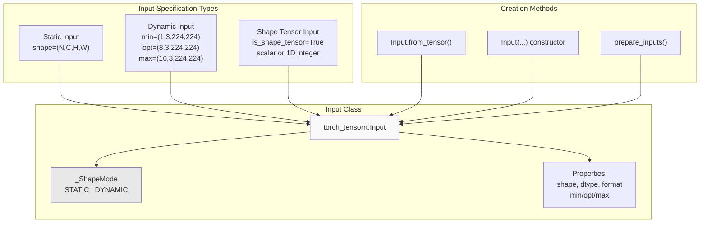
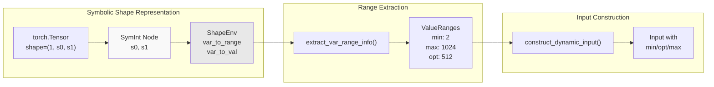
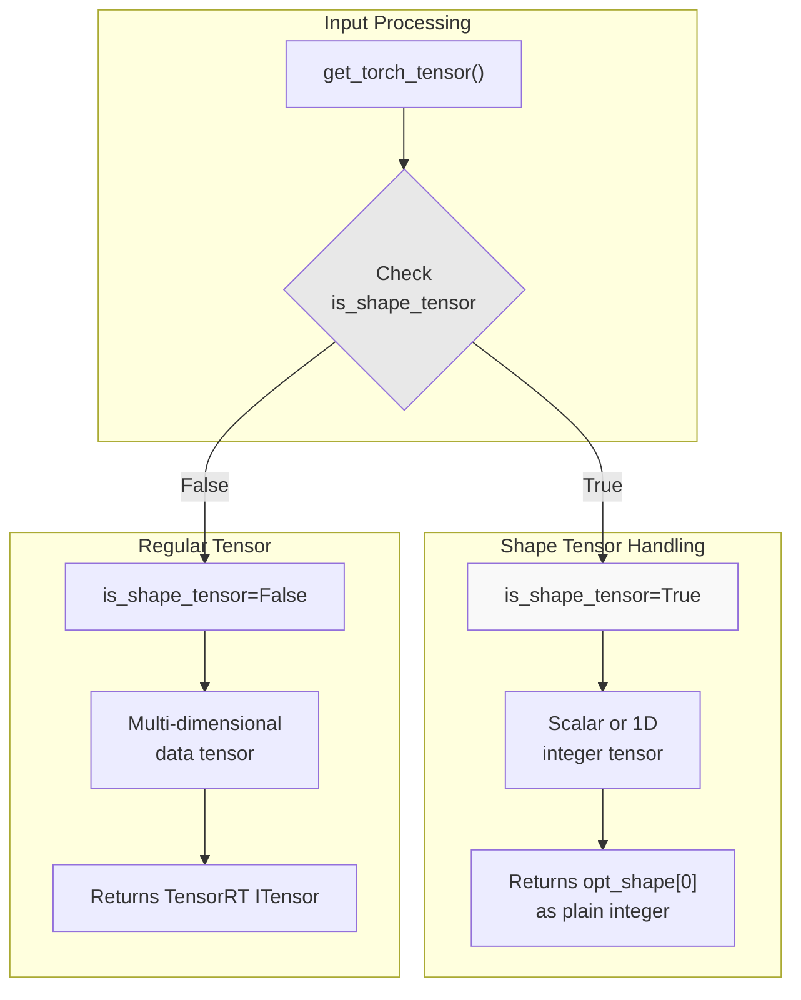
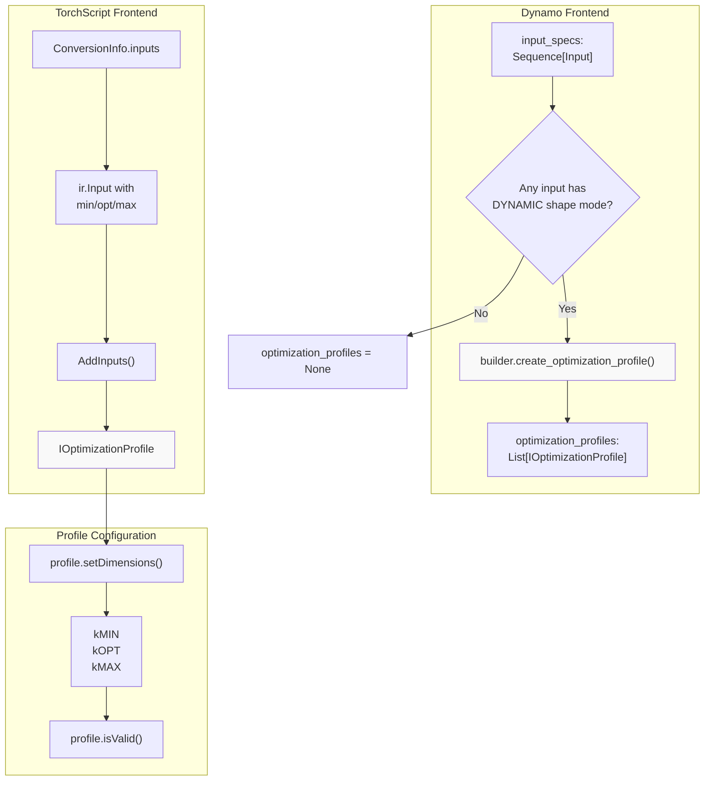
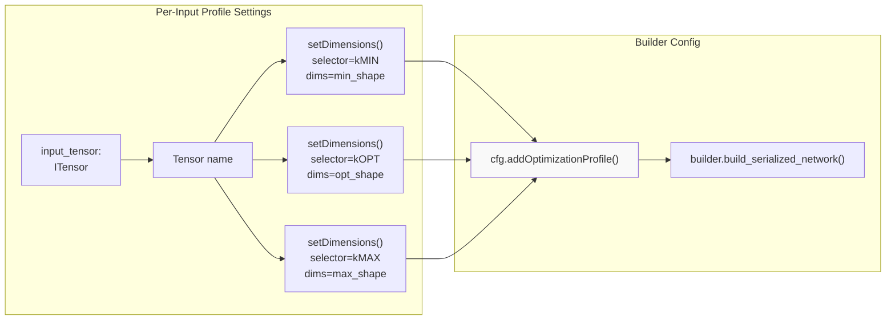
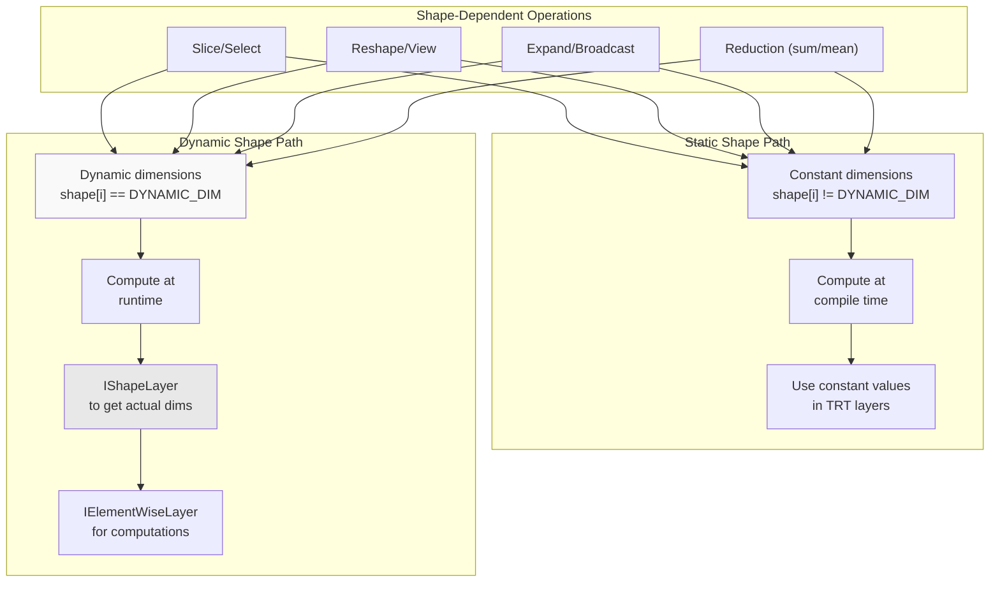
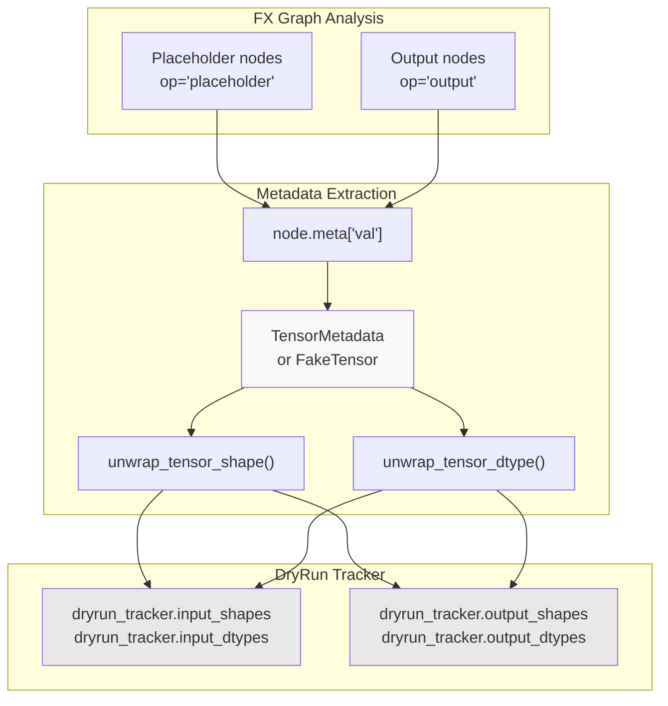
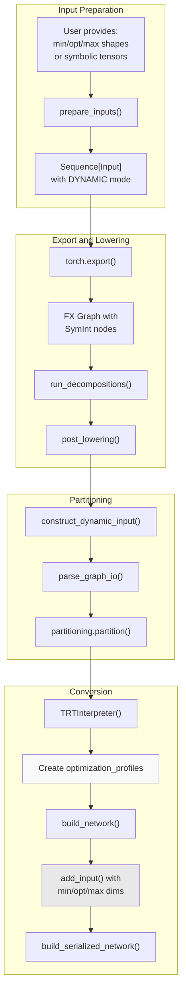
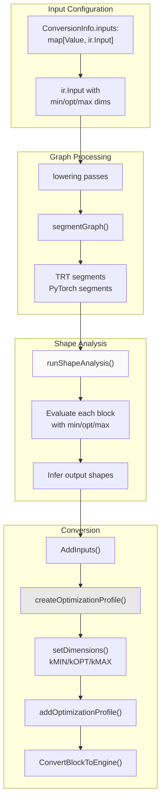

<!-- source: DeepWiki mcp.deepwiki.com · repo pytorch/TensorRT · page 2.5 Dynamic Shapes and Input Specifications · fetched 2026-10-21 -->

# Dynamic Shapes and Input Specifications

<details>
<summary>Relevant source files</summary>

The following files were used as context for generating this wiki page:

- [core/compiler.cpp](core/compiler.cpp)
- [core/partitioning/BUILD](core/partitioning/BUILD)
- [core/partitioning/partitioning.cpp](core/partitioning/partitioning.cpp)
- [core/partitioning/partitioning.h](core/partitioning/partitioning.h)
- [core/partitioning/partitioningctx/PartitioningCtx.cpp](core/partitioning/partitioningctx/PartitioningCtx.cpp)
- [core/partitioning/partitioningctx/PartitioningCtx.h](core/partitioning/partitioningctx/PartitioningCtx.h)
- [core/partitioning/segmentedblock/SegmentedBlock.cpp](core/partitioning/segmentedblock/SegmentedBlock.cpp)
- [core/partitioning/segmentedblock/SegmentedBlock.h](core/partitioning/segmentedblock/SegmentedBlock.h)
- [core/partitioning/shape_analysis.cpp](core/partitioning/shape_analysis.cpp)
- [core/partitioning/stitching.cpp](core/partitioning/stitching.cpp)
- [cpp/bin/torchtrtc/README.md](cpp/bin/torchtrtc/README.md)
- [cpp/bin/torchtrtc/main.cpp](cpp/bin/torchtrtc/main.cpp)
- [cpp/include/torch_tensorrt/torch_tensorrt.h](cpp/include/torch_tensorrt/torch_tensorrt.h)
- [cpp/src/compile_spec.cpp](cpp/src/compile_spec.cpp)
- [py/torch_tensorrt/_Input.py](py/torch_tensorrt/_Input.py)
- [py/torch_tensorrt/_compile.py](py/torch_tensorrt/_compile.py)
- [py/torch_tensorrt/csrc/register_tensorrt_classes.cpp](py/torch_tensorrt/csrc/register_tensorrt_classes.cpp)
- [py/torch_tensorrt/csrc/tensorrt_classes.cpp](py/torch_tensorrt/csrc/tensorrt_classes.cpp)
- [py/torch_tensorrt/csrc/tensorrt_classes.h](py/torch_tensorrt/csrc/tensorrt_classes.h)
- [py/torch_tensorrt/csrc/torch_tensorrt_py.cpp](py/torch_tensorrt/csrc/torch_tensorrt_py.cpp)
- [py/torch_tensorrt/dynamo/__init__.py](py/torch_tensorrt/dynamo/__init__.py)
- [py/torch_tensorrt/dynamo/_compiler.py](py/torch_tensorrt/dynamo/_compiler.py)
- [py/torch_tensorrt/dynamo/_defaults.py](py/torch_tensorrt/dynamo/_defaults.py)
- [py/torch_tensorrt/dynamo/_refit.py](py/torch_tensorrt/dynamo/_refit.py)
- [py/torch_tensorrt/dynamo/_settings.py](py/torch_tensorrt/dynamo/_settings.py)
- [py/torch_tensorrt/dynamo/conversion/_TRTInterpreter.py](py/torch_tensorrt/dynamo/conversion/_TRTInterpreter.py)
- [py/torch_tensorrt/dynamo/conversion/_conversion.py](py/torch_tensorrt/dynamo/conversion/_conversion.py)
- [py/torch_tensorrt/dynamo/lowering/passes/__init__.py](py/torch_tensorrt/dynamo/lowering/passes/__init__.py)
- [py/torch_tensorrt/dynamo/utils.py](py/torch_tensorrt/dynamo/utils.py)
- [py/torch_tensorrt/ts/_compile_spec.py](py/torch_tensorrt/ts/_compile_spec.py)
- [py/torch_tensorrt/ts/_compiler.py](py/torch_tensorrt/ts/_compiler.py)
- [tests/core/partitioning/test_conditionals.cpp](tests/core/partitioning/test_conditionals.cpp)
- [tests/core/partitioning/test_resolve_nontensor_inputs.cpp](tests/core/partitioning/test_resolve_nontensor_inputs.cpp)
- [tests/core/partitioning/test_segmentation.cpp](tests/core/partitioning/test_segmentation.cpp)
- [tests/core/partitioning/test_shape_analysis.cpp](tests/core/partitioning/test_shape_analysis.cpp)
- [tests/cpp/test_dynamic_fallback.cpp](tests/cpp/test_dynamic_fallback.cpp)
- [tests/py/dynamo/conversion/harness.py](tests/py/dynamo/conversion/harness.py)
- [tests/py/dynamo/models/test_export_kwargs_serde.py](tests/py/dynamo/models/test_export_kwargs_serde.py)
- [tests/py/dynamo/models/test_export_serde.py](tests/py/dynamo/models/test_export_serde.py)
- [tests/py/dynamo/models/test_model_refit.py](tests/py/dynamo/models/test_model_refit.py)
- [tests/py/dynamo/models/test_reexport.py](tests/py/dynamo/models/test_reexport.py)
- [tests/py/dynamo/runtime/test_002_lazy_engine_init.py](tests/py/dynamo/runtime/test_002_lazy_engine_init.py)

</details>


This page explains how Torch-TensorRT handles variable input dimensions through dynamic shape specifications and TensorRT optimization profiles. It covers the input specification system, symbolic shape representation, and the compilation flow for models with runtime-variable dimensions.

For information about input processing and type handling during conversion, see [Input Processing and Type Handling](#3.6).
For details on the TorchScript shape analysis system, see [Shape Analysis and Dynamic Shapes](#4.4).

---

## Input Specification System

Torch-TensorRT uses `torch_tensorrt.Input` objects to define tensor specifications including shape, dtype, and memory layout. These inputs can be either **static** (fixed shape) or **dynamic** (variable shape with bounds).

### Input Class Structure

The `Input` class supports three modes of shape specification:

| Attribute | Description | Usage |
|-----------|-------------|-------|
| `shape` | Static shape specification | Single fixed shape, e.g., `(1, 3, 224, 224)` |
| `min_shape`, `opt_shape`, `max_shape` | Dynamic shape bounds | Variable shapes within specified range |
| `is_shape_tensor` | Boolean flag | Indicates if input is a shape tensor (scalar/1D integer) |
| `dtype` | Data type | PyTorch dtype (torch.float32, torch.int64, etc.) |
| `format` | Memory layout | torch.contiguous_format or torch.channels_last |



Sources: [py/torch_tensorrt/dynamo/utils.py:300-351](), [py/torch_tensorrt/dynamo/partitioning/common.py:13-84]()

### Static vs Dynamic Inputs

**Static Inputs** have a fixed shape known at compile time. They result in a single TensorRT optimization profile:

```python
# Static input specification
input_spec = torch_tensorrt.Input(
    shape=(1, 3, 224, 224),
    dtype=torch.float32
)
```

**Dynamic Inputs** specify a range of possible shapes. The TensorRT engine is optimized for the `opt_shape` but can handle any shape between `min_shape` and `max_shape`:

```python
# Dynamic input specification
input_spec = torch_tensorrt.Input(
    min_shape=(1, 3, 224, 224),
    opt_shape=(8, 3, 512, 512),
    max_shape=(16, 3, 1024, 1024)
)
```

The `input_is_dynamic()` function determines if any inputs have dynamic shapes by checking either the `Input._ShapeMode.DYNAMIC` flag or the presence of `torch.SymInt` nodes in tensor shapes.

Sources: [py/torch_tensorrt/dynamo/utils.py:187-203](), [tests/py/dynamo/models/test_dyn_models.py:18-66]()

---

## Dynamic Shape Mechanisms

### Symbolic Shapes in PyTorch 2.x

PyTorch 2.x represents dynamic dimensions using **SymInt nodes** (symbolic integers). These are special objects that carry symbolic information about dimension constraints:



The `extract_var_range_info()` function extracts min/max/opt values from SymInt nodes by querying the shape environment:

- `shape_env.var_to_range` provides the lower and upper bounds
- `shape_env.var_to_val` provides the current/optimal value
- Special handling for torchdynamo 0/1 specialization (min_val adjusted from 2 to 1)

Sources: [py/torch_tensorrt/dynamo/utils.py:409-436](), [py/torch_tensorrt/dynamo/utils.py:439-465]()

### The DYNAMIC_DIM Constant

Throughout the codebase, the constant `DYNAMIC_DIM = -1` is used to mark dimensions that can vary at runtime. This constant appears in:

- `input.shape[i] == DYNAMIC_DIM` checks to identify dynamic dimensions
- TensorRT ITensor shape specifications where `-1` indicates a runtime dimension
- Shape inference logic that must handle symbolic dimensions

When a dimension is marked as `DYNAMIC_DIM`, the conversion system uses alternative logic:
- Shape operations query the actual shape via `get_shape()` layer
- Slice operations compute bounds dynamically
- Broadcast operations handle variable dimensions

Sources: [py/torch_tensorrt/dynamo/utils.py:46](), [py/torch_tensorrt/dynamo/conversion/impl/slice/ops.py:30-48]()

### Shape Tensors

**Shape tensors** are a special category of inputs that represent integer values used for shape computations (e.g., target sizes for reshape operations). They are typically scalars or 1D integer tensors:



The distinction is important because shape tensors are not processed as regular TensorRT network inputs but as scalar values used for layer configuration.

Sources: [py/torch_tensorrt/dynamo/utils.py:206-219](), [py/torch_tensorrt/dynamo/partitioning/common.py:46-84]()

---

## TensorRT Optimization Profiles

TensorRT optimization profiles define the valid input dimension ranges for dynamic shapes. Each profile specifies three dimension sets per input: minimum, optimum, and maximum.

### Profile Creation Flow



**Dynamo Path**: Profiles are created in `TRTInterpreter.__init__()` if any input has `shape_mode == Input._ShapeMode.DYNAMIC`. The profile is populated later during network construction.

**TorchScript Path**: Profiles are created in `AddInputs()` and immediately configured with dimension ranges from the `ConversionInfo.inputs` map.

Sources: [py/torch_tensorrt/dynamo/conversion/_TRTInterpreter.py:130-137](), [core/conversion/conversion.cpp:138-206]()

### Profile Population

For each dynamic input, the profile must specify all three dimension sets:



The dimensions must satisfy: `min_shape[i] <= opt_shape[i] <= max_shape[i]` for all dimensions. The profile is validated before building the engine with `profile.isValid()`.

**Key Properties**:
- TensorRT optimizes kernel selection for `opt_shape`
- Actual runtime shapes must fall within [min_shape, max_shape]
- Different profiles can be created for different input size ranges
- Profiles are part of the serialized engine

Sources: [core/conversion/conversion.cpp:186-205](), [py/torch_tensorrt/dynamo/conversion/_TRTInterpreter.py:341-395]()

---

## Shape Inference and Propagation

### Unwrapping Symbolic Shapes

The `unwrap_tensor_shape()` function converts symbolic tensor shapes into a representation that can be used for profile creation:

| Input Type | Output Format | Example |
|------------|---------------|---------|
| Static dimension | Integer | `224` |
| SymInt dimension | Tuple (min, max) | `(1, 16)` with mode="" |
| SymInt with mode | Integer value | `8` with mode="opt" |
| SymFloat | Integer 1 | `1` (treated as 1D) |

```python
# Example: tensor with shape (1, s0, 224) where s0 is symbolic
# Without mode: returns [1, (2, 16), 224]
# With mode="opt": returns [1, 8, 224]
```

This function is used throughout the partitioning system to:
1. Parse input shapes from FakeTensor metadata
2. Extract dimension bounds for profile creation
3. Display shape information in debug logs

Sources: [py/torch_tensorrt/dynamo/utils.py:439-465](), [py/torch_tensorrt/dynamo/utils.py:468-484]()

### Dynamic Shape in Conversion

During conversion, operations must handle both static and dynamic dimensions:



**Static Path Example**: For `slice(x, dim=1, start=0, stop=100)` with static shape `(8, 128, 256)`, the slice layer uses constant start/stop/stride values.

**Dynamic Path Example**: For the same slice with shape `(8, DYNAMIC_DIM, 256)`, the system:
1. Uses `get_shape()` to query `x.shape[1]` at runtime
2. Performs bounds checking dynamically
3. Creates slice layer with ITensor inputs for dynamic bounds

Sources: [py/torch_tensorrt/dynamo/conversion/impl/slice/ops.py:33-245](), [py/torch_tensorrt/dynamo/conversion/impl/shape.py:1-100]()

### Graph I/O Shape Parsing

The `parse_graph_io()` function analyzes FX graph inputs and outputs to extract shape and dtype information:



This information is used for:
- Creating Input specifications during partitioning
- Validating shape compatibility between graph segments
- Generating debug output about model I/O

Sources: [py/torch_tensorrt/dynamo/utils.py:508-527](), [py/torch_tensorrt/dynamo/utils.py:487-505]()

---

## Compilation Flow for Dynamic Shapes

### Dynamo Path with Dynamic Inputs

The Dynamo compilation path handles dynamic shapes through the following sequence:



**Key Steps**:

1. **Input Preparation** ([py/torch_tensorrt/dynamo/utils.py:300-351]()): Converts user-provided inputs (tensors with SymInt shapes or explicit Input objects) into `Input` specifications with proper shape modes.

2. **Export** ([py/torch_tensorrt/dynamo/_compiler.py:365-374]()): `torch.export()` captures the model as an ExportedProgram with symbolic shapes preserved in the FX graph metadata.

3. **Decomposition** ([py/torch_tensorrt/dynamo/_compiler.py:366-368]()): Graph decomposition passes must handle SymInt nodes correctly, using shape-agnostic implementations.

4. **Partitioning** ([py/torch_tensorrt/dynamo/partitioning/common.py:13-84]()): For each subgraph input, `construct_dynamic_input()` extracts min/max/opt from SymInt nodes and creates Input objects.

5. **Interpreter Setup** ([py/torch_tensorrt/dynamo/conversion/_TRTInterpreter.py:81-137]()): `TRTInterpreter.__init__()` checks if any `input_spec.shape_mode == Input._ShapeMode.DYNAMIC` and creates optimization profiles accordingly.

6. **Network Building** ([py/torch_tensorrt/dynamo/conversion/_TRTInterpreter.py:341-395]()): When adding inputs to the TensorRT network, the profile is populated with min/opt/max dimensions using `profile.setDimensions()`.

7. **Conversion** ([py/torch_tensorrt/dynamo/conversion/converter_utils.py:1-1000]()): Individual converters check for `DYNAMIC_DIM` and use shape layers when necessary.

Sources: [py/torch_tensorrt/dynamo/_compiler.py:397-494](), [py/torch_tensorrt/dynamo/conversion/_TRTInterpreter.py:81-160]()

### TorchScript Path with Dynamic Inputs

The TorchScript path handles dynamic shapes differently, using its shape analysis system:



**Key Differences**:

1. **Input Specification** ([core/ir/ir.h:1-200]()): Users provide `ir::Input` objects directly with min/opt/max fields populated.

2. **Shape Analysis** ([core/partitioning/shape_analysis.cpp:1-500]()): The `runShapeAnalysis()` function evaluates each segment multiple times with different input shapes to infer output shapes.

3. **Profile Creation** ([core/conversion/conversion.cpp:138-206]()): Profiles are created and populated immediately in `AddInputs()`, not deferred to network building.

4. **Type Casting** ([core/partitioning/partitioning.cpp:1-1000]()): The partitioning system inserts explicit casts for kLong→kInt and kByte→kInt conversions to handle TensorRT type constraints.

Sources: [core/conversion/conversion.cpp:138-206](), [core/conversion/conversionctx/ConversionCtx.cpp:1-197]()

---

## Configuration Settings

The following compilation settings affect dynamic shape handling:

| Setting | Type | Purpose |
|---------|------|---------|
| `assume_dynamic_shape_support` | bool | Enable converters to work with both static and dynamic shapes |
| `workspace_size` | int | Additional memory for dynamic shape engines (may need more workspace) |
| `optimization_level` | int | Higher levels spend more time optimizing for dynamic shapes |
| `num_avg_timing_iters` | int | Timing iterations for kernel selection with variable shapes |

The `assume_dynamic_shape_support` flag is particularly important as it enables shape-agnostic converter implementations that query shapes at runtime rather than assuming compile-time constants.

Sources: [py/torch_tensorrt/dynamo/_settings.py:59-210](), [py/torch_tensorrt/dynamo/_defaults.py:1-86]()

---

