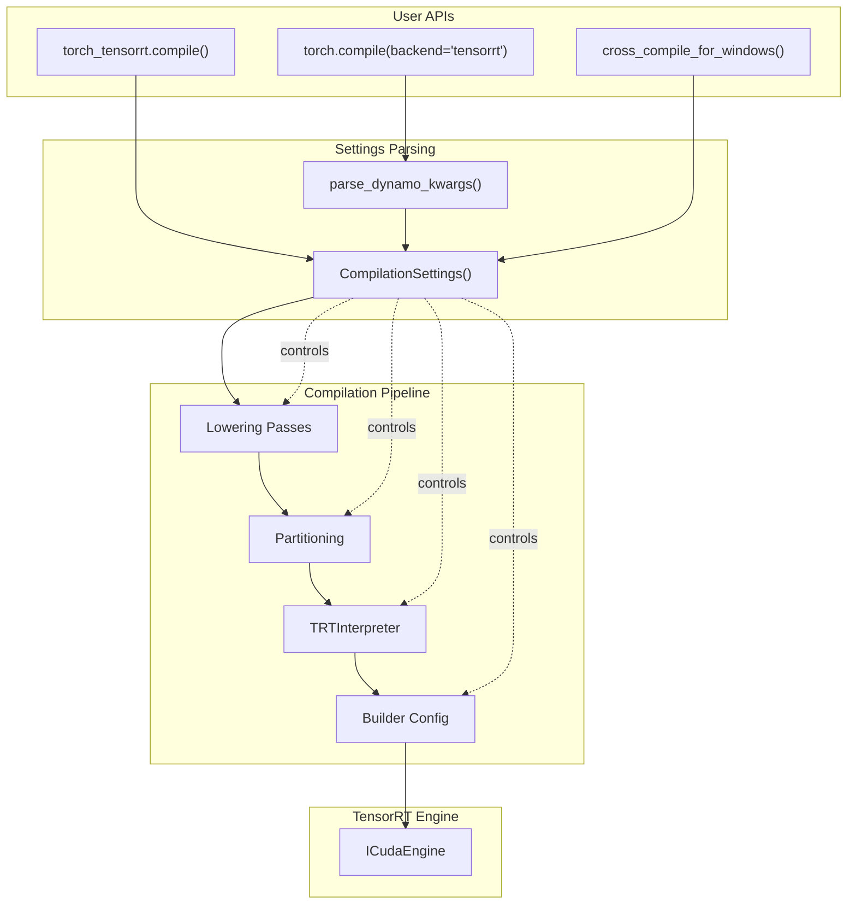
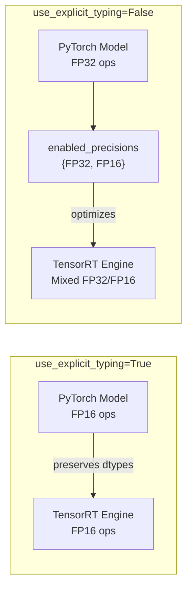
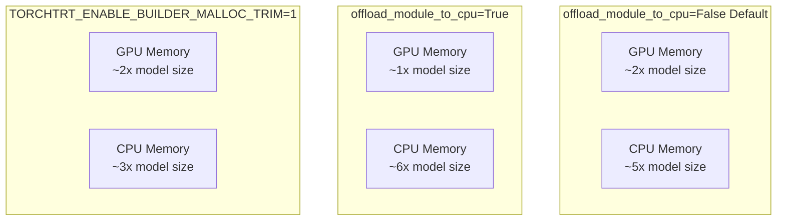
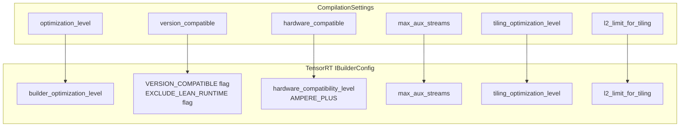
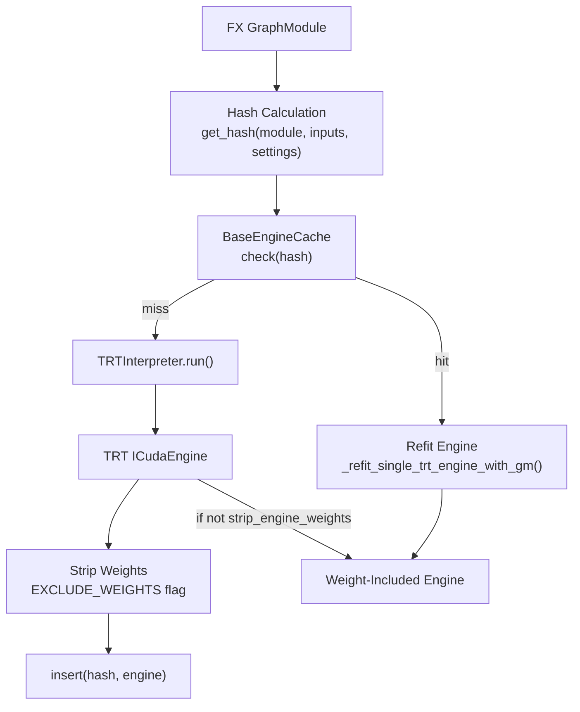
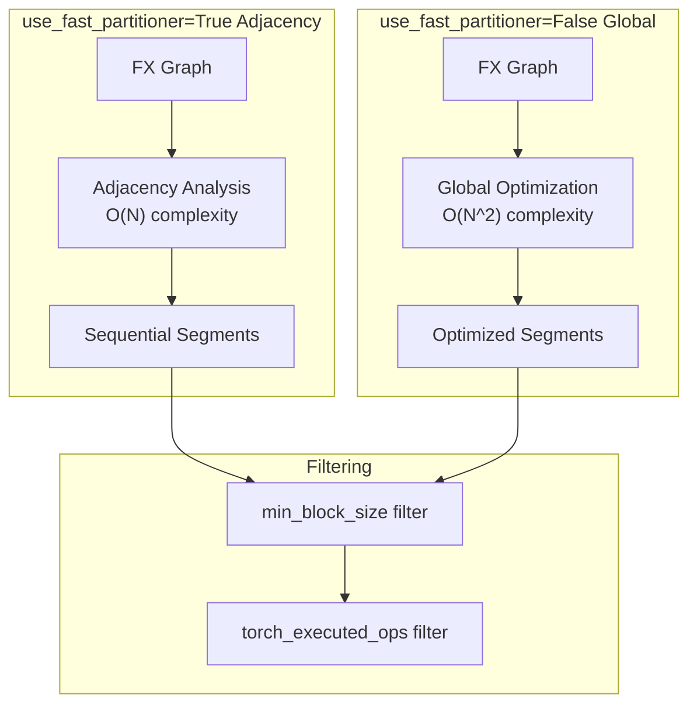
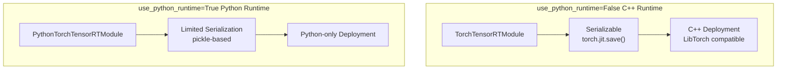
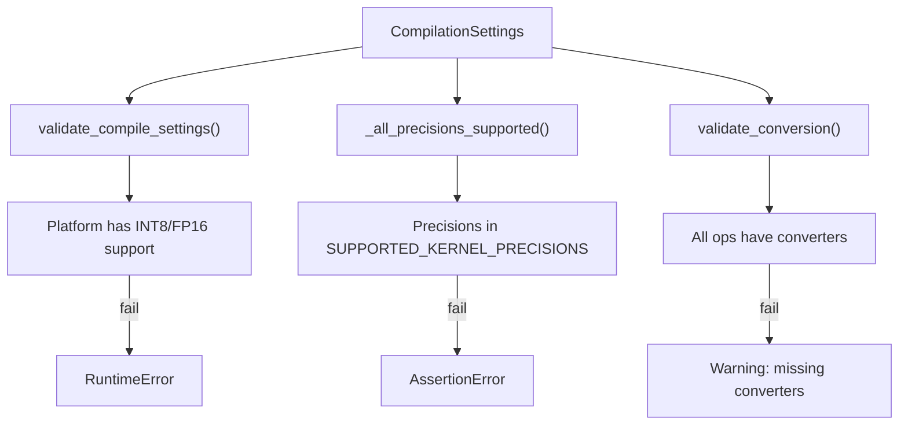

<!-- source: DeepWiki mcp.deepwiki.com · repo pytorch/TensorRT · page 2.6 Compilation Settings and Configuration · fetched 2026-10-21 -->

# Compilation Settings and Configuration

<details>
<summary>Relevant source files</summary>

The following files were used as context for generating this wiki page:

- [cpp/bin/torchtrtc/README.md](cpp/bin/torchtrtc/README.md)
- [cpp/bin/torchtrtc/main.cpp](cpp/bin/torchtrtc/main.cpp)
- [cpp/include/torch_tensorrt/torch_tensorrt.h](cpp/include/torch_tensorrt/torch_tensorrt.h)
- [cpp/src/compile_spec.cpp](cpp/src/compile_spec.cpp)
- [py/torch_tensorrt/_Input.py](py/torch_tensorrt/_Input.py)
- [py/torch_tensorrt/_compile.py](py/torch_tensorrt/_compile.py)
- [py/torch_tensorrt/csrc/register_tensorrt_classes.cpp](py/torch_tensorrt/csrc/register_tensorrt_classes.cpp)
- [py/torch_tensorrt/csrc/tensorrt_classes.cpp](py/torch_tensorrt/csrc/tensorrt_classes.cpp)
- [py/torch_tensorrt/csrc/tensorrt_classes.h](py/torch_tensorrt/csrc/tensorrt_classes.h)
- [py/torch_tensorrt/csrc/torch_tensorrt_py.cpp](py/torch_tensorrt/csrc/torch_tensorrt_py.cpp)
- [py/torch_tensorrt/dynamo/__init__.py](py/torch_tensorrt/dynamo/__init__.py)
- [py/torch_tensorrt/dynamo/_compiler.py](py/torch_tensorrt/dynamo/_compiler.py)
- [py/torch_tensorrt/dynamo/_defaults.py](py/torch_tensorrt/dynamo/_defaults.py)
- [py/torch_tensorrt/dynamo/_refit.py](py/torch_tensorrt/dynamo/_refit.py)
- [py/torch_tensorrt/dynamo/_settings.py](py/torch_tensorrt/dynamo/_settings.py)
- [py/torch_tensorrt/dynamo/conversion/_TRTInterpreter.py](py/torch_tensorrt/dynamo/conversion/_TRTInterpreter.py)
- [py/torch_tensorrt/dynamo/conversion/_conversion.py](py/torch_tensorrt/dynamo/conversion/_conversion.py)
- [py/torch_tensorrt/dynamo/lowering/passes/__init__.py](py/torch_tensorrt/dynamo/lowering/passes/__init__.py)
- [py/torch_tensorrt/dynamo/utils.py](py/torch_tensorrt/dynamo/utils.py)
- [py/torch_tensorrt/ts/_compile_spec.py](py/torch_tensorrt/ts/_compile_spec.py)
- [py/torch_tensorrt/ts/_compiler.py](py/torch_tensorrt/ts/_compiler.py)
- [tests/py/dynamo/conversion/harness.py](tests/py/dynamo/conversion/harness.py)
- [tests/py/dynamo/models/test_export_kwargs_serde.py](tests/py/dynamo/models/test_export_kwargs_serde.py)
- [tests/py/dynamo/models/test_export_serde.py](tests/py/dynamo/models/test_export_serde.py)
- [tests/py/dynamo/models/test_model_refit.py](tests/py/dynamo/models/test_model_refit.py)
- [tests/py/dynamo/models/test_reexport.py](tests/py/dynamo/models/test_reexport.py)
- [tests/py/dynamo/runtime/test_002_lazy_engine_init.py](tests/py/dynamo/runtime/test_002_lazy_engine_init.py)

</details>


This page provides a comprehensive reference for configuring Torch-TensorRT compilation through the `CompilationSettings` class. These settings control precision modes, memory allocation, engine building strategies, caching behavior, partitioning policies, and advanced optimization features.

For precision mode details (FP16, INT8, etc.), see [2.4](#2.4). For dynamic shape configuration, see [2.5](#2.5). For debugging and profiling settings, see [2.7](#2.7).

## Overview of CompilationSettings

The `CompilationSettings` dataclass consolidates all compilation configuration options into a single object that flows through the compilation pipeline from user API calls to TensorRT engine building.



**Sources:** [py/torch_tensorrt/dynamo/_settings.py:59-175](), [py/torch_tensorrt/dynamo/_compiler.py:397-551](), [py/torch_tensorrt/dynamo/utils.py:558-660]()

## Settings Categories

### Precision and Performance Settings

These settings control numerical precision, type handling, and compute performance characteristics.

| Setting | Type | Default | Description |
|---------|------|---------|-------------|
| `enabled_precisions` | `Set[dtype]` | `{dtype.f32}` | Kernel precision modes TensorRT can use |
| `use_explicit_typing` | `bool` | `True` | Enable strong typing respecting PyTorch model precisions |
| `disable_tf32` | `bool` | `False` | Disable TF32 tensor cores for FP32 operations |
| `sparse_weights` | `bool` | `False` | Enable sparsity for convolution and fully-connected layers |
| `use_fp32_acc` | `bool` | `False` | Force FP32 accumulation for matmul in FP16 mode |
| `truncate_double` | `bool` | `False` | Truncate float64 weights/inputs to float32 |

#### Strong Typing vs. Precision Sets

When `use_explicit_typing=True`, TensorRT respects the exact dtypes in the PyTorch model graph. When `False`, TensorRT selects kernels from `enabled_precisions` to optimize performance, potentially converting operations to lower precision.



**Sources:** [py/torch_tensorrt/dynamo/_settings.py:119-150](), [py/torch_tensorrt/dynamo/conversion/_TRTInterpreter.py:298-309](), [py/torch_tensorrt/dynamo/_compiler.py:259-277]()

### Memory Management

Memory settings control CPU and GPU allocation during compilation and runtime.

| Setting | Type | Default | Description |
|---------|------|---------|-------------|
| `workspace_size` | `int` | `0` | TensorRT workspace size in bytes (0=unlimited) |
| `dla_sram_size` | `int` | `1048576` | DLA SRAM size (1MB) |
| `dla_local_dram_size` | `int` | `1073741824` | DLA local DRAM size (1GB) |
| `dla_global_dram_size` | `int` | `536870912` | DLA global DRAM size (512MB) |
| `offload_module_to_cpu` | `bool` | `False` | Move model to CPU to free GPU memory for TensorRT |
| `enable_resource_partitioning` | `bool` | `False` | Enable CPU memory-aware partitioning |
| `cpu_memory_budget` | `Optional[int]` | `None` | Maximum CPU memory for compilation (bytes) |

#### Memory Usage Patterns



The `workspace_size` parameter is passed to `IBuilderConfig.set_memory_pool_limit()` for `WORKSPACE` pool. DLA memory pools are configured similarly for DLA execution.

**Sources:** [py/torch_tensorrt/dynamo/_settings.py:120-142](), [py/torch_tensorrt/dynamo/conversion/_TRTInterpreter.py:232-296](), [docsrc/contributors/resource_management.rst:1-78]()

### Engine Building Options

These settings control TensorRT's engine building process and output characteristics.

| Setting | Type | Default | Description |
|---------|------|---------|-------------|
| `engine_capability` | `EngineCapability` | `STANDARD` | Target device type (STANDARD, SAFETY, DLA_STANDALONE) |
| `optimization_level` | `Optional[int]` | `None` | Build optimization level 0-5 (higher=slower build, faster runtime) |
| `version_compatible` | `bool` | `False` | Build forward-compatible engines |
| `hardware_compatible` | `bool` | `False` | Build cross-GPU-architecture engines (Ampere+) |
| `num_avg_timing_iters` | `int` | `1` | Kernel timing iterations for selection |
| `max_aux_streams` | `Optional[int]` | `None` | Maximum auxiliary CUDA streams |
| `tiling_optimization_level` | `str` | `"none"` | Tiling strategy: "none", "fast", "moderate", "full" |
| `l2_limit_for_tiling` | `int` | `-1` | L2 cache limit for tiling optimization (-1=unlimited) |

#### Builder Configuration Mapping



The `_populate_trt_builder_config()` method in `TRTInterpreter` translates these settings to TensorRT builder flags and configuration parameters.

**Sources:** [py/torch_tensorrt/dynamo/_settings.py:136-157](), [py/torch_tensorrt/dynamo/conversion/_TRTInterpreter.py:221-377]()

### Caching and Refitting

Engine caching reuses compiled engines across runs, and refitting updates weights without rebuilding.

| Setting | Type | Default | Description |
|---------|------|---------|-------------|
| `cache_built_engines` | `bool` | `False` | Save compiled engines to storage |
| `reuse_cached_engines` | `bool` | `False` | Load engines from cache if available |
| `timing_cache_path` | `str` | `/tmp/.../timing_cache.bin` | Path for TensorRT timing cache |
| `immutable_weights` | `bool` | `True` | Build non-refittable engines |
| `refit_identical_engine_weights` | `bool` | `False` | Enable refitting with identical weight structure |
| `strip_engine_weights` | `bool` | `False` | Strip weights from serialized engine |
| `lazy_engine_init` | `bool` | `False` | Defer engine initialization until all engines built |

#### Engine Caching Flow



Weight-stripped engines are cached using `SerializationFlag.EXCLUDE_WEIGHTS`, then refitted with new weights when reused. This requires `ENABLED_FEATURES.refit` and `immutable_weights=False`.

**Sources:** [py/torch_tensorrt/dynamo/_settings.py:145-153](), [py/torch_tensorrt/dynamo/conversion/_conversion.py:50-186](), [py/torch_tensorrt/dynamo/conversion/_TRTInterpreter.py:317-331]()

### Partitioning and Fallback

Partitioning settings control how graphs are segmented between TensorRT and PyTorch execution.

| Setting | Type | Default | Description |
|---------|------|---------|-------------|
| `min_block_size` | `int` | `5` | Minimum contiguous TensorRT ops for a segment |
| `torch_executed_ops` | `Collection[Target]` | `set()` | Operations forced to run in PyTorch |
| `pass_through_build_failures` | `bool` | `False` | Continue on TensorRT build errors (torch.compile only) |
| `use_fast_partitioner` | `bool` | `True` | Use adjacency partitioner vs. global partitioner |
| `require_full_compilation` | `bool` | `False` | Error if any ops remain in PyTorch (dynamo only) |

#### Partitioning Strategies



The adjacency partitioner runs faster but may produce suboptimal segmentation. The global partitioner finds better boundaries at higher computational cost.

**Sources:** [py/torch_tensorrt/dynamo/_settings.py:121-132](), [py/torch_tensorrt/dynamo/partitioning/_global_partitioner.py](), [py/torch_tensorrt/dynamo/_compiler.py:418-419]()

### Advanced Features

| Setting | Type | Default | Description |
|---------|------|---------|-------------|
| `enable_experimental_decompositions` | `bool` | `False` | Use full decomposition set vs. core set |
| `assume_dynamic_shape_support` | `bool` | `False` | Enable converters for both static and dynamic shapes |
| `dryrun` | `Union[bool, str]` | `False` | Run partitioning only, log analysis (optionally to file) |
| `enable_cross_compile_for_windows` | `bool` | `False` | Build Windows-compatible engines on Linux |
| `enable_weight_streaming` | `bool` | `False` | Enable weight streaming feature |
| `use_distributed_mode_trace` | `bool` | `False` | Use AOT autograd for distributed tensor tracing |

#### Cross-Compilation Configuration

When `enable_cross_compile_for_windows=True`:


This disables certain runtime features (Python runtime, lazy init, engine caching) that aren't supported in cross-compilation mode.

**Sources:** [py/torch_tensorrt/dynamo/_settings.py:130-159](), [py/torch_tensorrt/dynamo/_compiler.py:60-394](), [py/torch_tensorrt/dynamo/conversion/_TRTInterpreter.py:348-352]()

### Autocast Settings

Autocast automatically reduces precision in selected operations while maintaining FP32 in precision-sensitive regions.

| Setting | Type | Default | Description |
|---------|------|---------|-------------|
| `enable_autocast` | `bool` | `False` | Enable autocast pass |
| `autocast_low_precision_type` | `Optional[dtype]` | `None` | Target precision (FP16 or BF16) |
| `autocast_excluded_nodes` | `Collection[str]` | `set()` | Regex patterns for node names to keep in FP32 |
| `autocast_excluded_ops` | `Collection[Target]` | `set()` | ATen ops to keep in FP32 |
| `autocast_max_output_threshold` | `float` | `512` | Max output value before keeping FP32 |
| `autocast_max_depth_of_reduction` | `Optional[int]` | `None` | Max reduction depth in low precision |
| `autocast_calibration_dataloader` | `Optional[DataLoader]` | `None` | Dataloader for calibration |

When `enable_autocast=True`, `use_explicit_typing` is automatically set to `True`.

**Sources:** [py/torch_tensorrt/dynamo/_settings.py:160-172](), [py/torch_tensorrt/dynamo/_compiler.py:447-460]()

### Runtime and Device Settings

| Setting | Type | Default | Description |
|---------|------|---------|-------------|
| `device` | `Device` | `default_device()` | Target GPU/DLA device |
| `use_python_runtime` | `Optional[bool]` | `False` | Use Python vs. C++ runtime (None=auto-detect) |

The runtime choice affects serialization and deployment:



**Sources:** [py/torch_tensorrt/dynamo/_settings.py:127-131](), [py/torch_tensorrt/dynamo/utils.py:142-170]()

## Settings Interaction and Constraints

### Conflicting Settings

Certain setting combinations are incompatible:

| Primary Setting | Conflict | Constraint |
|----------------|----------|------------|
| `immutable_weights=True` | `refit_identical_engine_weights=True` | Immutable engines cannot be refitted |
| `immutable_weights=True` | `strip_engine_weights=True` | Ignored; immutable engines must include weights |
| `use_explicit_typing=False` | `enabled_precisions` | Explicit typing ignores precision set |
| `enable_weight_streaming=True` | `use_explicit_typing=False` | Weight streaming requires explicit typing |
| `refit_identical_engine_weights=True` | `cache_built_engines=False` | Refitting requires cacheable engines |

**Sources:** [py/torch_tensorrt/dynamo/_compiler.py:245-250](), [py/torch_tensorrt/dynamo/_compiler.py:274-277](), [py/torch_tensorrt/dynamo/conversion/_TRTInterpreter.py:317-328]()

### Settings Validation

The `TRTInterpreter` validates settings during initialization:



**Sources:** [py/torch_tensorrt/dynamo/conversion/_TRTInterpreter.py:119-175](), [py/torch_tensorrt/dynamo/conversion/_TRTInterpreter.py:200-220]()

## Settings Persistence and Serialization

### Engine-Invariant Settings

Settings marked as engine-invariant must match when reusing cached engines:

```python
_SETTINGS_TO_BE_ENGINE_INVARIANT = (
    "enabled_precisions",
    "max_aux_streams",
    "version_compatible",
    "optimization_level",
    "disable_tf32",
    "sparse_weights",
    "engine_capability",
    "hardware_compatible",
    "refit_identical_engine_weights",
    "immutable_weights",
    "enable_weight_streaming",
    "tiling_optimization_level",
    "l2_limit_for_tiling",
    "enable_autocast",
    "autocast_low_precision_type",
    "autocast_excluded_nodes",
    "autocast_excluded_ops",
    "autocast_max_output_threshold",
    "autocast_max_depth_of_reduction",
    "autocast_calibration_dataloader",
)
```

The `settings_are_compatible()` function compares these fields to determine if a cached engine can be reused.

**Sources:** [py/torch_tensorrt/dynamo/_settings.py:192-230]()

### Serialization Support

`CompilationSettings` implements `__getstate__` and `__setstate__` for pickling, with special handling for `torch_executed_ops` to convert operation targets to strings.

**Sources:** [py/torch_tensorrt/dynamo/_settings.py:176-190]()

## Configuration Examples

### High-Performance FP16 Compilation

```python
settings = CompilationSettings(
    enabled_precisions={torch.float16},
    use_explicit_typing=False,
    disable_tf32=True,
    optimization_level=5,
    workspace_size=8 * 1024**3,  # 8GB
    use_fp32_acc=True,
    sparse_weights=True,
)
```

### Memory-Constrained Compilation

```python
settings = CompilationSettings(
    offload_module_to_cpu=True,
    workspace_size=1 * 1024**3,  # 1GB
    enable_resource_partitioning=True,
    cpu_memory_budget=16 * 1024**3,  # 16GB
)
```

### Production Deployment Configuration

```python
settings = CompilationSettings(
    version_compatible=True,
    hardware_compatible=True,
    optimization_level=5,
    cache_built_engines=True,
    timing_cache_path="/persistent/cache/timing.bin",
    immutable_weights=False,
    strip_engine_weights=True,
)
```

### Debug and Development Configuration

```python
settings = CompilationSettings(
    dryrun="/tmp/partitioning_analysis.log",
    min_block_size=1,
    pass_through_build_failures=True,
    torch_executed_ops={torch.ops.aten.matmul},
)
```

**Sources:** [tests/py/dynamo/models/test_models.py:34-47](), [tests/py/dynamo/conversion/harness.py:191-263]()

---

