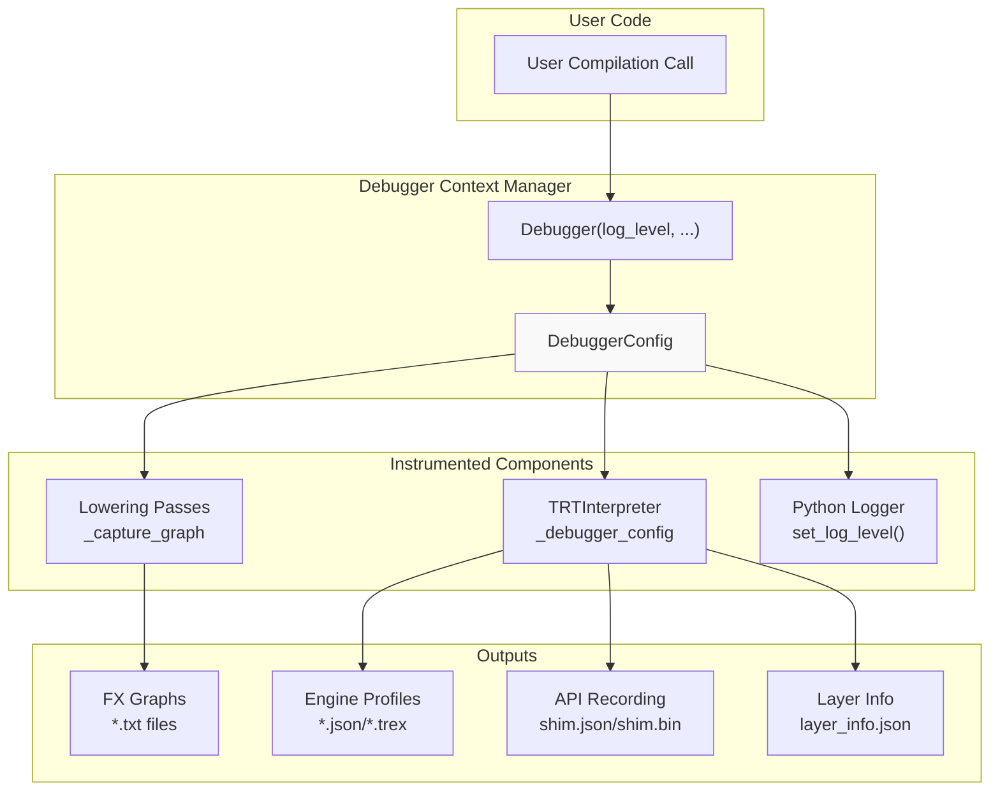
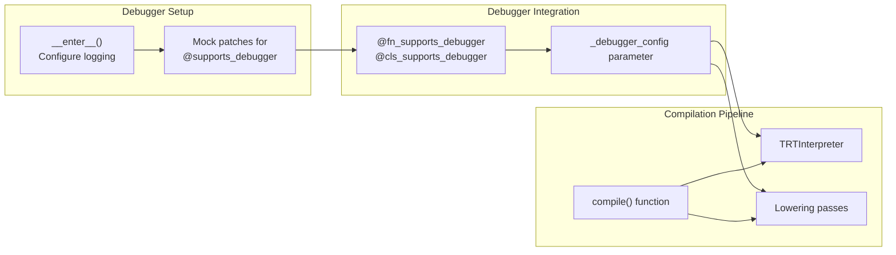
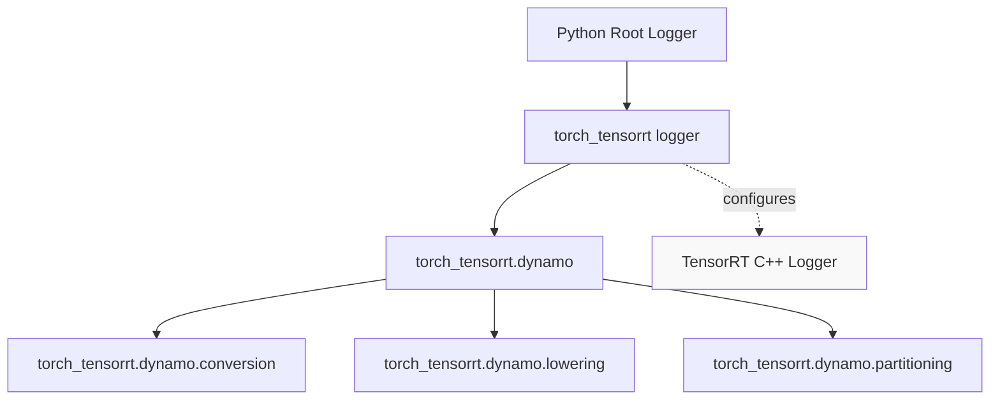
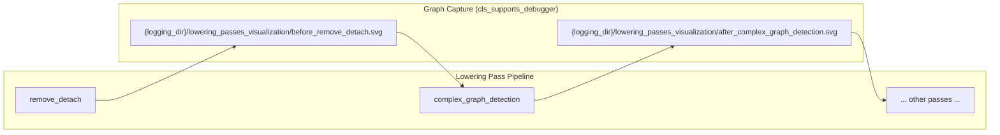
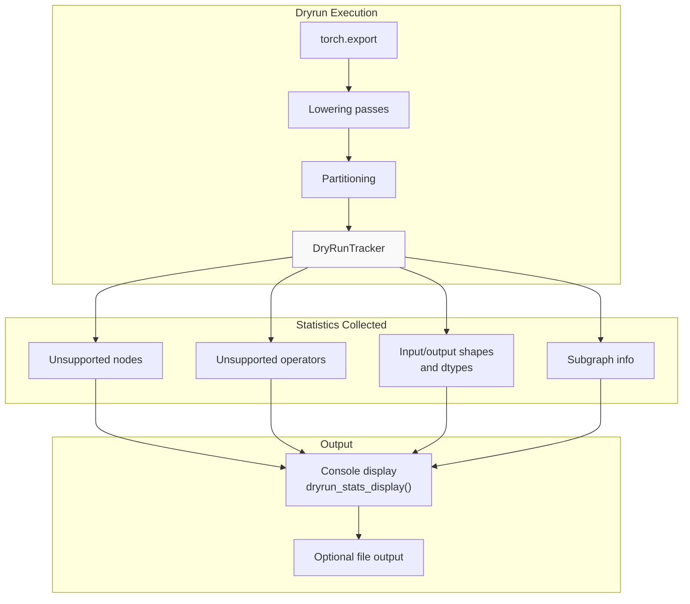
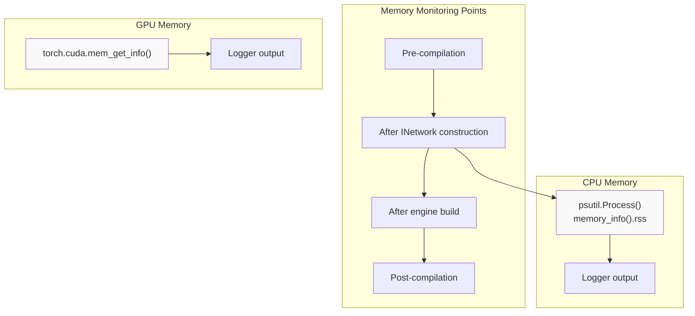

<!-- source: DeepWiki mcp.deepwiki.com · repo pytorch/TensorRT · page 2.7 Debugging and Profiling · fetched 2026-10-21 -->

# Debugging and Profiling

<details>
<summary>Relevant source files</summary>

The following files were used as context for generating this wiki page:

- [.gitignore](.gitignore)
- [core/runtime/DeviceList.cpp](core/runtime/DeviceList.cpp)
- [core/runtime/TRTEngine.cpp](core/runtime/TRTEngine.cpp)
- [core/runtime/TRTEngine.h](core/runtime/TRTEngine.h)
- [core/runtime/execute_engine.cpp](core/runtime/execute_engine.cpp)
- [core/runtime/register_jit_hooks.cpp](core/runtime/register_jit_hooks.cpp)
- [core/runtime/runtime.cpp](core/runtime/runtime.cpp)
- [core/runtime/runtime.h](core/runtime/runtime.h)
- [docsrc/conf.py](docsrc/conf.py)
- [docsrc/index.rst](docsrc/index.rst)
- [docsrc/requirements.txt](docsrc/requirements.txt)
- [docsrc/user_guide/runtime.rst](docsrc/user_guide/runtime.rst)
- [examples/dynamo/README.rst](examples/dynamo/README.rst)
- [examples/dynamo/compile_with_dynamic_inputs.py](examples/dynamo/compile_with_dynamic_inputs.py)
- [examples/dynamo/custom_kernel_plugins.py](examples/dynamo/custom_kernel_plugins.py)
- [examples/dynamo/debugger_example.py](examples/dynamo/debugger_example.py)
- [examples/dynamo/dynamic_memory_allocation.py](examples/dynamo/dynamic_memory_allocation.py)
- [examples/dynamo/low_cpu_memory_compilation.py](examples/dynamo/low_cpu_memory_compilation.py)
- [examples/dynamo/refit_engine_example.py](examples/dynamo/refit_engine_example.py)
- [py/torch_tensorrt/dynamo/runtime/_PythonTorchTensorRTModule.py](py/torch_tensorrt/dynamo/runtime/_PythonTorchTensorRTModule.py)
- [py/torch_tensorrt/dynamo/runtime/_TorchTensorRTModule.py](py/torch_tensorrt/dynamo/runtime/_TorchTensorRTModule.py)
- [py/torch_tensorrt/dynamo/runtime/__init__.py](py/torch_tensorrt/dynamo/runtime/__init__.py)
- [py/torch_tensorrt/runtime/__init__.py](py/torch_tensorrt/runtime/__init__.py)

</details>


This page documents the debugging and profiling tools available in Torch-TensorRT for troubleshooting compilation issues, analyzing performance, and understanding graph transformations. These tools help diagnose converter failures, optimize TensorRT engine builds, and reproduce compilation problems.

For information about compilation settings and configuration, see [2.6](#2.6). For details on the compilation pipeline and graph lowering, see [3.1](#3.1) and [3.3](#3.3).

## Overview of Debugging Capabilities

Torch-TensorRT provides several debugging and profiling mechanisms:

| Feature | Purpose | Output Location |
|---------|---------|----------------|
| **`Debugger` context manager** | Unified interface for all debugging features | User-specified `logging_dir` |
| **Logging Levels** | Control verbosity of compilation output | `{logging_dir}/torch_tensorrt_logging.log` |
| **FX Graph Capture** | Visualize graph transformations at each lowering pass | `{logging_dir}/lowering_passes_visualization/*.svg` |
| **Engine Build Monitor** | Display TensorRT build progress | Console |
| **Engine Profiling** | Analyze TensorRT layer-by-layer execution time | System temp dir (`profile_path_prefix`) |
| **Layer Info Dump** | Inspect TensorRT network layer details | `{engine_name}_layer_information.json` |
| **API Capture/Replay** | Record and reproduce TensorRT API calls | `/tmp/torch_tensorrt_{user}/shim/` |
| **Dryrun Mode** | Simulate compilation without building engines | Console |
| **Memory Monitoring** | Track CPU/GPU memory usage | Console |

Sources: [py/torch_tensorrt/dynamo/debug/_DebuggerConfig.py:6-14](), [examples/dynamo/debugger_example.py:42-74](), [core/runtime/TRTEngine.h:209-216]()

## Debugger Class

### Architecture and Configuration



**Debugger Context Manager Usage**

The `Debugger` class is used as a context manager to wrap compilation calls. All debugging features are configured at context entry and torn down at exit:

```python
with torch_tensorrt.dynamo.Debugger(
    log_level="debug",
    logging_dir="/path/to/debug",
    engine_builder_monitor=False,
    capture_fx_graph_after=["complex_graph_detection"],
    capture_fx_graph_before=["remove_detach"],
):
    compiled_model = torch_tensorrt.dynamo.compile(model, ...)
    output = compiled_model(*inputs)
```

The output directory structure produced:

```
/path/to/debug/
    torch_tensorrt_logging.log
    lowering_passes_visualization/
        after_complex_graph_detection.svg
        before_remove_detach.svg
```

Sources: [examples/dynamo/debugger_example.py:42-74](), [py/torch_tensorrt/dynamo/debug/_DebuggerConfig.py:6-14]()

### Configuration Options

The `DebuggerConfig` dataclass (located at [py/torch_tensorrt/dynamo/debug/_DebuggerConfig.py:6-14]()) holds all debugging settings. These fields are exposed as keyword arguments to `Debugger(...)`:

| Parameter | Type | Default | Description |
|-----------|------|---------|-------------|
| `log_level` | str | `"debug"` | Logging verbosity: `"debug"`, `"info"`, `"warning"`, `"error"`, `"internal_errors"`, `"graphs"` |
| `capture_fx_graph_before` | List[str] | `[]` | Pass names to capture FX graph SVG before that pass runs |
| `capture_fx_graph_after` | List[str] | `[]` | Pass names to capture FX graph SVG after that pass runs |
| `save_engine_profile` | bool | `False` | Enable per-layer TensorRT execution profiling via `profiling_enabled` in `PythonTorchTensorRTModule` |
| `capture_tensorrt_api_recording` | bool | `False` | Enable TensorRT API capture for replay debugging |
| `profile_format` | str | `"perfetto"` | Profiling output format: `"perfetto"` or `"trex"` |
| `engine_builder_monitor` | bool | `True` | Display `TRTBulderMonitor` progress during engine build |
| `logging_dir` | str | `/tmp/torch_tensorrt_{user}/debug_logs` | Root directory for all debug file outputs |
| `save_layer_info` | bool | `False` | Save TensorRT layer information JSON from engine inspector |

Sources: [py/torch_tensorrt/dynamo/debug/_DebuggerConfig.py:6-14](), [py/torch_tensorrt/dynamo/runtime/_PythonTorchTensorRTModule.py:204-208]()

### Implementation Mechanism



The debugger uses decorator-based injection to pass configuration to instrumented functions and classes. Functions marked with `@fn_supports_debugger` and classes with `@cls_supports_debugger` receive a `_debugger_config` parameter.

Sources: [py/torch_tensorrt/dynamo/debug/_Debugger.py:152-252](), [py/torch_tensorrt/dynamo/debug/_supports_debugger.py](), [py/torch_tensorrt/dynamo/conversion/_TRTInterpreter.py:79-90]()

## Logging System

### Log Levels

Torch-TensorRT supports multiple logging levels with different verbosity:

| Level | Numeric Value | Use Case |
|-------|---------------|----------|
| `GRAPHS` | 5 | Only graph-level information |
| `DEBUG` | 10 | Detailed debugging information |
| `INFO` | 20 | General informational messages |
| `WARNING` | 30 | Warning messages |
| `ERROR` | 40 | Error messages |
| `CRITICAL` | 50 | Internal errors only |

**Setting Log Levels**

Log levels can be configured in three ways:

1. **Via Debugger context manager:**
```python
with torch_tensorrt.dynamo.Debugger(log_level="debug"):
    # compilation code
```

2. **Via utility function:**
```python
from torch_tensorrt.dynamo.utils import set_log_level
import logging
set_log_level(parent_logger, logging.DEBUG)
```

3. **For TensorRT C++ logger:**
The `set_log_level` function also configures the TensorRT logger when the runtime is available, mapping Python logging levels to TensorRT severity levels.

Sources: [py/torch_tensorrt/dynamo/debug/_Debugger.py:25-96](), [py/torch_tensorrt/dynamo/utils.py:273-298]()

### Logger Hierarchy



Sources: [py/torch_tensorrt/dynamo/utils.py:273-298](), [py/torch_tensorrt/dynamo/conversion/_TRTInterpreter.py:93]()

## FX Graph Capture

### Capturing Graph Transformations

The debugger can capture FX graphs before and after specific lowering passes to visualize transformations. The graphs are rendered as SVG files:

```python
with torch_tensorrt.dynamo.Debugger(
    logging_dir="/tmp/debug",
    capture_fx_graph_before=["remove_detach"],
    capture_fx_graph_after=["complex_graph_detection"],
):
    compiled_model = torch_tensorrt.dynamo.compile(model, ...)
```

### Lowering Pass Integration

**FX Graph Capture: pass instrumentation flow**



Lowering pass names to pass to `capture_fx_graph_before` / `capture_fx_graph_after` correspond to the registered pass names in:
- `ATEN_PRE_LOWERING_PASSES` — pre-export passes
- `ATEN_POST_LOWERING_PASSES` — post-export passes

SVG files are saved under `{logging_dir}/lowering_passes_visualization/` as:
- `before_{pass_name}.svg`
- `after_{pass_name}.svg`

Sources: [examples/dynamo/debugger_example.py:42-74](), [py/torch_tensorrt/dynamo/debug/_DebuggerConfig.py:6-14]()

## TensorRT Engine Profiling

Engine profiling is a **runtime** feature that measures TRT layer-by-layer execution. It is separate from the build-time diagnostics provided by the engine builder monitor.

### Profiling via `Debugger` (Python runtime)

When `save_engine_profile=True` is passed to `Debugger`, the `_debugger_config` is forwarded to `PythonTorchTensorRTModule`, which sets its `profiling_enabled` flag. This causes `torch.autograd.profiler.record_function` context guards to wrap the three runtime phases (`ProcessInputs`, `ProcessOutputs`, `TensorRTRuntime`) during each forward call.

Sources: [py/torch_tensorrt/dynamo/runtime/_PythonTorchTensorRTModule.py:204-208](), [py/torch_tensorrt/dynamo/runtime/_PythonTorchTensorRTModule.py:486-582]()

### Profiling via `TorchTensorRTModule` API (C++ runtime)

`TorchTensorRTModule` exposes `enable_profiling()` and `disable_profiling()` that delegate directly to the underlying `TRTEngine` C++ object via `torch.classes.tensorrt.Engine`:

```python
module.enable_profiling(
    profiling_results_dir="/path/to/results",
    profile_format="perfetto"  # or "trex"
)

# ... run inference to collect profile data ...

module.disable_profiling()
```

Supported profile formats:

| Format | Description | Viewer |
|--------|-------------|--------|
| `"perfetto"` | Perfetto trace format | [ui.perfetto.dev](https://ui.perfetto.dev) |
| `"trex"` | TREx engine graph format | TensorRT tools |

Sources: [py/torch_tensorrt/dynamo/runtime/_TorchTensorRTModule.py:367-399](), [core/runtime/TRTEngine.cpp:313-321]()

### `TRTEngine` Profiling Mechanism (C++ runtime internals)

**TRTEngine profiling: code-level data flow**

```mermaid
graph TB
    subgraph "TRTEngine (core/runtime/TRTEngine.cpp)"
        EP["enable_profiling()"]
        DP["disable_profiling()"]
        PROF["TRTEngineProfiler (unique_ptr)"]
        CTX["exec_ctx->setProfiler()"]
        PP["set_profiling_paths()"]
    end

    subgraph "execute_engine (core/runtime/execute_engine.cpp)"
        REC1["RecordProfile: input_profile_path"]
        REC2["RecordProfile: output_profile_path"]
        REC3["RecordProfile: enqueue_profile_path"]
        DUMP["dump_trace(trt_engine_profile_path)"]
        LAYERDUMP["dump_engine_layer_info()"]
    end

    subgraph "Output files (profile_path_prefix = sys temp)"
        F1["{name}_input_profile.trace"]
        F2["{name}_output_profile.trace"]
        F3["{name}_enqueue_profile.trace"]
        F4["{name}_engine_execution_profile.trace"]
        F5["{name}_layer_information.json"]
        F6["{name}_cudagraph.dot"]
    end

    EP --> PROF
    EP --> CTX
    PP --> F1
    PP --> F2
    PP --> F3
    PP --> F4
    PP --> F5
    PP --> F6

    REC1 --> F1
    REC2 --> F2
    REC3 --> F3
    DUMP --> F4
    LAYERDUMP --> F5
```



In debug builds (`#ifndef NDEBUG`), `profile_execution` defaults to `true`, so profiling is automatically enabled without any explicit call to `enable_profiling()`.

The `profile_path_prefix` defaults to the system temporary directory (`std::filesystem::temp_directory_path()`). It can be overridden:

```python
module.engine.profile_path_prefix = "/my/output/dir"
```

Sources: [core/runtime/TRTEngine.h:204-216](), [core/runtime/TRTEngine.cpp:276-303](), [core/runtime/TRTEngine.cpp:354-363](), [core/runtime/execute_engine.cpp:473-486]()

### Layer Information

`TRTEngine` provides direct access to layer information via the TensorRT engine inspector:

- `get_engine_layer_info()` → returns a JSON string
- `dump_engine_layer_info()` → writes `{name}_layer_information.json` to `profile_path_prefix`
- `dump_engine_layer_info_to_file(path)` → writes to an explicit path

These are accessible from Python via `TorchTensorRTModule.get_layer_info()` and `TorchTensorRTModule.dump_layer_info()`.

Sources: [core/runtime/TRTEngine.cpp:284-297](), [core/runtime/TRTEngine.cpp:323-326](), [py/torch_tensorrt/dynamo/runtime/_TorchTensorRTModule.py:401-419]()

## TensorRT API Capture and Replay

### Capture and Replay Workflow

TensorRT API capture records all TensorRT API calls during engine building for deterministic reproduction:

```mermaid
graph LR
    subgraph "Capture Phase"
        ENV["TORCHTRT_ENABLE_TENSORRT_API_CAPTURE=1"]
        COMPILE["torch_tensorrt.compile()"]
        SHIM["libtensorrt_shim.so<br/>intercepts API calls"]
        OUTPUT["shim.json<br/>shim.bin"]
    end
    
    subgraph "Replay Phase"
        PLAYER["tensorrt_player<br/>-j shim.json"]
        ENGINE["output.engine<br/>serialized TRT engine"]
    end
    
    subgraph "Validation"
        TRTEXEC["trtexec<br/>--loadEngine"]
        VERIFY["Validate engine"]
    end
    
    ENV --> COMPILE
    COMPILE --> SHIM
    SHIM --> OUTPUT
    OUTPUT --> PLAYER
    PLAYER --> ENGINE
    ENGINE --> TRTEXEC
    TRTEXEC --> VERIFY
    
    style SHIM fill:#f9f9f9
    style PLAYER fill:#f9f9f9
```



### Enabling API Capture

**Method 1: Environment Variable**

```bash
export TORCHTRT_ENABLE_TENSORRT_API_CAPTURE=1
python my_compilation_script.py
```

**Method 2: Debugger Configuration**

```python
with torch_tensorrt.dynamo.Debugger(capture_tensorrt_api_recording=True):
    compiled_model = torch_tensorrt.compile(model, ...)
```

### Output Location and Files

API recordings are saved to `/tmp/torch_tensorrt_{current_user}/shim/`:
- `shim.json` - API call sequence and parameters (text format)
- `shim.bin` - Binary data (weights, buffers)

### Replaying Captured Builds

Use the TensorRT `tensorrt_player` tool to replay captured API calls:

```bash
tensorrt_player -j /path/to/shim.json -o /path/to/output.engine
```

Then validate the engine with `trtexec`:

```bash
trtexec --loadEngine=/path/to/output.engine
```

**Requirements:**
- `libtensorrt_shim.so` must be in TensorRT lib directory
- `tensorrt_player` must be in TensorRT bin directory
- TensorRT version must match between capture and replay

**Current Limitations:**
- Only the first engine is captured in multi-engine scenarios (graph breaks)
- Linux only (enforced by runtime checks)

Sources: [docsrc/getting_started/capture_and_replay.rst:1-50](), [py/torch_tensorrt/_TensorRTProxyModule.py:34-109](), [py/torch_tensorrt/dynamo/debug/_Debugger.py:54-56]()

## Dryrun Mode

### Purpose and Configuration

Dryrun mode simulates compilation without building TensorRT engines, providing detailed logging of graph structure and partitioning decisions:

```python
compiled_model = torch_tensorrt.compile(
    model,
    inputs=[...],
    dryrun=True  # or dryrun="/path/to/output.txt"
)
```

### Dryrun Output



### DryRunTracker

The `DryRunTracker` class collects statistics during dryrun:

```python
class DryRunTracker:
    input_shapes: Sequence[Any]
    input_dtypes: Sequence[Any]
    output_shapes: Sequence[Any]
    output_dtypes: Sequence[Any]
    to_run_in_torch: List[str]
    unsupported_ops: Set[str]
    per_subgraph_data: Dict[str, PerSubgraphData]
```

**Per-Subgraph Data:**
- Subgraph name
- Input/output shapes and dtypes
- Unsupported nodes
- Conversion time (in dryrun, always 0)

The `dryrun_stats_display()` function formats this data for console output.

Sources: [py/torch_tensorrt/dynamo/_DryRunTracker.py](), [py/torch_tensorrt/dynamo/_compiler.py:330](), [py/torch_tensorrt/_defaults.py:30]()

## Performance Monitoring

### Memory Usage Tracking

Torch-TensorRT provides utilities to monitor CPU and GPU memory during compilation:



**CPU Memory Tracking:**

The `get_cpu_memory_usage()` function uses `psutil` to track resident set size (RSS):

```python
def get_cpu_memory_usage() -> int:
    """Returns CPU memory usage in MB"""
    process = psutil.Process(os.getpid())
    return process.memory_info().rss / (1024 ** 2)
```

This is logged at key points:
- After TRT network construction: [py/torch_tensorrt/dynamo/conversion/_TRTInterpreter.py:613-615]()
- After clearing frozen parameters: [py/torch_tensorrt/dynamo/conversion/_conversion.py:260-263]()

**GPU Memory Tracking:**

GPU memory is checked via `torch.cuda.mem_get_info()` to warn about potential OOM:
```python
remaining_memory, total_memory = torch.cuda.mem_get_info()
if remaining_memory < total_memory // 2:
    logger.warning("Remaining GPU memory may not be enough...")
```

Sources: [py/torch_tensorrt/dynamo/utils.py](), [py/torch_tensorrt/dynamo/_compiler.py:383-387]()

### Compilation Timing

The `TRTInterpreter` logs elapsed time for key phases:

```python
run_module_start_time = datetime.now()
super().run()
logger.info(f"TRT INetwork construction elapsed time: {datetime.now() - run_module_start_time}")
```

Additionally, CUDA events measure TensorRT execution time in test harnesses:

```python
start_event = torch.cuda.Event(enable_timing=True)
end_event = torch.cuda.Event(enable_timing=True)
start_event.record()
outputs = trt_mod(*cuda_inputs)
end_event.record()
torch.cuda.synchronize()
logger.info(f"TRT run time(s)= {start_event.elapsed_time(end_event) * 1.0e-3}")
```

Sources: [py/torch_tensorrt/dynamo/conversion/_TRTInterpreter.py:416-420](), [tests/py/dynamo/conversion/harness.py:228-237]()

### Cosine Similarity Validation

Test utilities provide cosine similarity comparison between PyTorch and TensorRT outputs:

```python
from torch_tensorrt.dynamo.utils import cosine_similarity, COSINE_THRESHOLD

cos_sim = cosine_similarity(pytorch_output, trt_output)
assert cos_sim > COSINE_THRESHOLD  # Default: 0.99
```

This is used extensively in model tests to validate numerical accuracy.

Sources: [py/torch_tensorrt/dynamo/utils.py:173-184](), [tests/py/dynamo/models/test_models.py]()

## Engine Builder Monitor

When `engine_builder_monitor=True` (default), a progress monitor displays TensorRT engine building progress:

```python
class TRTBulderMonitor(trt.IProgressMonitor):
    """Monitors TensorRT engine build progress"""
    def phase_start(self, phase_name, parent_phase, num_steps):
        # Display phase information
    
    def step_complete(self, phase_name, step):
        # Update progress
```

This is registered with the builder config:
```python
if self._debugger_config and self._debugger_config.engine_builder_monitor:
    builder_config.progress_monitor = TRTBulderMonitor()
```

Sources: [py/torch_tensorrt/dynamo/conversion/_TRTBuilderMonitor.py](), [py/torch_tensorrt/dynamo/conversion/_TRTInterpreter.py:229-230]()

## Complete Debugging Workflow Example

```python
import torch
import torch_tensorrt
from torch_tensorrt.dynamo import Debugger

model = MyModel().eval().cuda()
inputs = [torch.randn(1, 3, 224, 224).cuda()]

with Debugger(
    log_level="debug",
    capture_fx_graph_before=["remove_assert_scalar", "constant_fold"],
    capture_fx_graph_after=["remove_assert_scalar", "constant_fold"],
    save_engine_profile=True,
    profile_format="perfetto",
    capture_tensorrt_api_recording=True,
    engine_builder_monitor=True,
    logging_dir="./debug_output",
    save_layer_info=True
):
    compiled_model = torch_tensorrt.compile(
        model,
        inputs=inputs,
        enabled_precisions={torch.float16},
        dryrun=False  # Set to True for dryrun mode
    )

# Debug outputs:
# - ./debug_output/graph_pre_*.txt
# - ./debug_output/graph_post_*.txt
# - ./debug_output/*_profile.json
# - ./debug_output/layer_info.json
# - /tmp/torch_tensorrt_{user}/shim/shim.json
# - /tmp/torch_tensorrt_{user}/shim/shim.bin
```

Sources: [py/torch_tensorrt/dynamo/debug/_Debugger.py:29-167](), [examples/]()

---

