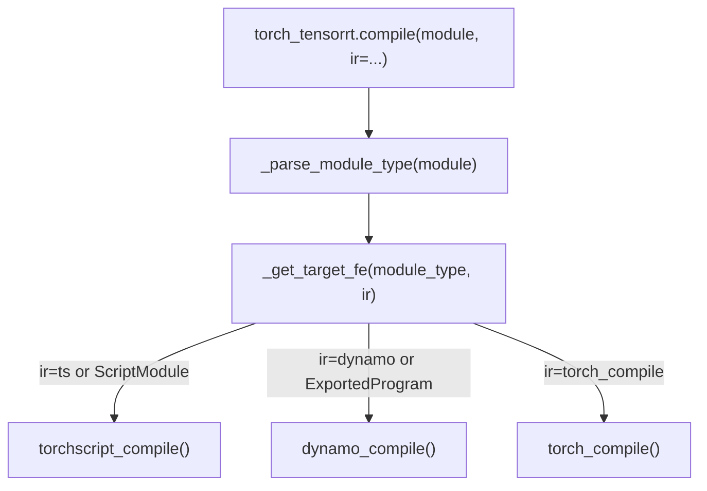
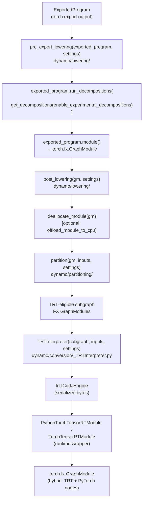
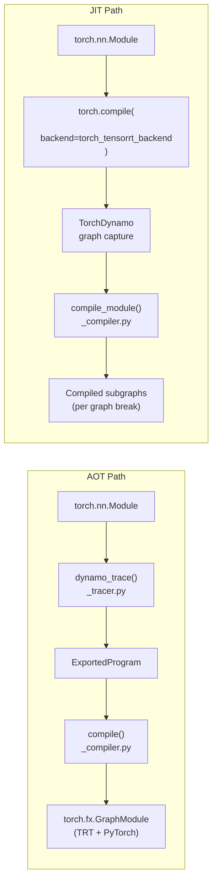
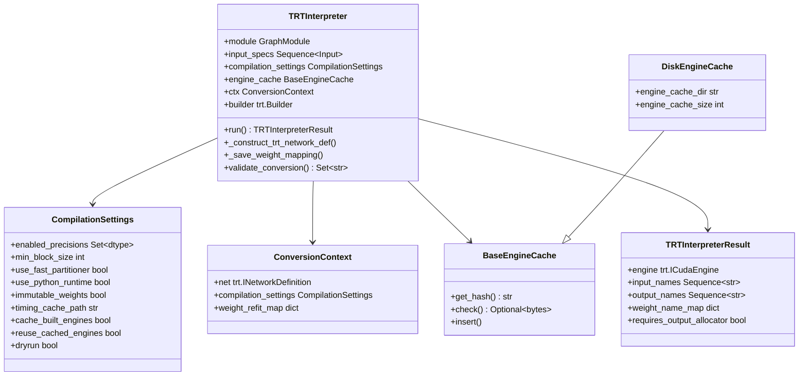

<!-- source: DeepWiki mcp.deepwiki.com · repo pytorch/TensorRT · page 3 Dynamo Frontend Architecture · fetched 2026-10-21 -->

# Dynamo Frontend Architecture

Relevant source files

The following files were used as context for generating this wiki page:

- [py/torch_tensorrt/_compile.py](py/torch_tensorrt/_compile.py)
- [py/torch_tensorrt/dynamo/__init__.py](py/torch_tensorrt/dynamo/__init__.py)
- [py/torch_tensorrt/dynamo/_compiler.py](py/torch_tensorrt/dynamo/_compiler.py)
- [py/torch_tensorrt/dynamo/_defaults.py](py/torch_tensorrt/dynamo/_defaults.py)
- [py/torch_tensorrt/dynamo/_refit.py](py/torch_tensorrt/dynamo/_refit.py)
- [py/torch_tensorrt/dynamo/_settings.py](py/torch_tensorrt/dynamo/_settings.py)
- [py/torch_tensorrt/dynamo/conversion/_TRTInterpreter.py](py/torch_tensorrt/dynamo/conversion/_TRTInterpreter.py)
- [py/torch_tensorrt/dynamo/conversion/_conversion.py](py/torch_tensorrt/dynamo/conversion/_conversion.py)
- [py/torch_tensorrt/dynamo/lowering/passes/__init__.py](py/torch_tensorrt/dynamo/lowering/passes/__init__.py)
- [py/torch_tensorrt/dynamo/utils.py](py/torch_tensorrt/dynamo/utils.py)
- [tests/py/dynamo/conversion/harness.py](tests/py/dynamo/conversion/harness.py)
- [tests/py/dynamo/models/test_export_kwargs_serde.py](tests/py/dynamo/models/test_export_kwargs_serde.py)
- [tests/py/dynamo/models/test_export_serde.py](tests/py/dynamo/models/test_export_serde.py)
- [tests/py/dynamo/models/test_model_refit.py](tests/py/dynamo/models/test_model_refit.py)
- [tests/py/dynamo/models/test_reexport.py](tests/py/dynamo/models/test_reexport.py)
- [tests/py/dynamo/runtime/test_002_lazy_engine_init.py](tests/py/dynamo/runtime/test_002_lazy_engine_init.py)

This document describes the internal architecture of the Dynamo frontend — the primary compilation path in Torch-TensorRT, based on `torch.export` and `torch.fx`. It covers the major modules, classes, and their relationships, serving as an orientation map for contributors and advanced users exploring the codebase.

For information about how to **use** the Dynamo frontend, see the User Guide sections: [2.1 JIT Compilation with torch.compile](#2.1) and [2.2 AOT Compilation and Export](#2.2). For details about the legacy TorchScript frontend, see [4 TorchScript Frontend Architecture](#4).

---

## Overview

The Dynamo frontend lives under `py/torch_tensorrt/dynamo/`. It accepts a `torch.export.ExportedProgram` (or a `torch.nn.Module` to be traced), applies a series of lowering passes, partitions the graph into TensorRT-eligible and PyTorch-fallback subgraphs, compiles each eligible subgraph into a TRT engine via `TRTInterpreter`, and returns a `torch.fx.GraphModule` that executes the engines at inference time.

There are two entry modes:

| Mode | Entry API | Description |
|------|-----------|-------------|
| AOT (ahead-of-time) | `torch_tensorrt.compile(ir='dynamo')` | Pre-compiles a full model to TRT engines before inference |
| JIT (just-in-time) | `torch.compile(backend='tensorrt')` | Compiles subgraphs on first call to `forward()` |

Both paths converge on the same internal compilation logic in `py/torch_tensorrt/dynamo/_compiler.py`.

Sources: [py/torch_tensorrt/dynamo/__init__.py:1-23](), [py/torch_tensorrt/_compile.py:79-178](), [py/torch_tensorrt/dynamo/_compiler.py:404-560]()

---

## Module Layout

The following table maps each architectural concern to its corresponding module:

| Concern | Module / File | Key Symbols |
|---------|--------------|-------------|
| Public entry points | `dynamo/_compiler.py` | `compile`, `convert_exported_program_to_serialized_trt_engine`, `cross_compile_for_windows` |
| Tracing | `dynamo/_tracer.py` | `trace`, `get_dynamic_shapes_args` |
| Compilation settings | `dynamo/_settings.py` | `CompilationSettings` |
| Default values | `dynamo/_defaults.py` | module-level constants |
| Lowering passes | `dynamo/lowering/` | `pre_export_lowering`, `post_lowering`, `get_decompositions` |
| Partitioning | `dynamo/partitioning/` | `partition`, `resource_partition` |
| Operator conversion | `dynamo/conversion/` | `TRTInterpreter`, `DYNAMO_CONVERTERS`, `convert_module` |
| Runtime wrappers | `dynamo/runtime/` | `PythonTorchTensorRTModule`, `TorchTensorRTModule` |
| Engine caching | `dynamo/_engine_cache.py` | `BaseEngineCache`, `DiskEngineCache` |
| Weight refitting | `dynamo/_refit.py` | `refit_module_weights`, `_refit_single_trt_engine_with_gm` |
| Debug tooling | `dynamo/debug/` | `Debugger`, `DebuggerConfig` |
| Utilities | `dynamo/utils.py` | `prepare_inputs`, `parse_dynamo_kwargs`, `deallocate_module` |

Sources: [py/torch_tensorrt/dynamo/__init__.py:1-23](), [py/torch_tensorrt/dynamo/_compiler.py:1-56]()

---

## Top-Level Entry Points

**High-level compile dispatch** — `py/torch_tensorrt/_compile.py`

`torch_tensorrt.compile()` is the universal entry point. It inspects the module type (`nn.Module`, `ExportedProgram`, `ScriptModule`, etc.) and the `ir` argument to select the appropriate frontend.

**Diagram: IR Selection Logic**

Sources: [py/torch_tensorrt/_compile.py:79-178](), [py/torch_tensorrt/_compile.py:291-333]()

When targeting the Dynamo frontend with a raw `torch.nn.Module`, `compile()` first calls `dynamo_trace()` to produce an `ExportedProgram`, then passes it to `dynamo_compile()`.

---

## CompilationSettings

`CompilationSettings` (defined in `py/torch_tensorrt/dynamo/_settings.py`) is a dataclass that carries all compilation options through the pipeline. It is constructed once at the entry point and passed by reference to every subsystem.

Key fields and their roles:

| Field | Default | Role |
|-------|---------|------|
| `enabled_precisions` | `{dtype.f32}` | Kernel dtype selection (FP32, FP16, INT8, BF16, FP8) |
| `min_block_size` | `5` | Minimum consecutive convertible ops to form a TRT subgraph |
| `torch_executed_ops` | `set()` | Force-fallback specific ATen ops to PyTorch |
| `use_fast_partitioner` | `True` | Adjacency vs. global graph partitioner |
| `use_python_runtime` | `False` | Python vs. C++ runtime for engine execution |
| `truncate_double` | `False` | Downcast float64 to float32 |
| `immutable_weights` | `True` | Disable engine refitting |
| `timing_cache_path` | `/tmp/...` | Path for TRT kernel timing cache |
| `cache_built_engines` | `False` | Save compiled engines to disk |
| `reuse_cached_engines` | `False` | Load and refit cached engines |
| `dryrun` | `False` | Partition without TRT conversion (for diagnostics) |
| `use_explicit_typing` | `True` | Enforce `STRONGLY_TYPED` TRT network flag |

`_SETTINGS_TO_BE_ENGINE_INVARIANT` in `_settings.py` enumerates which fields, if changed, require a full engine rebuild (relevant to the engine cache system).

Sources: [py/torch_tensorrt/dynamo/_settings.py:61-219](), [py/torch_tensorrt/dynamo/_defaults.py:1-87]()

---

## Compilation Pipeline

The core compilation sequence is implemented in the `compile()` function in `py/torch_tensorrt/dynamo/_compiler.py` and the `compile_module()` helper it calls.

**Diagram: Dynamo Compilation Pipeline**

Sources: [py/torch_tensorrt/dynamo/_compiler.py:368-401](), [py/torch_tensorrt/dynamo/_compiler.py:560-700]()

### Stage 1 — Pre-Export Lowering

`pre_export_lowering()` runs passes on the `ExportedProgram` before decomposition. These address patterns that must be transformed at the exported-program level (e.g., removing `_assert_scalar` nodes introduced by dynamic shapes).

### Stage 2 — Decomposition

`exported_program.run_decompositions(get_decompositions(...))` expands composite ATen ops into simpler ATen primitives. `get_decompositions()` in `dynamo/lowering/` selects the decomposition set. The `enable_experimental_decompositions` flag adds a broader set that may improve TRT coverage but is less tested.

### Stage 3 — Post-Lowering

`post_lowering()` applies additional graph-level transformations to the resulting `torch.fx.GraphModule`. This includes constant folding, removal of dead nodes, and repair of aliased inputs.

### Stage 4 — Partitioning

The graph is split into TRT-convertible segments and PyTorch fallback segments. Two strategies exist:
- **Fast partitioner** (`use_fast_partitioner=True`): adjacency-based, faster but possibly suboptimal.
- **Global partitioner** (`use_fast_partitioner=False`): exhaustive, better for maximum TRT coverage.

`min_block_size` controls how many consecutive TRT-eligible ops are required to form a segment. Isolated convertible ops below this threshold remain in PyTorch.

### Stage 5 — TRTInterpreter

Each TRT-eligible subgraph is converted by `TRTInterpreter` (a `torch.fx.Interpreter` subclass in `py/torch_tensorrt/dynamo/conversion/_TRTInterpreter.py`). It walks each FX node and calls the registered converter to build the corresponding `trt.INetworkDefinition` layers. The result is a compiled `trt.ICudaEngine`.

### Stage 6 — Runtime Wrapping

Each compiled engine is wrapped in either `PythonTorchTensorRTModule` or `TorchTensorRTModule` depending on the `use_python_runtime` setting. These are `torch.nn.Module` subclasses that handle CUDA memory, input binding, and execution-context management at inference time.

---

## JIT Path via torch.compile

When using `torch.compile(model, backend="tensorrt")`, the backend is `torch_tensorrt_backend` (in `dynamo/backend/`). TorchDynamo traces the model on first call and invokes the Torch-TensorRT backend, which internally calls the same `compile_module()` logic used in the AOT path.

Key difference: graph breaks are handled by TorchDynamo — each traced subgraph becomes a separate compilation unit. The `require_full_compilation` flag has no effect in this mode.

**Diagram: JIT vs. AOT Entry Paths**

Sources: [py/torch_tensorrt/_compile.py:438-451](), [py/torch_tensorrt/dynamo/utils.py:572-674]()

---

## Key Classes and Their Relationships

**Diagram: Core Class Relationships**

Sources: [py/torch_tensorrt/dynamo/conversion/_TRTInterpreter.py:71-160](), [py/torch_tensorrt/dynamo/_settings.py:61-179](), [py/torch_tensorrt/dynamo/_compiler.py:24-36]()

---

## Engine Cache Integration

When `cache_built_engines=True` and `reuse_cached_engines=True`, the pipeline integrates an engine cache between partitioning and `TRTInterpreter`:

1. A hash is computed over the subgraph, inputs, and `CompilationSettings`.
2. If a cache hit is found (`engine_cache.check(hash_val)`), the cached weight-stripped engine is refitted with current weights via `_refit_single_trt_engine_with_gm()` and returned without re-running `TRTInterpreter`.
3. On a cache miss, `TRTInterpreter` runs normally and the resulting engine is stored via `engine_cache.insert()`.

The `DiskEngineCache` in `py/torch_tensorrt/dynamo/_engine_cache.py` is the default implementation. Users can supply their own by subclassing `BaseEngineCache`.

> **Note:** Engine caching requires `immutable_weights=False` (refittable engines). The cache always stores weight-stripped engines and refits them on load.

Sources: [py/torch_tensorrt/dynamo/conversion/_conversion.py:55-194](), [py/torch_tensorrt/dynamo/_compiler.py:24-36]()

---

## Weight Refitting

Weight refitting allows updating TRT engine weights without full recompilation. The key function is `refit_module_weights()` in `py/torch_tensorrt/dynamo/_refit.py`.

The process:
1. Accept a compiled `torch.fx.GraphModule` and a new `ExportedProgram` with updated weights.
2. For each TRT engine submodule, build a weight mapping from engine weight names to `state_dict` names using `construct_refit_mapping()` or `construct_refit_mapping_from_weight_name_map()`.
3. Call `trt.Refitter.set_named_weights()` for each mapped weight and commit via `refit_cuda_engine()`.

The weight name mapping is cached on the compiled module (`weight_name_map` in `TRTInterpreterResult`) for fast subsequent refits, avoiding the need to re-run the interpreter.

Sources: [py/torch_tensorrt/dynamo/_refit.py:56-215](), [py/torch_tensorrt/dynamo/conversion/_TRTInterpreter.py:461-600]()

---

## Input Preparation

User-provided inputs are normalized to `torch_tensorrt.Input` objects by `prepare_inputs()` in `py/torch_tensorrt/dynamo/utils.py`. This function handles:
- Raw `torch.Tensor` objects → `Input.from_tensor()`
- Scalars (`int`, `float`, `bool`) → wrapped as tensors
- Nested `list`, `tuple`, `dict` structures → recursively processed

The `Input` class (`py/torch_tensorrt/_Input.py`) carries shape mode (`STATIC` or `DYNAMIC`), min/opt/max shapes (for dynamic inputs), dtype, memory format, and a flag for shape tensors. `TRTInterpreter` iterates over `input_specs` in graph order during placeholder node processing.

Sources: [py/torch_tensorrt/dynamo/utils.py:299-350](), [py/torch_tensorrt/dynamo/conversion/_TRTInterpreter.py:130-140]()

---

## Subsystem Cross-References

The following child pages cover each major subsystem in detail:

| Subsystem | Page |
|-----------|------|
| Full compilation pipeline walkthrough | [3.1 Compilation Pipeline Overview](#3.1) |
| Converter registry and `dynamo_tensorrt_converter` decorator | [3.2 ATen Operator Conversion System](#3.2) |
| Decompositions and lowering pass infrastructure | [3.3 Decompositions and Lowering Passes](#3.3) |
| `TRTInterpreter` and network building | [3.4 TRTInterpreter and Network Building](#3.4) |
| Engine cache and weight refitting details | [3.5 Engine Caching and Weight Refitting](#3.5) |
| `Input` class and type handling | [3.6 Input Processing and Type Handling](#3.6) |

---

