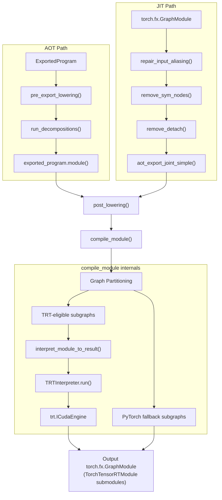
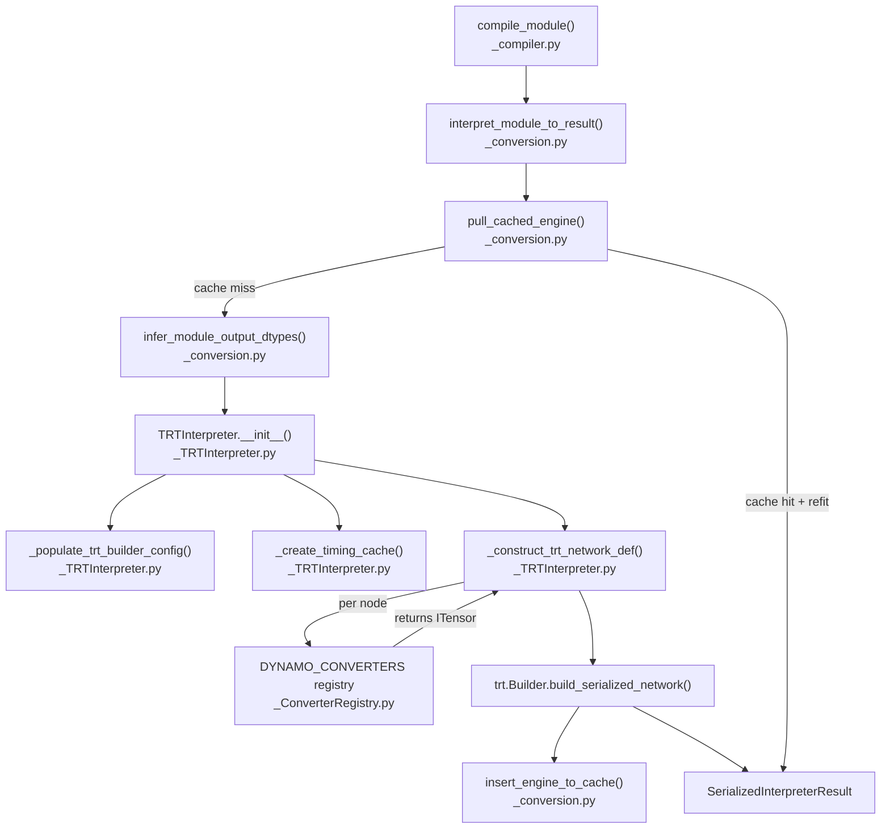

<!-- source: DeepWiki mcp.deepwiki.com · repo pytorch/TensorRT · page 3.1 Compilation Pipeline Overview · fetched 2026-10-21 -->

# Compilation Pipeline Overview

<details>
<summary>Relevant source files</summary>

The following files were used as context for generating this wiki page:

- [.gitignore](.gitignore)
- [docsrc/conf.py](docsrc/conf.py)
- [docsrc/contributors/writing_dynamo_aten_lowering_passes.rst](docsrc/contributors/writing_dynamo_aten_lowering_passes.rst)
- [docsrc/index.rst](docsrc/index.rst)
- [docsrc/requirements.txt](docsrc/requirements.txt)
- [examples/dynamo/README.rst](examples/dynamo/README.rst)
- [examples/dynamo/compile_with_dynamic_inputs.py](examples/dynamo/compile_with_dynamic_inputs.py)
- [examples/dynamo/custom_kernel_plugins.py](examples/dynamo/custom_kernel_plugins.py)
- [examples/dynamo/debugger_example.py](examples/dynamo/debugger_example.py)
- [examples/dynamo/dynamic_memory_allocation.py](examples/dynamo/dynamic_memory_allocation.py)
- [examples/dynamo/low_cpu_memory_compilation.py](examples/dynamo/low_cpu_memory_compilation.py)
- [examples/dynamo/refit_engine_example.py](examples/dynamo/refit_engine_example.py)
- [py/torch_tensorrt/_compile.py](py/torch_tensorrt/_compile.py)
- [py/torch_tensorrt/dynamo/__init__.py](py/torch_tensorrt/dynamo/__init__.py)
- [py/torch_tensorrt/dynamo/_compiler.py](py/torch_tensorrt/dynamo/_compiler.py)
- [py/torch_tensorrt/dynamo/_defaults.py](py/torch_tensorrt/dynamo/_defaults.py)
- [py/torch_tensorrt/dynamo/_refit.py](py/torch_tensorrt/dynamo/_refit.py)
- [py/torch_tensorrt/dynamo/_settings.py](py/torch_tensorrt/dynamo/_settings.py)
- [py/torch_tensorrt/dynamo/backend/backends.py](py/torch_tensorrt/dynamo/backend/backends.py)
- [py/torch_tensorrt/dynamo/conversion/_TRTInterpreter.py](py/torch_tensorrt/dynamo/conversion/_TRTInterpreter.py)
- [py/torch_tensorrt/dynamo/conversion/_conversion.py](py/torch_tensorrt/dynamo/conversion/_conversion.py)
- [py/torch_tensorrt/dynamo/lowering/passes/__init__.py](py/torch_tensorrt/dynamo/lowering/passes/__init__.py)
- [py/torch_tensorrt/dynamo/lowering/passes/constant_folding.py](py/torch_tensorrt/dynamo/lowering/passes/constant_folding.py)
- [py/torch_tensorrt/dynamo/lowering/passes/fuse_prims_broadcast.py](py/torch_tensorrt/dynamo/lowering/passes/fuse_prims_broadcast.py)
- [py/torch_tensorrt/dynamo/lowering/passes/pass_manager.py](py/torch_tensorrt/dynamo/lowering/passes/pass_manager.py)
- [py/torch_tensorrt/dynamo/lowering/passes/remove_input_alias_fixing_clones.py](py/torch_tensorrt/dynamo/lowering/passes/remove_input_alias_fixing_clones.py)
- [py/torch_tensorrt/dynamo/lowering/passes/repair_input_as_output.py](py/torch_tensorrt/dynamo/lowering/passes/repair_input_as_output.py)
- [py/torch_tensorrt/dynamo/utils.py](py/torch_tensorrt/dynamo/utils.py)
- [tests/py/dynamo/conversion/harness.py](tests/py/dynamo/conversion/harness.py)
- [tests/py/dynamo/models/test_export_kwargs_serde.py](tests/py/dynamo/models/test_export_kwargs_serde.py)
- [tests/py/dynamo/models/test_export_serde.py](tests/py/dynamo/models/test_export_serde.py)
- [tests/py/dynamo/models/test_model_refit.py](tests/py/dynamo/models/test_model_refit.py)
- [tests/py/dynamo/models/test_reexport.py](tests/py/dynamo/models/test_reexport.py)
- [tests/py/dynamo/runtime/test_002_lazy_engine_init.py](tests/py/dynamo/runtime/test_002_lazy_engine_init.py)
- [tests/py/dynamo/testing_utilities.py](tests/py/dynamo/testing_utilities.py)

</details>


## Purpose and Scope

This page describes the end-to-end compilation pipeline of the Dynamo frontend in Torch-TensorRT. It covers the sequence of transformations applied to a model from the initial `ExportedProgram` (or `torch.fx.GraphModule`) input through lowering, partitioning, TRT network construction, and final `torch.fx.GraphModule` output.

- For the **TorchScript** compilation pipeline, see [4.1](#4.1).
- For the **ATen operator converter** system (how individual ops are mapped to TRT layers), see [3.2](#3.2).
- For the **lowering pass** infrastructure in detail, see [3.3](#3.3).
- For **TRTInterpreter** internals, see [3.4](#3.4).
- For **engine caching and weight refitting**, see [3.5](#3.5).

---

## Two Entry Points

The Dynamo pipeline is triggered through two distinct paths, both of which converge at a common `compile_module` function.

| Mode | Trigger | Entry Function | Input Type |
|------|---------|----------------|------------|
| AOT | `torch_tensorrt.compile(..., ir='dynamo')` | `compile()` in `_compiler.py` | `torch.export.ExportedProgram` |
| JIT | `torch.compile(..., backend='tensorrt')` | `torch_tensorrt_backend()` in `backends.py` | `torch.fx.GraphModule` (from Dynamo tracer) |

The AOT path accepts an already-exported `ExportedProgram`. The JIT path receives a partially-traced FX graph from `torch.compile` and must do additional translation steps to reach ATen IR before the two paths merge.

Sources: [py/torch_tensorrt/dynamo/_compiler.py:404-471](), [py/torch_tensorrt/dynamo/backend/backends.py:32-97]()

---

## Pipeline Overview

**Figure 1: Dynamo Compilation Pipeline — Both Paths**



Sources: [py/torch_tensorrt/dynamo/_compiler.py:366-401](), [py/torch_tensorrt/dynamo/backend/backends.py:99-190]()

---

## Stage-by-Stage Walkthrough

### Stage 1: Input Preparation

**AOT path:** The user provides a `torch.export.ExportedProgram`. If starting from a raw `torch.nn.Module`, the tracer (`dynamo_trace()`) runs `torch.export.export` first. Inputs are normalized to a sequence of `torch_tensorrt.Input` objects via `prepare_inputs()`.

**JIT path:** `torch.compile` invokes `torch_tensorrt_backend()` (registered under the names `"tensorrt"` and `"torch_tensorrt"`), which delegates to `aot_torch_tensorrt_aten_backend()`, then `_pretraced_backend()`. The graph at this point is a pre-ATen FX graph.

`CompilationSettings` is assembled from user kwargs and passed through every subsequent stage.

Sources: [py/torch_tensorrt/dynamo/_compiler.py:280-366](), [py/torch_tensorrt/dynamo/backend/backends.py:32-97](), [py/torch_tensorrt/dynamo/utils.py:299-350]()

---

### Stage 2: Pre-Export Lowering (AOT path only)

```
pre_export_lowering(exported_program, settings)
```

Applies graph passes to the `ExportedProgram` before decomposition. These passes prepare the graph for the ATen decomposition step. They operate at the `ExportedProgram` level before the underlying `fx.GraphModule` is extracted.

Sources: [py/torch_tensorrt/dynamo/_compiler.py:368-370]()

---

### Stage 3: Decomposition / ATen Lowering

**AOT path:**
```
exported_program.run_decompositions(get_decompositions(enable_experimental_decompositions))
```
Complex composite PyTorch operators are decomposed into simpler core ATen primitives. `get_decompositions()` selects the decomposition table based on the `enable_experimental_decompositions` flag.

**JIT path:**
```
aot_export_joint_simple(gm, sample_inputs, trace_joint=False, decompositions=get_decompositions(...))
```
`aot_export_joint_simple` from `torch._functorch.aot_autograd` translates the pre-ATen FX graph to a full ATen graph, applying the same decomposition table.

After this step, both paths produce a `torch.fx.GraphModule` composed of ATen operations.

Sources: [py/torch_tensorrt/dynamo/_compiler.py:369-373](), [py/torch_tensorrt/dynamo/backend/backends.py:138-148]()

---

### Stage 4: Graph Module Extraction (AOT path only)

```
gm = exported_program.module()
```

Extracts a `torch.fx.GraphModule` from the `ExportedProgram`. Constants, parameters, and buffers are inlined as `get_attr` nodes in the graph.

Sources: [py/torch_tensorrt/dynamo/_compiler.py:373-374]()

---

### Stage 5: Post-Lowering Passes

```
gm = post_lowering(gm, settings)
```

A suite of graph passes is applied to the `torch.fx.GraphModule`. These include constant folding (via `constant_fold()` in `lowering/passes/constant_folding.py`), dead-code elimination, and other graph clean-up passes. Constants are folded and materialized as `get_attr` parameters.

Optionally, if `offload_module_to_cpu=True`, `deallocate_module(gm)` moves the module's weights to CPU after this step to free GPU memory before TRT engine builds.

Sources: [py/torch_tensorrt/dynamo/_compiler.py:378-394](), [py/torch_tensorrt/dynamo/backend/backends.py:150-152](), [py/torch_tensorrt/dynamo/lowering/passes/constant_folding.py:23-65]()

---

### Stage 6: Graph Partitioning

```
compile_module(gm, inputs, settings, engine_cache)
```

Inside `compile_module`, the lowered `torch.fx.GraphModule` is partitioned into contiguous subgraphs. Two partitioners are available, selected by `settings.use_fast_partitioner`:

| Partitioner | Setting | Behavior |
|-------------|---------|----------|
| Fast (adjacency-based) | `use_fast_partitioner=True` (default) | Faster, may not find global optimum |
| Global | `use_fast_partitioner=False` | Slower, considers full graph structure |

Partitioning respects:
- **Converter coverage**: only ops with registered converters can go to TRT.
- **`torch_executed_ops`**: ops explicitly forced to run in PyTorch.
- **`min_block_size`**: minimum number of contiguous ops required to form a TRT block (default: 5).
- **`require_full_compilation`**: raises an error if any fallback is needed.

The output is a set of `PartitionedGraph` segments, each tagged as either TRT-convertible or a PyTorch fallback.

Sources: [py/torch_tensorrt/dynamo/_compiler.py:17-18](), [py/torch_tensorrt/dynamo/_defaults.py:27-28]()

---

### Stage 7: TRT Conversion

For each TRT-eligible partition, `interpret_module_to_result()` is called.

**Figure 2: Code Entity Map — TRT Conversion Stage**



The key steps within `interpret_module_to_result()`:

1. **Engine cache check**: `pull_cached_engine()` checks if a previously compiled engine matches the current graph hash. On a hit, the weight-stripped cached engine is refitted with the current module's weights and returned immediately.

2. **Output dtype inference**: `infer_module_output_dtypes()` reads `node.meta['val']` to determine expected output dtypes.

3. **Interpreter construction**: `TRTInterpreter(module, inputs, output_dtypes, compilation_settings, engine_cache)` is instantiated. It creates a `trt.Builder` and `trt.INetworkDefinition` via `ConversionContext`.

4. **Builder config**: `_populate_trt_builder_config()` applies all settings to the `trt.IBuilderConfig` — precision flags, optimization profiles, workspace size, timing cache, hardware compatibility, weight streaming, etc.

5. **Network construction**: `_construct_trt_network_def()` calls `super().run()` (from `torch.fx.Interpreter`), which walks each FX graph node and dispatches to the registered converter in `DYNAMO_CONVERTERS`. Each converter appends layers to the `INetworkDefinition` and returns `trt.ITensor` values.

6. **Engine build**: TensorRT compiles the `INetworkDefinition` into a serialized `trt.ICudaEngine`.

7. **Cache insert**: `insert_engine_to_cache()` saves the weight-stripped engine to the cache if caching is enabled.

Sources: [py/torch_tensorrt/dynamo/conversion/_conversion.py:197-280](), [py/torch_tensorrt/dynamo/conversion/_TRTInterpreter.py:80-160](), [py/torch_tensorrt/dynamo/conversion/_TRTInterpreter.py:221-377](), [py/torch_tensorrt/dynamo/conversion/_TRTInterpreter.py:409-420]()

---

### Stage 8: Output Assembly

Each compiled TRT engine is wrapped in a runtime module and re-embedded into the parent `torch.fx.GraphModule`:

| Setting | Runtime Module Class |
|---------|---------------------|
| `use_python_runtime=True` | `PythonTorchTensorRTModule` |
| `use_python_runtime=False` (default) | `TorchTensorRTModule` |

PyTorch fallback subgraphs remain as plain `torch.fx.GraphModule` submodules. The final returned object is a `torch.fx.GraphModule` that calls TRT submodules and PyTorch submodules in the correct execution order.

Sources: [py/torch_tensorrt/dynamo/conversion/_conversion.py:197-280](), [py/torch_tensorrt/dynamo/utils.py:141-168]()

---

## Data Flow Summary

**Figure 3: Data Types Through the Pipeline**

```mermaid
flowchart LR
    A["torch.nn.Module\nor ExportedProgram"] -->|"dynamo_trace() / torch.export"| B
    B["ExportedProgram"] -->|"pre_export_lowering()\nrun_decompositions()"| C
    C["ExportedProgram\n(ATen ops only)"] -->|"exported_program.module()"| D
    D["torch.fx.GraphModule\n(ATen IR)"] -->|"post_lowering()"| E
    E["torch.fx.GraphModule\n(lowered + folded)"] -->|"compile_module() -> partitioning"| F
    F["PartitionedGraph\nsegments"] -->|"interpret_module_to_result()"| G
    G["SerializedInterpreterResult\n(bytes + metadata)"] -->|"runtime module wrapping"| H
    H["torch.fx.GraphModule\nwith TorchTensorRTModule submodules"]
```



Sources: [py/torch_tensorrt/dynamo/_compiler.py:366-401](), [py/torch_tensorrt/dynamo/conversion/_conversion.py:33-40]()

---

## Key Data Structures

| Class | Location | Role |
|-------|----------|------|
| `CompilationSettings` | `_settings.py` | Dataclass holding all compiler configuration parameters |
| `TRTInterpreterResult` | `_TRTInterpreter.py` | Named tuple: `(engine, input_names, output_names, weight_name_map, requires_output_allocator)` |
| `SerializedInterpreterResult` | `_conversion.py` | Named tuple: `(serialized_engine, input_names, output_names, weight_name_map, requires_output_allocator, symbolic_shape_expressions)` |
| `ConversionContext` | `_ConversionContext.py` | Holds `trt.INetworkDefinition` and mutable state during converter execution |
| `Input` | `_Input.py` | Represents an input specification (shape, dtype, dynamic ranges) |

Sources: [py/torch_tensorrt/dynamo/_settings.py:62-180](), [py/torch_tensorrt/dynamo/conversion/_TRTInterpreter.py:71-76](), [py/torch_tensorrt/dynamo/conversion/_conversion.py:33-40]()

---

## Engine Cache Integration

The engine cache is consulted at two points during `interpret_module_to_result()`:

1. **Before building** (`pull_cached_engine()`): A hash of the graph and compilation settings is computed. On a cache hit, the weight-stripped engine is loaded and refitted with current model weights using `_refit_single_trt_engine_with_gm()`. This skips TRT compilation entirely.

2. **After building** (`insert_engine_to_cache()`): The newly built engine is stored as a weight-stripped serialized engine alongside the `weight_name_map` for future refit.

Cache behavior is controlled by `cache_built_engines` and `reuse_cached_engines` in `CompilationSettings`. A custom cache can be provided via `custom_engine_cache` (implementing `BaseEngineCache`); otherwise, `DiskEngineCache` is used.

Sources: [py/torch_tensorrt/dynamo/conversion/_conversion.py:55-193]()

---

## Dryrun Mode

When `settings.dryrun=True`, the pipeline runs through partitioning but skips TRT engine building. The `DryRunTracker` and `PerSubgraphData` objects collect graph I/O shapes, operator coverage statistics, and partition layouts, which are printed or saved to a file. This is useful for diagnosing partitioning behavior before committing to a full compilation.

`parse_non_trt_nodes()` and `dryrun_stats_display()` format the output.

Sources: [py/torch_tensorrt/dynamo/_compiler.py:18-23](), [py/torch_tensorrt/dynamo/_defaults.py:30]()

---

