<!-- source: DeepWiki mcp.deepwiki.com · repo pytorch/TensorRT · page 3.2 ATen Operator Conversion System · fetched 2026-10-21 -->

# ATen Operator Conversion System

<details>
<summary>Relevant source files</summary>

The following files were used as context for generating this wiki page:

- [docsrc/contributors/writing_dynamo_aten_lowering_passes.rst](docsrc/contributors/writing_dynamo_aten_lowering_passes.rst)
- [py/torch_tensorrt/dynamo/backend/backends.py](py/torch_tensorrt/dynamo/backend/backends.py)
- [py/torch_tensorrt/dynamo/conversion/aten_ops_converters.py](py/torch_tensorrt/dynamo/conversion/aten_ops_converters.py)
- [py/torch_tensorrt/dynamo/conversion/converter_utils.py](py/torch_tensorrt/dynamo/conversion/converter_utils.py)
- [py/torch_tensorrt/dynamo/conversion/impl/normalization/ops.py](py/torch_tensorrt/dynamo/conversion/impl/normalization/ops.py)
- [py/torch_tensorrt/dynamo/conversion/impl/slice/ops.py](py/torch_tensorrt/dynamo/conversion/impl/slice/ops.py)
- [py/torch_tensorrt/dynamo/lowering/_decomposition_groups.py](py/torch_tensorrt/dynamo/lowering/_decomposition_groups.py)
- [py/torch_tensorrt/dynamo/lowering/passes/constant_folding.py](py/torch_tensorrt/dynamo/lowering/passes/constant_folding.py)
- [py/torch_tensorrt/dynamo/lowering/passes/fuse_prims_broadcast.py](py/torch_tensorrt/dynamo/lowering/passes/fuse_prims_broadcast.py)
- [py/torch_tensorrt/dynamo/lowering/passes/pass_manager.py](py/torch_tensorrt/dynamo/lowering/passes/pass_manager.py)
- [py/torch_tensorrt/dynamo/lowering/passes/remove_input_alias_fixing_clones.py](py/torch_tensorrt/dynamo/lowering/passes/remove_input_alias_fixing_clones.py)
- [py/torch_tensorrt/dynamo/lowering/passes/repair_input_as_output.py](py/torch_tensorrt/dynamo/lowering/passes/repair_input_as_output.py)
- [tests/py/dynamo/conversion/test_batch_norm_aten.py](tests/py/dynamo/conversion/test_batch_norm_aten.py)
- [tests/py/dynamo/conversion/test_erf_aten.py](tests/py/dynamo/conversion/test_erf_aten.py)
- [tests/py/dynamo/conversion/test_flip_aten.py](tests/py/dynamo/conversion/test_flip_aten.py)
- [tests/py/dynamo/conversion/test_group_norm_aten.py](tests/py/dynamo/conversion/test_group_norm_aten.py)
- [tests/py/dynamo/conversion/test_layer_norm_aten.py](tests/py/dynamo/conversion/test_layer_norm_aten.py)
- [tests/py/dynamo/conversion/test_neg_aten.py](tests/py/dynamo/conversion/test_neg_aten.py)
- [tests/py/dynamo/conversion/test_pdist_aten.py](tests/py/dynamo/conversion/test_pdist_aten.py)
- [tests/py/dynamo/conversion/test_rsqrt_aten.py](tests/py/dynamo/conversion/test_rsqrt_aten.py)
- [tests/py/dynamo/conversion/test_slice_aten.py](tests/py/dynamo/conversion/test_slice_aten.py)
- [tests/py/dynamo/conversion/test_tile_aten.py](tests/py/dynamo/conversion/test_tile_aten.py)
- [tests/py/dynamo/testing_utilities.py](tests/py/dynamo/testing_utilities.py)

</details>


## Purpose and Scope

The ATen Operator Conversion System is the core mechanism in the Dynamo frontend that translates PyTorch ATen operations to TensorRT layers. This system uses a decorator-based registration pattern to map individual PyTorch operators (e.g., `torch.ops.aten.relu.default`, `torch.ops.aten.matmul`) to converter functions that create equivalent TensorRT `ILayer` objects.

This page focuses on the conversion registration and implementation architecture. For the broader compilation pipeline, see [Compilation Pipeline Overview](#3.1). For details on individual operation implementations, see [Operation Converter Implementation](#5). For graph transformations that occur before conversion, see [Decompositions and Lowering Passes](#3.3).

---

## Converter Registration Architecture

### Registration Decorator System

The conversion system uses the `@dynamo_tensorrt_converter` decorator to register mapping functions between PyTorch ATen operations and TensorRT layer creation logic. Each converter is associated with one or more PyTorch operation targets and can specify additional constraints.

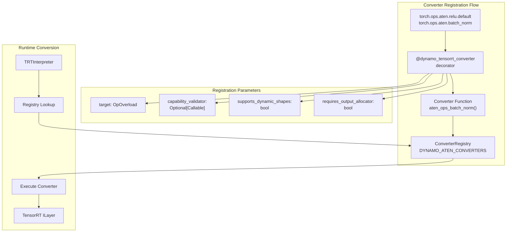

**Sources:** [py/torch_tensorrt/dynamo/conversion/aten_ops_converters.py:1-100](), [py/torch_tensorrt/dynamo/conversion/_ConverterRegistry.py]()

### Converter Function Signature

All converter functions in the Dynamo frontend follow a standardized signature defined by `DynamoConverterImplSignature`:

| Parameter | Type | Description |
|-----------|------|-------------|
| `ctx` | `ConversionContext` | Contains TensorRT builder, network, and compilation settings |
| `target` | `Target` | The PyTorch operation being converted (e.g., `torch.ops.aten.relu.default`) |
| `args` | `Tuple[Argument, ...]` | Positional arguments from the FX graph node |
| `kwargs` | `Dict[str, Argument]` | Keyword arguments from the FX graph node |
| `name` | `str` | Name for the generated TensorRT layer(s) |
| **Returns** | `Union[TRTTensor, Sequence[TRTTensor]]` | Output tensor(s) from the created TensorRT layer |

**Example converter structure:**

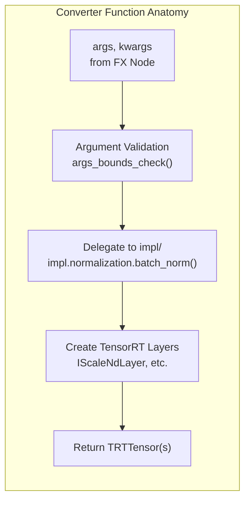

**Sources:** [py/torch_tensorrt/dynamo/conversion/aten_ops_converters.py:76-98](), [py/torch_tensorrt/dynamo/conversion/_ConverterRegistry.py]()

---

## Implementation Directory Structure

Converter implementations are organized into a modular `impl/` directory structure. The top-level converter functions in `aten_ops_converters.py` act as thin wrappers that delegate to specialized implementation modules.

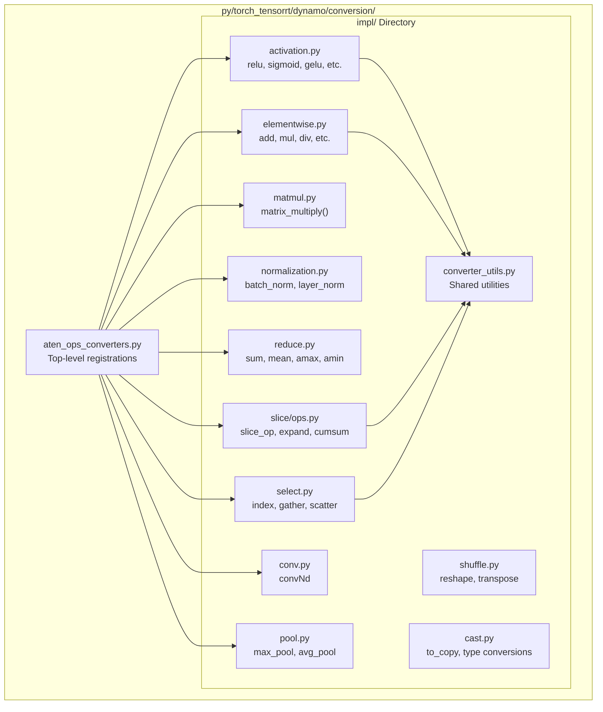

**Module categorization:**

| Category | Module(s) | Operations |
|----------|-----------|------------|
| Activation | `activation.py` | `relu`, `sigmoid`, `tanh`, `gelu`, `leaky_relu`, `elu`, `softplus` |
| Element-wise | `elementwise.py` | `add`, `mul`, `div`, `sub`, `pow`, `floor_divide`, `clamp` |
| Matrix Operations | `matmul.py`, `linear.py` | `matmul`, `mm`, `bmm`, `addmm`, `linear` |
| Normalization | `normalization.py` | `batch_norm`, `layer_norm`, `group_norm`, `softmax` |
| Reductions | `reduce.py` | `sum`, `mean`, `amax`, `amin`, `prod` |
| Tensor Manipulation | `select.py`, `slice/`, `shuffle.py` | `index`, `slice`, `gather`, `scatter`, `reshape`, `permute` |
| Convolution/Pooling | `conv.py`, `deconv.py`, `pool.py` | `conv2d`, `conv_transpose`, `max_pool`, `avg_pool` |
| Type Handling | `cast.py` | `to_copy`, `_to_copy`, type promotions |

**Sources:** [py/torch_tensorrt/dynamo/conversion/impl/__init__.py:1-36](), [py/torch_tensorrt/dynamo/conversion/aten_ops_converters.py]()

---

## Registration Patterns and Examples

### Basic Registration

The simplest converter registration maps a single operation to a converter function:


**Code example from:** [py/torch_tensorrt/dynamo/conversion/aten_ops_converters.py:399-413]()

### Multi-Target Registration

A single converter can handle multiple related operations by applying the decorator multiple times:

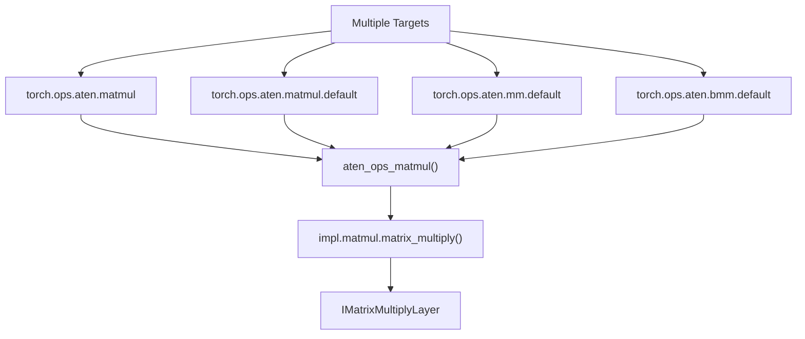

**Sources:** [py/torch_tensorrt/dynamo/conversion/aten_ops_converters.py:623-643]()

### Registration with Capability Validators

Converters can specify `capability_validator` functions to determine whether a specific node can be converted based on its attributes:

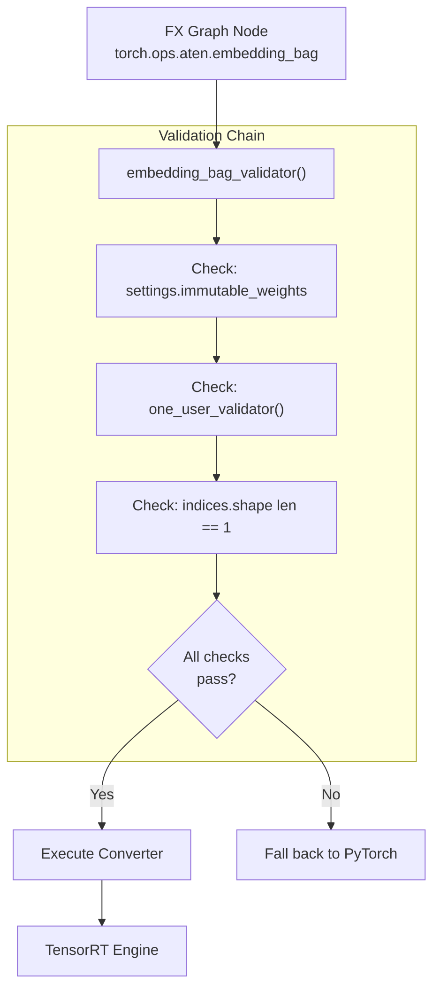

**Example validators:**
- `one_user_validator`: Ensures node has single user (getitem at index 0)
- `index_dtype_validator`: Validates index tensor datatypes
- `refit_validator`: Checks if operation is compatible with weight refitting
- `embedding_bag_validator`: Combines multiple validation checks

**Sources:** [py/torch_tensorrt/dynamo/conversion/aten_ops_converters.py:51-59](), [py/torch_tensorrt/dynamo/conversion/aten_ops_converters.py:297-323](), [py/torch_tensorrt/dynamo/conversion/aten_ops_converters.py:999-1003]()

---

## Type Enforcement and Argument Processing

### The `@enforce_tensor_types` Decorator

Converters use the `@enforce_tensor_types` decorator to ensure arguments are in the correct format (TensorRT ITensor, NumPy array, or PyTorch Tensor) before processing. This decorator can promote types automatically if enabled.

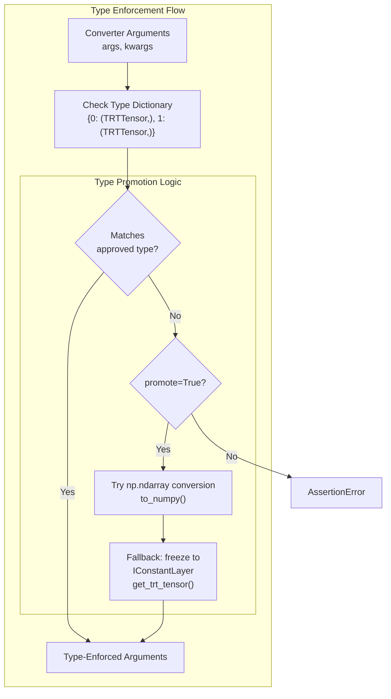

**Type enforcement example:**

| Position | Approved Types | Behavior if Mismatch |
|----------|---------------|---------------------|
| `0` (input) | `(TRTTensor,)` | Promote to `TRTTensor` via `get_trt_tensor()` |
| `1` (indices) | `(TRTTensor,)` | Freeze constant to `IConstantLayer` |
| `2` (scalar) | `(np.ndarray, torch.Tensor)` | Convert to NumPy array |

**Sources:** [py/torch_tensorrt/dynamo/conversion/converter_utils.py:571-679](), [py/torch_tensorrt/dynamo/conversion/aten_ops_converters.py:71-75]()

### Argument Utility Functions

The conversion system provides several utilities for safe argument handling:

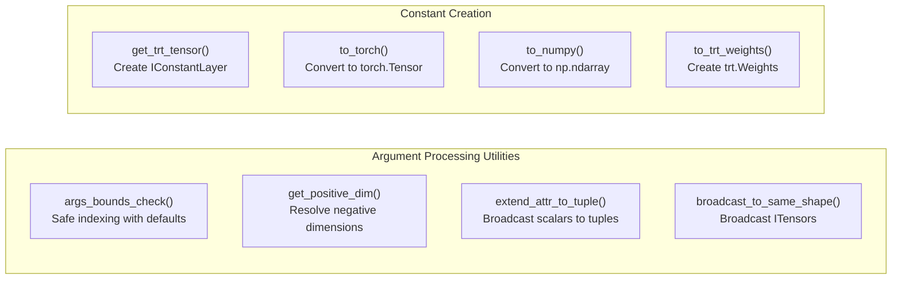

**Common patterns:**

```python
# Safe argument access with default
dim = args_bounds_check(args, 2, replacement=0)  # Default to 0 if missing

# Handle negative dimensions
positive_dim = get_positive_dim(-1, rank=4)  # Returns 3

# Create TensorRT constant from Python value
const_tensor = get_trt_tensor(ctx, 1.0, "my_constant")
```

**Sources:** [py/torch_tensorrt/dynamo/conversion/converter_utils.py:534-568](), [py/torch_tensorrt/dynamo/conversion/converter_utils.py:407-489]()

---

## Decomposition Integration

Before operators reach the conversion system, they may be transformed by decompositions that break complex operations into simpler primitives. The decomposition system works in concert with the converter registry.

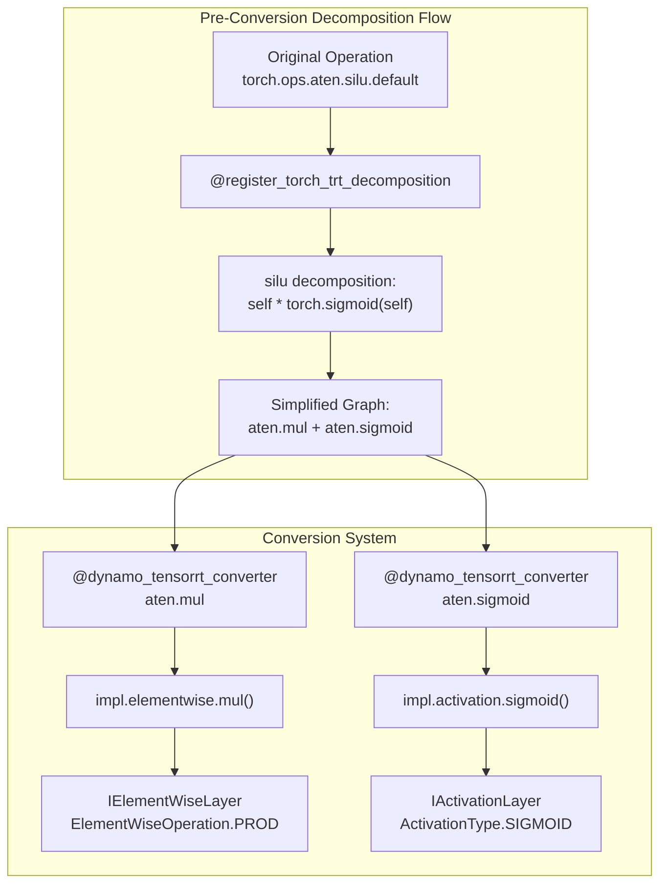

### Decomposition Categories

| Category | Registry | Examples |
|----------|----------|----------|
| Torch Native | `ENABLED_TORCH_DECOMPOSITIONS` | `aten.var`, `aten.std`, `aten.stack`, `aten.unbind` |
| Torch-TRT Custom | `TORCH_TRT_DECOMPOSITIONS` | `aten.silu`, `aten.rsqrt`, `aten.reciprocal`, `aten.slice_scatter` |
| Explicitly Disabled | `torch_disabled_decompositions` | `aten._softmax`, `aten.linear`, `aten.matmul` (have direct converters) |

### Custom Decomposition Example

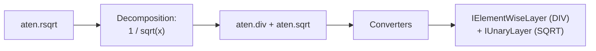

The `rsqrt` operation is decomposed into division and square root, both of which have direct TensorRT layer equivalents, rather than implementing a custom converter.

**Sources:** [py/torch_tensorrt/dynamo/lowering/_decompositions.py:94-96](), [py/torch_tensorrt/dynamo/lowering/_decomposition_groups.py:1-195](), [tests/py/dynamo/lowering/test_decompositions.py:80-119]()

---

## Dynamic Shape Support

Converters can declare support for dynamic shapes through the `supports_dynamic_shapes` parameter. Dynamic shape handling requires special consideration when creating TensorRT layers.

```mermaid
graph TB
    subgraph "Static Shape Conversion"
        STATIC_INPUT["Input: Tensor[10, 20, 30]"]
        STATIC_SLICE["slice(dim=1, start=5, stop=15)"]
        STATIC_LAYER["ISliceLayer<br/>start=[0,5,0]<br/>shape=[10,10,30]<br/>stride=[1,1,1]"]
        STATIC_OUTPUT["Output: Tensor[10, 10, 30]"]
        
        STATIC_INPUT --> STATIC_SLICE
        STATIC_SLICE --> STATIC_LAYER
        STATIC_LAYER --> STATIC_OUTPUT
    end
    
    subgraph "Dynamic Shape Conversion"
        DYN_INPUT["Input: Tensor[-1, 20, 30]"]
        DYN_SLICE["slice(dim=0, start=0, stop=-2)"]
        DYN_SHAPE["get_shape() to get runtime dim"]
        DYN_CALC["Calculate output shape:<br/>shape[0] - 2"]
        DYN_LAYER["ISliceLayer with<br/>shape tensor input"]
        DYN_OUTPUT["Output: Tensor[-1-2, 20, 30]"]
        
        DYN_INPUT --> DYN_SLICE
        DYN_SLICE --> DYN_SHAPE
        DYN_SHAPE --> DYN_CALC
        DYN_CALC --> DYN_LAYER
        DYN_LAYER --> DYN_OUTPUT
    end
```

**Dynamic shape utilities:**

- `get_shape()`: Extract individual dimension size at runtime
- `get_shape_with_dynamic_shape()`: Create complete shape tensor
- `has_dynamic_shape()`: Check if tensor has any dynamic dimensions
- `DYNAMIC_DIM`: Constant (-1) representing dynamic dimension marker

**Sources:** [py/torch_tensorrt/dynamo/conversion/impl/slice/ops.py:33-215](), [py/torch_tensorrt/dynamo/conversion/impl/shape.py](), [tests/py/dynamo/conversion/test_slice_aten.py:52-228]()

---

## Converter Execution Context

### ConversionContext Structure

Each converter receives a `ConversionContext` object that provides access to the compilation environment:

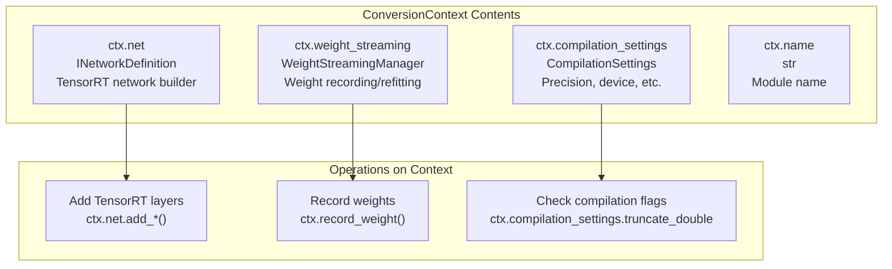

**Key context methods and properties:**

| Member | Type | Purpose |
|--------|------|---------|
| `ctx.net` | `trt.INetworkDefinition` | TensorRT network to add layers to |
| `ctx.compilation_settings` | `CompilationSettings` | User-provided compilation configuration |
| `ctx.record_weight()` | Method | Record weight for refitting support |
| `ctx.name` | `str` | Name prefix for generated layers |

**Sources:** [py/torch_tensorrt/dynamo/conversion/_ConversionContext.py](), [py/torch_tensorrt/dynamo/conversion/converter_utils.py:336-404]()

---

## Converter Implementation Best Practices

### Layer Naming Convention

Converters should use descriptive layer names that include operation type, target name, and user-provided name:

```python
layer_name = f"[CONVOLUTION]-[aten_ops.conv2d]-[{name}] KERNEL"
```

### Weight Recording

When creating layers with weights, use `to_trt_weights()` which automatically records weights for refitting:

```python
weights = to_trt_weights(
    ctx, 
    weight_tensor, 
    name="conv_weight",
    layer_type_name="CONVOLUTION",
    weight_type_name="KERNEL",
    target=target,
    source_ir=SourceIR.ATEN
)
```

### Error Handling Pattern

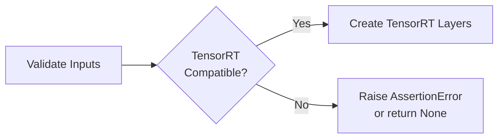

Converters should validate compatibility early and raise clear errors when operations cannot be converted, allowing the partitioning system to fall back to PyTorch for those operations.

**Sources:** [py/torch_tensorrt/dynamo/conversion/aten_ops_converters.py](), [py/torch_tensorrt/dynamo/conversion/converter_utils.py]()

---

