<!-- source: DeepWiki mcp.deepwiki.com · repo pytorch/TensorRT · page 3.3 Decompositions and Lowering Passes · fetched 2026-10-21 -->

# Decompositions and Lowering Passes

<details>
<summary>Relevant source files</summary>

The following files were used as context for generating this wiki page:

- [py/torch_tensorrt/dynamo/conversion/aten_ops_converters.py](py/torch_tensorrt/dynamo/conversion/aten_ops_converters.py)
- [py/torch_tensorrt/dynamo/conversion/converter_utils.py](py/torch_tensorrt/dynamo/conversion/converter_utils.py)
- [py/torch_tensorrt/dynamo/conversion/impl/__init__.py](py/torch_tensorrt/dynamo/conversion/impl/__init__.py)
- [py/torch_tensorrt/dynamo/conversion/impl/addmm.py](py/torch_tensorrt/dynamo/conversion/impl/addmm.py)
- [py/torch_tensorrt/dynamo/conversion/impl/linear.py](py/torch_tensorrt/dynamo/conversion/impl/linear.py)
- [py/torch_tensorrt/dynamo/conversion/impl/normalization/ops.py](py/torch_tensorrt/dynamo/conversion/impl/normalization/ops.py)
- [py/torch_tensorrt/dynamo/conversion/impl/slice/ops.py](py/torch_tensorrt/dynamo/conversion/impl/slice/ops.py)
- [py/torch_tensorrt/dynamo/lowering/_decomposition_groups.py](py/torch_tensorrt/dynamo/lowering/_decomposition_groups.py)
- [py/torch_tensorrt/dynamo/lowering/_decompositions.py](py/torch_tensorrt/dynamo/lowering/_decompositions.py)
- [py/torch_tensorrt/dynamo/lowering/passes/_aten_lowering_pass.py](py/torch_tensorrt/dynamo/lowering/passes/_aten_lowering_pass.py)
- [tests/py/dynamo/conversion/test_addmm_aten.py](tests/py/dynamo/conversion/test_addmm_aten.py)
- [tests/py/dynamo/conversion/test_attention.py](tests/py/dynamo/conversion/test_attention.py)
- [tests/py/dynamo/conversion/test_batch_norm_aten.py](tests/py/dynamo/conversion/test_batch_norm_aten.py)
- [tests/py/dynamo/conversion/test_erf_aten.py](tests/py/dynamo/conversion/test_erf_aten.py)
- [tests/py/dynamo/conversion/test_flip_aten.py](tests/py/dynamo/conversion/test_flip_aten.py)
- [tests/py/dynamo/conversion/test_group_norm_aten.py](tests/py/dynamo/conversion/test_group_norm_aten.py)
- [tests/py/dynamo/conversion/test_layer_norm_aten.py](tests/py/dynamo/conversion/test_layer_norm_aten.py)
- [tests/py/dynamo/conversion/test_linear_aten.py](tests/py/dynamo/conversion/test_linear_aten.py)
- [tests/py/dynamo/conversion/test_neg_aten.py](tests/py/dynamo/conversion/test_neg_aten.py)
- [tests/py/dynamo/conversion/test_pdist_aten.py](tests/py/dynamo/conversion/test_pdist_aten.py)
- [tests/py/dynamo/conversion/test_rsqrt_aten.py](tests/py/dynamo/conversion/test_rsqrt_aten.py)
- [tests/py/dynamo/conversion/test_slice_aten.py](tests/py/dynamo/conversion/test_slice_aten.py)
- [tests/py/dynamo/conversion/test_tile_aten.py](tests/py/dynamo/conversion/test_tile_aten.py)
- [tests/py/dynamo/lowering/test_aten_lowering_passes.py](tests/py/dynamo/lowering/test_aten_lowering_passes.py)
- [tests/py/dynamo/lowering/test_decompositions.py](tests/py/dynamo/lowering/test_decompositions.py)

</details>


## Purpose and Scope

This document describes the graph transformation system in the Dynamo frontend that prepares FX graphs for TensorRT conversion. **Decompositions** break down complex PyTorch operations into simpler primitives that TensorRT supports, while **lowering passes** perform graph optimizations and cleanup before and after decomposition.

For information about how these transformed operations are converted to TensorRT layers, see [ATen Operator Conversion System](#3.2). For the overall compilation pipeline, see [Compilation Pipeline Overview](#3.1).

---

## System Overview

The decomposition and lowering system transforms FX graphs through three phases:

1. **Pre-lowering passes**: Applied immediately after `torch.export`, before decomposition
2. **Decomposition**: Breaks complex operations into TensorRT-compatible primitives  
3. **Post-lowering passes**: Cleans up and optimizes the decomposed graph

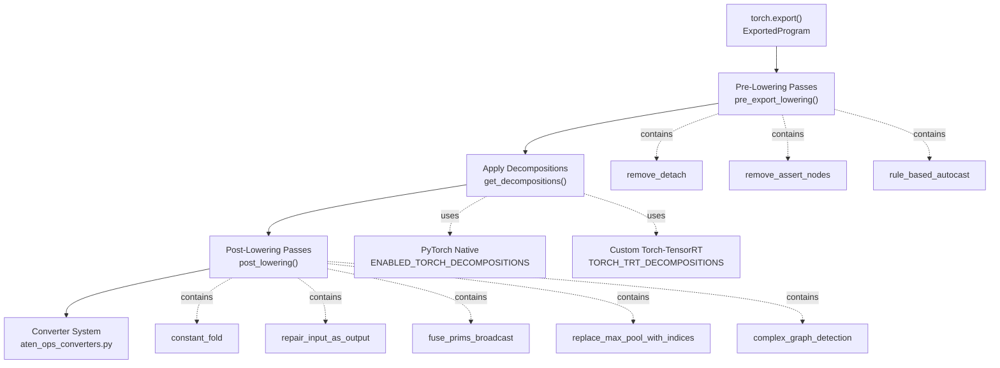

**Sources**: [py/torch_tensorrt/dynamo/lowering/_aten_lowering_pass.py:24-48](), [py/torch_tensorrt/dynamo/lowering/_decompositions.py:639-665]()

---

## Decomposition System Architecture

### Two-Tier Decomposition Registry

Torch-TensorRT maintains two separate decomposition registries that are merged during compilation:

| Registry | Source | Purpose | Size |
|----------|--------|---------|------|
| `ENABLED_TORCH_DECOMPOSITIONS` | PyTorch core | Standard PyTorch decompositions for common operations | ~100+ ops |
| `TORCH_TRT_DECOMPOSITIONS` | Torch-TensorRT custom | TensorRT-specific decompositions and overrides | ~40+ ops |

The final decomposition table is constructed in `get_decompositions()`:

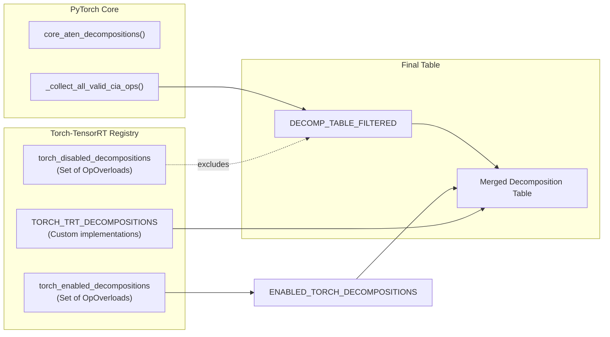

**Sources**: [py/torch_tensorrt/dynamo/lowering/_decompositions.py:639-665](), [py/torch_tensorrt/dynamo/lowering/_decomposition_groups.py:1-195]()

### Decomposition Registration

Custom decompositions are registered using the `@register_torch_trt_decomposition` decorator:

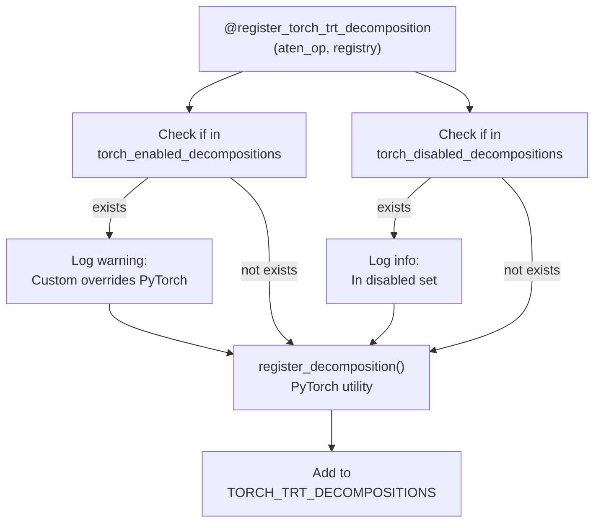

**Sources**: [py/torch_tensorrt/dynamo/lowering/_decompositions.py:28-62]()

---

## Custom Torch-TensorRT Decompositions

### Inplace Operation Decompositions

Inplace operations (e.g., `add_`, `relu_`) are decomposed to their functional equivalents followed by `copy_`:

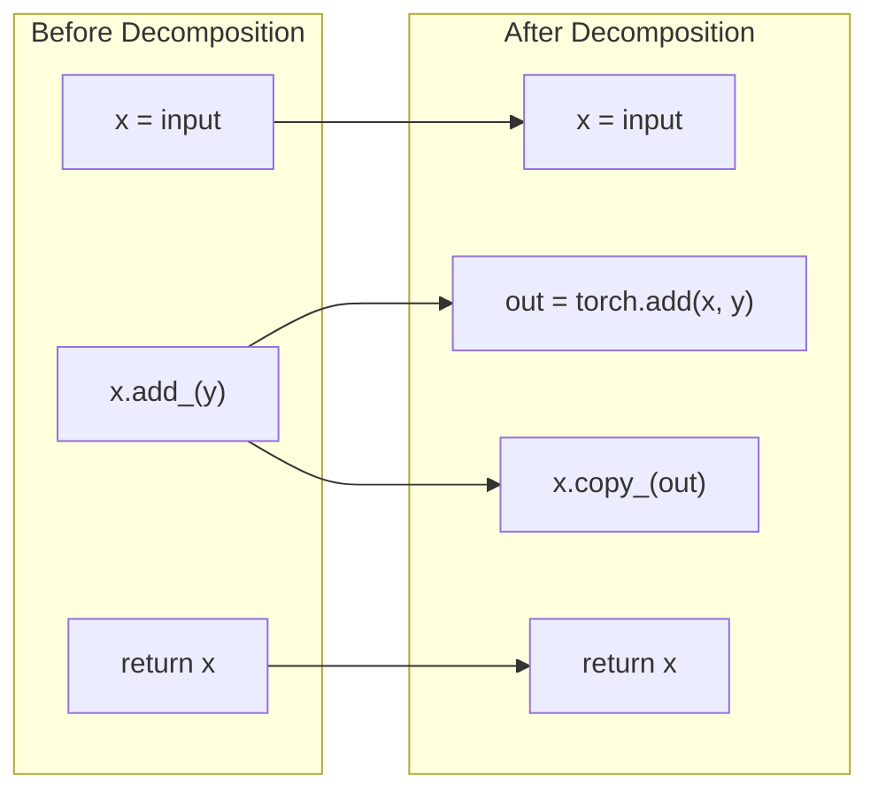

Implemented via `replace_inplace_op()` helper:

**Decomposed Operations**:
- `aten.add_` → `aten.add` + `copy_`
- `aten.relu_` → `aten.relu` + `copy_`
- `aten.index_put_` → `aten.index_put` + `copy_`
- `aten.scatter_` → `aten.scatter` + `copy_`
- Plus 8 more inplace variants

**Sources**: [py/torch_tensorrt/dynamo/lowering/_decompositions.py:65-92]()

### Mathematical Operation Decompositions

#### Reciprocal and Rsqrt

These operations are decomposed into division operations that TensorRT handles more efficiently:

| Original Op | Decomposition | Rationale |
|-------------|---------------|-----------|
| `aten.rsqrt(x)` | `torch.div(1, torch.sqrt(x))` | Avoids dedicated rsqrt converter |
| `aten.reciprocal(x)` | `torch.div(1, x)` | Reuses element-wise division |

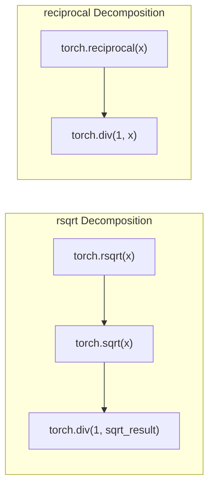

**Sources**: [py/torch_tensorrt/dynamo/lowering/_decompositions.py:94-123]()

#### Variance Decomposition

The `prims.var` operation is decomposed into mean, subtraction, and sum operations:

**Formula**: `var(x) = sum((x - mean(x))^2) / (N - correction)`

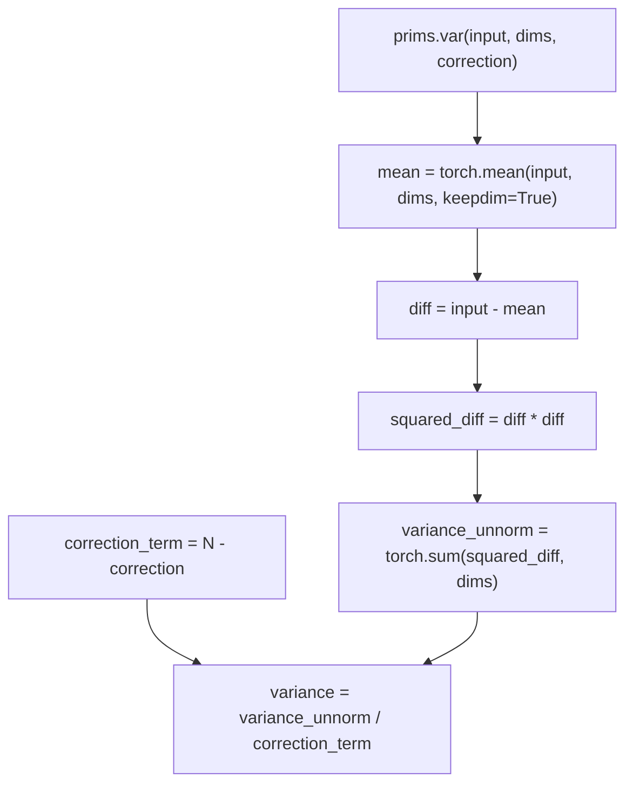

**Sources**: [py/torch_tensorrt/dynamo/lowering/_decompositions.py:125-171]()

### Tensor Creation Decompositions

#### empty_permuted

Creates an empty tensor with a specified permutation by creating an empty tensor and then permuting:

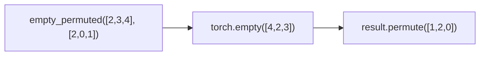

**Sources**: [py/torch_tensorrt/dynamo/lowering/_decompositions.py:173-184]()

#### full_like

Decomposes tensor-dependent creation to explicit shape-based creation:

**Before**: `torch.full_like(tensor, fill_value)`  
**After**: `torch.full(tensor.shape, fill_value, dtype=tensor.dtype, device=tensor.device)`

**Sources**: [py/torch_tensorrt/dynamo/lowering/_decompositions.py:433-443]()

### Scatter Operation Decompositions

#### slice_scatter

Decomposes slice assignment into a gather index computation followed by scatter:

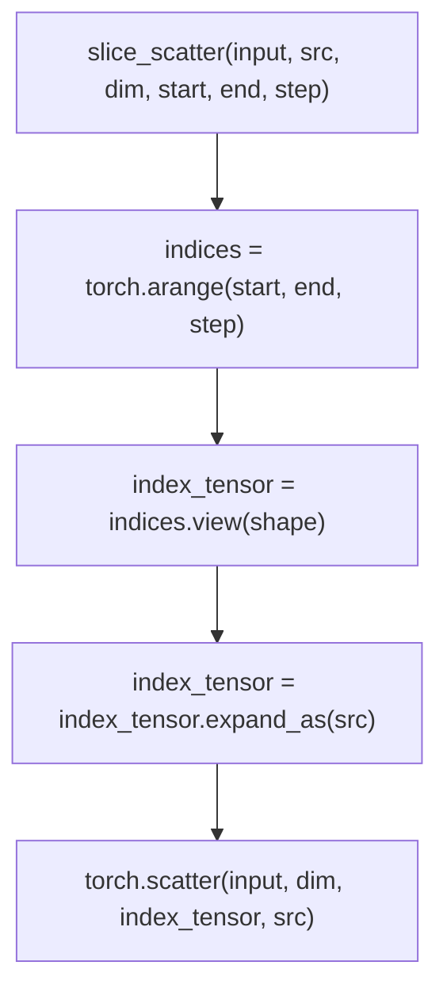

**Sources**: [py/torch_tensorrt/dynamo/lowering/_decompositions.py:186-227]()

#### scatter_reduce

Implements reduction scatter operations (sum, prod, mean, amax, amin) through a loop that processes each source dimension:

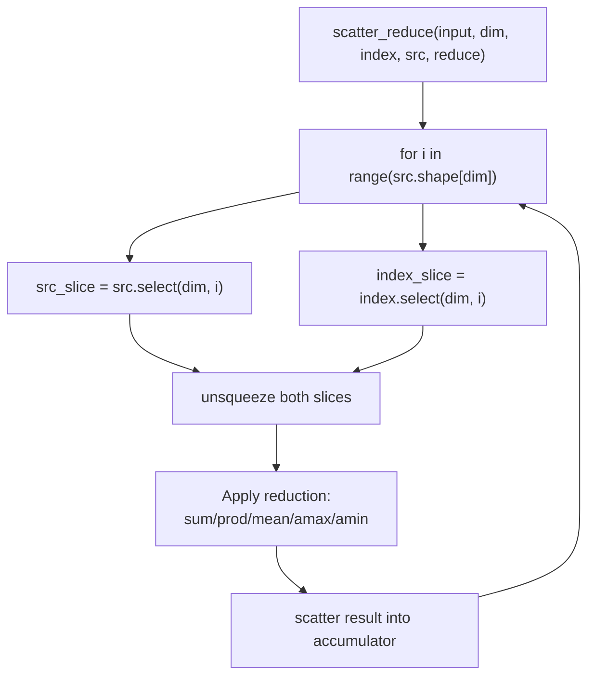

**Sources**: [py/torch_tensorrt/dynamo/lowering/_decompositions.py:302-400]()

### Attention Mechanism Decompositions

#### scaled_dot_product_attention

Decomposes PyTorch's optimized attention into explicit matmul and softmax operations:

**Formula**: `softmax((Q @ K^T) / scale + attn_bias) @ V`

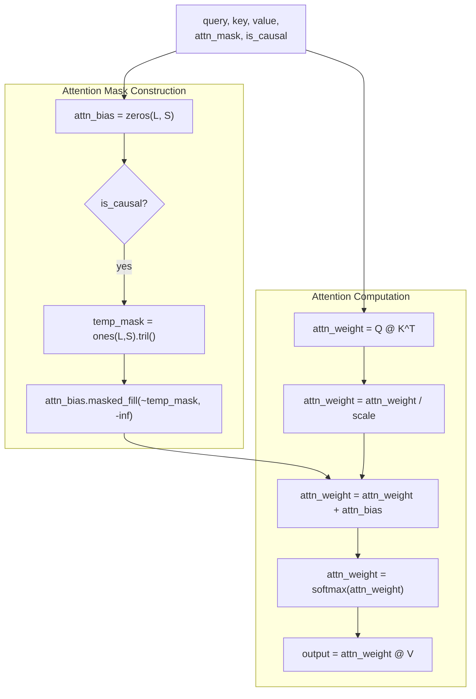

**Variants Decomposed**:
- `aten.scaled_dot_product_attention`
- `aten._scaled_dot_product_flash_attention`
- `aten._scaled_dot_product_efficient_attention`
- `aten._scaled_dot_product_cudnn_attention`

**Sources**: [py/torch_tensorrt/dynamo/lowering/_decompositions.py:450-581]()

### View and Reshape Decompositions

#### view → _reshape_copy

The `aten.view` operation is decomposed to `aten._reshape_copy` for better compatibility:

**Sources**: [py/torch_tensorrt/dynamo/lowering/_decompositions.py:445-448]()

#### unsafe_view → reshape

Removes unsafe view semantics by converting to standard reshape:

**Sources**: [py/torch_tensorrt/dynamo/lowering/_decompositions.py:99-102]()

#### alias → identity

Removes explicit aliasing operations that have no semantic effect:

**Sources**: [py/torch_tensorrt/dynamo/lowering/_decompositions.py:111-114]()

---

## PyTorch Native Decompositions

### Enabled Decomposition Categories

Torch-TensorRT selectively enables PyTorch's core decompositions organized by functionality:

| Category | Example Operations | Count |
|----------|-------------------|-------|
| **Pooling** | `avg_pool2d_backward`, `max_pool2d_with_indices_backward` | 2 |
| **Normalization** | `cudnn_batch_norm`, `native_batch_norm_backward`, `native_layer_norm_backward` | 4 |
| **Activations** | `celu`, `elu_backward`, `gelu_backward`, `hardswish`, `leaky_relu_backward`, `sigmoid_backward`, `tanh_backward` | 10+ |
| **Loss Functions** | `binary_cross_entropy`, `l1_loss`, `mse_loss`, `huber_loss`, `nll_loss_forward` | 8 |
| **Tensor Manipulation** | `stack`, `repeat`, `unfold`, `rot90`, `narrow` | 15+ |
| **Math Operations** | `addcdiv`, `addcmul`, `logaddexp`, `xlogy`, `frac` | 10+ |
| **Indexing** | `index_add`, `index_copy`, `index_fill` | 6 |
| **Special Functions** | `special_entr`, `special_log_ndtr`, `mvlgamma` | 5+ |

**Full list**: [py/torch_tensorrt/dynamo/lowering/_decomposition_groups.py:13-161]()

### Explicitly Disabled Decompositions

Certain PyTorch decompositions are explicitly disabled to maintain performance or compatibility:

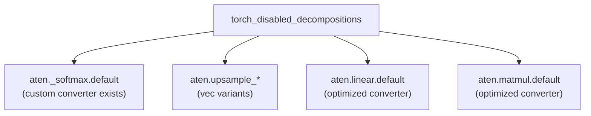

**Rationale**: These operations have specialized, high-performance converters that outperform decomposed implementations.

**Sources**: [py/torch_tensorrt/dynamo/lowering/_decomposition_groups.py:162-173]()

---

## Lowering Pass System

### Pass Manager Architecture

Lowering passes are managed by `DynamoPassManager`, which applies passes sequentially:

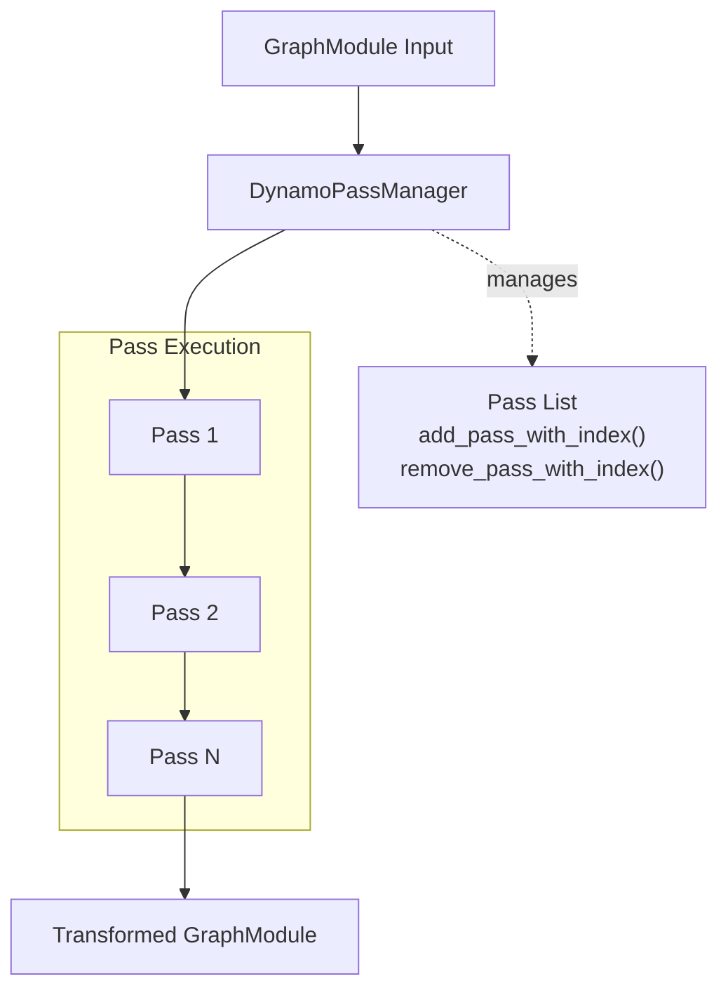

**Pass Management Functions**:
- `_aten_lowering_pass(index=None)`: Decorator to register new passes
- `_remove_lowering_pass(index=i)`: Remove pass at index
- `get_lowering_pass_config(pass)`: Get pass configuration

**Sources**: [py/torch_tensorrt/dynamo/lowering/passes/_aten_lowering_pass.py:55-123]()

---

## Pre-Lowering Passes

Applied **before** decomposition, immediately after `torch.export`:

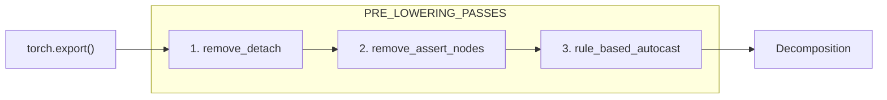

### Pass Descriptions

| Pass | Purpose | Example Transformation |
|------|---------|----------------------|
| `remove_detach` | Removes gradient isolation nodes irrelevant for inference | `detach(x)` → `x` |
| `remove_assert_nodes` | Removes runtime assertions from exported graph | Removes `assert` nodes |
| `rule_based_autocast` | Applies mixed-precision casting based on calibration data | Inserts casts based on autocast policy |

**Sources**: [py/torch_tensorrt/dynamo/lowering/passes/_aten_lowering_pass.py:24-28]()

---

## Post-Lowering Passes

Applied **after** decomposition, before conversion to TensorRT:

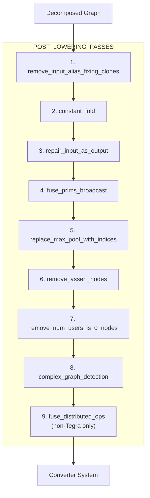

### Critical Post-Lowering Passes

#### constant_fold

Evaluates constant expressions at compile-time to reduce runtime computation:

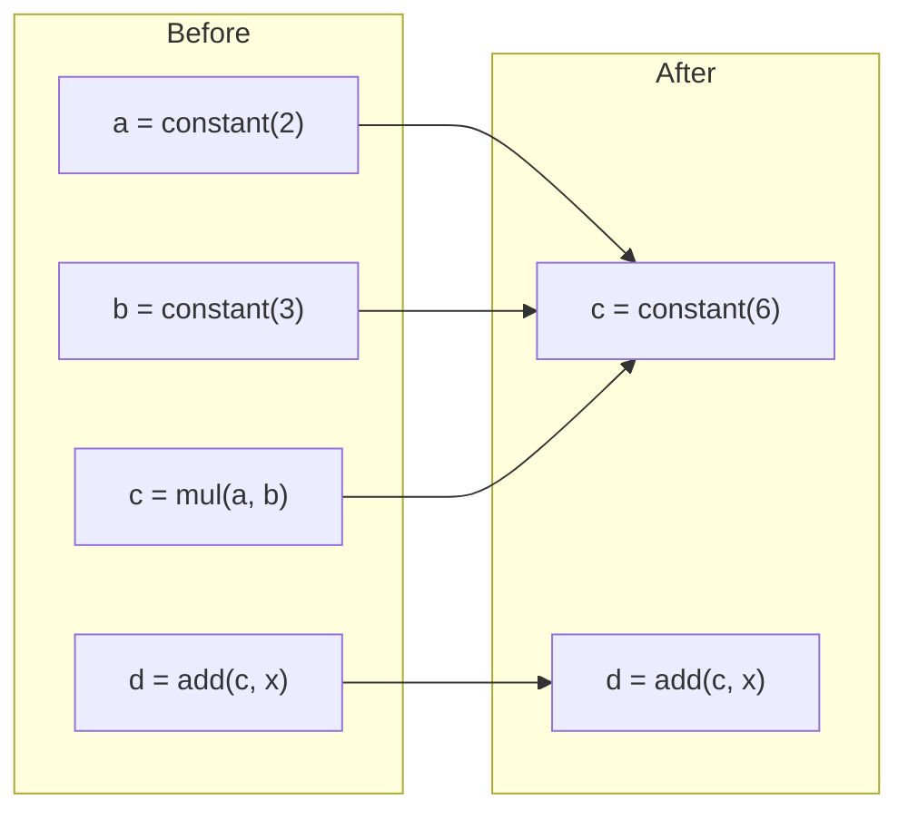

#### repair_input_as_output

Handles cases where graph inputs are also outputs (identity operations):

**Problem**: TensorRT engines cannot have the same tensor as both input and output  
**Solution**: Inserts identity copy operations

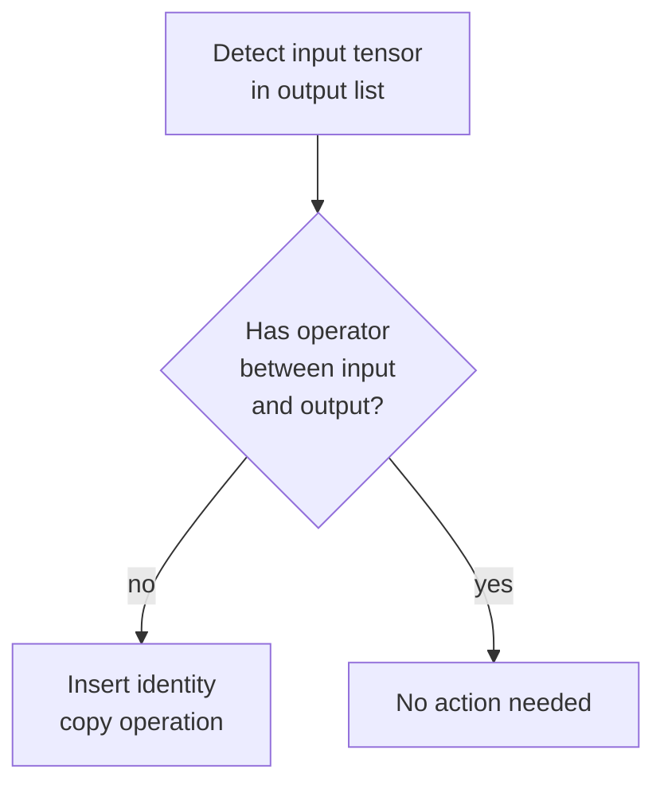

**Sources**: [py/torch_tensorrt/dynamo/lowering/passes/repair_input_as_output.py]()

#### fuse_prims_broadcast

Fuses primitive broadcast operations with their consumers:

**Pattern**: `prims.broadcast_in_dim(x) → consumer(broadcast_x)` becomes `consumer(x)` with implicit broadcast

#### replace_max_pool_with_indices

Converts `max_pool_with_indices` to simple `max_pool` when indices are unused:

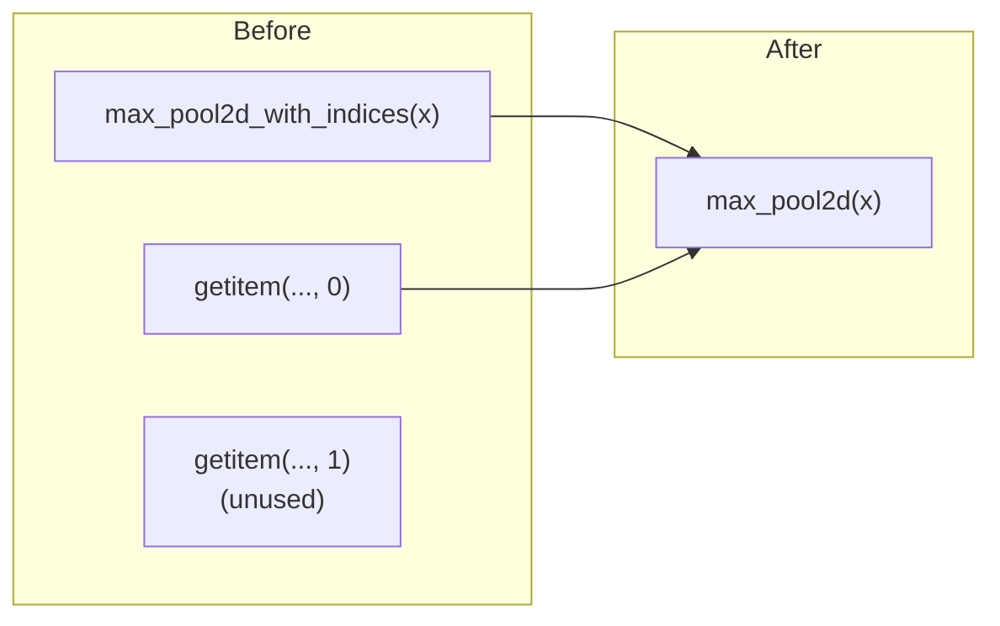

**Sources**: [py/torch_tensorrt/dynamo/lowering/passes/replace_max_pool_with_indices.py]()

#### complex_graph_detection

Detects and decomposes complex number operations into real/imaginary components:

**Pattern**: `view_as_complex` → `mul` → `view_as_real` is expanded into real-valued arithmetic

**Sources**: [py/torch_tensorrt/dynamo/lowering/passes/complex_graph_rewrite.py]()

#### fuse_distributed_ops

Fuses collective communication operations for distributed training (non-Tegra platforms only):

**Condition**: Only added to pass list when `not is_tegra_platform()`

**Sources**: [py/torch_tensorrt/dynamo/lowering/passes/_aten_lowering_pass.py:41-44]()

---

## Integration with Conversion System

The lowering and decomposition system prepares graphs for conversion by ensuring all operations have corresponding converters:

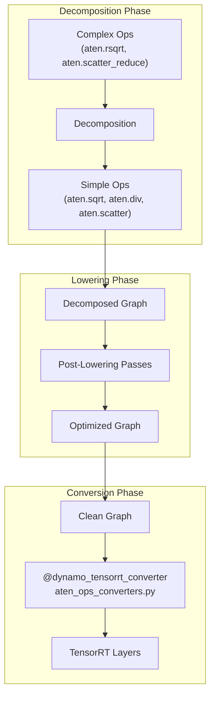

**Key Benefits**:
1. **Reduced Converter Count**: Decompositions allow ~40 decomposition functions to support hundreds of operations
2. **Maintainability**: Changes to decompositions affect multiple dependent operations
3. **Correctness**: PyTorch-validated decompositions ensure semantic equivalence
4. **Optimization**: Post-lowering passes remove redundant operations

**Sources**: [py/torch_tensorrt/dynamo/conversion/aten_ops_converters.py:1-50](), [py/torch_tensorrt/dynamo/lowering/_decompositions.py:639-665]()

---

## Testing and Validation

### Decomposition Tests

Tests verify that decompositions produce expected operator sequences:

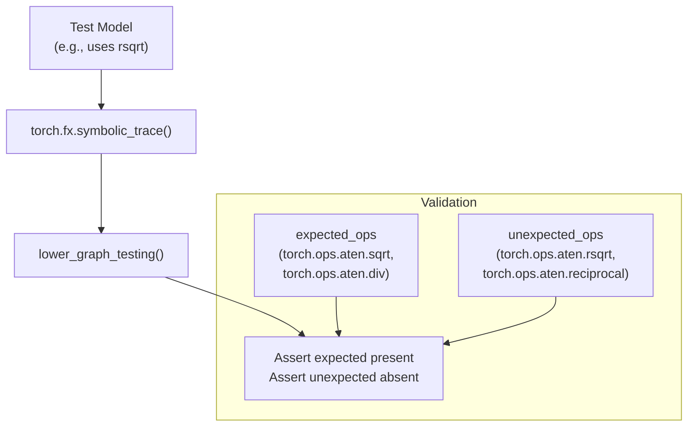

**Test Structure** ([tests/py/dynamo/lowering/test_decompositions.py]()):
- `test_lowering_inplace_op`: Validates inplace decompositions
- `test_lowering_rsqrt`: Validates rsqrt decomposition
- `test_lowering_reciprocal`: Validates reciprocal decomposition  
- `test_lowering_prims_var`: Validates variance decomposition
- `test_lowering_maxpool*`: Validates pooling decompositions
- `test_lowering_full_like_module`: Validates tensor creation decompositions

### Lowering Pass Tests

Tests verify pass behavior and end-to-end correctness:

**Test Categories**:
1. **Pass Registration**: Tests decorator and index-based insertion
2. **Input-as-Output**: Validates `repair_input_as_output` pass
3. **Broadcast Fusion**: Validates `fuse_prims_broadcast` pass
4. **Complex Subgraphs**: Validates `complex_graph_detection` pass

**Sources**: [tests/py/dynamo/lowering/test_aten_lowering_passes.py:1-253]()

---

## Common Decomposition Patterns

### Pattern 1: Unary Operation Decomposition

**Template**: Replace operation with equivalent arithmetic

```
aten.op(x) → arithmetic_operations(x)
```

**Examples**:
- `rsqrt(x)` → `div(1, sqrt(x))`
- `reciprocal(x)` → `div(1, x)`
- `silu(x)` → `x * sigmoid(x)`

### Pattern 2: Inplace to Functional

**Template**: Replace inplace with functional + copy

```
x.op_(y) → x.copy_(op(x, y))
```

**Examples**: All `_` suffixed operations (add_, relu_, etc.)

### Pattern 3: View Normalization

**Template**: Normalize view semantics to standard operations

```
unsafe_view(x, shape) → reshape(x, shape)
alias(x) → x
```

### Pattern 4: Complex to Primitive

**Template**: Break complex operations into multiple simple steps

```
scatter_reduce(input, dim, idx, src, "sum")
  → loop over src dimension
    → select, unsqueeze, scatter, add
```

**Sources**: [py/torch_tensorrt/dynamo/lowering/_decompositions.py:65-665]()

---

