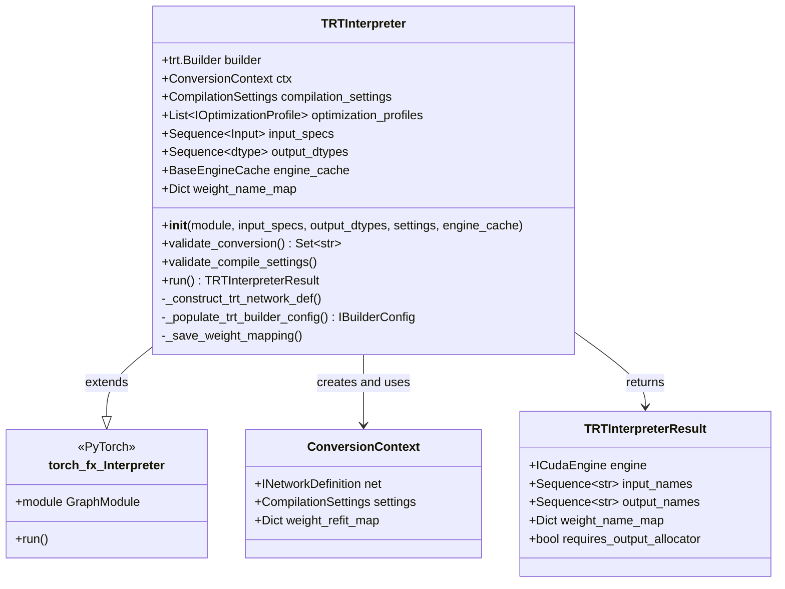
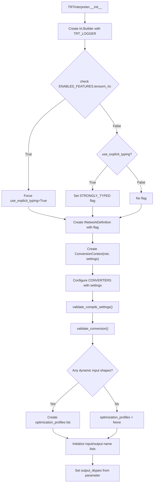
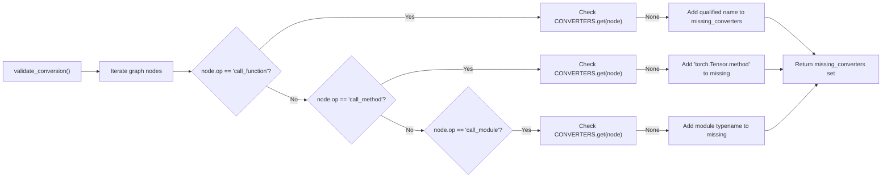
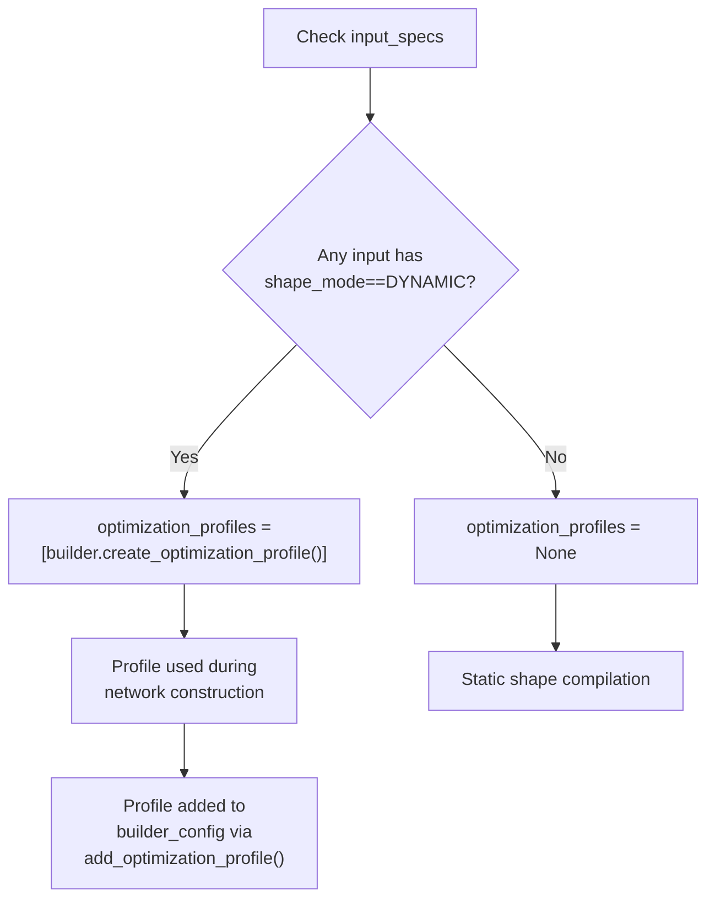
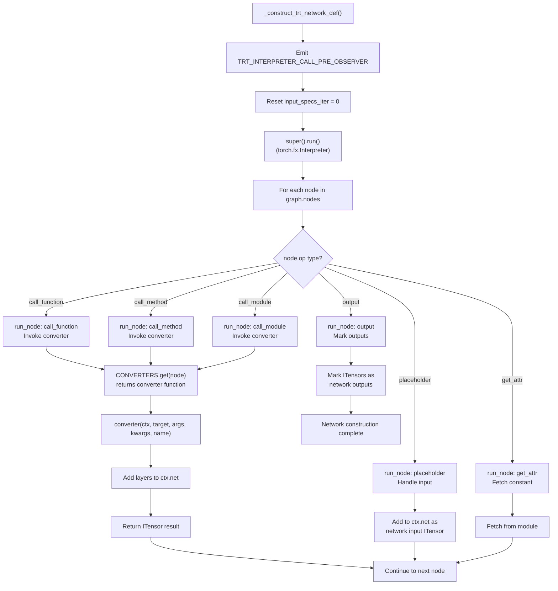
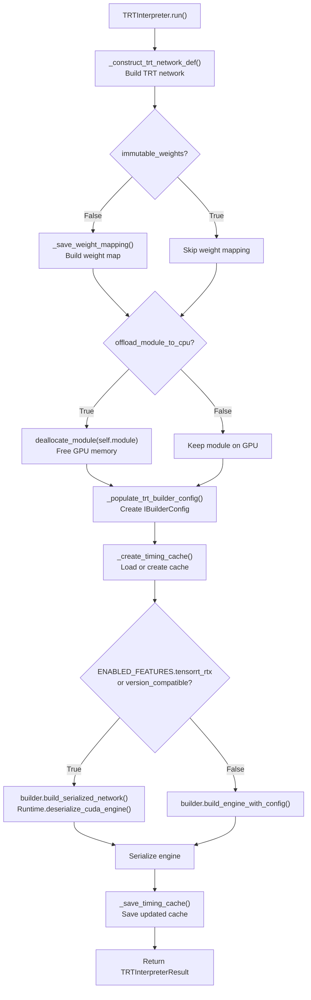

<!-- source: DeepWiki mcp.deepwiki.com · repo pytorch/TensorRT · page 3.4 TRTInterpreter and Network Building · fetched 2026-10-21 -->

# TRTInterpreter and Network Building

<details>
<summary>Relevant source files</summary>

The following files were used as context for generating this wiki page:

- [py/torch_tensorrt/_compile.py](py/torch_tensorrt/_compile.py)
- [py/torch_tensorrt/dynamo/__init__.py](py/torch_tensorrt/dynamo/__init__.py)
- [py/torch_tensorrt/dynamo/_compiler.py](py/torch_tensorrt/dynamo/_compiler.py)
- [py/torch_tensorrt/dynamo/_defaults.py](py/torch_tensorrt/dynamo/_defaults.py)
- [py/torch_tensorrt/dynamo/_refit.py](py/torch_tensorrt/dynamo/_refit.py)
- [py/torch_tensorrt/dynamo/_settings.py](py/torch_tensorrt/dynamo/_settings.py)
- [py/torch_tensorrt/dynamo/conversion/_TRTInterpreter.py](py/torch_tensorrt/dynamo/conversion/_TRTInterpreter.py)
- [py/torch_tensorrt/dynamo/conversion/_conversion.py](py/torch_tensorrt/dynamo/conversion/_conversion.py)
- [py/torch_tensorrt/dynamo/conversion/aten_ops_converters.py](py/torch_tensorrt/dynamo/conversion/aten_ops_converters.py)
- [py/torch_tensorrt/dynamo/conversion/converter_utils.py](py/torch_tensorrt/dynamo/conversion/converter_utils.py)
- [py/torch_tensorrt/dynamo/conversion/impl/normalization/ops.py](py/torch_tensorrt/dynamo/conversion/impl/normalization/ops.py)
- [py/torch_tensorrt/dynamo/conversion/impl/slice/ops.py](py/torch_tensorrt/dynamo/conversion/impl/slice/ops.py)
- [py/torch_tensorrt/dynamo/lowering/_decomposition_groups.py](py/torch_tensorrt/dynamo/lowering/_decomposition_groups.py)
- [py/torch_tensorrt/dynamo/lowering/passes/__init__.py](py/torch_tensorrt/dynamo/lowering/passes/__init__.py)
- [py/torch_tensorrt/dynamo/utils.py](py/torch_tensorrt/dynamo/utils.py)
- [tests/py/dynamo/conversion/harness.py](tests/py/dynamo/conversion/harness.py)
- [tests/py/dynamo/conversion/test_batch_norm_aten.py](tests/py/dynamo/conversion/test_batch_norm_aten.py)
- [tests/py/dynamo/conversion/test_erf_aten.py](tests/py/dynamo/conversion/test_erf_aten.py)
- [tests/py/dynamo/conversion/test_flip_aten.py](tests/py/dynamo/conversion/test_flip_aten.py)
- [tests/py/dynamo/conversion/test_group_norm_aten.py](tests/py/dynamo/conversion/test_group_norm_aten.py)
- [tests/py/dynamo/conversion/test_layer_norm_aten.py](tests/py/dynamo/conversion/test_layer_norm_aten.py)
- [tests/py/dynamo/conversion/test_neg_aten.py](tests/py/dynamo/conversion/test_neg_aten.py)
- [tests/py/dynamo/conversion/test_pdist_aten.py](tests/py/dynamo/conversion/test_pdist_aten.py)
- [tests/py/dynamo/conversion/test_rsqrt_aten.py](tests/py/dynamo/conversion/test_rsqrt_aten.py)
- [tests/py/dynamo/conversion/test_slice_aten.py](tests/py/dynamo/conversion/test_slice_aten.py)
- [tests/py/dynamo/conversion/test_tile_aten.py](tests/py/dynamo/conversion/test_tile_aten.py)
- [tests/py/dynamo/models/test_export_kwargs_serde.py](tests/py/dynamo/models/test_export_kwargs_serde.py)
- [tests/py/dynamo/models/test_export_serde.py](tests/py/dynamo/models/test_export_serde.py)
- [tests/py/dynamo/models/test_model_refit.py](tests/py/dynamo/models/test_model_refit.py)
- [tests/py/dynamo/models/test_reexport.py](tests/py/dynamo/models/test_reexport.py)
- [tests/py/dynamo/runtime/test_002_lazy_engine_init.py](tests/py/dynamo/runtime/test_002_lazy_engine_init.py)

</details>


## Purpose and Scope

The `TRTInterpreter` class is the core component of the Dynamo frontend that converts PyTorch FX graphs into TensorRT `INetwork` objects and builds optimized TensorRT engines. It extends `torch.fx.Interpreter` to traverse FX graph nodes, validate operator support, manage dynamic shape optimization profiles, configure TensorRT builder settings, and orchestrate the entire network construction and engine compilation process.

This page covers the internal workings of `TRTInterpreter` and its role in building TensorRT networks. For information about how operators are converted, see [ATen Operator Conversion System](#3.2). For details on engine caching and weight refitting after the engine is built, see [Engine Caching and Weight Refitting](#3.5). For how inputs are processed before reaching the interpreter, see [Input Processing and Type Handling](#3.6).

**Sources:** [py/torch_tensorrt/dynamo/conversion/_TRTInterpreter.py:1-800]()

## TRTInterpreter Class Structure

The `TRTInterpreter` class inherits from `torch.fx.Interpreter` and manages the entire TensorRT network construction lifecycle. It is instantiated once per FX subgraph that needs to be converted to TensorRT.

### Core Attributes

| Attribute | Type | Purpose |
|-----------|------|---------|
| `builder` | `trt.Builder` | TensorRT builder instance for creating networks and engines |
| `ctx` | `ConversionContext` | Manages TensorRT network and conversion state, maintains ITensor mappings |
| `compilation_settings` | `CompilationSettings` | User-provided compilation options (precision, workspace size, etc.) |
| `optimization_profiles` | `List[trt.IOptimizationProfile]` | Dynamic shape profiles for min/opt/max dimensions |
| `input_specs` | `Sequence[Input]` | Input tensor specifications including shape and dtype information |
| `output_dtypes` | `Sequence[dtype]` | Expected output data types for the compiled module |
| `engine_cache` | `BaseEngineCache` | Optional cache for storing and reusing built engines |
| `weight_name_map` | `Dict[str, Any]` | Mapping from TensorRT engine weight names to PyTorch state dict keys |



**Sources:** [py/torch_tensorrt/dynamo/conversion/_TRTInterpreter.py:80-160](), [py/torch_tensorrt/dynamo/conversion/_TRTInterpreter.py:71-76]()

## Initialization and Validation

### Constructor Workflow

The `TRTInterpreter.__init__` method performs several critical initialization steps:



**Network Creation Flags:** The `STRONGLY_TYPED` flag [py/torch_tensorrt/dynamo/conversion/_TRTInterpreter.py:105-109]() is set when `use_explicit_typing=True`, which enables strict type inference in TensorRT and respects PyTorch model precisions. This is mandatory when TensorRT-RTX is enabled [py/torch_tensorrt/dynamo/conversion/_TRTInterpreter.py:98-103]().

**Sources:** [py/torch_tensorrt/dynamo/conversion/_TRTInterpreter.py:81-160]()

### Operator Validation

The `validate_conversion()` method scans the FX graph to identify operations that lack converters:



If any converters are missing, a warning is logged indicating that interpretation will fail [py/torch_tensorrt/dynamo/conversion/_TRTInterpreter.py:125-128]().

**Sources:** [py/torch_tensorrt/dynamo/conversion/_TRTInterpreter.py:161-175]()

### Compilation Settings Validation

The `validate_compile_settings()` method ensures the platform supports requested precisions:

- **INT8 validation:** Checks `builder.platform_has_fast_int8` [py/torch_tensorrt/dynamo/conversion/_TRTInterpreter.py:209-213]()
- **FP16 validation:** Issues warning if `builder.platform_has_fast_fp16` is false [py/torch_tensorrt/dynamo/conversion/_TRTInterpreter.py:215-219]()
- **BF16 restriction:** TensorRT-RTX does not support bfloat16 [py/torch_tensorrt/dynamo/conversion/_TRTInterpreter.py:205-207]()

**Sources:** [py/torch_tensorrt/dynamo/conversion/_TRTInterpreter.py:203-219]()

## Optimization Profile Management

Optimization profiles are created during initialization when any input has dynamic shapes (detected via `Input._ShapeMode.DYNAMIC` [py/torch_tensorrt/dynamo/conversion/_TRTInterpreter.py:133-136]()). These profiles define the min/opt/max dimensions that TensorRT will optimize for.

### Profile Creation



During network construction, when a dynamic input is encountered, its shape ranges are registered with the optimization profile. The profile is then added to the `IBuilderConfig` in the `_populate_trt_builder_config()` method [py/torch_tensorrt/dynamo/conversion/_TRTInterpreter.py:336-339]().

**Sources:** [py/torch_tensorrt/dynamo/conversion/_TRTInterpreter.py:130-137](), [py/torch_tensorrt/dynamo/conversion/_TRTInterpreter.py:336-339]()

## Builder Configuration Population

The `_populate_trt_builder_config()` method constructs a `trt.IBuilderConfig` object with all user-specified and platform-specific settings. This is one of the most complex configuration methods in the interpreter.

### Configuration Categories

```mermaid
graph TB
    A["_populate_trt_builder_config()"] --> B["Memory Management"]
    A --> C["Precision Flags"]
    A --> D["Hardware Settings"]
    A --> E["Optimization Settings"]
    A --> F["Compatibility Flags"]
    A --> G["Profiling and Monitoring"]
    
    B --> B1["workspace_size<br/>MemoryPoolType.WORKSPACE"]
    B --> B2["DLA memory pools<br/>SRAM/LOCAL_DRAM/GLOBAL_DRAM"]
    
    C --> C1["FP16/BF16/INT8/FP8 flags"]
    C --> C2["sparse_weights flag"]
    C --> C3["disable_tf32 flag"]
    
    D --> D1["engine_capability<br/>GPU/DLA selection"]
    D --> D2["DLA core selection"]
    D --> D3["hardware_compatible<br/>AMPERE_PLUS"]
    
    E --> E1["optimization_level<br/>0-5"]
    E --> E2["avg_timing_iterations"]
    E --> E3["max_aux_streams"]
    E --> E4["tiling_optimization_level"]
    E --> E5["l2_limit_for_tiling"]
    
    F --> F1["version_compatible<br/>VERSION_COMPATIBLE flag"]
    F --> F2["REFIT/REFIT_IDENTICAL flags"]
    F --> F3["STRIP_PLAN flag"]
    F --> F4["WEIGHT_STREAMING flag"]
    F --> F5["WINDOWS_AMD64 runtime"]
    
    G --> G1["profiling_verbosity<br/>DETAILED/LAYER_NAMES_ONLY"]
    G --> G2["progress_monitor<br/>TRTBuilderMonitor"]
```



### Key Configuration Logic

**Precision Configuration:** When `use_explicit_typing=False`, precision flags are set based on `enabled_precisions` [py/torch_tensorrt/dynamo/conversion/_TRTInterpreter.py:298-310](). When `use_explicit_typing=True`, TensorRT infers types from the network layer types directly.

**Refittable Engine Configuration:** [py/torch_tensorrt/dynamo/conversion/_TRTInterpreter.py:317-332]()
- If `immutable_weights=True`: Non-refittable engine, ignore strip and refit flags
- If `immutable_weights=False`:
  - Set `REFIT_IDENTICAL` flag if `refit_identical_engine_weights=True`
  - Otherwise set `REFIT` flag
  - Set `STRIP_PLAN` flag if `strip_engine_weights=True`

**Timing Cache:** If `timing_cache_path` is provided, the method loads existing cache or creates new one [py/torch_tensorrt/dynamo/conversion/_TRTInterpreter.py:379-407]().

**Sources:** [py/torch_tensorrt/dynamo/conversion/_TRTInterpreter.py:221-377]()

## Network Construction Process

The network construction is orchestrated by the `_construct_trt_network_def()` method, which calls the parent `torch.fx.Interpreter.run()` method to traverse the graph.

### Graph Traversal and Conversion



**Placeholder Nodes:** When encountering `placeholder` nodes, the interpreter creates TensorRT input tensors. For dynamic inputs, it registers shape ranges with the optimization profile [py/torch_tensorrt/dynamo/conversion/_TRTInterpreter.py:709-784]() (actual implementation is in the parent `Interpreter.run()` which calls various converter functions).

**Converter Invocation:** For `call_function`, `call_method`, and `call_module` nodes, the interpreter retrieves the appropriate converter from the `CONVERTERS` registry and invokes it with the `ConversionContext` [py/torch_tensorrt/dynamo/conversion/_ConverterRegistry.py:1-300](). The converter adds TensorRT layers to the network and returns ITensors.

**Output Marking:** `output` nodes identify which ITensors should be network outputs. These ITensor names are stored in `_output_names` for later retrieval.

**Sources:** [py/torch_tensorrt/dynamo/conversion/_TRTInterpreter.py:409-420](), [py/torch_tensorrt/dynamo/conversion/_ConverterRegistry.py:1-200]()

## Weight Management and Refitting

For refittable engines (when `immutable_weights=False`), the `_save_weight_mapping()` method builds a mapping from TensorRT engine weight names to PyTorch `state_dict` keys. This mapping is essential for the weight refitting mechanism documented in [Engine Caching and Weight Refitting](#3.5).

### Weight Mapping Strategy

The weight mapping uses a two-stage approach:

**Stage 1: Name Transformation** [py/torch_tensorrt/dynamo/conversion/_TRTInterpreter.py:516-566]()

The method defines a `MODULE_MAP` that specifies how to construct state dict weight names from TensorRT layer names:

| Layer Type | ILayer Type | Weight Attributes |
|------------|-------------|-------------------|
| `SCALE` | `IScaleLayer` | `scale`, `shift` → `weight`, `bias`, `running_mean`, `running_var` |
| `CONVOLUTION` | `IConvolutionLayer` | `kernel`, `bias` → `weight`, `bias` |
| `DECONVOLUTION` | `IDeconvolutionLayer` | `kernel`, `bias` → `weight`, `bias` |
| `CONSTANT` | `IConstantLayer` | `weights` → `weight`, `bias` |

For each TensorRT layer, the method extracts the layer name (which contains the PyTorch module path), parses it, and constructs the corresponding state dict key.

**Stage 2: Value Mapping** [py/torch_tensorrt/dynamo/conversion/_TRTInterpreter.py:567-589]()

After name-based mapping, the method validates by comparing weight tensors:
- For each engine weight, fetch the corresponding state dict weight
- Use `check_weight_equal()` [py/torch_tensorrt/dynamo/conversion/_TRTInterpreter.py:446-459]() to compare shapes and values
- If mismatch, search through all state dict weights to find a match using `find_weight()` [py/torch_tensorrt/dynamo/conversion/_TRTInterpreter.py:422-443]()

The final `weight_name_map` structure is:
```python
{
    "engine_weight_name": [state_dict_key, dtype],
    ...
    "constant_mapping": {scalar_constants}
}
```

**Sources:** [py/torch_tensorrt/dynamo/conversion/_TRTInterpreter.py:462-595]()

## Engine Building and Serialization

The `run()` method is the main entry point that orchestrates the entire network construction and engine building process.

### Build Workflow



### Engine Build Methods

**build_serialized_network (for RTX/version-compatible):** [py/torch_tensorrt/dynamo/conversion/_TRTInterpreter.py:634-643]()
```
serialized_engine = builder.build_serialized_network(ctx.net, builder_config)
runtime = trt.Runtime(TRT_LOGGER)
cuda_engine = runtime.deserialize_cuda_engine(serialized_engine)
```

**build_engine_with_config (standard):** [py/torch_tensorrt/dynamo/conversion/_TRTInterpreter.py:646-648]()
```
cuda_engine = builder.build_engine_with_config(ctx.net, builder_config)
```

The build process can take significant time depending on model complexity and optimization level. Progress can be monitored via `TRTBuilderMonitor` if debug mode is enabled [py/torch_tensorrt/dynamo/conversion/_TRTInterpreter.py:229-230]().

**Sources:** [py/torch_tensorrt/dynamo/conversion/_TRTInterpreter.py:597-711]()

### TRTInterpreterResult Structure

The `run()` method returns a `TRTInterpreterResult` named tuple containing:

| Field | Type | Description |
|-------|------|-------------|
| `engine` | `trt.ICudaEngine` | Compiled TensorRT engine ready for inference |
| `input_names` | `Sequence[str]` | Ordered list of input tensor binding names |
| `output_names` | `Sequence[str]` | Ordered list of output tensor binding names |
| `weight_name_map` | `Optional[dict]` | Mapping for weight refitting (None if immutable) |
| `requires_output_allocator` | `bool` | Whether runtime needs to allocate output buffers |

**Sources:** [py/torch_tensorrt/dynamo/conversion/_TRTInterpreter.py:71-76](), [py/torch_tensorrt/dynamo/conversion/_TRTInterpreter.py:650-711]()

## Integration with Compilation Pipeline

The `TRTInterpreter` is instantiated and invoked by the `interpret_module_to_result()` function in the broader compilation pipeline.

```mermaid
flowchart LR
    A["compile_module()<br/>_compiler.py"] --> B["convert_module()<br/>_conversion.py"]
    B --> C["interpret_module_to_result()<br/>_conversion.py"]
    C --> D{"reuse_cached_engines?"}
    D -->|Yes| E["engine_cache.check(hash)<br/>pull_cached_engine()"]
    E -->|Hit| F["Return cached<br/>SerializedInterpreterResult"]
    E -->|Miss| G["Create TRTInterpreter"]
    D -->|No| G
    G --> H["interpreter.run()<br/>Build engine"]
    H --> I["Delete interpreter<br/>Release memory"]
    I --> J{"cache_built_engines?"}
    J -->|Yes| K["insert_engine_to_cache()"]
    J -->|No| L["Serialize engine"]
    K --> L
    L --> M["Return SerializedInterpreterResult"]
    F --> N["convert_module() continues"]
    M --> N
    N --> O["Create runtime module<br/>PythonTorchTensorRTModule<br/>or TorchTensorRTModule"]
```



**Key Integration Points:**

1. **Input Preparation:** The `input_specs` are prepared by parsing user inputs via `prepare_inputs()` in [utils.py:300-352]() before reaching the interpreter.

2. **Output Dtype Inference:** Output dtypes are inferred from the FX graph node metadata via `infer_module_output_dtypes()` [py/torch_tensorrt/dynamo/conversion/_conversion.py:37-47]().

3. **Engine Caching:** The interpreter result is cached (if enabled) using `insert_engine_to_cache()` [py/torch_tensorrt/dynamo/conversion/_conversion.py:50-94](), allowing future compilations to skip engine building.

4. **Memory Management:** After building, frozen parameters are deleted and memory is released [py/torch_tensorrt/dynamo/conversion/_conversion.py:255-262]() to free resources for subsequent compilation or inference.

5. **Runtime Module Creation:** The serialized engine is wrapped in either `PythonTorchTensorRTModule` or `TorchTensorRTModule` for inference [py/torch_tensorrt/dynamo/conversion/_conversion.py:286-342]().

**Sources:** [py/torch_tensorrt/dynamo/conversion/_conversion.py:188-342](), [py/torch_tensorrt/dynamo/_compiler.py:700-900]()

## Error Handling and Debugging

The interpreter provides several mechanisms for debugging and error handling:

### Validation and Warnings

- **Missing Converters:** `validate_conversion()` warns about unsupported operators [py/torch_tensorrt/dynamo/conversion/_TRTInterpreter.py:125-128]()
- **Precision Support:** Platform capability checks for INT8/FP16/BF16 [py/torch_tensorrt/dynamo/conversion/_TRTInterpreter.py:203-219]()
- **Argument Logging:** `_args_str()` formats node arguments for debug output [py/torch_tensorrt/dynamo/conversion/_TRTInterpreter.py:178-197]()

### Timing and Profiling

The interpreter tracks execution time:
- Network construction time logged at [py/torch_tensorrt/dynamo/conversion/_TRTInterpreter.py:418-420]()
- Engine building time logged at [py/torch_tensorrt/dynamo/conversion/_TRTInterpreter.py:650-656]()
- CPU memory usage tracked via `get_cpu_memory_usage()` [py/torch_tensorrt/dynamo/conversion/_TRTInterpreter.py:613-615]()

### Progress Monitoring

When `DebuggerConfig.engine_builder_monitor` is enabled, a `TRTBuilderMonitor` is attached to track builder progress [py/torch_tensorrt/dynamo/conversion/_TRTInterpreter.py:229-230]().

**Sources:** [py/torch_tensorrt/dynamo/conversion/_TRTInterpreter.py:161-219](), [py/torch_tensorrt/dynamo/conversion/_TRTBuilderMonitor.py:1-100]()

---

