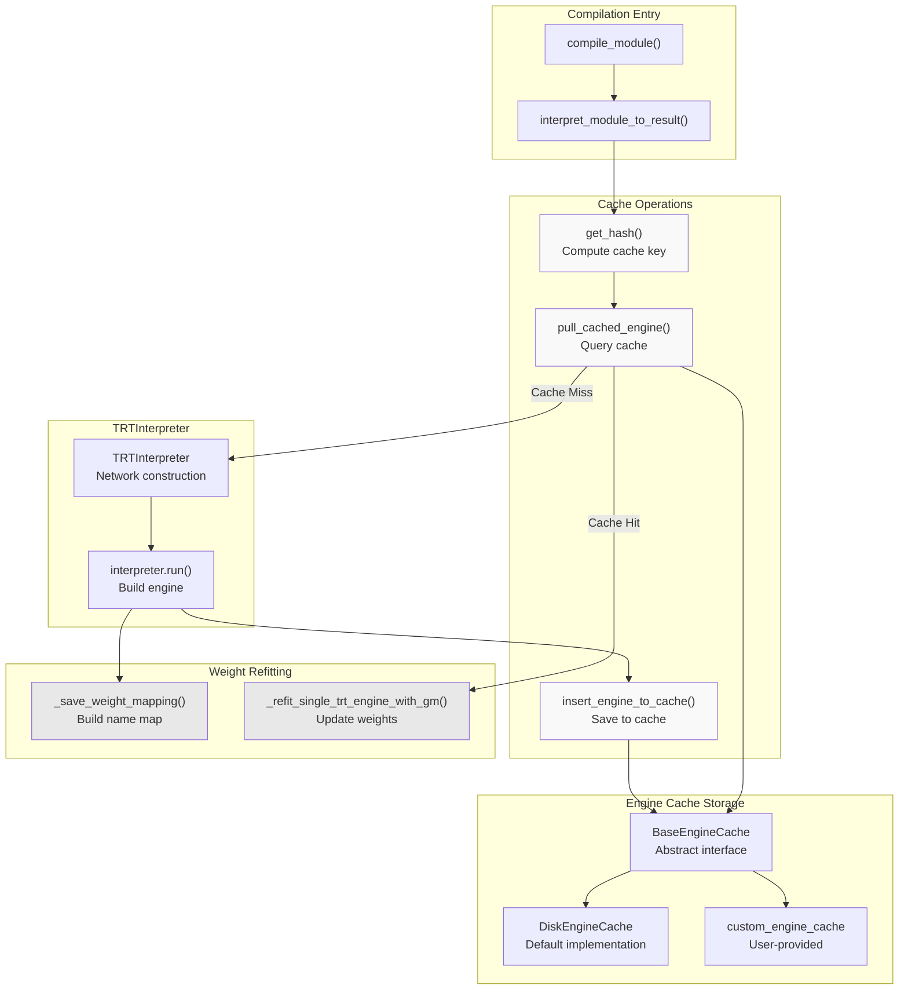
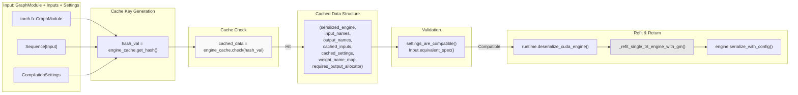
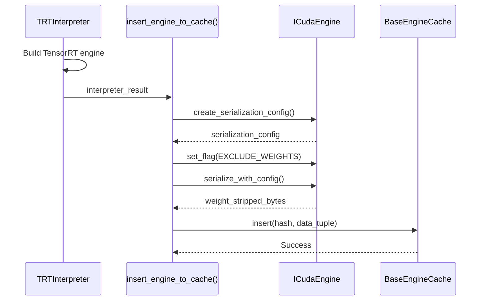
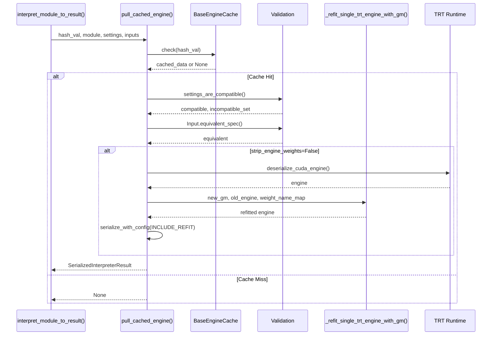
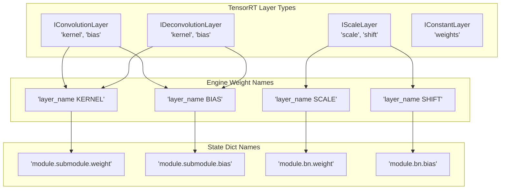

<!-- source: DeepWiki mcp.deepwiki.com · repo pytorch/TensorRT · page 3.5 Engine Caching and Weight Refitting · fetched 2026-10-21 -->

# Engine Caching and Weight Refitting

<details>
<summary>Relevant source files</summary>

The following files were used as context for generating this wiki page:

- [.gitignore](.gitignore)
- [docsrc/conf.py](docsrc/conf.py)
- [docsrc/index.rst](docsrc/index.rst)
- [docsrc/requirements.txt](docsrc/requirements.txt)
- [examples/dynamo/README.rst](examples/dynamo/README.rst)
- [examples/dynamo/compile_with_dynamic_inputs.py](examples/dynamo/compile_with_dynamic_inputs.py)
- [examples/dynamo/custom_kernel_plugins.py](examples/dynamo/custom_kernel_plugins.py)
- [examples/dynamo/debugger_example.py](examples/dynamo/debugger_example.py)
- [examples/dynamo/dynamic_memory_allocation.py](examples/dynamo/dynamic_memory_allocation.py)
- [examples/dynamo/low_cpu_memory_compilation.py](examples/dynamo/low_cpu_memory_compilation.py)
- [examples/dynamo/refit_engine_example.py](examples/dynamo/refit_engine_example.py)
- [py/torch_tensorrt/_compile.py](py/torch_tensorrt/_compile.py)
- [py/torch_tensorrt/dynamo/__init__.py](py/torch_tensorrt/dynamo/__init__.py)
- [py/torch_tensorrt/dynamo/_compiler.py](py/torch_tensorrt/dynamo/_compiler.py)
- [py/torch_tensorrt/dynamo/_defaults.py](py/torch_tensorrt/dynamo/_defaults.py)
- [py/torch_tensorrt/dynamo/_refit.py](py/torch_tensorrt/dynamo/_refit.py)
- [py/torch_tensorrt/dynamo/_settings.py](py/torch_tensorrt/dynamo/_settings.py)
- [py/torch_tensorrt/dynamo/conversion/_TRTInterpreter.py](py/torch_tensorrt/dynamo/conversion/_TRTInterpreter.py)
- [py/torch_tensorrt/dynamo/conversion/_conversion.py](py/torch_tensorrt/dynamo/conversion/_conversion.py)
- [py/torch_tensorrt/dynamo/lowering/passes/__init__.py](py/torch_tensorrt/dynamo/lowering/passes/__init__.py)
- [py/torch_tensorrt/dynamo/utils.py](py/torch_tensorrt/dynamo/utils.py)
- [tests/py/dynamo/conversion/harness.py](tests/py/dynamo/conversion/harness.py)
- [tests/py/dynamo/models/test_export_kwargs_serde.py](tests/py/dynamo/models/test_export_kwargs_serde.py)
- [tests/py/dynamo/models/test_export_serde.py](tests/py/dynamo/models/test_export_serde.py)
- [tests/py/dynamo/models/test_model_refit.py](tests/py/dynamo/models/test_model_refit.py)
- [tests/py/dynamo/models/test_reexport.py](tests/py/dynamo/models/test_reexport.py)
- [tests/py/dynamo/runtime/test_002_lazy_engine_init.py](tests/py/dynamo/runtime/test_002_lazy_engine_init.py)

</details>


## Purpose and Scope

This document describes the engine caching and weight refitting mechanisms in the Dynamo frontend. These features enable compiled TensorRT engines to be saved to disk and reused across compilation sessions, avoiding expensive recompilation when only model weights change. This is particularly useful for fine-tuning scenarios and iterative model development.

**Related Topics:**
- For overall Dynamo compilation pipeline, see [3.1](#3.1)
- For TRTInterpreter network building, see [3.4](#3.4)
- For compilation settings configuration, see [2.6](#2.6)

## Core Concepts

### Weight-Stripped Engines

TensorRT engines can be serialized without their weight values using the `EXCLUDE_WEIGHTS` serialization flag. These weight-stripped engines contain the network structure and optimization decisions but occupy significantly less disk space. The weights can be refitted later without rebuilding the entire engine.

### Engine Refitting

Refitting is the process of updating weights in an existing TensorRT engine without rebuilding it. This requires:
1. A refittable engine (built with `BuilderFlag.REFIT` or `BuilderFlag.REFIT_IDENTICAL`)
2. A weight name mapping between TensorRT engine names and PyTorch state_dict names
3. New weights that match the engine's expected shapes and types

### Cache Key Computation

Each compiled engine is identified by a hash computed from:
- The FX graph structure
- Input specifications (shapes, dtypes, dynamic ranges)
- Compilation settings that affect engine structure

Sources: [py/torch_tensorrt/dynamo/conversion/_conversion.py:214-219]()

## Architecture Overview



Sources: [py/torch_tensorrt/dynamo/conversion/_conversion.py:50-95](), [py/torch_tensorrt/dynamo/conversion/_conversion.py:97-185](), [py/torch_tensorrt/dynamo/conversion/_conversion.py:188-290]()

## Component Interactions



Sources: [py/torch_tensorrt/dynamo/conversion/_conversion.py:97-185](), [py/torch_tensorrt/dynamo/_settings.py:217-229]()

## Engine Caching Process

### Cache Insertion Flow

When `cache_built_engines=True`, compiled engines are saved to the cache:

1. **Engine Serialization with Weight Stripping**: After building the TensorRT engine, create a serialization config and set the `EXCLUDE_WEIGHTS` flag to strip weights before caching.

2. **Cache Storage**: Insert the weight-stripped engine along with metadata into the cache using the computed hash as the key.

3. **Stored Metadata Tuple**:
   - `serialized_engine`: Weight-stripped engine bytes
   - `input_names`: List of engine input binding names
   - `output_names`: List of engine output binding names
   - `inputs`: Input specifications used during compilation
   - `settings`: CompilationSettings used during compilation
   - `weight_name_map`: Mapping for weight refitting
   - `requires_output_allocator`: Whether runtime needs output allocator



Sources: [py/torch_tensorrt/dynamo/conversion/_conversion.py:50-95]()

### Cache Retrieval Flow

When `reuse_cached_engines=True`, the system attempts to load engines from cache:

1. **Cache Query**: Use the computed hash to query the cache.

2. **Compatibility Validation**: 
   - Check if compilation settings are compatible using `settings_are_compatible()`
   - Verify input specifications match using `Input.equivalent_spec()`

3. **Conditional Refitting**:
   - If `strip_engine_weights=False` in current settings, refit the cached engine with new weights
   - If `strip_engine_weights=True`, return the weight-stripped engine as-is

4. **Re-serialization**: After refitting, serialize the engine with `INCLUDE_REFIT` flag to include the new weights.



Sources: [py/torch_tensorrt/dynamo/conversion/_conversion.py:97-185](), [py/torch_tensorrt/dynamo/_settings.py:217-229]()

### Prerequisites for Caching

The engine caching system requires specific conditions:

| Condition | Requirement | Location |
|-----------|-------------|----------|
| Refit Feature | `ENABLED_FEATURES.refit == True` | [py/torch_tensorrt/dynamo/conversion/_conversion.py:61-66]() |
| Immutable Weights | `settings.immutable_weights == False` | [py/torch_tensorrt/dynamo/conversion/_conversion.py:230-233]() |
| Engine Cache | `engine_cache is not None` | [py/torch_tensorrt/dynamo/conversion/_conversion.py:222-226]() |

If these conditions are not met, warning messages are logged and caching is skipped.

Sources: [py/torch_tensorrt/dynamo/conversion/_conversion.py:208-240]()

## Weight Refitting Process

### Weight Name Mapping Construction

The `_save_weight_mapping()` method builds a bidirectional mapping between TensorRT engine weight names and PyTorch state_dict names. This is a two-stage process implemented in [py/torch_tensorrt/dynamo/conversion/_TRTInterpreter.py:462-595]().

#### Stage 1: Name Transformation

Map engine weight names to expected state_dict names based on layer structure:



Sources: [py/torch_tensorrt/dynamo/conversion/_TRTInterpreter.py:471-565]()

The `MODULE_MAP` dictionary defines the mapping rules:

| Layer Type | Weight Attribute | Engine Suffix | State Dict Suffix |
|------------|-----------------|---------------|-------------------|
| CONVOLUTION | kernel | KERNEL | weight |
| CONVOLUTION | bias | BIAS | bias |
| DECONVOLUTION | kernel | KERNEL | weight |
| DECONVOLUTION | bias | BIAS | bias |
| SCALE | scale | SCALE | (weight, bias, running_mean, running_var) |
| SCALE | shift | SHIFT | (weight, bias, running_mean, running_var) |
| CONSTANT | weights | CONSTANT | (weight, bias) |

Sources: [py/torch_tensorrt/dynamo/conversion/_TRTInterpreter.py:471-515]()

#### Stage 2: Value Mapping

For weights where name transformation fails or produces incorrect matches, perform value-based matching:

1. **Extract Network Weight**: Get weight tensor from `weight_refit_map[engine_weight_name]`
2. **Iterate State Dict**: Compare weight shapes and values with each entry in state_dict
3. **Match by Equality**: Use `check_weight_equal()` to find matching weights (tolerance: 0.01)
4. **Remove Matched**: Delete matched entries from state_dict to avoid duplicate matches

```python
# Pseudocode from _save_weight_mapping
for engine_weight_name, sd_weight_name in weight_name_map.items():
    if sd_weight_name not in state_dict or not check_weight_equal():
        sd_weight_name = find_weight(
            engine_weight_name, 
            weight_refit_map, 
            state_dict, 
            device
        )
```

Sources: [py/torch_tensorrt/dynamo/conversion/_TRTInterpreter.py:567-595](), [py/torch_tensorrt/dynamo/conversion/_TRTInterpreter.py:423-460]()

### Refit Operation

The actual refitting is performed by `_refit_single_trt_engine_with_gm()` (implementation not in provided files, but referenced in [py/torch_tensorrt/dynamo/conversion/_conversion.py:154-165]()):

1. **Deserialize Engine**: Convert weight-stripped serialized bytes to `ICudaEngine`
2. **Create Refitter**: Use TensorRT's refitter API with the existing engine
3. **Update Weights**: For each weight in `weight_name_map`, extract from new graph module and set in refitter
4. **Refit Engine**: Call refitter to update engine weights in-place
5. **Serialize with Weights**: Create new serialization with `INCLUDE_REFIT` flag

The updated engine is then returned to the caller for execution.

## Configuration Reference

### Compilation Settings

These flags control engine caching and refitting behavior:

| Setting | Type | Default | Description |
|---------|------|---------|-------------|
| `cache_built_engines` | bool | False | Save compiled engines to cache |
| `reuse_cached_engines` | bool | False | Load engines from cache if available |
| `engine_cache_dir` | str | `/tmp/torch_tensorrt_engine_cache` | Directory for disk-based cache |
| `engine_cache_size` | int | 5368709120 (5GB) | Maximum cache size in bytes |
| `custom_engine_cache` | BaseEngineCache | None | Custom cache implementation |
| `refit_identical_engine_weights` | bool | False | Build with REFIT_IDENTICAL flag |
| `strip_engine_weights` | bool | False | Return weight-stripped engines |
| `immutable_weights` | bool | True | Build non-refittable engines |

Sources: [py/torch_tensorrt/dynamo/_settings.py:60-174](), [py/torch_tensorrt/dynamo/_defaults.py:43-54]()

### Engine Invariant Settings

The following settings affect engine structure and must match between cached and current compilation for cache reuse:

- `enabled_precisions`
- `max_aux_streams`
- `version_compatible`
- `optimization_level`
- `disable_tf32`
- `sparse_weights`
- `engine_capability`
- `hardware_compatible`
- `refit_identical_engine_weights`
- `immutable_weights`
- `enable_weight_streaming`
- `tiling_optimization_level`
- `l2_limit_for_tiling`
- `enable_autocast`
- `autocast_low_precision_type`
- `autocast_excluded_nodes`
- `autocast_excluded_ops`
- `autocast_max_output_threshold`
- `autocast_max_depth_of_reduction`
- `autocast_calibration_dataloader`

Sources: [py/torch_tensorrt/dynamo/_settings.py:192-214]()

### Builder Flags for Refitting

When building refittable engines, the following TensorRT builder flags are set:

```python
if not immutable_weights:
    if refit_identical_engine_weights:
        builder_config.set_flag(trt.BuilderFlag.REFIT_IDENTICAL)
    else:
        builder_config.set_flag(trt.BuilderFlag.REFIT)
    
    if strip_engine_weights:
        builder_config.set_flag(trt.BuilderFlag.STRIP_PLAN)
```

Sources: [py/torch_tensorrt/dynamo/conversion/_TRTInterpreter.py:317-331]()

## Implementation Details

### Cache Interface

The `BaseEngineCache` abstract class (not in provided files, imported in [py/torch_tensorrt/dynamo/_engine_cache:24]()) defines the interface for engine cache implementations:

- `get_hash(module, inputs, settings) -> str`: Compute cache key
- `check(hash_val) -> Optional[tuple]`: Query cache for entry
- `insert(hash_val, data) -> None`: Store entry in cache

The default `DiskEngineCache` implementation stores engines in the filesystem using the hash as filename.

Sources: [py/torch_tensorrt/dynamo/_compiler.py:24](), [py/torch_tensorrt/dynamo/utils.py:36]()

### Memory Management

During weight mapping and refitting, memory is explicitly managed:

1. **CPU Offloading**: Weights can be moved to CPU during mapping to reduce GPU memory usage
2. **Garbage Collection**: After engine building, temporary structures are deleted and `gc.collect()` is called
3. **CUDA Cache Clearing**: `torch.cuda.empty_cache()` is invoked to release GPU memory

Sources: [py/torch_tensorrt/dynamo/conversion/_TRTInterpreter.py:593-595](), [py/torch_tensorrt/dynamo/conversion/_conversion.py:254-262]()

### Example Usage

```python
import torch_tensorrt

# Enable engine caching
compiled_model = torch_tensorrt.compile(
    model,
    inputs=[input_spec],
    cache_built_engines=True,
    reuse_cached_engines=True,
    engine_cache_dir="/path/to/cache",
    immutable_weights=False,  # Required for caching
)

# Second compilation with same graph structure but different weights
# will reuse cached engine and refit with new weights
new_model = torch_tensorrt.compile(
    updated_model,
    inputs=[input_spec],
    reuse_cached_engines=True,
    engine_cache_dir="/path/to/cache",
)
```

Sources: [py/torch_tensorrt/dynamo/_compiler.py:397-463](), [tests/py/dynamo/models/test_models.py:158-188]()

---

