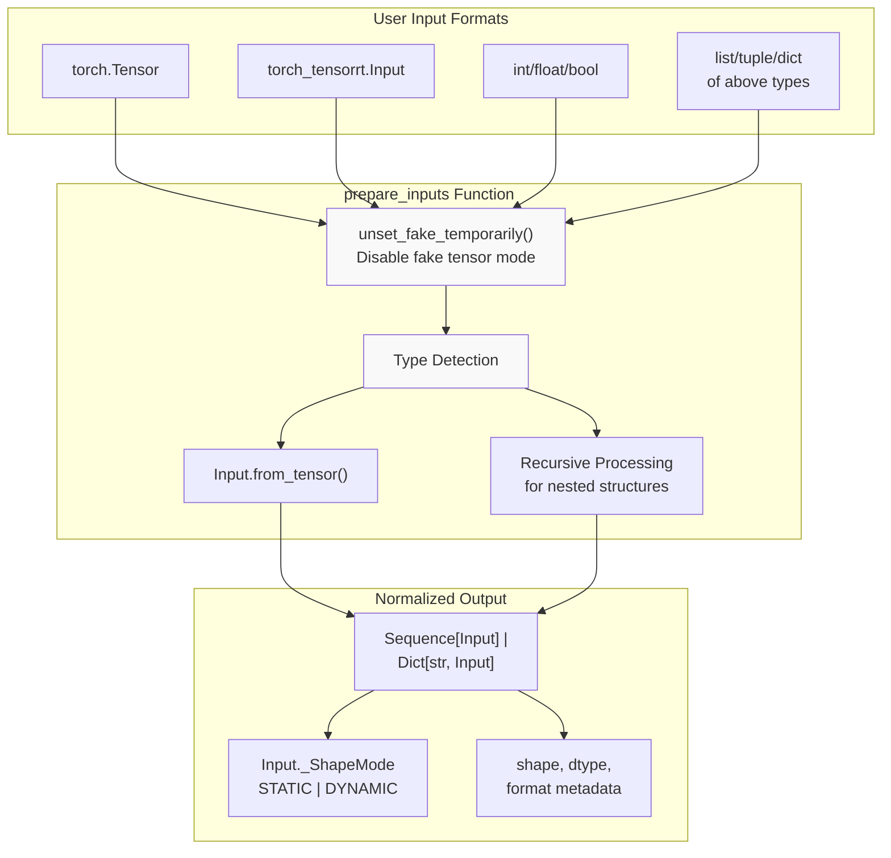
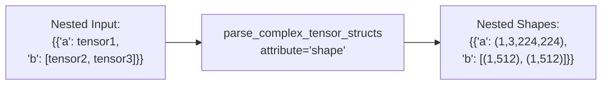
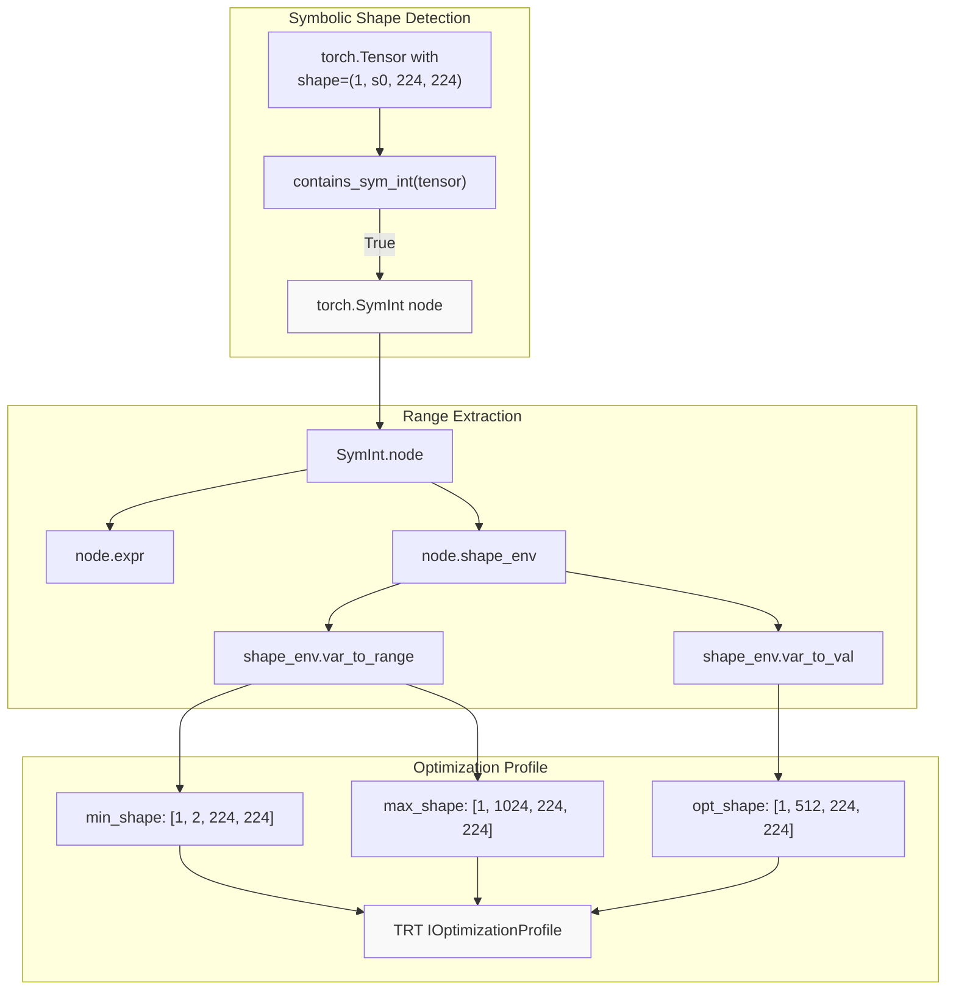
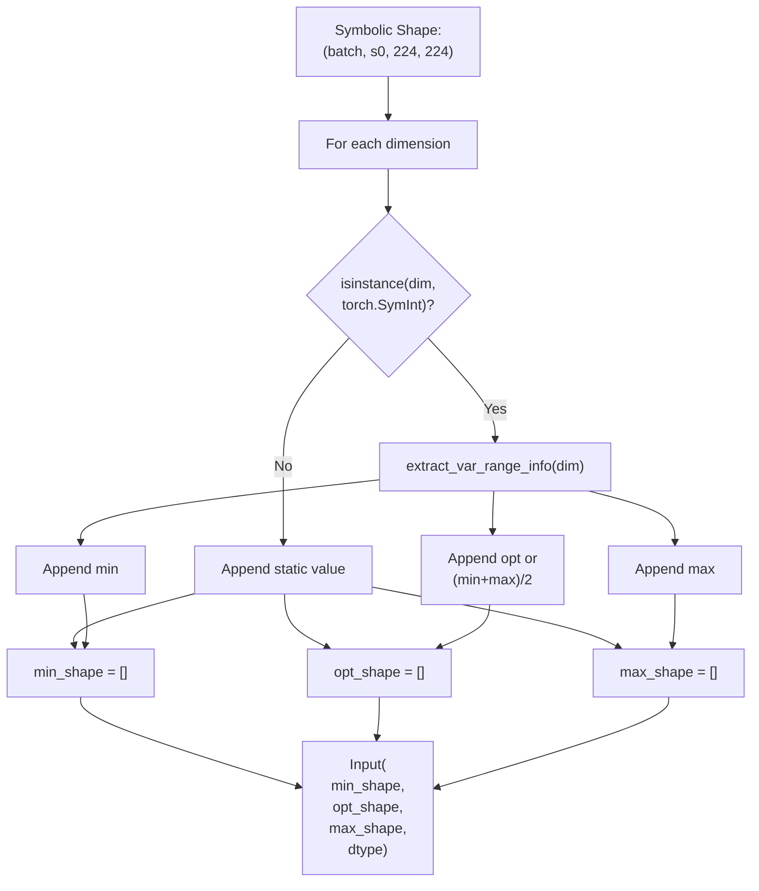
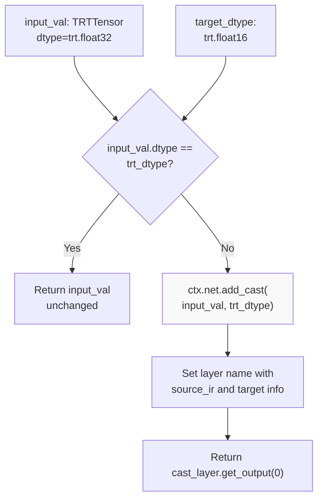
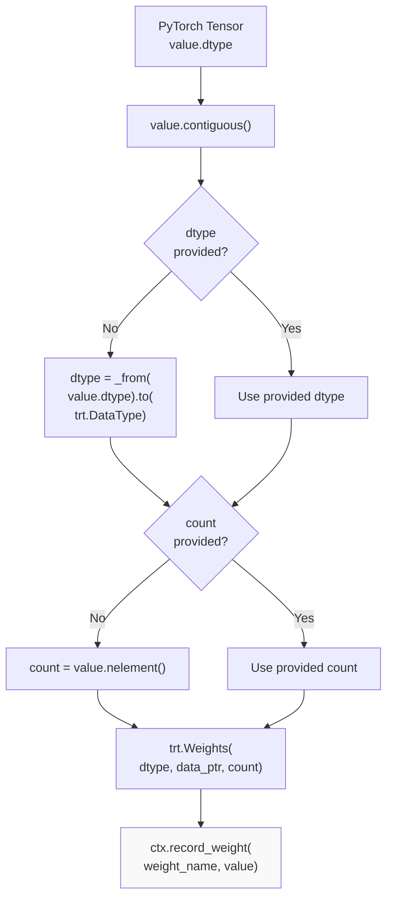
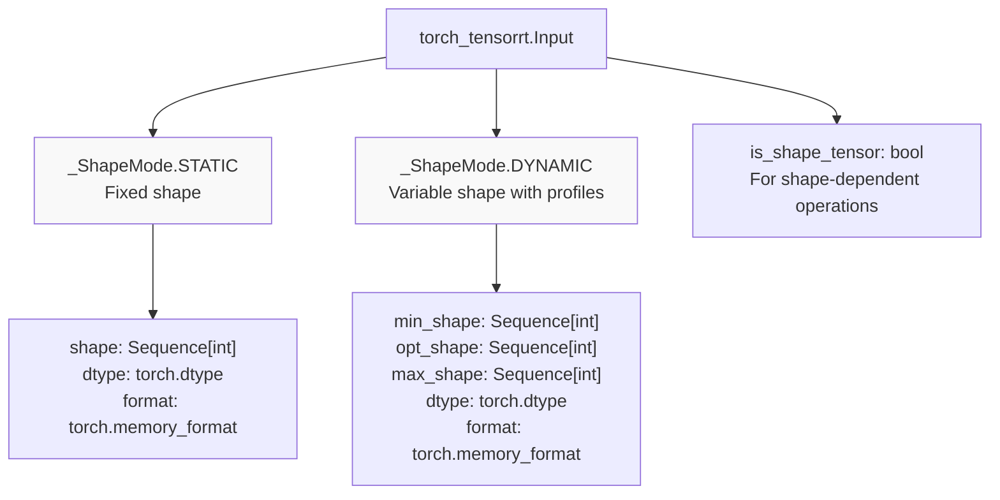
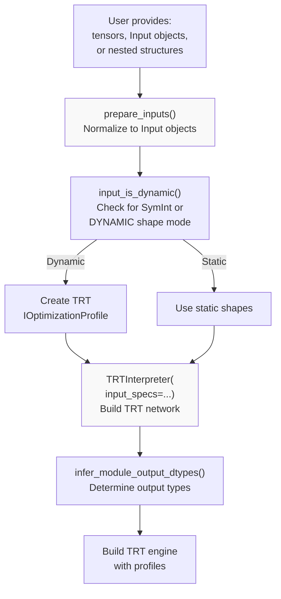

<!-- source: DeepWiki mcp.deepwiki.com · repo pytorch/TensorRT · page 3.6 Input Processing and Type Handling · fetched 2026-10-21 -->

# Input Processing and Type Handling

<details>
<summary>Relevant source files</summary>

The following files were used as context for generating this wiki page:

- [py/torch_tensorrt/_compile.py](py/torch_tensorrt/_compile.py)
- [py/torch_tensorrt/dynamo/__init__.py](py/torch_tensorrt/dynamo/__init__.py)
- [py/torch_tensorrt/dynamo/_compiler.py](py/torch_tensorrt/dynamo/_compiler.py)
- [py/torch_tensorrt/dynamo/_defaults.py](py/torch_tensorrt/dynamo/_defaults.py)
- [py/torch_tensorrt/dynamo/_refit.py](py/torch_tensorrt/dynamo/_refit.py)
- [py/torch_tensorrt/dynamo/_settings.py](py/torch_tensorrt/dynamo/_settings.py)
- [py/torch_tensorrt/dynamo/conversion/_TRTInterpreter.py](py/torch_tensorrt/dynamo/conversion/_TRTInterpreter.py)
- [py/torch_tensorrt/dynamo/conversion/_conversion.py](py/torch_tensorrt/dynamo/conversion/_conversion.py)
- [py/torch_tensorrt/dynamo/conversion/aten_ops_converters.py](py/torch_tensorrt/dynamo/conversion/aten_ops_converters.py)
- [py/torch_tensorrt/dynamo/conversion/converter_utils.py](py/torch_tensorrt/dynamo/conversion/converter_utils.py)
- [py/torch_tensorrt/dynamo/conversion/impl/normalization/ops.py](py/torch_tensorrt/dynamo/conversion/impl/normalization/ops.py)
- [py/torch_tensorrt/dynamo/conversion/impl/slice/ops.py](py/torch_tensorrt/dynamo/conversion/impl/slice/ops.py)
- [py/torch_tensorrt/dynamo/lowering/_decomposition_groups.py](py/torch_tensorrt/dynamo/lowering/_decomposition_groups.py)
- [py/torch_tensorrt/dynamo/lowering/passes/__init__.py](py/torch_tensorrt/dynamo/lowering/passes/__init__.py)
- [py/torch_tensorrt/dynamo/utils.py](py/torch_tensorrt/dynamo/utils.py)
- [tests/py/dynamo/conversion/harness.py](tests/py/dynamo/conversion/harness.py)
- [tests/py/dynamo/conversion/test_batch_norm_aten.py](tests/py/dynamo/conversion/test_batch_norm_aten.py)
- [tests/py/dynamo/conversion/test_erf_aten.py](tests/py/dynamo/conversion/test_erf_aten.py)
- [tests/py/dynamo/conversion/test_flip_aten.py](tests/py/dynamo/conversion/test_flip_aten.py)
- [tests/py/dynamo/conversion/test_group_norm_aten.py](tests/py/dynamo/conversion/test_group_norm_aten.py)
- [tests/py/dynamo/conversion/test_layer_norm_aten.py](tests/py/dynamo/conversion/test_layer_norm_aten.py)
- [tests/py/dynamo/conversion/test_neg_aten.py](tests/py/dynamo/conversion/test_neg_aten.py)
- [tests/py/dynamo/conversion/test_pdist_aten.py](tests/py/dynamo/conversion/test_pdist_aten.py)
- [tests/py/dynamo/conversion/test_rsqrt_aten.py](tests/py/dynamo/conversion/test_rsqrt_aten.py)
- [tests/py/dynamo/conversion/test_slice_aten.py](tests/py/dynamo/conversion/test_slice_aten.py)
- [tests/py/dynamo/conversion/test_tile_aten.py](tests/py/dynamo/conversion/test_tile_aten.py)
- [tests/py/dynamo/models/test_export_kwargs_serde.py](tests/py/dynamo/models/test_export_kwargs_serde.py)
- [tests/py/dynamo/models/test_export_serde.py](tests/py/dynamo/models/test_export_serde.py)
- [tests/py/dynamo/models/test_model_refit.py](tests/py/dynamo/models/test_model_refit.py)
- [tests/py/dynamo/models/test_reexport.py](tests/py/dynamo/models/test_reexport.py)
- [tests/py/dynamo/runtime/test_002_lazy_engine_init.py](tests/py/dynamo/runtime/test_002_lazy_engine_init.py)

</details>


This page describes how the Dynamo frontend processes inputs to TensorRT compilation, including parsing various input formats, detecting dynamic shapes via symbolic integers, and enforcing type constraints. This covers the transformation from user-provided inputs (PyTorch tensors, `torch_tensorrt.Input` objects, or nested structures) into TensorRT-compatible input specifications with proper data types and shape profiles.

For information about how these inputs are used during graph conversion, see [TRTInterpreter and Network Building](#3.4). For type handling within individual operation converters, see [Type Handling and Casting](#5.6).

## Input Parsing Pipeline

The Dynamo frontend accepts inputs in multiple formats and normalizes them into a consistent representation. The main entry point is the `prepare_inputs` function which recursively processes nested structures of tensors, scalars, and `Input` objects.



**Diagram: Input parsing transformation from user formats to normalized Input specifications**

Sources: [py/torch_tensorrt/dynamo/utils.py:300-352]()

### Parsing Function Implementation

The `prepare_inputs` function handles the following input types:

| Input Type | Processing | Result |
|------------|-----------|--------|
| `torch_tensorrt.Input` | Pass through unchanged | `Input` object |
| `torch.Tensor` | Convert via `Input.from_tensor()` | `Input` with static/dynamic shape |
| `int`, `float`, `bool` | Wrap in tensor, then convert | `Input` representing scalar |
| `list`, `tuple` | Recursively process each element | List/tuple of `Input` objects |
| `dict` | Recursively process each value | Dict with `Input` values |

The function temporarily disables fake tensor mode using `unset_fake_temporarily()` to ensure that tensors created during input processing are real tensors, not fake tensors that might be present during `torch.compile` sessions.

Sources: [py/torch_tensorrt/dynamo/utils.py:300-352](), [py/torch_tensorrt/dynamo/_compiler.py:278-300]()

### Nested Structure Handling

For complex input structures, the `parse_complex_tensor_structs` utility extracts attributes (like `shape` or `dtype`) while preserving the nested structure:



**Diagram: Attribute extraction from nested input structures**

This is used throughout the compilation pipeline to extract shapes, dtypes, or devices from complex input specifications while maintaining the same nesting structure.

Sources: [py/torch_tensorrt/dynamo/utils.py:354-400]()

## Dynamic Shape Detection

Dynamic shapes are detected through PyTorch's symbolic shape system using `torch.SymInt`. When a tensor has symbolic dimensions, these are identified and converted into TensorRT optimization profiles with minimum, optimal, and maximum bounds.



**Diagram: Dynamic shape detection and TensorRT optimization profile construction**

Sources: [py/torch_tensorrt/dynamo/utils.py:402-437](), [py/torch_tensorrt/dynamo/partitioning/common.py:13-73]()

### SymInt Range Information

The `extract_var_range_info` function retrieves the constraints on symbolic dimensions:

```python
# For a SymInt s0 with range [2, 1024] and current value 512
var_range_info = {
    "min": 2,      # from shape_env.var_to_range.lower
    "opt": 512,    # from shape_env.var_to_val or expr.xreplace
    "max": 1024    # from shape_env.var_to_range.upper
}
```

Special handling is applied for TorchDynamo's 0/1 specialization where `min_val == 2` is adjusted to `min_val = 1`.

Sources: [py/torch_tensorrt/dynamo/utils.py:409-436]()

### Shape Unwrapping

The `unwrap_tensor_shape` function converts symbolic shapes into a representation suitable for logging or input specification:

| Tensor Shape | Unwrapped Shape | Mode |
|--------------|-----------------|------|
| `(1, 3, 224, 224)` | `(1, 3, 224, 224)` | Static |
| `(1, s0, 224, 224)` | `(1, (2, 1024), 224, 224)` | Dynamic (no mode) |
| `(1, s0, 224, 224)` | `(1, 2, 224, 224)` | Dynamic (mode="min") |
| `(1, s0, 224, 224)` | `(1, 512, 224, 224)` | Dynamic (mode="opt") |

Sources: [py/torch_tensorrt/dynamo/utils.py:439-466]()

### Dynamic Input Construction

The `construct_dynamic_input` function creates a `torch_tensorrt.Input` object from symbolic shapes:



**Diagram: Dynamic Input object construction from symbolic shapes**

Sources: [py/torch_tensorrt/dynamo/partitioning/common.py:13-73]()

## Type Handling

Type handling in the Dynamo frontend involves enforcement of type constraints, casting between data types, and promotion rules to ensure TensorRT compatibility.

### Type Enforcement with Decorators

The `enforce_tensor_types` decorator validates that converter arguments have the expected TensorRT tensor types:

```python
@enforce_tensor_types({
    0: (TRTTensor,),           # First arg must be TRTTensor
    1: (TRTTensor,),           # Second arg must be TRTTensor
})
def my_converter(ctx, target, args, kwargs, name):
    # args[0] and args[1] guaranteed to be TRTTensor
    ...
```

This decorator is applied to many converters to ensure type safety before processing.

Sources: [py/torch_tensorrt/dynamo/conversion/aten_ops_converters.py:71-75](), [py/torch_tensorrt/dynamo/conversion/aten_ops_converters.py:433-437]()

### Type Casting Infrastructure

The `cast_trt_tensor` function converts TensorRT tensors between data types:



**Diagram: Type casting decision flow for TensorRT tensors**

Sources: [py/torch_tensorrt/dynamo/conversion/converter_utils.py:147-183]()

### Type Promotion Rules

Type promotion follows TensorRT compatibility rules:

| PyTorch Type | TensorRT Type | Notes |
|--------------|---------------|-------|
| `torch.float64` | `trt.float32` | Truncated if `truncate_double=True` |
| `torch.int64` | `trt.int32` | Supported natively in newer TRT versions |
| `torch.float32` | `trt.float32` | Direct mapping |
| `torch.float16` | `trt.float16` | Direct mapping |
| `torch.bfloat16` | `trt.bfloat16` | Direct mapping (not supported on TensorRT-RTX) |
| `torch.int8` | `trt.int8` | Direct mapping |
| `torch.bool` | `trt.bool` | Direct mapping |
| `torch.uint8` | `trt.fp4` | Special handling for FP4 quantization (TRT 10.8+) |

The `unified_dtype_converter` function handles conversions between PyTorch, NumPy, and TensorRT data types:

Sources: [py/torch_tensorrt/dynamo/utils.py:58-128](), [py/torch_tensorrt/dynamo/conversion/converter_utils.py:336-405]()

### Weight Type Conversion

The `to_trt_weights` function converts PyTorch tensors to TensorRT weights with proper type handling:



**Diagram: Weight tensor to TensorRT weights conversion pipeline**

Weight recording tracks weights for refitting and debugging purposes. The function supports special handling for quantized types (e.g., FP4 packed in uint8).

Sources: [py/torch_tensorrt/dynamo/conversion/converter_utils.py:336-405]()

### Special Type Handling Cases

#### Double Truncation

When `truncate_double=True`, float64 tensors and weights are automatically truncated to float32:

```python
if torch_value.dtype == torch.float64:
    raise ValueError(
        "TensorRT does not support float64 (double) precision. "
        "To resolve this, please set truncate_double=True..."
    )
```

Sources: [py/torch_tensorrt/dynamo/conversion/converter_utils.py:437-440]()

#### INT64 to INT32 Casting

For integer division operations, both operands are cast to float32 to ensure correct division semantics:

```python
def cast_int_int_div_trt_tensor(ctx, lhs_val, rhs_val, name):
    if lhs_val.dtype == trt.int32 and rhs_val.dtype == trt.int32:
        lhs_val = cast_trt_tensor(ctx, lhs_val, trt.float32, name)
        rhs_val = cast_trt_tensor(ctx, rhs_val, trt.float32, name)
    return [lhs_val, rhs_val]
```

Sources: [py/torch_tensorrt/dynamo/conversion/converter_utils.py:185-205]()

#### Boolean Casting

Boolean tensors are cast when needed for operations that require boolean inputs:

```python
def cast_int_or_float_to_bool(ctx, name, tensor):
    if tensor.dtype != trt.bool:
        return cast_trt_tensor(ctx, tensor, trt.bool, name)
    return tensor
```

Sources: [py/torch_tensorrt/dynamo/conversion/converter_utils.py:327-334]()

## Input Specifications and Shape Modes

The `torch_tensorrt.Input` class represents input specifications with two primary shape modes.

### Input Shape Modes



**Diagram: Input class structure with shape modes and fields**

Sources: [py/torch_tensorrt/dynamo/utils.py:187-203](), [py/torch_tensorrt/dynamo/utils.py:206-220]()

### Shape Tensors

Shape tensors are special inputs that represent shape information rather than data:

```python
def get_torch_tensor(input: Input, device: torch.device, mode: str = ""):
    if input.is_shape_tensor:
        # Shape tensors are plain integers
        return input.shape["opt_shape"][0]
    
    if len(mode) > 0:
        return input.example_tensor(mode).to(device)
    else:
        return input.torch_tensor.to(device)
```

Shape tensors are used for operations where shape values flow through the computation graph (e.g., `torch.arange(x)` where `x` is a shape-dependent value).

Sources: [py/torch_tensorrt/dynamo/utils.py:206-220]()

### Optimization Profile Creation

Dynamic inputs trigger the creation of TensorRT optimization profiles in the interpreter:

```python
self.optimization_profiles = (
    [self.builder.create_optimization_profile()]
    if any(
        input_spec.shape_mode == Input._ShapeMode.DYNAMIC
        for input_spec in input_specs
    )
    else None
)
```

Each dynamic dimension is registered with the profile using the min/opt/max bounds extracted from the symbolic shape information.

Sources: [py/torch_tensorrt/dynamo/conversion/_TRTInterpreter.py:130-137]()

### Input Processing in Compilation

The complete input processing flow through compilation:



**Diagram: End-to-end input processing through compilation pipeline**

Sources: [py/torch_tensorrt/dynamo/_compiler.py:278-394](), [py/torch_tensorrt/dynamo/utils.py:187-203](), [py/torch_tensorrt/dynamo/conversion/_TRTInterpreter.py:81-152]()

## Type Inference and Output Types

Output data types are inferred from the FX graph metadata set during Dynamo tracing:

```python
def infer_module_output_dtypes(module: torch.fx.GraphModule, truncate_double: bool = False):
    outputs = [node for node in module.graph.nodes if node.op == "output"]
    outputs = outputs[0].args
    return get_output_dtypes(outputs, truncate_double)
```

The `get_output_dtypes` function recursively extracts dtype information from output nodes, handling nested structures and applying truncation rules when necessary.

Sources: [py/torch_tensorrt/dynamo/conversion/_conversion.py:37-48](), [py/torch_tensorrt/dynamo/utils.py:468-485]()

### Data Type Metadata

During graph traversal, type information is preserved in node metadata:

| Metadata Key | Content | Usage |
|--------------|---------|-------|
| `node.meta['val']` | `FakeTensor` or scalar value | Primary source for shape/dtype |
| `node.meta['tensor_meta']` | `TensorMetadata` object | Alternative metadata source |
| `input.dtype` | PyTorch dtype | Used for `Input` objects |

The `unwrap_tensor_dtype` function extracts dtype from any of these sources:

```python
def unwrap_tensor_dtype(tensor):
    if isinstance(tensor, (torch.Tensor, FakeTensor)):
        return tensor.dtype
    elif isinstance(tensor, (int, float, bool)):
        return torch.tensor(tensor).dtype
    elif isinstance(tensor, torch.SymInt):
        return torch.int64
    elif isinstance(tensor, torch.SymFloat):
        return torch.float32
```

Sources: [py/torch_tensorrt/dynamo/utils.py:468-485]()

---

