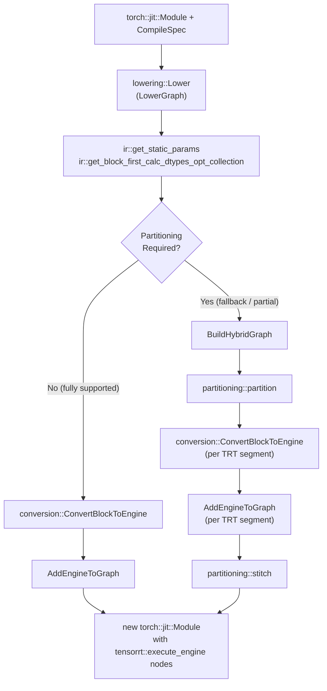
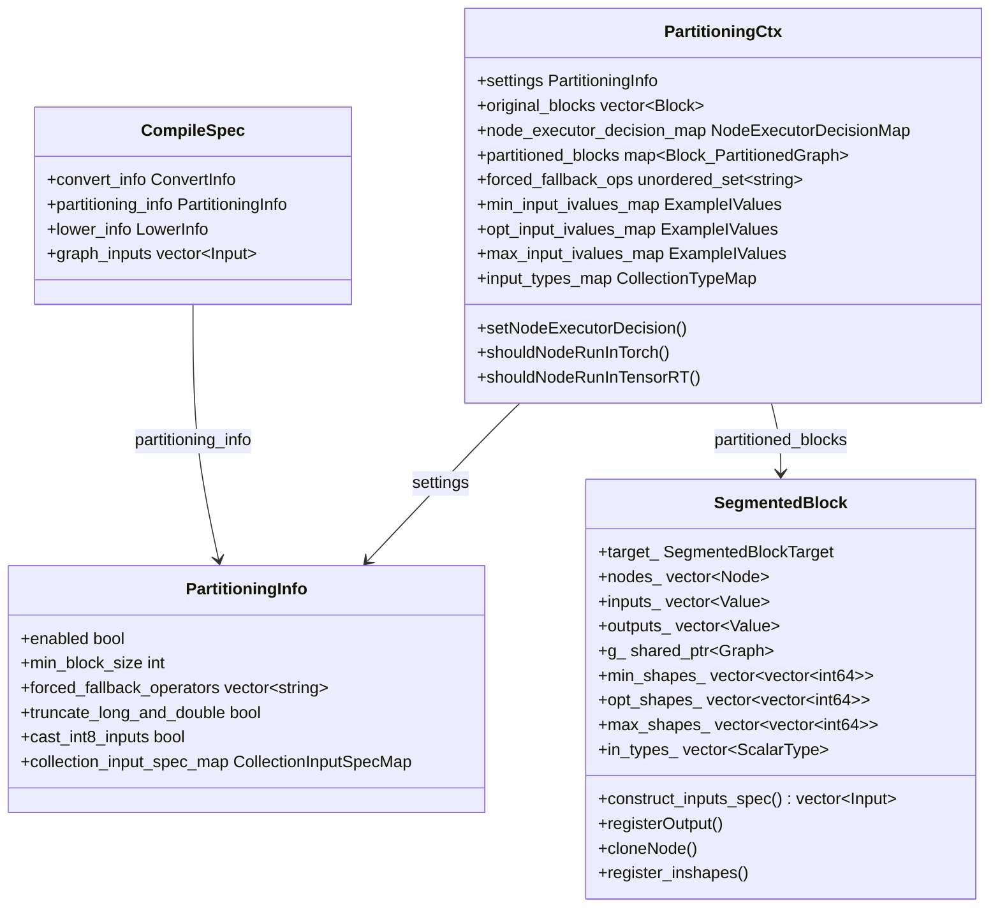
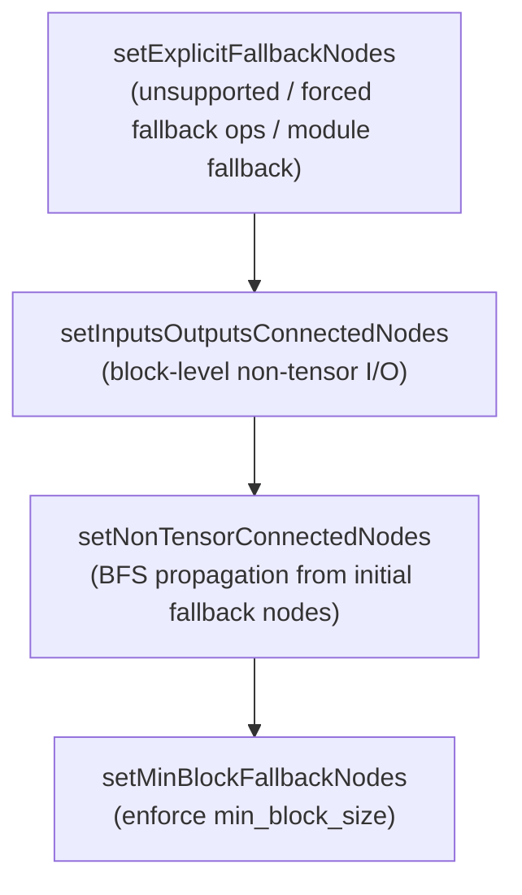
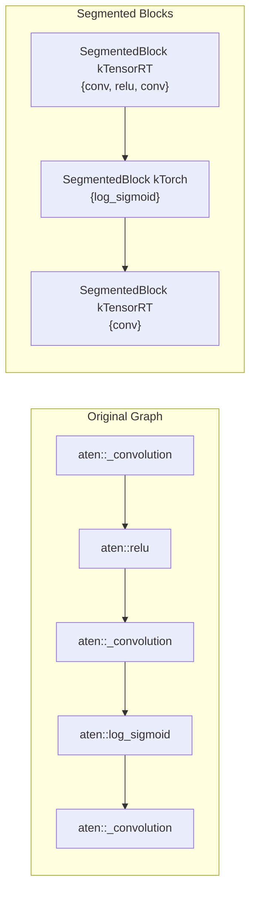
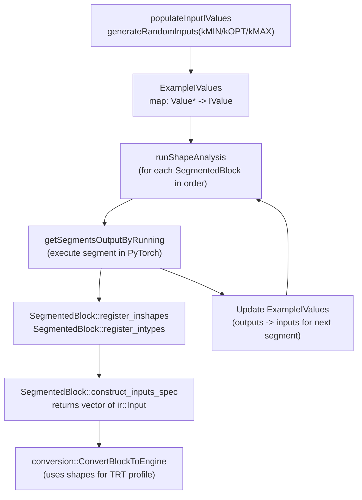
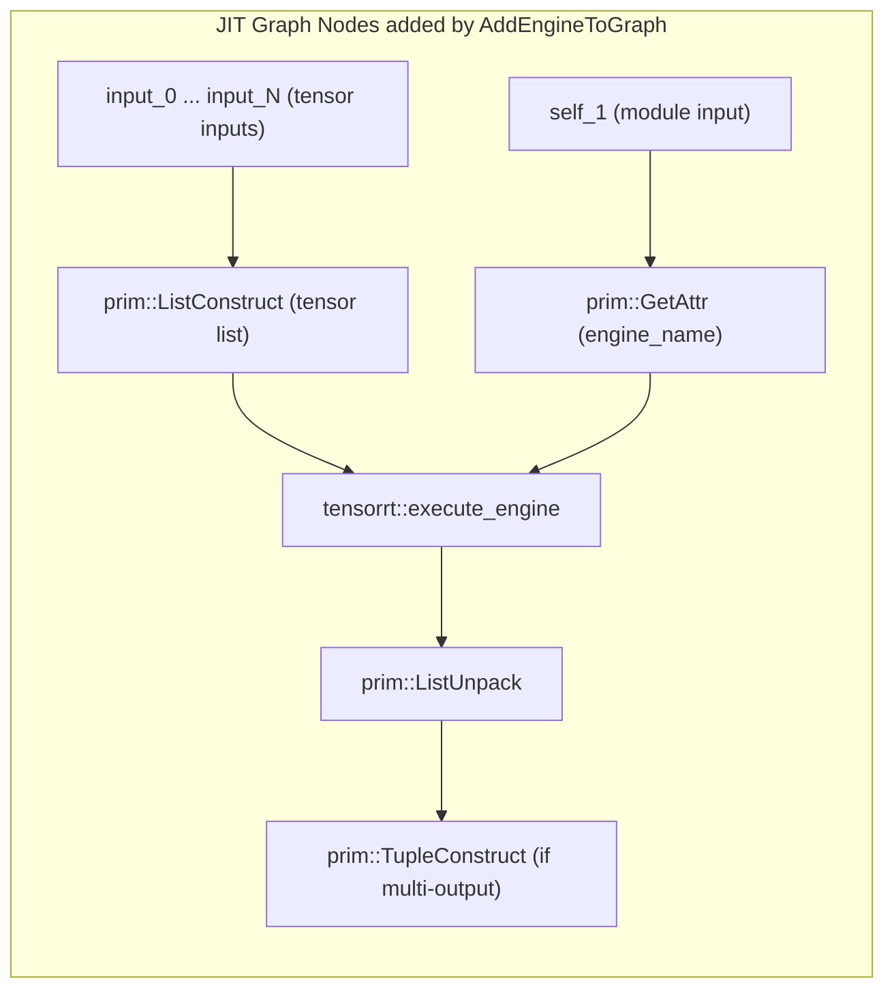
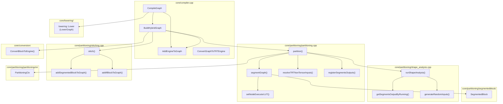

<!-- source: DeepWiki mcp.deepwiki.com · repo pytorch/TensorRT · page 4 TorchScript Frontend Architecture · fetched 2026-10-21 -->

# TorchScript Frontend Architecture

<details>
<summary>Relevant source files</summary>

The following files were used as context for generating this wiki page:

- [core/compiler.cpp](core/compiler.cpp)
- [core/partitioning/BUILD](core/partitioning/BUILD)
- [core/partitioning/partitioning.cpp](core/partitioning/partitioning.cpp)
- [core/partitioning/partitioning.h](core/partitioning/partitioning.h)
- [core/partitioning/partitioningctx/PartitioningCtx.cpp](core/partitioning/partitioningctx/PartitioningCtx.cpp)
- [core/partitioning/partitioningctx/PartitioningCtx.h](core/partitioning/partitioningctx/PartitioningCtx.h)
- [core/partitioning/segmentedblock/SegmentedBlock.cpp](core/partitioning/segmentedblock/SegmentedBlock.cpp)
- [core/partitioning/segmentedblock/SegmentedBlock.h](core/partitioning/segmentedblock/SegmentedBlock.h)
- [core/partitioning/shape_analysis.cpp](core/partitioning/shape_analysis.cpp)
- [core/partitioning/stitching.cpp](core/partitioning/stitching.cpp)
- [tests/core/partitioning/test_conditionals.cpp](tests/core/partitioning/test_conditionals.cpp)
- [tests/core/partitioning/test_resolve_nontensor_inputs.cpp](tests/core/partitioning/test_resolve_nontensor_inputs.cpp)
- [tests/core/partitioning/test_segmentation.cpp](tests/core/partitioning/test_segmentation.cpp)
- [tests/core/partitioning/test_shape_analysis.cpp](tests/core/partitioning/test_shape_analysis.cpp)
- [tests/cpp/test_dynamic_fallback.cpp](tests/cpp/test_dynamic_fallback.cpp)

</details>


This page describes the internal architecture of the TorchScript-based compilation path in Torch-TensorRT. This path takes a `torch::jit::script::Module` as input, lowers its graph through the JIT IR, partitions it into TensorRT-eligible and PyTorch-fallback segments, converts TRT segments into serialized engines, and assembles a new module that embeds those engines for inference.

This is the **legacy** frontend. For the newer Dynamo-based (`torch.export` / `torch.compile`) frontend, see [Dynamo Frontend Architecture](#3). For user-facing usage of TorchScript compilation, see [TorchScript Compilation](#2.3).

---

## Pipeline Summary

The TorchScript frontend pipeline has five major stages, all orchestrated from [core/compiler.cpp]().

**High-level TorchScript Compilation Pipeline**



Sources: [core/compiler.cpp:300-427]()

---

## Entry Points

### `CompileGraph`

[core/compiler.cpp:334-427]()

The primary entry point. Accepts a `torch::jit::Module` and a `CompileSpec`, and returns a new `torch::jit::Module` where all supported operations have been replaced with `tensorrt::execute_engine` calls.

Decision logic for whether to use a hybrid graph:

| Condition | Path |
|---|---|
| All ops are TRT-supported and no fallback requested | Full TRT compilation via `ConvertBlockToEngine` |
| Any op is unsupported, or user requests fallback | Hybrid graph via `BuildHybridGraph` |
| Output is a collection or contains I/O handling | Hybrid graph via `BuildHybridGraph` |
| Input dtype is `at::kLong` | Hybrid graph via `BuildHybridGraph` |

### `ConvertGraphToTRTEngine`

[core/compiler.cpp:300-327]()

Converts the `forward` block of a fully-TRT-compatible module into a serialized TRT engine (a `std::string`). This is the API used when the user wants just the raw engine bytes.

### `BuildHybridGraph`

[core/compiler.cpp:136-216]()

Called when partitioning is required. Creates a `PartitioningCtx`, calls `partitioning::partition`, converts each `kTensorRT` segment to an engine, embeds each engine with `AddEngineToGraph`, then calls `partitioning::stitch` to assemble the final `torch::jit::Graph`.

---

## Key Data Structures

**Core Types and Their File Locations**



Sources: [core/partitioning/partitioningctx/PartitioningCtx.h](), [core/partitioning/segmentedblock/SegmentedBlock.h]()

### `SegmentedBlock`

Defined in [core/partitioning/segmentedblock/SegmentedBlock.h](), implemented in [core/partitioning/segmentedblock/SegmentedBlock.cpp]().

Each `SegmentedBlock` owns a cloned `torch::jit::Graph` (`g_`) containing a subset of original graph nodes. It tracks:
- `target_`: either `kTorch` or `kTensorRT`
- `nodes_`: the original `torch::jit::Node*` pointers (used for lookup and dependency analysis)
- `inputs_` / `outputs_`: the `torch::jit::Value*` pointers that cross segment boundaries, in the **cloned** graph's scope
- `raw_inputs_` / `raw_outputs_`: corresponding pointers in the **original** (lowered) graph's scope
- `opt_shapes_`, `min_shapes_`, `max_shapes_`: per-input shapes discovered during shape analysis

The `old_to_new_` map tracks the correspondence between original graph values and their clones inside the segment graph.

### `NodeExecutorDecision`

Defined in [core/partitioning/partitioningctx/PartitioningCtx.h:15-31]().

An enum that records *why* a node has been routed to either Torch or TensorRT:

| Value | Meaning |
|---|---|
| `kCONVERT` | Node will be compiled into TRT |
| `kUNSUPPORTED` | No converter exists for this op |
| `kOPERATOR_FALLBACK` | User explicitly listed this op in `forced_fallback_operators` |
| `kMODULE_FALLBACK` | User listed the containing module in forced fallback modules |
| `kMIN_BLOCK_FALLBACK` | The TRT segment containing this node is smaller than `min_block_size` |
| `kNON_TENSOR` | Node produces or consumes non-tensor values alongside a fallback node |
| `kUNKNOWN` | Initial state before analysis |

---

## Partitioning

The partitioning subsystem lives in `core/partitioning/`. Its entry point is `partitioning::partition` in [core/partitioning/partitioning.h:52]().

### Node Executor Decision Assignment

`setNodeExecutorLUT` in [core/partitioning/partitioning.cpp:367-388]() applies four passes in order:



**Pass 1 — `setExplicitFallbackNodes`** ([core/partitioning/partitioning.cpp:68-94]()): iterates all non-constant block nodes. Assigns `kUNSUPPORTED` if `conversion::OpSupported` returns false, `kOPERATOR_FALLBACK` if the op is in `forced_fallback_ops`, `kMODULE_FALLBACK` if the node has a `to_compile=false` attribute, or `kCONVERT` otherwise.

**Pass 2 — `setInputsOutputsConnectedNodes`** ([core/partitioning/partitioning.cpp:32-48]()): any node that produces a non-tensor block output, or consumes a non-tensor block input, is marked `kNON_TENSOR`.

**Pass 3 — `setNonTensorConnectedNodes`** ([core/partitioning/partitioning.cpp:98-129]()): BFS from the current fallback set. If a fallback node's input or output is a non-tensor value, the producer/consumer of that value is also marked `kNON_TENSOR`.

**Pass 4 — `setMinBlockFallbackNodes`** ([core/partitioning/partitioning.cpp:187-201]()): iterates repeatedly until stable. Any run of TRT-bound nodes shorter than `min_block_size` is marked `kMIN_BLOCK_FALLBACK` and BFS is re-run to propagate the effect.

### Graph Segmentation

`segmentGraph` in [core/partitioning/partitioning.cpp:443-526]() walks block nodes in topological order and maintains two in-progress node lists: one for TRT (`in_prog_trt_blk_nodes`) and one for Torch (`in_prog_pyt_blk_nodes`). It finalizes a `SegmentedBlock` whenever a node type transition requires it, or when a dependency forces closure of the current in-progress block. Adjacent segments of the same type are merged via `merge_adjacent_segments_of_same_type` ([core/partitioning/partitioning.cpp:416-441]()).

`prim::If` nodes always get their own `SegmentedBlock` with `do_not_merge = true` to prevent them from being folded into adjacent segments.

**Segmentation Example (Sequential Model)**



Sources: [core/partitioning/partitioning.cpp:443-526](), [tests/core/partitioning/test_segmentation.cpp:57-88]()

### Non-Tensor Input Resolution

`resolveTRTNonTensorInputs` in [core/partitioning/partitioning.cpp:269-294]() handles the case where a TRT segment has non-tensor inputs (e.g., an integer shape value) produced by another TRT segment. It locates the DAG of dependency nodes via `getDependencyNodes` and injects them into the consuming TRT segment's node list so the segment remains self-contained.

---

## Shape Analysis

Shape analysis is needed to determine the concrete input shapes for each `SegmentedBlock`, which are required to build TRT optimization profiles.

`runShapeAnalysis` in [core/partitioning/shape_analysis.cpp:345-357]() iterates every `SegmentedBlock` and calls `getSegmentsOutputByRunning`. That function:

1. Copies the segment's graph and wraps it in a temporary `torch::jit::script::Module`.
2. Looks up `torch::jit::IValue` inputs for the segment from an `ExampleIValues` map (pre-generated by `generateRandomInputs`).
3. Calls `cur_mod.forward(inputs)` to execute the segment in PyTorch.
4. Stores the output `IValue`s back into the `ExampleIValues` map so downstream segments can use them.
5. Records concrete input shapes into the `SegmentedBlock` via `register_inshapes` and `register_intypes`.

For dynamic-shape inputs, shape analysis is run three times (min, opt, max) using inputs generated at each range.

**Shape Analysis Data Flow**



Sources: [core/partitioning/shape_analysis.cpp:150-357](), [core/partitioning/partitioning.cpp:541-610]()

Shape analysis also inserts cast nodes for dtype boundaries. For example, if a Torch segment produces a `kLong` tensor but `truncate_long_and_double` is set, an `aten::to` cast to `kInt` is prepended to the output of the Torch segment so the downstream TRT segment receives a compatible type. See [core/partitioning/shape_analysis.cpp:241-295]().

---

## Block Conversion

After segmentation and shape analysis, `BuildHybridGraph` iterates all `kTensorRT` segments and calls `conversion::ConvertBlockToEngine` on each:

```cpp
// core/compiler.cpp:172
auto engine = conversion::ConvertBlockToEngine(seg_block.block(), convert_info, static_params);
```

The input spec for each segment is built from the shape analysis results:

```cpp
// core/compiler.cpp:168
auto inputs = seg_block.construct_inputs_spec();
convert_info.inputs = ir::associate_specs_with_inputs(seg_block.g(), inputs, static_params);
```

See [core/compiler.cpp:160-186]() for the full segment conversion loop.

---

## Engine Embedding

`AddEngineToGraph` in [core/compiler.cpp:30-124]() builds the JIT graph nodes that represent a TRT engine call:

**JIT Graph Structure for a TRT Engine Node**



The `TRTEngine` object is registered as an attribute on the module with `mod.register_attribute`. This ensures it is serialized with the module via `torch.jit.save` and deserialized with `torch.jit.load`. The engine is identified in the attribute list by name (e.g. `<module_name>_engine_<ptr>`).

Sources: [core/compiler.cpp:30-124]()

---

## Graph Stitching

`partitioning::stitch` in [core/partitioning/stitching.cpp:100-148]() assembles the final `torch::jit::Graph` from the list of `SegmentedBlock`s.

For each `SegmentedBlock`:
- **`kTensorRT` blocks**: their previously-updated graph (which now contains `tensorrt::execute_engine` nodes) is inlined via `addSegmentedBlockToGraph`.
- **`kTorch` blocks with `prim::If`**: handled separately by `addIfBlockToGraph`, which recursively calls `stitch` on each branch block and constructs a new `prim::If` node.
- **`kTorch` blocks (other)**: inlined directly via `addSegmentedBlockToGraph`.

The function returns a `GraphAndMapping` pair (typedef in [core/partitioning/partitioning.h:18-19]()): the stitched graph and a value-mapping from the original lowered graph to the new graph.

Sources: [core/partitioning/stitching.cpp]()

---

## Subsystem Map

The following diagram associates each pipeline stage with its primary code location.



Sources: [core/compiler.cpp](), [core/partitioning/partitioning.cpp](), [core/partitioning/shape_analysis.cpp](), [core/partitioning/stitching.cpp](), [core/partitioning/partitioningctx/PartitioningCtx.h](), [core/partitioning/segmentedblock/SegmentedBlock.h]()

---

## Child Pages

The subsystems described above are covered in detail in the following pages:

- [4.1 — Compilation Pipeline Overview](#4.1): End-to-end walkthrough of the `CompileGraph` flow
- [4.2 — Graph Lowering Passes](#4.2): The `LowerGraph` function and pre-conversion graph transformations
- [4.3 — Partitioning and Hybrid Execution](#4.3): Detailed coverage of `PartitioningCtx`, `segmentGraph`, and stitching
- [4.4 — Shape Analysis and Dynamic Shapes](#4.4): Shape propagation through segments and optimization profile construction
- [4.5 — ConversionCtx and Network Building](#4.5): How `ConvertBlockToEngine` constructs the TRT network
- [4.6 — Evaluators and Constant Folding](#4.6): The evaluator registry and compile-time constant computation

---

