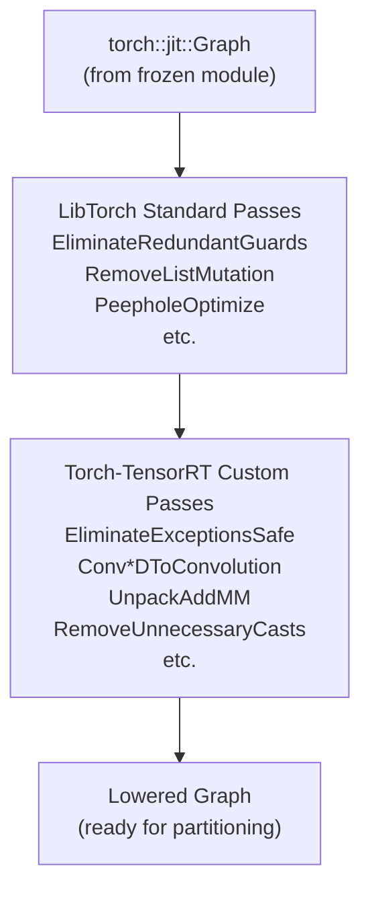
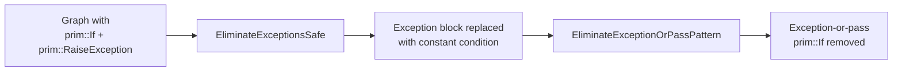
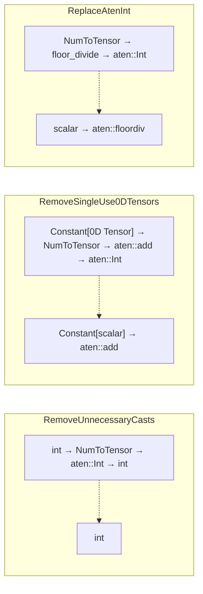
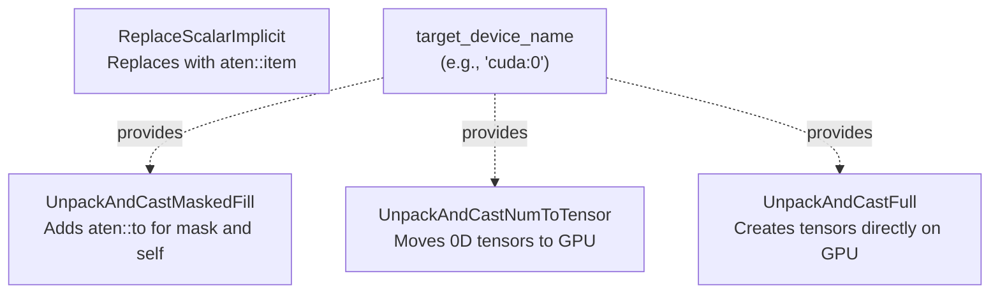
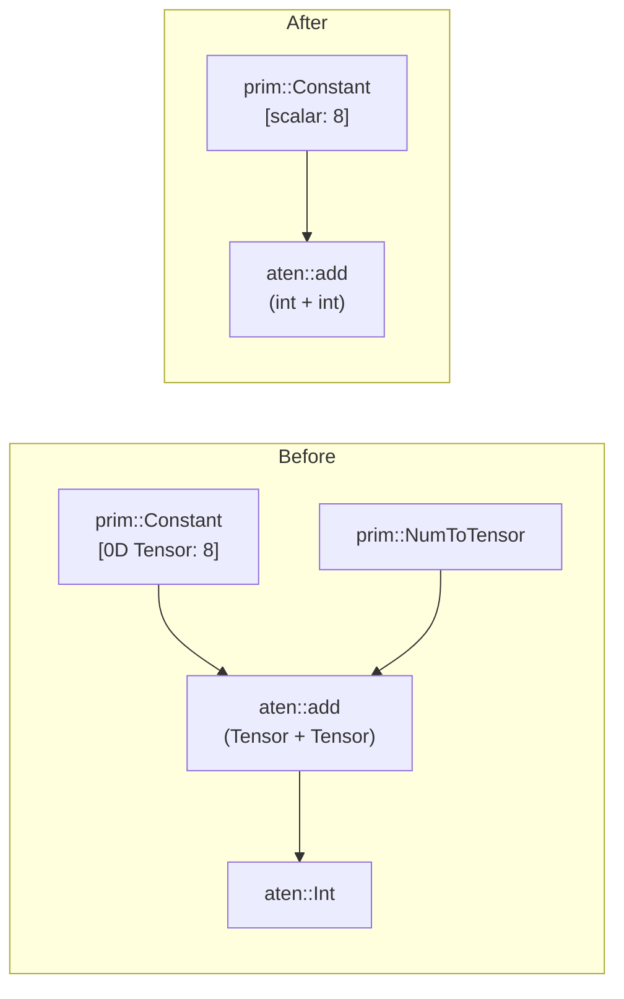
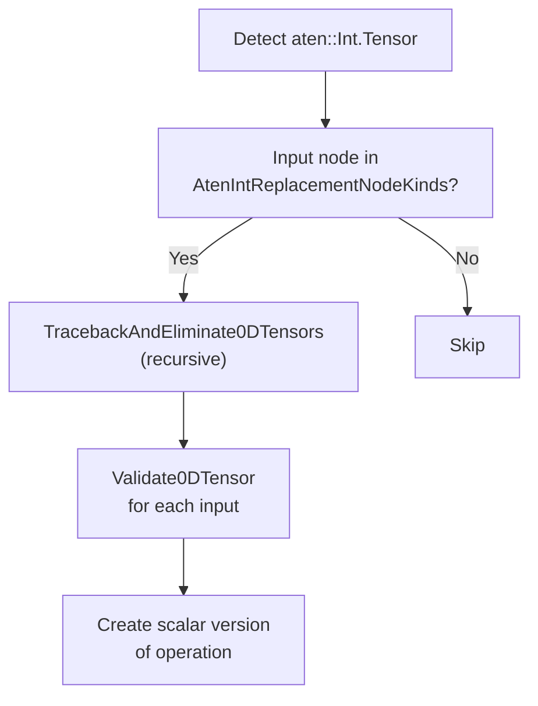
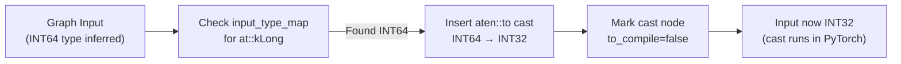

<!-- source: DeepWiki mcp.deepwiki.com · repo pytorch/TensorRT · page 4.2 Graph Lowering Passes · fetched 2026-10-21 -->

# Graph Lowering Passes

<details>
<summary>Relevant source files</summary>

The following files were used as context for generating this wiki page:

- [core/conversion/evaluators/aten.cpp](core/conversion/evaluators/aten.cpp)
- [core/conversion/evaluators/eval_macros.h](core/conversion/evaluators/eval_macros.h)
- [core/conversion/evaluators/eval_util.cpp](core/conversion/evaluators/eval_util.cpp)
- [core/conversion/evaluators/eval_util.h](core/conversion/evaluators/eval_util.h)
- [core/conversion/evaluators/prim.cpp](core/conversion/evaluators/prim.cpp)
- [core/ir/GraphInputs.cpp](core/ir/GraphInputs.cpp)
- [core/ir/StaticParams.cpp](core/ir/StaticParams.cpp)
- [core/ir/ir.cpp](core/ir/ir.cpp)
- [core/lowering/CMakeLists.txt](core/lowering/CMakeLists.txt)
- [core/lowering/lowering.cpp](core/lowering/lowering.cpp)
- [core/lowering/lowering.h](core/lowering/lowering.h)
- [core/lowering/passes/BUILD](core/lowering/passes/BUILD)
- [core/lowering/passes/CMakeLists.txt](core/lowering/passes/CMakeLists.txt)
- [core/lowering/passes/device_casting.cpp](core/lowering/passes/device_casting.cpp)
- [core/lowering/passes/exception_elimination.cpp](core/lowering/passes/exception_elimination.cpp)
- [core/lowering/passes/passes.h](core/lowering/passes/passes.h)
- [core/lowering/passes/remove_set_attrs.cpp](core/lowering/passes/remove_set_attrs.cpp)
- [core/lowering/passes/remove_unnecessary_casts.cpp](core/lowering/passes/remove_unnecessary_casts.cpp)
- [cpp/src/torch_tensorrt.cpp](cpp/src/torch_tensorrt.cpp)
- [tests/core/conversion/evaluators/test_aten_evaluators.cpp](tests/core/conversion/evaluators/test_aten_evaluators.cpp)
- [tests/core/lowering/BUILD](tests/core/lowering/BUILD)
- [tests/core/lowering/test_exception_elimination_pass.cpp](tests/core/lowering/test_exception_elimination_pass.cpp)
- [tests/core/lowering/test_remove_unnecessary_casts.cpp](tests/core/lowering/test_remove_unnecessary_casts.cpp)

</details>


## Purpose and Scope

Graph Lowering Passes are optimization and normalization transformations applied to TorchScript graphs before conversion to TensorRT. These passes simplify the graph structure, canonicalize operations, eliminate unsupported patterns, and prepare the graph for partitioning and conversion.

This page covers the TorchScript frontend lowering system. For lowering in the Dynamo frontend, see [Decompositions and Lowering Passes](#3.3). For the overall TorchScript compilation flow, see [Compilation Pipeline Overview](#4.1).

## Overview

The lowering system transforms TorchScript `torch::jit::Graph` objects through a series of passes. Each pass performs a specific transformation—eliminating exceptions, unpacking composite operations, normalizing convolutions, removing unnecessary casts, etc. The passes run in a carefully ordered sequence within the `LowerGraph` function.

**High-Level Lowering Flow**



Sources: [core/lowering/lowering.cpp:99-158]()

## Lowering Configuration

The `LowerInfo` structure controls lowering behavior:

| Field | Type | Purpose |
|-------|------|---------|
| `unfreeze_module` | `bool` | Skip module freezing (required for QAT models) |
| `disable_cse` | `bool` | Disable common subexpression elimination (preserves QAT QDQ nodes) |
| `converting_to_trt_engine` | `bool` | Whether target is TRT engine vs. hybrid module |
| `target_device` | `ir::Device` | GPU device for casting operations |
| `forced_fallback_modules` | `vector<string>` | Modules to mark for PyTorch fallback |

Sources: [core/lowering/lowering.h:10-30]()

## Lowering Pipeline

The `LowerGraph` function orchestrates the complete lowering process. The passes execute in this specific order:

```mermaid
graph TD
    Start["LowerGraph Entry"]
    
    subgraph "Phase 1: LibTorch Standard Passes"
        P1["EliminateRedundantGuards"]
        P2["RemoveListMutation<br/>RemoveTensorMutation"]
        P3["CreateFunctionalGraphs<br/>InlineFunctionalGraphs"]
        P4["PeepholeOptimize"]
        P5["FuseLinear"]
    end
    
    subgraph "Phase 2: Exception & Control Flow"
        P6["EliminateExceptionsSafe"]
        P7["EliminateCommonSubexpression<br/>(if not disabled)"]
        P8["EliminateDeadCode"]
        P9["MarkNodesForFallback<br/>(if forced_fallback_modules)"]
    end
    
    subgraph "Phase 3: Operator Unpacking"
        P10["UnpackHardSwish<br/>UnpackHardSigmoid"]
        P11["EliminateExceptionOrPassPattern"]
        P12["ReduceToOperation<br/>ReduceGelu<br/>ReduceRemainder"]
    end
    
    subgraph "Phase 4: Operation Normalization"
        P13["RemoveContiguous<br/>ViewToReshape<br/>RemoveDropout"]
        P14["LinearToAddMM"]
        P15["Conv1D/2D/3DToConvolution<br/>ConvTransposed*ToConvolution"]
        P16["FuseAddMMBranches<br/>RemoveBNDimCheck"]
    end
    
    subgraph "Phase 5: Advanced Unpacking"
        P17["UnpackAddMM<br/>UnpackLogSoftmax"]
        P18["UnpackRsqrt<br/>UnpackStd<br/>UnpackVar"]
        P19["UnpackScaledDotProductAttention"]
    end
    
    subgraph "Phase 6: Cleanup & Casting"
        P20["RemoveNOPs<br/>AliasOperators"]
        P21["SiluToSigmoidMultiplication<br/>RemoveSingleUse0DTensors"]
        P22["RemoveUnnecessaryCasts<br/>ReplaceAtenInt"]
        P23["RemoveCollectionCast<br/>(if converting_to_trt_engine)"]
    end
    
    subgraph "Phase 7: Device Casting"
        P24["UnpackAndCastMaskedFill<br/>UnpackAndCastNumToTensor<br/>UnpackAndCastFull"]
        P25["ReplaceScalarImplicit"]
        P26["RewriteInputsWithParams"]
        P27["ReplaceAtenPad<br/>ReplaceTileWithRepeat"]
    end
    
    Start --> P1
    P1 --> P2 --> P3 --> P4 --> P5
    P5 --> P6 --> P7 --> P8 --> P9
    P9 --> P10 --> P11 --> P12
    P12 --> P13 --> P14 --> P15 --> P16
    P16 --> P17 --> P18 --> P19
    P19 --> P20 --> P21 --> P22 --> P23
    P23 --> P24 --> P25 --> P26 --> P27
    P27 --> End["Lowered Graph"]
```



Sources: [core/lowering/lowering.cpp:99-158](), [core/lowering/passes/passes.h:1-64]()

## Pass Categories

**Exception Elimination Passes**



- **`EliminateExceptionsSafe`**: Replaces `prim::If` nodes containing `prim::RaiseException` with constant boolean conditions, effectively eliminating exception-throwing branches
- **`EliminateExceptionOrPassPattern`**: Removes `prim::If` nodes where one branch raises an exception and the other does nothing

Sources: [core/lowering/passes/exception_elimination.cpp:104-176]()

**Convolution Normalization Passes**

All convolution variants are normalized to the base `aten::_convolution` schema:

- `Conv1DToConvolution` 
- `Conv2DToConvolution`
- `Conv3DToConvolution`
- `ConvTransposed1DToConvolution`
- `ConvTransposed2DToConvolution`
- `ConvTransposed3DToConvolution`

This unification simplifies the converter implementation, which only needs to handle `aten::_convolution`.

Sources: [core/lowering/passes/passes.h:15-20]()

**Operator Unpacking Passes**

These passes decompose composite operations into primitive operations:

| Pass | Transformation |
|------|----------------|
| `UnpackAddMM` | Expands `aten::addmm` into explicit matrix multiply + add |
| `UnpackBatchNorm` | Decomposes batch normalization into scale/shift operations |
| `UnpackLogSoftmax` | Expands log softmax into separate log and softmax |
| `UnpackRsqrt` | Replaces `rsqrt(x)` with `1 / sqrt(x)` |
| `UnpackStd` | Decomposes standard deviation computation |
| `UnpackVar` | Decomposes variance computation |
| `UnpackHardSwish` | Expands `hardswish` activation |
| `UnpackHardSigmoid` | Expands `hardsigmoid` activation |
| `UnpackScaledDotProductAttention` | Decomposes scaled dot-product attention |

Sources: [core/lowering/passes/passes.h:38-48]()

**Cast Removal Passes**



- **`RemoveUnnecessaryCasts`**: Eliminates redundant `NumToTensor` → `aten::Int/Float/Bool` patterns
- **`RemoveSingleUse0DTensors`**: Replaces 0-dimensional tensor constants with scalar constants when only used once
- **`ReplaceAtenInt`**: Traces through `aten::Int.Tensor` calls to replace 0D tensor operations with scalar equivalents

Sources: [core/lowering/passes/remove_unnecessary_casts.cpp:16-348]()

**Device Casting Passes**

These passes ensure all tensors are on the correct GPU device:



The `target_device_name` parameter (e.g., `"cuda:0"`) is injected into rewrite patterns to ensure tensors are created on or moved to the GPU.

Sources: [core/lowering/passes/device_casting.cpp:11-116]()

## Key Pass Implementations

### Exception Elimination

The `EliminateExceptionsSafe` pass replaces exception-throwing branches with constant conditions:

**Pattern Detection:**
1. Find `prim::If` nodes where one block contains `prim::RaiseException`
2. Replace the `prim::If` input with constant `true` or `false` to skip exception branch
3. Mark cast nodes with `to_compile=false` to run in PyTorch

**Why "Safe"?**
This is a fork of PyTorch's `EliminateExceptions` that uses `replaceAllUsesAfterNodeWith` instead of `replaceAllUsesWith` to avoid invalidating IR in nested `prim::If` cases.

Sources: [core/lowering/passes/exception_elimination.cpp:119-176]()

### Cast Removal and Scalar Promotion

**`RemoveSingleUse0DTensors` Pattern:**



This pass:
1. Detects 0-dimensional tensor constants used exactly once
2. Replaces them with scalar constants
3. Updates operation schemas from tensor versions to scalar versions
4. Eliminates the `NumToTensor` and `aten::Int` nodes

Special handling for `aten::div` with rounding modes (`"trunc"`, `"floor"`).

Sources: [core/lowering/passes/remove_unnecessary_casts.cpp:59-204]()

**`ReplaceAtenInt` Traceback:**



Supported operations for traceback: `aten::mul`, `aten::floor_divide`

Sources: [core/lowering/passes/remove_unnecessary_casts.cpp:251-348]()

### Collection Cast Removal

The `RemoveCollectionCast` pass eliminates `prim::TupleConstruct` and `prim::ListConstruct` nodes at graph outputs when compiling to a TensorRT engine:

**Before:**
```
graph(%x : Tensor):
  %a : Tensor = aten::mul(%x, ...)
  %b : Tensor = aten::add(%a, ...)
  %c : Tensor = aten::relu(%b)
  %output : (Tensor, Tensor, Tensor) = prim::TupleConstruct(%a, %b, %c)
  return (%output)
```

**After:**
```
graph(%x : Tensor):
  %a : Tensor = aten::mul(%x, ...)
  %b : Tensor = aten::add(%a, ...)
  %c : Tensor = aten::relu(%b)
  return (%a, %b, %c)
```

This pass only runs when `converting_to_trt_engine=true`, as TensorRT engines cannot preserve collection structures—they return multiple tensors directly.

Sources: [core/lowering/passes/remove_unnecessary_casts.cpp:350-387]()

## Autocast Long Inputs

The `AutocastLongInputs` function handles INT64 → INT32 type conversion for inputs:



**Why mark `to_compile=false`?**
The cast nodes are marked to run in PyTorch rather than TensorRT, ensuring correct type handling at the graph boundary.

**Warning Issued:**
The function logs a warning that INT64 inputs have been automatically cast to INT32, and suggests recompiling with INT32 inputs to avoid this.

Sources: [core/lowering/lowering.cpp:28-97]()

## Entry Points

**Main Lowering Function:**

```cpp
std::pair<std::shared_ptr<torch::jit::Graph>, std::vector<torch::jit::IValue>> 
Lower(const torch::jit::Module& mod, 
      std::string method_name,
      const LowerInfo& lower_info)
```

This function:
1. Optionally freezes the module via `LowerModule` (unless `unfreeze_module=true`)
2. Calls PyTorch's `torch::jit::LowerGraph` for standard lowering
3. Calls `LowerGraph` for Torch-TensorRT custom passes
4. Returns the lowered graph and extracted parameters

Sources: [core/lowering/lowering.cpp:172-197]()

**Module-Level Entry:**

```cpp
torch::jit::Module LowerModule(
    const torch::jit::Module& mod,
    std::string method_name, 
    const LowerInfo& lower_info)
```

This function:
1. Notates forced fallback modules if specified
2. Freezes the module using `torch::jit::freeze_module`
3. Returns the frozen module

Module freezing inlines parameters and attributes as constants, enabling constant folding and optimization. For QAT models, freezing is skipped to preserve quantize/dequantize nodes.

Sources: [core/lowering/lowering.cpp:160-170]()

## Testing Infrastructure

Each pass has corresponding unit tests in `tests/core/lowering/`:

| Test File | Passes Tested |
|-----------|---------------|
| `test_remove_unnecessary_casts.cpp` | `RemoveUnnecessaryCasts`, `RemoveSingleUse0DTensors`, `ReplaceAtenInt`, `RemoveCollectionCast` |
| `test_exception_elimination_pass.cpp` | `EliminateExceptionOrPassPattern`, `EliminateExceptionsSafe` |
| `test_conv_pass.cpp` | Convolution normalization passes |
| `test_linear_to_addmm.cpp` | `LinearToAddMM` |
| `test_device_casting.cpp` | Device casting passes |

Tests use `torch::jit::SubgraphRewriter` pattern matching to verify graph transformations.

Sources: [tests/core/lowering/BUILD:1-156]()

## Build Configuration

The lowering passes are compiled as part of the `core_lowering` library:

**CMake Structure:**
```
core/lowering/
├── CMakeLists.txt          # Main library definition
└── passes/
    ├── CMakeLists.txt      # Pass implementations
    ├── passes.h            # Pass declarations
    ├── exception_elimination.cpp
    ├── remove_unnecessary_casts.cpp
    ├── device_casting.cpp
    └── ...
```

**Bazel Structure:**
```
core/lowering/passes/
└── BUILD                   # cc_library "passes"
```

The passes library depends on LibTorch and `core_util` for logging and graph utilities.

Sources: [core/lowering/CMakeLists.txt:1-41](), [core/lowering/passes/BUILD:1-103]()

---

