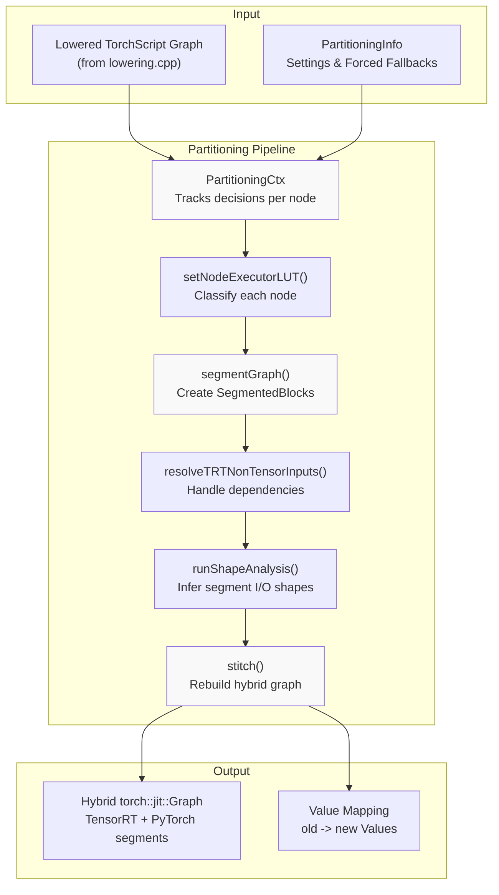
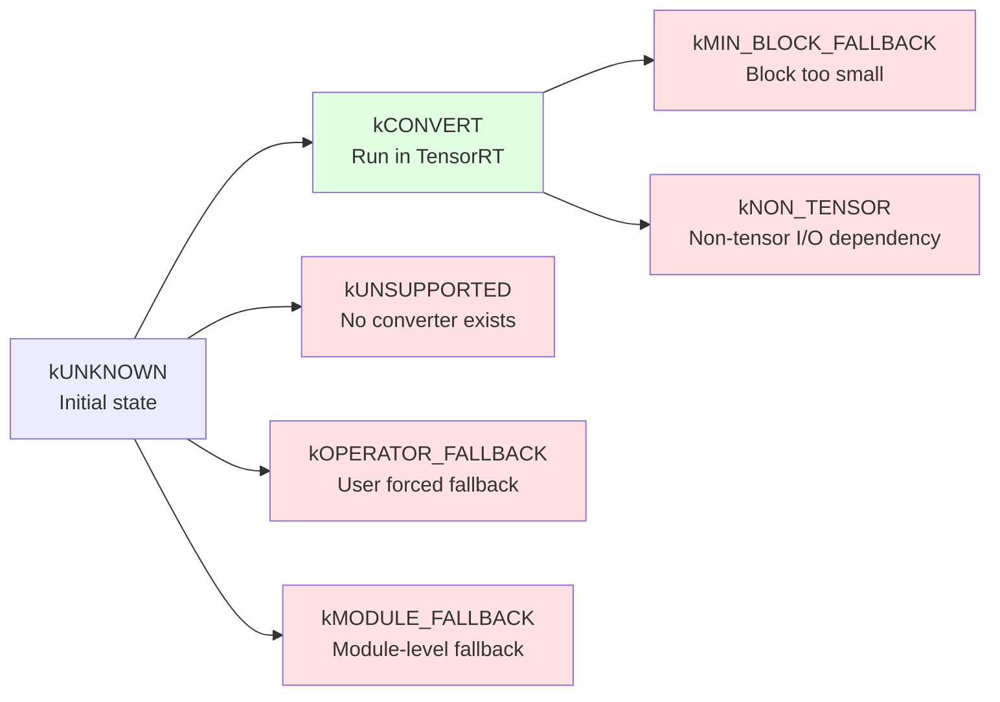
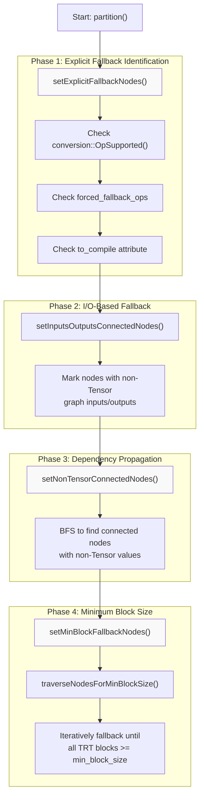
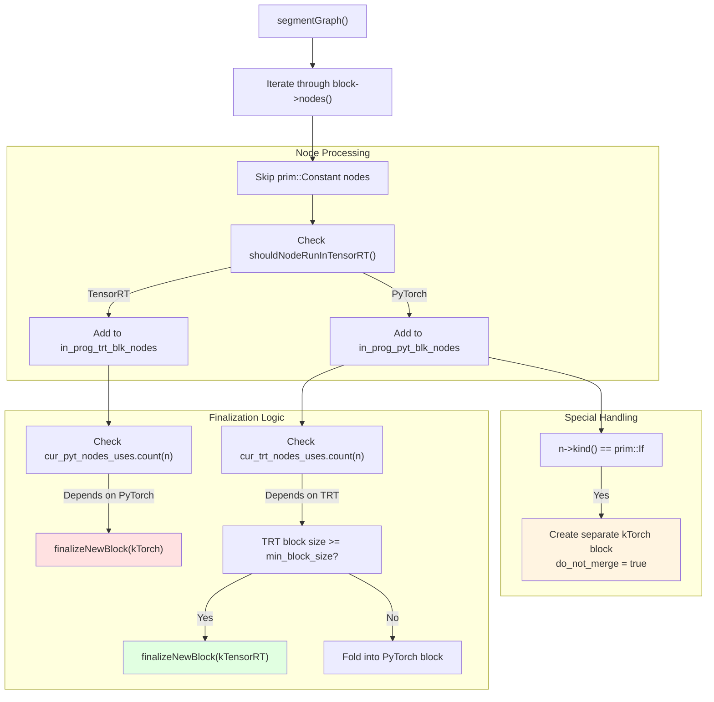
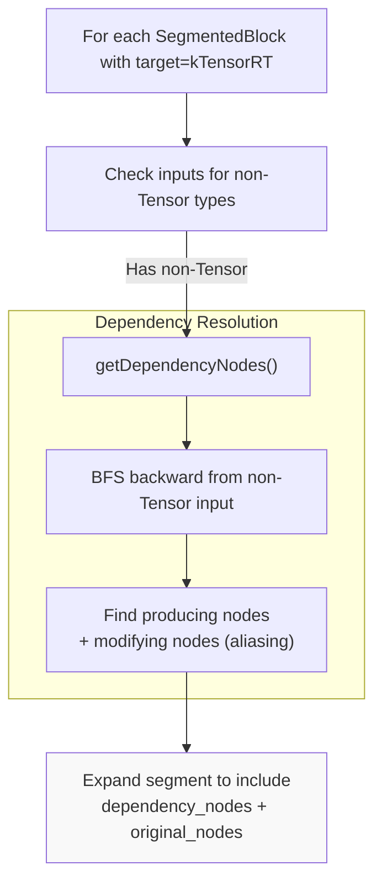
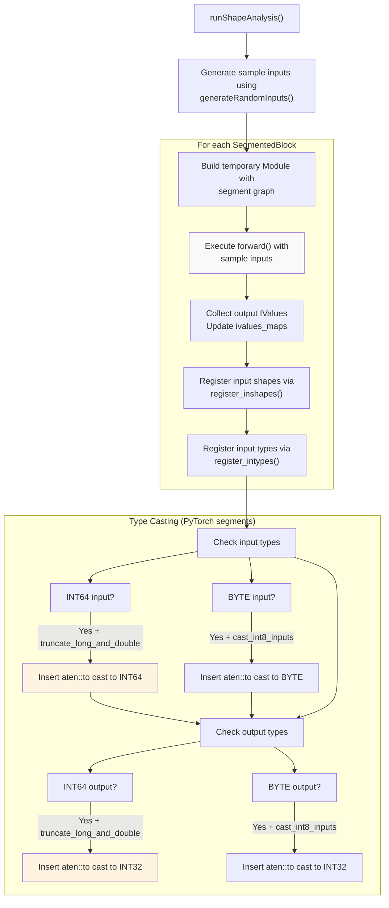
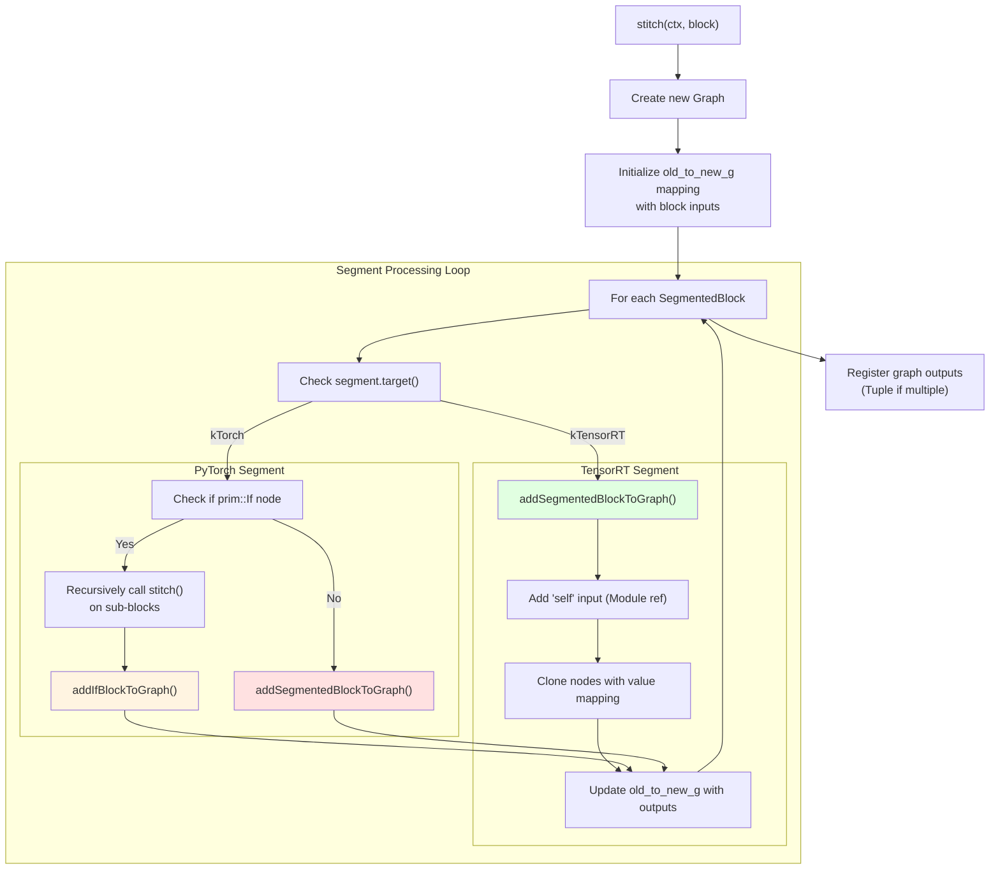
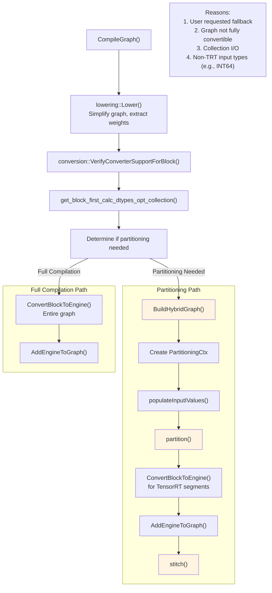

<!-- source: DeepWiki mcp.deepwiki.com · repo pytorch/TensorRT · page 4.3 Partitioning and Hybrid Execution · fetched 2026-10-21 -->

# Partitioning and Hybrid Execution

<details>
<summary>Relevant source files</summary>

The following files were used as context for generating this wiki page:

- [core/compiler.cpp](core/compiler.cpp)
- [core/conversion/conversion.cpp](core/conversion/conversion.cpp)
- [core/conversion/conversionctx/ConversionCtx.cpp](core/conversion/conversionctx/ConversionCtx.cpp)
- [core/conversion/conversionctx/ConversionCtx.h](core/conversion/conversionctx/ConversionCtx.h)
- [core/partitioning/BUILD](core/partitioning/BUILD)
- [core/partitioning/partitioning.cpp](core/partitioning/partitioning.cpp)
- [core/partitioning/partitioning.h](core/partitioning/partitioning.h)
- [core/partitioning/partitioningctx/PartitioningCtx.cpp](core/partitioning/partitioningctx/PartitioningCtx.cpp)
- [core/partitioning/partitioningctx/PartitioningCtx.h](core/partitioning/partitioningctx/PartitioningCtx.h)
- [core/partitioning/segmentedblock/SegmentedBlock.cpp](core/partitioning/segmentedblock/SegmentedBlock.cpp)
- [core/partitioning/segmentedblock/SegmentedBlock.h](core/partitioning/segmentedblock/SegmentedBlock.h)
- [core/partitioning/shape_analysis.cpp](core/partitioning/shape_analysis.cpp)
- [core/partitioning/stitching.cpp](core/partitioning/stitching.cpp)
- [tests/core/partitioning/test_conditionals.cpp](tests/core/partitioning/test_conditionals.cpp)
- [tests/core/partitioning/test_resolve_nontensor_inputs.cpp](tests/core/partitioning/test_resolve_nontensor_inputs.cpp)
- [tests/core/partitioning/test_segmentation.cpp](tests/core/partitioning/test_segmentation.cpp)
- [tests/core/partitioning/test_shape_analysis.cpp](tests/core/partitioning/test_shape_analysis.cpp)
- [tests/cpp/test_dynamic_fallback.cpp](tests/cpp/test_dynamic_fallback.cpp)

</details>


This document describes the **TorchScript graph partitioning system** that enables hybrid execution of PyTorch models, where parts of the graph run in TensorRT while unsupported operations fall back to PyTorch. This is a core feature of the TorchScript frontend that allows models with partial operator coverage to still benefit from TensorRT optimization.

**Scope:** This page covers the partitioning algorithm, segmentation process, shape analysis, and stitching mechanism used in the TorchScript compilation path. For the Dynamo frontend's partitioning approach, see [3.1](#3.1). For the overall TorchScript compilation pipeline, see [4.1](#4.1). For details on graph lowering that precedes partitioning, see [4.2](#4.2).

## System Overview

The partitioning system analyzes a lowered TorchScript graph and segments it into blocks that will execute either in TensorRT or PyTorch. The system handles:

- **Operator Support Detection**: Identifying which operations can be converted to TensorRT
- **User-Specified Fallback**: Honoring explicit requests to run certain operators or modules in PyTorch
- **Minimum Block Size Filtering**: Ensuring TensorRT segments are large enough to justify overhead
- **Non-Tensor I/O Resolution**: Handling control flow and data dependencies between segments
- **Shape Analysis**: Inferring output shapes by executing segments with sample inputs
- **Type Casting**: Managing type incompatibilities (e.g., INT64→INT32, BYTE→INT32) at segment boundaries



**Diagram: Partitioning Pipeline Overview**

Sources: [core/partitioning/partitioning.cpp:567-610](), [core/partitioning/partitioning.h:52](), [core/compiler.cpp:136-216]()

## Partitioning Context and Decision Tracking

The `PartitioningCtx` class maintains state throughout the partitioning process, tracking which executor (TensorRT or PyTorch) should handle each node.

### PartitioningCtx Structure

| Field | Type | Purpose |
|-------|------|---------|
| `settings` | `PartitioningInfo` | Configuration including `min_block_size`, `forced_fallback_operators`, `truncate_long_and_double`, `cast_int8_inputs` |
| `node_executor_decision_map` | `NodeExecutorDecisionMap` | Maps each node to its execution decision (see `NodeExecutorDecision` enum) |
| `partitioned_blocks` | `unordered_map<Block*, PartitionedGraph>` | Stores segmented blocks for each input block |
| `min_input_ivalues_map`, `opt_input_ivalues_map`, `max_input_ivalues_map` | `ExampleIValues` | Sample inputs for shape analysis at different optimization profiles |
| `input_types_map` | `CollectionTypeMap` | Input data types |
| `forced_fallback_ops` | `unordered_set<string>` | Set of operator qualified names to always run in PyTorch |

Sources: [core/partitioning/partitioningctx/PartitioningCtx.h:47-70](), [core/partitioning/partitioningctx/PartitioningCtx.cpp:10-15]()

### NodeExecutorDecision Enum

Each node is classified with one of these decisions:



**Diagram: NodeExecutorDecision State Transitions**

Sources: [core/partitioning/partitioningctx/PartitioningCtx.h:15-31](), [core/partitioning/partitioningctx/PartitioningCtx.cpp:84-102]()

## Partitioning Decision Process

The `setNodeExecutorLUT()` function orchestrates a multi-phase analysis to determine which nodes run in which executor. This is implemented as `partition()` calling several sub-functions.



**Diagram: Partitioning Decision Flow (setNodeExecutorLUT)**

Sources: [core/partitioning/partitioning.cpp:367-388](), [core/partitioning/partitioning.cpp:68-94](), [core/partitioning/partitioning.cpp:98-129](), [core/partitioning/partitioning.cpp:186-201]()

### Phase 1: Explicit Fallback Identification

The `setExplicitFallbackNodes()` function marks nodes that cannot or should not run in TensorRT:

1. **Unsupported Operations**: Calls `conversion::OpSupported(n)` to check if a converter exists
2. **Forced Operator Fallback**: Checks if node kind is in `forced_fallback_ops` set (user-specified via `PartitioningInfo.forced_fallback_operators`)
3. **Module Fallback**: Checks if node has `to_compile=false` attribute (set during lowering for modules marked for PyTorch execution)
4. **Evaluatable Loops**: Special handling for `prim::Loop` nodes that can be evaluated at compile-time via `checkLoopEvaluatable()`

All other nodes are initially marked `kCONVERT` (to run in TensorRT).

Sources: [core/partitioning/partitioning.cpp:68-94]()

### Phase 2: Graph Input/Output Handling

The `setInputsOutputsConnectedNodes()` function handles the graph boundary:

- If the graph produces non-Tensor outputs (e.g., `int`, `bool`), mark the producing nodes as `kNON_TENSOR`
- If the graph consumes non-Tensor inputs, mark all users of those inputs as `kNON_TENSOR`

This ensures TensorRT segments only have Tensor inputs and outputs at the graph level.

Sources: [core/partitioning/partitioning.cpp:32-48]()

### Phase 3: Dependency Propagation

The `setNonTensorConnectedNodes()` function uses breadth-first search to propagate fallback decisions through data dependencies:

```cpp
// For each fallback node:
for (auto input : node->inputs()) {
  if (!isTensor(input) && input->node() != prim::Constant) {
    // Producer of non-Tensor value must also fallback
    setNodeExecutorDecision(input->node(), kNON_TENSOR);
  }
}
for (auto output : node->outputs()) {
  if (!isTensor(output)) {
    // Consumers of non-Tensor value must also fallback
    for (auto use : output->uses()) {
      setNodeExecutorDecision(use.user, kNON_TENSOR);
    }
  }
}
```

This prevents TensorRT segments from having non-Tensor inputs or outputs (except at segment boundaries, which are resolved later).

Sources: [core/partitioning/partitioning.cpp:98-129]()

### Phase 4: Minimum Block Size Enforcement

The `setMinBlockFallbackNodes()` function ensures TensorRT segments are large enough to justify compilation overhead:

1. **Traverse Graph**: `traverseNodesForMinBlockSize()` walks through nodes, tracking consecutive TensorRT nodes
2. **Check Dependency Cuts**: When a PyTorch node depends on current TensorRT nodes, check if TensorRT block size >= `min_block_size` (default: 3)
3. **Fallback Small Blocks**: Mark blocks smaller than threshold as `kMIN_BLOCK_FALLBACK`
4. **Iterate**: Repeat until no more blocks are too small (fallback can cascade due to dependencies)

The function uses dependency analysis via `getDependentNodes()` which checks both data flow and aliasing (in-place operations).

Sources: [core/partitioning/partitioning.cpp:154-201](), [core/partitioning/partitioning.cpp:131-152]()

## Graph Segmentation

After decision-making, `segmentGraph()` creates `SegmentedBlock` objects by grouping consecutive nodes of the same target (TensorRT or PyTorch).



**Diagram: Graph Segmentation Algorithm (segmentGraph)**

Sources: [core/partitioning/partitioning.cpp:443-526]()

### Key Segmentation Rules

1. **Dependency-Based Finalization**: When a TensorRT node depends on the active PyTorch block, finalize the PyTorch block first. Similarly for PyTorch nodes depending on TensorRT blocks.

2. **Minimum Block Size Check**: When finalizing a TensorRT block, verify it has at least `min_block_size` nodes. If not, fold it into the adjacent PyTorch block.

3. **Conditional (prim::If) Handling**: Each `prim::If` node becomes its own separate segment marked `do_not_merge = true` to preserve control flow structure. Sub-blocks within the conditional are partitioned recursively.

4. **Adjacent Block Merging**: After initial segmentation, `merge_adjacent_segments_of_same_type()` combines consecutive segments of the same target (unless marked `do_not_merge`).

Sources: [core/partitioning/partitioning.cpp:443-526](), [core/partitioning/partitioning.cpp:416-441](), [core/partitioning/partitioning.cpp:492-504]()

## SegmentedBlock Structure

Each `SegmentedBlock` represents a contiguous subgraph that will execute on one target.

### SegmentedBlock Class

| Member | Type | Description |
|--------|------|-------------|
| `target_` | `SegmentedBlockTarget` | `kTorch` or `kTensorRT` |
| `g_` | `shared_ptr<Graph>` | Self-contained JIT graph for this segment |
| `nodes_` | `vector<Node*>` | Raw nodes from original graph |
| `inputs_` | `vector<Value*>` | Raw input values from original graph |
| `outputs_` | `vector<Value*>` | Raw output values from original graph |
| `old_to_new_` | `unordered_map<Value*, Value*>` | Mapping from original to segment graph values |
| `min_shapes_`, `opt_shapes_`, `max_shapes_` | `vector<vector<int64_t>>` | Input shapes for dynamic shape handling |
| `in_types_` | `vector<ScalarType>` | Input data types |
| `do_not_merge_` | `bool` | Prevents merging with adjacent blocks (used for `prim::If`) |

**Key Methods:**

- `getOrAddInputForValue(Value* v)`: Adds an input to the segment graph if not already present
- `cloneNode(Node* n)`: Clones a node from the original graph into the segment graph
- `registerOutput(Value* v)`: Marks a value as a segment output
- `construct_inputs_spec()`: Creates `ir::Input` specs from recorded shapes and types

Sources: [core/partitioning/segmentedblock/SegmentedBlock.h:14-137](), [core/partitioning/segmentedblock/SegmentedBlock.cpp:8-90]()

### Segment Output Registration

The `registerSegmentsOutputs()` function determines which values each segment produces:

1. **Collect Used Values**: Find all values consumed by subsequent segments or the graph output
2. **Mark Segment Outputs**: For each segment, mark any produced value that is later consumed as an output
3. **Filter Non-Tensor Outputs**: TensorRT segments cannot output non-Tensor values (these are handled by dependency resolution)
4. **Handle No-Output Segments**: If a segment produces no outputs (e.g., in-place operations), register the last Tensor output or the first input

Sources: [core/partitioning/partitioning.cpp:296-355]()

## Non-Tensor Input Resolution

TensorRT engines can only process Tensor inputs/outputs. When a TensorRT segment needs non-Tensor inputs (e.g., `int` for shape computations), `resolveTRTNonTensorInputs()` expands the segment to include dependency nodes.



**Diagram: Non-Tensor Input Resolution**

The `getDependencyNodes()` function performs BFS from non-Tensor values to find:
- The nodes that produce those values
- Any nodes that modify the values via aliasing (in-place operations identified by `AliasInfo::isWrite()`)

These dependency nodes are prepended to the segment, ensuring the TensorRT segment becomes self-contained.

Sources: [core/partitioning/partitioning.cpp:269-294](), [core/partitioning/partitioning.cpp:239-267]()

## Shape Analysis

For dynamic shape models and to enable proper type handling at segment boundaries, `runShapeAnalysis()` executes each segment with sample inputs to determine output shapes and types.

### Shape Analysis Pipeline



**Diagram: Shape Analysis and Type Casting**

Sources: [core/partitioning/shape_analysis.cpp:345-357](), [core/partitioning/shape_analysis.cpp:150-343]()

### Dynamic Shape Handling

For models with dynamic inputs, shape analysis is performed three times with different input shapes:

1. **Minimum Shape**: Using `min_input_ivalues_map` generated from `ir::ShapeMode::kMIN`
2. **Optimal Shape**: Using `opt_input_ivalues_map` generated from `ir::ShapeMode::kOPT`
3. **Maximum Shape**: Using `max_input_ivalues_map` generated from `ir::ShapeMode::kMAX`

These shapes are stored in each `SegmentedBlock` and later used to create TensorRT optimization profiles.

Sources: [core/partitioning/partitioning.cpp:600-609](), [core/partitioning/partitioning.cpp:528-565](), [core/partitioning/shape_analysis.cpp:13-84]()

### Type Casting at Segment Boundaries

TensorRT does not support INT64 (kLong) or DOUBLE types. When `truncate_long_and_double` is enabled:

**For PyTorch Segment Inputs:**
- If input is INT64, insert `aten::to` cast **to INT64** (ensures PyTorch receives correct type from prior TensorRT segment that truncated to INT32)
- If input is BYTE and `cast_int8_inputs=true`, insert `aten::to` cast to BYTE

**For PyTorch Segment Outputs:**
- If output is INT64, insert `aten::to` cast **to INT32** (truncate before passing to next TensorRT segment)
- If output is BYTE and `cast_int8_inputs=true`, insert `aten::to` cast to INT32

The casting logic is implemented in `createCastNode()` which:
1. Searches for existing upstream `aten::to` operations to reuse parameters
2. Creates new cast nodes when necessary, using the target device from `PartitioningInfo.getGPUDeviceString()`

Sources: [core/partitioning/shape_analysis.cpp:240-295](), [core/partitioning/shape_analysis.cpp:86-148]()

## Stitching: Hybrid Graph Construction

After segmentation and shape analysis, `stitch()` reconstructs a unified graph that interleaves TensorRT and PyTorch segments.



**Diagram: Graph Stitching Process**

Sources: [core/partitioning/stitching.cpp:100-148]()

### Stitching Algorithm

The `stitch()` function maintains a mapping (`old_to_new_g`) from original graph values to new graph values:

1. **TensorRT Segments**: Cloned via `addSegmentedBlockToGraph()`, which:
   - Inserts a `self` input (reference to the module containing TensorRT engines)
   - Maps segment inputs to corresponding values in the new graph
   - Clones all nodes using `util::cloneNode()`
   - Updates the mapping with segment outputs

2. **PyTorch Segments**: Handled differently based on node type:
   - **Regular Nodes**: Cloned similar to TensorRT segments
   - **prim::If Nodes**: Recursively process each branch via `stitch()`, then reconstruct using `addIfBlockToGraph()` which:
     - Creates a new `prim::If` node in the output graph
     - Clones each branch's graph into separate blocks
     - Maps condition and outputs

3. **Output Registration**: If multiple outputs, wraps them in a `prim::TupleConstruct` node

Sources: [core/partitioning/stitching.cpp:100-148](), [core/partitioning/stitching.cpp:12-50](), [core/partitioning/stitching.cpp:52-98]()

## Integration with Compilation Pipeline

The partitioning system integrates into the overall compilation flow in `core/compiler.cpp`:



**Diagram: Partitioning in Compilation Pipeline**

Key decision logic from `core/compiler.cpp`:

```cpp
// Determine if partitioning is required
auto isPartitioningRequired = 
    (isFallbackRequested ||           // User specified fallback
     !isBlockConvertible ||            // Some ops not supported
     outputIsCollection ||             // Graph returns collection
     user_requested_long);             // INT64 inputs requested

if ((cfg.partitioning_info.enabled && isPartitioningRequired) || 
    requires_collection_handling) {
    // Use partitioning path
    auto graph_and_mapping = BuildHybridGraph(
        new_mod, g->block(), cfg, static_params, first_use_types, 
        expect_full_compilation);
} else {
    // Full compilation path
    auto engine = conversion::ConvertBlockToEngine(
        g->block(), cfg.convert_info, static_params);
}
```

Sources: [core/compiler.cpp:334-427](), [core/compiler.cpp:136-216](), [core/compiler.cpp:329-332](), [core/compiler.cpp:382-411]()

### Full Compilation Enforcement

When `require_full_compilation=True` is specified, the system:

1. Overrides `min_block_size` to 1 (allows any size TensorRT block)
2. Runs partitioning to generate collection-handling code
3. Validates results:
   - No more than 2 PyTorch segments (preprocessing and postprocessing)
   - Exactly 1 TensorRT segment
   - PyTorch segments only contain collection operators from `CollectionNodeKinds`

If validation fails, throws `TORCHTRT_THROW_ERROR` with suggestions to disable `require_full_compilation`.

Sources: [core/compiler.cpp:136-216](), [core/partitioning/partitioning.cpp:567-580](), [core/partitioning/partitioning.h:24-32]()

## Example: Sequential Model Partitioning

Consider a simple sequential model with one unsupported operation:

```
graph(%x, %w1, %b1, %w2, %b2, %w3, %b3):
  %conv1 = aten::_convolution(%x, %w1, %b1, ...)     # Supported
  %relu  = aten::relu(%conv1)                        # Supported
  %conv2 = aten::_convolution(%relu, %w2, %b2, ...)  # Supported
  %log   = aten::log_sigmoid(%conv2)                 # UNSUPPORTED
  %conv3 = aten::_convolution(%log, %w3, %b3, ...)   # Supported
  return (%conv3)
```

**Partitioning Result with min_block_size=3:**

| Segment | Target | Nodes | Reason |
|---------|--------|-------|--------|
| Segment 0 | TensorRT | `conv1, relu, conv2` | 3 supported ops >= min_block_size |
| Segment 1 | PyTorch | `log_sigmoid` | Unsupported operation |
| Segment 2 | TensorRT | `conv3` | Only 1 op, **but** would be merged into Segment 1 if min_block_size not satisfied |

With default `min_block_size=3`, Segment 2 would actually be **folded into PyTorch** because it only has 1 node:

Final Result:
- Segment 0: TensorRT (`conv1, relu, conv2`)
- Segment 1: PyTorch (`log_sigmoid, conv3`)

This behavior is demonstrated in test: [tests/core/partitioning/test_segmentation.cpp:90-122]()

Sources: [tests/core/partitioning/test_segmentation.cpp:57-88](), [tests/core/partitioning/test_segmentation.cpp:90-122]()

## Example: Non-Tensor Input Resolution

Consider a model where a TensorRT segment needs a non-Tensor input:

```
graph(%x):
  %0 = aten::size(%x, 0)              # Returns int
  %y = aten::add(%x, %x, 1)           # TensorRT-compatible
  %z = aten::reshape(%y, [%0, -1])    # Needs %0 (int) as input
  return (%z)
```

**Before Resolution:**
- `aten::add` → TensorRT segment
- `aten::reshape` → TensorRT segment (depends on non-Tensor `%0`)

**After `resolveTRTNonTensorInputs()`:**
The system traces `%0` back to `aten::size` and includes it in the TensorRT segment's dependency nodes:

- TensorRT segment nodes: `[aten::size, aten::add, aten::reshape]`

This ensures the TensorRT segment has all nodes needed to compute non-Tensor inputs internally.

Test reference: [tests/core/partitioning/test_resolve_nontensor_inputs.cpp:93-151]()

Sources: [core/partitioning/partitioning.cpp:269-294](), [tests/core/partitioning/test_resolve_nontensor_inputs.cpp:93-151]()

## Partitioning Configuration

### PartitioningInfo Settings

| Setting | Type | Default | Description |
|---------|------|---------|-------------|
| `enabled` | `bool` | `false` | Enable partitioning (required for hybrid execution) |
| `min_block_size` | `uint64_t` | `3` | Minimum number of ops in a TensorRT segment |
| `forced_fallback_operators` | `vector<string>` | `[]` | Operator names to always run in PyTorch (e.g., `"aten::relu"`) |
| `truncate_long_and_double` | `bool` | `false` | Enable INT64→INT32 and DOUBLE→FLOAT casting |
| `cast_int8_inputs` | `bool` | `false` | Enable BYTE→INT32 casting for non-quantized models |
| `collection_input_spec_map` | `CollectionInputSpecMap` | - | Maps graph inputs to their specs (shapes, dtypes) |

**Note:** When `require_full_compilation=True` is used, `min_block_size` is automatically overridden to `1` to allow maximum TensorRT coverage.

Sources: [core/partitioning/partitioninginfo/PartitioningInfo.h](), [core/partitioning/partitioning.cpp:567-580]()

### Common Usage Patterns

**1. Force specific operators to PyTorch:**
```cpp
CompileSpec cfg(inputs);
cfg.partitioning_info.enabled = true;
cfg.partitioning_info.forced_fallback_operators.push_back("aten::add");
```

**2. Handle INT64 types:**
```cpp
cfg.partitioning_info.enabled = true;
cfg.partitioning_info.truncate_long_and_double = true;
```

**3. Adjust minimum block size:**
```cpp
cfg.partitioning_info.enabled = true;
cfg.partitioning_info.min_block_size = 5;  // More aggressive filtering
```

**4. Require full compilation with collection handling:**
```cpp
// No need to set partitioning_info.enabled
// System automatically partitions for collection I/O handling
auto new_mod = CompileGraph(mod, cfg);
```

Sources: [tests/core/partitioning/test_segmentation.cpp:162-194](), [tests/core/partitioning/test_resolve_nontensor_inputs.cpp:30-91](), [core/compiler.cpp:392-399]()

---

