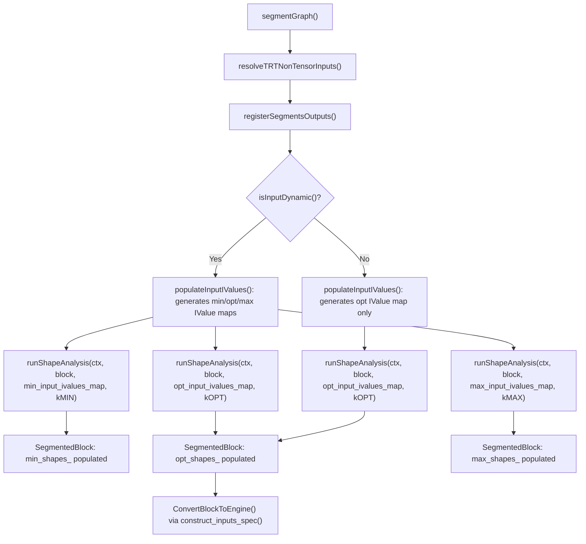
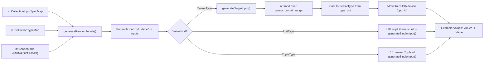
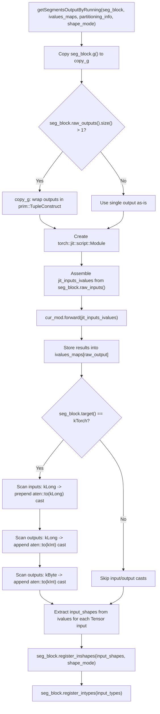
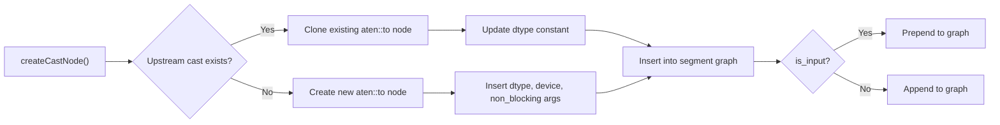
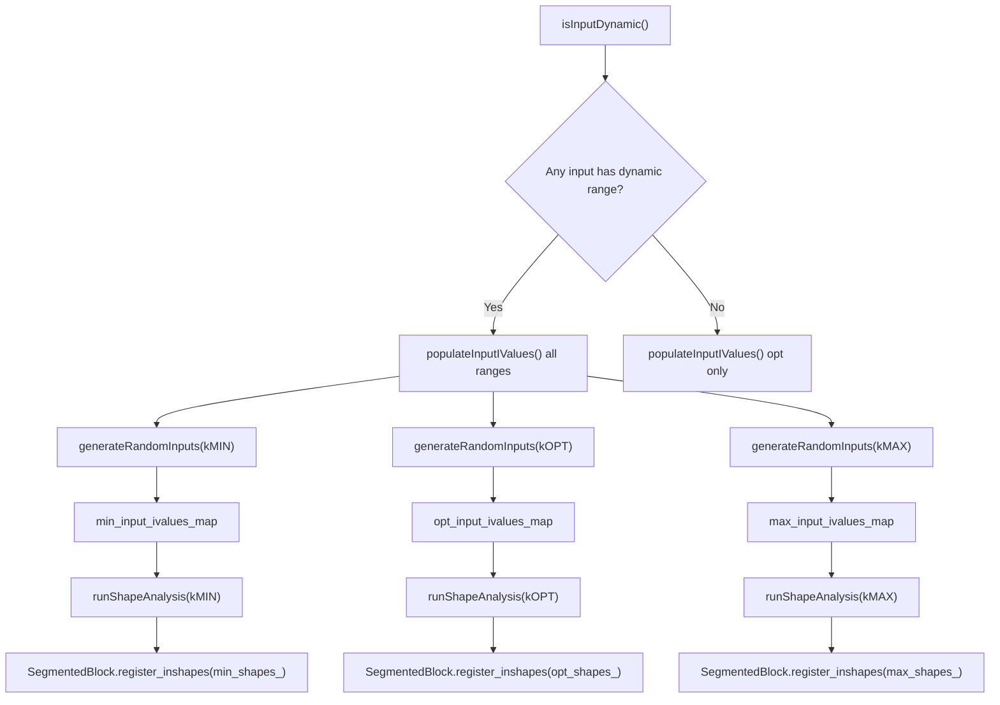
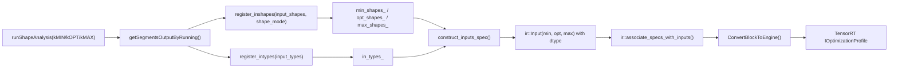

<!-- source: DeepWiki mcp.deepwiki.com · repo pytorch/TensorRT · page 4.4 Shape Analysis and Dynamic Shapes · fetched 2026-10-21 -->

# Shape Analysis and Dynamic Shapes

<details>
<summary>Relevant source files</summary>

The following files were used as context for generating this wiki page:

- [core/compiler.cpp](core/compiler.cpp)
- [core/partitioning/BUILD](core/partitioning/BUILD)
- [core/partitioning/partitioning.cpp](core/partitioning/partitioning.cpp)
- [core/partitioning/partitioning.h](core/partitioning/partitioning.h)
- [core/partitioning/partitioningctx/PartitioningCtx.cpp](core/partitioning/partitioningctx/PartitioningCtx.cpp)
- [core/partitioning/partitioningctx/PartitioningCtx.h](core/partitioning/partitioningctx/PartitioningCtx.h)
- [core/partitioning/segmentedblock/SegmentedBlock.cpp](core/partitioning/segmentedblock/SegmentedBlock.cpp)
- [core/partitioning/segmentedblock/SegmentedBlock.h](core/partitioning/segmentedblock/SegmentedBlock.h)
- [core/partitioning/shape_analysis.cpp](core/partitioning/shape_analysis.cpp)
- [core/partitioning/stitching.cpp](core/partitioning/stitching.cpp)
- [tests/core/partitioning/test_conditionals.cpp](tests/core/partitioning/test_conditionals.cpp)
- [tests/core/partitioning/test_resolve_nontensor_inputs.cpp](tests/core/partitioning/test_resolve_nontensor_inputs.cpp)
- [tests/core/partitioning/test_segmentation.cpp](tests/core/partitioning/test_segmentation.cpp)
- [tests/core/partitioning/test_shape_analysis.cpp](tests/core/partitioning/test_shape_analysis.cpp)
- [tests/cpp/test_dynamic_fallback.cpp](tests/cpp/test_dynamic_fallback.cpp)

</details>


This document describes the shape analysis system used by the TorchScript frontend to infer output shapes of graph segments during partitioning. Shape analysis is critical for hybrid execution, where TensorRT and PyTorch segments must exchange tensors with compatible shapes and data types.

For information about the overall partitioning process, see [Partitioning and Hybrid Execution](#4.3). For details on how conversion uses shape information, see [ConversionCtx and Network Building](#4.5).

## Purpose and Scope

The shape analysis system solves a fundamental problem in graph partitioning: when a graph is divided into TensorRT and PyTorch segments, each segment needs to know the shapes and data types of its inputs to execute correctly. Since TensorRT requires explicit shape specifications during engine building, the partitioning system must determine these shapes before conversion can proceed.

This system handles:
- Static shape inference by executing segments with example inputs
- Dynamic shape support using TensorRT optimization profiles (min/opt/max)
- Automatic type casting between PyTorch and TensorRT (`at::kLong`→`at::kInt`, `at::kByte`→`at::kInt`)
- Shape propagation across multiple interconnected segments

Sources: [core/partitioning/shape_analysis.cpp:1-362](), [core/partitioning/partitioning.cpp:598-609]()

## Shape Analysis in the Partitioning Pipeline

Shape analysis occurs after graph segmentation but before conversion to TensorRT engines. The partitioning pipeline follows this sequence:

**`partition()` call flow in `partitioning.cpp`**



The `partition()` function in [core/partitioning/partitioning.cpp:567-610]() orchestrates this process. After segmentation is complete, it calls `isInputDynamic()` [core/partitioning/partitioning.cpp:528-539]() to inspect `collection_input_spec_map` for any `ir::Input` with `input_is_dynamic=true`. For dynamic inputs, shape analysis runs three times to populate all three profiles. For static inputs, it runs once with the opt shapes.

Sources: [core/partitioning/partitioning.cpp:567-610](), [core/partitioning/partitioning.cpp:528-539]()

## Key Data Structures

The shape analysis system maintains shape information across two primary structures:

**`PartitioningCtx` shape maps** (keyed by `const torch::jit::Value*`)

| Field | Type | Purpose |
|-------|------|---------|
| `min_input_ivalues_map` | `ExampleIValues` | Random input tensors at minimum dimensions |
| `opt_input_ivalues_map` | `ExampleIValues` | Input tensors at optimal/actual dimensions |
| `max_input_ivalues_map` | `ExampleIValues` | Random input tensors at maximum dimensions |
| `input_types_map` | `CollectionTypeMap` | Scalar types for each graph input value |

**`SegmentedBlock` shape fields** (per-block, set by `register_inshapes()`)

| Field | Type | Purpose |
|-------|------|---------|
| `min_shapes_` | `vector<vector<int64_t>>` | Input shapes for kMIN profile |
| `opt_shapes_` | `vector<vector<int64_t>>` | Input shapes for kOPT profile |
| `max_shapes_` | `vector<vector<int64_t>>` | Input shapes for kMAX profile |
| `in_types_` | `vector<at::ScalarType>` | Data types for each tensor input |

`ExampleIValues` is a `typedef` for `unordered_map<const torch::jit::Value*, torch::jit::IValue>` [core/partitioning/partitioning.h:16](). The `PartitioningCtx` structure is defined in [core/partitioning/partitioningctx/PartitioningCtx.h:47-77]() and maintains these maps globally, while each `SegmentedBlock` stores the specific shape ranges for its inputs.

Sources: [core/partitioning/partitioningctx/PartitioningCtx.h:47-77](), [core/partitioning/segmentedblock/SegmentedBlock.h:76-99](), [core/partitioning/partitioning.h:16]()

## Input Generation for Shape Inference

Before shape analysis can run segments, it must generate example inputs. The `generateRandomInputs()` function creates tensors filled with random values for each graph input.

**`generateRandomInputs()` and `generateSingleInput()` data flow**



The `generateSingleInput()` function [core/partitioning/shape_analysis.cpp:13-50]() creates individual tensors by:

1. **Shape selection**: Reads `ir::Input.min`, `.opt`, or `.max` (`nvinfer1::Dims`) based on the `ir::ShapeMode`. Uses `input.input_shape` directly for static inputs.
2. **Value generation**: Random uniform values over `input.tensor_domain` (default `[0.0, 1.0)`).
3. **Type cast**: Tensor is initialized as float and cast to the target `at::ScalarType` from `type_opt`.
4. **Device placement**: Placed on the CUDA device specified by `gpu_id`.

The `generateRandomInputs()` function [core/partitioning/shape_analysis.cpp:52-84]() dispatches by `TypeKind`, wrapping results in `c10::impl::GenericList` (list inputs) or `c10::ivalue::Tuple` (tuple inputs).

Sources: [core/partitioning/shape_analysis.cpp:13-84](), [core/partitioning/partitioning.cpp:541-565]()

## Segment Execution and Shape Recording

The core of shape analysis is `getSegmentsOutputByRunning()`, which executes each segment to determine its output shapes and types.

**`getSegmentsOutputByRunning()` execution flow**



The execution process [core/partitioning/shape_analysis.cpp:150-343]() follows these steps:

1. **Graph preparation**: The segment's graph is copied (`g->copy()`) and wrapped in a temporary `torch::jit::script::Module`. Multiple outputs are collected into a `prim::TupleConstruct` to satisfy PyTorch's single-output API.

2. **Input assembly**: Input IValues are retrieved from `ivalues_maps` indexed by `seg_block.raw_inputs()`. The system handles `Tensor`, `Int`, `Bool`, `Float`, `String`, `List`, `Tuple`, `Dict`, and `DeviceObjType` values [core/partitioning/shape_analysis.cpp:182-218]().

3. **Execution**: `cur_mod.forward()` is invoked with the assembled inputs, propagating shapes through the segment's operators.

4. **Output recording**: Result IValues are stored back into `ivalues_maps` indexed by `seg_block.raw_outputs()`, making them available as inputs to downstream segments.

5. **Shape extraction**: For each tensor input, the shape is extracted (scalars are treated as `[1]`) and collected. `register_inshapes()` and `register_intypes()` are called to persist these on the block [core/partitioning/shape_analysis.cpp:297-342]().

Sources: [core/partitioning/shape_analysis.cpp:150-343]()

## Type Casting for TensorRT Compatibility

A critical function of shape analysis is inserting type casting operations to bridge PyTorch's and TensorRT's type systems. TensorRT does not support INT64 (Long) or INT8 (Byte, in non-quantized contexts) natively, so the system automatically converts these types.

### Casting Rules

The casting logic in [core/partitioning/shape_analysis.cpp:240-294]() applies different rules based on whether the segment is PyTorch or TensorRT:

| Segment Type | Input Casting | Output Casting | Configuration Flag |
|--------------|---------------|----------------|-------------------|
| PyTorch (kTorch) | INT32→INT64 if needed | INT64→INT32 if output goes to TensorRT | `truncate_long_and_double` |
| PyTorch (kTorch) | INT32→INT8 if needed | INT8→INT32 if output goes to TensorRT | `cast_int8_inputs` |
| TensorRT (kTensorRT) | Truncation happens in upstream PyTorch block | N/A | N/A |

### Cast Node Creation

The `createCastNode()` function at [core/partitioning/shape_analysis.cpp:109-148]() creates `aten::to` operations for type conversion:



The function searches for an upstream `aten::to` node using BFS in `getUpstreamCastNode()` at [core/partitioning/shape_analysis.cpp:86-107](). If found, it clones that node with updated parameters. Otherwise, it constructs a new cast node with the necessary constants.

For **input casting** [core/partitioning/shape_analysis.cpp:242-266](), when a PyTorch segment receives an INT32 input that should be INT64, `createCastNode()` is called with `is_input=true` and the result is prepended to the segment graph via `seg_block.g()->prependNode()`. All uses of the original input within the segment are then redirected to the cast node's output.

For **output casting** [core/partitioning/shape_analysis.cpp:269-292](), when a PyTorch segment produces an INT64 output that will feed a TensorRT segment, `createCastNode()` is called with `is_input=false`, the cast is appended via `seg_block.g()->appendNode()`, and the segment's output is replaced via `seg_block.g()->block()->replaceOutput()`.

Sources: [core/partitioning/shape_analysis.cpp:86-148](), [core/partitioning/shape_analysis.cpp:240-294]()

## Dynamic Shape Profile Management

For dynamic inputs, TensorRT requires optimization profiles that specify min, opt, and max dimensions for each input. The shape analysis system populates these profiles by running shape inference three times.



The `isInputDynamic()` function at [core/partitioning/partitioning.cpp:528-539]() checks if any input in the `collection_input_spec_map` has `input_is_dynamic` set to true. This flag is set when an `ir::Input` is constructed with separate min/opt/max dimensions (rather than a single static shape).

For dynamic inputs, `populateInputIValues()` at [core/partitioning/partitioning.cpp:541-565]() generates three complete sets of input tensors:
- **min_input_ivalues_map**: Tensors with minimum dimensions from `ir::Input.min`
- **opt_input_ivalues_map**: Tensors with optimal dimensions from `ir::Input.opt`
- **max_input_ivalues_map**: Tensors with maximum dimensions from `ir::Input.max`

Each `SegmentedBlock` stores the inferred shapes for all three profiles via `register_inshapes()` at [core/partitioning/segmentedblock/SegmentedBlock.h:76-84](), which routes to the appropriate member (`min_shapes_`, `opt_shapes_`, or `max_shapes_`) based on the `ir::ShapeMode` parameter.

Later, during conversion, `construct_inputs_spec()` at [core/partitioning/segmentedblock/SegmentedBlock.cpp:60-76]() creates `ir::Input` objects with these shapes, which are used to build TensorRT optimization profiles in `AddInputs()` at [core/conversion/conversion.cpp:138-206]().

**Sources:** [core/partitioning/partitioning.cpp:528-565](), [core/partitioning/partitioning.cpp:598-609](), [core/partitioning/segmentedblock/SegmentedBlock.h:76-99](), [core/partitioning/segmentedblock/SegmentedBlock.cpp:60-76]()

## runShapeAnalysis Function

`runShapeAnalysis()` [core/partitioning/shape_analysis.cpp:345-358]() is the main entry point for shape inference, invoked by `partition()` for each shape mode.

**Signature:**
```
runShapeAnalysis(PartitioningCtx* ctx, torch::jit::Block* block,
                 ExampleIValues& example_tensor_map, const ir::ShapeMode& shape_mode)
```

| Parameter | Type | Purpose |
|-----------|------|---------|
| `ctx` | `PartitioningCtx*` | Holds all segmented blocks and settings |
| `block` | `torch::jit::Block*` | The original module block being analyzed |
| `example_tensor_map` | `ExampleIValues&` | Pre-generated IValues for min/opt/max inputs; mutated with outputs |
| `shape_mode` | `ir::ShapeMode` | `kMIN`, `kOPT`, or `kMAX` — controls which shapes are recorded |

**Process:**
1. Iterate through `ctx->partitioned_blocks[block]` in topological order.
2. Call `torch::jit::ConstantPooling()` on each segment graph to reduce memory.
3. Call `getSegmentsOutputByRunning()` for each segment, passing `example_tensor_map` by reference. This mutates the map, inserting outputs keyed by each segment's `raw_outputs()`.
4. Subsequent segments receive the outputs of earlier segments as their inputs automatically via the shared `example_tensor_map`.

This chained execution pattern ensures shapes propagate correctly through all segments regardless of how many PyTorch and TensorRT blocks are interleaved.

Sources: [core/partitioning/shape_analysis.cpp:345-358]()

## Type Truncation and Compatibility

Beyond simple type casting, the system handles type truncation for compatibility between PyTorch's and TensorRT's type systems. This occurs in `getSegmentsOutputByRunning()` at [core/partitioning/shape_analysis.cpp:298-339]().

### Truncation Logic

For tensor inputs to TensorRT segments (after PyTorch segments have produced them), the system checks the inferred scalar type [core/partitioning/shape_analysis.cpp:310-319](). If `truncate_long_and_double` is disabled and an `at::kLong` or `at::kDouble` input is encountered, a `TORCHTRT_THROW_ERROR` is raised directing the user to enable the flag. If the flag is enabled, `at::kLong` is silently truncated to `at::kInt`, and `at::kDouble` is truncated to `at::kFloat`. This ensures that intermediate values flowing between segments have types compatible with TensorRT before shape recording occurs.

### INT8 Special Case

For INT8 types in non-quantized models [core/partitioning/shape_analysis.cpp:321-328](), when `partitioning_info.cast_int8_inputs` is set, any `nvinfer1::DataType::kINT8` input IValue is cast to `at::kInt` before being passed to TensorRT. This ensures TensorRT engines do not receive raw INT8 inputs unless the model uses quantization (Q/DQ nodes).

Sources: [core/partitioning/shape_analysis.cpp:298-339]()

## Integration with SegmentedBlock

Each `SegmentedBlock` stores shape information that will be used during conversion. The class defined in [core/partitioning/segmentedblock/SegmentedBlock.h:14-143]() maintains:

| Member Variable | Type | Purpose |
|-----------------|------|---------|
| `min_shapes_` | `vector<vector<int64_t>>` | Minimum input shapes for each input |
| `opt_shapes_` | `vector<vector<int64_t>>` | Optimal input shapes for each input |
| `max_shapes_` | `vector<vector<int64_t>>` | Maximum input shapes for each input |
| `in_types_` | `vector<at::ScalarType>` | Data types for each input |

**Shape data flow: from analysis to TensorRT engine**



The `register_inshapes()` method [core/partitioning/segmentedblock/SegmentedBlock.h:76-84]() stores shapes based on the `ir::ShapeMode` enum: `kMIN` writes to `min_shapes_`, `kOPT` to `opt_shapes_`, and `kMAX` to `max_shapes_`. This is called once per shape analysis pass.

`construct_inputs_spec()` [core/partitioning/segmentedblock/SegmentedBlock.cpp:60-76]() creates `ir::Input` objects from the stored shapes for use during conversion. When all three shape sets (`min_shapes_`, `opt_shapes_`, `max_shapes_`) are populated and have matching sizes, it constructs dynamic `ir::Input` objects with min/opt/max ranges. When only opt shapes are available (static case), it constructs static `ir::Input` objects. In both cases, the `dtype` field is populated from `in_types_`.

Sources: [core/partitioning/segmentedblock/SegmentedBlock.h:76-99](), [core/partitioning/segmentedblock/SegmentedBlock.cpp:60-76]()

## Configuration Flags

Shape analysis behavior is controlled by several flags in `PartitioningInfo`:

| Flag | Type | Purpose | Default |
|------|------|---------|---------|
| `truncate_long_and_double` | `bool` | Enable automatic truncation of INT64→INT32 and DOUBLE→FLOAT | `false` |
| `cast_int8_inputs` | `bool` | Cast INT8 inputs to INT32 for non-quantized models | `false` |
| `collection_input_spec_map` | `ir::CollectionInputSpecMap` | Maps input values to their shape specifications | Empty |

These flags are set in the `PartitioningInfo` structure at [core/partitioning/partitioninginfo/PartitioningInfo.h:19-39]() and accessed throughout shape analysis to control casting behavior.

When `truncate_long_and_double` is enabled and `require_full_compilation` is set, the compiler will automatically insert casts as needed. When disabled, attempting to pass INT64 values to TensorRT will result in an error, forcing the user to either enable truncation or modify their model.

**Sources:** [core/partitioning/partitioninginfo/PartitioningInfo.h:19-39](), [core/partitioning/shape_analysis.cpp:240-294]()

---

