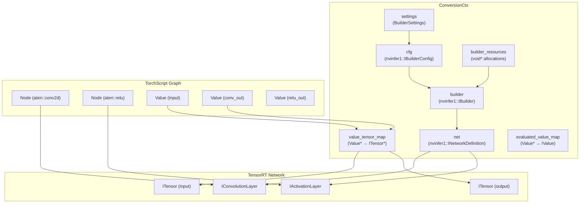
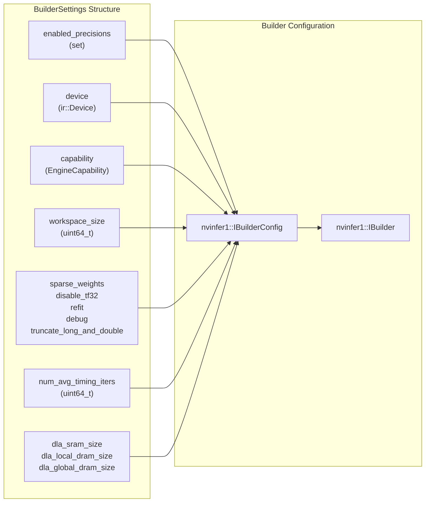
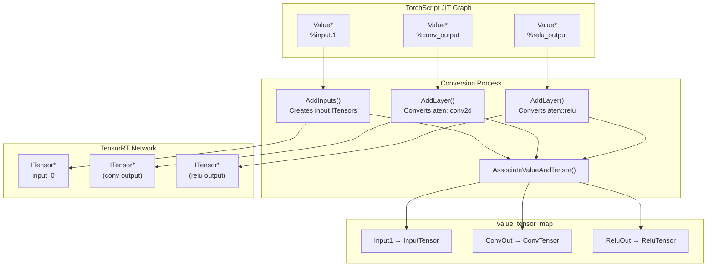
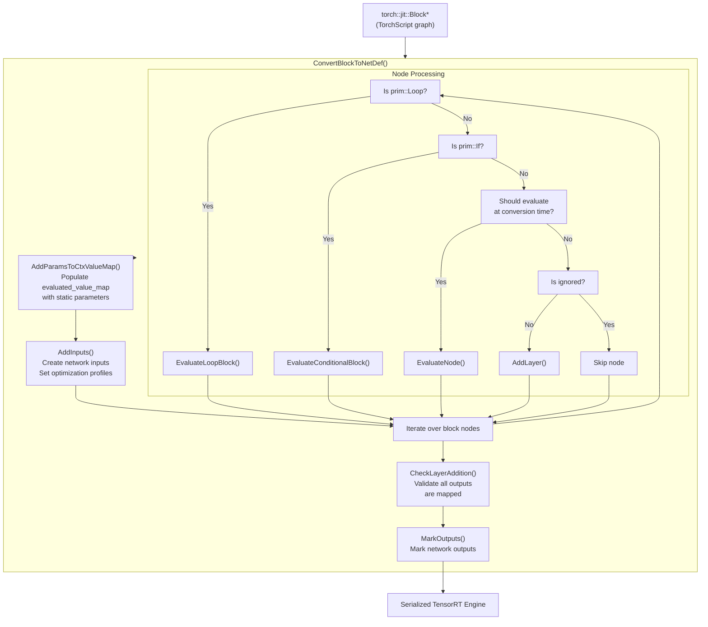
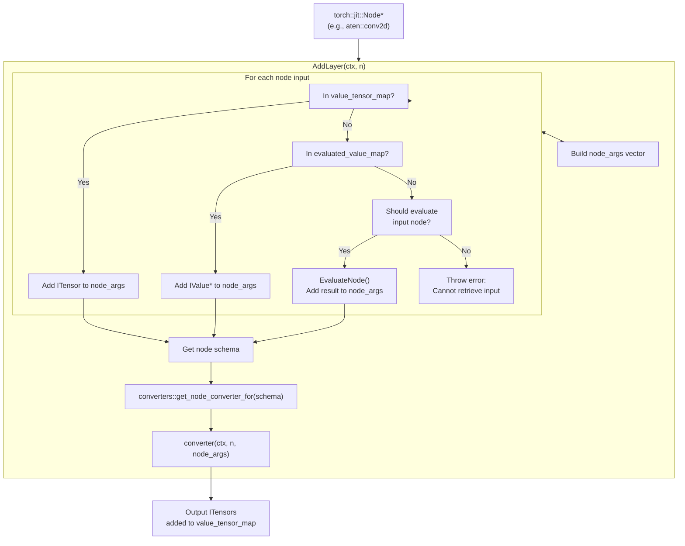
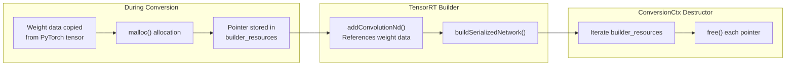

<!-- source: DeepWiki mcp.deepwiki.com · repo pytorch/TensorRT · page 4.5 ConversionCtx and Network Building · fetched 2026-10-21 -->

# ConversionCtx and Network Building

<details>
<summary>Relevant source files</summary>

The following files were used as context for generating this wiki page:

- [core/conversion/conversion.cpp](core/conversion/conversion.cpp)
- [core/conversion/conversionctx/ConversionCtx.cpp](core/conversion/conversionctx/ConversionCtx.cpp)
- [core/conversion/conversionctx/ConversionCtx.h](core/conversion/conversionctx/ConversionCtx.h)

</details>


This document describes the `ConversionCtx` class and the TensorRT network building process in the TorchScript frontend. The `ConversionCtx` serves as the central context object that manages TensorRT builder resources, maintains mappings between TorchScript JIT values and TensorRT tensors, and orchestrates the conversion of JIT graph nodes into TensorRT layers.

For information about the overall TorchScript compilation pipeline, see [Compilation Pipeline Overview](#4.1). For details on how individual operations are converted to TensorRT layers, see [Operation Converter Implementation](#5).

---

## ConversionCtx Class Structure

The `ConversionCtx` class is defined in [core/conversion/conversionctx/ConversionCtx.h]() and serves as the primary context object during TensorRT network construction. It encapsulates all state required for converting a TorchScript graph block into a TensorRT engine.

### Core Components

The class maintains the following key components:

| Component | Type | Purpose |
|-----------|------|---------|
| `builder` | `std::shared_ptr<nvinfer1::IBuilder>` | TensorRT builder instance for creating networks and engines |
| `net` | `std::shared_ptr<nvinfer1::INetworkDefinition>` | TensorRT network definition being constructed |
| `cfg` | `std::shared_ptr<nvinfer1::IBuilderConfig>` | Builder configuration specifying precision, workspace, etc. |
| `value_tensor_map` | `std::unordered_map<const torch::jit::Value*, nvinfer1::ITensor*>` | Maps JIT values to TensorRT tensors |
| `evaluated_value_map` | `std::unordered_map<const torch::jit::Value*, torch::jit::IValue>` | Maps JIT values to compile-time evaluated IValues |
| `builder_resources` | `std::vector<void*>` | Memory allocations that must persist until engine serialization |
| `settings` | `BuilderSettings` | Configuration for engine building |
| `logger` | `util::logging::TorchTRTLogger` | Logger for conversion diagnostics |

**ConversionCtx Class Relationships**



Sources: [core/conversion/conversionctx/ConversionCtx.h:40-71]()

---

## BuilderSettings Configuration

The `BuilderSettings` struct encapsulates all configuration parameters for TensorRT engine building. It is passed to the `ConversionCtx` constructor and used to configure the TensorRT builder and config objects.

### BuilderSettings Fields



Sources: [core/conversion/conversionctx/ConversionCtx.h:19-38]()

### Constructor Initialization

The `ConversionCtx` constructor [core/conversion/conversionctx/ConversionCtx.cpp:39-131]() performs the following initialization sequence:

1. **GPU Device Selection**: Sets CUDA device based on `settings.device.gpu_id`
2. **Builder Creation**: Creates `nvinfer1::IBuilder` instance
3. **Network Creation**: Creates network with `kEXPLICIT_BATCH` flag enabled
4. **Config Creation**: Creates `nvinfer1::IBuilderConfig` instance
5. **Precision Configuration**: Enables FP16, INT8, or FP32 based on `enabled_precisions`
6. **TF32 Control**: Disables TF32 if `disable_tf32` is set
7. **Flags Configuration**: Sets SPARSE_WEIGHTS, REFIT, DEBUG, GPU_FALLBACK flags
8. **Workspace Configuration**: Sets memory pool limit for workspace
9. **Device Configuration**: Configures DLA settings if device type is DLA
10. **Capability Setting**: Sets engine capability (standard, safety, DLA_standalone)

Sources: [core/conversion/conversionctx/ConversionCtx.cpp:39-131]()

---

## Value Mapping System

The `ConversionCtx` maintains two primary mappings to track the conversion state of TorchScript graph values:

### Value-to-Tensor Mapping

The `value_tensor_map` associates TorchScript `Value*` objects with TensorRT `ITensor*` objects. This mapping is used when a JIT value has been converted to a TensorRT layer and produces an ITensor output.

**Value Mapping Flow**



Sources: [core/conversion/conversionctx/ConversionCtx.h:66](), [core/conversion/conversionctx/ConversionCtx.cpp:139-143]()

### Value-to-IValue Mapping

The `evaluated_value_map` stores JIT values that were evaluated at compile-time rather than converted to TensorRT layers. This is used for constant values, shape computations, and operations handled by evaluators.

**Methods for Value Association**

| Method | Signature | Purpose |
|--------|-----------|---------|
| `AssociateValueAndTensor` | `nvinfer1::ITensor* AssociateValueAndTensor(const torch::jit::Value* value, nvinfer1::ITensor* tensor)` | Maps JIT value to TensorRT tensor |
| `AssociateValueAndIValue` | `torch::jit::IValue* AssociateValueAndIValue(const torch::jit::Value* value, torch::jit::IValue ivalue)` | Maps JIT value to evaluated IValue |
| `RecordNewITensor` | `void RecordNewITensor(const torch::jit::Value* value, nvinfer1::ITensor* tensor)` | Records tensor in both value_tensor_map and seen_itensors |

Sources: [core/conversion/conversionctx/ConversionCtx.h:43-45](), [core/conversion/conversionctx/ConversionCtx.cpp:139-157]()

---

## Network Building Workflow

The network building process converts a TorchScript graph block into a TensorRT INetworkDefinition. The primary orchestration function is `ConvertBlockToNetDef` in [core/conversion/conversion.cpp:402-485]().

### Conversion Pipeline



Sources: [core/conversion/conversion.cpp:402-485]()

### AddInputs Function

The `AddInputs` function [core/conversion/conversion.cpp:138-206]() creates TensorRT network inputs from the `ConversionInfo` specification:

1. **Input Filtering**: Identifies tensor inputs from the block (ignoring non-tensor values like `self`)
2. **Input Spec Lookup**: Retrieves `ir::Input` specification for each input from `conversion_info.inputs`
3. **ITensor Creation**: Calls `net->addInput()` with name, dtype, and shape from the spec
4. **Format Configuration**: Sets allowed tensor formats via `setAllowedFormats()`
5. **Profile Configuration**: Creates optimization profile with min/opt/max dimensions
6. **Value Association**: Maps JIT value to ITensor via `ctx->RecordNewITensor()`
7. **Profile Validation**: Adds profile to builder config after validation

Sources: [core/conversion/conversion.cpp:138-206]()

### AddLayer Function

The `AddLayer` function [core/conversion/conversion.cpp:75-136]() converts a single TorchScript node to TensorRT layers:

**AddLayer Execution Flow**



Sources: [core/conversion/conversion.cpp:75-136]()

The `AddLayer` function performs the following steps:

1. **Argument Collection**: Iterates through node inputs and builds `converters::args` vector by checking:
   - If input is already an ITensor in `value_tensor_map`
   - If input is an evaluated IValue in `evaluated_value_map`
   - If input node should be evaluated at conversion time (calls `EvaluateNode`)
2. **Schema Retrieval**: Gets the operator schema via `n->maybeSchema()`
3. **Converter Lookup**: Calls `converters::get_node_converter_for(schema)` to find the registered converter
4. **Converter Execution**: Invokes the converter function, which creates TensorRT layers and associates outputs with values

Sources: [core/conversion/conversion.cpp:75-136]()

### MarkOutputs Function

The `MarkOutputs` function [core/conversion/conversion.cpp:208-270]() marks TensorRT network outputs:

1. **Output Lookup**: For each block output value, checks `value_tensor_map` or `evaluated_value_map`
2. **Special Handling**:
   - If output is evaluated and contains `TensorContainer`, extracts ITensor
   - If output is evaluated tensor, converts to constant ITensor via `tensor_to_const`
   - Validates output types (throws error for unsupported tuple/list/scalar types)
3. **Identity Layer Insertion**: If output tensor is also a network input, inserts identity layer to avoid TensorRT restrictions
4. **Output Marking**: Calls `net->markOutput(*out_tensor)` with generated name `output_N`

Sources: [core/conversion/conversion.cpp:208-270]()

---

## Resource Management

The `ConversionCtx` manages memory allocations that must persist until the TensorRT engine is serialized.

### Builder Resources

The `builder_resources` vector [core/conversion/conversionctx/ConversionCtx.h:64]() stores pointers to allocated memory. This is primarily used by the `Weights` class for storing weight data copied from PyTorch tensors.

**Resource Lifecycle**



Sources: [core/conversion/conversionctx/ConversionCtx.h:64](), [core/conversion/conversionctx/ConversionCtx.cpp:133-137]()

### Engine Serialization

The `SerializeEngine` method [core/conversion/conversionctx/ConversionCtx.cpp:159-175]() builds and serializes the TensorRT engine:

1. **Network Building**: Calls `builder->buildSerializedNetwork(*net, *cfg)` (TensorRT 8+) or `builder->buildEngineWithConfig(*net, *cfg)` followed by `engine->serialize()` (TensorRT 7)
2. **Serialization**: Extracts serialized data as byte array
3. **String Conversion**: Returns engine as `std::string` containing binary data

After serialization, the `ConversionCtx` destructor [core/conversion/conversionctx/ConversionCtx.cpp:133-137]() frees all allocations in `builder_resources`.

Sources: [core/conversion/conversionctx/ConversionCtx.cpp:133-137](), [core/conversion/conversionctx/ConversionCtx.cpp:159-175]()

---

## Validation and Error Checking

The `ConversionCtx` provides validation mechanisms to ensure correct conversion:

### CheckLayerAddition

The `CheckLayerAddition` method [core/conversion/conversionctx/ConversionCtx.cpp:177-192]() validates that all node outputs have been properly converted:

1. Iterates through node outputs
2. Checks if each output exists in `value_tensor_map` or `evaluated_value_map`
3. Logs warning if output is missing, indicating potential converter/evaluator defect

This validation is called in [core/conversion/conversion.cpp:479-481]() after all nodes have been processed.

### seen_itensors Tracking

The `seen_itensors` set [core/conversion/conversionctx/ConversionCtx.h:70]() tracks ITensors that have been recorded. When `RecordNewITensor` is called [core/conversion/conversionctx/ConversionCtx.cpp:150-157](), it attempts to insert the tensor into the set and logs a warning if the tensor was already recorded, preventing accidental overwrites.

Sources: [core/conversion/conversionctx/ConversionCtx.h:70](), [core/conversion/conversionctx/ConversionCtx.cpp:150-157](), [core/conversion/conversionctx/ConversionCtx.cpp:177-192]()

---

## Integration with Conversion Pipeline

The `ConversionCtx` is instantiated in [core/conversion/conversion.cpp:495]() by the `ConvertBlockToEngine` function:

```
ConversionCtx ctx(build_info.engine_settings);
ConvertBlockToNetDef(&ctx, b, build_info, static_params);
std::string engine = ctx.SerializeEngine();
```

This demonstrates the typical usage pattern:
1. Create `ConversionCtx` with `BuilderSettings`
2. Call `ConvertBlockToNetDef` to populate the network
3. Call `SerializeEngine` to obtain serialized engine bytes

The resulting engine string is then returned to the partitioning system for integration into the hybrid TorchScript module. For details on how engines are integrated, see [Partitioning and Hybrid Execution](#4.3).

Sources: [core/conversion/conversion.cpp:491-499]()

---

