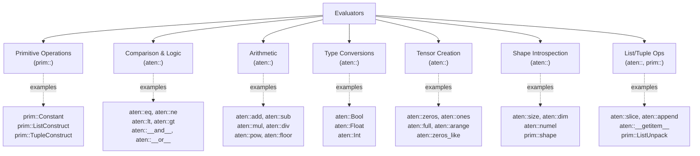
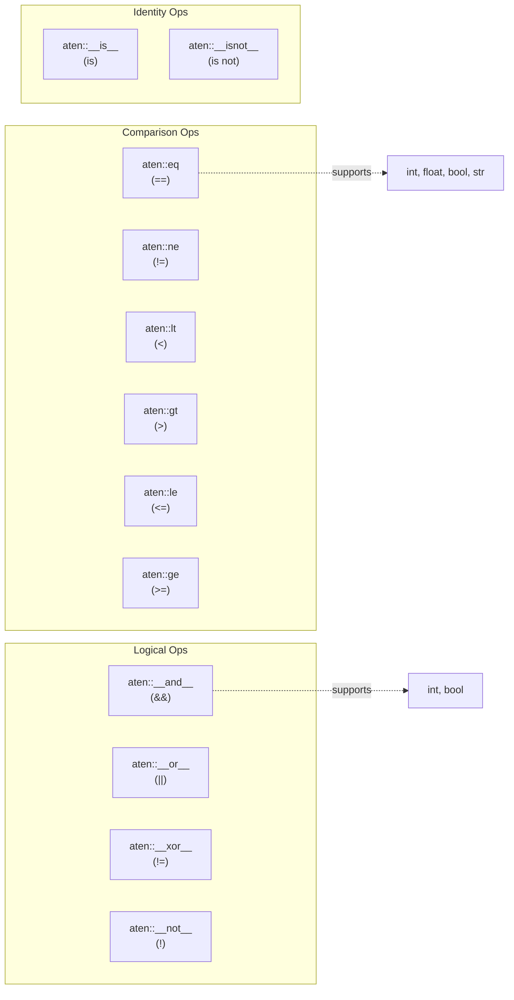
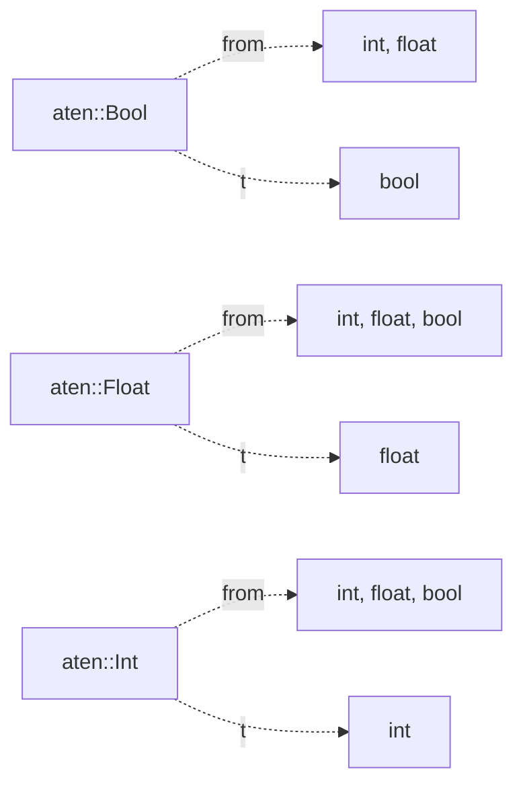
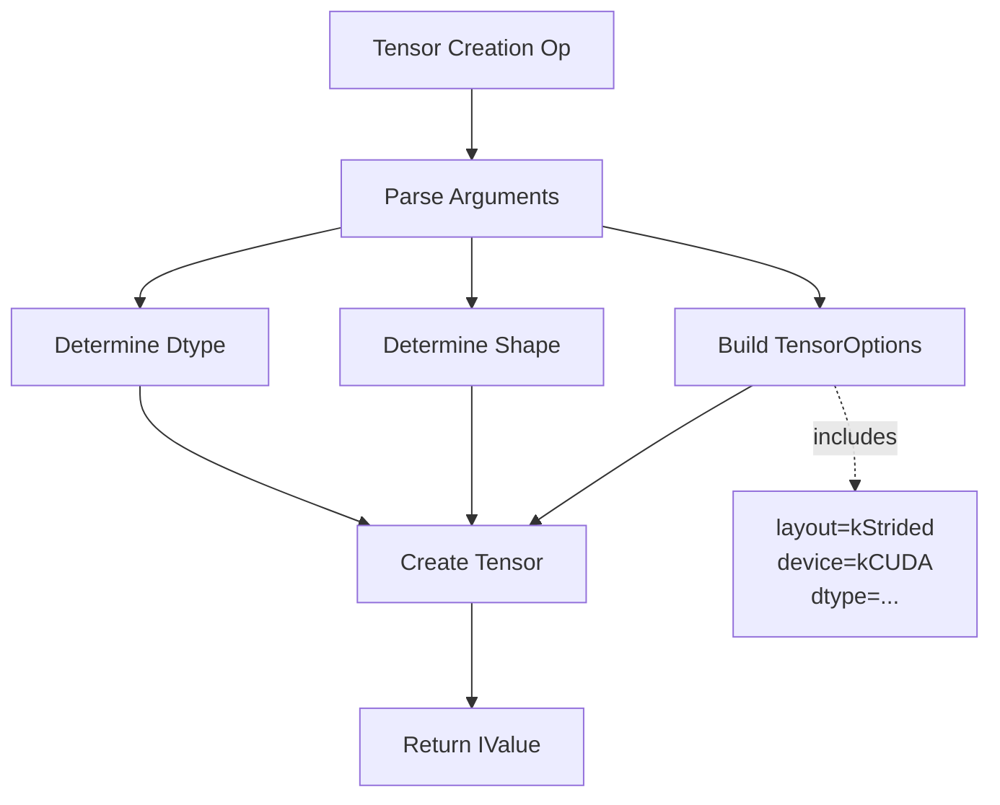
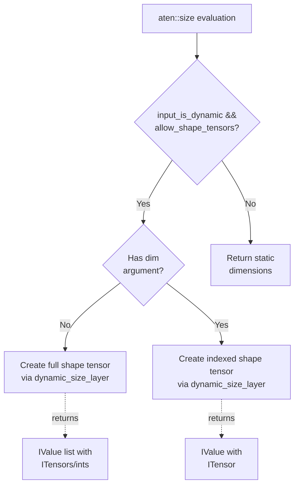
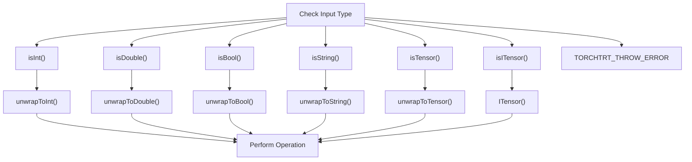
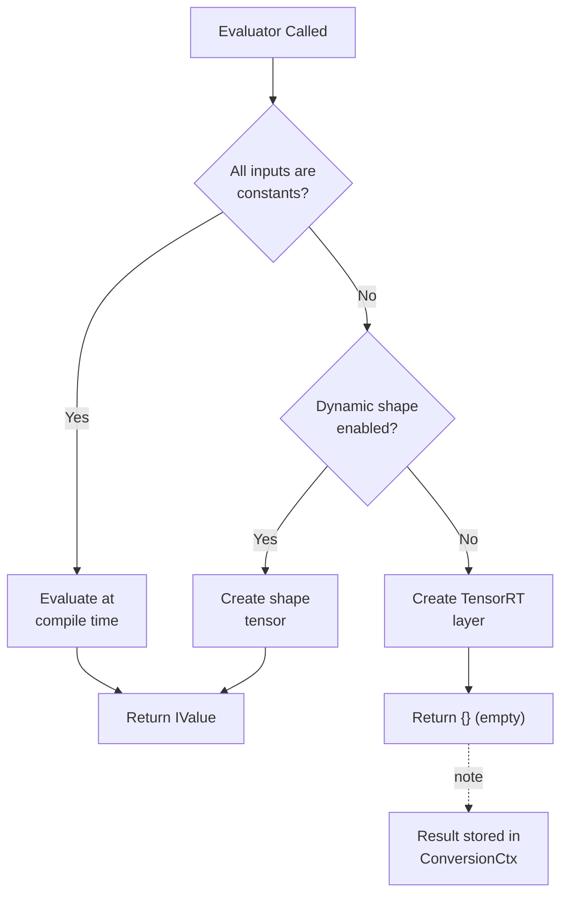
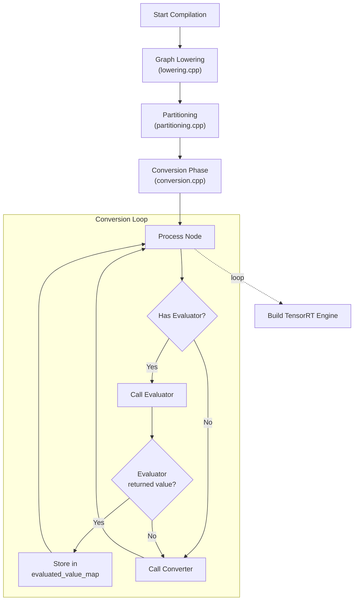

<!-- source: DeepWiki mcp.deepwiki.com · repo pytorch/TensorRT · page 4.6 Evaluators and Constant Folding · fetched 2026-10-21 -->

# Evaluators and Constant Folding

<details>
<summary>Relevant source files</summary>

The following files were used as context for generating this wiki page:

- [core/conversion/evaluators/aten.cpp](core/conversion/evaluators/aten.cpp)
- [core/conversion/evaluators/eval_macros.h](core/conversion/evaluators/eval_macros.h)
- [core/conversion/evaluators/eval_util.cpp](core/conversion/evaluators/eval_util.cpp)
- [core/conversion/evaluators/eval_util.h](core/conversion/evaluators/eval_util.h)
- [core/conversion/evaluators/prim.cpp](core/conversion/evaluators/prim.cpp)
- [core/ir/GraphInputs.cpp](core/ir/GraphInputs.cpp)
- [core/ir/StaticParams.cpp](core/ir/StaticParams.cpp)
- [core/ir/ir.cpp](core/ir/ir.cpp)
- [tests/core/conversion/evaluators/test_aten_evaluators.cpp](tests/core/conversion/evaluators/test_aten_evaluators.cpp)

</details>


## Purpose and Scope

The evaluator system in the TorchScript frontend performs **compile-time computation** of operations whose inputs are known constants, eliminating unnecessary runtime overhead. Rather than converting every operation to TensorRT layers, evaluators execute operations during graph analysis and replace them with constant results. This process, known as constant folding, simplifies the graph before conversion to TensorRT.

For information about the overall TorchScript compilation pipeline, see page 4.1. For details about how the conversion context manages TensorRT network building, see page 4.5.

**Sources:** [core/conversion/evaluators/aten.cpp:1-50](), [core/conversion/evaluators/prim.cpp:1-30]()

---

## Evaluation vs Conversion

In the TorchScript compilation pipeline, operations can be handled in two ways:

| Approach | When Used | Result |
|----------|-----------|--------|
| **Evaluation** | All inputs are compile-time constants | Operation is executed immediately, result stored as constant |
| **Conversion** | One or more inputs are runtime tensors | Operation is converted to TensorRT layer(s) |

For example, `aten::add` with two integer constants is evaluated to produce a constant result, while `aten::add` with two `ITensor` inputs is converted to an `IElementWiseLayer`.

Some evaluators support **hybrid behavior**: they check if inputs are constants and evaluate if possible, otherwise create TensorRT layers. The `aten::mul` evaluator demonstrates this pattern:

```cpp
// If inputs are ITensors, create TensorRT layer
if (!constTypesOnly(args)) {
  auto mul = converters::add_elementwise(ctx, nvinfer1::ElementWiseOperation::kPROD, a, b, ...);
  // ...
}
// Otherwise, evaluate as constants
if (args.at(n->input(0)).IValue()->isInt()) {
  auto a = args.at(n->input(0)).unwrapToInt();
  auto b = args.at(n->input(1)).unwrapToInt();
  return a * b;
}
```

**Sources:** [core/conversion/evaluators/aten.cpp:534-562]()

---

## Registration System

Evaluators are registered using the `RegisterNodeEvaluators()` class, which associates operation symbols (e.g., `aten::eq`, `prim::Constant`) with evaluator functions. Registration occurs at static initialization time:

```mermaid
graph LR
    REG["RegisterNodeEvaluators()"]
    EVAL["evaluator()"]
    SYM["c10::Symbol::fromQualString"]
    LAMBDA["Lambda Function"]
    OPTS["EvalOptions()"]
    SCHEMA["validSchemas()"]
    
    REG --> EVAL
    EVAL --> SYM
    EVAL --> LAMBDA
    EVAL --> OPTS
    OPTS --> SCHEMA
    
    SYM -.example.-> QSTR["\"aten::eq\""]
    LAMBDA -.signature.-> FUNC["(ConversionCtx*, Node*, kwargs&)<br/>-> optional<IValue>"]
    SCHEMA -.example.-> SIGS["\"aten::eq.int(int a, int b) -> (bool)\""]
```

**Registration Pattern:**

```cpp
auto <name>_registrations TORCHTRT_UNUSED = 
    RegisterNodeEvaluators()
        .evaluator({
            c10::Symbol::fromQualString("<op_name>"),
            [](ConversionCtx* ctx, const torch::jit::Node* n, kwargs& args) 
                -> c10::optional<torch::jit::IValue> {
                // Evaluator implementation
            },
            EvalOptions().validSchemas({
                "<schema_1>",
                "<schema_2>",
                // ...
            })
        });
```

The `EvalOptions().validSchemas()` clause specifies which operation overloads this evaluator handles, enabling precise dispatch based on argument types.

**Sources:** [core/conversion/evaluators/aten.cpp:128-144](), [core/conversion/evaluators/prim.cpp:22-31]()

---

## Evaluator Function Signature

All evaluator functions follow this signature:

```cpp
c10::optional<torch::jit::IValue> evaluator(
    ConversionCtx* ctx,           // Conversion context
    const torch::jit::Node* n,    // Graph node being evaluated
    kwargs& args                  // Map of inputs to their values
)
```

**Accessing Inputs:**

Inputs are accessed through the `kwargs& args` map using node input indices:

```cpp
auto input_value = args.at(n->input(0));  // First input
auto second_value = args.at(n->input(1)); // Second input
```

**Input Types:**

The `kwargs` map values can represent:
- **`IValue`**: PyTorch constant values (int, float, bool, Tensor, list, tuple)
- **`ITensor`**: TensorRT runtime tensors
- **`TensorContainer`**: Wrapper for ITensors in IValue containers

**Unwrapping Values:**

```cpp
// Unwrap to specific types
auto int_val = args.at(n->input(0)).unwrapToInt();
auto double_val = args.at(n->input(0)).unwrapToDouble();
auto bool_val = args.at(n->input(0)).unwrapToBool();
auto tensor_val = args.at(n->input(0)).unwrapToTensor();
auto list_val = args.at(n->input(0)).unwrapToIntList();

// Check if value is ITensor
if (args.at(n->input(0)).isITensor()) {
    auto itensor = args.at(n->input(0)).ITensor();
}
```

**Return Value:**

Evaluators return `c10::optional<torch::jit::IValue>`:
- `c10::nullopt` or empty `{}`: Evaluation not possible (fall through to converter)
- `IValue`: Successful evaluation result

**Sources:** [core/conversion/evaluators/aten.cpp:134-144](), [core/conversion/evaluators/prim.cpp:25-31]()

---

## Categories of Evaluators



**Sources:** [core/conversion/evaluators/aten.cpp:23-825](), [core/conversion/evaluators/prim.cpp:22-347]()

---

### Primitive Operations (prim::)

Primitive operations are TorchScript internal operations that manage control flow and data structures.

| Operation | Purpose | Example |
|-----------|---------|---------|
| `prim::Constant` | Extract constant value from node | Extracts constant integers, floats, tensors |
| `prim::ListConstruct` | Construct list from elements | `[a, b, c]` creates list |
| `prim::TupleConstruct` | Construct tuple from elements | `(a, b, c)` creates tuple |
| `prim::ListUnpack` | Unpack list into elements | `a, b, c = my_list` |
| `prim::TupleUnpack` | Unpack tuple into elements | `a, b = my_tuple` |
| `prim::TupleIndex` | Index into tuple | `my_tuple[0]` |
| `prim::NumToTensor` | Convert scalar to tensor | Wraps scalar in tensor |
| `prim::dtype` | Extract tensor dtype | Returns scalar type as int |
| `prim::min` | Minimum of values or list | `min(a, b)` or `min([1,2,3])` |
| `prim::max` | Maximum of values or list | `max(a, b)` or `max([1,2,3])` |
| `prim::shape` | Get tensor shape | Returns shape as int list |
| `prim::unchecked_cast` | Type cast without checks | Cast between types |
| `prim::Uninitialized` | Uninitialized value | Returns `IValue::uninitialized()` |
| `prim::RaiseException` | Raise exception | Throws error with message |

**List Construction Example:**

The `prim::ListConstruct` evaluator handles both constant lists and lists containing ITensors:

```cpp
if (constTypesOnly(args)) {
    // Build list of constants
    c10::List<int64_t> list;
    for (auto in : n->inputs()) {
        list.emplace_back(std::move(args.at(in).unwrapToInt()));
    }
    return torch::jit::IValue(list);
} else {
    // Build list containing ITensors wrapped in TensorContainers
    auto list = c10::impl::GenericList(c10::AnyType::get());
    for (auto in : n->inputs()) {
        if (args.at(in).isITensor()) {
            auto tensor_holder = TensorContainer();
            tensor_holder.hold_tensor(args.at(in).ITensor());
            auto ival = c10::IValue(std::move(c10::make_intrusive<TensorContainer>(tensor_holder)));
            list.emplace_back(std::move(ival));
        }
    }
    return torch::jit::IValue(list);
}
```

**Sources:** [core/conversion/evaluators/prim.cpp:22-347]()

---

### Comparison and Logical Operations

Comparison and logical evaluators compute boolean results from scalar comparisons.



**Type Dispatch Pattern:**

These evaluators use the `DEFINE_GENERIC_TWO_INPUT_EVALUATOR` macro to handle multiple type combinations:

```cpp
DEFINE_GENERIC_TWO_INPUT_EVALUATOR(
    eq,                     // Evaluator name
    "aten::eq",            // Operation symbol
    a == b,                // Comparison operation
    std::set<std::string>({
        "aten::eq.bool(bool a, bool b) -> (bool)",
        "aten::eq.int(int a, int b) -> (bool)",
        "aten::eq.float(float a, float b) -> (bool)",
        "aten::eq.str(str a, str b) -> (bool)",
        "aten::eq.int_float(int a, float b) -> (bool)",
        "aten::eq.float_int(float a, int b) -> (bool)",
    }));
```

The macro expands to handle all type combinations (int/int, int/float, float/int, bool/bool, etc.).

**Sources:** [core/conversion/evaluators/aten.cpp:23-126](), [core/conversion/evaluators/eval_macros.h:5-78]()

---

### Arithmetic Operations

Arithmetic evaluators compute mathematical operations on scalar values.

| Operation | Supported Types | Return Type | Notes |
|-----------|----------------|-------------|-------|
| `aten::add` | int, float, str | Same as input | String concatenation supported |
| `aten::sub` | int, float | Same as input | Subtraction |
| `aten::mul` | int, float | Same as input | Hybrid: creates layer if ITensor inputs |
| `aten::div` | int, float | float | Always returns float (int/int → float) |
| `aten::floordiv` | int, float | int | Floor division (returns int) |
| `aten::pow` | int, float | float | Power operation |
| `aten::neg` | int | int | Negation (multiplies by -1) |
| `aten::floor` | int, float | int | Floor rounding |
| `aten::sqrt` | int, float | float | Square root |
| `aten::__round_to_zero_floordiv` | int | int | Truncating division |

**Hybrid Evaluation Example (aten::mul):**

```cpp
if (!constTypesOnly(args)) {
    // Runtime tensors: create TensorRT ElementWise layer
    auto a = args.at(n->input(0)).ITensorOrFreeze(ctx);
    auto b = args.at(n->input(1)).ITensorOrFreeze(ctx);
    auto mul = converters::add_elementwise(
        ctx, nvinfer1::ElementWiseOperation::kPROD, a, b, util::node_info(n));
    auto out = ctx->AssociateValueAndTensor(n->outputs()[0], mul->getOutput(0));
    return {};
}
// Constants: evaluate at compile time
if (args.at(n->input(0)).IValue()->isInt()) {
    auto a = args.at(n->input(0)).unwrapToInt();
    auto b = args.at(n->input(1)).unwrapToInt();
    return a * b;
}
```

**Sources:** [core/conversion/evaluators/aten.cpp:478-562](), [core/conversion/evaluators/aten.cpp:564-584](), [core/conversion/evaluators/aten.cpp:716-777]()

---

### Type Conversions

Type conversion evaluators cast values between scalar types.



**Example Conversion:**

```cpp
// aten::Float evaluator
if (args.at(n->input(0)).IValue()->isInt()) {
    auto a = args.at(n->input(0)).unwrapToInt();
    return (float)a;
} else if (args.at(n->input(0)).IValue()->isDouble()) {
    auto a = args.at(n->input(0)).unwrapToDouble();
    return (float)a;
} else if (args.at(n->input(0)).IValue()->isBool()) {
    auto a = args.at(n->input(0)).unwrapToBool();
    return (float)a;
}
```

**Sources:** [core/conversion/evaluators/aten.cpp:586-650]()

---

### Tensor Creation

Tensor creation evaluators produce new tensors with specified values and shapes.

**Tensor Creation Operations:**

| Category | Operations | Description |
|----------|-----------|-------------|
| **Factory Functions** | `aten::zeros`, `aten::ones`, `aten::full` | Create tensors with specified shape |
| **Like Functions** | `aten::zeros_like`, `aten::ones_like`, `aten::full_like` | Create tensors matching input shape |
| **New Functions** | `aten::new_zeros`, `aten::new_ones` | Create tensors with shape, inheriting dtype |
| **Range Functions** | `aten::arange` | Create sequence tensors |
| **Fill Functions** | `aten::fill_` | Fill existing tensor with value |
| **Clone/Copy** | `aten::clone`, `aten::copy_` | Duplicate tensor data |

**Tensor Creation Flow:**



**aten::zeros Example:**

```cpp
// aten::zeros(int[] size, *, int? dtype=None, ...) -> (Tensor)
auto options = torch::TensorOptions()
    .layout(torch::kStrided)
    .device(torch::kCUDA);

// Parse dtype if specified
if (!args.at(n->input(1)).isNone() && 
    !args.at(n->input(1)).IValue()->isNone()) {
    options = options.dtype(c10::ScalarType(args.at(n->input(1)).unwrapToInt()));
}

// Create tensor
auto out_tensor = torch::zeros(
    args.at(n->input(0)).unwrapToIntList().vec(), 
    options);
return out_tensor;
```

**Like Functions Implementation:**

The `newTensorLikeImplementation` helper handles dynamic shape support:

```cpp
if (ctx->settings.allow_shape_tensors && ctx->input_is_dynamic) {
    // For dynamic shapes, create constant and broadcast to runtime shape
    auto constant = tensor_builder(dims_vec, options);
    auto constant_itensor = converters::tensor_to_const(ctx, constant);
    
    // Get runtime shape via shape layer
    nvinfer1::ITensor* shape_output = getShapeOutput(ctx, self, ...);
    
    // Use slice layer to broadcast (slice implements expand)
    auto slice_layer = ctx->net->addSlice(*constant_itensor, start_offset, 
                                          self->getDimensions(), start_offset);
    slice_layer->setInput(2, *shape_output);
    
    return {};  // Result stored in conversion context
}
// For static shapes, evaluate directly
return tensor_builder(tensor_dims, options);
```

**Sources:** [core/conversion/evaluators/aten.cpp:128-279](), [core/conversion/evaluators/eval_util.cpp:386-435]()

---

### Shape Introspection

Shape introspection evaluators extract tensor shape information at compile time or create shape tensors for dynamic shapes.

**Shape Operations:**

| Operation | Return Type | Dynamic Shape Handling |
|-----------|-------------|------------------------|
| `aten::size` | int[] or int | Creates shape tensor if `allow_shape_tensors=True` |
| `aten::size(dim)` | int | Returns static size or creates shape tensor for dynamic dim |
| `aten::dim` | int | Returns number of dimensions (always static) |
| `aten::numel` | int | Returns total number of elements |
| `prim::shape` | int[] | Similar to `aten::size` without dim argument |

**Dynamic Shape Handling:**

When `ctx->input_is_dynamic` and `ctx->settings.allow_shape_tensors` are both true, shape evaluators create TensorRT shape tensors instead of returning static integers:



**aten::size Implementation:**

```cpp
auto tensor_var = args.at(n->input(0));
if (n->inputs().size() == 1) {
    // aten::size(Tensor) -> int[]
    if (tensor_var.isITensor()) {
        auto tensor = tensor_var.ITensor();
        if (ctx->input_is_dynamic) {
            if (ctx->settings.allow_shape_tensors) {
                return dynamic_size_layer(ctx, n, args);  // Create shape tensor
            } else {
                LOG_WARNING("Undefined behavior using dynamic shape without allow_shape_tensors");
            }
        }
        return util::toVec(tensor->getDimensions());  // Static case
    }
} else {
    // aten::size(Tensor, int dim) -> int
    auto dim = args.at(n->input(1)).unwrapToInt();
    if (tensor_var.isITensor()) {
        auto dims = util::toVec(tensor->getDimensions());
        if (dim < 0) { dim += nbDims; }
        
        if (ctx->input_is_dynamic && dims[dim] == -1) {
            if (ctx->settings.allow_shape_tensors) {
                return dynamic_size_layer(ctx, n, args);  // Create shape tensor
            }
        }
        return dims[dim];  // Static dimension
    }
}
```

**dynamic_size_layer Implementation:**

The `dynamic_size_layer` function creates an `IShapeLayer` to compute shape at runtime:

```cpp
c10::IValue dynamic_size_layer(ConversionCtx* ctx, const torch::jit::Node* n, kwargs& args) {
    auto in = args.at(n->input(0)).ITensorOrFreeze(ctx);
    
    // Create shape layer to get runtime shape
    nvinfer1::ITensor* shape_1d_tensor = getShapeOutput(ctx, in, ...);
    
    if (n->inputs().size() != 1) {
        // Extract specific dimension
        auto dim = args.at(n->input(1)).unwrapToInt();
        dim = dim < 0 ? dim + maxDim : dim;
        shape_1d_tensor = index_layer(ctx, n, shape_1d_tensor, dim);
        
        // Wrap ITensor in TensorContainer for return
        auto tensor_holder = TensorContainer();
        tensor_holder.hold_tensor(shape_1d_tensor);
        return c10::IValue(std::move(c10::make_intrusive<TensorContainer>(tensor_holder)));
    } else {
        // Return list with dynamic dimensions as ITensors, static as ints
        auto input_size = c10::impl::GenericList(c10::AnyType::get());
        for (int32_t i = 0; i < input_dims.nbDims; i++) {
            if (input_dims.d[i] == -1) {
                auto dynamic_dim_tensor = index_layer(ctx, n, shape_1d_tensor, i);
                // Wrap and add to list...
            } else {
                input_size.emplace_back(input_dims.d[i]);
            }
        }
        return c10::IValue(input_size);
    }
}
```

**Sources:** [core/conversion/evaluators/aten.cpp:332-397](), [core/conversion/evaluators/aten.cpp:684-714](), [core/conversion/evaluators/eval_util.cpp:32-71]()

---

### List and Tuple Operations

List and tuple evaluators manipulate collections at compile time.

**List Operations:**

| Operation | Description | Example |
|-----------|-------------|---------|
| `aten::slice` | Extract sublist | `my_list[1:3]` |
| `aten::len` | Get list length | `len(my_list)` |
| `aten::__getitem__` | Index into list | `my_list[0]` |
| `aten::append` | Append element | `my_list.append(x)` |
| `aten::extend` | Extend with another list | `my_list.extend(other_list)` |
| `aten::add_` | Concatenate lists | `list_a + list_b` |
| `prim::ListConstruct` | Construct list | `[a, b, c]` |
| `prim::ListUnpack` | Unpack list | `a, b, c = my_list` |

**Tuple Operations:**

| Operation | Description |
|-----------|-------------|
| `prim::TupleConstruct` | Construct tuple |
| `prim::TupleIndex` | Index into tuple |
| `prim::TupleUnpack` | Unpack tuple |

**List Slicing Example:**

```cpp
// aten::slice.t(t[] l, int? start=None, int? end=None, int step=1) -> (t[])
c10::List<c10::IValue> list = args.at(n->input(0)).IValue()->to<c10::List<c10::IValue>>();
int64_t start = 0;
int64_t end = 9223372036854775807;  // Max int64

// Parse start/end with None handling
auto startIVal = args.at(n->input(1)).IValue();
auto endIVal = args.at(n->input(2)).IValue();
if (!startIVal->isNone()) {
    start = args.at(n->input(1)).unwrapToInt();
}
if (!endIVal->isNone()) {
    end = args.at(n->input(2)).unwrapToInt();
}

int64_t step = args.at(n->input(3)).unwrapToInt();

// Normalize indices (handle negatives)
const int64_t normalized_start = std::max((int64_t)0, normalizeIndex(start, list_size));
const int64_t normalized_end = std::min(list_size, normalizeIndex(end, list_size));

// Build sliced list
auto sliced_list = c10::impl::GenericList(list.elementType());
for (auto i = normalized_start; i < normalized_end; i += step) {
    sliced_list.push_back(list.get(i));
}
return sliced_list;
```

**Handling ITensors in Lists:**

When list elements are ITensors, they're wrapped in `TensorContainer` objects:

```cpp
// aten::append with ITensor
if (args.at(n->input(1)).isITensor()) {
    auto tensor_holder = TensorContainer();
    tensor_holder.hold_tensor(args.at(n->input(1)).ITensor());
    auto el = c10::IValue(std::move(c10::make_intrusive<TensorContainer>(tensor_holder)));
    list.push_back(std::move(el));
}
```

**Sources:** [core/conversion/evaluators/aten.cpp:281-466](), [core/conversion/evaluators/prim.cpp:42-134]()

---

## Implementation Patterns

### Macro-Based Evaluators

The codebase uses C++ macros to reduce boilerplate for evaluators that follow common patterns.

**DEFINE_GENERIC_TWO_INPUT_EVALUATOR:**

This macro generates evaluators for binary operations that support multiple type combinations:

```cpp
DEFINE_GENERIC_TWO_INPUT_EVALUATOR(
    eq,                    // Evaluator name
    "aten::eq",           // Operation symbol
    a == b,               // Operation expression
    std::set<std::string>({
        "aten::eq.bool(bool a, bool b) -> (bool)",
        "aten::eq.int(int a, int b) -> (bool)",
        "aten::eq.float(float a, float b) -> (bool)",
        "aten::eq.str(str a, str b) -> (bool)",
        "aten::eq.int_float(int a, float b) -> (bool)",
        "aten::eq.float_int(float a, int b) -> (bool)",
    })
);
```

**Expansion Pattern:**

The macro expands to nested if-else chains testing all type combinations:

```cpp
if (args.at(n->input(0)).IValue()->isInt()) {
    auto a = args.at(n->input(0)).unwrapToInt();
    if (args.at(n->input(1)).IValue()->isInt()) {
        auto b = args.at(n->input(1)).unwrapToInt();
        return a == b;  // Operation expression
    } else if (args.at(n->input(1)).IValue()->isDouble()) {
        auto b = args.at(n->input(1)).unwrapToDouble();
        return a == b;
    }
    // ... more type combinations
} else if (args.at(n->input(0)).IValue()->isDouble()) {
    // ... handle double as first argument
} else if (args.at(n->input(0)).IValue()->isString()) {
    // ... handle string as first argument
}
```

**Available Macros:**

| Macro | Purpose |
|-------|---------|
| `DEFINE_GENERIC_TWO_INPUT_EVALUATOR` | Binary ops supporting int/float/bool/string |
| `DEFINE_ARITHMATIC_TWO_INPUT_EVALUATOR` | Binary ops supporting int/float/bool only |
| `DEFINE_TWO_INPUT_SIMPLE_EVALUATOR` | Binary ops with single type |

**Sources:** [core/conversion/evaluators/eval_macros.h:5-136](), [core/conversion/evaluators/aten.cpp:23-126]()

---

### Type Dispatch Pattern

Evaluators commonly use type dispatch to handle different input types:



**Pattern Implementation:**

```cpp
if (args.at(n->input(0)).IValue()->isInt()) {
    auto a = args.at(n->input(0)).unwrapToInt();
    // Perform operation with int
    return result;
} else if (args.at(n->input(0)).IValue()->isDouble()) {
    auto a = args.at(n->input(0)).unwrapToDouble();
    // Perform operation with double
    return result;
} else if (args.at(n->input(0)).IValue()->isTensor()) {
    auto a = args.at(n->input(0)).unwrapToTensor();
    // Perform operation with tensor
    return result;
} else {
    TORCHTRT_THROW_ERROR(
        "Unimplemented data type for evaluator: " 
        << args.at(n->input(0)).IValue()->type()->str());
    return {};
}
```

**Sources:** [core/conversion/evaluators/aten.cpp:478-502]()

---

### Dynamic vs Static Evaluation

Some evaluators must handle both static (compile-time known) and dynamic (runtime-dependent) cases.

**Decision Flow:**



**Example: aten::mul**

```cpp
// Check if all inputs are constants
if (!constTypesOnly(args)) {
    // Create TensorRT layer for runtime computation
    auto a = args.at(n->input(0)).ITensorOrFreeze(ctx);
    auto b = args.at(n->input(1)).ITensorOrFreeze(ctx);
    auto mul = converters::add_elementwise(
        ctx, nvinfer1::ElementWiseOperation::kPROD, a, b, util::node_info(n));
    
    // Store result in context
    auto out = ctx->AssociateValueAndTensor(n->outputs()[0], mul->getOutput(0));
    return {};  // Empty return indicates layer was created
}

// All inputs are constants - evaluate at compile time
if (args.at(n->input(0)).IValue()->isInt()) {
    auto a = args.at(n->input(0)).unwrapToInt();
    auto b = args.at(n->input(1)).unwrapToInt();
    return a * b;  // Return computed value
}
```

**Example: aten::size**

```cpp
if (tensor_var.isITensor()) {
    auto tensor = tensor_var.ITensor();
    
    if (ctx->input_is_dynamic) {
        if (ctx->settings.allow_shape_tensors) {
            // Create shape tensor for dynamic case
            return dynamic_size_layer(ctx, n, args);
        } else {
            LOG_WARNING("Undefined behavior using dynamic shape...");
        }
    }
    
    // Static case - return dimensions directly
    return util::toVec(tensor->getDimensions());
}
```

**Sources:** [core/conversion/evaluators/aten.cpp:534-562](), [core/conversion/evaluators/aten.cpp:332-397]()

---

## Evaluator Execution in Compilation Pipeline

Evaluators are invoked during the conversion phase of TorchScript compilation:



**Evaluator Lookup Process:**

1. **Node Kind Extraction**: Get operation symbol (e.g., `aten::add`)
2. **Registry Lookup**: Check if evaluator exists for this symbol
3. **Schema Matching**: Verify operation schema matches evaluator schemas
4. **Execution**: Call evaluator with `ConversionCtx`, `Node`, and `kwargs`
5. **Result Handling**:
   - If evaluator returns `IValue`: Store in `evaluated_value_map`, skip converter
   - If evaluator returns `{}`: Continue to converter

**Integration with ConversionCtx:**

Evaluators access compilation state through `ConversionCtx`:
- `ctx->net`: TensorRT network builder
- `ctx->settings`: Compilation settings (e.g., `allow_shape_tensors`)
- `ctx->input_is_dynamic`: Whether inputs have dynamic shapes
- `ctx->AssociateValueAndTensor()`: Map node outputs to ITensors

**Sources:** Inferred from system architecture, [core/conversion/evaluators/evaluators.h]()

---

## Usage Examples

### Example 1: Constant Arithmetic

**Graph:**
```python
def forward(self):
    a = 9
    b = 4
    c = a / b  # aten::div evaluator called
    return c
```

**Evaluation:**
```cpp
// aten::div evaluator executes at compile time
auto a = args.at(n->input(0)).unwrapToInt();  // 9
auto b = args.at(n->input(1)).unwrapToInt();  // 4
return static_cast<double>(a) / static_cast<double>(b);  // Returns 2.25
```

Result: Graph contains constant `2.25` instead of `aten::div` operation.

**Sources:** [tests/core/conversion/evaluators/test_aten_evaluators.cpp:9-24]()

---

### Example 2: Tensor Shape Query

**Graph:**
```python
def forward(self, x: Tensor):
    shape = x.size()  # aten::size evaluator called
    batch_size = shape[0]
    return torch.zeros(batch_size, 10)
```

**Evaluation (Static Shape):**
```cpp
// Input: x with shape [4, 3, 224, 224]
auto tensor = tensor_var.ITensor();
return util::toVec(tensor->getDimensions());  // Returns [4, 3, 224, 224]
```

**Evaluation (Dynamic Shape):**
```cpp
// Input: x with shape [-1, 3, 224, 224]
if (ctx->input_is_dynamic && ctx->settings.allow_shape_tensors) {
    // Create IShapeLayer to compute shape at runtime
    nvinfer1::ITensor* shape_tensor = getShapeOutput(ctx, tensor, ...);
    // Returns IValue list: [ITensor, 3, 224, 224]
}
```

**Sources:** [tests/core/conversion/evaluators/test_aten_evaluators.cpp:503-526]()

---

### Example 3: List Construction and Slicing

**Graph:**
```python
def forward(self):
    my_list = [1, 2, 3, 4, 5]  # prim::ListConstruct
    sliced = my_list[1:4]       # aten::slice
    return sliced[0]             # aten::__getitem__
```

**Evaluation:**
```cpp
// prim::ListConstruct
c10::List<int64_t> list;
for (auto in : n->inputs()) {
    list.emplace_back(args.at(in).unwrapToInt());
}
// Result: [1, 2, 3, 4, 5]

// aten::slice
int64_t start = 1, end = 4, step = 1;
auto sliced_list = c10::impl::GenericList(list.elementType());
for (auto i = start; i < end; i += step) {
    sliced_list.push_back(list.get(i));
}
// Result: [2, 3, 4]

// aten::__getitem__
int64_t idx = 0;
return sliced_list.get(idx);
// Result: 2
```

**Sources:** [tests/core/conversion/evaluators/test_aten_evaluators.cpp:560-583]()

---

### Example 4: Tensor Creation with Dynamic Broadcast

**Graph:**
```python
def forward(self, x: Tensor):
    # x has shape [batch, channels, height, width]
    ones = torch.ones_like(x)  # aten::ones_like evaluator
    return ones
```

**Evaluation (Dynamic Input):**
```cpp
if (ctx->settings.allow_shape_tensors && ctx->input_is_dynamic) {
    // Create 1x1x1x1 constant tensor
    auto constant = torch::ones({1, 1, 1, 1}, options);
    auto constant_itensor = converters::tensor_to_const(ctx, constant);
    
    // Get runtime shape of x
    nvinfer1::ITensor* shape_output = getShapeOutput(ctx, self, ...);
    
    // Use slice layer to broadcast constant to x's shape
    auto slice_layer = ctx->net->addSlice(
        *constant_itensor, 
        start_offset, 
        self->getDimensions(), 
        start_offset
    );
    slice_layer->setInput(2, *shape_output);  // Set output shape dynamically
    
    return {};  // Result stored in context
}
```

**Sources:** [core/conversion/evaluators/eval_util.cpp:415-432](), [tests/core/conversion/evaluators/test_aten_evaluators.cpp:381-398]()

---

### Example 5: Hybrid Evaluation with Fallback

**Graph:**
```python
def forward(self, x: Tensor, scale: int):
    # Case 1: scale is constant 5
    result1 = x * 5  # Evaluator creates layer (x is ITensor)
    
    # Case 2: both are constants
    result2 = 3 * 5  # Evaluator computes 15 at compile time
    
    return result1 + result2
```

**Evaluation:**
```cpp
// aten::mul for x * 5
if (!constTypesOnly(args)) {
    // x is ITensor, 5 is constant
    auto a = args.at(n->input(0)).ITensorOrFreeze(ctx);  // x as ITensor
    auto b = args.at(n->input(1)).ITensorOrFreeze(ctx);  // 5 frozen to ITensor
    auto mul = converters::add_elementwise(
        ctx, nvinfer1::ElementWiseOperation::kPROD, a, b, ...
    );
    return {};  // Layer created
}

// aten::mul for 3 * 5
if (args.at(n->input(0)).IValue()->isInt()) {
    auto a = args.at(n->input(0)).unwrapToInt();  // 3
    auto b = args.at(n->input(1)).unwrapToInt();  // 5
    return a * b;  // Returns 15
}
```

**Sources:** [core/conversion/evaluators/aten.cpp:534-562]()

---

## Summary

The evaluator system provides compile-time optimization through constant folding:

| Aspect | Description |
|--------|-------------|
| **Purpose** | Execute operations with constant inputs at compile time |
| **Registration** | `RegisterNodeEvaluators()` maps operation symbols to evaluator functions |
| **Coverage** | Supports `aten::` operations (arithmetic, comparison, tensor creation, shape introspection) and `prim::` operations (control flow, data structures) |
| **Dynamic Shapes** | Special handling via shape tensors when `allow_shape_tensors=True` |
| **Hybrid Behavior** | Some evaluators (e.g., `aten::mul`) can both evaluate constants and create TensorRT layers |
| **Return Values** | `IValue` for successful evaluation, `{}` to fall through to converter |

The evaluator system reduces graph complexity before TensorRT conversion, improving compilation speed and runtime performance by eliminating unnecessary operations.

**Sources:** [core/conversion/evaluators/aten.cpp:1-50](), [core/conversion/evaluators/prim.cpp:1-30](), [core/conversion/evaluators/eval_util.cpp:1-40]()

---

