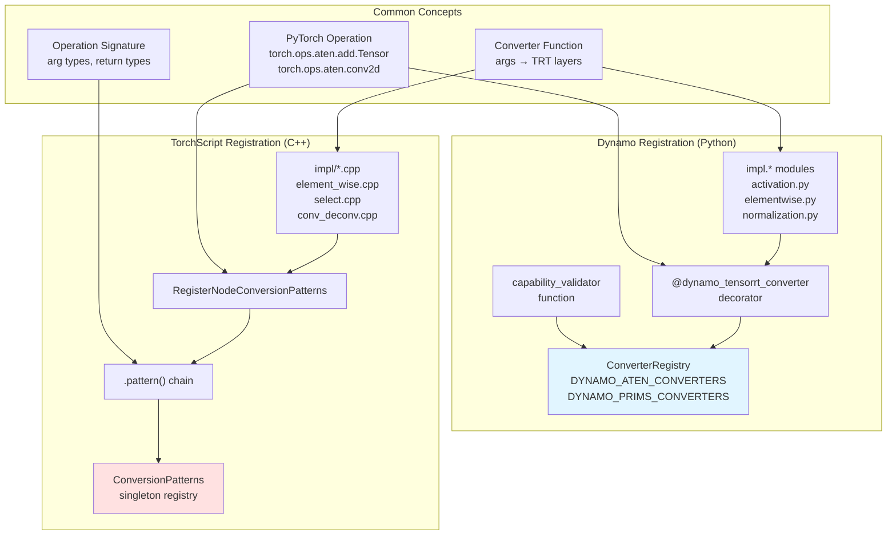
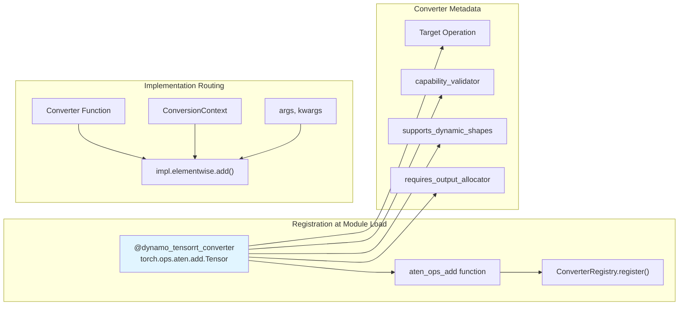
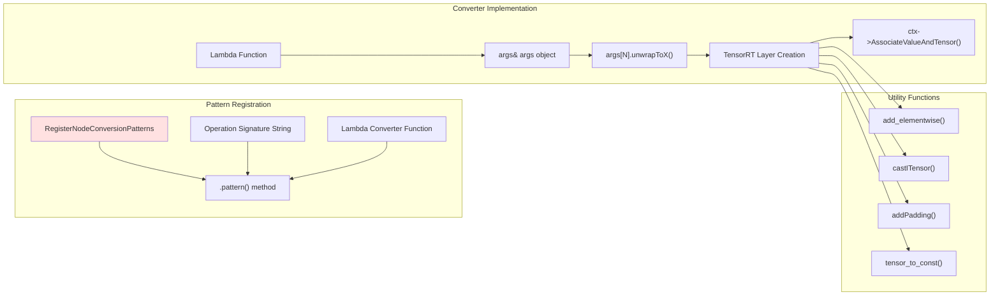
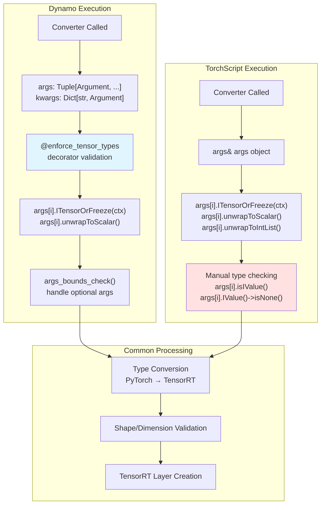
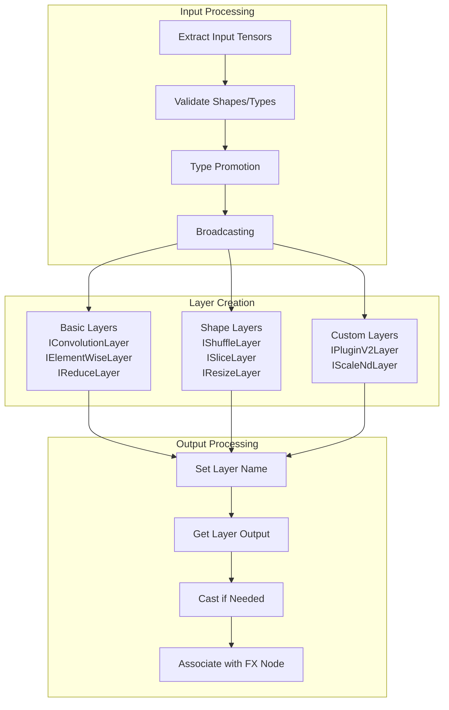
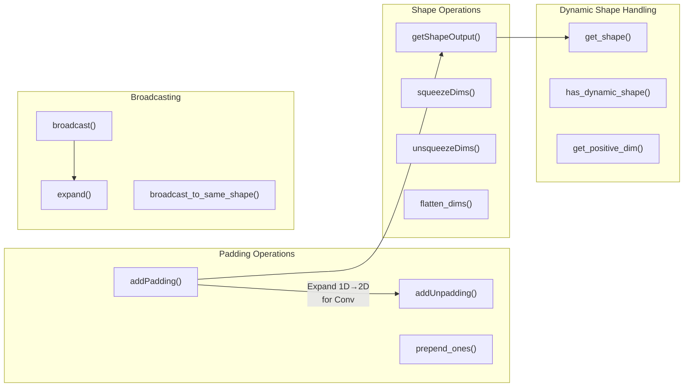
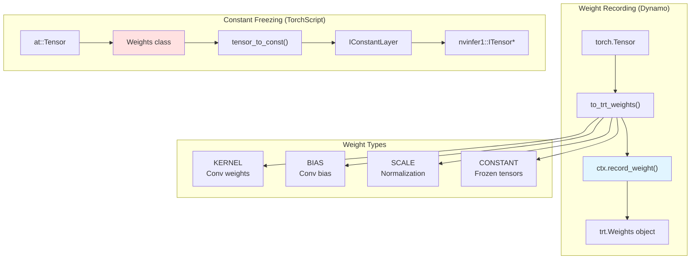

<!-- source: DeepWiki mcp.deepwiki.com · repo pytorch/TensorRT · page 5 Operation Converter Implementation · fetched 2026-10-21 -->

# Operation Converter Implementation

<details>
<summary>Relevant source files</summary>

The following files were used as context for generating this wiki page:

- [core/conversion/converters/BUILD](core/conversion/converters/BUILD)
- [core/conversion/converters/impl/batch_norm.cpp](core/conversion/converters/impl/batch_norm.cpp)
- [core/conversion/converters/impl/constant.cpp](core/conversion/converters/impl/constant.cpp)
- [core/conversion/converters/impl/conv_deconv.cpp](core/conversion/converters/impl/conv_deconv.cpp)
- [core/conversion/converters/impl/layer_norm.cpp](core/conversion/converters/impl/layer_norm.cpp)
- [core/conversion/converters/impl/linear.cpp](core/conversion/converters/impl/linear.cpp)
- [core/conversion/converters/impl/matrix_multiply.cpp](core/conversion/converters/impl/matrix_multiply.cpp)
- [core/conversion/converters/impl/pooling.cpp](core/conversion/converters/impl/pooling.cpp)
- [tests/core/conversion/converters/BUILD](tests/core/conversion/converters/BUILD)
- [tests/core/conversion/converters/test_conv_deconv.cpp](tests/core/conversion/converters/test_conv_deconv.cpp)
- [tests/core/conversion/converters/test_instance_norm.cpp](tests/core/conversion/converters/test_instance_norm.cpp)
- [tests/core/conversion/converters/test_layer_norm.cpp](tests/core/conversion/converters/test_layer_norm.cpp)
- [tests/core/conversion/converters/test_matrix_multiply.cpp](tests/core/conversion/converters/test_matrix_multiply.cpp)
- [tests/core/conversion/converters/test_pooling.cpp](tests/core/conversion/converters/test_pooling.cpp)

</details>


This page documents how individual PyTorch operations are converted to TensorRT layers in both the Dynamo and TorchScript frontends. For information about the overall conversion pipeline and graph processing, see [Dynamo Frontend Architecture](#3) and [TorchScript Frontend Architecture](#4). For details on how converters are registered and invoked, see [ATen Operator Conversion System](#3.2) and [ConversionCtx and Network Building](#4.5).

## Overview

Operation converters are the core translation layer between PyTorch operations and TensorRT's `ILayer` API. Each converter:

1. **Extracts arguments** from the PyTorch node representation
2. **Validates inputs** and checks for supported configurations
3. **Creates TensorRT layers** using the `INetwork` API
4. **Handles type conversions** and broadcasting as needed
5. **Associates outputs** with the TensorRT tensors for downstream use

The converter system is implemented separately for each frontend:
- **Dynamo**: Python-based converters in [py/torch_tensorrt/dynamo/conversion/impl/]()
- **TorchScript**: C++-based converters in [core/conversion/converters/impl/]()

Both implementations follow similar patterns but use different registration mechanisms and context management.

---

## Converter Registration Architecture

### Registration Flow for Both Frontends



**Sources:** [py/torch_tensorrt/dynamo/conversion/aten_ops_converters.py:1-100](), [core/conversion/converters/impl/element_wise.cpp:54-84]()

---

### Dynamo Converter Registration Pattern

Dynamo converters use a decorator-based registration system where each converter function is decorated with `@dynamo_tensorrt_converter` and routed to implementation functions in the `impl.*` modules.



A converter function is decorated with `@dynamo_tensorrt_converter`, specifying the target op and metadata, then optionally with `@enforce_tensor_types` to validate input types before conversion. The function body routes to an `impl.*` sub-module function.

For an example, see `aten_ops_batch_norm` at [py/torch_tensorrt/dynamo/conversion/aten_ops_converters.py:62-98](), which registers `torch.ops.aten.batch_norm.default` and delegates to `impl.normalization.batch_norm`.

**Key Components:**
- **`@dynamo_tensorrt_converter`**: Registers the target op, optional `capability_validator`, and `supports_dynamic_shapes` flag
- **`@enforce_tensor_types`**: Pre-validates that specified argument indices have `TRTTensor` types before the converter runs
- **`args_bounds_check`**: Safely reads optional positional arguments with fallback defaults
- **`impl.*` routing**: Delegates to reusable, stateless implementation functions organized by operation category

**Sources:** [py/torch_tensorrt/dynamo/conversion/aten_ops_converters.py:62-98](), [py/torch_tensorrt/dynamo/conversion/_ConverterRegistry.py:1-100]()

---

### TorchScript Converter Registration Pattern

TorchScript converters use a builder pattern with `RegisterNodeConversionPatterns` where each pattern includes the operation signature string and a lambda converter function.



Each call to `.pattern({schema_string, lambda})` on a `RegisterNodeConversionPatterns` chain matches a JIT IR schema string against a converter lambda. The lambda receives `ConversionCtx*`, the JIT `Node*`, and an `args&` accessor object, creates TensorRT network layers directly, and returns `bool`.

See [core/conversion/converters/impl/element_wise.cpp:54-84]() for `aten::add.Tensor`: the converter checks the `alpha` scalar, optionally scales the second input with `kPROD`, then sums with `add_elementwise` using `kSUM`.

**Key Components:**
- **Schema string**: Exact JIT IR op schema (e.g., `"aten::add.Tensor(Tensor self, Tensor other, Scalar alpha=1) -> Tensor"`)
- **`args[i].ITensorOrFreeze(ctx)`**: Retrieves an input as `nvinfer1::ITensor*`, freezing constant IValues into the network
- **`args[i].unwrapToScalar()` / `unwrapToInt()` / `unwrapToIntList()`**: Typed extractors for non-tensor arguments
- **`ctx->AssociateValueAndTensor(n->outputs()[0], out)`**: Binds the JIT graph output value to its produced `ITensor*`
- **Return `bool`**: Indicates conversion success or failure to the calling conversion loop

**Sources:** [core/conversion/converters/impl/element_wise.cpp:54-84](), [core/conversion/converters/converter_util.cpp:86-173]()

---

## Converter Execution Flow

### Argument Extraction and Validation



**Dynamo Argument Handling:**

Dynamo converters receive a `args: Tuple[Argument, ...]` and `kwargs: Dict[str, Argument]` from the FX graph node. Helpers like `args_bounds_check` safely read optional args. Variable-length argument patterns (e.g., `aten::cat`) are parsed via helper functions like `parse_cat_args` before routing to `impl.*`. See [py/torch_tensorrt/dynamo/conversion/aten_ops_converters.py:254-274]() for the `aten_ops_cat` pattern.

**TorchScript Argument Handling:**

TorchScript converters use the `args&` accessor object. Negative indices are normalized by adding `maxDim`, and `TORCHTRT_CHECK` guards enforce valid ranges. See `add_split` at [core/conversion/converters/impl/select.cpp:18-89]() for an example of axis validation and split-size computation from `args[i].unwrapToIntList()`.

**Sources:** [py/torch_tensorrt/dynamo/conversion/aten_ops_converters.py:222-274](), [core/conversion/converters/impl/select.cpp:18-89]()

---

### TensorRT Layer Creation



**Element-wise Layer Creation (Dynamo):**

The Dynamo `add` implementation at [py/torch_tensorrt/dynamo/conversion/impl/elementwise/ops.py:1-100]() follows the pattern: (1) promote types via `cast_int_or_float_to_bool_inplace`, (2) broadcast to same shape via `broadcast`, (3) optionally scale by `alpha`, then (4) call `ctx.net.add_elementwise` with `trt.ElementWiseOperation.ADD` and name the layer with `set_layer_name`.

**Element-wise Layer Creation (TorchScript):**

The shared `add_elementwise` utility at [core/conversion/converters/impl/element_wise.cpp:86-173]() handles promotion (via `promote_types` + `castITensor`), dimension broadcasting (via `addShuffle` + `setReshapeDimensions`), and finally calls `ctx->net->addElementWise`. This function is used by most arithmetic and comparison converters to avoid repetition.

**Sources:** [py/torch_tensorrt/dynamo/conversion/impl/elementwise/ops.py:1-200](), [core/conversion/converters/impl/element_wise.cpp:86-173]()

---

## Type Handling and Casting

### Type Promotion Rules

Both frontends implement PyTorch-compatible type promotion for element-wise operations:

```mermaid
graph TB
    subgraph "Type Promotion Decision"
        INPUT["Input Types<br/>lhs: DataType<br/>rhs: DataType"]
        SAME{"Types<br/>Same?"}
        PROMO["promote_types()<br/>PyTorch rules"]
        RESULT["Promoted Type"]
        
        INPUT --> SAME
        SAME -->|No| PROMO
        SAME -->|Yes| RESULT
        PROMO --> RESULT
    end
    
    subgraph "PyTorch Promotion Rules"
        BOOL["bool"]
        INT32["int32"]
        FLOAT16["float16"]
        FLOAT32["float32"]
        INT64["int64"]
        
        BOOL -->|+| INT32
        INT32 -->|+| FLOAT16
        FLOAT16 -->|+| FLOAT32
        INT64 -->|special| FLOAT32
    end
    
    subgraph "Casting Implementation"
        RESULT2["Promoted Type"]
        CAST1["Cast lhs if needed"]
        CAST2["Cast rhs if needed"]
        OPERATE["Perform Operation"]
        
        RESULT2 --> CAST1
        RESULT2 --> CAST2
        CAST1 --> OPERATE
        CAST2 --> OPERATE
    end
    
    style PROMO fill:#ffffcc
```



**Dynamo Type Casting:**

`cast_trt_tensor` at [py/torch_tensorrt/dynamo/conversion/converter_utils.py:147-183]() inserts a TensorRT cast layer only when `input_val.dtype != trt_dtype`. It converts the target `dtype` via `_enums.dtype._from(dtype).to(trt.DataType)` before calling `ctx.net.add_cast`.

**TorchScript Type Promotion:**

`promote_types` at [core/conversion/converters/converter_util.cpp:78-84]() converts both TRT `DataType` values to PyTorch `ScalarType` via `TRTDataTypeToScalarType`, calls `at::promote_types` to apply PyTorch's promotion rules, then converts the result back with `ScalarTypeToTRTDataType`.

**Sources:** [py/torch_tensorrt/dynamo/conversion/converter_utils.py:147-183](), [core/conversion/converters/converter_util.cpp:78-84]()

---

### Special Type Conversions

| Conversion | Reason | Implementation |
|------------|--------|----------------|
| **INT64 → INT32** | TensorRT doesn't support INT64 | Truncation with warning |
| **FLOAT64 → FLOAT32** | TensorRT doesn't support FLOAT64 | Truncation with warning |
| **BOOL → INT32** | Some operations don't support BOOL | Temporary cast for computation |
| **INT32 → FLOAT32** | Division operations | Automatic for `div` operation |
| **Any → BOOL** | Comparison operations | Cast result back to BOOL |

**INT64/FLOAT64 Truncation (TorchScript):**

`tensor_to_const` at [core/conversion/converters/converter_util.cpp:241-265]() checks `ctx->settings.truncate_long_and_double`. If enabled and the tensor is `at::kLong`, it converts to `at::kInt` and emits a `LOG_WARNING`. Likewise for `at::kDouble` → `at::kFloat`. If the setting is disabled and the tensor is one of these types, it throws via `TORCHTRT_THROW_ERROR`. The resulting `Weights` are embedded with `ctx->net->addConstant`.

**Boolean Handling (Dynamo):**

`cast_int_or_float_to_bool` at [py/torch_tensorrt/dynamo/conversion/converter_utils.py:327-333]() conditionally calls `cast_trt_tensor` to insert a cast layer only when `tensor.dtype != trt.bool`.

**Division Type Casting:**

`cast_int_int_div_tensors` at [core/conversion/converters/impl/element_wise.cpp:29-39]() promotes both operands from `kINT32` to `kFLOAT` when both inputs are integer, matching PyTorch's behavior where `int / int` produces a float result.

**Sources:** [core/conversion/converters/converter_util.cpp:241-265](), [py/torch_tensorrt/dynamo/conversion/converter_utils.py:327-333](), [core/conversion/converters/impl/element_wise.cpp:29-39]()

---

## Common Converter Utilities

### Dimension and Shape Manipulation

Both frontends provide utilities for handling dimension expansion, padding, and shape operations:



**Padding for Conv1D (TorchScript):**

`addPadding` at [core/conversion/converters/converter_util.cpp:10-40]() inserts an `IShuffleLayer` to expand a tensor's rank to `nDim` when `dims.nbDims < nDim`. It uses `util::unsqueezeDims` to build the target dimensions, configures `setReshapeDimensions`, and sets `setZeroIsPlaceholder(use_zeros)`. This is used by the 1D convolution path to promote inputs to 4D before calling `addConvolutionNd`.

**Broadcasting (Dynamo):**

`broadcast_to_same_shape` at [py/torch_tensorrt/dynamo/conversion/converter_utils.py:235-296]() first calls `broadcast` to align ranks, then computes a per-dimension max shape and calls `impl.slice.expand` on whichever tensor needs expansion.

**Dynamic Shape Handling (Dynamo):**

`slice_op` at [py/torch_tensorrt/dynamo/conversion/impl/slice/ops.py:33-96]() detects dynamic dimensions (`shape[i] == -1`, i.e., `DYNAMIC_DIM`) and substitutes runtime shape queries via `get_shape` for those positions, assembling the `ISliceLayer` start/size/stride tensors from a mix of static and dynamic values.

**Sources:** [core/conversion/converters/converter_util.cpp:10-76](), [py/torch_tensorrt/dynamo/conversion/converter_utils.py:235-296](), [py/torch_tensorrt/dynamo/conversion/impl/slice/ops.py:33-96]()

---

### Weight and Constant Handling



**Dynamo Weight Recording:**

[py/torch_tensorrt/dynamo/conversion/converter_utils.py:336-390]()

```python
def to_trt_weights(
    ctx, value, name, 
    layer_type_name,  # "CONVOLUTION", "CONSTANT", "SCALE"
    weight_type_name,  # "KERNEL", "BIAS", "CONSTANT"
    target=None, source_ir=None,
    target_quantized_type=None, dtype=None, count=None
):
    """Convert PyTorch tensor to TensorRT weights with recording"""
    
    # Weight recording for tracking
    if weight_type_name == "CONSTANT" and layer_type_name == "CONSTANT":
        weight_name = f"{name} CONSTANT"
        ctx.record_weight(weight_name, value)
    else:
        # Record with target information
        source_ir = source_ir if source_ir is not None else SourceIR.UNKNOWN
        target_str = ConverterRegistry.qualified_name_or_str(target)
        target_name = f"{source_ir}_ops{('.' + target_str) if target_str else ''}"
        weight_name = f"{layer_type_name} {weight_type_name} - [{target_name}]-[{name}]"
        ctx.record_weight(weight_name, value)
    
    # Convert to TensorRT weights
    return trt.Weights(unified_dtype_converter(value, dtype, target_quantized_type))
```

**TorchScript Constant Freezing:**

[core/conversion/converters/converter_util.cpp:241-273]()

```cpp
nvinfer1::ITensor* tensor_to_const(ConversionCtx* ctx, at::Tensor t, const std::string& name) {
    // Handle unsupported types (bool)
    bool post_freeze_cast = false;
    nvinfer1::DataType post_freeze_cast_type = nvinfer1::DataType::kFLOAT;
    if (t.scalar_type() == at::kBool) {
        post_freeze_cast = true;
        post_freeze_cast_type = util::ScalarTypeToTRTDataType(t.scalar_type());
        t = t.to(at::kFloat);  // Cast bool to float for constant layer
    }
    
    auto weights = Weights(ctx, t);
    auto const_layer = ctx->net->addConstant(weights.shape, weights.data);
    auto out = const_layer->getOutput(0);
    
    // Cast back to bool if needed
    if (post_freeze_cast) {
        out = castITensor(ctx, out, post_freeze_cast_type, name);
    }
    
    return out;
}
```

**Scalar to Tensor Conversion:**

[core/conversion/converters/converter_util.cpp:276-288]()

```cpp
nvinfer1::ITensor* scalar_to_tensor(ConversionCtx* ctx, torch::jit::IValue scalar) {
    torch::Tensor scalar_tensor;
    if (scalar.isInt()) {
        scalar_tensor = torch::tensor({scalar.toInt()}, torch::kInt32);
    } else if (scalar.isDouble()) {
        scalar_tensor = torch::tensor({scalar.toDouble()}, torch::kFloat32);
    } else if (scalar.isBool()) {
        scalar_tensor = torch::tensor({scalar.toBool()}, torch::kInt32);
    } else {
        TORCHTRT_THROW_ERROR("Unsupported scalar type for conversion");
    }
    return tensor_to_const(ctx, scalar_tensor);
}
```

**Sources:** [py/torch_tensorrt/dynamo/conversion/converter_utils.py:336-390](), [core/conversion/converters/converter_util.cpp:241-288]()

---

## Converter Categories

### Tensor Manipulation Operations

Tensor manipulation operations handle indexing, slicing, selecting, and reshaping. These converters primarily use `IGatherLayer`, `ISliceLayer`, and `IShuffleLayer`.

**Key Operations:**
- `select`: Extract single element along dimension using `IGatherLayer`
- `slice`: Extract range along dimension using `ISliceLayer`
- `gather`: Gather elements by indices
- `index`: Advanced indexing with multiple index tensors
- `split`/`unbind`: Split tensor into multiple outputs

**Select Implementation (TorchScript):**

[core/conversion/converters/impl/select.cpp:122-178]()

```cpp
.pattern({
    "aten::select.int(Tensor(a) self, int dim, int index) -> (Tensor(a))",
    [](ConversionCtx* ctx, const torch::jit::Node* n, args& args) -> bool {
        auto in = args[0].ITensorOrFreeze(ctx);
        auto maxDim = static_cast<int64_t>(in->getDimensions().nbDims);
        auto dim = args[1].unwrapToInt();
        dim = dim < 0 ? dim + maxDim : dim;  // Handle negative dims
        auto ind = (int32_t)args[2].unwrapToInt();
        ind = ind < 0 ? ind + in->getDimensions().d[dim] : ind;  // Handle negative index
        
        // Create index tensor
        at::Tensor indices = torch::tensor({ind}).to(torch::kI32);
        auto const_out = tensor_to_const(ctx, indices);
        
        // Use IGatherLayer to extract
        auto gather_layer = ctx->net->addGather(*in, *const_out, dim);
        auto out = gather_layer->getOutput(0);
        
        // Remove the selected dimension using IShuffleLayer
        auto shuffle_layer = ctx->net->addShuffle(*out);
        shuffle_layer->setReshapeDimensions(util::squeezeDims(out->getDimensions(), dim));
        out = shuffle_layer->getOutput(0);
        
        ctx->AssociateValueAndTensor(n->outputs()[0], out);
        return true;
    }
})
```

**Index Implementation with Boolean Masks (Dynamo):**

[py/torch_tensorrt/dynamo/conversion/impl/select/ops.py:1-200]()

```python
def index(ctx, target, source_ir, name, input, indices):
    """Handle torch.ops.aten.index.Tensor with potentially boolean masks"""
    
    # Separate None indices from tensor indices
    advanced_idx_indices = []
    tensors = []
    for i, idx in enumerate(indices):
        if idx is not None:
            advanced_idx_indices.append(i)
            if isinstance(idx, TRTTensor):
                # Cast boolean masks to INT32 for gather
                if idx.dtype == trt.bool:
                    idx = cast_trt_tensor(ctx, idx, trt.int32, f"{name}_idx_{i}_cast")
                tensors.append(idx)
    
    # Handle multi-index case by computing flat index
    if len(tensors) > 1:
        # Compute strides and flatten to 1D index
        # index = sum(idx_i * stride_i)
        flat_index = compute_flat_index(ctx, name, input, tensors, advanced_idx_indices)
        return gather_flat(ctx, name, input, flat_index)
    else:
        # Single index case - use simple gather
        return ctx.net.add_gather(input, tensors[0], advanced_idx_indices[0]).get_output(0)
```

**Sources:** [core/conversion/converters/impl/select.cpp:119-178](), [py/torch_tensorrt/dynamo/conversion/impl/select/ops.py:1-300]()

---

### Element-wise Operations

Element-wise operations perform per-element arithmetic, comparisons, or logical operations. These use `IElementWiseLayer` with automatic type promotion and broadcasting.

**Key Operations:**
- Binary: `add`, `sub`, `mul`, `div`, `pow`, `floor_div`
- Comparisons: `eq`, `ne`, `lt`, `le`, `gt`, `ge`
- Logical: `logical_and`, `logical_or`, `logical_xor`
- Unary: `neg`, `abs`, `sqrt`, `exp`, `log`

**Element-wise Operation Table:**

| PyTorch Op | TensorRT Op | Type Constraints | Special Handling |
|------------|-------------|------------------|------------------|
| `add` | `kSUM` | Promotes types | Alpha parameter support |
| `sub` | `kSUB` | Promotes types | Alpha parameter support |
| `mul` | `kPROD` | Promotes types | - |
| `div` | `kDIV` | Auto-cast INT32 to FLOAT | PyTorch semantics |
| `floor_div` | `kFLOOR_DIV` | - | - |
| `pow` | `kPOW` | FLOAT only | - |
| `eq`, `ne`, `lt`, etc. | `kEQUAL`, `kGREATER`, etc. | Output is BOOL | - |
| `logical_and` | `kAND` | BOOL inputs | - |
| `logical_or` | `kOR` | BOOL inputs | - |

**Add with Alpha (TorchScript):**

[core/conversion/converters/impl/element_wise.cpp:56-84]()

```cpp
.pattern({
    "aten::add.Tensor(Tensor self, Tensor other, Scalar alpha=1) -> Tensor",
    [](ConversionCtx* ctx, const torch::jit::Node* n, args& args) -> bool {
        auto self = args[0].ITensorOrFreeze(ctx);
        auto other = args[1].ITensorOrFreeze(ctx);
        auto scalar = args[2].unwrapToScalar();
        
        // Scale other by alpha if alpha != 1
        if (1 != scalar.to<float>()) {
            auto alphaTensor = scalar_to_tensor(ctx, scalar);
            auto scaleLayer = add_elementwise(
                ctx, nvinfer1::ElementWiseOperation::kPROD,
                other, alphaTensor, util::node_info(n) + "_AlphaMultiplier");
            other = scaleLayer->getOutput(0);
        }
        
        // Perform addition with type promotion and broadcasting
        auto add = add_elementwise(ctx, nvinfer1::ElementWiseOperation::kSUM, self, other, util::node_info(n));
        ctx->AssociateValueAndTensor(n->outputs()[0], add->getOutput(0));
        return true;
    }
})
```

**Division with Rounding Modes (TorchScript):**

[core/conversion/converters/impl/element_wise.cpp:329-379]()

```cpp
.pattern({
    "aten::div.Tensor_mode(Tensor self, Tensor other, *, str? rounding_mode) -> (Tensor)",
    [](ConversionCtx* ctx, const torch::jit::Node* n, args& args) -> bool {
        auto self = args[0].ITensorOrFreeze(ctx);
        auto other = args[1].ITensorOrFreeze(ctx);
        std::string rounding_mode = args[2].isIValue() && args[2].IValue()->isString() 
            ? args[2].unwrapToString() : "default";
        
        nvinfer1::ILayer* div = nullptr;
        if (rounding_mode == "floor") {
            div = add_elementwise(ctx, nvinfer1::ElementWiseOperation::kFLOOR_DIV, self, other, util::node_info(n));
        } else if (rounding_mode == "trunc") {
            // trunc = floor(abs(div)) * sign(div)
            auto tmp_div = add_elementwise(ctx, nvinfer1::ElementWiseOperation::kDIV, self, other, util::node_info(n) + "_tmp");
            auto abs = add_abs(ctx, n, tmp_div->getOutput(0), util::node_info(n) + "_abs");
            auto floor_layer = ctx->net->addUnary(*abs, nvinfer1::UnaryOperation::kFLOOR);
            auto sign = ctx->net->addUnary(*tmp_div->getOutput(0), nvinfer1::UnaryOperation::kSIGN);
            div = add_elementwise(ctx, nvinfer1::ElementWiseOperation::kPROD, floor_layer->getOutput(0), sign->getOutput(0), util::node_info(n));
        } else {
            // Default: cast INT32/INT32 to FLOAT for division
            cast_int_int_div_tensors(ctx, n, self, other);
            div = add_elementwise(ctx, nvinfer1::ElementWiseOperation::kDIV, self, other, util::node_info(n));
        }
        
        ctx->AssociateValueAndTensor(n->outputs()[0], div->getOutput(0));
        return true;
    }
})
```

**Comparison Operations (Dynamo):**

[py/torch_tensorrt/dynamo/conversion/impl/elementwise/ops.py:200-250]()

```python
def comparison_op(ctx, target, source_ir, name, lhs, rhs, op_type):
    """Generic comparison operation converter"""
    # Ensure inputs are tensors
    lhs = get_trt_tensor(ctx, lhs, f"{name}_lhs")
    rhs = get_trt_tensor(ctx, rhs, f"{name}_rhs")
    
    # Type promotion for comparison
    lhs, rhs = cast_int_or_float_to_bool_inplace(ctx, name, lhs, rhs)
    
    # Broadcasting
    lhs, rhs = broadcast_to_same_shape(ctx, target, source_ir, name, lhs, rhs)
    
    # Create comparison layer (output is bool)
    layer = ctx.net.add_elementwise(lhs, rhs, op_type)
    set_layer_name(layer, target, name, source_ir)
    return layer.get_output(0)

def eq(ctx, target, source_ir, name, lhs, rhs):
    return comparison_op(ctx, target, source_ir, name, lhs, rhs, trt.ElementWiseOperation.EQUAL)

def ne(ctx, target, source_ir, name, lhs, rhs):
    # Implement as NOT(EQUAL)
    eq_result = comparison_op(ctx, target, source_ir, f"{name}_eq", lhs, rhs, trt.ElementWiseOperation.EQUAL)
    not_layer = ctx.net.add_unary(eq_result, trt.UnaryOperation.NOT)
    return not_layer.get_output(0)
```

**Sources:** [core/conversion/converters/impl/element_wise.cpp:56-600](), [py/torch_tensorrt/dynamo/conversion/impl/elementwise/ops.py:1-300]()

---

### Reduction Operations

Reduction operations aggregate values along specified dimensions using `IReduceLayer`. They handle axis masks, keepdim behavior, and output dtype specifications.

**Key Operations:**
- `sum`, `mean`, `prod`: Arithmetic reductions
- `max`, `min`, `amax`, `amin`: Min/max reductions
- `any`, `all`: Boolean reductions

**Reduction Pattern (TorchScript):**

[core/conversion/converters/impl/reduce.cpp:42-100]()

```cpp
.pattern({
    "aten::sum.dim_IntList(Tensor self, int[1] dim, bool keepdim=False, *, ScalarType? dtype=None) -> (Tensor)",
    [](ConversionCtx* ctx, const torch::jit::Node* n, args& args) -> bool {
        auto in_tensor = args[0].ITensorOrFreeze(ctx);
        auto dims = args[1].unwrapToIntList().vec();
        auto keepdim = args[2].unwrapToBool();
        
        // Convert dimensions to axis mask
        uint32_t axis_mask = 0;
        for (auto dim : dims) {
            dim = dim < 0 ? (in_tensor->getDimensions().nbDims + dim) : dim;
            axis_mask |= (1 << dim);
        }
        
        // Create reduce layer
        auto sum_layer = ctx->net->addReduce(*in_tensor, nvinfer1::ReduceOperation::kSUM, axis_mask, keepdim);
        auto out = sum_layer->getOutput(0);
        
        // Handle dtype conversion if specified
        if (!args[3].IValue()->isNone()) {
            auto dtype = args[3].unwrapToScalar().to<int64_t>();
            auto trt_dtype = util::ScalarTypeToTRTDataType(static_cast<at::ScalarType>(dtype));
            out = castITensor(ctx, out, trt_dtype, util::node_info(n));
        }
        
        ctx->AssociateValueAndTensor(n->outputs()[0], out);
        return true;
    }
})
```

**Mean Reduction with Output Dtype (Dynamo):**

[py/torch_tensorrt/dynamo/conversion/impl/reduce/ops.py:1-100]()

```python
def sum(ctx, target, source_ir, name, input_val, dim, keepdim=False):
    """Sum reduction converter"""
    # Handle dim=None (reduce all dimensions)
    if dim is None:
        axis_mask = (1 << len(input_val.shape)) - 1
    else:
        # Convert list of dims to axis mask
        dims = [dim] if isinstance(dim, int) else dim
        axis_mask = 0
        for d in dims:
            d = get_positive_dim(d, len(input_val.shape))
            axis_mask |= (1 << d)
    
    # Create reduce layer
    layer = ctx.net.add_reduce(input_val, trt.ReduceOperation.SUM, axis_mask, keepdim)
    set_layer_name(layer, target, name, source_ir)
    return layer.get_output(0)

def mean(ctx, target, source_ir, name, input_val, dim, keepdim=False):
    """Mean reduction converter"""
    # Mean = Sum / Count
    sum_val = sum(ctx, target, source_ir, f"{name}_sum", input_val, dim, keepdim)
    
    # Calculate count of reduced elements
    if dim is None:
        count = float(np.prod(input_val.shape))
    else:
        dims = [dim] if isinstance(dim, int) else dim
        count = 1.0
        for d in dims:
            d = get_positive_dim(d, len(input_val.shape))
            count *= input_val.shape[d]
    
    # Divide by count
    count_tensor = get_trt_tensor(ctx, count, f"{name}_count")
    return impl.elementwise.div(ctx, target, source_ir, f"{name}_div", sum_val, count_tensor)
```

**Boolean Reduction (Any/All):**

[core/conversion/converters/impl/reduce.cpp:12-40]()

```cpp
nvinfer1::ITensor* anyDimImplementation(
    ConversionCtx* ctx, const torch::jit::Node* n,
    nvinfer1::ITensor* in_tensor, int dim, bool keepdim) {
    
    auto in_dims = in_tensor->getDimensions();
    dim = dim < 0 ? (in_dims.nbDims + dim) : dim;
    uint32_t axis_mask = 1 << dim;
    
    // Reduce does not work on bool inputs - cast to INT32
    if (in_tensor->getType() == nvinfer1::DataType::kBOOL) {
        in_tensor = castITensor(ctx, in_tensor, nvinfer1::DataType::kINT32, util::node_info(n) + "_in");
    }
    
    // Sum reduction (any non-zero value becomes true)
    auto sum_layer = ctx->net->addReduce(*in_tensor, nvinfer1::ReduceOperation::kSUM, axis_mask, keepdim);
    
    // Cast back to bool
    auto out_tensor = castITensor(ctx, sum_layer->getOutput(0), nvinfer1::DataType::kBOOL, util::node_info(n) + "_out");
    return out_tensor;
}
```

**Sources:** [core/conversion/converters/impl/reduce.cpp:1-200](), [py/torch_tensorrt/dynamo/conversion/impl/reduce/ops.py:1-150]()

---

### Convolution and Pooling

Convolution and pooling operations are handled with special attention to dimension expansion (1D→2D), output padding for transposed convolutions, and quantized weight support.

**Convolution Features:**
- 1D/2D/3D convolution support with automatic dimension expansion
- Transposed convolution (deconvolution) with output padding
- Grouped convolution
- Dilation support
- Quantized weight handling (QAT models)

**Convolution Converter (TorchScript):**

[core/conversion/converters/impl/conv_deconv.cpp:81-314]()

```cpp
bool add_conv_deconv(ConversionCtx* ctx, const torch::jit::Node* n, args& args) {
    auto in = args[0].ITensor();
    auto stride = util::toDims(args[3].unwrapToIntList());
    auto padding = util::toDims(args[4].unwrapToIntList());
    auto dilation = util::toDims(args[5].unwrapToIntList());
    bool transposed = args[6].unwrapToBool();
    auto out_padding = util::toDims(args[7].unwrapToIntList());
    int64_t groups = args[8].unwrapToInt();
    
    // Expand 1D to 2D if needed
    auto orig_dims = in->getDimensions();
    bool expandDims = (orig_dims.nbDims < 4);
    if (expandDims) {
        in = addPadding(ctx, n, in, 4);
        if (stride.nbDims == 1) stride = util::unsqueezeDims(stride, 1, 1);
        if (padding.nbDims == 1) padding = util::unsqueezeDims(padding, 1, 0);
        if (dilation.nbDims == 1) dilation = util::unsqueezeDims(dilation, 1, 1);
    }
    
    // Handle quantized weights (ITensor case)
    if (args[1].isITensor()) {
        auto kernel = args[1].ITensor();
        auto kernel_dims = kernel->getDimensions();
        nvinfer1::Dims filter_dim = /* extract spatial dims */;
        int32_t num_output_maps = transposed ? kernel_dims.d[1] : kernel_dims.d[0];
        
        // Create layer with dummy weights (actual weights set via setInput)
        auto kernel_weights = nvinfer1::Weights{nvinfer1::DataType::kFLOAT, nullptr, 0};
        if (transposed) {
            auto deconv = ctx->net->addDeconvolutionNd(*in, num_output_maps, filter_dim, kernel_weights, bias.data);
            deconv->setInput(1, *kernel);  // Set quantized weights
            deconv->setStrideNd(stride);
            deconv->setDilationNd(dilation);
            deconv->setNbGroups(groups);
            /* handle output padding */
        } else {
            auto conv = ctx->net->addConvolutionNd(*in, num_output_maps, filter_dim, kernel_weights, bias.data);
            conv->setInput(1, *kernel);  // Set quantized weights
            conv->setStrideNd(stride);
            conv->setPaddingNd(padding);
            conv->setDilationNd(dilation);
            conv->setNbGroups(groups);
        }
    } else {
        // Standard weights (frozen)
        auto w = Weights(ctx, args[1].unwrapToTensor());
        /* create standard conv/deconv layer */
    }
    
    // Un-expand dimensions if expanded
    auto out = addUnpadding(ctx, n, layer->getOutput(0), orig_dims.nbDims);
    ctx->AssociateValueAndTensor(n->outputs()[0], out);
    return true;
}
```

**Output Padding for Deconvolution:**

[core/conversion/converters/impl/conv_deconv.cpp:13-79]()

```cpp
void add_output_padding(nvinfer1::Dims& padding, nvinfer1::Dims& out_padding, bool& has_output_padding) {
    int nbSpatialDims = out_padding.nbDims;
    // When there is out_padding, adjust padding first or use bias layer
    for (int i = 0; i < nbSpatialDims; ++i) {
        if (padding.d[i] - out_padding.d[i] >= 0) {
            padding.d[i] -= out_padding.d[i];
            out_padding.d[i] = 0;
        } else {
            out_padding.d[i] -= padding.d[i];
            padding.d[i] = 0;
            has_output_padding = true;
        }
    }
}

nvinfer1::ILayer* add_bias_layer(ConversionCtx* ctx, nvinfer1::ITensor* input_tensor,
                                   nvinfer1::Dims& input_dims, nvinfer1::Dims& output_padding, Weights& bias) {
    // Use ISliceLayer to add padding post-deconvolution
    nvinfer1::ITensor* start = tensor_to_const(ctx, torch::zeros(input_dims.nbDims, torch::kInt32));
    nvinfer1::ITensor* totalPadding = /* compute padding tensor */;
    auto size = ctx->net->addElementWise(*input_shape, *totalPadding, nvinfer1::ElementWiseOperation::kSUM)->getOutput(0);
    
    auto* sliceLayer = ctx->net->addSlice(*input_tensor, dummy, dummy, stride);
    sliceLayer->setInput(1, *start);
    sliceLayer->setInput(2, *size);
    sliceLayer->setMode(nvinfer1::SampleMode::kFILL);
    
    // Add bias using element-wise
    auto bias_layer = ctx->net->addElementWise(*slice_output, *bias_const, nvinfer1::ElementWiseOperation::kSUM);
    return bias_layer;
}
```

**Pooling Converter:**

[core/conversion/converters/impl/pooling.cpp:116-200]()

```cpp
bool PoolingConverter(ConversionCtx* ctx, const torch::jit::Node* n, args& args, nvinfer1::PoolingType pool_type) {
    auto in = args[0].ITensorOrFreeze(ctx);
    auto orig_dims = in->getDimensions();
    
    // Expand 1D to 2D if needed
    bool expandDims = (orig_dims.nbDims < 4);
    if (expandDims) {
        in = addPadding(ctx, n, in, 4, false, true);
    }
    
    auto kernel_size = util::toDims(args[1].unwrapToIntList());
    auto stride = util::toDims(args[2].unwrapToIntList());
    auto padding = util::toDims(args[3].unwrapToIntList());
    
    // Expand 1D parameters to 2D
    if (kernel_size.nbDims == 1) kernel_size = util::unsqueezeDims(kernel_size, 0, 1);
    if (stride.nbDims == 1) stride = util::unsqueezeDims(stride, 0, 1);
    if (padding.nbDims == 1) padding = util::unsqueezeDims(padding, 0, 0);
    
    nvinfer1::IPoolingLayer* new_layer;
    if (pool_type == nvinfer1::PoolingType::kMAX) {
        bool ceil_mode = args[5].unwrapToBool();
        new_layer = ctx->net->addPoolingNd(*in, pool_type, kernel_size);
    } else if (pool_type == nvinfer1::PoolingType::kAVERAGE) {
        bool ceil_mode = args[4].unwrapToBool();
        bool count_include_pad = args[5].unwrapToBool();
        new_layer = ctx->net->addPoolingNd(*in, pool_type, kernel_size);
        new_layer->setAverageCountExcludesPadding(!count_include_pad);
    }
    
    auto padding_mode = ceil_mode ? nvinfer1::PaddingMode::kEXPLICIT_ROUND_UP 
                                   : nvinfer1::PaddingMode::kEXPLICIT_ROUND_DOWN;
    new_layer->setPaddingMode(padding_mode);
    new_layer->setStrideNd(stride);
    new_layer->setPaddingNd(padding);
    
    auto out = addUnpadding(ctx, n, new_layer->getOutput(0), orig_dims.nbDims);
    ctx->AssociateValueAndTensor(n->outputs()[0], out);
    return true;
}
```

**Sources:** [core/conversion/converters/impl/conv_deconv.cpp:1-344](), [core/conversion/converters/impl/pooling.cpp:1-300]()

---

### Normalization Operations

Normalization operations (batch norm, layer norm, instance norm) compute scale and bias from statistics. Batch norm compiles statistics into constant weights, while layer norm uses runtime computation.

**Batch Normalization:**

[core/conversion/converters/impl/batch_norm.cpp:13-99]()

```cpp
void _batch_norm(
    ConversionCtx* ctx, const torch::jit::Node* n,
    nvinfer1::ITensor* input, const nvinfer1::Dims& orig_shape,
    const torch::Tensor& gamma, const torch::Tensor& beta,
    const torch::Tensor& mean, const torch::Tensor& var, const float eps) {
    
    // Compute scale and bias from statistics (compile-time)
    // scale = gamma / sqrt(var + eps)
    // bias = beta - mean * scale
    auto orig_dtype = var.dtype();
    auto calculation_gamma = gamma.to(torch::kFloat);  // Higher precision for calculation
    auto calculation_beta = beta.to(torch::kFloat);
    auto calculation_mean = mean.to(torch::kFloat);
    auto calculation_var = var.to(torch::kFloat);
    
    auto scale = calculation_gamma / torch::sqrt(calculation_var + eps);
    auto bias = calculation_beta - calculation_mean * scale;
    
    // Convert back to original dtype
    auto scale_weights = Weights(ctx, scale.to(orig_dtype));
    auto bias_weights = Weights(ctx, bias.to(orig_dtype));
    auto power = Weights(ctx, at::ones_like(scale).to(orig_dtype));
    
    // Use IScaleNdLayer for channel-wise scale/bias
    auto bn = ctx->net->addScaleNd(*input, nvinfer1::ScaleMode::kCHANNEL,
                                    bias_weights.data, scale_weights.data, power.data, 1);
    
    auto out = addUnpadding(ctx, n, bn->getOutput(0), orig_shape.nbDims);
    ctx->AssociateValueAndTensor(n->outputs()[0], out);
}

bool BatchNormConverter(ConversionCtx* ctx, const torch::jit::Node* n, args& args) {
    auto input = args[0].ITensor();
    auto orig_shape = input->getDimensions();
    
    // Extract parameters
    auto gamma = args[1].unwrapToTensor(at::ones(channel_dim));  // Default to 1 if None
    auto beta = args[2].unwrapToTensor(at::zeros(channel_dim));  // Default to 0 if None
    auto mean = args[3].unwrapToTensor(at::zeros(channel_dim));
    auto var = args[4].unwrapToTensor(at::ones(channel_dim));
    auto eps = static_cast<float>(args[7].unwrapToDouble(1e-5f));
    
    // Expand 1D/2D to 4D if needed
    bool expandDims = (orig_shape.nbDims < 4);
    if (expandDims) {
        input = addPadding(ctx, n, input, 4);
    }
    
    _batch_norm(ctx, n, input, orig_shape, gamma, beta, mean, var, eps);
    return true;
}
```

**Layer Normalization (Dynamo):**

[py/torch_tensorrt/dynamo/conversion/impl/normalization/ops.py:1-150]()

```python
def native_layer_norm(ctx, target, source_ir, name, input, normalized_shape, weight, bias, eps):
    """Layer normalization with runtime computation"""
    # normalized_shape specifies last N dimensions to normalize over
    axes = list(range(len(input.shape) - len(normalized_shape), len(input.shape)))
    
    # Compute mean and variance at runtime
    # mean = sum(input) / N
    mean = impl.reduce.mean(ctx, target, source_ir, f"{name}_mean", input, dim=axes, keepdim=True)
    
    # variance = mean((input - mean)^2)
    diff = impl.elementwise.sub(ctx, target, source_ir, f"{name}_diff", input, mean)
    squared = impl.elementwise.mul(ctx, target, source_ir, f"{name}_squared", diff, diff)
    variance = impl.reduce.mean(ctx, target, source_ir, f"{name}_var", squared, dim=axes, keepdim=True)
    
    # Normalize: (input - mean) / sqrt(variance + eps)
    eps_tensor = get_trt_tensor(ctx, eps, f"{name}_eps")
    variance_eps = impl.elementwise.add(ctx, target, source_ir, f"{name}_var_eps", variance, eps_tensor)
    std = impl.unary.sqrt(ctx, target, source_ir, f"{name}_std", variance_eps)
    normalized = impl.elementwise.div(ctx, target, source_ir, f"{name}_normalized", diff, std)
    
    # Apply affine transform: output = normalized * weight + bias
    if weight is not None:
        weight_tensor = get_trt_tensor(ctx, weight, f"{name}_weight")
        normalized = impl.elementwise.mul(ctx, target, source_ir, f"{name}_scale", normalized, weight_tensor)
    if bias is not None:
        bias_tensor = get_trt_tensor(ctx, bias, f"{name}_bias")
        normalized = impl.elementwise.add(ctx, target, source_ir, f"{name}_shift", normalized, bias_tensor)
    
    return normalized
```

**Sources:** [core/conversion/converters/impl/batch_norm.cpp:1-200](), [py/torch_tensorrt/dynamo/conversion/impl/normalization/ops.py:1-200]()

---

## Converter Testing and Validation

### Test Structure

Converter tests validate both functional correctness and numerical accuracy by comparing TensorRT outputs against PyTorch reference implementations.

**Test Pattern (TorchScript):**

[tests/core/conversion/converters/test_select.cpp:9-33]()

```cpp
TEST(Converters, ATenSelectIntConvertsCorrectly) {
    // Define JIT IR for the operation
    const auto graph = R"IR(
        graph(%0 : Tensor):
          %2 : int = prim::Constant[value=0]()
          %3 : Tensor = aten::select(%0, %2, %2)
          return (%3))IR";
    
    auto g = std::make_shared<torch::jit::Graph>();
    torch::jit::parseIR(graph, g.get());
    
    // Run with PyTorch JIT
    auto in = at::randint(1, 10, {4, 4, 4}, {at::kCUDA});
    auto jit_in = at::clone(in);
    auto params = torch_tensorrt::core::ir::get_static_params(g->inputs(), {});
    auto jit_results = torch_tensorrt::tests::util::RunGraph(g, params, {jit_in});
    
    // Run with TensorRT
    auto trt_in = at::clone(in);
    auto trt_results = torch_tensorrt::tests::util::RunGraphEngine(g, params, {trt_in});
    
    // Compare results
    auto trt = trt_results[0].reshape(jit_results[0].sizes());
    ASSERT_TRUE(torch_tensorrt::tests::util::almostEqual(jit_results[0], trt));
}
```

**Test Pattern (Dynamo):**

[tests/py/dynamo/lowering/test_decompositions.py:16-49]()

```python
def test_lowering_inplace_op(self):
    class InPlace(torch.nn.Module):
        def forward(self, x, y):
            x += 1
            x = torch.ops.aten.add_.Tensor(x, y)
            x = torch.ops.aten.relu_.default(x)
            return x
    
    # Expected ops after decomposition
    expected_ops = {torch.ops.aten.add.Tensor, torch.ops.aten.relu.default}
    
    inputs = [torch.rand(5,), torch.rand(5,)]
    
    # Test lowering and verify ops
    fx_graph = torch.fx.symbolic_trace(InPlace())
    _, expected_ops_unseen = lower_graph_testing(
        fx_graph, inputs, expected_ops=expected_ops, min_block_size=2
    )
    
    self.assertEqual(len(expected_ops_unseen), 0,
                    f"Expected ops not encountered: {expected_ops_unseen}")
```

**Sources:** [tests/core/conversion/converters/test_select.cpp:1-250](), [tests/py/dynamo/lowering/test_decompositions.py:1-100]()

---

This converter implementation system provides a flexible, extensible architecture for translating PyTorch operations to TensorRT layers. Both frontends share common patterns for type handling, broadcasting, and layer creation, while maintaining frontend-specific registration and execution mechanisms optimized for their respective compilation pipelines.

---

