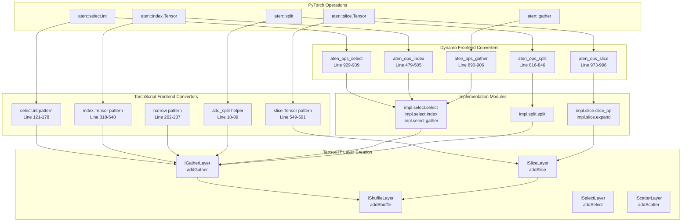
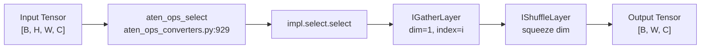
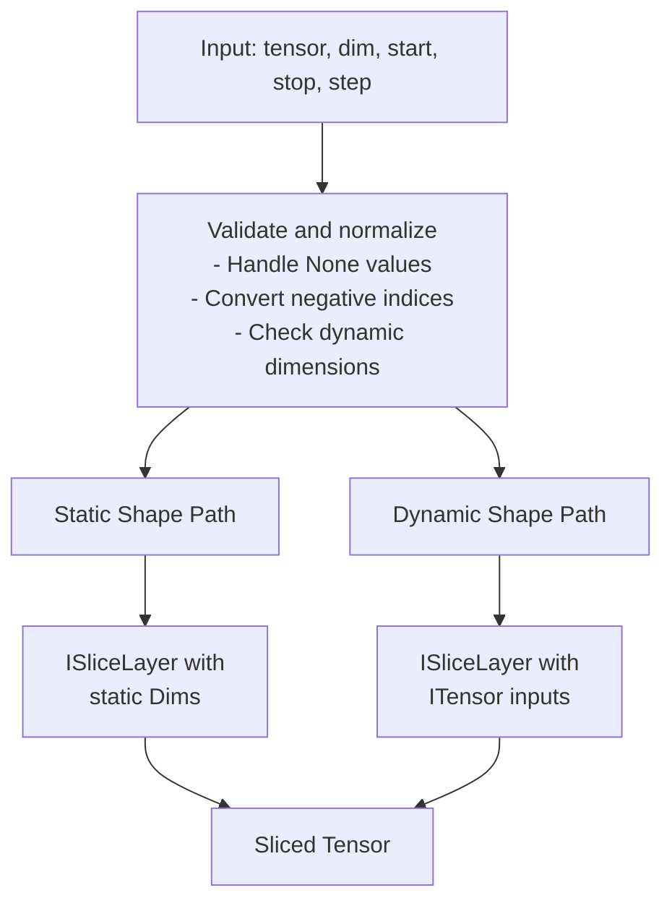
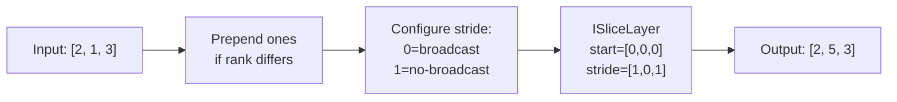
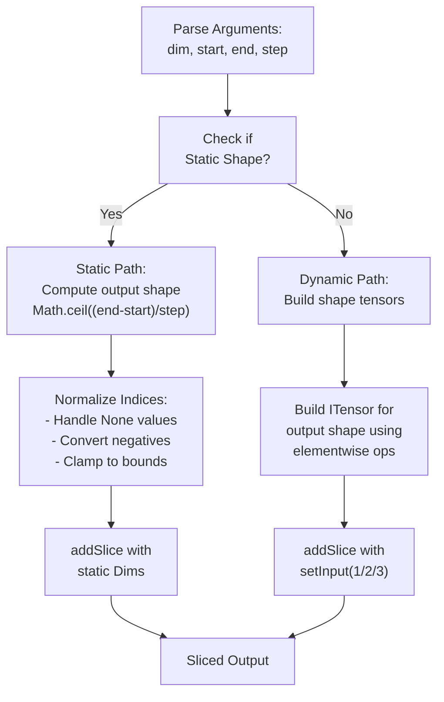
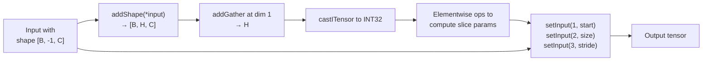

<!-- source: DeepWiki mcp.deepwiki.com · repo pytorch/TensorRT · page 5.1 Tensor Manipulation Operations · fetched 2026-10-21 -->

# Tensor Manipulation Operations

<details>
<summary>Relevant source files</summary>

The following files were used as context for generating this wiki page:

- [core/conversion/converters/Weights.cpp](core/conversion/converters/Weights.cpp)
- [core/conversion/converters/Weights.h](core/conversion/converters/Weights.h)
- [core/conversion/converters/converter_util.cpp](core/conversion/converters/converter_util.cpp)
- [core/conversion/converters/converter_util.h](core/conversion/converters/converter_util.h)
- [core/conversion/converters/impl/cast.cpp](core/conversion/converters/impl/cast.cpp)
- [core/conversion/converters/impl/quantization.cpp](core/conversion/converters/impl/quantization.cpp)
- [core/conversion/converters/impl/select.cpp](core/conversion/converters/impl/select.cpp)
- [core/conversion/converters/impl/shuffle.cpp](core/conversion/converters/impl/shuffle.cpp)
- [core/conversion/converters/impl/squeeze.cpp](core/conversion/converters/impl/squeeze.cpp)
- [core/conversion/converters/impl/unsqueeze.cpp](core/conversion/converters/impl/unsqueeze.cpp)
- [core/conversion/var/BUILD](core/conversion/var/BUILD)
- [core/conversion/var/Var.cpp](core/conversion/var/Var.cpp)
- [core/conversion/var/Var.h](core/conversion/var/Var.h)
- [core/conversion/var/Var_inl.h](core/conversion/var/Var_inl.h)
- [core/lowering/passes/reduce_to.cpp](core/lowering/passes/reduce_to.cpp)
- [core/lowering/passes/remove_nops.cpp](core/lowering/passes/remove_nops.cpp)
- [core/util/trt_util.cpp](core/util/trt_util.cpp)
- [core/util/trt_util.h](core/util/trt_util.h)
- [tests/core/conversion/converters/test_cast.cpp](tests/core/conversion/converters/test_cast.cpp)
- [tests/core/conversion/converters/test_quantization.cpp](tests/core/conversion/converters/test_quantization.cpp)
- [tests/core/conversion/converters/test_select.cpp](tests/core/conversion/converters/test_select.cpp)
- [tests/core/conversion/converters/test_shuffle.cpp](tests/core/conversion/converters/test_shuffle.cpp)
- [tests/core/conversion/converters/test_squeeze.cpp](tests/core/conversion/converters/test_squeeze.cpp)
- [tests/core/conversion/converters/test_unsqueeze.cpp](tests/core/conversion/converters/test_unsqueeze.cpp)
- [tests/core/lowering/test_reduce_to_pass.cpp](tests/core/lowering/test_reduce_to_pass.cpp)
- [tests/cpp/test_dynamic_size.cpp](tests/cpp/test_dynamic_size.cpp)

</details>


## Purpose and Scope

This page documents the conversion of tensor manipulation operations from PyTorch to TensorRT. These operations include indexing, slicing, selection, splitting, gathering, and scattering operations that change tensor shapes or reorder tensor elements without performing arithmetic computations.

For arithmetic operations on tensors, see [Element-wise Operations](#5.2). For shape-changing operations that involve dimension reduction, see [Reduction Operations](#5.3). For type conversions and casting, see [Type Handling and Casting](#5.6).

## Supported Operations

Torch-TensorRT supports the following tensor manipulation operations in both Dynamo and TorchScript frontends:

| PyTorch Operation | TensorRT Layer Type | Description |
|------------------|-------------------|-------------|
| `aten::select.int` | `IGatherLayer` | Selects elements along a dimension at a specific index |
| `aten::slice.Tensor` | `ISliceLayer` | Extracts a contiguous slice along dimensions |
| `aten::narrow` | `IGatherLayer` | Narrows a tensor along a dimension |
| `aten::index.Tensor` | `IGatherLayer` | Advanced indexing with integer/boolean tensors |
| `aten::index_select` | `IGatherLayer` | Selects elements at specified indices |
| `aten::gather` | `IGatherLayer` | Gathers values along an axis |
| `aten::scatter` | `IScatterLayer` | Scatters values into a tensor |
| `aten::split` | `IGatherLayer` | Splits tensor into chunks |
| `aten::unbind` | `IGatherLayer` + `IShuffleLayer` | Removes a dimension by slicing |
| `aten::roll` | `IGatherLayer` | Rolls tensor elements along dimensions |
| `aten::expand` | `ISliceLayer` | Broadcasts tensor to larger shape |
| `aten::where` | `ISelectLayer` | Element-wise conditional selection |

Sources: [py/torch_tensorrt/dynamo/conversion/aten_ops_converters.py:479-996](), [core/conversion/converters/impl/select.cpp:119-691]()

## System Architecture

The converter system has parallel implementations for both compilation frontends, with converters delegating to implementation modules that create TensorRT layers.



**Architecture Overview**: The Dynamo frontend registers converters using `@dynamo_tensorrt_converter` decorators that delegate to implementation modules. The TorchScript frontend uses `RegisterNodeConversionPatterns` to map JIT IR patterns directly to TensorRT layers. Both paths converge on creating TensorRT layers like `IGatherLayer` and `ISliceLayer`.

Sources: [py/torch_tensorrt/dynamo/conversion/aten_ops_converters.py:1-100](), [core/conversion/converters/impl/select.cpp:1-110]()

## Dynamo Frontend Implementation

The Dynamo frontend implementation registers converters that validate inputs and delegate to implementation modules in the `impl` namespace.

### Select Operation

The `select` operation extracts a single element along a dimension, reducing rank by one:



The converter at [py/torch_tensorrt/dynamo/conversion/aten_ops_converters.py:929-939]() handles:
- Dimension normalization for negative indices
- Index bounds checking
- Delegation to `impl.select.select`

### Slice Operation

The `slice` operation extracts a contiguous range along a dimension with optional stride:



The implementation at [py/torch_tensorrt/dynamo/conversion/impl/slice/ops.py:33-215]() handles:
- `start=None` defaults to 0
- `stop=None` uses tensor dimension size
- Negative indices converted via dimension size
- Dynamic shapes require ITensor-based slice parameters
- Special handling for `stop=sys.maxsize` (slice to end)

Sources: [py/torch_tensorrt/dynamo/conversion/aten_ops_converters.py:973-996](), [py/torch_tensorrt/dynamo/conversion/impl/slice/ops.py:33-215]()

### Index Operation

Advanced indexing with tensor indices is one of the most complex converters, supporting both integer and boolean indices:

The converter at [py/torch_tensorrt/dynamo/conversion/aten_ops_converters.py:479-505]() includes validators:
- `index_dtype_validator`: Ensures indices are INT32, INT64, or BOOL types
- `index_nonbool_validator`: Rejects boolean indices on TensorRT-RTX platforms (nonzero op unsupported)

The implementation uses `IGatherLayer` to select elements at computed positions.

Sources: [py/torch_tensorrt/dynamo/conversion/aten_ops_converters.py:449-505]()

### Gather and Scatter Operations

Gather collects elements along an axis using an index tensor, while scatter distributes values:

| Operation | Converter | Implementation | TRT Layer |
|-----------|-----------|----------------|-----------|
| `gather` | `aten_ops_gather` | `impl.select.gather` | `IGatherLayer` |
| `scatter` | `aten_ops_scatter` | `impl.select.scatter` | `IScatterLayer` |

Both operations enforce tensor types on input and index tensors using the `@enforce_tensor_types` decorator at [py/torch_tensorrt/dynamo/conversion/aten_ops_converters.py:891-894]() and [py/torch_tensorrt/dynamo/conversion/aten_ops_converters.py:911-915]().

Sources: [py/torch_tensorrt/dynamo/conversion/aten_ops_converters.py:890-926]()

### Split Operation

The split converter requires static split sizes for proper segment computation:

The converter at [py/torch_tensorrt/dynamo/conversion/aten_ops_converters.py:816-846]() uses:
- `has_static_shapes_in_args([1])` validator: Ensures split sizes are compile-time constants
- Supports both `aten.split.Tensor` (uniform splits) and `aten.split.sizes` (variable splits)
- Supports `aten.split_with_sizes.default` for explicit size lists

Sources: [py/torch_tensorrt/dynamo/conversion/aten_ops_converters.py:816-846]()

### Expand Operation

The expand operation broadcasts tensors to larger shapes by replicating elements:



The implementation at [py/torch_tensorrt/dynamo/conversion/impl/slice/ops.py:218-302]() handles:
- Rank adjustment via `prepend_ones` utility
- Stride configuration: `stride[dim]=0` for broadcasting, `stride[dim]=1` otherwise
- Dynamic dimension resolution using shape tensors

Sources: [py/torch_tensorrt/dynamo/conversion/impl/slice/ops.py:218-302](), [py/torch_tensorrt/dynamo/conversion/aten_ops_converters.py:1223-1243]()

## TorchScript Frontend Implementation

The TorchScript frontend uses pattern matching on JIT IR graphs and directly creates TensorRT layers without intermediate implementation modules.

### Select Operation Pattern

The select converter at [core/conversion/converters/impl/select.cpp:121-178]() implements:

1. **Dimension and Index Normalization**: Handles negative dimensions and indices relative to tensor shape
2. **Gather Layer Creation**: Uses `addGather(*in, *const_out, dim)` to select elements
3. **Dimension Squeezing**: Uses `addShuffle` with `util::squeezeDims` to remove the selected dimension
4. **Empty Tensor Handling**: Special logic at [core/conversion/converters/impl/select.cpp:152-165]() for tensors with zero-sized dimensions

Sources: [core/conversion/converters/impl/select.cpp:121-178]()

### Slice Operation Pattern

The slice converter at [core/conversion/converters/impl/select.cpp:549-691]() is more complex due to dynamic shape support:



Key features:
- **Static path** [core/conversion/converters/impl/select.cpp:586-615](): Uses `addSlice` with computed `nvinfer1::Dims`
- **Dynamic path** [core/conversion/converters/impl/select.cpp:604-673](): Uses `setInput(1, start_slice_tensor)`, `setInput(2, output_shape_tensor)`, `setInput(3, stride_slice_tensor)` to provide runtime shape information
- **Index clamping**: [core/conversion/converters/impl/select.cpp:554-583]() handles indices exceeding tensor dimensions

Sources: [core/conversion/converters/impl/select.cpp:549-691]()

### Narrow Operation Pattern

The narrow operation is a specialized slice that takes a start index and length:

The converter at [core/conversion/converters/impl/select.cpp:202-237]() implements:
1. Creates index tensor: `torch::arange(start, start + length, 1).to(torch::kI32)`
2. Converts to TensorRT weights via `Weights` class
3. Adds constant layer: `addConstant(weights.shape, weights.data)`
4. Uses `addGather` to extract the range
5. Applies `addShuffle` with `util::unpadDims` to reshape output

Sources: [core/conversion/converters/impl/select.cpp:202-273]()

### Index Operation Pattern

The index operation with multiple tensor indices is the most complex converter, handling advanced indexing scenarios:

The converter at [core/conversion/converters/impl/select.cpp:318-548]() handles:
- **Single index tensor** [core/conversion/converters/impl/select.cpp:349-362](): Direct `addGather` 
- **Multiple index tensors** [core/conversion/converters/impl/select.cpp:363-546](): Computes linear indices via:
  - Transposing input to group advanced indexed dimensions
  - Flattening groups
  - Computing cumulative index: `index = Σ(ind_i * Π(x_j))` for j>i
  - Gathering from flattened tensor
  - Reshaping and transposing back

Sources: [core/conversion/converters/impl/select.cpp:318-548]()

### Roll Operation

The roll operation circularly shifts elements along dimensions:

Helper function at [core/conversion/converters/impl/select.cpp:91-117]() implements:
1. Computes start index: `start = (in_dim - shift) % in_dim`
2. Corrects for C++ modulo behavior with negative numbers
3. Creates two index ranges: `[start, in_dim)` and `[0, start)`
4. Concatenates ranges and uses `addGather` to reorder elements

The main converter at [core/conversion/converters/impl/select.cpp:295-316]() applies roll iteratively for each dimension-shift pair.

Sources: [core/conversion/converters/impl/select.cpp:91-117](), [core/conversion/converters/impl/select.cpp:295-316]()

### Split and Unbind Patterns

Both operations split a tensor along a dimension into multiple outputs:

The shared helper `add_split` at [core/conversion/converters/impl/select.cpp:18-89]() handles:
- **Split sizes computation**: For uniform splits, computes `numOutputs = inDimSize / split_size` and remainder
- **Unbind mode**: Sets all split sizes to 1 and squeezes output dimension
- **Gather-based extraction**: Uses `torch::arange(start_idx, start_idx + sizes[i], 1)` to create index tensors
- **Output list creation**: Wraps each output ITensor in `TensorContainer` and returns as `c10::List`

The pattern is registered for `aten::split`, `aten::split_with_sizes`, and `aten::unbind`.

Sources: [core/conversion/converters/impl/select.cpp:18-89]()

## Common Utilities

Both frontends rely on shared utility functions for common operations:

### Index and Shape Normalization

Located in [core/conversion/converters/converter_util.cpp](), these utilities handle dimension and index normalization:

| Utility Function | Purpose | Usage |
|-----------------|---------|-------|
| `normalize_indices` | Converts negative indices to positive: `idx < 0 ? dim + idx : idx` | Used in slice, select operations |
| `clamp_to_input_dim` | Clamps indices to `[0, input_dim-1]` range | Prevents out-of-bounds access |
| `normalize_start_and_end` | Applies both normalization and clamping to slice bounds | Used in dynamic slice operations |

Sources: [core/conversion/converters/converter_util.cpp:342-382]()

### Dimension Padding

The `addPadding` and `addUnpadding` functions at [core/conversion/converters/converter_util.cpp:10-76]() adjust tensor rank:
- **addPadding**: Prepends or appends dimensions of size 1 to reach target rank
- **addUnpadding**: Removes dimensions to reach target rank
- Both use `IShuffleLayer` with reshaped dimensions

These are critical for broadcasting operations where operands must have matching rank.

Sources: [core/conversion/converters/converter_util.cpp:10-76]()

### Type Casting

The `castITensor` function at [core/conversion/converters/converter_util.cpp:214-239]() adds `ICastLayer` when dtype conversion is needed. The Dynamo equivalent `cast_trt_tensor` is at [py/torch_tensorrt/dynamo/conversion/converter_utils.py:147-183]().

Casting is commonly needed when:
- Converting boolean indices to INT32
- Promoting types in mixed-precision operations
- Converting INT64 to INT32 (TensorRT compatibility)

Sources: [core/conversion/converters/converter_util.cpp:214-239](), [py/torch_tensorrt/dynamo/conversion/converter_utils.py:147-183]()

### Freezing Tensors

The `tensor_to_const` function at [core/conversion/converters/converter_util.cpp:241-289]() converts `at::Tensor` to `nvinfer1::ITensor` via `IConstantLayer`:
1. Handles boolean tensors by casting to float (TensorRT limitation)
2. Truncates INT64/FLOAT64 if `truncate_long_and_double` is enabled
3. Creates `Weights` object from tensor
4. Adds `IConstantLayer` to network

This is used extensively for index tensors in select/gather/slice operations.

Sources: [core/conversion/converters/converter_util.cpp:241-289]()

## Dynamic Shape Handling

Dynamic shapes require special handling throughout tensor manipulation converters to defer shape computation to runtime.

### Shape Tensor Creation

When input dimensions are dynamic (`-1`), shape information must be extracted at runtime using shape tensors:



The `getShapeOutput` utility at [core/conversion/converters/converter_util.cpp:42-46]() wraps this pattern:
- Calls `addShape(*input_tensor)`
- Casts result to INT32 (shape values must be INT32 in TensorRT)

Sources: [core/conversion/converters/converter_util.cpp:42-46]()

### Runtime Shape Computation

The Dynamo slice implementation at [py/torch_tensorrt/dynamo/conversion/impl/slice/ops.py:102-210]() handles dynamic dimensions:

1. **Negative index handling**: If `start < 0`, computes `start = shape - start` using elementwise subtraction
2. **None stop handling**: If `stop=None`, uses full dimension size from shape tensor
3. **Output shape computation**: Computes `ceil((stop - start) / step)` using elementwise operations
4. **Slice layer configuration**: Uses `layer.set_input(1, start_tensor)`, `layer.set_input(2, size_tensor)`, `layer.set_input(3, stride_tensor)`

The TorchScript equivalent at [core/conversion/converters/impl/select.cpp:604-673]() follows similar patterns using TensorRT's elementwise operations to compute shapes.

Sources: [py/torch_tensorrt/dynamo/conversion/impl/slice/ops.py:102-210](), [core/conversion/converters/impl/select.cpp:604-673]()

### Mixed Static-Dynamic Handling

When only some dimensions are dynamic, converters must handle mixed cases:

The implementation at [py/torch_tensorrt/dynamo/conversion/impl/slice/ops.py:75-92]() builds the stop slice tensor:
```python
for i in range(len(input.shape)):
    if input.shape[i] == DYNAMIC_DIM and i != dim:
        # Dynamic dimension: extract from shape tensor
        stop_slice.append(get_shape(..., i))
    elif i == dim:
        # Dimension being sliced
        stop_slice.append(stop)
    else:
        # Static dimension
        stop_slice.append(input.shape[i])
```

This ensures static dimensions use compile-time values while dynamic dimensions use runtime shape extraction.

Sources: [py/torch_tensorrt/dynamo/conversion/impl/slice/ops.py:75-92]()

## Special Cases and Edge Conditions

### Empty Tensors

Tensors with zero-sized dimensions require special handling:

The TorchScript select converter at [core/conversion/converters/impl/select.cpp:152-165]() includes:
- Detection: `util::validateInputDimsForShuffle` returns count of zero dimensions
- Configuration: `shuffle_layer->setZeroIsPlaceholder(false)` to treat 0 as literal dimension size (not placeholder for inherited dimension)

Test case at [tests/core/conversion/converters/test_select.cpp:169-192]() validates this behavior.

Sources: [core/conversion/converters/impl/select.cpp:152-165](), [tests/core/conversion/converters/test_select.cpp:169-192]()

### Negative Indices

All converters must handle Python-style negative indexing where `-1` refers to the last element:

The pattern is consistent across converters:
```cpp
// C++ (TorchScript)
dim = dim < 0 ? dim + maxDim : dim;
ind = ind < 0 ? ind + in->getDimensions().d[dim] : ind;
```

```python
# Python (Dynamo)
dim = get_positive_dim(dim, len(input.shape))
start = get_positive_dim(start, input.shape[dim])
```

Sources: [core/conversion/converters/impl/select.cpp:126-130](), [py/torch_tensorrt/dynamo/conversion/converter_utils.py:792-815]()

### Type Compatibility

TensorRT has stricter type requirements than PyTorch:

| PyTorch Type | TensorRT Handling | Reason |
|-------------|------------------|--------|
| `torch.int64` | Truncate to INT32 | TensorRT doesn't support INT64 |
| `torch.bool` | Cast to INT32 for indices | TensorRT indices must be INT32 |
| `torch.float64` | Truncate to FLOAT32 | TensorRT doesn't support FLOAT64 |

The Dynamo converters use validators to check index types:
- `index_dtype_validator` at [py/torch_tensorrt/dynamo/conversion/aten_ops_converters.py:449-462]() ensures indices are INT32, INT64, or BOOL
- Converters automatically cast boolean indices using `castITensor` or `cast_trt_tensor`

Sources: [py/torch_tensorrt/dynamo/conversion/aten_ops_converters.py:449-462](), [core/conversion/converters/impl/select.cpp:280-282]()

### Boolean Indexing Limitations

Boolean indexing is not supported on TensorRT-RTX platforms:

The validator at [py/torch_tensorrt/dynamo/conversion/aten_ops_converters.py:465-476]() checks:
```python
if ENABLED_FEATURES.tensorrt_rtx:
    for ind in index:
        if ind is not None and ind.meta.get("val").dtype == torch.bool:
            return False  # Reject conversion
```

This is because the nonzero operation (required for boolean indexing) is not supported on TensorRT-RTX.

Sources: [py/torch_tensorrt/dynamo/conversion/aten_ops_converters.py:465-476]()

### Maximum Integer Handling

When `stop=sys.maxsize` (indicating slice to end), special handling is required:

The Dynamo implementation at [py/torch_tensorrt/dynamo/conversion/impl/slice/ops.py:109]() treats `stop == sys.maxsize` as equivalent to `stop=None`, using the full dimension size.

Sources: [py/torch_tensorrt/dynamo/conversion/impl/slice/ops.py:107-120]()

## Decompositions

Some complex tensor manipulation operations are decomposed into simpler primitives before conversion:

### Slice Scatter

The `slice_scatter` operation (inserting a slice into a tensor) is decomposed at [py/torch_tensorrt/dynamo/lowering/_decompositions.py:186-226]():

```python
def slice_scatter_decomposition(input_tensor, src_tensor, dim, start, end, step):
    # Create index tensor for positions to update
    indices = torch.arange(start, end, step, device=input_tensor.device)
    index_tensor = indices.view([-1 if i == dim else 1 for i in range(input_tensor.dim())])
    index_tensor = index_tensor.expand_as(src_tensor)
    # Use scatter to insert values
    return torch.scatter(input_tensor, dim, index_tensor, src_tensor)
```

This decomposes `slice_scatter` into `arange`, `view`, `expand`, and `scatter` operations.

### Select Scatter

The `select_scatter` operation is decomposed at [py/torch_tensorrt/dynamo/lowering/_decompositions.py:229-239]():

```python
def select_scatter_decomposition(input_tensor, src_tensor, dim, index):
    src_tensor = torch.unsqueeze(src_tensor, dim)
    return torch.slice_scatter(input_tensor, src_tensor, dim, index, index + 1, 1)
```

This converts `select_scatter` to `unsqueeze` + `slice_scatter`.

### Scatter Add

The `scatter_add` operation is decomposed into a loop at [py/torch_tensorrt/dynamo/lowering/_decompositions.py:265-299]() that iteratively:
1. Selects a slice of source and index tensors
2. Creates zero tensor of input shape
3. Scatters source values to zero tensor
4. Adds scattered tensor to accumulator

Sources: [py/torch_tensorrt/dynamo/lowering/_decompositions.py:186-299]()

## Testing and Validation

Comprehensive test coverage exists for all tensor manipulation operations:

### Converter Tests

TorchScript converter tests at [tests/core/conversion/converters/test_select.cpp]():
- `ATenSelectIntConvertsCorrectly`: Basic select operation
- `ATenSelectIntDynamicConvertsCorrectly`: Select with dynamic shapes
- `ATenSelectIntNegIndexConvertsCorrectly`: Negative index handling
- `ATenSelectEmptyTensorConvertsCorrectly`: Empty tensor handling
- `ATenNarrowStartScalarConvertsCorrectly`: Narrow operation
- `ATenEmbeddingConvertsCorrectly`: Embedding lookup via gather

Dynamo converter tests at [tests/py/dynamo/conversion/test_slice_aten.py]():
- `TestSliceConverter`: Static shape slice tests with various start/stop/step combinations
- `TestSliceConverterDynamicShape`: Dynamic shape slice tests with Input specifications
- Tests cover edge cases like `start=None`, `stop=None`, `step=1`, negative indices, `stop=sys.maxsize`

Sources: [tests/core/conversion/converters/test_select.cpp:9-247](), [tests/py/dynamo/conversion/test_slice_aten.py:9-155]()

### Lowering Pass Tests

Tests at [tests/py/dynamo/lowering/test_decompositions.py]() validate decompositions are applied correctly, checking that:
- Expected operations appear in lowered graph
- Unexpected operations are removed
- Numerical accuracy is maintained

Sources: [tests/py/dynamo/lowering/test_decompositions.py:1-520]()

## Summary

Tensor manipulation operations in Torch-TensorRT are converted to TensorRT primarily through `IGatherLayer` (for indexing and selection) and `ISliceLayer` (for contiguous extraction). The dual-frontend architecture supports both Dynamo (Python-based, FX graph) and TorchScript (C++-based, JIT IR) compilation paths, with converters handling static and dynamic shapes, negative indices, empty tensors, and type compatibility. Complex operations are decomposed into simpler primitives before conversion, and comprehensive utilities manage dimension normalization, shape computation, and type casting.

---

