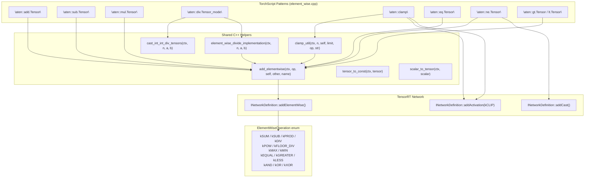

<!-- source: DeepWiki mcp.deepwiki.com · repo pytorch/TensorRT · page 5.2 Element-wise Operations · fetched 2026-10-21 -->

# Element-wise Operations

<details>
<summary>Relevant source files</summary>

The following files were used as context for generating this wiki page:

- [core/conversion/converters/impl/element_wise.cpp](core/conversion/converters/impl/element_wise.cpp)
- [core/conversion/converters/impl/reduce.cpp](core/conversion/converters/impl/reduce.cpp)
- [core/lowering/passes/unpack_var.cpp](core/lowering/passes/unpack_var.cpp)
- [tests/core/conversion/converters/test_reduce.cpp](tests/core/conversion/converters/test_reduce.cpp)
- [tests/core/lowering/test_unpack_reduce_ops.cpp](tests/core/lowering/test_unpack_reduce_ops.cpp)

</details>


## Purpose and Scope

This page documents how element-wise operations are converted to TensorRT's `IElementWiseLayer` in both the Dynamo and TorchScript frontends. Element-wise operations include binary arithmetic (add, multiply, divide), comparison operations (equal, greater than), logical operations, and clamping functions.

For reduction operations that aggregate across dimensions, see page 5.3. For type casting utilities used by these converters, see page 5.7.

## Overview

Element-wise operations in PyTorch are converted to `nvinfer1::IElementWiseLayer`, which supports per-element computation with automatic broadcasting. The conversion system handles:

- **Binary operations**: Two tensor inputs (add, subtract, multiply, divide, power, comparisons)
- **Scalar operations**: One operand is a scalar constant converted to a constant tensor
- **Type promotion**: Automatic casting to compatible data types (e.g., integer division → float)
- **Alpha scaling**: PyTorch `add`/`sub` operations take an optional `alpha` scalar that scales the second operand
- **Special semantics**: Rounding modes for division, clamp/clip fusion, `ne` via XOR

The TorchScript frontend registers converters via `RegisterNodeConversionPatterns` in `element_wise.cpp`. The Dynamo frontend registers converters via the `@dynamo_tensorrt_converter` decorator, delegating to implementation functions in the `impl.elementwise` module.

Sources: [core/conversion/converters/impl/element_wise.cpp:1-60]()

## Element-wise Operations Conversion Architecture

**TorchScript frontend converter registration and dispatch:**



Sources: [core/conversion/converters/impl/element_wise.cpp:14-52](), [core/conversion/converters/impl/element_wise.cpp:54-577]()

## The `add_elementwise` Utility

The central building block for all element-wise converters in the TorchScript frontend is the `add_elementwise` function declared in `converter_util.h`. Every binary element-wise TRT layer is created through this function.

**Signature (C++):**

```
nvinfer1::IElementWiseLayer* add_elementwise(
    ConversionCtx* ctx,
    nvinfer1::ElementWiseOperation op,
    nvinfer1::ITensor* self,
    nvinfer1::ITensor* other,
    const std::string& name
)
```

It calls `ctx->net->addElementWise(*self, *other, op)`, sets the layer name, and returns the layer pointer. All individual converters call `add_elementwise` rather than calling the TRT API directly, ensuring consistent naming and error checking via `TORCHTRT_CHECK`.

**Scalar operands** are converted to constant tensors first using `tensor_to_const` or `scalar_to_tensor` before being passed to `add_elementwise`, allowing uniform handling of both tensor-tensor and tensor-scalar patterns.

Sources: [core/conversion/converters/impl/element_wise.cpp:23](), [core/conversion/converters/impl/element_wise.cpp:47](), [core/conversion/converters/impl/element_wise.cpp:77](), [core/conversion/converters/impl/element_wise.cpp:122]()

## Supported Binary Operations

The following table lists the primary binary element-wise operations supported by both frontends:

| Operation Category | PyTorch Op | TensorRT Operation | Dynamo Support | TorchScript Support |
|-------------------|------------|-------------------|----------------|---------------------|
| **Arithmetic** | `aten.add.Tensor` | `kSUM` | ✓ | ✓ |
| | `aten.add.Scalar` | `kSUM` | ✓ | ✓ |
| | `aten.sub.Tensor` | `kSUB` | ✓ | ✓ |
| | `aten.sub.Scalar` | `kSUB` | ✓ | ✓ |
| | `aten.mul.Tensor` | `kPROD` | ✓ | ✓ |
| | `aten.mul.Scalar` | `kPROD` | ✓ | ✓ |
| | `aten.div.Tensor` | `kDIV` | ✓ | ✓ |
| | `aten.div.Scalar` | `kDIV` | ✓ | ✓ |
| | `aten.pow.Tensor_Tensor` | `kPOW` | ✓ | ✓ |
| | `aten.pow.Tensor_Scalar` | `kPOW` | ✓ | ✓ |
| | `aten.floor_divide` | `kFLOOR_DIV` | ✓ | ✓ |
| **Comparison** | `aten.eq` | `kEQUAL` | ✓ | ✓ |
| | `aten.ne` | `kEQUAL + kXOR` | ✓ | ✓ |
| | `aten.gt` | `kGREATER` | ✓ | ✓ |
| | `aten.lt` | `kLESS` | ✓ | ✓ |
| | `aten.ge` | `kGREATER + kEQUAL` | ✓ | ✓ |
| | `aten.le` | `kLESS + kEQUAL` | ✓ | ✓ |
| **Min/Max** | `aten.max.other` | `kMAX` | ✓ | ✓ |
| | `aten.min.other` | `kMIN` | ✓ | ✓ |
| | `aten.clamp` | `kMAX + kMIN` | ✓ | ✓ |
| **Modulo** | `aten.fmod` | Custom | ✓ | ✓ |
| | `operator.mod` | Custom | ✓ | - |
| **Other** | `aten.square` | `kPROD` (self * self) | - | ✓ |
| | `aten.rsub` | `kSUB` (reversed) | ✓ | ✓ |

Sources: [py/torch_tensorrt/dynamo/conversion/aten_ops_converters.py:352-888](), [core/conversion/converters/impl/element_wise.cpp:54-900]()

## Arithmetic Operations

### Addition with Alpha Scaling

PyTorch's `add` operation supports an alpha parameter: `output = input + alpha * other`. Both frontends handle this by creating an intermediate multiplication layer when alpha ≠ 1.

**Dynamo Implementation:**
The Dynamo frontend uses the `impl.elementwise.add` function which handles alpha scaling internally.

**TorchScript Implementation:**
```cpp
// Pattern: aten::add.Tensor(Tensor self, Tensor other, Scalar alpha=1)
// If alpha != 1, create: other_scaled = alpha * other
// Then: result = self + other_scaled
```

Sources: [core/conversion/converters/impl/element_wise.cpp:56-113]()

### Division with Rounding Modes

PyTorch's `div` operation supports three rounding modes:
- **Default**: True division (int/int → float)
- **`"floor"`**: Floor division
- **`"trunc"`**: Truncated division (toward zero)

**Integer Division Special Case:**

The helper function `cast_int_int_div_tensors` is called before any true division. When both inputs are `kINT32`, it casts both to `kFLOAT` to match PyTorch's behavior of producing a float result from integer division.

See: [core/conversion/converters/impl/element_wise.cpp:29-39]()

**Truncated Division:**

Truncated division is implemented as: `trunc(x/y) = floor(abs(x/y)) * sign(x/y)`

**Truncated division layer sequence for `aten::div.Tensor_mode` with `rounding_mode="trunc"`:**

```mermaid
graph LR
    XY["\"x, y (inputs)\""]
    DIV["\"kDIV: tmp = x / y\""]
    ABS["\"add_abs: abs_val = abs(tmp)\""]
    FLOOR["\"kFLOOR (unary): floor_val\""]
    SIGN["\"kSIGN (unary): sign_val\""]
    PROD["\"kPROD: result = floor_val * sign_val\""]
    OUT["\"output tensor\""]

    XY --> DIV
    DIV --> ABS
    DIV --> SIGN
    ABS --> FLOOR
    FLOOR --> PROD
    SIGN --> PROD
    PROD --> OUT
```

> **Note:** For `kINT32` or `kBOOL` inputs, the `kFLOOR` unary step is skipped (floor of an integer is identity).

Sources: [core/conversion/converters/impl/element_wise.cpp:342-379]()

### Power Operation

The power operation (`pow`) computes `input ^ exponent` element-wise. Both `aten::pow.Tensor_Tensor` and `aten::pow.Tensor_Scalar` are supported. For the scalar variant, the exponent is converted to a constant tensor via `scalar_to_tensor` before calling `add_elementwise` with `kPOW`.

Sources: [core/conversion/converters/impl/element_wise.cpp:518-546]()

## Comparison Operations

Comparison operations produce boolean tensors in PyTorch but are represented as TensorRT layers with boolean output type.

### Not-Equal Operation

`aten::ne` is not a native TensorRT operation. It is implemented by composing two layers:

1. **`kEQUAL`** to compute the equality mask.
2. **`kXOR`** against a constant `true` boolean tensor to invert the result.

The constant boolean tensor is created by producing a float `ones` tensor via `tensor_to_const`, then casting it to `kBOOL` with `ctx->net->addCast`. This pattern applies to both `aten::ne.Tensor` and `aten::ne.Scalar`.

Sources: [core/conversion/converters/impl/element_wise.cpp:456-516]()

## Clamp Operation

The clamp operation constrains tensor values to a specified range: `output = min(max(input, min_val), max_val)`.

Three `aten` patterns are registered: `aten::clamp`, `aten::clamp_min`, and `aten::clamp_max`.

### Implementation Variants

| Condition | TRT API used | Notes |
|---|---|---|
| Both `min` and `max` are scalar constants | `INetworkDefinition::addActivation(kCLIP)` | Optimal: single layer, alpha/beta set to bounds |
| Only `min` provided | `add_elementwise(..., kMAX, ...)` via `clamp_util` | Constant limit tensor created with `tensor_to_const` |
| Only `max` provided | `add_elementwise(..., kMIN, ...)` via `clamp_util` | Same pattern, flipped operation |

The helper function `clamp_util` [core/conversion/converters/impl/element_wise.cpp:14-27]() encapsulates the single-bound case. It creates a constant tensor from the scalar limit and delegates to `add_elementwise`.

Sources: [core/conversion/converters/impl/element_wise.cpp:14-27](), [core/conversion/converters/impl/element_wise.cpp:131-187]()

## Type Promotion and Casting

Element-wise operations require compatible input types. The converter system handles type promotion in several ways:

### Integer Division Casting

The `cast_int_int_div_tensors` function is called before any true-division operation. If both tensor operands are `kINT32`, it casts both to `kFLOAT` using `castITensor`. This matches PyTorch semantics where `int / int` produces a float.

This function is used by both `element_wise_divide_implementation` (shared helper) and the `aten::div.Tensor_mode` converter for the default rounding mode.

Sources: [core/conversion/converters/impl/element_wise.cpp:29-52]()

### Boolean Type Handling in Comparisons

When comparing with `aten::eq.Scalar` and the input tensor is `kBOOL`, both the scalar tensor and the input are cast to `kINT32` before creating the `kEQUAL` layer. This is required because TensorRT's `kEQUAL` does not operate directly on boolean tensors in all configurations.

For the scalar type check, when `other->getType() != self->getType()`, `castITensor` is called to align the scalar tensor type with the input tensor type. This same pattern applies to `aten::gt.Scalar` and `aten::lt.Scalar`.

Sources: [core/conversion/converters/impl/element_wise.cpp:619-635](), [core/conversion/converters/impl/element_wise.cpp:650-663](), [core/conversion/converters/impl/element_wise.cpp:679-702]()

## Broadcasting Behavior

`IElementWiseLayer` in TensorRT natively supports broadcasting. The TorchScript converters pass tensors directly to `add_elementwise` without explicit shape manipulation — TRT resolves broadcasting at engine build time.

The Dynamo frontend includes explicit broadcasting utilities (`broadcast`, `broadcast_to_same_shape`, and `broadcastable`) in its converter utilities module to handle rank mismatches before calling into TRT. These functions:

- **`broadcast`**: Prepends size-1 dimensions to the lower-rank tensor to match ranks.
- **`broadcast_to_same_shape`**: After rank alignment, uses `expand` (via `impl.slice.expand`) to explicitly match shapes.
- **`broadcastable`**: Validates that two tensor shapes satisfy NumPy-style broadcasting rules (each dim is equal, or one dim is 1).

For scalar inputs in the TorchScript frontend, scalars are converted to rank-1 tensors via `scalar_to_tensor` or `tensor_to_const`, which TensorRT then broadcasts against the full input tensor.

Sources: [core/conversion/converters/impl/element_wise.cpp:119-129](), [core/conversion/converters/impl/element_wise.cpp:383-385](), [core/conversion/converters/impl/element_wise.cpp:432-434]()

## Converter Implementation Patterns

### Dynamo Frontend Pattern

Dynamo converters for element-wise operations are registered with `@dynamo_tensorrt_converter` and delegate to implementation functions in the `impl.elementwise` module. The converters are structured to handle the alpha scaling path and scalar-to-tensor conversion as needed. See the converter registration files for specific signatures.

### TorchScript Frontend Pattern

All TorchScript element-wise converters follow the same structure and are registered via `element_wise_registrations` in `element_wise.cpp` using `RegisterNodeConversionPatterns`. The common pattern for a binary operation:

1. Extract tensor arguments with `args[N].ITensorOrFreeze(ctx)` (freezes constants as `ITensor*`).
2. Extract scalar arguments with `args[N].unwrapToScalar()`.
3. Convert scalars to tensors using `scalar_to_tensor` or `tensor_to_const`.
4. Call `add_elementwise(ctx, <operation>, self, other, util::node_info(n))`.
5. Register the output with `ctx->AssociateValueAndTensor(n->outputs()[0], layer->getOutput(0))`.

**Alpha scaling path** (used by `aten::add.Tensor`, `aten::sub.Tensor`, `aten::rsub.*`):

When `alpha != 1`, an intermediate `kPROD` layer is inserted to compute `alpha * other` before the main addition or subtraction. The layer is named `util::node_info(n) + "_AlphaMultiplier"`.

See: [core/conversion/converters/impl/element_wise.cpp:56-84]() for the full `aten::add.Tensor` implementation.

**`element_wise_divide_implementation` helper:**

Division-family operations (`aten::div.Tensor`, `aten::div.Scalar`, `aten::div_.Tensor`, `aten::div_.Scalar`) all delegate to `element_wise_divide_implementation`, which calls `cast_int_int_div_tensors` then `add_elementwise` with `kDIV`.

See: [core/conversion/converters/impl/element_wise.cpp:41-52]()

Sources: [core/conversion/converters/impl/element_wise.cpp:54-84](), [core/conversion/converters/impl/element_wise.cpp:321-400]()

## TensorRT Layer Creation

The `add_elementwise` function declared in `core/conversion/converters/converter_util.h` is the single point of TRT layer creation for all element-wise operations in the TorchScript frontend. It wraps `INetworkDefinition::addElementWise` and ensures proper layer naming. The Dynamo frontend has an equivalent utility in its Python converter infrastructure.

### Supported TensorRT Element-wise Operations

| `nvinfer1::ElementWiseOperation` | PyTorch ops | Notes |
|---|---|---|
| `kSUM` | `aten::add.*` | Alpha path adds `kPROD` layer when `alpha != 1` |
| `kSUB` | `aten::sub.*`, `aten::rsub.*` | `rsub` reverses operand order |
| `kPROD` | `aten::mul.*`, `aten::square` | `square` passes `self` as both operands |
| `kDIV` | `aten::div.*` (default/trunc) | `cast_int_int_div_tensors` applied first |
| `kFLOOR_DIV` | `aten::floor_divide.*`, `aten::div.Tensor_mode` with `"floor"` | Direct TRT floor division |
| `kPOW` | `aten::pow.*` | Scalar exponent converted via `scalar_to_tensor` |
| `kMAX` | `aten::max.other`, `aten::clamp_min` | `clamp_util` wraps single-bound path |
| `kMIN` | `aten::min.other`, `aten::clamp_max` | `clamp_util` wraps single-bound path |
| `kEQUAL` | `aten::eq.*`, `aten::ne.*` (step 1) | `ne` uses `kEQUAL` then `kXOR` |
| `kGREATER` | `aten::gt.*`, `aten::ge.*` (component) | |
| `kLESS` | `aten::lt.*`, `aten::le.*` (component) | |
| `kXOR` | `aten::ne.*` (step 2) | XOR with `true` tensor to negate `kEQUAL` result |
| `kAND` | `aten::logical_and`, `aten::bitwise_and` | |
| `kOR` | `aten::logical_or`, `aten::bitwise_or` | |

Sources: [core/conversion/converters/impl/element_wise.cpp:54-700]()

## Special Cases and Limitations

### In-place Operations

In-place variants (`aten::add_.Tensor`, `aten::sub_.Tensor`, `aten::mul_.Tensor`, `aten::div_.Tensor`, `aten::div_.Scalar`) are registered as separate patterns in the TorchScript frontend but produce identical TRT graphs to their out-of-place equivalents. In the Dynamo frontend, in-place operations are decomposed into out-of-place versions during the lowering phase.

Sources: [core/conversion/converters/impl/element_wise.cpp:85-113](), [core/conversion/converters/impl/element_wise.cpp:237-265](), [core/conversion/converters/impl/element_wise.cpp:387-400]()

### Square Operation

`aten::square` is converted by passing `self` as both operands to `add_elementwise` with `kPROD`, equivalent to `self * self`.

Sources: [core/conversion/converters/impl/element_wise.cpp:401-412]()

### Reverse Subtraction

`aten::rsub.Scalar` and `aten::rsub.Tensor` compute `other - alpha * self`. The operand order to `add_elementwise` is reversed compared to `aten::sub`: `add_elementwise(ctx, kSUB, other, self_scaled, ...)`. The alpha scaling path is the same as for `aten::sub`.

Sources: [core/conversion/converters/impl/element_wise.cpp:265-320]()

## Dynamic Shape Support

Element-wise operations fully support dynamic shapes in both frontends. Broadcasting is automatically handled at runtime by TensorRT when input dimensions are marked as dynamic.

**Dynamic Shape Considerations:**

1. **Shape inference**: Output shapes are inferred based on broadcasting rules
2. **Optimization profiles**: Dynamic dimensions must be specified with min/opt/max values
3. **Broadcasting with dynamics**: TensorRT handles runtime shape resolution automatically

```python
@dynamo_tensorrt_converter(
    torch.ops.aten.add.Tensor, 
    supports_dynamic_shapes=True  # Explicitly marked as supporting dynamics
)
```

Sources: [py/torch_tensorrt/dynamo/conversion/aten_ops_converters.py:1327-1449](), [tests/py/dynamo/conversion/test_slice_aten.py:52-180]()

---

