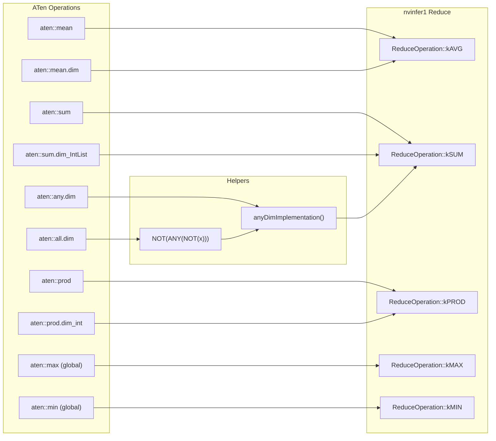
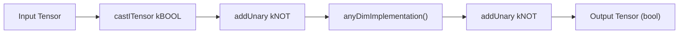
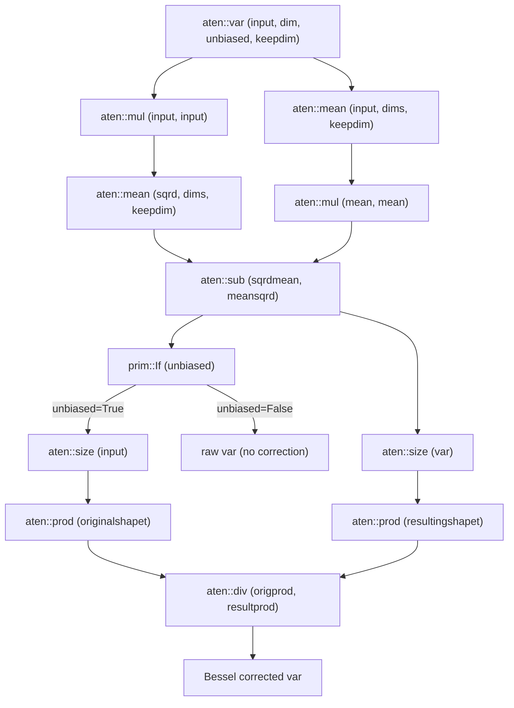
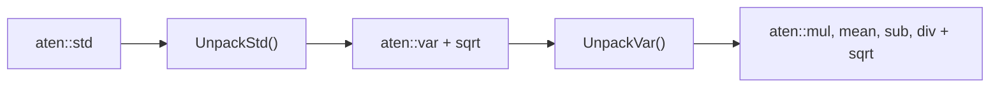
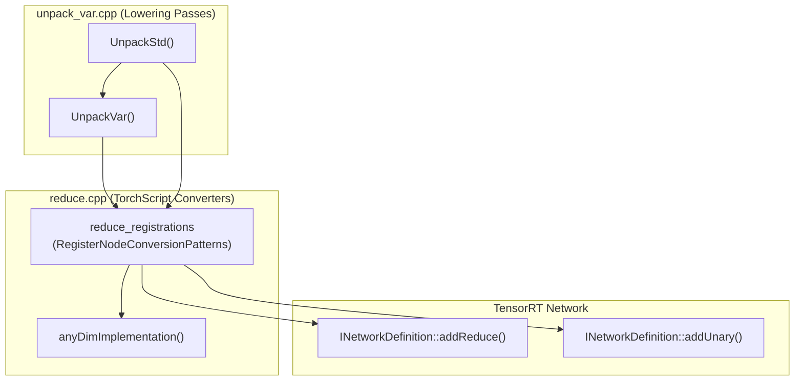

<!-- source: DeepWiki mcp.deepwiki.com · repo pytorch/TensorRT · page 5.3 Reduction Operations · fetched 2026-10-21 -->

# Reduction Operations

<details>
<summary>Relevant source files</summary>

The following files were used as context for generating this wiki page:

- [core/conversion/converters/impl/element_wise.cpp](core/conversion/converters/impl/element_wise.cpp)
- [core/conversion/converters/impl/reduce.cpp](core/conversion/converters/impl/reduce.cpp)
- [core/lowering/passes/unpack_var.cpp](core/lowering/passes/unpack_var.cpp)
- [tests/core/conversion/converters/test_reduce.cpp](tests/core/conversion/converters/test_reduce.cpp)
- [tests/core/lowering/test_unpack_reduce_ops.cpp](tests/core/lowering/test_unpack_reduce_ops.cpp)

</details>


## Purpose and Scope

This page documents the converters and lowering passes that handle reduction operations — operations that aggregate values across one or more tensor dimensions. It covers the TorchScript frontend C++ converter implementations registered in `core/conversion/converters/impl/reduce.cpp`, and the `UnpackVar` / `UnpackStd` lowering passes in `core/lowering/passes/` that decompose variance and standard deviation into primitives supported by TensorRT.

For element-wise `max` and `min` between two tensors (e.g., `aten::max.other`), see [Element-wise Operations](#5.2). For the ATen operator conversion system used by the Dynamo frontend, see [ATen Operator Conversion System](#3.2). For the lowering pass infrastructure, see [Decompositions and Lowering Passes](#3.3).

---

## TensorRT Reduce Layer Fundamentals

TensorRT provides a single layer type, `IReduceLayer`, that covers all reduce operations. It is constructed via `INetworkDefinition::addReduce()` and parameterized by:

| Parameter | Type | Role |
|-----------|------|------|
| `input` | `ITensor&` | Tensor to reduce |
| `operation` | `ReduceOperation` | Which aggregation to apply |
| `reduceAxes` | `uint32_t` | Bitmask of axes to reduce |
| `keepDimensions` | `bool` | Whether to preserve reduced dims as size 1 |

The `ReduceOperation` enum values used in this codebase:

| `nvinfer1::ReduceOperation` | PyTorch Operation |
|-----------------------------|-------------------|
| `kSUM` | `aten::sum` |
| `kAVG` | `aten::mean` |
| `kPROD` | `aten::prod` |
| `kMAX` | `aten::max` |
| `kMIN` | `aten::min` |

Sources: [core/conversion/converters/impl/reduce.cpp:1-100]()

---

## Axis Mask Encoding

TensorRT does not accept a list of dimension indices directly. All converters translate the PyTorch dimension specification into a `uint32_t` bitmask where bit `i` indicates that dimension `i` is reduced.

**Reduce all dimensions** (global reduction):

```
axis_mask = (uint32_t)(((uint64_t)1 << ndims) - 1)
```

**Reduce a single dimension `d`** (after normalizing negative indices):

```
axis_mask = 1 << d
```

**Reduce multiple dimensions** (OR of individual masks):

```
axis_mask = 0
for each dim d: axis_mask |= (1 << d)
```

Negative dimension indices are normalized to non-negative form before the mask is computed:

```
dim = dim < 0 ? (in_dims.nbDims + dim) : dim
```

Sources: [core/conversion/converters/impl/reduce.cpp:12-170]()

---

## Registered Converters

All reduction converters are registered using `RegisterNodeConversionPatterns()` inside `reduce_registrations` in `core/conversion/converters/impl/reduce.cpp`.

**Converter operation to TRT pattern mapping:**



Sources: [core/conversion/converters/impl/reduce.cpp:42-286]()

### Global Reductions

The `aten::mean`, `aten::sum`, `aten::prod`, `aten::max`, and `aten::min` (no `dim` argument) converters build an axis mask covering all dimensions and call `addReduce` with `keepDimensions=false`.

- `aten::mean` → [`reduce.cpp:45-62`](core/conversion/converters/impl/reduce.cpp:45-62)
- `aten::sum` → [`reduce.cpp:99-123`](core/conversion/converters/impl/reduce.cpp:99-123)
- `aten::prod` → [`reduce.cpp:172-188`](core/conversion/converters/impl/reduce.cpp:172-188)
- `aten::max` → [`reduce.cpp:218-234`](core/conversion/converters/impl/reduce.cpp:218-234)
- `aten::min` → [`reduce.cpp:236-252`](core/conversion/converters/impl/reduce.cpp:236-252)

### Dimension-Specific Reductions

`aten::mean.dim`, `aten::sum.dim_IntList`, and `aten::prod.dim_int` accept explicit dimension lists and a `keepdim` flag. The converters normalize negative indices, build the axis mask, and pass `keepdim` to `addReduce`.

| ATen Pattern | Signature |
|---|---|
| `aten::mean.dim` | `(Tensor self, int[] dim, bool keepdim, int? dtype)` |
| `aten::sum.dim_IntList` | `(Tensor self, int[1] dim, bool keepdim, ScalarType? dtype)` |
| `aten::prod.dim_int` | `(Tensor self, int dim, bool keepdim, ScalarType? dtype)` |

> **Note:** All three converters emit a `LOG_WARNING` that `dtype` is disregarded.

Sources: [core/conversion/converters/impl/reduce.cpp:63-216]()

---

## Boolean Input Handling

TensorRT's `IReduceLayer` does not accept `kBOOL` tensors. Both `aten::sum` and `aten::sum.dim_IntList` detect this case and cast the input to `kINT32` before the reduce call:

```
if (in_tensor->getType() == nvinfer1::DataType::kBOOL) {
    in_tensor = castITensor(ctx, in_tensor, nvinfer1::DataType::kINT32);
}
```

Sources: [core/conversion/converters/impl/reduce.cpp:105-159]()

---

## `any.dim` and `all.dim` Implementations

### `anyDimImplementation`

The helper function `anyDimImplementation` [reduce.cpp:12-40]() handles `aten::any.dim`. Since TensorRT has no native boolean reduce, the approach is:

1. If input dtype is `kBOOL`, cast to `kINT32`.
2. Apply `addReduce` with `kSUM` and the specified axis mask / `keepdim`.
3. Cast the output back to `kBOOL`.

A non-zero sum indicates at least one `true` value in the reduced slice.

### `all.dim` via Double Negation

`aten::all.dim` is implemented without a native TRT "all" reduction by using De Morgan's identity: `ALL(x) == NOT(ANY(NOT(x)))`.



Sources: [core/conversion/converters/impl/reduce.cpp:265-286]()

---

## `UnpackVar` Lowering Pass

`aten::var` has no direct TensorRT equivalent. The `UnpackVar` pass in `core/lowering/passes/unpack_var.cpp` rewrites it into a sequence of supported operations before conversion.

### Decomposition

The pass uses `SubgraphRewriter` to match the pattern `aten::var(%input, %dim, %unbiased, %keepdim)` and replace it with the following graph:

```
Var(x) = mean(x²) - mean(x)²
```

With Bessel's correction applied when `unbiased=True`:

```
Var_unbiased(x) = Var(x) * N / (N - 1)
```

where `N` is the number of elements used per variance computation (ratio of original to output element count).

The resulting graph uses only these ATen operations:

| Operation | Role |
|---|---|
| `aten::mul` | Square the input: `x²` |
| `aten::mean` | Compute `mean(x²)` and `mean(x)` |
| `aten::sub` | Subtract: `mean(x²) - mean(x)²` |
| `aten::prod` | Count elements in original and result shapes |
| `aten::div` | Bessel's correction ratio |

### Decomposition Flow



Sources: [core/lowering/passes/unpack_var.cpp:1-58]()

---

## `UnpackStd` Lowering Pass

`aten::std` is decomposed by a companion pass `UnpackStd` (referenced in `tests/core/lowering/test_unpack_reduce_ops.cpp`) which rewrites `aten::std` into `sqrt(var(...))`. The `UnpackVar` pass is then applied to finish the decomposition. The two passes are applied in sequence:



Sources: [tests/core/lowering/test_unpack_reduce_ops.cpp:102-198]()

---

## Testing

### Converter Tests

Located in `tests/core/conversion/converters/test_reduce.cpp`, tests use parameterized IR graph helpers:

| Helper | Graph Shape | What It Tests |
|---|---|---|
| `gen_basic_graph(op)` | Global reduction, no dim | `sum`, `prod`, `mean` |
| `gen_min_max_graph(op)` | Global reduction (no None arg) | `max`, `min` |
| `gen_dim_graph(op)` | `dim=[1]`, `keepdim=false` | `sum`, `mean` |
| `gen_multidim_graph(op)` | `dim=[0,1]`, `keepdim=false` | `sum`, `mean` |
| `gen_keepdim_graph(op)` | `dim=[1]`, `keepdim=true` | `sum`, `mean` |

Additional named tests cover:

- Bool tensor input for `aten::sum` (cast to INT32 path)
- Negative dimension indices (`value=-1`, `value=-2`)
- `aten::any.dim` with keepdim, negative index, and all-false inputs
- `aten::all.dim` with keepdim, all-true inputs, and dynamic shapes

Each test runs the same graph through JIT and a TRT engine, then compares results with `almostEqual`.

Sources: [tests/core/conversion/converters/test_reduce.cpp:1-401]()

### Lowering Pass Tests

Located in `tests/core/lowering/test_unpack_reduce_ops.cpp`, tests verify `UnpackVar` and `UnpackStd` by:

1. Evaluating the original graph via JIT.
2. Applying the lowering pass (`UnpackVar` or `UnpackStd` + `UnpackVar`).
3. Running `EliminateCommonSubexpression` for cleanup.
4. Evaluating the lowered graph via JIT.
5. Comparing results with `almostEqual`.

Variants tested:

| Pass | `unbiased` | `keepdim` |
|---|---|---|
| `UnpackVar` | false | true |
| `UnpackVar` | false | false |
| `UnpackVar` | true | true |
| `UnpackVar` | true | false |
| `UnpackStd` | false | true / false |
| `UnpackStd` | true | true / false |

Sources: [tests/core/lowering/test_unpack_reduce_ops.cpp:1-238]()

---

## Summary: Code Entity Map



Sources: [core/conversion/converters/impl/reduce.cpp:42-292](), [core/lowering/passes/unpack_var.cpp:10-53]()

---

