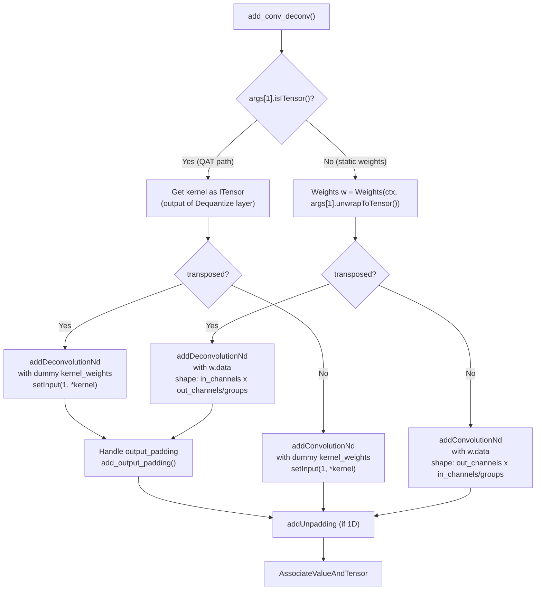
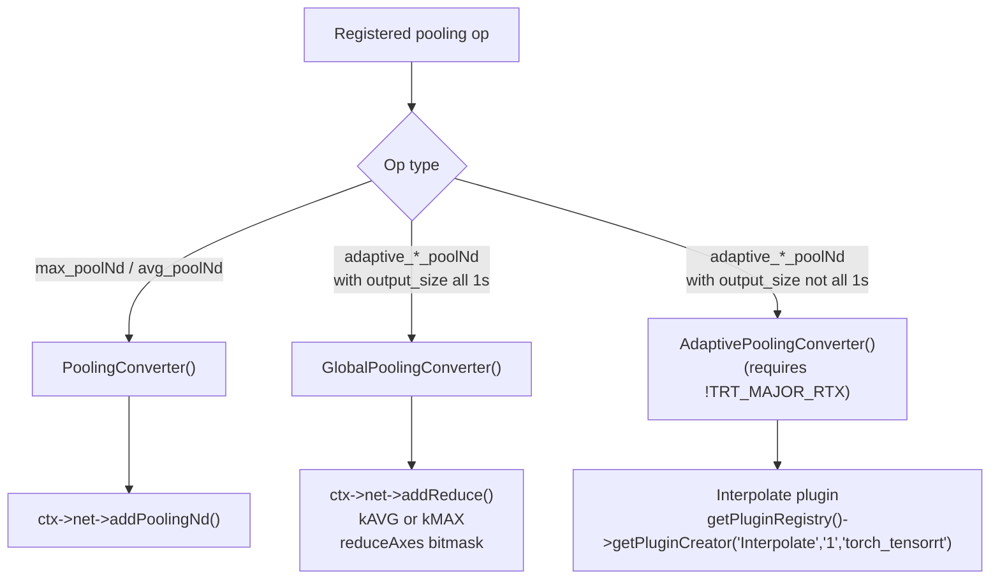
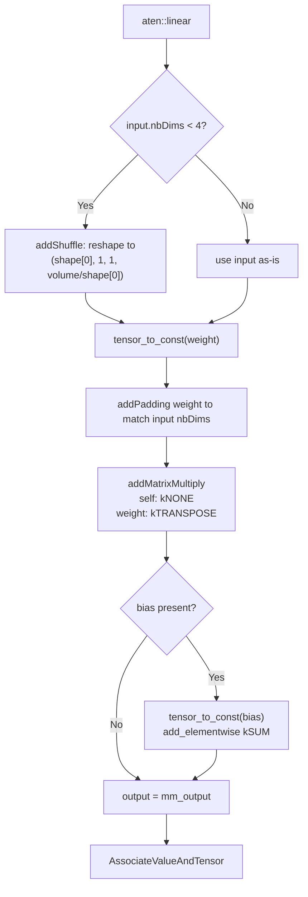
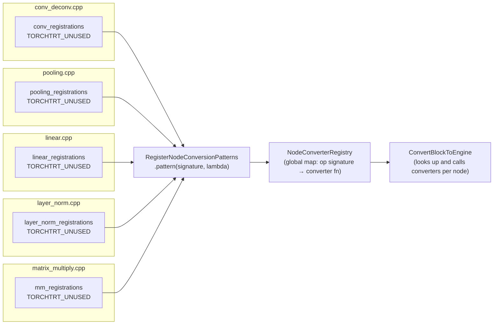

<!-- source: DeepWiki mcp.deepwiki.com · repo pytorch/TensorRT · page 5.4 Convolution and Pooling · fetched 2026-10-21 -->

# Convolution and Pooling

<details>
<summary>Relevant source files</summary>

The following files were used as context for generating this wiki page:

- [core/conversion/converters/BUILD](core/conversion/converters/BUILD)
- [core/conversion/converters/impl/batch_norm.cpp](core/conversion/converters/impl/batch_norm.cpp)
- [core/conversion/converters/impl/constant.cpp](core/conversion/converters/impl/constant.cpp)
- [core/conversion/converters/impl/conv_deconv.cpp](core/conversion/converters/impl/conv_deconv.cpp)
- [core/conversion/converters/impl/layer_norm.cpp](core/conversion/converters/impl/layer_norm.cpp)
- [core/conversion/converters/impl/linear.cpp](core/conversion/converters/impl/linear.cpp)
- [core/conversion/converters/impl/matrix_multiply.cpp](core/conversion/converters/impl/matrix_multiply.cpp)
- [core/conversion/converters/impl/pooling.cpp](core/conversion/converters/impl/pooling.cpp)
- [tests/core/conversion/converters/BUILD](tests/core/conversion/converters/BUILD)
- [tests/core/conversion/converters/test_conv_deconv.cpp](tests/core/conversion/converters/test_conv_deconv.cpp)
- [tests/core/conversion/converters/test_instance_norm.cpp](tests/core/conversion/converters/test_instance_norm.cpp)
- [tests/core/conversion/converters/test_layer_norm.cpp](tests/core/conversion/converters/test_layer_norm.cpp)
- [tests/core/conversion/converters/test_matrix_multiply.cpp](tests/core/conversion/converters/test_matrix_multiply.cpp)
- [tests/core/conversion/converters/test_pooling.cpp](tests/core/conversion/converters/test_pooling.cpp)

</details>


This page documents the **TorchScript frontend** converter implementations for convolution, transposed convolution, pooling, linear, layer normalization, and matrix multiply operations. These converters translate JIT graph nodes into TensorRT network layers via the `RegisterNodeConversionPatterns` mechanism described in page [4.5](#4.5).

For the analogous Dynamo (ATen-level) converter implementations, see [3.2](#3.2). For normalization operations such as `batch_norm` and `group_norm`, see [5.5](#5.5). For shared utilities referenced throughout this page (`addPadding`, `addUnpadding`, `tensor_to_const`, `Weights`), see [5.7](#5.7).

---

## Convolution and Transposed Convolution

**Source file:** [core/conversion/converters/impl/conv_deconv.cpp]()

All convolution variants in the TorchScript graph are unified into the `add_conv_deconv` function, which handles both `aten::_convolution` and its deprecated variant.

### Registered Patterns

| JIT Pattern | Notes |
|---|---|
| `aten::_convolution(...)` | Standard traced/scripted models |
| `aten::_convolution.deprecated(...)` | Traced models without `allow_tf32` |

Both patterns delegate directly to `add_conv_deconv`.

[core/conversion/converters/impl/conv_deconv.cpp:316-338]()

### Parameter Extraction

The converter reads the following arguments from the JIT node:

| Arg index | Name | Type |
|---|---|---|
| 0 | `input` | `ITensor*` |
| 1 | `weight` | `ITensor*` or `Tensor` |
| 2 | `bias` | `Tensor?` |
| 3 | `stride` | `int[]` |
| 4 | `padding` | `int[]` |
| 5 | `dilation` | `int[]` |
| 6 | `transposed` | `bool` |
| 7 | `output_padding` | `int[]` |
| 8 | `groups` | `int` |

[core/conversion/converters/impl/conv_deconv.cpp:81-96]()

### 1D Dimension Expansion

TensorRT requires at least 2 spatial dimensions. When the input has only 1 spatial dimension (e.g., Conv1D), all spatial parameters are expanded from 1D to 2D using `util::unsqueezeDims`, and the input tensor is padded to 4D via `addPadding`. The output is then unpadded back to the original rank using `addUnpadding`.

[core/conversion/converters/impl/conv_deconv.cpp:98-115](), [core/conversion/converters/impl/conv_deconv.cpp:243-257]()

### Two Weight Paths

**Diagram: `add_conv_deconv` control flow**



The QAT (Quantization-Aware Training) path is triggered when convolution weights are themselves `ITensor` values — the output of a Dequantize layer in an INT8 graph. In this case, a dummy zero-length `nvinfer1::Weights` is passed as the kernel placeholder, and the actual kernel is bound via `setInput(1, *kernel)`.

[core/conversion/converters/impl/conv_deconv.cpp:127-214]()

### Output Padding for Transposed Convolution

When `output_padding` is non-zero on a transposed convolution, the helper `add_output_padding` tries to absorb it into the pre/post padding. If any `output_padding` dimension exceeds the available `padding`, a residual `out_padding` remains and is applied via `add_bias_layer`, which uses a `Slice` layer with `kFILL` mode to extend the output and an element-wise addition to apply the bias.

[core/conversion/converters/impl/conv_deconv.cpp:13-79]()

### Weight Shape Conventions

| Operation | Weight layout |
|---|---|
| `Conv` (forward) | `[out_channels, in_channels/groups, *spatial]` |
| `ConvTranspose` | `[in_channels, out_channels/groups, *spatial]` |

For transposed convolution with static weights, the number of output maps is `w.shape.d[1] * groups`.

[core/conversion/converters/impl/conv_deconv.cpp:267-301]()

---

## Pooling Operations

**Source file:** [core/conversion/converters/impl/pooling.cpp]()

Three internal functions implement different pooling strategies, selected based on op type and output size.

### Converter Functions

**Diagram: Pooling converter selection**



Sources: [core/conversion/converters/impl/pooling.cpp:12-113]()

### `PoolingConverter`

Handles all `max_poolNd` and `avg_poolNd` operations.

Key behaviors:
- Inputs with fewer than 4 dimensions are padded to 4D via `addPadding` (with `false, true` flags to preserve batch).
- If `stride` is empty, the kernel size is used as stride.
- 1D kernel/padding/stride dims are unsqueezed to 2D.
- `ceil_mode=true` maps to `kEXPLICIT_ROUND_UP`; `false` maps to `kEXPLICIT_ROUND_DOWN`.
- For average pooling, `count_include_pad` controls `setAverageCountExcludesPadding`.
- Max pooling accepts a `dilation` argument, but TensorRT does not support pooling dilation. If dilation ≠ 1, an error is raised.
- DLA requires 2D stride; a warning is emitted if stride is not 2D.

[core/conversion/converters/impl/pooling.cpp:116-200]()

### `GlobalPoolingConverter`

When an adaptive pooling op requests an output size of all 1s, it is converted to a global reduce using `addReduce` rather than a pooling layer. A bitmask of spatial axes is constructed dynamically:

- For `nbDims > 2`: all bits except the last 2 (N and C) are set.
- For `nbDims == 2` (e.g. `adaptive_avg_pool1d` on a 2D input): all bits except the last 1 (N) are set.

[core/conversion/converters/impl/pooling.cpp:12-38]()

### `AdaptivePoolingConverter`

For adaptive pooling with non-unit output sizes, the converter uses the custom `Interpolate` TensorRT plugin (registered as `"Interpolate"` version `"1"` in namespace `"torch_tensorrt"`). This path is disabled when building for TensorRT RTX (`#ifndef TRT_MAJOR_RTX`).

A warning is emitted that adaptive pooling will use ATen kernels via the plugin, and users should consider switching to non-adaptive pooling when performance is critical.

[core/conversion/converters/impl/pooling.cpp:41-113]()

### Registered Patterns Summary

| Pattern | Converter function |
|---|---|
| `aten::max_pool1d` | `PoolingConverter(kMAX)` |
| `aten::avg_pool1d` | `PoolingConverter(kAVERAGE)` |
| `aten::max_pool2d` | `PoolingConverter(kMAX)` |
| `aten::avg_pool2d` | `PoolingConverter(kAVERAGE)` |
| `aten::max_pool3d` | `PoolingConverter(kMAX)` |
| `aten::avg_pool3d` | `PoolingConverter(kAVERAGE)` |
| `aten::adaptive_avg_pool1d` | `AdaptivePoolingConverter(kAVERAGE)` or `GlobalPoolingConverter` |
| `aten::adaptive_max_pool1d` | `AdaptivePoolingConverter(kMAX)` or `GlobalPoolingConverter` |
| `aten::adaptive_avg_pool2d` | `AdaptivePoolingConverter(kAVERAGE)` or `GlobalPoolingConverter` |
| `aten::adaptive_max_pool2d` | `AdaptivePoolingConverter(kMAX)` or `GlobalPoolingConverter` |
| `aten::adaptive_avg_pool3d` | `AdaptivePoolingConverter(kAVERAGE)` or `GlobalPoolingConverter` |
| `aten::adaptive_max_pool3d` | `AdaptivePoolingConverter(kMAX)` or `GlobalPoolingConverter` |

The adaptive variants are only registered in the non-RTX configuration.

[core/conversion/converters/impl/pooling.cpp:203-298]()

---

## Linear Layer

**Source file:** [core/conversion/converters/impl/linear.cpp]()

Registered pattern: `aten::linear(Tensor input, Tensor weight, Tensor? bias) -> Tensor`

### Implementation

PyTorch `linear` implements the formula `output = input @ weight.T + bias`. The converter maps this to a TensorRT `IMatrixMultiplyLayer` with `kTRANSPOSE` applied to the weight operand.

**Diagram: `aten::linear` converter flow**



Sources: [core/conversion/converters/impl/linear.cpp:11-70]()

The input is only reshaped if it is fewer than 4 dimensions — it is flattened to `[N, 1, 1, features]` so that the matrix multiply operates correctly. The weight tensor is loaded as a constant and padded with leading dimensions of size 1 to match the input rank before the multiply.

---

## Layer Normalization

**Source file:** [core/conversion/converters/impl/layer_norm.cpp]()

Registered pattern: `aten::layer_norm(Tensor input, int[] normalized_shape, Tensor? gamma, Tensor? beta, float eps, bool cudnn_enabled) -> Tensor`

### Implementation

The converter uses TensorRT's native `INetworkDefinition::addNormalization`, which maps directly to layer normalization.

**Axes mask computation:** The normalized dimensions are the trailing `len(normalized_shape)` dimensions. The `axes_mask` is a bitmask where bit `i` is set for each dimension in the normalized range.

```
axis = input_rank - len(normalized_shape)
for i in [axis, input_rank):
    axes_mask |= (1 << i)
```

**Gamma and beta handling:**
- If `gamma` is `None`, a ones tensor of the full input shape is substituted.
- If `beta` is `None`, a zeros tensor of the full input shape is substituted.
- Otherwise, `add_expand` broadcasts `gamma`/`beta` to the full input shape.

The compute precision of the normalization layer is set to match the input tensor's type via `setComputePrecision`.

[core/conversion/converters/impl/layer_norm.cpp:13-59]()

---

## Matrix Multiply Operations

**Source file:** [core/conversion/converters/impl/matrix_multiply.cpp]()

Three patterns are registered:

| Pattern | Description |
|---|---|
| `aten::matmul` | General matrix multiply with broadcasting |
| `aten::bmm` | Batched 3D matrix multiply |
| `aten::baddbmm` | Batched multiply-add: `beta * self + alpha * (batch1 @ batch2)` |

### `aten::matmul`

Handles all combinations of 1D–4D inputs.

**1D input adjustments:**

- If `self` is 1D and `other` is higher-rank: `squeezeFront = true`. After multiply, the leading dimension is squeezed off.
- If `other` is 1D and `self` is higher-rank: `other` is padded to 2D (appending a size-1 dim), `squeezeBack = true`. After multiply, the trailing dimension is squeezed off.

Both inputs are then padded via `addPadding` to equal `nbDims` before calling `addMatrixMultiply` with `kNONE` on both operands.

[core/conversion/converters/impl/matrix_multiply.cpp:16-65]()

### `aten::bmm`

Enforces that both inputs are exactly 3D, and that `batch1.d[2] == batch2.d[1]`. Directly calls `addMatrixMultiply` with `kNONE` on both.

[core/conversion/converters/impl/matrix_multiply.cpp:67-106]()

### `aten::baddbmm`

Implements `out = beta * self + alpha * (batch1 @ batch2)`.

- Same dimension checks as `bmm`.
- If `alpha != 1.0`: scales the `mm_out` by `alpha` via `add_elementwise(kPROD)`.
- If `beta == 0.0`: the `self` term is dropped entirely (NaN/Inf in `self` are not propagated).
- If `beta != 0.0` and `beta != 1.0`: scales `self` by `beta` via `add_elementwise(kPROD)`.
- If `beta != 0.0`: adds `self` to `mm_out` via `add_elementwise(kSUM)`.

[core/conversion/converters/impl/matrix_multiply.cpp:107-185]()

---

## Registration and Build System

All converters in this page are compiled into the `converters` Bazel target defined in [core/conversion/converters/BUILD:118-183](). The relevant source files in that target are:

- `impl/conv_deconv.cpp`
- `impl/pooling.cpp`
- `impl/linear.cpp`
- `impl/layer_norm.cpp`
- `impl/matrix_multiply.cpp`

Each file uses the `RegisterNodeConversionPatterns` / `.pattern(...)` chain (defined in `NodeConverterRegistry.cpp`) to register its converters at static initialization time.

**Diagram: Registration flow for TorchScript converters**



Sources: [core/conversion/converters/BUILD:118-157]()

---

## Testing

Converter tests are located in `tests/core/conversion/converters/` and built via the `converter_test` Bazel macro.

| Test file | Ops covered |
|---|---|
| `test_conv_deconv.cpp` | Conv1d/2d/3d, ConvTranspose, QAT weight path |
| `test_pooling.cpp` | MaxPool/AvgPool 1d/2d/3d, AdaptiveAvgPool 1d/2d/3d, global pooling |
| `test_linear.cpp` | `aten::linear` |
| `test_layer_norm.cpp` | `aten::layer_norm` with varying `normalized_shape` ranks |
| `test_matrix_multiply.cpp` | `matmul` (1D–4D combinations), `bmm`, `baddbmm` |

Sources: [tests/core/conversion/converters/BUILD:75-77](), [tests/core/conversion/converters/BUILD:109-117](), [tests/core/conversion/converters/BUILD:131-133]()

Each test follows the standard pattern of running the JIT graph and the TRT graph on identical cloned inputs, then comparing outputs with `torch_tensorrt::tests::util::almostEqual`.

---

