<!-- source: DeepWiki mcp.deepwiki.com · repo pytorch/TensorRT · page 5.5 Normalization Operations · fetched 2026-10-21 -->

# Normalization Operations

<details>
<summary>Relevant source files</summary>

The following files were used as context for generating this wiki page:

- [core/conversion/converters/BUILD](core/conversion/converters/BUILD)
- [core/conversion/converters/impl/batch_norm.cpp](core/conversion/converters/impl/batch_norm.cpp)
- [core/conversion/converters/impl/constant.cpp](core/conversion/converters/impl/constant.cpp)
- [core/conversion/converters/impl/conv_deconv.cpp](core/conversion/converters/impl/conv_deconv.cpp)
- [core/conversion/converters/impl/layer_norm.cpp](core/conversion/converters/impl/layer_norm.cpp)
- [core/conversion/converters/impl/linear.cpp](core/conversion/converters/impl/linear.cpp)
- [core/conversion/converters/impl/matrix_multiply.cpp](core/conversion/converters/impl/matrix_multiply.cpp)
- [core/conversion/converters/impl/pooling.cpp](core/conversion/converters/impl/pooling.cpp)
- [py/torch_tensorrt/dynamo/conversion/aten_ops_converters.py](py/torch_tensorrt/dynamo/conversion/aten_ops_converters.py)
- [py/torch_tensorrt/dynamo/conversion/converter_utils.py](py/torch_tensorrt/dynamo/conversion/converter_utils.py)
- [py/torch_tensorrt/dynamo/conversion/impl/normalization/ops.py](py/torch_tensorrt/dynamo/conversion/impl/normalization/ops.py)
- [py/torch_tensorrt/dynamo/conversion/impl/slice/ops.py](py/torch_tensorrt/dynamo/conversion/impl/slice/ops.py)
- [py/torch_tensorrt/dynamo/lowering/_decomposition_groups.py](py/torch_tensorrt/dynamo/lowering/_decomposition_groups.py)
- [tests/core/conversion/converters/BUILD](tests/core/conversion/converters/BUILD)
- [tests/core/conversion/converters/test_conv_deconv.cpp](tests/core/conversion/converters/test_conv_deconv.cpp)
- [tests/core/conversion/converters/test_instance_norm.cpp](tests/core/conversion/converters/test_instance_norm.cpp)
- [tests/core/conversion/converters/test_layer_norm.cpp](tests/core/conversion/converters/test_layer_norm.cpp)
- [tests/core/conversion/converters/test_matrix_multiply.cpp](tests/core/conversion/converters/test_matrix_multiply.cpp)
- [tests/core/conversion/converters/test_pooling.cpp](tests/core/conversion/converters/test_pooling.cpp)
- [tests/py/dynamo/conversion/test_batch_norm_aten.py](tests/py/dynamo/conversion/test_batch_norm_aten.py)
- [tests/py/dynamo/conversion/test_erf_aten.py](tests/py/dynamo/conversion/test_erf_aten.py)
- [tests/py/dynamo/conversion/test_flip_aten.py](tests/py/dynamo/conversion/test_flip_aten.py)
- [tests/py/dynamo/conversion/test_group_norm_aten.py](tests/py/dynamo/conversion/test_group_norm_aten.py)
- [tests/py/dynamo/conversion/test_layer_norm_aten.py](tests/py/dynamo/conversion/test_layer_norm_aten.py)
- [tests/py/dynamo/conversion/test_neg_aten.py](tests/py/dynamo/conversion/test_neg_aten.py)
- [tests/py/dynamo/conversion/test_pdist_aten.py](tests/py/dynamo/conversion/test_pdist_aten.py)
- [tests/py/dynamo/conversion/test_rsqrt_aten.py](tests/py/dynamo/conversion/test_rsqrt_aten.py)
- [tests/py/dynamo/conversion/test_slice_aten.py](tests/py/dynamo/conversion/test_slice_aten.py)
- [tests/py/dynamo/conversion/test_tile_aten.py](tests/py/dynamo/conversion/test_tile_aten.py)

</details>


This page documents the conversion of normalization operations from PyTorch to TensorRT in both the Dynamo and TorchScript frontends. Normalization operations include batch normalization, layer normalization, instance normalization, and group normalization.

For information about activation functions, see [Activation Operations](#5.2). For convolution operations that often precede normalization, see [Convolution and Pooling](#5.4).

## Overview

Normalization operations standardize inputs across different dimensions to stabilize and accelerate training. Torch-TensorRT converts these operations to TensorRT's native layers or, when necessary, uses plugins or decompositions. The conversion approach differs between frontends:

- **Dynamo Frontend**: Supports batch normalization, layer normalization, and group normalization through direct ATen operator conversion
- **TorchScript Frontend**: Supports batch normalization and instance normalization through graph pattern matching

Both frontends compute normalization weights at compile-time when possible, converting running statistics (mean/variance) into scale/bias parameters for efficient inference.

Sources: [py/torch_tensorrt/dynamo/conversion/aten_ops_converters.py:62-220](), [core/conversion/converters/impl/batch_norm.cpp:1-239]()

## Supported Normalization Operations

The following table summarizes normalization operation support across frontends:

| Operation | Dynamo Frontend | TorchScript Frontend | Implementation Strategy |
|-----------|----------------|---------------------|------------------------|
| Batch Normalization | ✓ | ✓ | `IScaleNdLayer` with precomputed scale/bias |
| Layer Normalization | ✓ | ✗ | `impl.normalization.native_layer_norm` |
| Group Normalization | ✓ | ✗ | `impl.normalization.native_group_norm` |
| Instance Normalization | Via decomposition | ✓ | Plugin (TorchScript) or decomposition to group_norm |
| Softmax | ✓ | ✗ | `ISoftMaxLayer` |

Sources: [py/torch_tensorrt/dynamo/conversion/aten_ops_converters.py:62-220](), [core/conversion/converters/impl/batch_norm.cpp:100-203](), [py/torch_tensorrt/dynamo/lowering/_decompositions.py:413-430]()

## Converter Registration and Routing

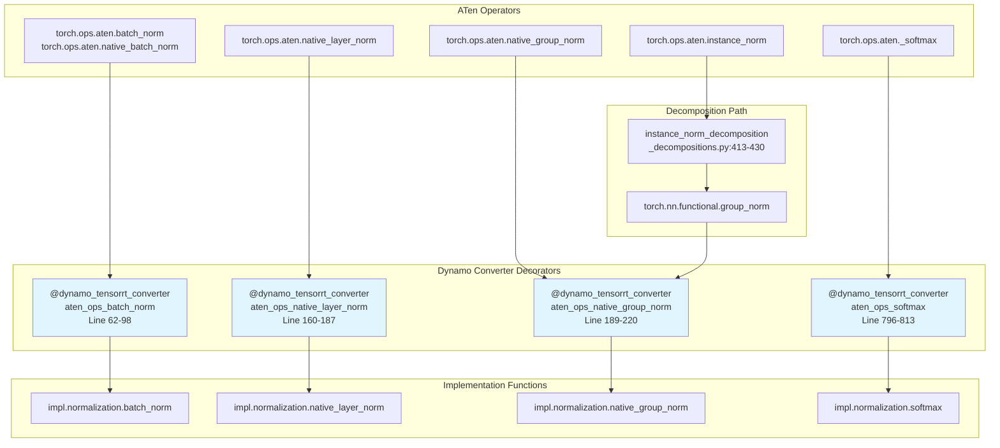

**Diagram: ATen Operator to Converter Routing in Dynamo Frontend**

Sources: [py/torch_tensorrt/dynamo/conversion/aten_ops_converters.py:62-220](), [py/torch_tensorrt/dynamo/lowering/_decompositions.py:413-430]()

## Dynamo Frontend Conversion

### Batch Normalization Converter

The Dynamo frontend registers multiple batch normalization variants with different capability validators and argument patterns:

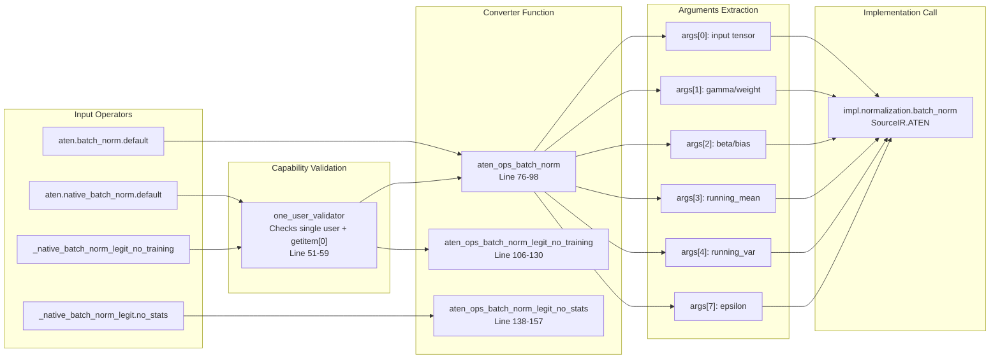

**Diagram: Batch Normalization Converter Flow in Dynamo Frontend**

The `one_user_validator` is required because certain batch normalization variants return tuples `(output, mean, rstd)` but TensorRT conversion only uses the first element. The validator ensures the node has exactly one user that extracts element 0 via `operator.getitem`.

**Key Implementation Details:**

| Parameter | Source | Default Value | Purpose |
|-----------|--------|---------------|---------|
| `input` | `args[0]` | Required | Input tensor to normalize |
| `weight` | `args[1]` | None | Learned scale parameter (γ) |
| `bias` | `args[2]` | None | Learned shift parameter (β) |
| `running_mean` | `args[3]` | None | Running mean statistics |
| `running_var` | `args[4]` | Running variance statistics |
| `training` | `args[5]` | False | Training mode flag (ignored in inference) |
| `eps` | `args[7]` | 1e-5 | Numerical stability constant |
| `return_mean_rstd` | Target-dependent | False | Whether to return mean and inverse std |

Sources: [py/torch_tensorrt/dynamo/conversion/aten_ops_converters.py:62-158]()

### Layer Normalization Converter

Layer normalization normalizes across the last `len(normalized_shape)` dimensions:

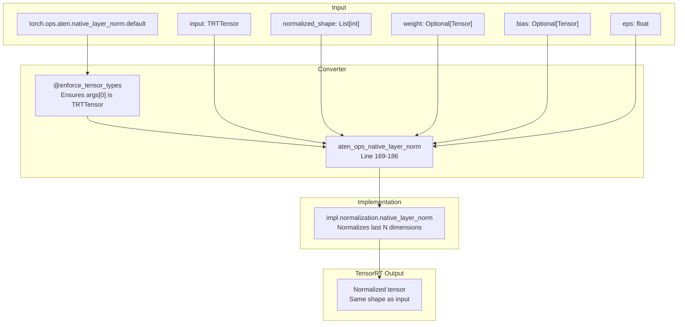

**Diagram: Layer Normalization Converter Architecture**

Layer normalization computes:
```
y = (x - mean) / sqrt(variance + eps) * weight + bias
```
where `mean` and `variance` are computed over the dimensions specified by `normalized_shape`.

Sources: [py/torch_tensorrt/dynamo/conversion/aten_ops_converters.py:160-187]()

### Group Normalization Converter

Group normalization divides channels into groups and normalizes within each group:

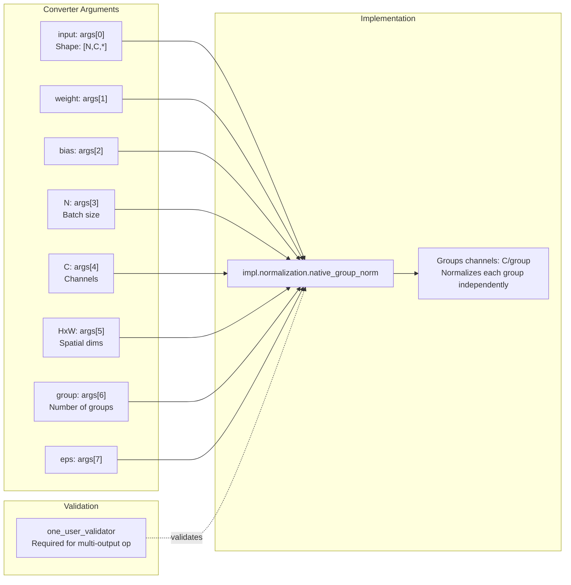

**Diagram: Group Normalization Converter Structure**

Group normalization requires `C % group == 0`. It computes statistics over `[N, C/group, H, W]` dimensions for each group.

Sources: [py/torch_tensorrt/dynamo/conversion/aten_ops_converters.py:189-220]()

### Instance Normalization Decomposition

Instance normalization is not directly supported in Dynamo but is decomposed to group normalization:

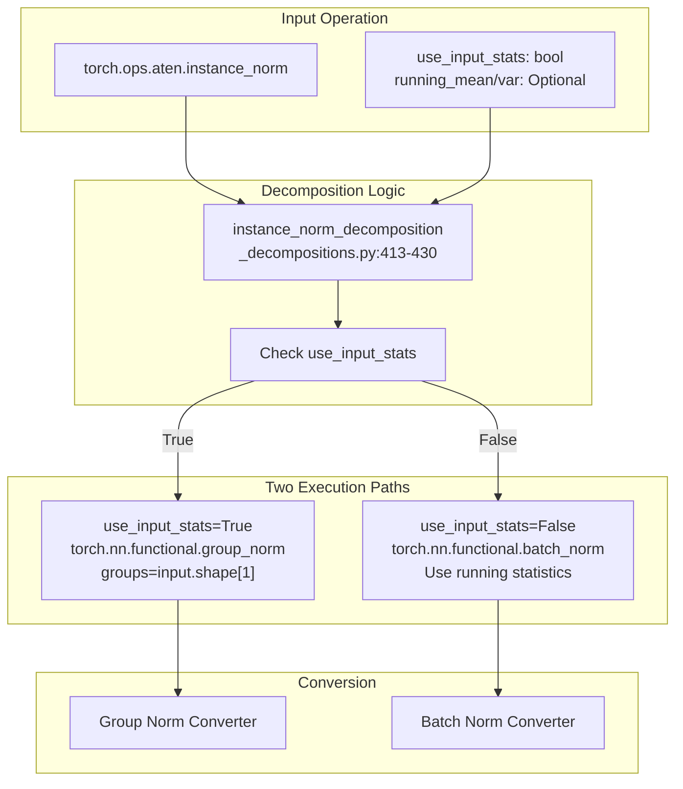

**Diagram: Instance Normalization Decomposition Strategy**

When `use_input_stats=True`, instance normalization is equivalent to group normalization with `groups=num_channels`. When `use_input_stats=False`, it delegates to batch normalization with stored statistics.

Sources: [py/torch_tensorrt/dynamo/lowering/_decompositions.py:413-430]()

## TorchScript Frontend Conversion

### Batch Normalization Converter

The TorchScript frontend uses C++ converters that match graph patterns:

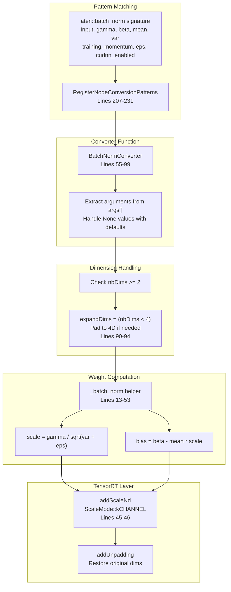

**Diagram: TorchScript Batch Normalization Converter Flow**

The C++ converter handles dynamic shape cases by checking `ctx->input_is_dynamic` and provides appropriate default tensors when weight/bias/mean/variance are None.

**Default Tensor Creation:**

| Parameter | Static Shape Default | Dynamic Shape Default |
|-----------|---------------------|----------------------|
| `gamma` | `at::full(channel_dim, 1, options)` | `at::full(channel_dim, 1, options)` |
| `beta` | `at::full(channel_dim, 0, options)` | `at::full(channel_dim, 0, options)` |
| `mean` | `at::full(channel_dim, 0, options)` | `args[3].unwrapToTensor()` |
| `var` | `at::full(channel_dim, 0, options)` | `args[4].unwrapToTensor()` |

Sources: [core/conversion/converters/impl/batch_norm.cpp:55-99](), [core/conversion/converters/impl/batch_norm.cpp:13-53]()

### Instance Normalization Plugin Converter

Instance normalization in TorchScript uses a TensorRT plugin when cuDNN is enabled:

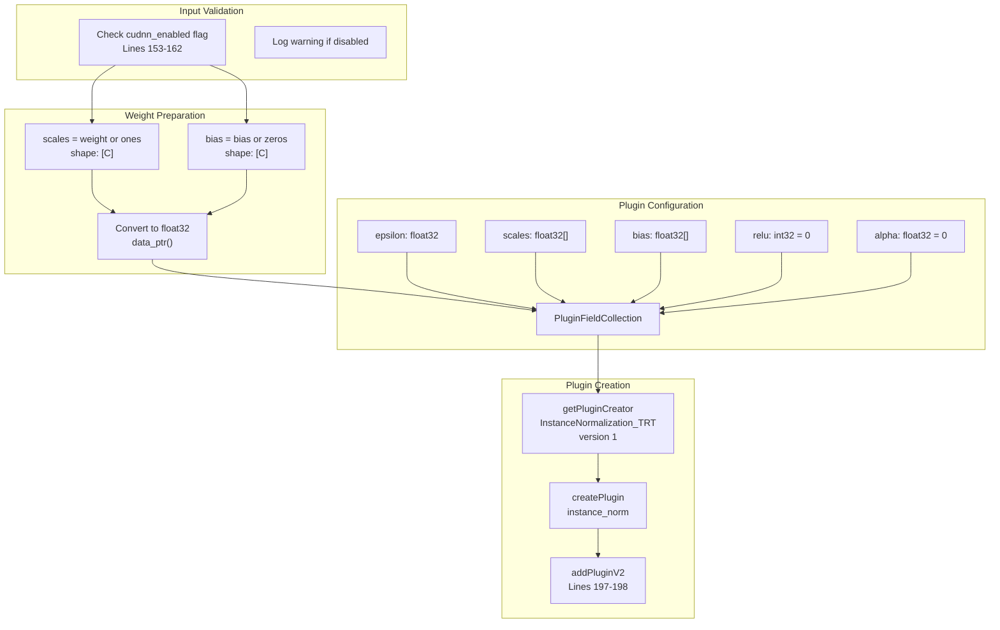

**Diagram: TorchScript Instance Normalization Plugin Architecture**

The instance normalization plugin requires:
- **epsilon**: Numerical stability constant
- **scales**: Channel-wise scaling factors (from `weight` parameter)
- **bias**: Channel-wise bias values (from `bias` parameter)  
- **relu**: Flag to enable leaky ReLU activation (set to 0)
- **alpha**: Leaky ReLU slope (set to 0)

The plugin is only available when cuDNN is loaded as a dynamic dependency. Since TensorRT 10.0, cuDNN must be installed separately.

Sources: [core/conversion/converters/impl/batch_norm.cpp:101-203]()

## Weight Computation and TensorRT Layer Usage

### Scale and Bias Calculation

Normalization layers compute scale and bias from running statistics at compile-time:

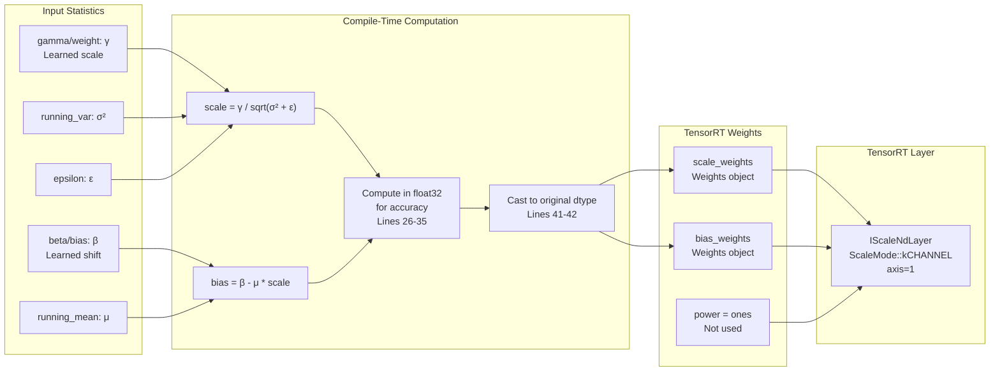

**Diagram: Batch Normalization Weight Computation Flow**

The computation follows the mathematical formula:
```
y = scale * x + bias
where:
  scale = γ / √(σ² + ε)
  bias = β - μ * scale
```

This transforms the normalization operation:
```
y = γ * (x - μ) / √(σ² + ε) + β
```
into a simple affine transformation that TensorRT can execute efficiently via `IScaleNdLayer`.

Sources: [core/conversion/converters/impl/batch_norm.cpp:13-53]()

### Dimension Expansion for TensorRT Compatibility

TensorRT pooling and normalization operations require inputs with at least 4 dimensions:

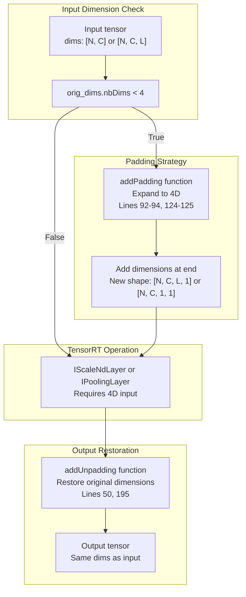

**Diagram: Dimension Handling for 1D and 2D Normalization**

**Dimension Expansion Examples:**

| Original Shape | Expanded Shape | Restored Shape |
|---------------|----------------|----------------|
| `[N, C]` | `[N, C, 1, 1]` | `[N, C]` |
| `[N, C, L]` | `[N, C, L, 1]` | `[N, C, L]` |
| `[N, C, H, W]` | No change | `[N, C, H, W]` |

This expansion ensures TensorRT operations execute correctly while maintaining output shape compatibility with PyTorch.

Sources: [core/conversion/converters/impl/batch_norm.cpp:90-96](), [core/conversion/converters/impl/pooling.cpp:122-126]()

## Data Type Handling and Precision

### Half-Precision Weight Computation

The batch normalization converter handles FP16 weights specially to maintain numerical accuracy:

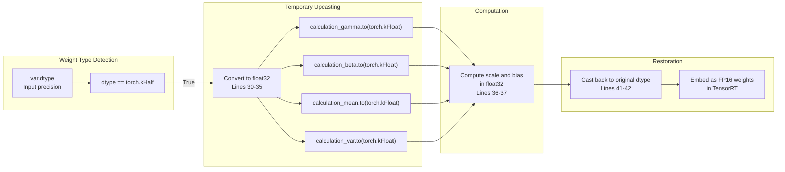

**Diagram: Precision Handling in Batch Normalization Weight Computation**

This approach prevents numerical instability when computing `1 / sqrt(variance + eps)` with FP16 values, which can lose precision for small variance values.

Sources: [core/conversion/converters/impl/batch_norm.cpp:23-42]()

### Softmax Precision Handling

Softmax normalization converts outputs to probabilities across a dimension:

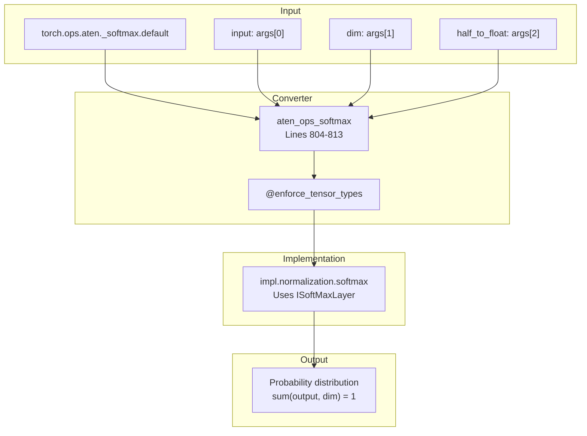

**Diagram: Softmax Converter Architecture**

The `half_to_float` parameter controls whether FP16 inputs are temporarily upcast to FP32 for the softmax computation to improve numerical stability.

Sources: [py/torch_tensorrt/dynamo/conversion/aten_ops_converters.py:796-813]()

## Testing and Validation

### Test Coverage

Normalization converters are tested across multiple scenarios:

| Test Category | Files | Key Scenarios |
|--------------|-------|---------------|
| Decomposition Tests | `test_decompositions.py` | MaxPool decomposition, variance computation, instance_norm decomposition |
| TorchScript Converter Tests | `test_conv_deconv.cpp`, `test_pooling.cpp` | Static and dynamic shapes, 1D/2D/3D inputs |
| Lowering Pass Tests | `test_aten_lowering_passes.py` | Integration with graph transformations |

The test suite validates:
- **Numerical accuracy**: Comparing TensorRT outputs with PyTorch reference implementations
- **Shape handling**: Testing dimension expansion and restoration for 1D, 2D, 3D inputs
- **Dynamic shapes**: Verifying behavior with variable batch sizes and spatial dimensions
- **Edge cases**: None values, missing statistics, training vs. inference mode

Sources: [tests/py/dynamo/lowering/test_decompositions.py:252-309](), [tests/core/conversion/converters/test_conv_deconv.cpp:1-345](), [tests/core/conversion/converters/test_pooling.cpp:1-305]()

---

