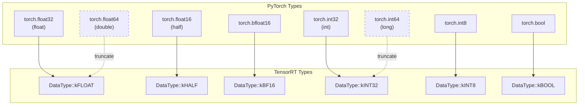
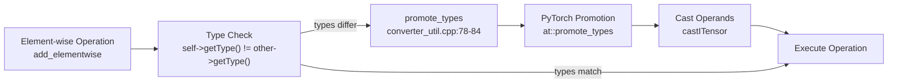
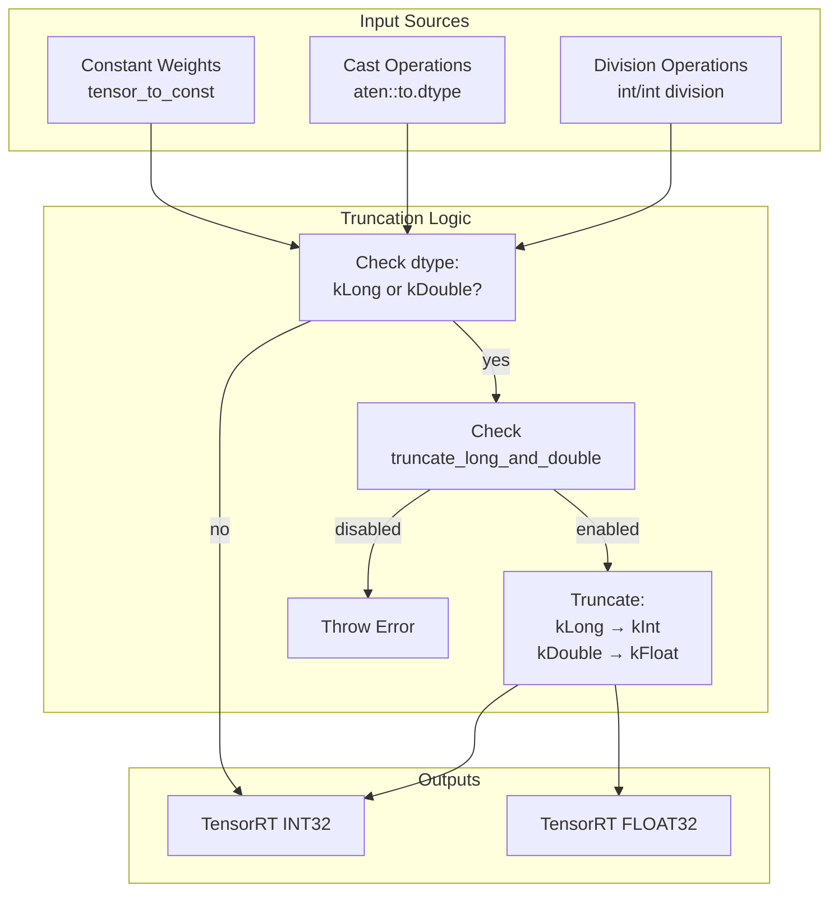
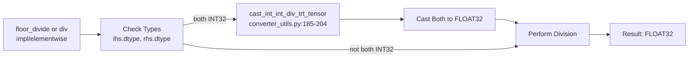
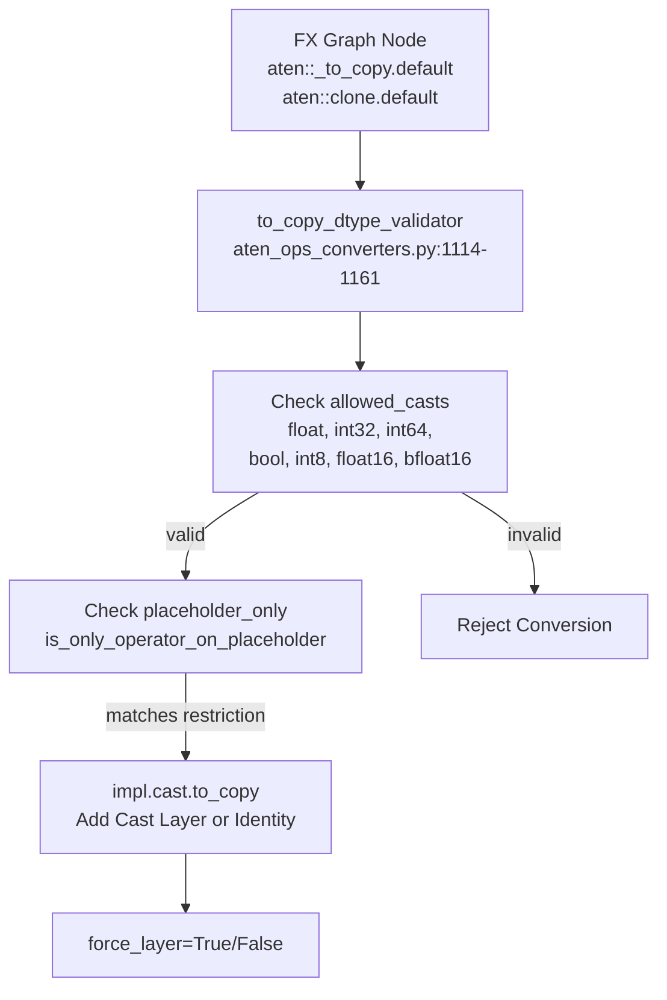

<!-- source: DeepWiki mcp.deepwiki.com · repo pytorch/TensorRT · page 5.6 Activation and Interpolation Operations · fetched 2026-10-21 -->

# Type Handling and Casting

<details>
<summary>Relevant source files</summary>

The following files were used as context for generating this wiki page:

- [core/conversion/converters/converters.h](core/conversion/converters/converters.h)
- [core/conversion/converters/impl/activation.cpp](core/conversion/converters/impl/activation.cpp)
- [core/conversion/converters/impl/internal_ops.cpp](core/conversion/converters/impl/internal_ops.cpp)
- [core/conversion/converters/impl/interpolate.cpp](core/conversion/converters/impl/interpolate.cpp)
- [core/conversion/converters/impl/lstm_cell.cpp](core/conversion/converters/impl/lstm_cell.cpp)
- [core/conversion/converters/impl/softmax.cpp](core/conversion/converters/impl/softmax.cpp)
- [core/conversion/converters/impl/unary.cpp](core/conversion/converters/impl/unary.cpp)
- [core/lowering/passes/unpack_scaled_dot_product_attention.cpp](core/lowering/passes/unpack_scaled_dot_product_attention.cpp)
- [tests/core/conversion/converters/test_activation.cpp](tests/core/conversion/converters/test_activation.cpp)
- [tests/core/conversion/converters/test_interpolate.cpp](tests/core/conversion/converters/test_interpolate.cpp)
- [tests/core/conversion/converters/test_lstm_cell.cpp](tests/core/conversion/converters/test_lstm_cell.cpp)
- [tests/core/conversion/converters/test_scaled_dot_product_attention.cpp](tests/core/conversion/converters/test_scaled_dot_product_attention.cpp)
- [tests/core/conversion/converters/test_softmax.cpp](tests/core/conversion/converters/test_softmax.cpp)
- [tests/core/conversion/converters/test_unary.cpp](tests/core/conversion/converters/test_unary.cpp)
- [tools/linter/utils.py](tools/linter/utils.py)

</details>


This page documents how Torch-TensorRT handles data type conversions between PyTorch and TensorRT, including type promotion rules, integer truncation strategies, boolean type handling, and explicit casting operations. These mechanisms ensure that PyTorch operations with various data types can be correctly mapped to TensorRT layers while respecting TensorRT's supported type constraints.

For information about how specific operations handle types during conversion, see [Operation Converter Implementation](#5). For precision mode configuration (FP32/FP16/INT8), see [Precision Modes](#2.4).

## Overview of Type Systems

PyTorch and TensorRT have different type systems and capabilities. PyTorch supports INT64 and FLOAT64, while TensorRT primarily operates on INT32, FLOAT32, FLOAT16, and INT8. This necessitates careful type mapping and truncation strategies.



**Diagram: PyTorch to TensorRT Type Mapping**

Sources: [py/torch_tensorrt/dynamo/conversion/converter_utils.py:146-183](), [core/conversion/converters/converter_util.cpp:78-84](), [core/conversion/converters/impl/cast.cpp:17-34]()

## Type Promotion in Element-Wise Operations

When element-wise operations encounter inputs with different types, the converter system automatically promotes both operands to a common type following PyTorch's type promotion rules.

### Dynamo Frontend Type Promotion

The Dynamo frontend uses `broadcast_to_same_shape` which internally handles type compatibility:

| Operation | Type A | Type B | Result Type | Action |
|-----------|--------|--------|-------------|--------|
| add/mul/sub | FLOAT32 | INT32 | FLOAT32 | Cast INT32 → FLOAT32 |
| add/mul/sub | INT32 | FLOAT32 | FLOAT32 | Cast INT32 → FLOAT32 |
| add/mul/sub | FLOAT32 | FLOAT32 | FLOAT32 | No cast needed |
| add/mul/sub | INT32 | INT32 | INT32 | No cast needed |

Sources: [py/torch_tensorrt/dynamo/conversion/converter_utils.py:235-296]()

### TorchScript Frontend Type Promotion

The TorchScript frontend implements `promote_types` which delegates to PyTorch's `at::promote_types`:



**Diagram: TorchScript Type Promotion Flow**

The `add_elementwise` function performs type promotion for all element-wise operations:

```
Input: self (FLOAT32), other (INT32)
→ promote_types(FLOAT32, INT32) = FLOAT32
→ castITensor(other, FLOAT32)
→ Execute element-wise operation
```

Sources: [core/conversion/converters/converter_util.cpp:78-84](), [core/conversion/converters/converter_util.cpp:86-173]()

## Integer Truncation and Long Type Handling

TensorRT does not natively support INT64 (kLong) or FLOAT64 (kDouble). The converter system provides configurable truncation strategies controlled by the `truncate_long_and_double` compilation setting.

### Truncation Locations



**Diagram: Integer and Double Truncation Flow**

### Constant Tensor Truncation

When freezing constant tensors (weights) into TensorRT constant layers:

```
tensor_to_const:
  if tensor.dtype == kLong and !truncate_long_and_double:
    throw error
  if tensor.dtype == kLong and truncate_long_and_double:
    tensor = tensor.toType(kInt)
    LOG_WARNING("Truncating from Int64 to Int32")
```

Sources: [core/conversion/converters/converter_util.cpp:241-289]()

### Cast Operation Truncation

For explicit `aten::to.dtype` cast operations:

```
aten::to.dtype converter:
  if output_dtype == kLong:
    LOG_WARNING("Truncating aten::to output type from at::kLong to at::kInt")
    trt_dtype = kINT32
```

Sources: [core/conversion/converters/impl/cast.cpp:17-34]()

## Integer Division Special Case

PyTorch automatically produces a float result for integer/integer division. Both frontends handle this by detecting int32/int32 division and casting both operands to float32 before the division operation.

### Dynamo Integer Division Handling



**Diagram: Dynamo Integer Division Casting**

Sources: [py/torch_tensorrt/dynamo/conversion/converter_utils.py:185-204]()

### TorchScript Integer Division Handling

```cpp
void cast_int_int_div_tensors(ConversionCtx* ctx, const torch::jit::Node* n,
                               nvinfer1::ITensor*& a, nvinfer1::ITensor*& b) {
  // Torch automatically produces a float for int/int division
  if (a->getType() == kINT32 && b->getType() == kINT32) {
    a = castITensor(ctx, a, kFLOAT, util::node_info(n) + "_a_cast");
    b = castITensor(ctx, b, kFLOAT, util::node_info(n) + "_b_cast");
  }
}
```

Sources: [core/conversion/converters/impl/element_wise.cpp:29-39](), [core/conversion/converters/impl/element_wise.cpp:322-400]()

## Boolean Type Handling

TensorRT has limited support for boolean operations. The converter system applies special handling for boolean types in several contexts.

### Boolean in Constant Tensors

When freezing boolean constants, the system temporarily converts to float, creates the constant layer, then casts back:

```
tensor_to_const (bool handling):
  if tensor.dtype == kBool:
    post_freeze_cast = true
    post_freeze_cast_type = kBOOL
    tensor = tensor.to(kFloat)  // Temporary conversion
  
  weights = Weights(ctx, tensor)
  const_layer = ctx->net->addConstant(weights.shape, weights.data)
  out = const_layer->getOutput(0)
  
  if post_freeze_cast:
    out = castITensor(ctx, out, post_freeze_cast_type)  // Cast back to BOOL
```

Sources: [core/conversion/converters/converter_util.cpp:241-289]()

### Boolean in Reduction Operations

Reduction operations (sum, any, all) do not work directly on boolean inputs in TensorRT. The system casts bool to INT32, performs the reduction, then casts back:

```cpp
nvinfer1::ITensor* anyDimImplementation(..., nvinfer1::ITensor* in_tensor, ...) {
  // Reduce does not work on bool inputs
  if (in_tensor->getType() == nvinfer1::DataType::kBOOL) {
    in_tensor = castITensor(ctx, in_tensor, nvinfer1::DataType::kINT32, 
                           (util::node_info(n) + "_in").c_str());
  }
  auto sum_layer = ctx->net->addReduce(*in_tensor, ReduceOperation::kSUM, 
                                       axis_mask, keepdim);
  
  auto out_tensor = castITensor(ctx, sum_layer->getOutput(0), 
                                nvinfer1::DataType::kBOOL, 
                                (util::node_info(n) + "_out").c_str());
  return out_tensor;
}
```

Sources: [core/conversion/converters/impl/reduce.cpp:12-40]()

### Boolean to Numeric Conversion

The `cast_int_or_float_to_bool` utility converts numeric types to boolean:

```python
def cast_int_or_float_to_bool(
    ctx: ConversionContext, name: str, tensor: TRTTensor
) -> TRTTensor:
    if tensor.dtype != trt.bool:
        return cast_trt_tensor(ctx, tensor, trt.bool, name)
    return tensor
```

Sources: [py/torch_tensorrt/dynamo/conversion/converter_utils.py:327-334]()

## Explicit Cast Operations

Both frontends provide converters for explicit PyTorch casting operations.

### Dynamo Cast Converters

The Dynamo frontend implements `aten::clone.default` and `aten::_to_copy.default` through the `to_copy` converter with validation:



**Diagram: Dynamo Cast Operation Validation and Conversion**

The validator distinguishes between two cases:
- **Placeholder operations**: When cast is the only operation on an input (force_layer=True to ensure TRT engine inputs ≠ outputs)
- **Non-placeholder operations**: General cast operations (force_layer=False for better performance)

Sources: [py/torch_tensorrt/dynamo/conversion/aten_ops_converters.py:1114-1220]()

### TorchScript Cast Converters

The TorchScript frontend provides converters for `aten::to.dtype` and `aten::to.device`:

| Converter | Signature | Behavior |
|-----------|-----------|----------|
| `aten::to.dtype` | `(Tensor, int dtype, bool, bool, int?)` | Cast to specified dtype with INT64 truncation |
| `aten::to.device` | `(Tensor, Device, int dtype, bool, bool, int?)` | Same as dtype variant (device ignored) |
| `aten::to.other` | `(Tensor, Tensor other, bool, bool, None)` | Cast to match other tensor's dtype |

The `aten::to.other` variant is created by the `ReduceToOperation` lowering pass which converts `aten::type_as` to `aten::to.other`.

Sources: [core/conversion/converters/impl/cast.cpp:14-95](), [core/lowering/passes/reduce_to.cpp:10-29]()

## Cast Utility Functions

Both frontends provide utility functions for adding cast layers to the TensorRT network.

### Dynamo Cast Utilities

| Function | Purpose | Location |
|----------|---------|----------|
| `cast_trt_tensor` | Add IIdentityCastLayer to cast ITensor to target dtype | [converter_utils.py:147-183]() |
| `cast_int_int_div_trt_tensor` | Cast both operands to FLOAT32 for int/int division | [converter_utils.py:185-204]() |
| `cast_int_or_float_to_bool` | Cast numeric tensor to boolean | [converter_utils.py:327-334]() |
| `to_trt_weights` | Convert PyTorch tensor to TensorRT weights with dtype handling | [converter_utils.py:336-404]() |

```python
def cast_trt_tensor(ctx: ConversionContext, input_val: TRTTensor,
                   dtype: Union[TRTDataType, torch.dtype, np.dtype, _enums.dtype],
                   name: str, target: Target = "", 
                   source_ir: Optional[SourceIR] = None) -> TRTTensor:
    trt_dtype = _enums.dtype._from(dtype).to(trt.DataType)
    
    if input_val.dtype != trt_dtype:
        cast_layer = ctx.net.add_cast(input_val, trt_dtype)
        cast_layer.name = f"Cast ITensor {input_val.name} from {input_val.dtype} to {trt_dtype}"
        return cast_layer.get_output(0)
    else:
        return input_val
```

Sources: [py/torch_tensorrt/dynamo/conversion/converter_utils.py:147-183]()

### TorchScript Cast Utilities

| Function | Purpose | Location |
|----------|---------|----------|
| `castITensor` | Add IIdentityCastLayer to cast ITensor to target dtype | [converter_util.cpp:214-239]() |
| `cast_int_int_div_tensors` | Cast both operands to FLOAT for int/int division | [element_wise.cpp:29-39]() |
| `promote_types` | Compute promoted type for two TensorRT types using PyTorch rules | [converter_util.cpp:78-84]() |
| `tensor_to_const` | Freeze PyTorch tensor to constant layer with type handling | [converter_util.cpp:241-289]() |

```cpp
nvinfer1::ITensor* castITensor(ConversionCtx* ctx, nvinfer1::ITensor* tensor,
                               nvinfer1::DataType dtype,
                               const std::string& layer_name_prefix) {
  if (tensor->getType() != dtype) {
    auto id_layer = ctx->net->addCast(*tensor, dtype);
    TORCHTRT_CHECK(id_layer, "Unable to create cast layer");
    
    auto casted_tensor = id_layer->getOutput(0);
    LOG_DEBUG(ctx->logger, "Casting ITensor from " << tensor->getType() 
              << " to " << dtype);
    
    std::stringstream ss;
    if (layer_name_prefix.size()) {
      ss << layer_name_prefix << " ";
    }
    ss << "[Cast ITensor from " << tensor->getType() << " to " << dtype << "]";
    id_layer->setName(ss.str().c_str());
    return casted_tensor;
  } else {
    return tensor;
  }
}
```

Sources: [core/conversion/converters/converter_util.cpp:214-239]()

## Type Handling in Specific Operations

Different operation categories have specialized type handling requirements.

### Embedding Operations

Embedding operations require indices to be INT32 in TensorRT. The converters automatically cast index tensors:

```cpp
// TorchScript aten::embedding converter
auto indicesTensor = args[1].ITensorOrFreeze(ctx);
// Set datatype for indices tensor to INT32
auto cast = ctx->net->addCast(*indicesTensor, nvinfer1::DataType::kINT32);
indicesTensor = cast->getOutput(0);

auto gather_layer = ctx->net->addGather(*embeddingTensor, *indicesTensor, 0);
```

Sources: [core/conversion/converters/impl/select.cpp:276-294]()

### Index and Gather Operations

Index and gather operations also enforce INT32 type for indices:

```python
# Dynamo aten::index.Tensor validator
def index_dtype_validator(node: Node, settings: Optional[CompilationSettings] = None) -> bool:
    index = node.args[1]
    for ind in index:
        if ind is not None:
            val = ind.meta.get("val")
            if val is not None and val.dtype not in (torch.int32, torch.int64, torch.bool):
                return False
    return True
```

Sources: [py/torch_tensorrt/dynamo/conversion/aten_ops_converters.py:449-462]()

### Shape Tensor Casting

Shape tensors must be INT32 in TensorRT. The `getShapeOutput` utility automatically casts shape outputs:

```cpp
nvinfer1::ITensor* getShapeOutput(ConversionCtx* ctx, 
                                 nvinfer1::ITensor* input_tensor, 
                                 const std::string& name) {
  nvinfer1::ITensor* input_shape = ctx->net->addShape(*input_tensor)->getOutput(0);
  input_shape = castITensor(ctx, input_shape, nvinfer1::DataType::kINT32, name);
  return input_shape;
}
```

Sources: [core/conversion/converters/converter_util.cpp:42-46]()

## Type Validation in Converters

Many converters use the `@enforce_tensor_types` decorator (Dynamo) or argument validation (TorchScript) to ensure input types are compatible before conversion.

### Dynamo Type Enforcement

```python
@enforce_tensor_types({
    0: (TRTTensor,),  # First argument must be TRTTensor
    1: (TRTTensor,),  # Second argument must be TRTTensor
})
def converter_function(ctx, target, args, kwargs, name):
    # Converter implementation
```

This decorator validates that specified argument indices are TensorRT tensors (not Python scalars or constants that need freezing).

Sources: [py/torch_tensorrt/dynamo/conversion/aten_ops_converters.py:71-75](), [py/torch_tensorrt/dynamo/conversion/aten_ops_converters.py:325-330]()

### Allowed Cast Types

The `to_copy_dtype_validator` defines the set of allowed target types for casting:

```python
allowed_casts = {
    torch.float,      # FLOAT32
    torch.int32,      # INT32
    torch.int64,      # INT64 (truncated to INT32)
    torch.bool,       # BOOL
    torch.int8,       # INT8
    torch.float16,    # FLOAT16/HALF
    torch.bfloat16,   # BFLOAT16
}
```

Attempts to cast to unsupported types (e.g., complex, uint) are rejected at the validation stage.

Sources: [py/torch_tensorrt/dynamo/conversion/aten_ops_converters.py:1124-1132]()

## Summary of Type Handling Strategies

| Scenario | Dynamo Frontend | TorchScript Frontend | Outcome |
|----------|----------------|---------------------|---------|
| Type promotion in element-wise ops | Implicit via TRT layer | `promote_types` + `castITensor` | Common type computed via PyTorch rules |
| INT64 → INT32 truncation | Controlled by `truncate_long_and_double` setting | Controlled by `truncate_long_and_double` setting | INT32 with warning or error |
| FLOAT64 → FLOAT32 truncation | Controlled by `truncate_long_and_double` setting | Controlled by `truncate_long_and_double` setting | FLOAT32 with warning or error |
| Boolean constants | Not explicitly handled | Cast to FLOAT, freeze, cast back to BOOL | Constant BOOL tensor |
| Boolean in reductions | Convert to INT via impl | Cast to INT32, reduce, cast to BOOL | Reduction result as BOOL |
| INT32/INT32 division | `cast_int_int_div_trt_tensor` | `cast_int_int_div_tensors` | FLOAT32 division result |
| Explicit casts | `to_copy` converter | `aten::to.dtype` converter | Cast layer in network |
| Index tensors | Validation + converter casting | Automatic cast to INT32 | INT32 indices |
| Shape tensors | `get_shape` with casting | `getShapeOutput` with casting | INT32 shape values |

Sources: [py/torch_tensorrt/dynamo/conversion/converter_utils.py:147-404](), [core/conversion/converters/converter_util.cpp:42-309](), [core/conversion/converters/impl/element_wise.cpp:29-39](), [core/conversion/converters/impl/reduce.cpp:12-40]()

---

