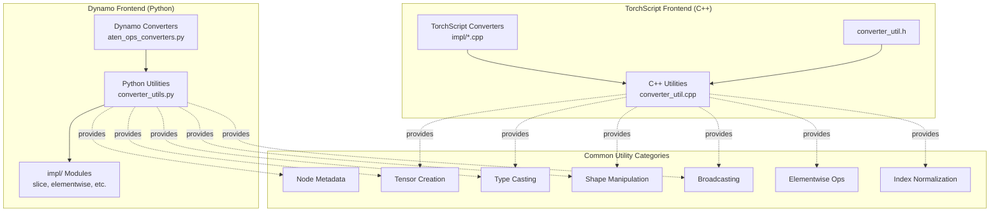
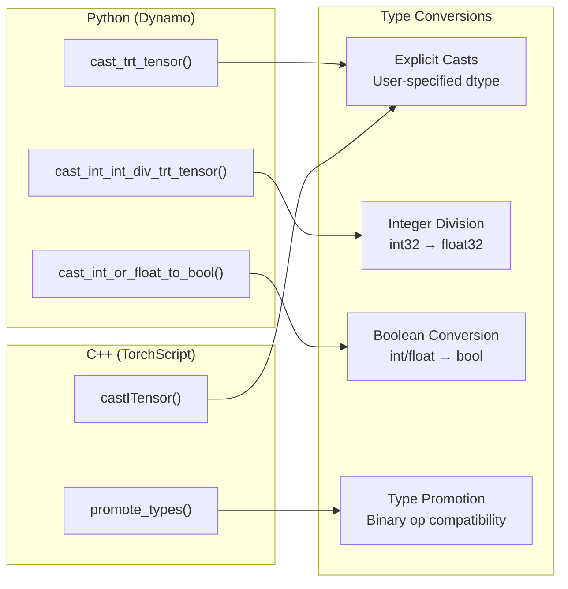
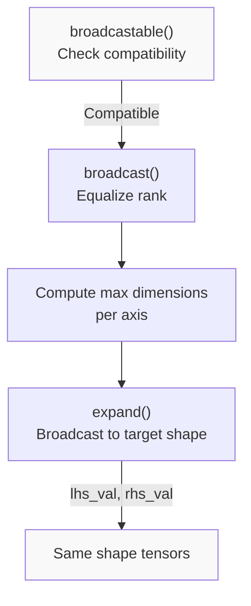
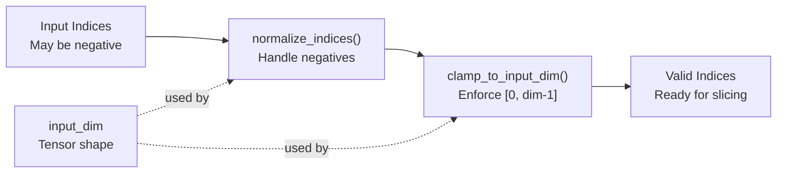

<!-- source: DeepWiki mcp.deepwiki.com · repo pytorch/TensorRT · page 5.7 Converter Utilities · fetched 2026-10-21 -->

# Converter Utilities

<details>
<summary>Relevant source files</summary>

The following files were used as context for generating this wiki page:

- [core/conversion/converters/Weights.cpp](core/conversion/converters/Weights.cpp)
- [core/conversion/converters/Weights.h](core/conversion/converters/Weights.h)
- [core/conversion/converters/converter_util.cpp](core/conversion/converters/converter_util.cpp)
- [core/conversion/converters/converter_util.h](core/conversion/converters/converter_util.h)
- [core/conversion/converters/impl/cast.cpp](core/conversion/converters/impl/cast.cpp)
- [core/conversion/converters/impl/quantization.cpp](core/conversion/converters/impl/quantization.cpp)
- [core/conversion/converters/impl/select.cpp](core/conversion/converters/impl/select.cpp)
- [core/conversion/converters/impl/shuffle.cpp](core/conversion/converters/impl/shuffle.cpp)
- [core/conversion/converters/impl/squeeze.cpp](core/conversion/converters/impl/squeeze.cpp)
- [core/conversion/converters/impl/unsqueeze.cpp](core/conversion/converters/impl/unsqueeze.cpp)
- [core/conversion/var/BUILD](core/conversion/var/BUILD)
- [core/conversion/var/Var.cpp](core/conversion/var/Var.cpp)
- [core/conversion/var/Var.h](core/conversion/var/Var.h)
- [core/conversion/var/Var_inl.h](core/conversion/var/Var_inl.h)
- [core/lowering/passes/reduce_to.cpp](core/lowering/passes/reduce_to.cpp)
- [core/lowering/passes/remove_nops.cpp](core/lowering/passes/remove_nops.cpp)
- [core/util/trt_util.cpp](core/util/trt_util.cpp)
- [core/util/trt_util.h](core/util/trt_util.h)
- [tests/core/conversion/converters/test_cast.cpp](tests/core/conversion/converters/test_cast.cpp)
- [tests/core/conversion/converters/test_quantization.cpp](tests/core/conversion/converters/test_quantization.cpp)
- [tests/core/conversion/converters/test_select.cpp](tests/core/conversion/converters/test_select.cpp)
- [tests/core/conversion/converters/test_shuffle.cpp](tests/core/conversion/converters/test_shuffle.cpp)
- [tests/core/conversion/converters/test_squeeze.cpp](tests/core/conversion/converters/test_squeeze.cpp)
- [tests/core/conversion/converters/test_unsqueeze.cpp](tests/core/conversion/converters/test_unsqueeze.cpp)
- [tests/core/lowering/test_reduce_to_pass.cpp](tests/core/lowering/test_reduce_to_pass.cpp)
- [tests/cpp/test_dynamic_size.cpp](tests/cpp/test_dynamic_size.cpp)

</details>


This page documents shared utility functions used across operation converters in both the Dynamo (Python) and TorchScript (C++) frontends. These utilities provide common functionality for tensor creation, type casting, shape manipulation, broadcasting, and element-wise operations. For information about specific operation converters, see [Tensor Manipulation Operations](#5.1), [Element-wise Operations](#5.2), [Reduction Operations](#5.3), [Convolution and Pooling](#5.4), and [Normalization Operations](#5.5). For type handling strategies, see [Type Handling and Casting](#5.6).

## Utility Architecture

The converter utility system is organized into two parallel implementations: Python utilities for the Dynamo frontend and C++ utilities for the TorchScript frontend. Both provide similar functionality but operate on different graph representations.



**Sources:** [py/torch_tensorrt/dynamo/conversion/converter_utils.py:1-50](), [core/conversion/converters/converter_util.h:1-110](), [core/conversion/converters/converter_util.cpp:1-50]()

## Node Metadata and Introspection (Dynamo)

The Dynamo frontend provides utilities for extracting metadata from FX graph nodes, which is essential for debugging and layer naming.

### get_node_name

```python
def get_node_name(node: torch.fx.Node) -> str
```

Extracts a hierarchical name for an FX node by examining its `nn_module_stack` metadata. This preserves the call stack of PyTorch `nn.Module` instances, showing exactly where the module is located in the network architecture.

**Implementation:** [py/torch_tensorrt/dynamo/conversion/converter_utils.py:39-56]()

**Usage Pattern:**
- Falls back to `node.meta['source_fn']` if `nn_module_stack` is unavailable
- Used for layer naming in TensorRT network construction
- Format: `"ModuleName/node_name"` or just `"node_name"`

### get_node_io

```python
def get_node_io(
    node: torch.fx.Node, 
    constant_mapping: Dict[str, Tuple[Sequence[int], str]]
) -> str
```

Generates a formatted string representing node inputs and outputs, including tensor shapes and dtypes. Handles various metadata types including `TensorMetadata`, scalars, `SymInt`, and sequences.

**Implementation:** [py/torch_tensorrt/dynamo/conversion/converter_utils.py:59-128]()

**Output Format:**
```
Inputs: (arg1: (shape)@dtype, arg2: value@type) | Outputs: (output: (shape)@dtype)
```

### is_only_operator_on_placeholder

```python
def is_only_operator_on_placeholder(
    node: torch.fx.Node, 
    settings: CompilationSettings = None
) -> bool
```

Detects whether a `call_function` node operates directly on a placeholder (input) and is a direct output. Used to determine when cast operations are necessary to prevent TRT engine inputs from also being outputs.

**Implementation:** [py/torch_tensorrt/dynamo/conversion/converter_utils.py:131-144]()

**Sources:** [py/torch_tensorrt/dynamo/conversion/converter_utils.py:39-144]()

## Tensor Creation and Conversion

### create_constant (Python)

```python
def create_constant(
    ctx: ConversionContext,
    value: Union[int, float, bool, np.ndarray, torch.Tensor],
    name: str,
    dtype: Optional[Union[torch.dtype, np.dtype, TRTDataType, _enums.dtype]],
    min_rank: Optional[int] = 1,
    target_quantized_type: Optional[TRTDataType] = None,
) -> TRTTensor
```

Creates a TensorRT constant layer from a literal value, NumPy array, or PyTorch tensor. Handles dtype conversion, rank constraints, and special cases like FP4 quantization.

**Key Features:**
- Converts values to `torch.Tensor` via `to_torch()` helper
- Supports rank-0 constants for `IFillLayer` inputs
- Handles FP4 quantization (TensorRT 10.8.0+) by packing in uint8
- Records weights in context for refitting and memory management
- Validates against unsupported float64

**Implementation:** [py/torch_tensorrt/dynamo/conversion/converter_utils.py:407-489]()

### get_trt_tensor (Python)

```python
def get_trt_tensor(
    ctx: ConversionContext,
    input_val: Any,
    name: str,
    dtype: Optional[Union[torch.dtype, np.dtype, TRTDataType, _enums.dtype]] = None,
    min_rank: int = 1,
    target_quantized_type: Optional[TRTDataType] = None,
) -> TRTTensor
```

Converts arbitrary values to TensorRT ITensors. If the input is already an ITensor, returns it unchanged. Otherwise, calls `create_constant()` to freeze the value. Handles truncation of float64 to float32 if configured.

**Implementation:** [py/torch_tensorrt/dynamo/conversion/converter_utils.py:492-584]()

### to_trt_weights (Python)

```python
def to_trt_weights(
    ctx: ConversionContext,
    value: torch.Tensor,
    name: str,
    layer_type_name: Literal["CONVOLUTION", "DECONVOLUTION", "CONSTANT", "SCALE"],
    weight_type_name: Literal["KERNEL", "BIAS", "CONSTANT", "SCALE", "SHIFT", "POWER"],
    target: Optional[Union[Target, str]] = None,
    source_ir: Optional[SourceIR] = None,
    target_quantized_type: Optional[trt.DataType] = None,
    dtype: Optional[trt.DataType] = None,
    count: Optional[int] = None,
) -> trt.Weights
```

Converts a PyTorch tensor to TensorRT weights object. Records the weight in the conversion context for refitting support and memory management.

**Weight Naming Convention:**
- For constants: `"{name} CONSTANT"`
- For other layers: `"[{layer_type}]-[{source_ir}_ops.{target}]-[{name}] {weight_type}"`

**Implementation:** [py/torch_tensorrt/dynamo/conversion/converter_utils.py:336-404]()

### tensor_to_const (C++)

```cpp
nvinfer1::ITensor* tensor_to_const(
    ConversionCtx* ctx, 
    at::Tensor t, 
    const std::string& name = std::string()
)
```

Freezes an `at::Tensor` into a TensorRT `IConstantLayer`. Handles type conversions including:
- Bool tensors: Cast to float for freezing, then cast back post-freeze
- INT64: Truncate to INT32 if `truncate_long_and_double` enabled (with warning)
- Float64: Truncate to Float32 if `truncate_long_and_double` enabled (with warning)

**Implementation:** [core/conversion/converters/converter_util.cpp:241-289]()

**Sources:** [py/torch_tensorrt/dynamo/conversion/converter_utils.py:336-584](), [core/conversion/converters/converter_util.cpp:241-289]()

## Type Casting and Promotion



### cast_trt_tensor (Python)

```python
def cast_trt_tensor(
    ctx: ConversionContext,
    input_val: TRTTensor,
    dtype: Union[TRTDataType, torch.dtype, np.dtype, _enums.dtype],
    name: str,
    target: Target = "",
    source_ir: Optional[SourceIR] = None,
) -> TRTTensor
```

Casts a TRT tensor to the specified dtype by adding an `ICastLayer`. Returns the input unchanged if it already has the desired dtype. Automatically converts dtype formats using `_enums.dtype._from()`.

**Implementation:** [py/torch_tensorrt/dynamo/conversion/converter_utils.py:147-182]()

### cast_int_int_div_trt_tensor (Python)

```python
def cast_int_int_div_trt_tensor(
    ctx: ConversionContext,
    lhs_val: TRTTensor,
    rhs_val: TRTTensor,
    name: str,
) -> List[TRTTensor]
```

Special casting for integer division operations. If both operands are INT32, casts both to FLOAT32 to enable proper division semantics (TensorRT integer division differs from PyTorch).

**Implementation:** [py/torch_tensorrt/dynamo/conversion/converter_utils.py:185-204]()

### cast_int_or_float_to_bool (Python)

```python
def cast_int_or_float_to_bool(
    ctx: ConversionContext, 
    name: str, 
    tensor: TRTTensor
) -> TRTTensor
```

Ensures a tensor has bool dtype, adding a cast if necessary. Used for condition tensors in control flow operations.

**Implementation:** [py/torch_tensorrt/dynamo/conversion/converter_utils.py:327-333]()

### castITensor (C++)

```cpp
nvinfer1::ITensor* castITensor(
    ConversionCtx* ctx,
    nvinfer1::ITensor* tensor,
    nvinfer1::DataType dtype,
    const std::string& layer_name_prefix = ""
)
```

C++ equivalent of `cast_trt_tensor()`. Adds an `ICastLayer` only if the tensor dtype differs from the target dtype. Logs the cast operation for debugging.

**Implementation:** [core/conversion/converters/converter_util.cpp:214-239]()

### promote_types (C++)

```cpp
nvinfer1::DataType promote_types(
    nvinfer1::DataType type_a, 
    nvinfer1::DataType type_b
)
```

Determines the promoted type for binary operations by converting TRT types to PyTorch scalar types, applying PyTorch's `at::promote_types()`, then converting back to TRT types.

**Implementation:** [core/conversion/converters/converter_util.cpp:78-84]()

**Sources:** [py/torch_tensorrt/dynamo/conversion/converter_utils.py:147-333](), [core/conversion/converters/converter_util.cpp:78-239]()

## Shape Manipulation

Shape manipulation utilities handle dimension padding, unpadding, and shape extraction, which are essential for normalizing tensor ranks across operations.

### addPadding (C++)

```cpp
nvinfer1::ITensor* addPadding(
    ConversionCtx* ctx,
    const torch::jit::Node* n,
    nvinfer1::ITensor* tensor,
    int nDim,
    bool trailing = true,
    bool use_zeros = true,
    const std::string& name = ""
)
```

Adds dimensions of size 1 to a tensor until it reaches `nDim` dimensions. Padding is added at the end (trailing) or beginning based on the `trailing` parameter. The `use_zeros` parameter controls whether to use 0 or -1 in the shape specification.

**Use Cases:**
- Normalizing convolution inputs to 4D (NCHW)
- Preparing tensors for broadcasting operations
- Ensuring minimum rank requirements for TensorRT layers

**Implementation:** [core/conversion/converters/converter_util.cpp:10-40]()

### addUnpadding (C++)

```cpp
nvinfer1::ITensor* addUnpadding(
    ConversionCtx* ctx,
    const torch::jit::Node* n,
    nvinfer1::ITensor* tensor,
    int nDim,
    bool trailing = true,
    bool use_zeros = true,
    const std::string& name = ""
)
```

Inverse of `addPadding()`. Removes dimensions from a tensor until it reaches `nDim` dimensions by squeezing from the end or beginning.

**Implementation:** [core/conversion/converters/converter_util.cpp:48-76]()

### getShapeOutput (C++)

```cpp
nvinfer1::ITensor* getShapeOutput(
    ConversionCtx* ctx, 
    nvinfer1::ITensor* input_tensor, 
    const std::string& name = ""
)
```

Extracts the shape of an input tensor as an INT32 ITensor using `IShapeLayer`. The result is a 1D tensor containing the dimensions of the input.

**Implementation:** [core/conversion/converters/converter_util.cpp:42-46]()

### extend_attr_to_tuple (Python)

```python
def extend_attr_to_tuple(
    val: Any,
    num_elem: int,
) -> Tuple[Any, ...]
```

Extends a single value or 1-element tuple/list to a tuple of length `num_elem` by replication. Used to normalize operation attributes like stride, padding, and dilation.

**Examples:**
- `extend_attr_to_tuple(3, 2)` → `(3, 3)`
- `extend_attr_to_tuple([2], 3)` → `(2, 2, 2)`
- `extend_attr_to_tuple((1, 2), 2)` → `(1, 2)`

**Implementation:** [py/torch_tensorrt/dynamo/conversion/converter_utils.py:299-324]()

**Sources:** [core/conversion/converters/converter_util.cpp:10-76](), [core/conversion/converters/converter_util.h:16-66](), [py/torch_tensorrt/dynamo/conversion/converter_utils.py:299-324]()

## Broadcasting and Dimension Handling

Broadcasting utilities ensure that tensors have compatible shapes for element-wise operations.

### broadcastable (Python)

```python
def broadcastable(
    a: Union[TRTTensor, np.ndarray], 
    b: Union[TRTTensor, np.ndarray]
) -> bool
```

Checks if two tensors are broadcastable according to PyTorch/NumPy broadcasting rules:
1. Tensors with equal rank and shape are broadcastable
2. After left-padding shorter tensor with 1s, each dimension must satisfy: `a[i] == b[i]` or `a[i] == 1` or `b[i] == 1`

**Implementation:** [py/torch_tensorrt/dynamo/conversion/converter_utils.py:207-232]()

### broadcast_to_same_shape (Python)

```python
def broadcast_to_same_shape(
    ctx: ConversionContext,
    target: Target,
    source_ir: Optional[SourceIR],
    name: str,
    lhs_val: TRTTensor,
    rhs_val: TRTTensor,
) -> Tuple[TRTTensor, TRTTensor]
```

Broadcasts two ITensors to the same shape. Unlike `broadcast()` which only equalizes rank, this function ensures both tensors have identical shapes by:
1. First calling `broadcast()` to equalize rank
2. Computing element-wise max dimensions
3. Using `impl.slice.expand()` to expand each tensor to the target shape

**Example:**
- Input: `lhs: (2, 3)`, `rhs: (2, 2, 1, 3)`
- After rank equalization: `lhs: (1, 1, 2, 3)`, `rhs: (2, 2, 1, 3)`
- After shape broadcast: `lhs: (2, 2, 2, 3)`, `rhs: (2, 2, 2, 3)`

**Implementation:** [py/torch_tensorrt/dynamo/conversion/converter_utils.py:235-296]()



**Sources:** [py/torch_tensorrt/dynamo/conversion/converter_utils.py:207-296]()

## Elementwise Operations (C++)

The C++ utilities provide helpers for creating elementwise operations with automatic type promotion and broadcasting.

### add_elementwise

```cpp
nvinfer1::ILayer* add_elementwise(
    ConversionCtx* ctx,
    nvinfer1::ElementWiseOperation op,
    nvinfer1::ITensor* self,
    nvinfer1::ITensor* other,
    const std::string& name
)
```

Creates an `IElementWiseLayer` with automatic handling of:

**Type Compatibility:**
- Casts FLOAT ↔ INT32 mismatches to the non-integer type
- Applies type promotion for other mismatches using `promote_types()`

**Rank Normalization:**
- Ensures `self` has rank ≥ `other` (swaps if necessary)
- For static shapes: Pads smaller tensor with `toDimsPad()`
- For dynamic shapes: Builds shape tensor at runtime and reshapes

**Implementation:** [core/conversion/converters/converter_util.cpp:86-173]()

**Dynamic Shape Handling:**
```cpp
// Example for other with dynamic shape (-1 dimensions)
auto selfShape = getShapeOutput(ctx, self);
// Compute dynamic dimensions from self, static from mask
auto otherDynamicShape = selfShape * otherDynamicShapeMask;
auto targetOtherShape = otherDynamicShape + otherStaticShapeMask;
// Reshape other to match
auto otherShuffle = ctx->net->addShuffle(*other);
otherShuffle->setInput(1, *targetOtherShape);
```

### add_abs

```cpp
nvinfer1::ITensor* add_abs(
    ConversionCtx* ctx,
    const torch::jit::Node* n,
    nvinfer1::ITensor* self,
    const std::string& name
)
```

Creates absolute value operation. Uses `IUnaryLayer::kABS` for supported types (FLOAT, HALF, INT8). For unsupported types (INT32, etc.), implements as `max(x, -x)` using `add_elementwise()`.

**Implementation:** [core/conversion/converters/converter_util.cpp:175-205]()

**Sources:** [core/conversion/converters/converter_util.cpp:86-205]()

## Index and Range Normalization (C++)

These utilities handle negative indices and boundary conditions for slicing operations.

### normalize_indices

```cpp
nvinfer1::ITensor* normalize_indices(
    ConversionCtx* ctx,
    nvinfer1::ITensor* input_dim,
    nvinfer1::ITensor* indices,
    int nbdims,
    std::string const& name
)
```

Converts negative indices to positive by adding the dimension size. Implements: `indices < 0 ? inputDims + indices : indices`

**Algorithm:**
```cpp
// Clamp indices to [-1, 0] to identify negative indices
auto signs = clamp(indices, neg_one, zero);
// Multiply input_dim by signs (0 where positive, input_dim where -1)
auto mul = signs * input_dim;
// Subtract to handle negatives
auto result = indices - mul;
```

**Implementation:** [core/conversion/converters/converter_util.cpp:343-367]()

### normalize_start_and_end

```cpp
std::vector<nvinfer1::ITensor*> normalize_start_and_end(
    ConversionCtx* ctx,
    nvinfer1::ITensor* in_shape,
    nvinfer1::ITensor* in_start,
    nvinfer1::ITensor* in_end,
    int nbdims,
    std::string const& name
)
```

Normalizes slice start/end parameters by:
1. Converting negative indices using `normalize_indices()`
2. Clamping to valid range `[0, dim_size]` using `clamp_to_input_dim()`

Returns a vector containing `[normalized_start, normalized_end]`.

**Implementation:** [core/conversion/converters/converter_util.cpp:369-382]()

### clamp and clamp_to_input_dim

```cpp
nvinfer1::ITensor* clamp(
    ConversionCtx* ctx,
    nvinfer1::ITensor* x,
    nvinfer1::ITensor* lower_bound,
    nvinfer1::ITensor* upper_bound,
    std::string const& name
)

nvinfer1::ITensor* clamp_to_input_dim(
    ConversionCtx* ctx,
    nvinfer1::ITensor* x,
    nvinfer1::ITensor* input_dim,
    int nbdims,
    std::string const& name
)
```

- `clamp()`: Implements `max(lower_bound, min(x, upper_bound))`
- `clamp_to_input_dim()`: Clamps to `[0, input_dim - 1]` by constructing bounds as tensors

**Implementation:** [core/conversion/converters/converter_util.cpp:292-340]()



**Sources:** [core/conversion/converters/converter_util.cpp:292-382](), [core/conversion/converters/converter_util.h:71-98]()

## Identity Operations (C++)

### applyIdentityOp

```cpp
nvinfer1::ITensor* applyIdentityOp(
    ConversionCtx* ctx, 
    nvinfer1::ITensor* tensor, 
    const std::string& tensor_name
)
```

Adds an `IIdentityLayer` to the network, which passes the input through unchanged. Used when a tensor needs to be explicitly marked in the network, such as when an input tensor is also used as an output (TensorRT requires engine inputs and outputs to be distinct).

**Use Cases:**
- Preventing input tensors from being directly used as outputs
- Creating explicit copies for debugging
- Enforcing layer boundaries in the network

**Implementation:** [core/conversion/converters/converter_util.cpp:207-212]()

**Sources:** [core/conversion/converters/converter_util.cpp:207-212]()

## Utility Function Reference Table

| Function | Frontend | Purpose | Key Use Cases |
|----------|----------|---------|---------------|
| `get_node_name()` | Python | Extract hierarchical node name | Layer naming, debugging |
| `get_node_io()` | Python | Format node I/O metadata | Graph visualization, debugging |
| `create_constant()` | Python | Create TRT constant layer | Freezing weights, creating scalar constants |
| `get_trt_tensor()` | Python | Convert value to TRT tensor | Input normalization, constant handling |
| `to_trt_weights()` | Python | Convert to TRT weights | Conv/deconv kernels, bias terms |
| `tensor_to_const()` | C++ | Freeze tensor to constant | Weight freezing, TorchScript constants |
| `cast_trt_tensor()` | Python | Cast tensor dtype | Type compatibility, precision conversion |
| `castITensor()` | C++ | Cast ITensor dtype | Type compatibility, TorchScript ops |
| `promote_types()` | C++ | Determine promoted type | Binary operation type resolution |
| `addPadding()` | C++ | Add dimensions | Rank normalization for convolutions |
| `addUnpadding()` | C++ | Remove dimensions | Rank reduction after operations |
| `getShapeOutput()` | C++ | Extract shape as tensor | Dynamic shape operations, reshaping |
| `extend_attr_to_tuple()` | Python | Normalize attributes | Stride, padding, dilation handling |
| `broadcastable()` | Python | Check broadcast compatibility | Input validation |
| `broadcast_to_same_shape()` | Python | Broadcast to same shape | Elementwise op preparation |
| `add_elementwise()` | C++ | Create elementwise layer | Binary operations with type promotion |
| `add_abs()` | C++ | Create abs operation | Absolute value with fallback |
| `normalize_indices()` | C++ | Convert negative indices | Slicing, indexing operations |
| `clamp()` | C++ | Clamp values to range | Boundary enforcement |
| `applyIdentityOp()` | C++ | Add identity layer | Input/output separation |

**Sources:** [py/torch_tensorrt/dynamo/conversion/converter_utils.py:1-900](), [core/conversion/converters/converter_util.cpp:1-500](), [core/conversion/converters/converter_util.h:1-110]()

---

