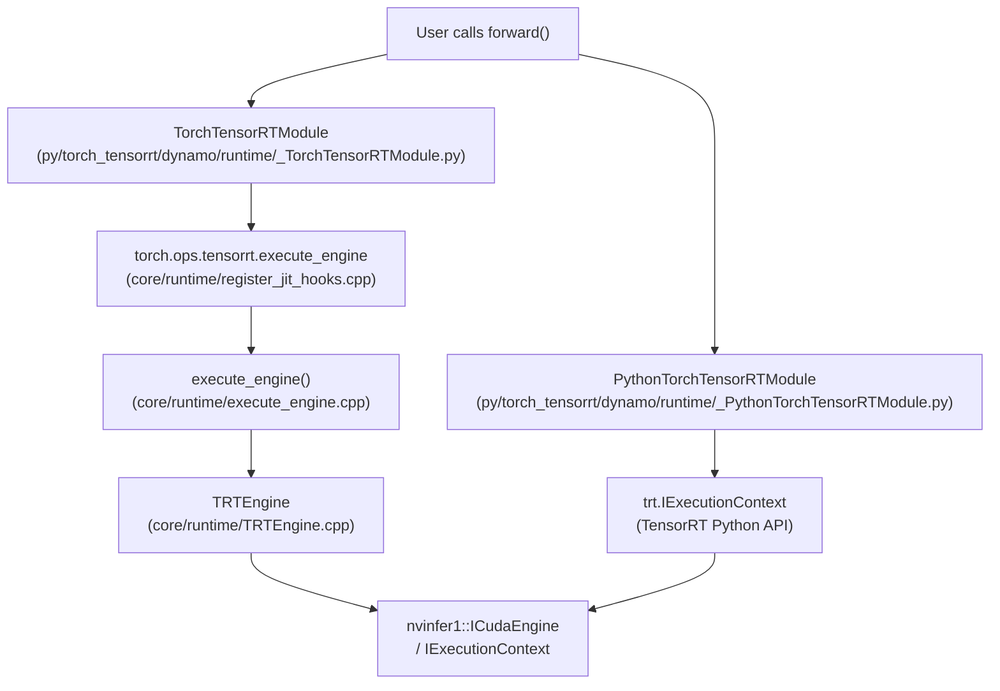
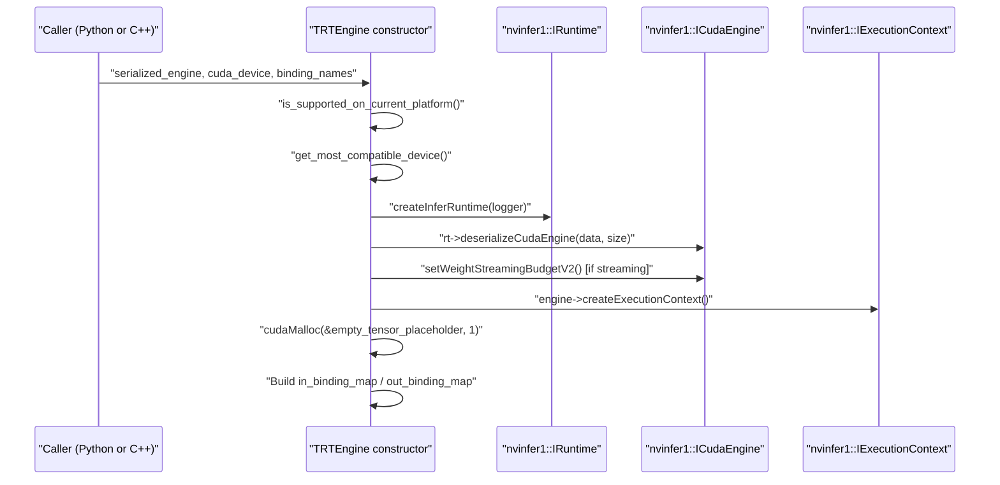
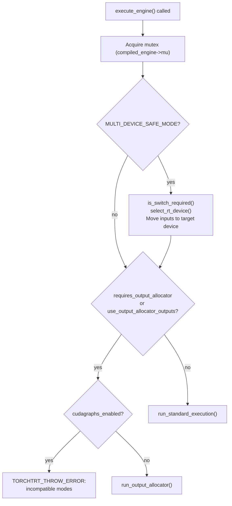
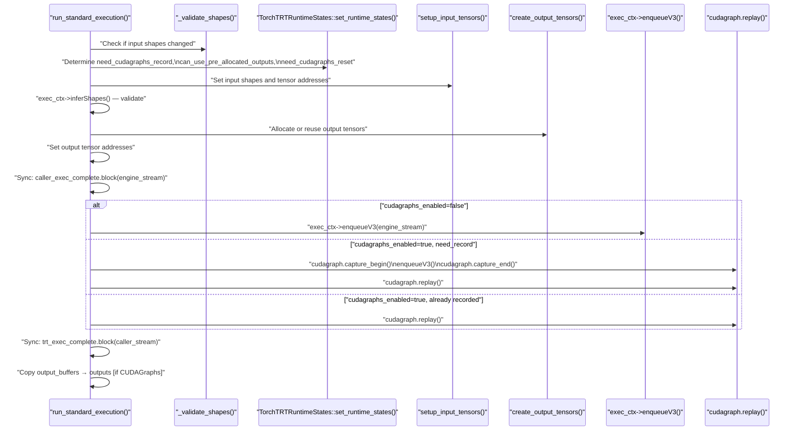

<!-- source: DeepWiki mcp.deepwiki.com · repo pytorch/TensorRT · page 6 Runtime and Engine Execution · fetched 2026-10-21 -->

# Runtime and Engine Execution

<details>
<summary>Relevant source files</summary>

The following files were used as context for generating this wiki page:

- [core/runtime/DeviceList.cpp](core/runtime/DeviceList.cpp)
- [core/runtime/TRTEngine.cpp](core/runtime/TRTEngine.cpp)
- [core/runtime/TRTEngine.h](core/runtime/TRTEngine.h)
- [core/runtime/execute_engine.cpp](core/runtime/execute_engine.cpp)
- [core/runtime/register_jit_hooks.cpp](core/runtime/register_jit_hooks.cpp)
- [core/runtime/runtime.cpp](core/runtime/runtime.cpp)
- [core/runtime/runtime.h](core/runtime/runtime.h)
- [docsrc/user_guide/runtime.rst](docsrc/user_guide/runtime.rst)
- [py/torch_tensorrt/dynamo/runtime/_PythonTorchTensorRTModule.py](py/torch_tensorrt/dynamo/runtime/_PythonTorchTensorRTModule.py)
- [py/torch_tensorrt/dynamo/runtime/_TorchTensorRTModule.py](py/torch_tensorrt/dynamo/runtime/_TorchTensorRTModule.py)
- [py/torch_tensorrt/dynamo/runtime/__init__.py](py/torch_tensorrt/dynamo/runtime/__init__.py)
- [py/torch_tensorrt/runtime/__init__.py](py/torch_tensorrt/runtime/__init__.py)

</details>


This section covers how serialized TensorRT engines are loaded, instantiated, and executed at inference time. It describes the C++ `TRTEngine` class, the two Python module wrappers (`PythonTorchTensorRTModule` and `TorchTensorRTModule`), and the execution modes available at runtime (standard, CUDA Graphs, Dynamic Output Allocator).

For how engines are *built* from FX graphs, see the Dynamo frontend documentation ([3](#3)). For engine caching and weight refitting across sessions, see [3.5](#3.5).

---

## Overview

When a model is compiled with Torch-TensorRT, the result is one or more serialized TensorRT engines embedded inside a `torch.nn.Module`. At inference time, this module delegates execution to one of two runtime paths:

- **`TorchTensorRTModule`** — uses the C++ Torch-TensorRT runtime (`libtorchtrt_runtime.so`) via a registered custom op, and is compatible with TorchScript and AOT-Inductor deployment.
- **`PythonTorchTensorRTModule`** — uses the TensorRT Python APIs directly, and supports Python-only (Dynamo / FX) deployments.

Both wrappers manage the same underlying concerns: engine deserialization, input/output binding, CUDA stream coordination, and optional acceleration via CUDA Graphs.

**Runtime component layout:**



Sources: [py/torch_tensorrt/dynamo/runtime/__init__.py](), [py/torch_tensorrt/runtime/__init__.py](), [core/runtime/register_jit_hooks.cpp:123-177](), [core/runtime/execute_engine.cpp:211-557]()

---

## The `TRTEngine` C++ Class

`TRTEngine` ([core/runtime/TRTEngine.h:101-220]()) is the central C++ object that holds all state for a running TensorRT engine. It is registered as a TorchScript custom class (`torch.classes.tensorrt.Engine`) so it can be embedded in traced modules and serialized.

### Key Fields

| Field | Type | Purpose |
|---|---|---|
| `rt` | `shared_ptr<nvinfer1::IRuntime>` | TensorRT runtime used for deserialization |
| `cuda_engine` | `shared_ptr<nvinfer1::ICudaEngine>` | The deserialized TRT engine |
| `exec_ctx` | `shared_ptr<nvinfer1::IExecutionContext>` | Per-inference execution context |
| `in_binding_map` / `out_binding_map` | `unordered_map<uint64_t, uint64_t>` | TRT tensor index → PyTorch index mappings |
| `in_binding_names` / `out_binding_names` | `vector<string>` | Ordered binding name lists |
| `num_io` | `pair<uint64_t, uint64_t>` | Count of (inputs, outputs) |
| `cudagraph` | `at::cuda::CUDAGraph` | Captured CUDA graph for replay |
| `engine_stream` / `caller_stream` | `at::cuda::CUDAStream` | CUDA stream management |
| `output_allocator` | `shared_ptr<DynamicOutputAllocator>` | Dynamic output allocation for data-dependent shapes |
| `resource_allocation_strategy` | `ResourceAllocationStrategy` | Static or dynamic device memory allocation |
| `mu` | `mutex` | Guards `enqueueV3` calls (not thread-safe in TRT) |

Sources: [core/runtime/TRTEngine.h:101-220]()

### Construction and Deserialization

The constructor ([core/runtime/TRTEngine.cpp:56-264]()) performs the following steps:

1. Validates that the engine's target platform matches the current platform.
2. Finds the most compatible CUDA device via `get_most_compatible_device`.
3. Calls `nvinfer1::createInferRuntime` and `rt->deserializeCudaEngine`.
4. Applies any weight streaming budget if configured.
5. Creates the `IExecutionContext` — using `kUSER_MANAGED` allocation if dynamic resource allocation is enabled, otherwise default static allocation.
6. Pre-allocates a 1-byte placeholder (`empty_tensor_placeholder`) for empty tensor inputs (TensorRT requires non-null addresses).
7. Builds `in_binding_map` / `out_binding_map` from binding names.

**TRTEngine initialization flow:**



Sources: [core/runtime/TRTEngine.cpp:93-264]()

### Serialization Format

`TRTEngine` serializes to a `vector<string>` indexed by the `SerializedInfoIndex` enum:

| Index | Field | Description |
|---|---|---|
| `ABI_TARGET_IDX` (0) | ABI version | Checked on load to detect incompatible versions |
| `NAME_IDX` (1) | Module name | Slugified name |
| `DEVICE_IDX` (2) | Device info | Serialized `RTDevice` |
| `ENGINE_IDX` (3) | Engine bytes | Base64-encoded serialized TRT engine |
| `INPUT_BINDING_NAMES_IDX` (4) | Input names | `%`-delimited binding names |
| `OUTPUT_BINDING_NAMES_IDX` (5) | Output names | `%`-delimited binding names |
| `HW_COMPATIBLE_IDX` (6) | HW compatibility | `"0"` or `"1"` |
| `SERIALIZED_METADATA_IDX` (7) | Metadata | Base64 pkl of `CompilationSettings` + weight map |
| `TARGET_PLATFORM_IDX` (8) | Platform | Serialized `Platform` |
| `REQUIRES_OUTPUT_ALLOCATOR_IDX` (9) | OA required | `"0"` or `"1"` |
| `RESOURCE_ALLOCATION_STRATEGY_IDX` (10) | Alloc strategy | `"0"` (static) or `"1"` (dynamic) |

The `verify_serialization_fmt` static method ([core/runtime/TRTEngine.cpp:448-457]()) checks that the ABI version matches before deserialization.

Sources: [core/runtime/runtime.h:31-43](), [core/runtime/TRTEngine.cpp:477-501](), [core/runtime/register_jit_hooks.cpp:111-121]()

### Resource Allocation Strategy

`TRTEngine` supports two modes for GPU memory allocation, controlled by `ResourceAllocationStrategy`:

- **`kStatic`** (default): The execution context pre-allocates all device memory at creation time using the standard `createExecutionContext()`.
- **`kDynamic`**: The context is created with `kUSER_MANAGED`, and `execute_engine` manually allocates a workspace tensor (`torch::empty(cuda_engine->getDeviceMemorySizeV2(), ...)`) before each inference call.

Sources: [core/runtime/TRTEngine.cpp:133-142](), [core/runtime/execute_engine.cpp:212-216]()

---

## Engine Execution (`execute_engine`)

The free function `execute_engine` in [core/runtime/execute_engine.cpp:211-557]() is the single entry point for running a `TRTEngine`. It is registered as `torch.ops.tensorrt.execute_engine` and dispatched by `TorchTensorRTModule.forward`.

### Execution Modes

`execute_engine` selects between two inner execution paths:

| Mode | Trigger | CUDA Graphs | Output Allocation |
|---|---|---|---|
| Standard | Default or user-selected | Optional | Pre-allocated or freshly created |
| Output Allocator | `requires_output_allocator=True` or user context manager | ❌ Incompatible | `DynamicOutputAllocator` |

**Execution mode decision flow:**



Sources: [core/runtime/execute_engine.cpp:466-556]()

### Standard Execution Path



Sources: [core/runtime/execute_engine.cpp:218-364]()

### Input Setup (`setup_input_tensors`)

`setup_input_tensors` ([core/runtime/execute_engine.cpp:95-174]()) handles each input tensor:

- Verifies each input is on CUDA and has the expected dtype.
- For **shape tensor inputs** (`isShapeInferenceIO`): copies to CPU int64, sets address via `setTensorAddress`.
- For **data tensor inputs**: creates a contiguous view, calls `setInputShape`, then `setTensorAddress`. Uses `empty_tensor_placeholder` for zero-element tensors to satisfy TRT's non-null address requirement.
- If CUDA Graphs are being recorded (`need_cudagraphs_record`), clones inputs into persistent `input_buffers` to maintain stable GPU memory addresses between graph captures and replays.

Sources: [core/runtime/execute_engine.cpp:95-174]()

### CUDA Stream Management

The engine runs on a dedicated **engine stream** separate from the caller's stream to allow overlapped computation:

1. `caller_exec_complete` event recorded on `caller_stream`, blocked on `engine_stream` — ensures input data is ready before TRT runs.
2. `enqueueV3` dispatched on `engine_stream`.
3. `trt_exec_complete` event recorded on `engine_stream`, blocked on `caller_stream` — ensures outputs are available before the caller proceeds.

Sources: [core/runtime/execute_engine.cpp:296-355]()

### Dynamic Output Allocator Path

When `requires_output_allocator` is set (e.g., for ops with data-dependent output shapes such as `nonzero`), `execute_engine` uses `run_output_allocator` ([core/runtime/execute_engine.cpp:366-465]()):

1. `create_output_allocator` instantiates a `DynamicOutputAllocator` if not already present and registers it with `exec_ctx->setOutputAllocator`.
2. `enqueueV3` is called; TRT calls back into `DynamicOutputAllocator::reallocateOutputAsync` to allocate buffers on demand.
3. After execution, output tensors are assembled from `output_allocator->getBuffers()`, reshaped using the shapes reported via `notifyShape`.

`DynamicOutputAllocator` ([core/runtime/TRTEngine.h:74-99]()) implements `nvinfer1::IOutputAllocator`, backing each output by an `at::Tensor` on CUDA.

Sources: [core/runtime/execute_engine.cpp:194-209](), [core/runtime/execute_engine.cpp:366-465](), [core/runtime/TRTEngine.h:74-99]()

---

## `TorchTRTRuntimeStates`

Both the C++ ([core/runtime/TRTEngine.h:35-72]()) and Python ([py/torch_tensorrt/dynamo/runtime/_PythonTorchTensorRTModule.py:64-114]()) runtimes track a small state machine to decide what needs to happen on each forward pass:

| State | Meaning |
|---|---|
| `old_cudagraphs` | Whether CUDAGraphs were active last call |
| `old_pre_allocated_outputs` | Whether pre-allocated outputs were used last call |
| `context_changed` | Whether the execution context was recreated (e.g., weight streaming budget change) |

`set_runtime_states()` returns three booleans:
- `need_cudagraphs_record` — CUDAGraph must be re-captured (first enable, shape change, or context change)
- `can_use_pre_allocated_outputs` — safe to skip output allocation
- `need_cudagraphs_reset` — existing graph must be discarded

Sources: [core/runtime/TRTEngine.h:35-72](), [py/torch_tensorrt/dynamo/runtime/_PythonTorchTensorRTModule.py:64-114]()

---

## Python Module Wrappers

### `TorchTensorRTModule`

[py/torch_tensorrt/dynamo/runtime/_TorchTensorRTModule.py]() wraps a `torch.classes.tensorrt.Engine` instance. Its `forward` method delegates entirely to the C++ path:

```
torch.ops.tensorrt.execute_engine(list(input_tensors), self.engine)
```

`setup_engine` constructs the C++ `TRTEngine` by calling `torch.classes.tensorrt.Engine(self._pack_engine_info())`, which invokes the `TRTEngine(vector<string>)` constructor via the TorchScript class registration.

Because `TorchTensorRTModule.forward` is a single custom op call, this module can be traced with `torch.jit.trace` and saved for deployment without Python.

Key methods:

| Method | Purpose |
|---|---|
| `setup_engine()` | Deserialize and instantiate the C++ `TRTEngine` |
| `forward(*inputs)` | Call `torch.ops.tensorrt.execute_engine` |
| `enable_profiling()` / `disable_profiling()` | Toggle TRT layer profiling |
| `set_device_memory_budget(budget)` | Set weight streaming budget |
| `set_pre_allocated_outputs(enable)` | Toggle pre-allocated output reuse |
| `get_extra_state()` / `set_extra_state()` | Custom state dict hooks for serialization |

Sources: [py/torch_tensorrt/dynamo/runtime/_TorchTensorRTModule.py:60-426]()

### `PythonTorchTensorRTModule`

[py/torch_tensorrt/dynamo/runtime/_PythonTorchTensorRTModule.py]() uses the TensorRT Python API (`trt.Runtime`, `trt.ICudaEngine`, `trt.IExecutionContext`) directly instead of going through the C++ custom op. The execution logic mirrors the C++ path but is implemented in Python.

Key differences from `TorchTensorRTModule`:

- Cannot be traced with `torch.jit.trace` — Python-only deployment.
- Lazily initializes the engine when `lazy_engine_init=True` in settings.
- Uses `torch.cuda.CUDAGraph` (PyTorch's Python-level CUDA graph API) rather than `at::cuda::CUDAGraph`.
- Implements `__getstate__` / `__setstate__` for `pickle`-based serialization.

`setup_engine` ([py/torch_tensorrt/dynamo/runtime/_PythonTorchTensorRTModule.py:283-325]()):
1. Validates platform compatibility.
2. Calls `trt.Runtime(TRT_LOGGER).deserialize_cuda_engine(self.serialized_engine)`.
3. Optionally sets weight streaming budget.
4. Creates `self.context = self.engine.create_execution_context()`.
5. Queries input/output dtypes and shapes from the engine.

`forward` contains the same two inner functions — `run_standard_execution` and `run_output_allocator` — mirroring the C++ implementation.

Sources: [py/torch_tensorrt/dynamo/runtime/_PythonTorchTensorRTModule.py:117-750]()

### Side-by-Side Comparison

| Feature | `TorchTensorRTModule` | `PythonTorchTensorRTModule` |
|---|---|---|
| Runtime backend | C++ via `torch.ops.tensorrt.execute_engine` | TensorRT Python API |
| TorchScript compatible | ✅ | ❌ |
| AOT-Inductor compatible | ✅ | ❌ |
| CUDA Graphs | ✅ (via C++ `at::cuda::CUDAGraph`) | ✅ (via `torch.cuda.CUDAGraph`) |
| Dynamic Output Allocator | ✅ | ✅ |
| Weight streaming | ✅ | ✅ |
| Lazy engine init | ✅ | ✅ |
| Pickle serializable | Via `get_extra_state` | Via `__getstate__` |

---

## Runtime Modes and Context Managers

The `torch_tensorrt.runtime` module ([py/torch_tensorrt/runtime/__init__.py]()) exposes several global runtime settings:

### Multi-Device Safe Mode

Controlled by `set_multi_device_safe_mode(bool)`. When enabled, `execute_engine` calls `is_switch_required` before every inference to verify device consistency, and moves tensors if needed. Disabled by default to avoid per-call overhead.

```python
torch_tensorrt.runtime.set_multi_device_safe_mode(True)

# Or as a context manager:
with torch_tensorrt.runtime.set_multi_device_safe_mode(True):
    outputs = model(inputs)
```

Sources: [core/runtime/execute_engine.cpp:489-535](), [docsrc/user_guide/runtime.rst:36-68]()

### CUDA Graphs Mode

Controlled by `set_cudagraphs_mode(bool)` or the `enable_cudagraphs` context manager. When enabled (`SUBGRAPH_CUDAGRAPHS`), `execute_engine` captures TRT's `enqueueV3` into a CUDA graph on the first (or shape-changed) call, then replays the graph on subsequent calls. Incompatible with the Dynamic Output Allocator.

The global C++ state is `CUDAGRAPHS_MODE` ([core/runtime/runtime.h:22-28](), [core/runtime/runtime.cpp:11]()).

```python
with torch_tensorrt.runtime.enable_cudagraphs(trt_module):
    outputs = trt_module(inputs)
```

Sources: [core/runtime/runtime.h:22-28](), [core/runtime/execute_engine.cpp:219](), [docsrc/user_guide/runtime.rst:70-92]()

### Dynamic Output Allocation Mode

Engines compiled with ops that produce data-dependent output shapes (e.g., `nonzero`) automatically set `requires_output_allocator=True`, forcing the output allocator runtime path. Users can also opt in manually:

```python
with torch_tensorrt.runtime.enable_output_allocator(trt_module):
    outputs = trt_module(inputs)
```

Sources: [docsrc/user_guide/runtime.rst:94-133](), [core/runtime/execute_engine.cpp:537-556]()

### Pre-allocated Outputs

For intermediate subgraph modules in a multi-subgraph model, output tensors can be kept resident across calls to avoid repeated allocation. Enabled via `set_pre_allocated_outputs(True)` on either module type. `output_tensors_are_unowned` controls whether the final module's outputs must be newly allocated each call (to avoid aliasing with caller-held references).

Sources: [core/runtime/TRTEngine.h:188-189](), [py/torch_tensorrt/dynamo/runtime/_PythonTorchTensorRTModule.py:455-457]()

---

## Weight Streaming

When an engine is compiled with `BuilderFlag::kWEIGHT_STREAMING`, only a subset of weights need to reside in GPU memory at once. `TRTEngine` exposes:

| Method | Description |
|---|---|
| `get_streamable_device_memory_budget()` | Total streamable weight size; 0 if not compiled with streaming |
| `get_automatic_device_memory_budget()` | TRT's recommended budget |
| `set_device_memory_budget(budget)` | Set budget; must recreate `exec_ctx` to take effect |

When setting a new budget, the existing `exec_ctx` is destroyed and recreated, and `runtime_states.context_changed` is set to trigger a CUDA graph re-capture on the next forward pass.

Sources: [core/runtime/TRTEngine.cpp:365-398](), [core/runtime/TRTEngine.cpp:369-388](), [py/torch_tensorrt/dynamo/runtime/_PythonTorchTensorRTModule.py:255-281]()

---

## Deployment Without Python

Two deployment paths are supported for running Torch-TensorRT models without a Python runtime:

**AOT-Inductor:**
Models can be saved as `.pt2` packages using `torch_tensorrt.save(..., output_format="aot_inductor")`. At runtime, `torch::inductor::AOTIModelPackageLoader` loads the package; `libtorchtrt_runtime.so` must be pre-loaded or linked.

**TorchScript:**
A `TorchTensorRTModule`-backed graph can be traced with `torch.jit.trace` and saved with `torch.jit.save`. The resulting `.ts` file can be loaded in C++ via `torch::jit::load`. Again, `libtorchtrt_runtime.so` must be visible to the linker.

Both paths require only `libtorchtrt_runtime.so` — not the full compiler library.

Sources: [docsrc/user_guide/runtime.rst:135-257]()

---

## JIT Hook Registration

`TRTEngine` is registered as a TorchScript custom class (`torch::class_<TRTEngine>("tensorrt", "Engine")`) in [core/runtime/register_jit_hooks.cpp:76-121](). This makes `torch.classes.tensorrt.Engine` available in Python and TorchScript.

The `execute_engine` C++ function is registered as a TorchScript operator in the `tensorrt` namespace ([core/runtime/register_jit_hooks.cpp:123-177]()):

```
m.def("execute_engine(Tensor[] input_tensors, __torch__.torch.classes.tensorrt.Engine engine) -> Tensor[]");
```

Its implementation is bound via `TORCH_LIBRARY_IMPL` on `CompositeExplicitAutograd`, dispatching to `execute_engine` in `execute_engine.cpp`.

Sources: [core/runtime/register_jit_hooks.cpp:76-177]()

---

