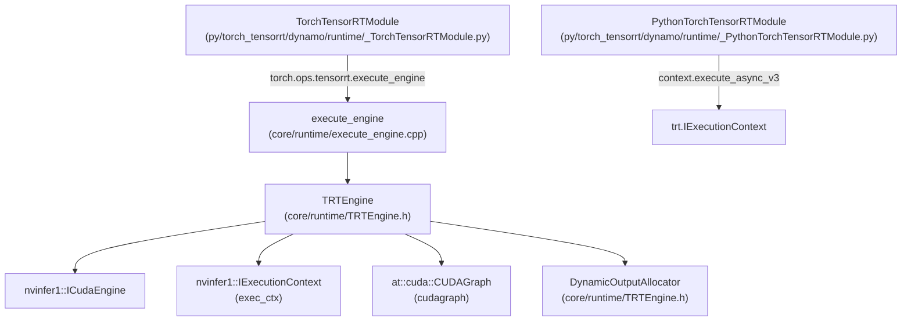
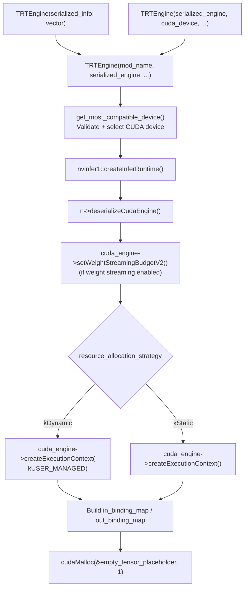
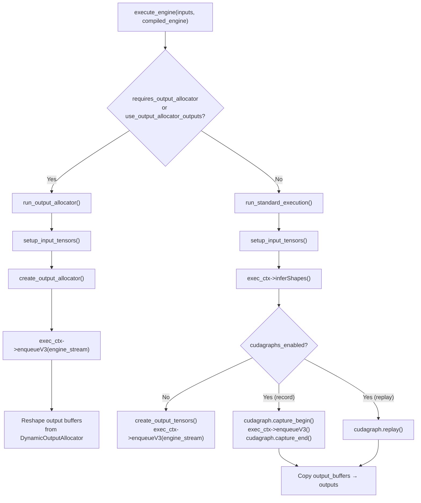
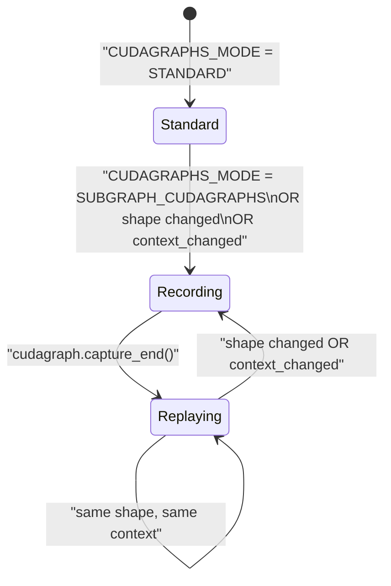
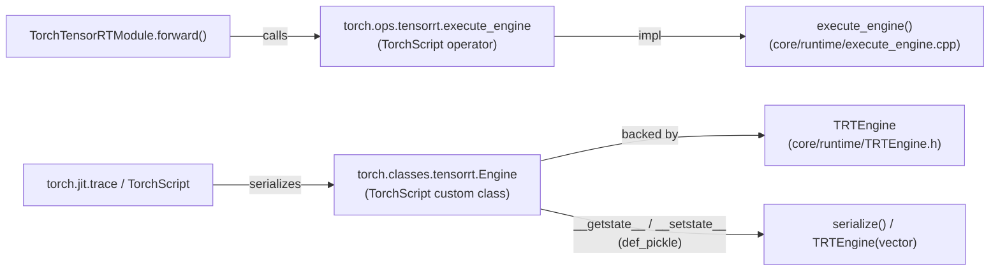

<!-- source: DeepWiki mcp.deepwiki.com · repo pytorch/TensorRT · page 6.1 TRTEngine and Execution Context · fetched 2026-10-21 -->

# TRTEngine and Execution Context

<details>
<summary>Relevant source files</summary>

The following files were used as context for generating this wiki page:

- [core/runtime/DeviceList.cpp](core/runtime/DeviceList.cpp)
- [core/runtime/TRTEngine.cpp](core/runtime/TRTEngine.cpp)
- [core/runtime/TRTEngine.h](core/runtime/TRTEngine.h)
- [core/runtime/execute_engine.cpp](core/runtime/execute_engine.cpp)
- [core/runtime/register_jit_hooks.cpp](core/runtime/register_jit_hooks.cpp)
- [core/runtime/runtime.cpp](core/runtime/runtime.cpp)
- [core/runtime/runtime.h](core/runtime/runtime.h)
- [docsrc/user_guide/runtime.rst](docsrc/user_guide/runtime.rst)
- [py/torch_tensorrt/dynamo/runtime/_PythonTorchTensorRTModule.py](py/torch_tensorrt/dynamo/runtime/_PythonTorchTensorRTModule.py)
- [py/torch_tensorrt/dynamo/runtime/_TorchTensorRTModule.py](py/torch_tensorrt/dynamo/runtime/_TorchTensorRTModule.py)
- [py/torch_tensorrt/dynamo/runtime/__init__.py](py/torch_tensorrt/dynamo/runtime/__init__.py)
- [py/torch_tensorrt/runtime/__init__.py](py/torch_tensorrt/runtime/__init__.py)

</details>


This page documents the C++ `TRTEngine` class, the `execute_engine` runtime function, and the supporting machinery that manages TensorRT engine instances at inference time. This covers the full execution path from engine deserialization through CUDA inference, including IO binding, CUDA graph capture, and dynamic output allocation.

For the Python-level `torch.nn.Module` wrappers that sit on top of `TRTEngine`, see [Python Runtime Modules](#6.2). For how engines are built during compilation, see [TRTInterpreter and Network Building](#3.4).

---

## System Overview

At runtime, a compiled TensorRT engine is held inside a `TRTEngine` C++ object, which is registered as a TorchScript custom class (`torch.classes.tensorrt.Engine`). The `execute_engine` C++ function is the single entry point for inference and is registered as a TorchScript operator (`torch.ops.tensorrt.execute_engine`). The Python-level wrappers call into this operator (or call TensorRT Python APIs directly) to run inference.

**Diagram: Runtime component relationships**



Sources: [core/runtime/TRTEngine.h:101-220](), [core/runtime/execute_engine.cpp:211-557](), [core/runtime/register_jit_hooks.cpp:76-121]()

---

## TRTEngine Struct

`TRTEngine` is defined in [core/runtime/TRTEngine.h:101-220]() and implemented in [core/runtime/TRTEngine.cpp:56-523](). It is a `torch::CustomClassHolder` subclass, allowing it to be held as a TorchScript custom class object.

### Key Members

| Member | Type | Purpose |
|---|---|---|
| `rt` | `shared_ptr<nvinfer1::IRuntime>` | TensorRT runtime for deserialization |
| `cuda_engine` | `shared_ptr<nvinfer1::ICudaEngine>` | Deserialized TRT engine |
| `exec_ctx` | `shared_ptr<nvinfer1::IExecutionContext>` | Execution context for inference |
| `in_binding_map` | `unordered_map<uint64_t, uint64_t>` | TRT IO index → PyTorch input index |
| `out_binding_map` | `unordered_map<uint64_t, uint64_t>` | TRT IO index → PyTorch output index |
| `in_binding_names` | `vector<string>` | Ordered by PyTorch input index |
| `out_binding_names` | `vector<string>` | Ordered by PyTorch output index |
| `num_io` | `pair<uint64_t, uint64_t>` | `(num_inputs, num_outputs)` |
| `device_info` | `RTDevice` | Target CUDA device |
| `hardware_compatible` | `bool` | Whether engine uses hardware-compatible mode |
| `cudagraph` | `at::cuda::CUDAGraph` | Captured CUDA graph (if enabled) |
| `input_buffers` / `output_buffers` | `vector<at::Tensor>` | Persistent buffers for CUDA graph mode |
| `output_allocator` | `shared_ptr<DynamicOutputAllocator>` | Used for data-dependent output shapes |
| `resource_allocation_strategy` | `ResourceAllocationStrategy` | `kStatic` or `kDynamic` |
| `mu` | `mutex` | Guards `exec_ctx->enqueue` (not thread-safe in TRT) |
| `empty_tensor_placeholder` | `void*` | Non-null address for zero-element tensors |
| `runtime_states` | `TorchTRTRuntimeStates` | Tracks CUDA graph and pre-allocation state across calls |

Sources: [core/runtime/TRTEngine.h:101-220]()

---

## Initialization and Deserialization

`TRTEngine` provides three constructors, all ultimately delegating to the canonical constructor at [core/runtime/TRTEngine.cpp:93-264]().

**Diagram: TRTEngine construction flow**



Sources: [core/runtime/TRTEngine.cpp:56-264](), [core/runtime/TRTEngine.h:127-152]()

### IO Binding Construction

After deserialization, the constructor maps TensorRT tensor indices to PyTorch positional indices via two paths:

1. **Explicit binding names provided** — The caller passes `_in_binding_names` and `_out_binding_names`. The constructor verifies each name exists in the engine and has the correct IO mode, then populates `in_binding_map` and `out_binding_map`. [core/runtime/TRTEngine.cpp:196-258]()

2. **No binding names provided** — The constructor auto-detects bindings by parsing the suffix of each IO tensor name (e.g. `x.0`, `output_1`). The index after the delimiter (`.` or `_`) is used as the PyTorch positional index. [core/runtime/TRTEngine.cpp:152-194]()

---

## ResourceAllocationStrategy

The `ResourceAllocationStrategy` enum [core/runtime/TRTEngine.h:103]() controls how device memory is managed for the execution context:

| Strategy | Execution Context Mode | Use Case |
|---|---|---|
| `kStatic` | Default TRT allocation | Fixed-shape workloads, CUDA graph friendly |
| `kDynamic` | `kUSER_MANAGED` — caller provides workspace | Memory-efficient dynamic shapes; workspace allocated per-call in `execute_engine` |

When `kDynamic` is selected, `execute_engine` allocates a workspace tensor each call and sets it via `exec_ctx->setDeviceMemory()` [core/runtime/execute_engine.cpp:212-216]().

The strategy can be changed after construction via `set_resource_allocation_strategy` [core/runtime/TRTEngine.cpp:507-519](), which recreates the execution context.

---

## execute_engine

The free function `execute_engine` in [core/runtime/execute_engine.cpp:211-557]() is the primary inference entry point. It is registered as a TorchScript operator and called by `TorchTensorRTModule.forward`.

### Execution Modes

`execute_engine` selects one of two execution paths:



Sources: [core/runtime/execute_engine.cpp:211-557]()

### Stream Synchronization

The engine always executes on a dedicated `engine_stream` (separate from the caller's stream). Synchronization uses `at::cuda::CUDAEvent` barriers:

1. `caller_exec_complete.record(caller_stream)` → `caller_exec_complete.block(engine_stream)` — engine waits for caller to finish producing inputs.
2. `trt_exec_complete.record(engine_stream)` → `trt_exec_complete.block(caller_stream)` — caller waits for engine to finish producing outputs.

[core/runtime/execute_engine.cpp:311-348]()

A `CUDAStreamGuard` switches the active stream to `engine_stream` for the duration of the `enqueueV3` call, and resets automatically on scope exit.

### Multi-Device Safe Mode

When `MULTI_DEVICE_SAFE_MODE` is true, `execute_engine` calls `get_current_device()` and `is_switch_required()` before every inference call to ensure device consistency. If a device switch is needed, input tensors are moved to the target device via `.to(target_device)`. [core/runtime/execute_engine.cpp:489-535]()

This mode is off by default due to per-call overhead. It is controlled globally via `MULTI_DEVICE_SAFE_MODE` in [core/runtime/runtime.cpp:10]().

---

## Input Setup: setup_input_tensors

`setup_input_tensors` [core/runtime/execute_engine.cpp:95-174]() prepares each input tensor for the execution context:

| Input Type | Handling |
|---|---|
| Shape tensor (`isShapeInferenceIO`) | Cloned to CPU as `int64`, pointer passed via `setTensorAddress` |
| Normal tensor, CUDA graphs active | Copied into persistent `input_buffers[i]`; `input_buffers[i].data_ptr()` bound |
| Normal tensor, standard mode | Contiguous view taken; `data_ptr()` bound directly |
| Zero-element tensor | `empty_tensor_placeholder` used (TRT requires non-null address even for empty tensors) |

For each non-shape-tensor input, `exec_ctx->setInputShape()` is also called to communicate the concrete shape to TRT before inference.

---

## Output Setup: create_output_tensors

`create_output_tensors` [core/runtime/execute_engine.cpp:176-192]() queries the execution context for each output tensor's shape after input shapes have been set:

```
out_shape = exec_ctx->getTensorShape(name)
type = TRTDataTypeToScalarType(cuda_engine->getTensorDataType(name))
outputs[pyt_idx] = at::empty(dims, {at::kCUDA}).to(type).contiguous()
```

Output tensor addresses are then registered with `exec_ctx->setTensorAddress`.

---

## CUDA Graph Support

CUDA graphs capture the sequence of GPU operations in a `cudaGraph_t` and replay them with minimal CPU overhead. `TRTEngine` integrates with CUDA graphs via `at::cuda::CUDAGraph cudagraph` [core/runtime/TRTEngine.h:182]().

**Graph lifecycle (managed by `TorchTRTRuntimeStates`):**



Sources: [core/runtime/TRTEngine.h:35-72](), [core/runtime/execute_engine.cpp:219-335]()

`TorchTRTRuntimeStates::set_runtime_states` [core/runtime/TRTEngine.h:45-71]() computes three boolean flags each call:

| Flag | Meaning |
|---|---|
| `need_cudagraphs_record` | Capture a new graph this call |
| `need_cudagraphs_reset` | Destroy the existing captured graph |
| `can_use_pre_allocated_outputs` | Reuse pre-allocated output tensors without re-querying shapes |

The `context_changed` flag in `TorchTRTRuntimeStates` is set to `true` when the execution context is recreated (e.g. after changing the weight streaming budget), triggering a graph re-capture on the next call.

When CUDA graphs are in use, `input_buffers` and `output_buffers` are persistent tensors cloned at recording time. Actual user inputs are copied into `input_buffers` before `cudagraph.replay()`, and results are copied from `output_buffers` back to the output tensors after replay.

---

## Dynamic Output Allocation

For operations with data-dependent output shapes (e.g., `nonzero`), the output tensor size cannot be known before execution. `DynamicOutputAllocator` [core/runtime/TRTEngine.h:74-99]() implements `nvinfer1::IOutputAllocator` and handles this:

- `reallocateOutputAsync` — Called by TensorRT during `enqueueV3` when output memory is needed. Allocates or reuses a flat CUDA tensor of the requested byte size.
- `notifyShape` — Called by TensorRT with the actual output dims after execution.

After `enqueueV3` returns, `execute_engine` reads `output_allocator->getShapes()` and `output_allocator->getBuffers()` to reconstruct properly-shaped `at::Tensor` outputs, slicing and reshaping the flat allocation. [core/runtime/execute_engine.cpp:438-455]()

Dynamic output allocation is **incompatible with CUDA graphs** — an error is thrown if both are enabled simultaneously. [core/runtime/execute_engine.cpp:538-541]()

---

## Weight Streaming

TensorRT supports streaming large engine weights from CPU to GPU on demand. `TRTEngine` exposes this via:

| Method | TRT API |
|---|---|
| `get_streamable_device_memory_budget()` | `cuda_engine->getStreamableWeightsSize()` |
| `get_automatic_device_memory_budget()` | `cuda_engine->getWeightStreamingAutomaticBudget()` |
| `get_device_memory_budget()` | `cuda_engine->getWeightStreamingBudgetV2()` |
| `set_device_memory_budget(budget)` | `cuda_engine->setWeightStreamingBudgetV2(budget)` |

[core/runtime/TRTEngine.cpp:365-398]()

`set_device_memory_budget` must destroy and recreate the execution context (`exec_ctx`) because the budget cannot be changed while an active context exists. After recreation, `runtime_states.context_changed` is set to `true` to force a CUDA graph re-capture. [core/runtime/TRTEngine.cpp:369-388]()

---

## Profiling

Profiling is enabled via `enable_profiling()` [core/runtime/TRTEngine.cpp:299-303](), which creates a `TRTEngineProfiler` and attaches it to `exec_ctx` via `setProfiler`. The profiler records per-layer latency.

In debug builds (`NDEBUG` not defined), profiling is enabled automatically in the constructor [core/runtime/TRTEngine.cpp:260-262]().

Profile output paths are set by `set_profiling_paths()` [core/runtime/TRTEngine.cpp:354-363](). The files generated:

| File suffix | Content |
|---|---|
| `_device_config_profile.trace` | Device selection |
| `_input_profile.trace` | Input packing timing |
| `_output_profile.trace` | Output packing timing |
| `_enqueue_profile.trace` | `enqueueV3` timing |
| `_engine_execution_profile.trace` | Per-layer TRT profiler output |
| `_cudagraph.dot` | CUDA graph debug dump |

Profile format can be set to `"trex"` or `"perfetto"` via `set_profile_format`. [core/runtime/TRTEngine.cpp:313-321]()

---

## Serialization Format

`TRTEngine` is serialized as an ordered `vector<string>` with fixed field indices defined by `SerializedInfoIndex` in [core/runtime/runtime.h:31-43]():

| Index | Constant | Content |
|---|---|---|
| 0 | `ABI_TARGET_IDX` | ABI version string (currently `"8"`) |
| 1 | `NAME_IDX` | Engine name |
| 2 | `DEVICE_IDX` | Serialized `RTDevice` string |
| 3 | `ENGINE_IDX` | Base64-encoded serialized TRT engine |
| 4 | `INPUT_BINDING_NAMES_IDX` | `%`-delimited input binding names |
| 5 | `OUTPUT_BINDING_NAMES_IDX` | `%`-delimited output binding names |
| 6 | `HW_COMPATIBLE_IDX` | `"0"` or `"1"` |
| 7 | `SERIALIZED_METADATA_IDX` | Base64-encoded pickle blob (settings, weight name map, etc.) |
| 8 | `TARGET_PLATFORM_IDX` | Serialized `Platform` string |
| 9 | `REQUIRES_OUTPUT_ALLOCATOR_IDX` | `"0"` or `"1"` |
| 10 | `RESOURCE_ALLOCATION_STRATEGY_IDX` | `"0"` (static) or `"1"` (dynamic) |

Sources: [core/runtime/runtime.h:31-43](), [core/runtime/TRTEngine.cpp:477-501]()

`verify_serialization_fmt` [core/runtime/TRTEngine.cpp:448-457]() checks that the vector length matches `SERIALIZATION_LEN` and that the ABI version matches the current `ABI_VERSION` constant before deserialization proceeds.

The `__obj_flatten__` method [core/runtime/TRTEngine.cpp:459-475]() exposes the same fields as named tuples, enabling TorchScript meta-kernel support for the custom class.

---

## TorchScript Registration

`TRTEngine` is registered as a TorchScript custom class and `execute_engine` as a TorchScript operator in [core/runtime/register_jit_hooks.cpp:76-177]().

**Diagram: Registration and call path**



Key registrations:

- `torch::class_<TRTEngine>("tensorrt", "Engine")` — registers the class with its methods including `enable_profiling`, `disable_profiling`, `infer_outputs`, `reset_captured_graph`, `device_memory_budget` property, and pickle support.
- `TORCH_LIBRARY(tensorrt, m)` — declares `execute_engine`, ABI constants, and mode getters/setters.
- `TORCH_LIBRARY_IMPL(tensorrt, CompositeExplicitAutograd, m)` — binds `execute_engine` to its C++ implementation.

Sources: [core/runtime/register_jit_hooks.cpp:76-177]()

---

## Pre-Allocated Outputs

For intermediate subgraphs in a larger compiled model, output tensors can be pre-allocated and reused across calls when the input shape is stable. This avoids repeated `at::empty` allocations.

Controlled by `use_pre_allocated_outputs` flag on `TRTEngine`. When set, `execute_engine` stores `pre_allocated_outputs` from the first call and reuses them in subsequent calls if `can_use_pre_allocated_outputs` is true (no shape change, no context change). [core/runtime/execute_engine.cpp:338-343]()

For the final module in a graph where output tensors may be consumed by the user, `output_tensors_are_unowned` should be set to `true` via `set_output_tensors_as_unowned` [core/runtime/TRTEngine.cpp:305-307](), which forces the creation of fresh output tensors even in pre-allocation mode.

---

