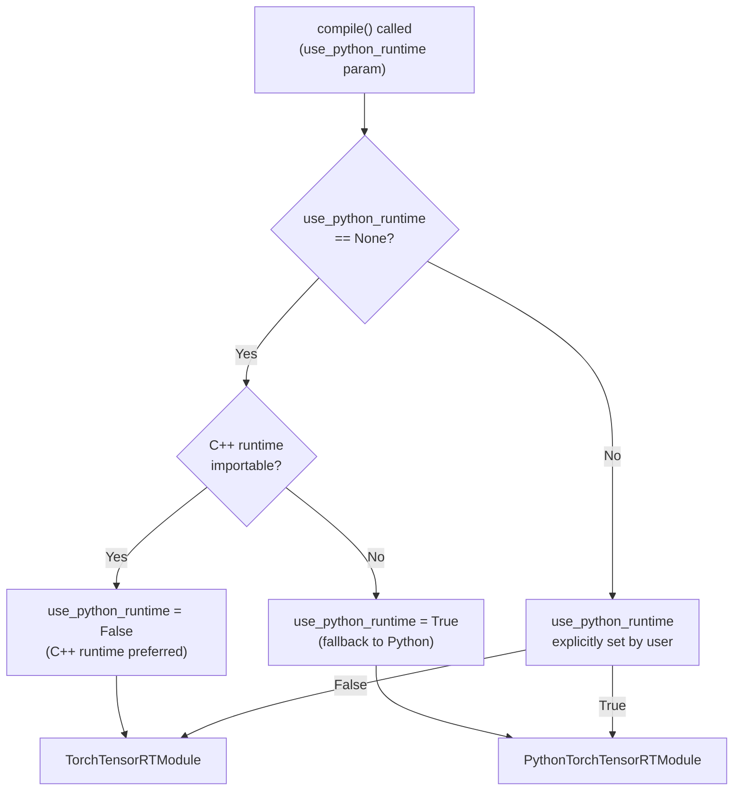
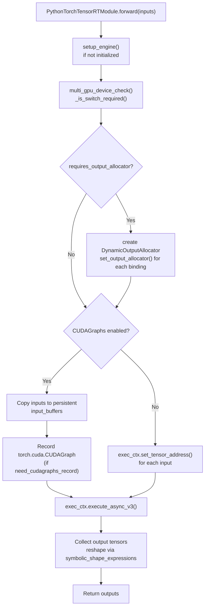
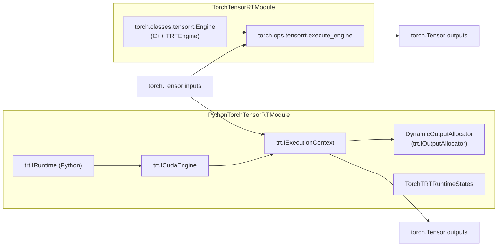
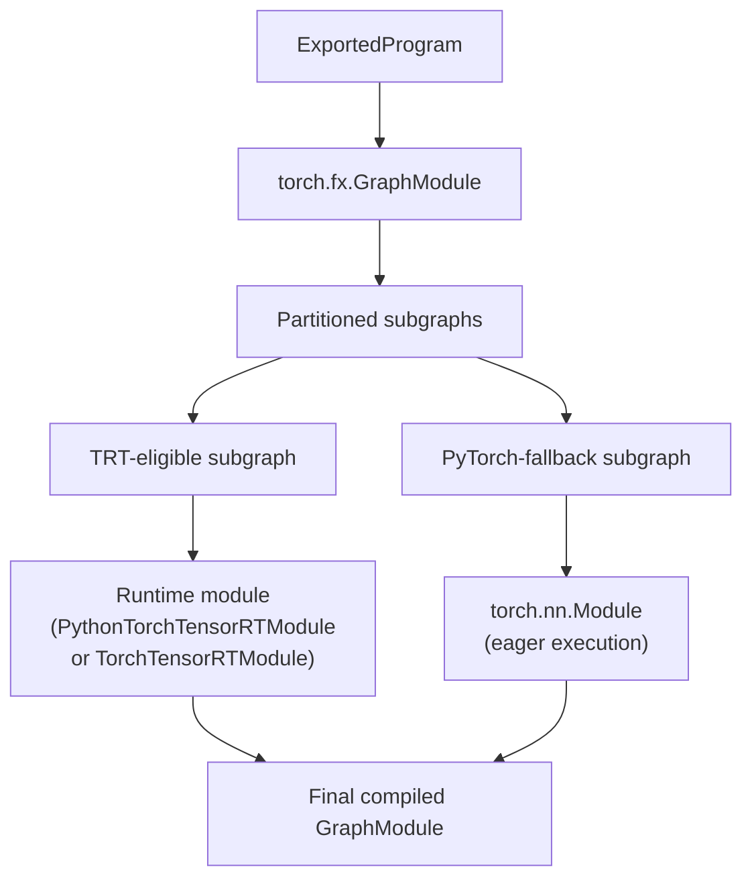

<!-- source: DeepWiki mcp.deepwiki.com · repo pytorch/TensorRT · page 6.2 Python Runtime Modules · fetched 2026-10-21 -->

# Python Runtime Modules

<details>
<summary>Relevant source files</summary>

The following files were used as context for generating this wiki page:

- [core/runtime/DeviceList.cpp](core/runtime/DeviceList.cpp)
- [core/runtime/TRTEngine.cpp](core/runtime/TRTEngine.cpp)
- [core/runtime/TRTEngine.h](core/runtime/TRTEngine.h)
- [core/runtime/execute_engine.cpp](core/runtime/execute_engine.cpp)
- [core/runtime/register_jit_hooks.cpp](core/runtime/register_jit_hooks.cpp)
- [core/runtime/runtime.cpp](core/runtime/runtime.cpp)
- [core/runtime/runtime.h](core/runtime/runtime.h)
- [docsrc/user_guide/runtime.rst](docsrc/user_guide/runtime.rst)
- [py/torch_tensorrt/_compile.py](py/torch_tensorrt/_compile.py)
- [py/torch_tensorrt/dynamo/__init__.py](py/torch_tensorrt/dynamo/__init__.py)
- [py/torch_tensorrt/dynamo/_compiler.py](py/torch_tensorrt/dynamo/_compiler.py)
- [py/torch_tensorrt/dynamo/_defaults.py](py/torch_tensorrt/dynamo/_defaults.py)
- [py/torch_tensorrt/dynamo/_refit.py](py/torch_tensorrt/dynamo/_refit.py)
- [py/torch_tensorrt/dynamo/_settings.py](py/torch_tensorrt/dynamo/_settings.py)
- [py/torch_tensorrt/dynamo/conversion/_TRTInterpreter.py](py/torch_tensorrt/dynamo/conversion/_TRTInterpreter.py)
- [py/torch_tensorrt/dynamo/conversion/_conversion.py](py/torch_tensorrt/dynamo/conversion/_conversion.py)
- [py/torch_tensorrt/dynamo/lowering/passes/__init__.py](py/torch_tensorrt/dynamo/lowering/passes/__init__.py)
- [py/torch_tensorrt/dynamo/runtime/_PythonTorchTensorRTModule.py](py/torch_tensorrt/dynamo/runtime/_PythonTorchTensorRTModule.py)
- [py/torch_tensorrt/dynamo/runtime/_TorchTensorRTModule.py](py/torch_tensorrt/dynamo/runtime/_TorchTensorRTModule.py)
- [py/torch_tensorrt/dynamo/runtime/__init__.py](py/torch_tensorrt/dynamo/runtime/__init__.py)
- [py/torch_tensorrt/dynamo/utils.py](py/torch_tensorrt/dynamo/utils.py)
- [py/torch_tensorrt/runtime/__init__.py](py/torch_tensorrt/runtime/__init__.py)
- [tests/py/dynamo/conversion/harness.py](tests/py/dynamo/conversion/harness.py)
- [tests/py/dynamo/models/test_export_kwargs_serde.py](tests/py/dynamo/models/test_export_kwargs_serde.py)
- [tests/py/dynamo/models/test_export_serde.py](tests/py/dynamo/models/test_export_serde.py)
- [tests/py/dynamo/models/test_model_refit.py](tests/py/dynamo/models/test_model_refit.py)
- [tests/py/dynamo/models/test_reexport.py](tests/py/dynamo/models/test_reexport.py)
- [tests/py/dynamo/runtime/test_002_lazy_engine_init.py](tests/py/dynamo/runtime/test_002_lazy_engine_init.py)

</details>


## Purpose and Scope

This page describes the two Python-level module wrappers that expose compiled TensorRT engines as standard `torch.nn.Module` instances: `PythonTorchTensorRTModule` and `TorchTensorRTModule`. These wrappers are what the Dynamo compilation pipeline produces as its final output, and they are what users interact with at inference time.

This page covers the structure, construction, execution, and runtime features (CUDAGraphs, weight streaming, dynamic output allocation) of both modules.

- For how the C++ `TRTEngine` that these modules wrap is implemented, see [6.1](#6.1).
- For how the Dynamo pipeline invokes these modules at the end of compilation, see [3.1](#3.1).

---

## Module Hierarchy and Selection

Both runtime module types live under `py/torch_tensorrt/dynamo/runtime/` and are re-exported from the top-level `py/torch_tensorrt/runtime/` package.

**Module layout:**

```
py/torch_tensorrt/runtime/__init__.py
  └── re-exports from:
      py/torch_tensorrt/dynamo/runtime/__init__.py
            ├── PythonTorchTensorRTModule  (_PythonTorchTensorRTModule.py)
            ├── TorchTensorRTModule        (_TorchTensorRTModule.py)
            └── ResourceAllocationStrategy (_ResourceAllocator.py)
```

Sources: [py/torch_tensorrt/dynamo/runtime/__init__.py:1-13](), [py/torch_tensorrt/runtime/__init__.py:1-14]()

---

### Choosing a Runtime

The `use_python_runtime` compilation setting controls which module type is produced. Selection logic is centralized in `use_python_runtime_parser()`:

- If `use_python_runtime=True` is set explicitly → `PythonTorchTensorRTModule` is used.
- If `use_python_runtime=False` → `TorchTensorRTModule` is used (requires the C++ Torch-TensorRT runtime).
- If `use_python_runtime=None` (default) → auto-detected: C++ runtime is preferred if the import `torch_tensorrt.dynamo.runtime.TorchTensorRTModule` succeeds; falls back to Python runtime if the C++ dependency is not present.

The default value `USE_PYTHON_RUNTIME = False` is defined in `_defaults.py`.

Sources: [py/torch_tensorrt/dynamo/utils.py:141-169](), [py/torch_tensorrt/dynamo/_defaults.py:26-26]()

**Runtime selection flow:**



Sources: [py/torch_tensorrt/dynamo/utils.py:141-169]()

---

## PythonTorchTensorRTModule

**File:** `py/torch_tensorrt/dynamo/runtime/_PythonTorchTensorRTModule.py`

`PythonTorchTensorRTModule` is a `torch.nn.Module` subclass that wraps a TensorRT engine entirely through the TensorRT **Python API** (`tensorrt` package). It does not depend on the C++ Torch-TensorRT runtime (`libtorchtrt.so`) and therefore works in Python-only deployments.

**Constraint:** This module **cannot** be serialized with `torch.jit.trace` for C++ deployment.

### Class Structure

| Attribute | Type | Purpose |
|-----------|------|---------|
| `serialized_engine` | `bytes` | Serialized TRT engine bytes |
| `input_names` | `List[str]` | TRT input binding names in order |
| `output_names` | `List[str]` | TRT output binding names in order |
| `settings` | `CompilationSettings` | Settings used to compile the engine |
| `engine` | `trt.ICudaEngine` | Deserialized TRT engine (after `setup_engine()`) |
| `context` | `trt.IExecutionContext` | Execution context for inference |
| `weight_name_map` | `dict` | Maps TRT weight names to `state_dict` names (for refitting) |
| `requires_output_allocator` | `bool` | True if data-dependent output shapes require `DynamicOutputAllocator` |
| `symbolic_shape_expressions` | `Dict[str, List[Dict]]` | Shape expressions for output tensor reshaping |
| `cudagraph` | `Optional[torch.cuda.CUDAGraph]` | Captured CUDA graph (when CUDAGraphs are enabled) |
| `runtime_states` | `TorchTRTRuntimeStates` | Tracks CUDAGraph and pre-allocation state across calls |
| `output_allocator` | `Optional[DynamicOutputAllocator]` | Allocator instance for data-dependent ops |
| `target_device_id` | `int` | GPU device ID the engine runs on |

Sources: [py/torch_tensorrt/dynamo/runtime/_PythonTorchTensorRTModule.py:118-231]()

### Constructor

```
PythonTorchTensorRTModule(
    serialized_engine: Optional[bytes],
    input_binding_names: Optional[List[str]],
    output_binding_names: Optional[List[str]],
    *,
    name: str = "",
    settings: CompilationSettings = CompilationSettings(),
    weight_name_map: Optional[dict] = None,
    requires_output_allocator: bool = False,
    symbolic_shape_expressions: Optional[Dict[str, List[Dict[str, Any]]]] = None,
    _debugger_config: Optional[DebuggerConfig] = None,
)
```

If `settings.lazy_engine_init` is `False` (the default), `setup_engine()` is called immediately in the constructor to deserialize and load the TRT engine. If `lazy_engine_init=True`, the engine is not initialized until the first `forward()` call.

Sources: [py/torch_tensorrt/dynamo/runtime/_PythonTorchTensorRTModule.py:125-231]()

### Execution Path

**Execution path diagram:**



Sources: [py/torch_tensorrt/dynamo/runtime/_PythonTorchTensorRTModule.py:117-231]()

### Weight Streaming

`PythonTorchTensorRTModule` exposes weight streaming budget control through these methods:

| Method | Description |
|--------|-------------|
| `get_streamable_device_memory_budget()` | Returns `engine.streamable_weights_size`; 0 if engine was not built with `WEIGHT_STREAMING` flag |
| `get_device_memory_budget()` | Returns current `engine.weight_streaming_budget_v2` |
| `set_device_memory_budget(budget_bytes)` | Sets the budget; recreates the execution context; sets `runtime_states.context_changed = True` |
| `get_automatic_device_memory_budget()` | Returns TRT's automatically calculated budget |

Sources: [py/torch_tensorrt/dynamo/runtime/_PythonTorchTensorRTModule.py:246-270]()

### Output Tensor Ownership

`set_output_tensors_as_unowned(enabled: bool)` — when `True`, output tensors are recreated on every `forward()` call instead of being reused. This is necessary for the final engine in a graph (outputs may be held externally by the user) but reduces performance for intermediate engines.

Sources: [py/torch_tensorrt/dynamo/runtime/_PythonTorchTensorRTModule.py:232-244]()

---

## TorchTensorRTModule

**File:** `py/torch_tensorrt/dynamo/runtime/_TorchTensorRTModule.py`

`TorchTensorRTModule` wraps the C++ `TRTEngine` custom class registered with the TorchScript JIT system via `torch.class_<TRTEngine>("tensorrt", "Engine")`. Inference is dispatched through the custom operator `torch.ops.tensorrt.execute_engine`.

This module **can** be serialized to disk with `torch.jit.save` and loaded with `torch.jit.load` for C++ deployment.

**Constraint:** Requires the C++ Torch-TensorRT runtime (`libtorchtrt.so` / `_C.so`). The entire class is guarded by `@for_all_methods(needs_torch_tensorrt_runtime)`.

### Serialization Format

The serialized engine info is a flat list of strings indexed by constants that mirror the C++ `SerializedInfoIndex` enum in `core/runtime/runtime.h`:

| Constant | Index | Content |
|----------|-------|---------|
| `ABI_TARGET_IDX` | 0 | ABI version string |
| `NAME_IDX` | 1 | Engine name |
| `DEVICE_IDX` | 2 | Device info |
| `ENGINE_IDX` | 3 | Base64-encoded serialized TRT engine |
| `INPUT_BINDING_NAMES_IDX` | 4 | Delimited input binding names |
| `OUTPUT_BINDING_NAMES_IDX` | 5 | Delimited output binding names |
| `HW_COMPATIBLE_IDX` | 6 | Hardware compatibility flag |
| `SERIALIZED_METADATA_IDX` | 7 | Serialized metadata |
| `TARGET_PLATFORM_IDX` | 8 | Target platform |
| `REQUIRES_OUTPUT_ALLOCATOR_IDX` | 9 | Output allocator requirement flag |
| `RESOURCE_ALLOCATION_STRATEGY_IDX` | 10 | Static vs dynamic resource allocation |

Sources: [py/torch_tensorrt/dynamo/runtime/_TorchTensorRTModule.py:28-55](), [core/runtime/runtime.h:30-43]()

### Execution

At inference time, `TorchTensorRTModule.forward()` calls `torch.ops.tensorrt.execute_engine(inputs, self.engine)`, which dispatches into the C++ `execute_engine` function. The C++ side handles:
- Input binding and type checking
- CUDAGraph recording/replay
- Output tensor allocation
- CUDA stream management

This is detailed in [6.1](#6.1).

Sources: [py/torch_tensorrt/dynamo/runtime/_TorchTensorRTModule.py:1-60](), [core/runtime/execute_engine.cpp:211-]()

---

## Supporting Classes

### DynamicOutputAllocator

**File:** `py/torch_tensorrt/dynamo/runtime/_PythonTorchTensorRTModule.py`

`DynamicOutputAllocator` extends `trt.IOutputAllocator` and is used when the compiled engine contains data-dependent output shapes (e.g., operations whose output sizes are not known until runtime). It is activated when `requires_output_allocator=True`.

| Method | Role |
|--------|------|
| `reallocate_output_async(tensor_name, memory, size, alignment, stream)` | (Re)allocates a CUDA buffer for the named output; returns its `data_ptr()` |
| `notify_shape(tensor_name, shape)` | Records the actual output shape once TRT has determined it |

The Python `DynamicOutputAllocator` mirrors the C++ `DynamicOutputAllocator` class defined in `core/runtime/TRTEngine.h`.

Sources: [py/torch_tensorrt/dynamo/runtime/_PythonTorchTensorRTModule.py:29-62](), [core/runtime/TRTEngine.h:74-99]()

### TorchTRTRuntimeStates

Tracks per-module state needed to correctly manage CUDAGraphs across successive `forward()` calls.

| Field | Description |
|-------|-------------|
| `old_cudagraphs` | Whether CUDAGraphs were enabled in the previous call |
| `old_pre_allocated_outputs` | Whether pre-allocated outputs were enabled previously |
| `context_changed` | Set to `True` when the execution context is recreated (e.g., after changing memory budget) |

`set_runtime_states(new_cudagraphs, new_pre_allocated_output, shape_changed)` returns a tuple `(need_cudagraphs_record, can_use_pre_allocated_outputs, need_cudagraphs_reset)` that controls what happens in the current call:

- **Record** is needed if CUDAGraphs just became enabled, or if input shape changed, or if context changed.
- **Reset** is needed if CUDAGraphs are now disabled, shape changed, or context changed.
- **Pre-allocated outputs** can be reused only if the previous and current calls both had them enabled and shapes are stable.

Sources: [py/torch_tensorrt/dynamo/runtime/_PythonTorchTensorRTModule.py:64-114]()

---

## Comparison: PythonTorchTensorRTModule vs TorchTensorRTModule



| Feature | `PythonTorchTensorRTModule` | `TorchTensorRTModule` |
|---------|-------|-------|
| Runtime dependency | TensorRT Python API only | C++ Torch-TensorRT runtime |
| TorchScript serializable | No | Yes (`torch.jit.save`) |
| Supported frontends | Dynamo / FX / `torch.compile` | Dynamo / FX / TorchScript |
| CUDAGraphs | Yes | Yes |
| Weight streaming | Yes | Yes |
| Weight refitting | Yes | Yes |
| Output allocator | `DynamicOutputAllocator` (Python) | `DynamicOutputAllocator` (C++) |
| Profiling | Yes (via `DebuggerConfig`) | Yes (via `enable_profiling()`) |

Sources: [py/torch_tensorrt/dynamo/runtime/_PythonTorchTensorRTModule.py:117-231](), [py/torch_tensorrt/dynamo/runtime/_TorchTensorRTModule.py:1-60]()

---

## Integration with the Compilation Pipeline

The `convert_module` function in `py/torch_tensorrt/dynamo/conversion/_conversion.py` is responsible for instantiating the correct runtime module after the `TRTInterpreter` produces a compiled engine. It reads `settings.use_python_runtime` (resolved by `use_python_runtime_parser`) and returns either a `PythonTorchTensorRTModule` or a `TorchTensorRTModule`.

**Where these modules appear in the compiled `GraphModule`:**

Each TRT-converted subgraph in the partitioned `GraphModule` becomes a submodule whose class is one of the two runtime module types. Non-TRT nodes remain as regular PyTorch operations in the enclosing `GraphModule`.



Sources: [py/torch_tensorrt/dynamo/conversion/_conversion.py:1-30](), [py/torch_tensorrt/dynamo/_compiler.py:404-560]()

---

## State Dict and Serialization

`PythonTorchTensorRTModule` registers a `_on_state_dict` hook (via `_register_state_dict_hook`) so that the serialized engine bytes and metadata are saved as part of the module's state dict. This allows the compiled module to be saved and loaded using standard `torch.export.save` / `torch.export.load` workflows via `torch_tensorrt.save` and `torch_tensorrt.load`.

`TorchTensorRTModule` relies on the C++ `TRTEngine`'s `serialize()` / `__obj_flatten__()` methods (registered in `core/runtime/register_jit_hooks.cpp`) to participate in TorchScript serialization.

Sources: [py/torch_tensorrt/dynamo/runtime/_PythonTorchTensorRTModule.py:168-170](), [py/torch_tensorrt/dynamo/runtime/_TorchTensorRTModule.py:20-55](), [core/runtime/register_jit_hooks.cpp:76-110]()

---

