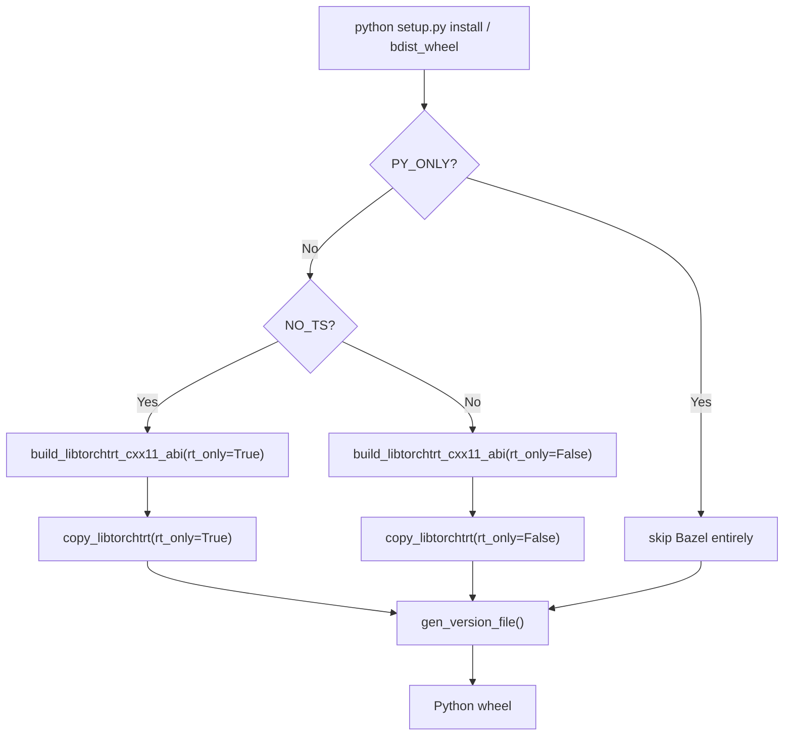
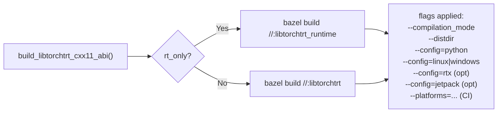
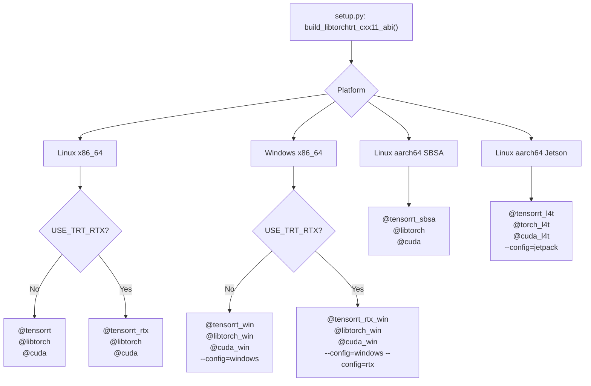

<!-- source: DeepWiki mcp.deepwiki.com · repo pytorch/TensorRT · page 7 Build System and Development · fetched 2026-10-21 -->

# Build System and Development

<details>
<summary>Relevant source files</summary>

The following files were used as context for generating this wiki page:

- [.github/scripts/generate-tensorrt-test-matrix.py](.github/scripts/generate-tensorrt-test-matrix.py)
- [.github/scripts/install-torch-tensorrt.sh](.github/scripts/install-torch-tensorrt.sh)
- [MODULE.bazel](MODULE.bazel)
- [README.md](README.md)
- [cpp/include/torch_tensorrt/macros.h](cpp/include/torch_tensorrt/macros.h)
- [dev_dep_versions.yml](dev_dep_versions.yml)
- [packaging/pre_build_script.sh](packaging/pre_build_script.sh)
- [packaging/pre_build_script_windows.sh](packaging/pre_build_script_windows.sh)
- [py/requirements.txt](py/requirements.txt)
- [pyproject.toml](pyproject.toml)
- [setup.py](setup.py)
- [tests/py/requirements.txt](tests/py/requirements.txt)
- [toolchains/ci_workspaces/MODULE.bazel.tmpl](toolchains/ci_workspaces/MODULE.bazel.tmpl)
- [tools/perf/Flux/create_env.sh](tools/perf/Flux/create_env.sh)
- [uv.lock](uv.lock)
- [version.txt](version.txt)

</details>


This section describes the Torch-TensorRT build system, development toolchain, CI/CD workflows, and testing infrastructure. The material here is aimed at contributors and anyone building the project from source.

For step-by-step installation instructions, see [Installation and Setup](#1.1). For contributor-facing guides on adding new operation converters, see [Contributing Converters](#7.6).

---

## Overview

Torch-TensorRT uses a **dual build system**: Bazel builds the C++ core library, and setuptools orchestrates packaging of the Python extension and pure-Python modules, calling Bazel as a subprocess when a C++-containing build is needed.

The two entry points are:

| File | Role |
|---|---|
| `setup.py` | Top-level Python build script; drives Bazel and packages the wheel |
| `pyproject.toml` | PEP 517 build backend declaration and tool configuration |
| `MODULE.bazel` | Bazel module definition and external dependency declarations |
| `dev_dep_versions.yml` | Canonical dependency version pins for CUDA, TensorRT, TensorRT-RTX, TensorRT-LLM |
| `version.txt` | Base version string read by `get_base_version()` in `setup.py` |

Sources: [setup.py:1-30](), [pyproject.toml:1-13](), [MODULE.bazel:1-10](), [dev_dep_versions.yml:1-5](), [version.txt:1-2]()

---

## Build Modes

Three primary build modes exist, selected by command-line flags or environment variables passed to `setup.py`:

| Mode | Flag | Env Var | C++ Built | TorchScript Support | Description |
|---|---|---|---|---|---|
| **Full** | _(default)_ | _(default)_ | Yes | Yes | Builds `libtorchtrt` with the full TorchScript frontend |
| **No-TS** | `--no-ts` | `NO_TORCHSCRIPT=1` | Yes (runtime only) | No | Builds only the runtime C++ library; omits TorchScript converter |
| **Python-only** | `--py-only` or `--fx-only` | `PYTHON_ONLY=1` | No | No | Packages only the Dynamo/Python frontend; no Bazel invocation |

An additional flag `--use-rtx` (env: `USE_TRT_RTX=1`) switches the TensorRT dependency to the TensorRT-RTX variant and changes the distribution package name to `torch_tensorrt_rtx`.

Sources: [setup.py:95-144]()

---

**Build Mode Decision Flow**



Sources: [setup.py:319-405]()

---

## setuptools Custom Commands

`setup.py` registers several custom setuptools command classes, each corresponding to a standard packaging operation:

| Class | Parent | Purpose |
|---|---|---|
| `DevelopCommand` | `develop` | `pip install -e .` — debug Bazel build, symlinks into `PYTHONPATH` |
| `InstallCommand` | `install` | `python setup.py install` — optimized Bazel build |
| `BdistCommand` | `bdist_wheel` | `pip wheel` — optimized build, produces `.whl` |
| `EditableWheelCommand` | `editable_wheel` | `pip install -e .` via PEP 660 editable wheels |
| `CleanCommand` | `Command` | Removes build artifacts (`build/`, `dist/`, `lib/`, `_version.py`) |

The key shared functions called by these commands are:

- `build_libtorchtrt_cxx11_abi()` — constructs and runs the Bazel command
- `copy_libtorchtrt()` — extracts the resulting tarball into `py/torch_tensorrt/`
- `gen_version_file()` — writes `py/torch_tensorrt/_version.py` with version strings

Sources: [setup.py:214-316](), [setup.py:319-456]()

---

## Bazel Build System

The C++ library (`libtorchtrt`) is built exclusively by Bazel. The top-level Bazel entry point is `MODULE.bazel`, which declares the module and pulls in all external C++ dependencies.

**build_libtorchtrt_cxx11_abi() invocation logic:**



Sources: [setup.py:214-266]()

---

## External Dependencies (MODULE.bazel)

`MODULE.bazel` declares all external dependencies consumed by Bazel. Different dependency variants are used per platform and TensorRT variant:

| Bazel Repo Name | Platform | TensorRT Variant |
|---|---|---|
| `tensorrt` | Linux x86_64 | Standard TensorRT |
| `tensorrt_sbsa` | Linux aarch64 (SBSA/server) | Standard TensorRT |
| `tensorrt_l4t` | Linux aarch64 (Jetson/L4T) | TensorRT for Jetson |
| `tensorrt_win` | Windows x86_64 | Standard TensorRT |
| `tensorrt_rtx` | Linux x86_64 | TensorRT RTX |
| `tensorrt_rtx_win` | Windows x86_64 | TensorRT RTX |
| `libtorch` | Linux x86_64 | — |
| `libtorch_win` | Windows x86_64 | — |
| `torch_l4t` | Linux aarch64 (Jetson) | — |
| `cuda` | Linux x86_64 / aarch64 | — |
| `cuda_l4t` | Linux Jetson | — |
| `cuda_win` | Windows | — |

The CUDA path defaults to `/usr/local/cuda-13.0/` on Linux and `C:/Program Files/NVIDIA GPU Computing Toolkit/CUDA/v13.0/` on Windows.

Sources: [MODULE.bazel:36-154]()

---

**Dependency Resolution by Platform**



Sources: [setup.py:230-266](), [MODULE.bazel:63-153]()

---

## Python Package Structure

The `setup.py` defines two package sets that are included or excluded based on the build mode:

**`dynamo_packages`** — always included; contains the Dynamo frontend and runtime:

- `torch_tensorrt`, `torch_tensorrt.dynamo`, `torch_tensorrt.dynamo.backend`
- `torch_tensorrt.dynamo.conversion`, `torch_tensorrt.dynamo.conversion.impl.*`
- `torch_tensorrt.dynamo.lowering`, `torch_tensorrt.dynamo.lowering.passes`
- `torch_tensorrt.dynamo.partitioning`, `torch_tensorrt.dynamo.runtime`
- `torch_tensorrt.runtime`

**`fx_packages`** — included unless `USE_TRT_RTX=1`:

- `torch_tensorrt.fx`, `torch_tensorrt.fx.converters`, `torch_tensorrt.fx.passes`
- `torch_tensorrt.fx.tracer.acc_tracer`, `torch_tensorrt.fx.tracer.dispatch_tracer`

**`torch_tensorrt.ts`** and **`torch_tensorrt._C`** (C extension) — included only in a full (non-`PY_ONLY`, non-`NO_TS`) build.

Sources: [setup.py:459-718]()

---

## Version Management

The package version is assembled in `setup.py` at build time from several sources:

1. **Base version**: read from `version.txt` via `get_base_version()`, with any trailing `a0` stripped.
2. **Git hash**: appended as `.dev0+<short-hash>` in non-release builds via `get_git_revision_short_hash()`.
3. **Release builds**: `BUILD_VERSION` environment variable is used directly when `RELEASE=1`.

Dependency version pins are read from `dev_dep_versions.yml` by `load_dep_info()`, populating `__cuda_version__`, `__tensorrt_version__`, `__tensorrt_rtx_version__`, and `__tensorrt_llm_version__`. These are written into `py/torch_tensorrt/_version.py` by `gen_version_file()`.

| Variable | Source |
|---|---|
| `__version__` | `version.txt` + git hash, or `BUILD_VERSION` |
| `__cuda_version__` | `dev_dep_versions.yml` or `CU_VERSION` env var |
| `__tensorrt_version__` | `dev_dep_versions.yml` |
| `__tensorrt_rtx_version__` | `dev_dep_versions.yml` |
| `__tensorrt_llm_version__` | `dev_dep_versions.yml` |

Current pinned versions (from `dev_dep_versions.yml`):
- CUDA: **13.0**
- TensorRT: **10.15.1**
- TensorRT RTX: **1.3.0**
- TensorRT LLM: **0.17.0.post1**

Sources: [setup.py:29-88](), [dev_dep_versions.yml:1-5](), [version.txt:1-2]()

---

## Development Tool Configuration

`pyproject.toml` configures the development toolchain under `[dependency-groups]`:

| Group | Purpose | Key Tools |
|---|---|---|
| `dev` | Core developer tools | `pre-commit`, `black`, `clang-format==14.0.6`, `ruff`, `mypy`, `isort`, `typos` |
| `debug` | Visualization tools | `pydot`, `tabulate`, `graphviz` |
| `test` | Base test runner | `pytest`, `pytest-xdist`, `parameterized`, `expecttest` |
| `test-ext` | Extended test dependencies | `timm`, `transformers`, `torchvision`, `flashinfer-python`, `nvidia-modelopt` |
| `docs` | Documentation generation | `sphinx==5.0.1`, `breathe==4.34.0`, `exhale==0.3.7`, `nbsphinx==0.9.3` |
| `quantization` | INT8/FP8 quantization tooling | `nvidia-modelopt` |

Linting rules are configured in `pyproject.toml` under `[tool.ruff]`, `[tool.mypy]`, `[tool.isort]`, `[tool.black]`, and `[tool.typos]`. The `py/torch_tensorrt/fx` subtree is excluded from most linters due to its legacy status.

Sources: [pyproject.toml:55-102](), [pyproject.toml:200-415]()

---

## CI MODULE.bazel Template

For CI builds, `MODULE.bazel` is not used directly. Instead, `toolchains/ci_workspaces/MODULE.bazel.tmpl` is a template file with placeholder variables (`${BUILD_VERSION}`, `${CUDA_HOME}`, `${TORCH_INSTALL_PATH}`, `${CU_UPPERBOUND}`). The pre-build scripts render this template via `envsubst`:

```
cat toolchains/ci_workspaces/MODULE.bazel.tmpl | envsubst > MODULE.bazel
```

This allows CI to inject the correct local PyTorch installation path and CUDA version without modifying the committed `MODULE.bazel`. The rendered CI workspace uses `new_local_repository` for `libtorch` (pointing to the installed PyTorch), while the committed `MODULE.bazel` uses `http_archive` to download a prebuilt libtorch tarball.

Sources: [toolchains/ci_workspaces/MODULE.bazel.tmpl:1-158](), [packaging/pre_build_script.sh:71-78](), [packaging/pre_build_script_windows.sh:47-54]()

---

## Platform Support Summary

| Platform | Architecture | Support Level | Build Notes |
|---|---|---|---|
| Linux AMD64 | x86_64 | Full | All build modes; CI via GitHub Actions |
| Linux SBSA | aarch64 | Full | Uses `--platforms=//toolchains:aarch64_linux` in CI |
| Windows | AMD64 | Dynamo only | `--config=windows`; `choco install bazelisk` for CI |
| Linux Jetson | aarch64 | Source build (JetPack 4.4+) | `--config=jetpack`; `JETPACK_BUILD=1` env var |
| Linux ppc64le | — | Not supported | — |

Sources: [README.md:106-117](), [setup.py:92-202]()

---

## Subsections

The following pages cover each topic in detail:

- **[Build System Architecture (7.1)](#7.1)** — `MODULE.bazel`, `WORKSPACE`, `pyproject.toml`, and build mode internals
- **[Building from Source (7.2)](#7.2)** — Step-by-step instructions for Linux Python-only and full C++ builds
- **[Platform-Specific Configurations (7.3)](#7.3)** — Linux x86_64, Windows cross-compilation, aarch64/Jetson specifics
- **[CI/CD Pipeline (7.4)](#7.4)** — GitHub Actions workflows for building, testing, and releasing
- **[Testing Infrastructure (7.5)](#7.5)** — nox session configuration, test categories, benchmarking
- **[Contributing Converters (7.6)](#7.6)** — How to write new op converters for Dynamo and TorchScript frontends
- **[Documentation Generation (7.7)](#7.7)** — Sphinx/Doxygen doc builds and the automated docgen workflow

---

