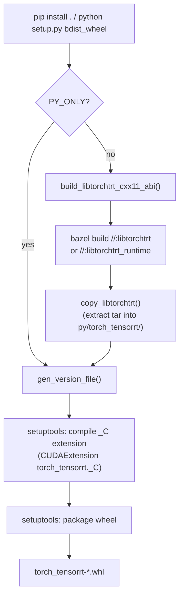
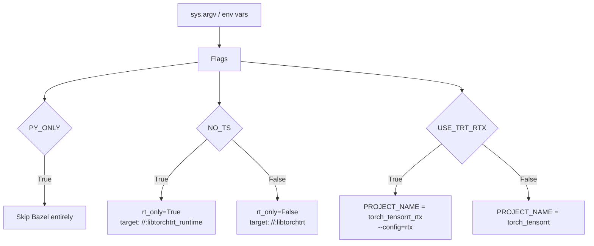
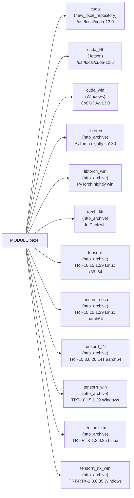
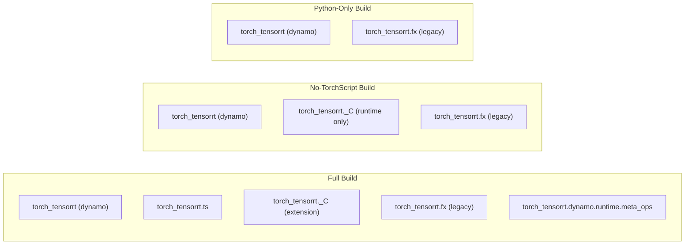

<!-- source: DeepWiki mcp.deepwiki.com · repo pytorch/TensorRT · page 7.1 Build System Architecture · fetched 2026-10-21 -->

# Build System Architecture

<details>
<summary>Relevant source files</summary>

The following files were used as context for generating this wiki page:

- [.github/scripts/generate-tensorrt-test-matrix.py](.github/scripts/generate-tensorrt-test-matrix.py)
- [.github/scripts/install-torch-tensorrt.sh](.github/scripts/install-torch-tensorrt.sh)
- [.github/scripts/run_cpp_linter.py](.github/scripts/run_cpp_linter.py)
- [.github/scripts/run_py_linter.py](.github/scripts/run_py_linter.py)
- [.github/workflows/docgen.yml](.github/workflows/docgen.yml)
- [.github/workflows/linter.yml](.github/workflows/linter.yml)
- [.github/workflows/stale.yml](.github/workflows/stale.yml)
- [MODULE.bazel](MODULE.bazel)
- [README.md](README.md)
- [cpp/include/torch_tensorrt/macros.h](cpp/include/torch_tensorrt/macros.h)
- [dev_dep_versions.yml](dev_dep_versions.yml)
- [docker/Dockerfile](docker/Dockerfile)
- [docker/Dockerfile.docs](docker/Dockerfile.docs)
- [docker/README.md](docker/README.md)
- [docker/dist-build.sh](docker/dist-build.sh)
- [docsrc/getting_started/installation.rst](docsrc/getting_started/installation.rst)
- [packaging/pre_build_script.sh](packaging/pre_build_script.sh)
- [packaging/pre_build_script_windows.sh](packaging/pre_build_script_windows.sh)
- [py/requirements.txt](py/requirements.txt)
- [pyproject.toml](pyproject.toml)
- [setup.py](setup.py)
- [tests/py/requirements.txt](tests/py/requirements.txt)
- [toolchains/ci_workspaces/MODULE.bazel.tmpl](toolchains/ci_workspaces/MODULE.bazel.tmpl)
- [tools/perf/Flux/create_env.sh](tools/perf/Flux/create_env.sh)
- [uv.lock](uv.lock)
- [version.txt](version.txt)

</details>


This page describes how Torch-TensorRT is built from source, covering the roles of Bazel and setuptools, the key configuration files, the three build modes, and how external C++ and Python dependencies are resolved. For step-by-step source build instructions see [7.2](#7.2). For platform-specific notes (Windows, Jetson, SBSA) see [7.3](#7.3).

---

## Overview

Torch-TensorRT uses a **two-level build system**:

1. **Bazel** — builds all C++ components, including `libtorchtrt` and the TorchScript frontend. Entry point: `MODULE.bazel`.
2. **setuptools** — packages the Python wheel. Entry point: `pyproject.toml` / `setup.py`. The custom build commands in `setup.py` invoke Bazel before handing off to setuptools.

A normal `pip install .` or `python setup.py bdist_wheel` transparently runs both levels in sequence. The Python-only path skips the Bazel step entirely.

Sources: [setup.py:1-30](), [pyproject.toml:1-12](), [MODULE.bazel:1-10]()

---

## Top-Level Build Flow

**Diagram: End-to-End Build Pipeline**



Sources: [setup.py:214-316](), [setup.py:840-858]()

---

## Key Configuration Files

| File | Role |
|---|---|
| `MODULE.bazel` | Bazel module definition; declares all external C++ dependencies |
| `pyproject.toml` | PEP 517 build system metadata; static project metadata; tool config (ruff, mypy, isort) |
| `setup.py` | Custom build commands that bridge Bazel and setuptools |
| `version.txt` | Canonical base version string (e.g. `2.12.0a0`) |
| `dev_dep_versions.yml` | Pinned versions of CUDA, TensorRT, TensorRT-RTX, TensorRT-LLM |
| `toolchains/ci_workspaces/MODULE.bazel.tmpl` | Template used by CI to generate a `MODULE.bazel` with locally-installed deps |
| `py/requirements.txt` | Runtime Python dependencies used during Docker/manual builds |

Sources: [version.txt:1](), [dev_dep_versions.yml:1-5](), [pyproject.toml:1-53](), [toolchains/ci_workspaces/MODULE.bazel.tmpl:1-10]()

---

## Build Modes

Three build modes control which C++ components are compiled and packaged.

| Mode | Flag / Env Var | Bazel Target | C Extension | TorchScript Frontend |
|---|---|---|---|---|
| **Full** | _(default)_ | `//:libtorchtrt` | `torch_tensorrt._C` | ✅ included |
| **No TorchScript** | `--no-ts` / `NO_TORCHSCRIPT=1` | `//:libtorchtrt_runtime` | `torch_tensorrt._C` | ❌ excluded |
| **Python-only** | `--py-only` / `PYTHON_ONLY=1` | _(none)_ | ❌ not built | ❌ excluded |

`--fx-only` is an alias for `--py-only`.

The flag `--use-rtx` / `USE_TRT_RTX=1` is orthogonal to the above — it selects a TensorRT RTX SDK variant and changes the distribution name from `torch_tensorrt` to `torch_tensorrt_rtx`.

Sources: [setup.py:95-144](), [setup.py:319-405]()

**Diagram: Build Mode Selection in setup.py**



Sources: [setup.py:95-145](), [setup.py:204-266]()

---

## Bazel Build Configuration (`MODULE.bazel`)

`MODULE.bazel` is the Bazel Bzlmod entry point. It performs three functions:

1. **Declares Bazel module rules** (`googletest`, `platforms`, `rules_cc`, `rules_python`, `rules_pkg`)
2. **Declares local system repositories** for CUDA and pre-installed Torch-TensorRT
3. **Declares remote HTTP archives** for LibTorch and TensorRT (all platform variants)

### External Dependency Repositories

**Diagram: Bazel External Repositories in MODULE.bazel**



Sources: [MODULE.bazel:33-172]()

### Bazel Build Flags

The `build_libtorchtrt_cxx11_abi()` function in `setup.py` assembles the `bazel build` command with flags based on the build context:

| Condition | Bazel Flag |
|---|---|
| Debug build (`develop=True`) | `--compilation_mode=dbg` |
| Release build | `--compilation_mode=opt` |
| x86_64 | `--distdir=third_party/dist_dir/x86_64-linux-gnu` |
| aarch64 | `--distdir=third_party/dist_dir/aarch64-linux-gnu` |
| Python binding | `--config=python` |
| Linux | `--config=linux` |
| Windows | `--config=windows` |
| TRT-RTX | `--config=rtx` |
| Jetpack | `--config=jetpack` |
| CI x86_64 | `--platforms=//toolchains:ci_rhel_x86_64_linux` |
| CI aarch64 | `--platforms=//toolchains:aarch64_linux` |

Sources: [setup.py:214-266]()

---

## setuptools Configuration (`pyproject.toml` + `setup.py`)

### `pyproject.toml` Responsibilities

- Specifies `setuptools` as the build backend (`build-backend = "setuptools.build_meta"`)
- Declares static project metadata: name, authors, classifiers, Python version requirement (`>=3.10`)
- Marks `version`, `dependencies`, and `optional-dependencies` as `dynamic` (resolved at build time by `setup.py`)
- Configures tools: `ruff`, `black`, `isort`, `mypy`, `typos`, `pytest`
- Defines `uv` index sources for PyTorch nightly wheel resolution

Sources: [pyproject.toml:1-53](), [pyproject.toml:107-132]()

### Custom Build Commands in `setup.py`

`setup.py` overrides four standard setuptools commands to inject the Bazel build step:

| Command Class | Invoked by | Behavior |
|---|---|---|
| `DevelopCommand` | `pip install -e .` | Bazel debug build → copy lib → gen version |
| `InstallCommand` | `pip install .` | Bazel release build → copy lib → gen version |
| `BdistCommand` | `pip wheel .` | Bazel release build → copy lib → gen version |
| `EditableWheelCommand` | `pip install --editable .` | Bazel debug build (unless PY_ONLY) → gen version |
| `CleanCommand` | `python setup.py clean` | Removes build artifacts in `py/` |

Sources: [setup.py:319-456]()

### Version File Generation

`gen_version_file()` writes `py/torch_tensorrt/_version.py` at build time, embedding:
- `__version__` — from `version.txt` + git hash (dev) or `BUILD_VERSION` env var (release)
- `__cuda_version__` — from `CU_VERSION` env var or `dev_dep_versions.yml`
- `__tensorrt_version__` — from `dev_dep_versions.yml`
- `__tensorrt_rtx_version__` — from `dev_dep_versions.yml`

Sources: [setup.py:269-279](), [dev_dep_versions.yml:1-5]()

### C Extension: `torch_tensorrt._C`

When building in full or no-TorchScript mode, `setup.py` defines a `CUDAExtension` named `torch_tensorrt._C` compiling these source files from `py/torch_tensorrt/csrc/`:

- `torch_tensorrt_py.cpp`
- `tensorrt_backend.cpp`
- `tensorrt_classes.cpp`
- `register_tensorrt_classes.cpp`

The extension links against `libtorchtrt.so` (or `.dll` on Windows), which was previously installed into `py/torch_tensorrt/lib/` by `copy_libtorchtrt()`.

Sources: [setup.py:631-708]()

---

## Python Package Structure by Build Mode

**Diagram: Python Packages Included per Build Mode**



The `dynamo_packages` list in `setup.py` defines the core set of Python-only packages included in all builds. The `torch_tensorrt.ts` and `torch_tensorrt.dynamo.runtime.meta_ops` subpackages are appended only for full or no-TorchScript builds. The `fx_packages` are conditionally appended when `USE_TRT_RTX` is false.

Sources: [setup.py:462-549](), [setup.py:559-717]()

---

## Library Copying: Bazel Output → Python Package

`copy_libtorchtrt()` extracts the Bazel-produced tarball into `py/torch_tensorrt/`:

| Platform | Source | Destination |
|---|---|---|
| Linux (full) | `bazel-bin/libtorchtrt.tar.gz` | `py/torch_tensorrt/` (via `tar -xzf ... --strip-components=1`) |
| Linux (rt_only) | `bazel-bin/libtorchtrt_runtime.tar.gz` | `py/torch_tensorrt/` |
| Windows | `bazel-bin/cpp/lib/torchtrt.dll` + `.dll.if.lib` | `py/torch_tensorrt/lib/` |

After extraction, `py/torch_tensorrt/lib/` contains the shared library, and `py/torch_tensorrt/include/` contains the public headers. These are declared in `package_data` so they are bundled into the wheel.

Sources: [setup.py:282-316](), [setup.py:719-757]()

---

## CI: `MODULE.bazel` Template Substitution

In CI environments, the top-level `MODULE.bazel` is regenerated from `toolchains/ci_workspaces/MODULE.bazel.tmpl` using `envsubst`. This allows the CI pipeline to:

- Override the LibTorch path to point to a locally-installed PyTorch (`${TORCH_INSTALL_PATH}`)
- Override `${CUDA_HOME}` for the correct CUDA installation
- Override TensorRT URLs to test specific TensorRT versions
- Set `${BUILD_VERSION}` for versioned release builds

The pre-build script `packaging/pre_build_script.sh` performs this substitution via:

```
cat toolchains/ci_workspaces/MODULE.bazel.tmpl | envsubst > MODULE.bazel
```

Sources: [packaging/pre_build_script.sh:71-78](), [toolchains/ci_workspaces/MODULE.bazel.tmpl:1-158]()

---

## Docker Build

`docker/Dockerfile` implements a multi-stage build:

1. **`base`** — CUDA base image; installs TensorRT via apt; installs Bazelisk
2. **`torch-tensorrt-builder`** — copies source, runs `docker/dist-build.sh` which calls `pip wheel .`
3. **`torch-tensorrt`** — copies output wheels from the builder stage; installs them

The Docker build uses the same `setup.py` path as a local build, so it automatically invokes Bazel to build `libtorchtrt` before packaging.

Sources: [docker/Dockerfile:1-124](), [docker/dist-build.sh:1-22]()

---

## Dependency Version Pinning

Current default pinned versions (from `dev_dep_versions.yml` and `MODULE.bazel`):

| Dependency | Version |
|---|---|
| CUDA | 13.0 |
| TensorRT (standard) | 10.15.1.29 |
| TensorRT RTX | 1.3.0.35 |
| Bazel | 8.1.1 (`.bazelversion` file) |
| Python | ≥ 3.10 |
| PyTorch | ≥ 2.12.0.dev, < 2.13.0 |

Platform-specific TensorRT archives differ: Linux x86_64, Linux SBSA (aarch64), Jetpack (L4T aarch64, CUDA 12.6, TRT 10.3.0), and Windows each have a separate `http_archive` entry in `MODULE.bazel`.

Sources: [dev_dep_versions.yml:1-5](), [MODULE.bazel:100-153](), [pyproject.toml:9-9]()

---

