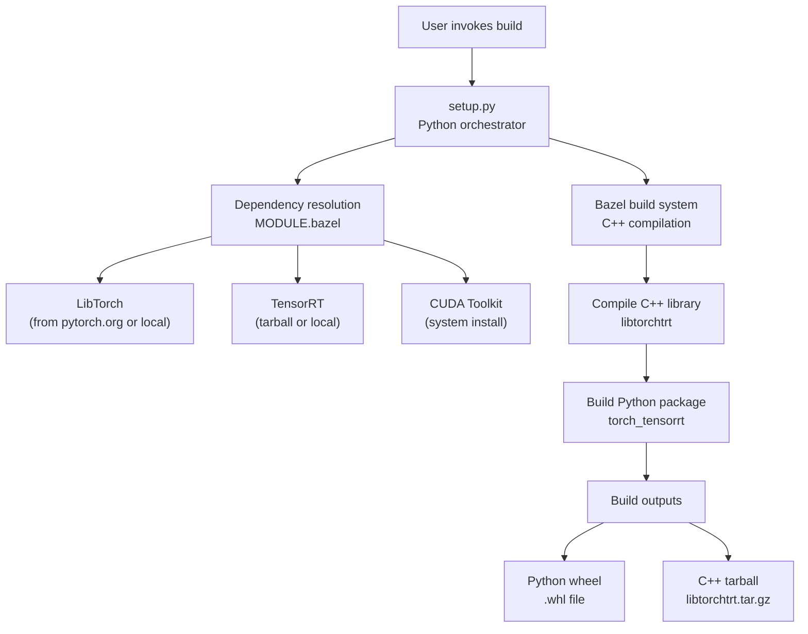
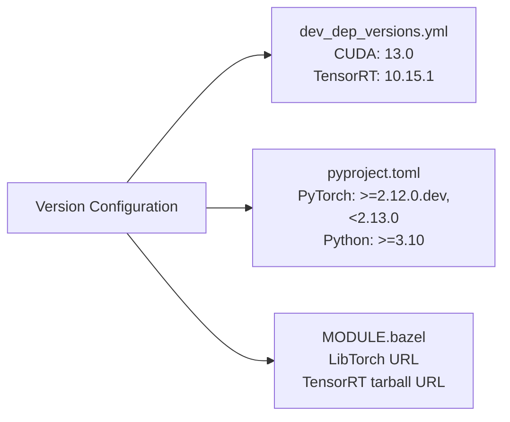
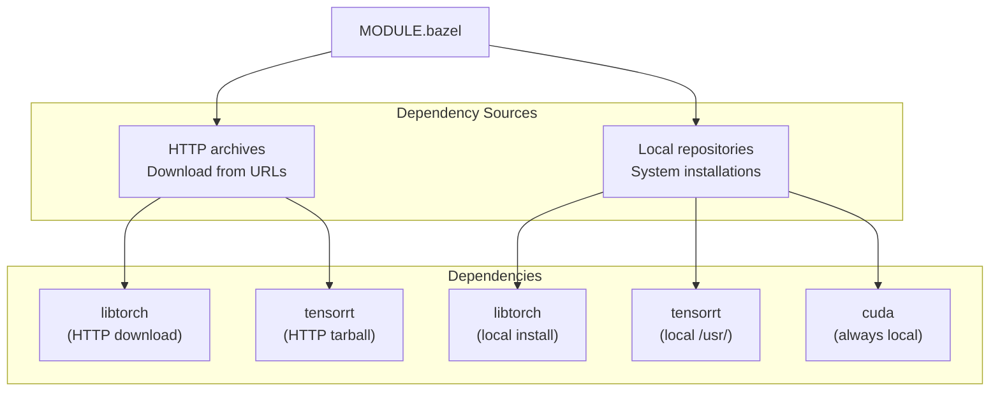
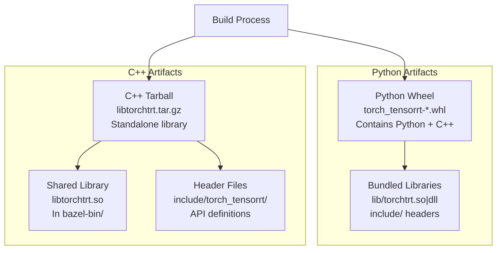
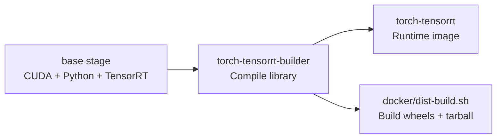

<!-- source: DeepWiki mcp.deepwiki.com · repo pytorch/TensorRT · page 7.2 Building from Source · fetched 2026-10-21 -->

# Building from Source

<details>
<summary>Relevant source files</summary>

The following files were used as context for generating this wiki page:

- [.github/scripts/generate-tensorrt-test-matrix.py](.github/scripts/generate-tensorrt-test-matrix.py)
- [.github/scripts/install-torch-tensorrt.sh](.github/scripts/install-torch-tensorrt.sh)
- [.github/scripts/run_cpp_linter.py](.github/scripts/run_cpp_linter.py)
- [.github/scripts/run_py_linter.py](.github/scripts/run_py_linter.py)
- [.github/workflows/docgen.yml](.github/workflows/docgen.yml)
- [.github/workflows/linter.yml](.github/workflows/linter.yml)
- [.github/workflows/stale.yml](.github/workflows/stale.yml)
- [MODULE.bazel](MODULE.bazel)
- [README.md](README.md)
- [cpp/include/torch_tensorrt/macros.h](cpp/include/torch_tensorrt/macros.h)
- [dev_dep_versions.yml](dev_dep_versions.yml)
- [docker/Dockerfile](docker/Dockerfile)
- [docker/Dockerfile.docs](docker/Dockerfile.docs)
- [docker/README.md](docker/README.md)
- [docker/dist-build.sh](docker/dist-build.sh)
- [docsrc/getting_started/installation.rst](docsrc/getting_started/installation.rst)
- [packaging/pre_build_script.sh](packaging/pre_build_script.sh)
- [packaging/pre_build_script_windows.sh](packaging/pre_build_script_windows.sh)
- [py/requirements.txt](py/requirements.txt)
- [pyproject.toml](pyproject.toml)
- [setup.py](setup.py)
- [tests/py/requirements.txt](tests/py/requirements.txt)
- [toolchains/ci_workspaces/MODULE.bazel.tmpl](toolchains/ci_workspaces/MODULE.bazel.tmpl)
- [tools/perf/Flux/create_env.sh](tools/perf/Flux/create_env.sh)
- [uv.lock](uv.lock)
- [version.txt](version.txt)

</details>


This page provides step-by-step instructions for compiling Torch-TensorRT from source code on different platforms. For information about the overall build system architecture and how it works, see page 7.1 (Build System Architecture). For platform-specific configuration details, see page 7.3 (Platform-Specific Configurations).

The build process uses a hybrid approach: `setup.py` orchestrates the Python package build and invokes Bazel to compile the C++ library components. The resulting outputs include Python wheels (`.whl` files) and optionally C++ library tarballs.

---

## Build System Overview

The build process follows this general flow:



Sources: [setup.py:1-814](), [MODULE.bazel:1-172](), [README.md:119-127]()

---

## Prerequisites

### Required Tools

| Tool | Purpose | Installation |
|------|---------|-------------|
| **Bazelisk** or **Bazel 8.1.1** | C++ build system | [github.com/bazelbuild/bazelisk](https://github.com/bazelbuild/bazelisk) |
| **Python 3.10-3.13** | Runtime and build environment | python.org |
| **CUDA 12.6 or 13.0** | GPU compute toolkit | [developer.nvidia.com/cuda](https://developer.nvidia.com/cuda) |
| **Git** | Source code management | System package manager |

Platform-specific requirements:
- **Linux**: GCC/G++ compiler, `ninja-build`, `fmt-devel`
- **Windows**: Visual Studio 2022 Build Tools, `ninja`, `wheel`, `setuptools`
- **Jetson**: Requires JetPack-specific CUDA 12.6 and TensorRT 10.3.0

Sources: [README.md:119-127](), [setup.py:176-184](), [packaging/pre_build_script.sh:1-85]()

### Dependency Versions

The required versions are defined in multiple configuration files:



Sources: [dev_dep_versions.yml:1-5](), [pyproject.toml:8-12](), [MODULE.bazel:64-144]()

---

## Building on Linux x86_64

### Standard Installation Build

The simplest approach installs the package directly:

```bash
# Install build dependencies
pip install -r py/requirements.txt

# Build and install
pip install --pre . --extra-index-url https://download.pytorch.org/whl/nightly/cu130
```

This command:
1. Reads [pyproject.toml:1-160]() for build requirements
2. Executes [setup.py:1-814]() which invokes Bazel
3. Compiles C++ library via [setup.py:186-238]()
4. Copies built libraries via [setup.py:254-288]()
5. Installs the Python package

Sources: [setup.py:1-814](), [pyproject.toml:1-160]()

### Development Build

For active development with editable installation:

```bash
# Development mode with debug symbols
pip install -e . --extra-index-url https://download.pytorch.org/whl/nightly/cu130
```

The `-e` flag creates a symlink installation, allowing code changes to take effect without reinstalling. The build uses `--compilation_mode=dbg` internally as defined in [setup.py:199]().

Sources: [setup.py:291-309]()

### Building Wheels

To create distributable wheel files:

```bash
# Create wheel in dist/ directory
pip wheel --no-deps --pre . --extra-index-url https://download.pytorch.org/whl/nightly/cu130 -w dist
```

The wheel build process is controlled by the `BdistCommand` class in [setup.py:331-349]().

Sources: [setup.py:331-349]()

---

## Build Configuration with MODULE.bazel

The [MODULE.bazel:1-172]() file defines all external dependencies. Key sections:



### Default Configuration (HTTP Archives)

By default, dependencies are downloaded automatically:

```python
# LibTorch from PyTorch nightly (MODULE.bazel lines 64-69)
http_archive(
    name = "libtorch",
    build_file = "@//third_party/libtorch:BUILD",
    strip_prefix = "libtorch",
    urls = ["https://download.pytorch.org/libtorch/nightly/cu130/libtorch-shared-with-deps-latest.zip"],
)

# TensorRT from NVIDIA (MODULE.bazel lines 101-108)
http_archive(
    name = "tensorrt",
    build_file = "@//third_party/tensorrt/archive:BUILD",
    strip_prefix = "TensorRT-10.15.1.29",
    urls = ["https://developer.nvidia.com/downloads/compute/machine-learning/tensorrt/10.15.1/tars/TensorRT-10.15.1.29.Linux.x86_64-gnu.cuda-13.1.tar.gz"],
)
```

### Using Local Dependencies

To use locally installed versions, comment out the `http_archive` rules and uncomment the `new_local_repository` rules:

```python
# Example: Using local LibTorch (MODULE.bazel lines 160-165)
new_local_repository(
    name = "libtorch",
    path = "/usr/local/lib/python3.11/dist-packages/torch",
    build_file = "third_party/libtorch/BUILD"
)

# Example: Using local TensorRT (MODULE.bazel lines 167-171)
new_local_repository(
   name = "tensorrt",
   path = "/usr/",
   build_file = "@//third_party/tensorrt/local:BUILD"
)
```

Sources: [MODULE.bazel:1-172](), [toolchains/ci_workspaces/MODULE.bazel.tmpl:1-158]()

---

## Building on Linux SBSA (aarch64)

Server-class ARM64 builds follow the same process as x86_64, with platform-specific detection:

```bash
# Build process automatically detects aarch64
pip install --pre . --extra-index-url https://download.pytorch.org/whl/nightly/cu130
```

Platform detection logic in [setup.py:91-174]():
- `IS_AARCH64 = platform.machine() == "aarch64"` ([setup.py:91]())
- `IS_SBSA = True if IS_AARCH64 and not IS_JETPACK else False` ([setup.py:174]())

The build system uses SBSA-specific TensorRT tarball defined in [MODULE.bazel:119-126]().

Sources: [setup.py:91-174](), [MODULE.bazel:119-126](), [packaging/pre_build_script.sh:8-24]()

---

## Building on Jetson (Tegra)

Jetson builds require JetPack-specific dependencies:

### Prerequisites

- JetPack 6.x with CUDA 12.6
- PyTorch 2.8.0 from Jetson AI Lab
- TensorRT 10.3.0 (included in JetPack)

### Build Process

```bash
# Set Jetson build flag
export JETPACK_BUILD=1

# Install PyTorch for Jetson
pip install torch==2.8.0 --index-url=https://pypi.jetson-ai-lab.io/jp6/cu126/

# Build with Jetson configuration
pip install --pre . --jetpack
```

Jetson-specific configuration:
- Detection: `IS_JETPACK = True` when `JETPACK_BUILD=1` ([setup.py:148-150]())
- Bazel config: `--config=jetpack` flag ([setup.py:220-222]())
- TensorRT: Uses `tensorrt_l4t` target ([MODULE.bazel:128-135]())

Sources: [setup.py:148-150](), [setup.py:220-222](), [MODULE.bazel:128-135](), [packaging/pre_build_script.sh:46-51]()

---

## Building on Windows

### Prerequisites

Install required tools in an **x64 Native Tools Command Prompt for VS 2022**:

```bash
# Install build tools
choco install bazelisk -y
pip install ninja wheel setuptools
```

### Build Commands

```bash
# Set up Visual Studio environment
set DISTUTILS_USE_SDK=1

# Install PyTorch
pip install --pre torch --index-url https://download.pytorch.org/whl/nightly/cu130

# Install requirements
pip install --pre -r py/requirements.txt

# Build wheel
python setup.py bdist_wheel

# Install built wheel
pip install dist/*.whl
```

Windows-specific configuration:
- Detection: `IS_WINDOWS = True` (imported from torch.utils.cpp_extension)
- Bazel config: `--config=windows` flag ([setup.py:212]())
- Output: `torchtrt.dll` and `torchtrt.lib` ([setup.py:259-267]())

Sources: [setup.py:211-214](), [setup.py:259-267](), [packaging/pre_build_script_windows.sh:1-60]()

---

## Build Configuration Options

### Python-Only Distribution

Excludes C++ components (TorchScript frontend and C++ runtime):

```bash
# Set flag before building
export PYTHON_ONLY=1
pip install --pre .
```

Or use the command-line flag:
```bash
pip install --pre . --py-only
```

This disables:
- C++ library compilation ([setup.py:303-305]())
- TorchScript frontend
- C++ runtime (Python runtime only)

Sources: [setup.py:94](), [setup.py:109-111](), [setup.py:299-305]()

### Disable TorchScript Frontend

Excludes TorchScript components but retains C++ runtime:

```bash
export NO_TORCHSCRIPT=1
pip install --pre .
```

Build configuration:
- Flag handling: [setup.py:95](), [setup.py:113-115]()
- Runtime-only build target: `//:libtorchtrt_runtime` ([setup.py:194]())

Sources: [setup.py:95](), [setup.py:113-115](), [setup.py:194]()

### TensorRT-RTX Build

Uses TensorRT-RTX SDK for additional optimizations:

```bash
export USE_TRT_RTX=1
pip install --pre .
```

Configuration:
- Flag handling: [setup.py:99](), [setup.py:101-103]()
- Bazel config: `--config=rtx` ([setup.py:216-218]())
- Dependency: Uses `tensorrt_rtx` archives ([MODULE.bazel:110-117]())

Sources: [setup.py:99-103](), [setup.py:216-218](), [MODULE.bazel:110-117]()

### CI Build Mode

Enables specific platform configurations for CI environments:

```bash
export CI_BUILD=1
pip install --pre .
```

Adds platform-specific flags:
- x86_64: `--platforms=//toolchains:ci_rhel_x86_64_linux` ([setup.py:232]())
- aarch64: `--platforms=//toolchains:aarch64_linux` ([setup.py:230]())

Sources: [setup.py:157-165](), [setup.py:227-232]()

---

## Build Output Artifacts

The build process produces different artifacts based on configuration:



### Output Locations

| Artifact | Location | Description |
|----------|----------|-------------|
| Python wheel | `dist/*.whl` | Complete Python package |
| C++ tarball | `bazel-bin/libtorchtrt.tar.gz` | Standalone C++ library |
| Shared library | `py/torch_tensorrt/lib/torchtrt.so` | Linux/Windows library |
| Headers | `py/torch_tensorrt/include/` | C++ API headers |
| Binaries | `py/torch_tensorrt/bin/` | Utility executables |

The library copying logic is in [setup.py:254-288]().

Sources: [setup.py:254-288](), [setup.py:597-712]()

---

## Docker Build Environment

For reproducible builds, use the provided Dockerfile:

### Build Docker Image

```bash
# Build with specific TensorRT version
DOCKER_BUILDKIT=1 docker build \
  --build-arg TENSORRT_VERSION=10.14.1 \
  --build-arg PYTHON_VERSION=3.11 \
  -f docker/Dockerfile \
  -t torch_tensorrt:latest .
```

### Dockerfile Build Process

The [docker/Dockerfile:1-125]() implements a multi-stage build:



Key Dockerfile stages:
1. **base**: Install CUDA, Python via pyenv, TensorRT, Bazel ([docker/Dockerfile:6-48]())
2. **torch-tensorrt-builder**: Compile library using [docker/dist-build.sh:1-23]() ([docker/Dockerfile:51-91]())
3. **torch-tensorrt**: Final runtime image with installed packages ([docker/Dockerfile:93-125]())

Sources: [docker/Dockerfile:1-125](), [docker/dist-build.sh:1-23](), [docker/README.md:1-46]()

---

## CI Build Scripts

The CI pipeline uses specialized build scripts:

### Linux CI Build Script

[packaging/pre_build_script.sh:1-85]() performs:
1. Platform detection (x86_64/SBSA/Jetson)
2. Dependency installation (Bazel, fmt, CUDA)
3. PyTorch installation from configured channel
4. MODULE.bazel generation from template
5. Optional TensorRT-RTX installation

Key operations:
```bash
# Install Bazel
curl -L https://github.com/bazelbuild/bazelisk/releases/download/v1.26.0/bazelisk-linux-${BAZEL_PLATFORM} \
    -o /usr/bin/bazel && chmod +x /usr/bin/bazel

# Generate MODULE.bazel from template
cat toolchains/ci_workspaces/MODULE.bazel.tmpl | envsubst > MODULE.bazel
```

Sources: [packaging/pre_build_script.sh:1-85]()

### Windows CI Build Script

[packaging/pre_build_script_windows.sh:1-60]() performs:
1. Bazel installation via Chocolatey
2. PyTorch installation from configured channel
3. fmt library workaround (copy to torch include path)
4. MODULE.bazel generation
5. Environment variable setup

Sources: [packaging/pre_build_script_windows.sh:1-60]()

---

## Troubleshooting

### Common Build Issues

| Issue | Solution |
|-------|----------|
| **Bazel not found** | Install bazelisk: `pip install bazelisk` or download from releases |
| **CUDA version mismatch** | Update `CUDA_HOME` in MODULE.bazel ([MODULE.bazel:38-41]()) |
| **TensorRT download fails** | Use local install, update MODULE.bazel ([MODULE.bazel:167-171]()) |
| **Out of memory during build** | Reduce parallel jobs: `export MAX_JOBS=4` |
| **Windows build fails** | Ensure using "x64 Native Tools Command Prompt" |
| **fmt not found (Windows)** | Build script copies fmt headers automatically ([packaging/pre_build_script_windows.sh:31-36]()) |

### Build Cache Location

Bazel cache is stored in:
- Linux: `~/.cache/bazel`
- Windows: `%USERPROFILE%\.bazel`

Clean cache if encountering persistent issues:
```bash
bazel clean --expunge
```

### Debugging Build Failures

Enable verbose output:
```bash
# Bazel verbose mode
bazel build --subcommands --verbose_failures //:libtorchtrt

# Python build with debug
VERBOSE=1 pip install -e .
```

Sources: [setup.py:234-238](), [docker/dist-build.sh:14-15]()

---

## Version File Generation

The build process generates [py/torch_tensorrt/_version.py:1-5]() with version information:

```python
def gen_version_file():
    """Generate _version.py with build metadata"""
    with open(dir_path + "/torch_tensorrt/_version.py", "w") as f:
        f.write('__version__ = "' + __version__ + '"\n')
        f.write('__cuda_version__ = "' + __cuda_version__ + '"\n')
        f.write('__tensorrt_version__ = "' + __tensorrt_version__ + '"\n')
        f.write('__tensorrt_rtx_version__ = "' + __tensorrt_rtx_version__ + '"\n')
        f.write('__tensorrt_llm_version__ = "' + __tensorrt_llm_version__ + '"\n')
```

Version determination:
- **Release builds**: Uses `BUILD_VERSION` environment variable ([setup.py:153]())
- **Development builds**: Combines base version + git hash ([setup.py:155]())
- Base version: Read from `version.txt` ([setup.py:57-66]())

Sources: [setup.py:241-252](), [setup.py:57-66](), [setup.py:153-155]()

---

