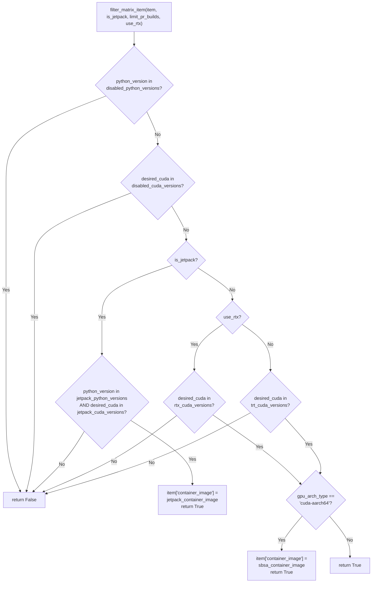
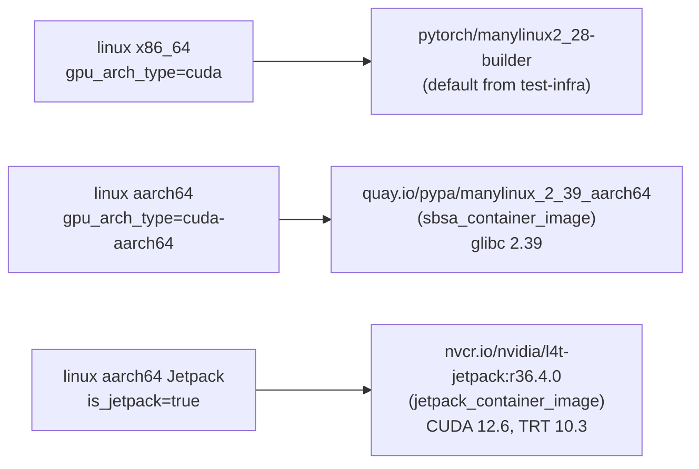
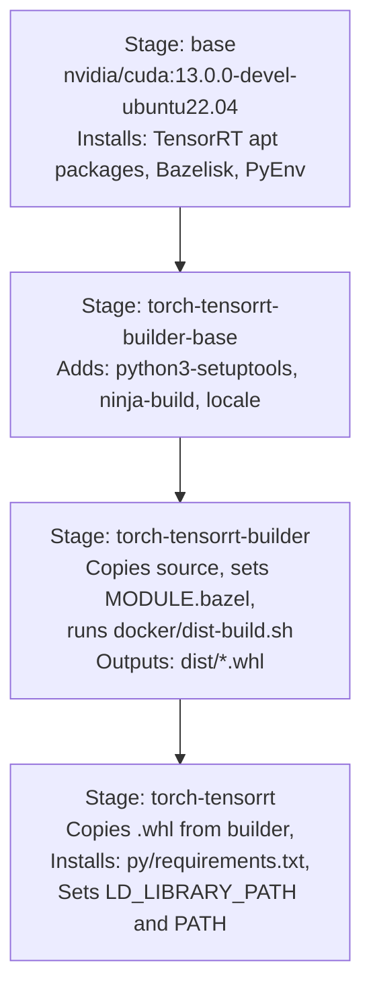

<!-- source: DeepWiki mcp.deepwiki.com · repo pytorch/TensorRT · page 7.3 Platform-Specific Configurations · fetched 2026-10-21 -->

# Platform-Specific Configurations

<details>
<summary>Relevant source files</summary>

The following files were used as context for generating this wiki page:

- [.github/scripts/filter-matrix.py](.github/scripts/filter-matrix.py)
- [.github/scripts/run_cpp_linter.py](.github/scripts/run_cpp_linter.py)
- [.github/scripts/run_py_linter.py](.github/scripts/run_py_linter.py)
- [.github/workflows/build-test-linux-aarch64-jetpack.yml](.github/workflows/build-test-linux-aarch64-jetpack.yml)
- [.github/workflows/build-test-linux-aarch64.yml](.github/workflows/build-test-linux-aarch64.yml)
- [.github/workflows/build-test-linux-x86_64.yml](.github/workflows/build-test-linux-x86_64.yml)
- [.github/workflows/build-test-linux-x86_64_rtx.yml](.github/workflows/build-test-linux-x86_64_rtx.yml)
- [.github/workflows/build-test-windows.yml](.github/workflows/build-test-windows.yml)
- [.github/workflows/build-test-windows_rtx.yml](.github/workflows/build-test-windows_rtx.yml)
- [.github/workflows/docgen.yml](.github/workflows/docgen.yml)
- [.github/workflows/linter.yml](.github/workflows/linter.yml)
- [.github/workflows/stale.yml](.github/workflows/stale.yml)
- [docker/Dockerfile](docker/Dockerfile)
- [docker/Dockerfile.docs](docker/Dockerfile.docs)
- [docker/README.md](docker/README.md)
- [docker/dist-build.sh](docker/dist-build.sh)
- [docsrc/getting_started/installation.rst](docsrc/getting_started/installation.rst)
- [docsrc/getting_started/jetpack.rst](docsrc/getting_started/jetpack.rst)
- [tests/py/dynamo/conversion/test_reshape_aten.py](tests/py/dynamo/conversion/test_reshape_aten.py)

</details>


This page documents the build and deployment differences across the platforms supported by Torch-TensorRT: **Linux x86_64**, **Windows**, **Linux aarch64 (SBSA)**, and **aarch64/Jetson (JetPack)**. It covers which CUDA versions are supported per platform, how the CI build matrix is filtered, platform-specific packaging scripts, Docker-based builds, and deployment considerations unique to each target.

For general step-by-step build instructions that apply broadly to Linux, see [7.2](#7.2). For the CI/CD pipeline that consumes these configurations, see [7.4](#7.4).

---

## Supported Platform Matrix

The table below summarizes the platforms Torch-TensorRT is built and tested against, along with their key constraints.

| Platform | Architecture | CUDA Versions | Python Versions | Container / Environment |
|---|---|---|---|---|
| Linux x86_64 (standard) | `x86_64` | `cu129`, `cu130` | 3.9–3.12 | `pytorch/manylinux2_28-builder` |
| Linux x86_64 (RTX) | `x86_64` | `cu129`, `cu130` | 3.9–3.12 | `pytorch/manylinux2_28-builder` |
| Windows | `x86_64` | `cu129`, `cu130` | 3.9–3.12 | Native Windows runner |
| Linux aarch64 (SBSA) | `aarch64` | `cu129`, `cu130` | 3.9–3.12 | `quay.io/pypa/manylinux_2_39_aarch64` |
| Linux aarch64 (Jetpack) | `aarch64` | `cu126` | `3.10` only | `nvcr.io/nvidia/l4t-jetpack:r36.4.0` |

> **Python 3.13t and 3.14/3.14t** are explicitly excluded across all platforms because TensorRT does not support them. This filter is applied in `disabled_python_versions` inside `filter-matrix.py`.

Sources: [.github/scripts/filter-matrix.py:1-20]()

---

## Build Matrix Filtering

The `filter_matrix_item` function in [.github/scripts/filter-matrix.py:35-71]() is the central decision point that determines which combinations of Python version, CUDA version, and platform are valid. It is called by every platform's workflow before the build matrix is constructed.

**Platform-level constants defined in `filter-matrix.py`:**

| Constant | Value | Purpose |
|---|---|---|
| `disabled_python_versions` | `["3.13t", "3.14", "3.14t"]` | Globally excluded Python versions |
| `disabled_cuda_versions` | `[]` | Globally excluded CUDA versions |
| `jetpack_python_versions` | `["3.10"]` | Only version for Jetpack builds |
| `jetpack_cuda_versions` | `["cu126"]` | Only version for Jetpack builds |
| `rtx_cuda_versions` | `["cu129", "cu130"]` | CUDA versions for RTX variant builds |
| `trt_cuda_versions` | `["cu129", "cu130"]` | CUDA versions for standard TRT builds |
| `jetpack_container_image` | `nvcr.io/nvidia/l4t-jetpack:r36.4.0` | Container for Jetpack builds |
| `sbsa_container_image` | `quay.io/pypa/manylinux_2_39_aarch64` | Container for SBSA/aarch64 builds |

Sources: [.github/scripts/filter-matrix.py:10-22]()

**Matrix filter decision diagram:**



Sources: [.github/scripts/filter-matrix.py:35-71]()

---

## Linux x86_64

### Standard Build

The primary CI workflow is [.github/workflows/build-test-linux-x86_64.yml](), which targets standard data-center-class NVIDIA GPUs. It uses the PyTorch test infrastructure's `generate_binary_build_matrix.yml` to generate an initial matrix, which is then filtered down to `cu129` and `cu130` only.

**Key packaging scripts:**

| Script | Purpose |
|---|---|
| `packaging/pre_build_script.sh` | Pre-build environment setup (dependency installation) |
| `packaging/env_vars.txt` | Environment variable declarations for the build |
| `packaging/post_build_script.sh` | Post-build cleanup and artifact preparation |
| `packaging/smoke_test_script.sh` | Basic import and sanity test after wheel installation |

The `build_linux.yml` reusable workflow is invoked with `architecture: "x86_64"` and `use-rtx: false`.

Sources: [.github/workflows/build-test-linux-x86_64.yml:49-81]()

### RTX Build

A parallel workflow, [.github/workflows/build-test-linux-x86_64_rtx.yml](), targets consumer RTX GPU hardware. The build is identical to the standard one except:

- `filter-matrix.py` is called with `--use-rtx true`, which restricts the CUDA matrix to `rtx_cuda_versions` (`cu129`, `cu130`).
- `build_linux.yml` is invoked with `use-rtx: true`.
- The `pip-install-torch-extra-args` points to `pypi.org` (not the PyTorch index), since RTX builds may use different index configurations.

Sources: [.github/workflows/build-test-linux-x86_64_rtx.yml:43-81]()

---

## Windows

### Build Environment Requirements

Windows builds require:

- **Microsoft Visual Studio 2022** (MSVC) with the "x64 Native Tools Command Prompt for VS 2022"
- **Bazelisk** (available via Chocolatey or direct download)
- **CUDA** installed on the host

The Visual C++ environment is initialized via `packaging/vc_env_helper.bat`, which is prepended to all test commands. Tests are run using this batch wrapper to ensure the MSVC environment is active.

Sources: [docsrc/getting_started/installation.rst:234-263](), [.github/workflows/build-test-windows.yml:59-88]()

### CI Workflow

The Windows CI is defined in [.github/workflows/build-test-windows.yml](). It has an additional step not present on Linux: a `substitute-runner` job that replaces the default `windows.g4dn.xlarge` runner with `windows.g5.4xlarge.nvidia.gpu` to ensure GPU availability.

**Key packaging scripts for Windows:**

| Script | Purpose |
|---|---|
| `packaging/pre_build_script_windows.sh` | Pre-build script for Windows (run under MSYS/Git Bash) |
| `packaging/vc_env_helper.bat` | Initializes the MSVC x64 toolchain environment |
| `packaging/smoke_test_windows.py` | Windows-specific smoke test script |
| `packaging/driver_upgrade.bat` | Upgrades GPU driver before tests run |

The build is triggered via `build_windows.yml` with the pre-script and env-script arguments.

Sources: [.github/workflows/build-test-windows.yml:59-88](), [.github/workflows/build-test-windows.yml:89-115]()

### Windows WORKSPACE Configuration

The Windows-specific Bazel workspace entries (`cuda_win`, `libtorch_win`, `tensorrt_win`) allow customizing dependency paths. The installation documentation notes that `toolchains/ci_workspaces/WORKSPACE.win.release.tmpl` contains an example using a local TensorRT installation on Windows.

Sources: [docsrc/getting_started/installation.rst:256-263]()

### RTX Variant on Windows

An RTX-specific Windows workflow exists at [.github/workflows/build-test-windows_rtx.yml](). In addition to the standard Windows configuration, the wheel build is passed `--use-rtx` via the `wheel-build-params` input and `use-rtx: true` is set on the build reusable workflow.

Sources: [.github/workflows/build-test-windows_rtx.yml:59-90]()

---

## Linux aarch64 (SBSA)

SBSA (Server Base System Architecture) targets aarch64 data-center deployments, such as NVIDIA Grace-based systems.

### glibc Constraint

The standard PyTorch aarch64 builder image (`pytorch/manylinuxaarch64-builder:cuda12.x`) ships with glibc 2.28. TensorRT on aarch64 requires **glibc 2.31 or later**. Therefore, the `filter_matrix_item` function overrides the container image for all `cuda-aarch64` entries:

```
item["container_image"] = sbsa_container_image  # quay.io/pypa/manylinux_2_39_aarch64
```

This container provides glibc 2.39, which satisfies TensorRT's requirement.

Sources: [.github/scripts/filter-matrix.py:65-70]()

### CI Workflow

The SBSA workflow is [.github/workflows/build-test-linux-aarch64.yml](). It is nearly identical to the x86_64 workflow in structure. The `build_linux.yml` reusable workflow is called with `architecture: "aarch64"`.

Sources: [.github/workflows/build-test-linux-aarch64.yml:50-81]()

**Diagram: Container image selection per architecture**



Sources: [.github/scripts/filter-matrix.py:21-23](), [.github/scripts/filter-matrix.py:55-70]()

---

## aarch64 / Jetson (JetPack)

### JetPack 6.2 Environment

JetPack 6.2 is the current supported JetPack release. It provides:

- **CUDA 12.6** (`cu126`)
- **TensorRT 10.3**
- **cuDNN 9.3**
- **Python 3.10** (only supported version)

Sources: [docsrc/getting_started/jetpack.rst:9-14]()

### CI Workflow

The Jetpack CI workflow is [.github/workflows/build-test-linux-aarch64-jetpack.yml](). The matrix is filtered with `--jetpack true`, which retains only entries where both `python_version in jetpack_python_versions` (`["3.10"]`) and `desired_cuda in jetpack_cuda_versions` (`["cu126"]`) are satisfied. All other combinations are dropped.

The `build_linux.yml` workflow is called with `architecture: "aarch64"` and `is-jetpack: true`.

Sources: [.github/workflows/build-test-linux-aarch64-jetpack.yml:53-85]()

### Installing from the Jetson AI Lab (JPL) Repository

Pre-built wheels for JetPack are distributed from the Jetson AI Lab PyPI mirror. The recommended install command is:

```sh
python -m pip install torch==2.8.0 torch_tensorrt==2.8.0 torchvision==0.24.0 \
    --extra-index-url https://pypi.jetson-ai-lab.io/jp6/cu126
```

TensorRT is assumed to be pre-installed by the JetPack SDK (not installed via pip on Jetson).

Sources: [docsrc/getting_started/jetpack.rst:63-72]()

### Building from Source on Jetson

Native compilation on Jetson requires building Bazel from source (since Bazelisk does not distribute binaries for aarch64 from all sources). The build uses the `--jetpack` flag for `setup.py`:

```sh
python setup.py bdist_wheel --jetpack
```

The Bazel workspace on Jetson must reference local dependencies. The `//toolchains/jp_workspaces` directory contains Jetpack-specific workspace templates. The `new_local_repository` rule points to the locally-installed LibTorch, for example at `/usr/local/lib/python3.8/dist-packages/torch`.

Sources: [docsrc/getting_started/installation.rst:299-361](), [docsrc/getting_started/jetpack.rst:82-121]()

**Key Jetson build steps:**

| Step | Command |
|---|---|
| Install Bazelisk for arm64 | `wget .../bazelisk-linux-arm64 && sudo mv ... /usr/bin/bazel` |
| Install build deps | `apt-get install ninja-build libopenblas-dev git` |
| Install PyTorch | `pip install torch==2.8.0 --index-url=https://pypi.jetson-ai-lab.io/jp6/cu126` |
| Build wheel | `python setup.py bdist_wheel --jetpack` |
| Install wheel | `pip install dist/torch_tensorrt-*.whl` |

Sources: [docsrc/getting_started/jetpack.rst:82-122]()

---

## Docker-Based Builds

The `docker/Dockerfile` provides a multi-stage build that encapsulates the full Torch-TensorRT build environment for Linux x86_64.

**Build stages:**



Sources: [docker/Dockerfile:1-124]()

### Key Docker Build Arguments

| Argument | Default | Purpose |
|---|---|---|
| `BASE_IMG` | `nvidia/cuda:13.0.0-devel-ubuntu22.04` | Base CUDA image |
| `TENSORRT_VERSION` | *(required)* | TensorRT version to install via apt |
| `PYTHON_VERSION` | `3.11` | Python version installed via PyEnv |
| `ARCH` | `x86_64` | Target architecture |

Sources: [docker/Dockerfile:3-14]()

### Runtime Library Path

After installation, the final Docker image sets:

```
LD_LIBRARY_PATH=/opt/python3/site-packages/torch/lib:
                /opt/python3/site-packages/torch_tensorrt/lib:
                /usr/lib/x86_64-linux-gnu:${LD_LIBRARY_PATH}
PATH=/opt/python3/site-packages/torch_tensorrt/bin:${PATH}
```

These paths make the TensorRT and Torch shared libraries discoverable at runtime without additional user configuration.

Sources: [docker/Dockerfile:121-122]()

### Build Command

```sh
DOCKER_BUILDKIT=1 docker build \
    --build-arg TENSORRT_VERSION=10.13.2 \
    -f docker/Dockerfile \
    -t torch_tensorrt:latest .
```

The internal build script `docker/dist-build.sh` installs pip dependencies and runs:

```sh
MAX_JOBS=4 python -m pip wheel . \
    --extra-index-url https://download.pytorch.org/whl/nightly/cu130 \
    -w dist
```

Sources: [docker/README.md:19-31](), [docker/dist-build.sh:1-22]()

---

## ABI Compatibility

All PyTorch distributions since torch 2.7 use `cxx11-abi`. All Torch-TensorRT builds (Python wheel and C++ `bazel build //:libtorchtrt`) default to `cxx11-abi`, which is compatible with PyTorch from PyPI, NGC containers, the Jetson AI Lab, and source builds.

| PyTorch Source | Python Build Command | C++ Build Command |
|---|---|---|
| PyTorch from PyPI | `python -m pip install .` | `bazel build //:libtorchtrt -c opt` |
| libtorch-cxx11-abi-shared-with-deps zip | `python setup.py bdist_wheel` | `bazel build //:libtorchtrt -c opt` |
| NGC container | `python setup.py bdist_wheel` | `bazel build //:libtorchtrt -c opt` |
| Jetson (NVIDIA Forums) | `python setup.py bdist_wheel` | `bazel build //:libtorchtrt -c opt` |
| PyTorch built from source | `python setup.py bdist_wheel` | `bazel build //:libtorchtrt -c opt` |

Sources: [docsrc/getting_started/installation.rst:208-231]()

---

## Platform Feature Availability

Not all Torch-TensorRT features are available on every platform.

| Feature | Linux x86_64 | Windows | SBSA aarch64 | Jetson |
|---|---|---|---|---|
| Dynamo frontend | ✅ | ✅ | ✅ | ✅ |
| TorchScript frontend | ✅ | ✅ | ✅ | ✅ |
| C++ runtime (`TRTEngine`) | ✅ | ✅ | ✅ | ✅ |
| Python-only runtime | ✅ | ✅ | ✅ | ✅ |
| `PYTHON_ONLY=1` build | ✅ | ✅ | ✅ | ✅ |
| Distributed / NCCL tests | ✅ | ❌ | ❌ | ❌ |
| Automatic plugin tests | ✅ | ✅ | ❌ | ❌ |

The `PYTHON_ONLY=1` build mode skips the TorchScript frontend C++ components and the C++ runtime, producing a lighter wheel that relies entirely on the Python-based runtime. This is useful for portability, though it limits serialization options.

Sources: [docsrc/getting_started/installation.rst:152-179](), [.github/workflows/build-test-linux-x86_64.yml:497-530]()

---

