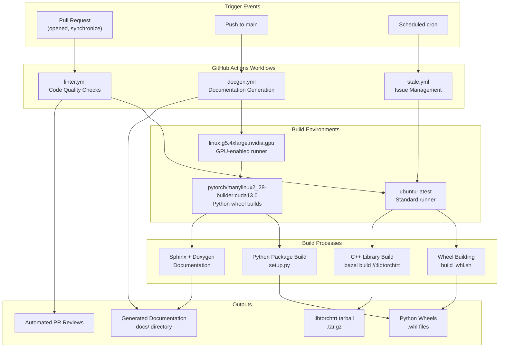
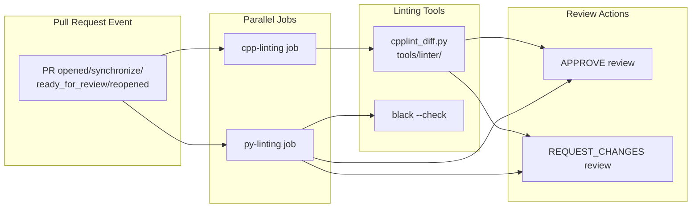
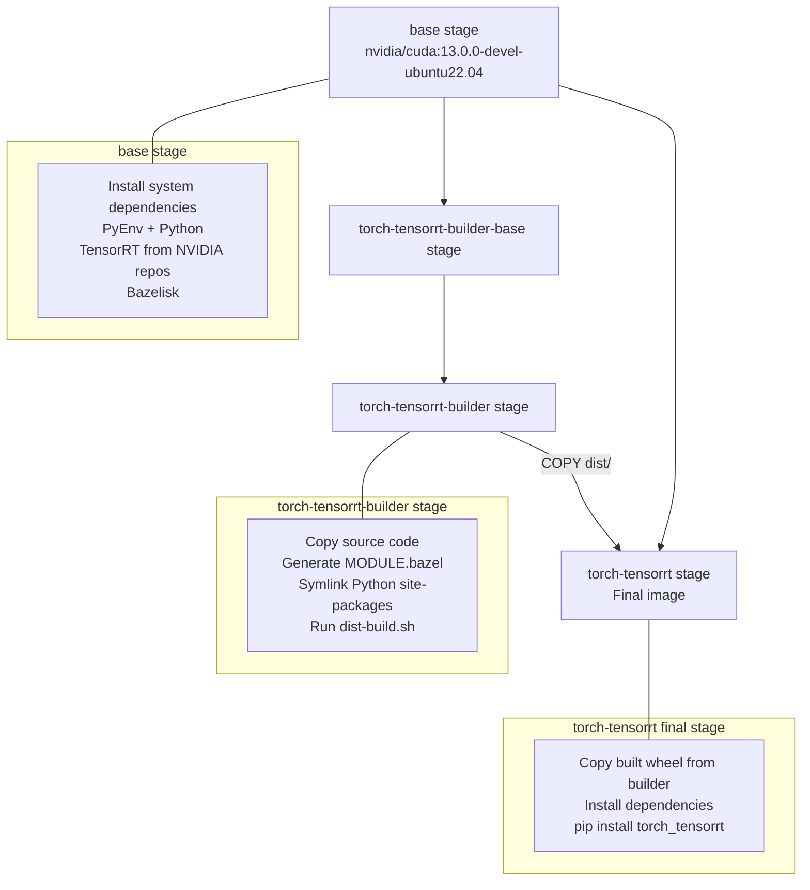
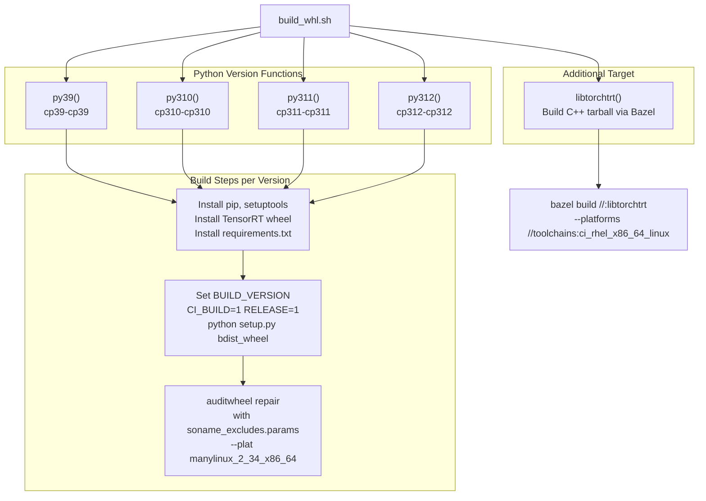

<!-- source: DeepWiki mcp.deepwiki.com · repo pytorch/TensorRT · page 7.4 CI/CD Pipeline · fetched 2026-10-21 -->

# CI/CD Pipeline

<details>
<summary>Relevant source files</summary>

The following files were used as context for generating this wiki page:

- [.github/scripts/filter-matrix.py](.github/scripts/filter-matrix.py)
- [.github/scripts/run_cpp_linter.py](.github/scripts/run_cpp_linter.py)
- [.github/scripts/run_py_linter.py](.github/scripts/run_py_linter.py)
- [.github/workflows/blossom-ci.yml](.github/workflows/blossom-ci.yml)
- [.github/workflows/build-test-linux-aarch64-jetpack.yml](.github/workflows/build-test-linux-aarch64-jetpack.yml)
- [.github/workflows/build-test-linux-aarch64.yml](.github/workflows/build-test-linux-aarch64.yml)
- [.github/workflows/build-test-linux-x86_64.yml](.github/workflows/build-test-linux-x86_64.yml)
- [.github/workflows/build-test-linux-x86_64_rtx.yml](.github/workflows/build-test-linux-x86_64_rtx.yml)
- [.github/workflows/build-test-windows.yml](.github/workflows/build-test-windows.yml)
- [.github/workflows/build-test-windows_rtx.yml](.github/workflows/build-test-windows_rtx.yml)
- [.github/workflows/docgen.yml](.github/workflows/docgen.yml)
- [.github/workflows/linter.yml](.github/workflows/linter.yml)
- [.github/workflows/stale.yml](.github/workflows/stale.yml)
- [docker/Dockerfile](docker/Dockerfile)
- [docker/Dockerfile.docs](docker/Dockerfile.docs)
- [docker/README.md](docker/README.md)
- [docker/dist-build.sh](docker/dist-build.sh)
- [docs/_sources/contributors/conversion.rst.txt](docs/_sources/contributors/conversion.rst.txt)
- [docs/_sources/contributors/lowering.rst.txt](docs/_sources/contributors/lowering.rst.txt)
- [docs/_sources/contributors/partitioning.rst.txt](docs/_sources/contributors/partitioning.rst.txt)
- [docs/_sources/contributors/phases.rst.txt](docs/_sources/contributors/phases.rst.txt)
- [docs/_sources/contributors/system_overview.rst.txt](docs/_sources/contributors/system_overview.rst.txt)
- [docs/_sources/tutorials/installation.rst.txt](docs/_sources/tutorials/installation.rst.txt)
- [docs/contributors/conversion.html](docs/contributors/conversion.html)
- [docs/contributors/lowering.html](docs/contributors/lowering.html)
- [docs/contributors/phases.html](docs/contributors/phases.html)
- [docs/contributors/system_overview.html](docs/contributors/system_overview.html)
- [docs/contributors/writing_converters.html](docs/contributors/writing_converters.html)
- [docs/sitemap.xml](docs/sitemap.xml)
- [docs/tutorials/installation.html](docs/tutorials/installation.html)
- [docsrc/getting_started/installation.rst](docsrc/getting_started/installation.rst)
- [docsrc/getting_started/jetpack.rst](docsrc/getting_started/jetpack.rst)
- [tests/py/dynamo/conversion/test_reshape_aten.py](tests/py/dynamo/conversion/test_reshape_aten.py)

</details>


This document describes the Continuous Integration and Continuous Deployment (CI/CD) infrastructure for Torch-TensorRT, including GitHub Actions workflows, Docker-based build environments, wheel packaging automation, and release processes. For information about the build system architecture itself, see [Build System Architecture](#6.1). For details on running tests locally, see [Testing Infrastructure](#6.5).

## Purpose and Scope

The CI/CD pipeline automates:
- Code quality enforcement through linting
- Documentation generation and deployment
- Python wheel building for multiple Python versions (3.9-3.12)
- C++ library tarball creation
- Multi-platform Docker image builds
- Release artifact publishing

---

## CI/CD Architecture Overview



**Sources:** [.github/workflows/docgen.yml:1-71](), [.github/workflows/linter.yml:1-87](), [.github/workflows/stale.yml:1-24]()

---

## GitHub Actions Workflows

### Documentation Generation Workflow

The `docgen.yml` workflow automatically regenerates and commits documentation on every push to the main branch.

**Workflow Configuration:**

| Property | Value |
|----------|-------|
| Trigger | Push to `main` branch |
| Runner | `linux.g5.4xlarge.nvidia.gpu` |
| Container | `pytorch/manylinux2_28-builder:cuda13.0` |
| GPU Support | Yes (`--gpus all`) |
| Python Version | 3.11 |

**Execution Steps:**

1. **Environment Setup**: Sets `CUDA_HOME=/usr/local/cuda-13.0`, configures safe directory for git operations
2. **Dependency Installation**: Installs PyTorch nightly, numpy, pyyaml via pip with CUDA 13.0 index
3. **Pre-build Script**: Executes `packaging/pre_build_script.sh` for system preparation
4. **Package Build**: Installs torch_tensorrt from source using nightly PyTorch
5. **Documentation Generation**: 
   - Installs Doxygen and Pandoc via dnf package manager
   - Installs Python documentation dependencies from `docsrc/requirements.txt`
   - Runs `make html` in `docsrc/` directory to build Sphinx documentation
6. **Auto-commit**: Uses `stefanzweifel/git-auto-commit-action@v4` to commit generated docs with message pattern: `"docs: [Automated] Regenerating documentation for <short-sha>"`

**Concurrency Control:** Uses workflow-level concurrency with `cancel-in-progress: true` to prevent duplicate builds.

**Sources:** [.github/workflows/docgen.yml:1-71]()

---

### Code Linting Workflow

The `linter.yml` workflow enforces code quality standards for both Python and C++ code on pull requests.



**Python Linting Job:**
- Tool: `black` (Python code formatter)
- Script: `.github/scripts/run_py_linter.py`
- Check: `python3 -m black --check .`
- On failure: Generates diff with `python3 -m black --diff --no-color .` and posts review requesting changes

**C++ Linting Job:**
- Tool: Custom `cpplint_diff.py` wrapper
- Script: `.github/scripts/run_cpp_linter.py`
- Check: `python3 tools/linter/cpplint_diff.py --no-color //...`
- On failure: Posts formatted diff in PR review

Both jobs use the GitHub API via PyGithub to create automated reviews on the PR's base commit, either approving or requesting changes based on linting results.

**Sources:** [.github/workflows/linter.yml:1-87](), [.github/scripts/run_py_linter.py:1-43](), [.github/scripts/run_cpp_linter.py:1-44]()

---

### Stale Issue Management

The `stale.yml` workflow automatically marks and closes inactive issues and pull requests.

**Configuration:**

| Parameter | Value |
|-----------|-------|
| Schedule | Daily at midnight (`0 0 * * *`) |
| Stale after | 90 days of inactivity |
| Close after | 10 additional days |
| Stale label | `No Activity` |
| Exempt issue labels | `feature request` |
| Exempt PR labels | `WIP` |

**Messages:**
- Issues: "This issue has not seen activity for 90 days, Remove stale label or comment or this will be closed in 10 days"
- PRs: "This PR has not seen activity for 90 days, Remove stale label or comment or this will be closed in 10 days"

**Sources:** [.github/workflows/stale.yml:1-24]()

---

## Docker Build Infrastructure

### Multi-Stage Dockerfile Architecture

The primary Dockerfile uses a three-stage build process for efficiency and reproducibility.



**Stage 1: base**
- Base image: `nvidia/cuda:13.0.0-devel-ubuntu22.04` (configurable via `BASE_IMG` arg)
- Installs system dependencies including build tools, SSL libraries, compression libraries
- Sets up PyEnv and installs specified Python version (default 3.11)
- Installs TensorRT packages matching `TENSORRT_VERSION` build arg from NVIDIA APT repository
- Installs Bazelisk (v1.25.0) as `/usr/bin/bazel`

**Stage 2: torch-tensorrt-builder-base**
- Inherits from base
- Installs additional build tools: `python3-setuptools`, `ninja-build`
- Configures locale (`en_US.UTF-8`)

**Stage 3: torch-tensorrt-builder**
- Inherits from torch-tensorrt-builder-base
- Installs `envsubst` for template substitution
- Copies source code to `/workspace/torch_tensorrt/src`
- Generates `MODULE.bazel` from `docker/MODULE.bazel.docker` template using envsubst
- Symlinks PyEnv Python site-packages to `/opt/python3/` for package sourcing
- Ensures CUDA symlink matches base image version
- Executes `docker/dist-build.sh` to build both Python wheels and C++ tarball

**Stage 4: torch-tensorrt (final)**
- Inherits from base (not builder, for smaller image size)
- Copies built wheel from builder stage: `/workspace/torch_tensorrt/src/dist/` → `.`
- Installs requirements and torch_tensorrt wheel
- Moves wheel to `/opt/torch_tensorrt/dist/` and cleans up temporary files
- Sets environment variables:
  - `LD_LIBRARY_PATH`: Includes torch, torch_tensorrt, and system libraries
  - `PATH`: Includes torch_tensorrt bin directory

**Sources:** [docker/Dockerfile:1-125]()

---

### CI-Specific Docker Image

The `py/ci/Dockerfile.ci` provides a lightweight CI environment for wheel builds.

**Base Image:** `pytorch/manylinux2_28-builder:cuda12.8`

**Installed Components:**
- `ninja-build` for faster compilation
- TensorRT 10.9.0.34 tarball downloaded from NVIDIA and extracted
- Bazelisk 1.17.0 as `/usr/bin/bazel`
- Working directory set to `/workspace`

**Environment Variables:**
- `TENSORRT_DIR=/TensorRT-10.9.0.34`
- `TENSORRT_VERSION=10.9.0`

This image is designed for automated wheel building in CI environments where TensorRT is not pre-installed.

**Sources:** [py/ci/Dockerfile.ci:1-21]()

---

## Python Wheel Building Process

### Distribution Build Script

The `dist-build.sh` script orchestrates the build of both Python wheels and C++ libraries.

**Build Command:**
```bash
python -m pip wheel . --extra-index-url https://download.pytorch.org/whl/nightly/cu130 -w dist
```

**Execution Flow:**
1. Limits pip version to `<=23.1` (TensorRT restriction)
2. Installs wheel package and requirements from `py/requirements.txt`
3. Builds wheel with `MAX_JOBS=4` parallelism
4. Installs additional packages: `ipywidgets`, `widgetsnbextension`, `timm`
5. Test installs: Uninstalls any existing torch_tensorrt, then installs newly built wheel

**Sources:** [docker/dist-build.sh:1-23]()

---

### Multi-Python Version Wheel Builder

The `build_whl.sh` script builds manylinux-compliant wheels for multiple Python versions.



**Python Version Build Function Structure:**

Each Python version function (e.g., `py39()`) follows this pattern:

1. **Set Environment Variables:**
   - `PY_BUILD_CODE`: e.g., `cp39-cp39` (CPython 3.9)
   - `PY_VERSION`: e.g., `3.9`
   - `PY_DIR`: e.g., `/opt/python/cp39-cp39`
   - `PY_PKG_DIR`: Site-packages directory

2. **Call `build_wheel()`:**
   - Upgrades pip and setuptools
   - Installs TensorRT wheel from `${TENSORRT_DIR}/python/`
   - Installs requirements from `py/requirements.txt`
   - Computes `BUILD_VERSION` dynamically via `versions.py`
   - Builds wheel: `CI_BUILD=1 RELEASE=1 python setup.py bdist_wheel`

3. **Call `patch_wheel()`:**
   - Installs `auditwheel` tool
   - Runs `auditwheel repair` with exclusions from `py/ci/soname_excludes.params`
   - Target platform: `manylinux_2_34_x86_64`
   - Excludes CUDA, PyTorch, and TensorRT shared libraries (see soname exclusions below)

**libtorchtrt C++ Tarball Build:**

The `libtorchtrt()` function builds the standalone C++ library:
- Uses Python 3.10 environment
- Builds via Bazel: `bazel build //:libtorchtrt --platforms //toolchains:ci_rhel_x86_64_linux -c opt`
- Extracts version information using `versions.py` module
- Renames tarball to: `libtorchtrt-{TORCHTRT_VERSION}-tensorrt{TRT_VERSION}-cuda{CUDA_VERSION}-libtorch{TORCH_VERSION}-x86_64-linux.tar.gz`
- Places in `py/wheelhouse/`

**Sources:** [py/ci/build_whl.sh:1-97]()

---

### Shared Library Exclusions

The `soname_excludes.params` file specifies which shared libraries should be excluded from the manylinux wheel during `auditwheel repair`.

**Excluded Library Categories:**

| Category | Libraries | Reason |
|----------|-----------|--------|
| PyTorch | `libtorch*.so`, `libc10*.so`, `libcaffe2_nvrtc.so`, `libshm.so` | User provides PyTorch installation |
| CUDA | `libcuda.so*`, `libcudart*.so`, `libnvrtc.so*`, `libnvToolsExt*.so` | System/container provides CUDA |
| cuBLAS | `libcublas*.so`, `libcublasLt*.so` | CUDA Toolkit component |
| TensorRT | `libnvinfer*.so` | User installs TensorRT separately |

This approach:
- Keeps wheel size small (~10MB instead of ~1GB+)
- Allows users to choose their PyTorch/CUDA/TensorRT versions
- Requires users to have compatible CUDA and TensorRT installed at runtime

**Sources:** [py/ci/soname_excludes.params:1-44]()

---

## Python Version Support Matrix

The CI builds wheels for four Python versions, specified in `build_manifest.txt`:

```
py39  → Python 3.9
py310 → Python 3.10
py311 → Python 3.11
py312 → Python 3.12
```

These correspond to the function names in `build_whl.sh` that are called during CI builds.

**Sources:** [py/ci/build_manifest.txt:1-5]()

---

## Build Environment Variables

The following environment variables control CI builds:

| Variable | Purpose | Typical Value |
|----------|---------|---------------|
| `CUDA_HOME` | CUDA installation path | `/usr/local/cuda-13.0` or `/usr/local/cuda-12.8` |
| `TENSORRT_DIR` | TensorRT installation directory | `/TensorRT-10.9.0.34` |
| `TENSORRT_VERSION` | TensorRT version string | `10.9.0` |
| `PROJECT_DIR` | Torch-TensorRT source root | `/workspace/TensorRT` |
| `CI_BUILD` | Indicates CI environment | `1` |
| `RELEASE` | Build release version | `1` |
| `BUILD_VERSION` | Dynamic version from `versions.py` | Computed at build time |
| `MAX_JOBS` | Parallel compilation jobs | `4` (to avoid OOM) |
| `VERSION_SUFFIX` | CUDA version suffix | `cu130` |
| `CHANNEL` | PyTorch channel | `nightly` |

**Sources:** [.github/workflows/docgen.yml:19-24](), [py/ci/build_whl.sh:5-7](), [docker/dist-build.sh:1-23]()

---

## Smoke Testing

Smoke testing is currently disabled in the CI pipeline due to challenges with TensorRT installation in CI environments. The issue is documented in `packaging/smoke_test_script.sh`:

**Challenge:** TensorRT cannot be pip-installed in CI environments, and manual installation from tarballs doesn't properly set `LD_LIBRARY_PATH` even when explicitly configured.

**TODO:** Implement a custom smoke test script to verify torch_tensorrt installation despite these constraints.

**Sources:** [packaging/smoke_test_script.sh:1-6]()

---

## Docker Ignore Configuration

The `.dockerignore` file excludes unnecessary files from Docker build contexts to improve build performance:

**Excluded Categories:**
- Build artifacts: `bazel-*`, `*.tar.gz`, `*.whl`, `*.so`, `*.bin`
- Documentation: `docs/v*/**/*`, `docsrc/_build`, `docsrc/_notebooks`
- Python artifacts: `__pycache__`, `*.pyc`, `*.egg-info`, `dist`, `py/build/`, `.eggs`
- Development files: `.vscode/`, `.DS_Store`, `experiments/`, `.nox/`
- Test data: `tests/py/data`, `tests/accuracy/datasets/data/*`
- Example binaries: `examples/**/deps/**/*`
- Environment directories: `env/`, `env/**/*`

**Sources:** [.dockerignore:1-65]()

---

## Integration with Build System

The CI/CD pipeline integrates with the broader build system:

- **Bazel Integration**: Uses `bazel build //:libtorchtrt` for C++ library builds with platform-specific toolchains
- **setup.py Orchestration**: Python package builds invoke Bazel through `setup.py` as described in [Build System Architecture](#6.1)
- **Version Management**: Dynamic version computation using `versions.py` module for consistent versioning
- **Multi-platform Support**: Platform detection and toolchain selection covered in [Platform-Specific Configurations](#6.3)

For details on the underlying build system, see [Build System Architecture](#6.1). For information on compiling from source locally, see [Building from Source](#6.2).

---

