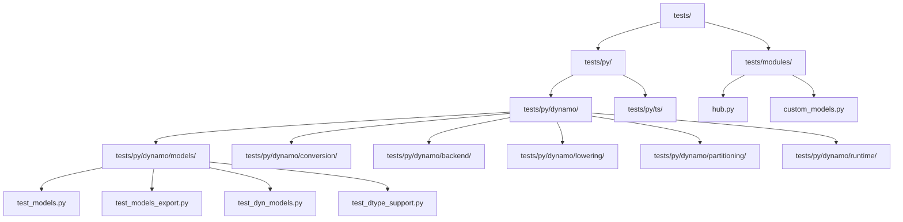
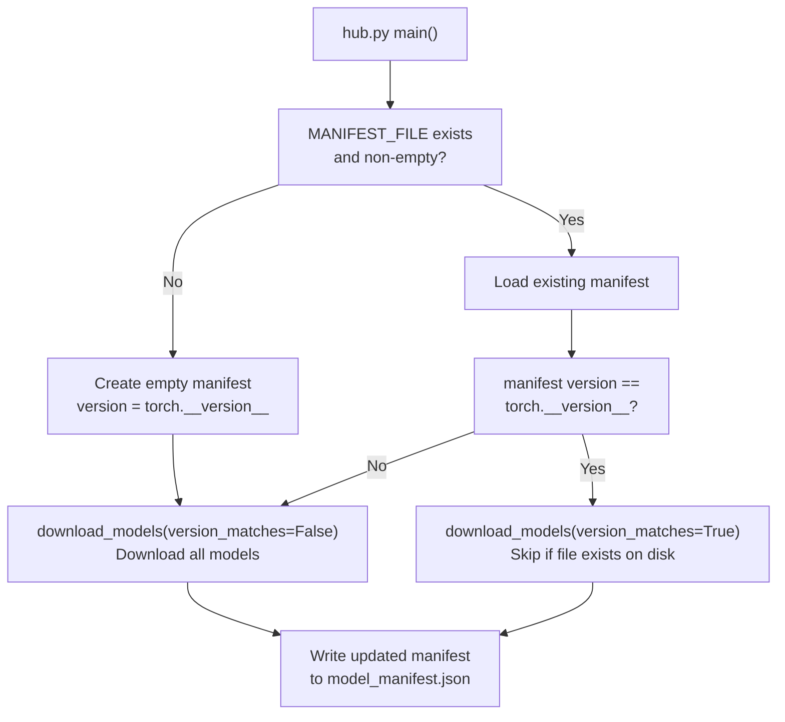
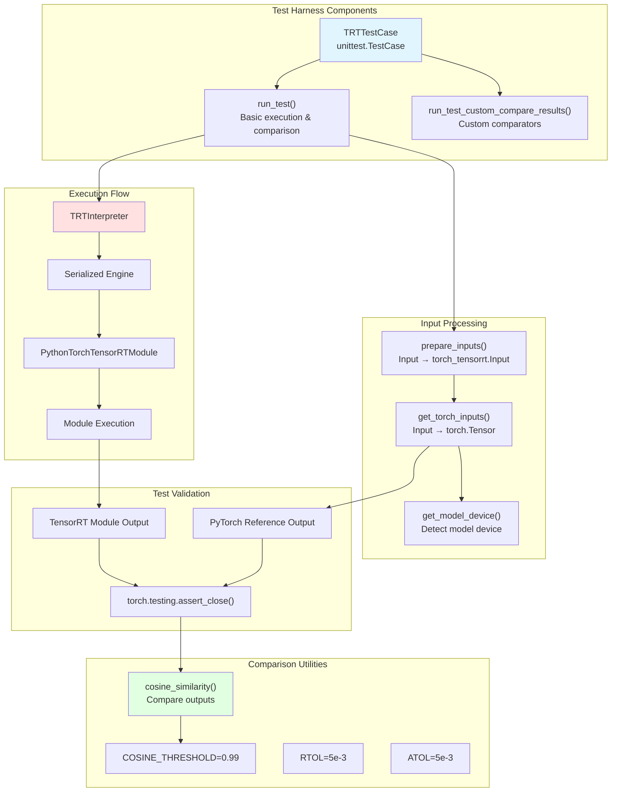
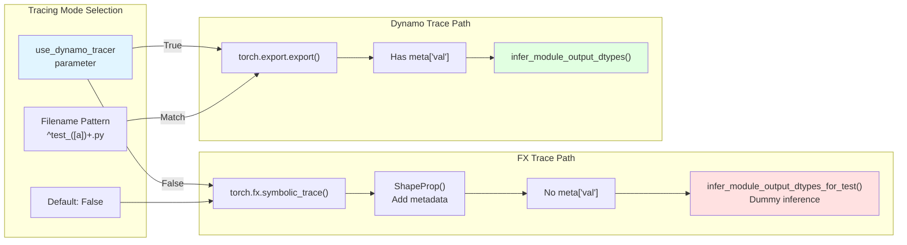
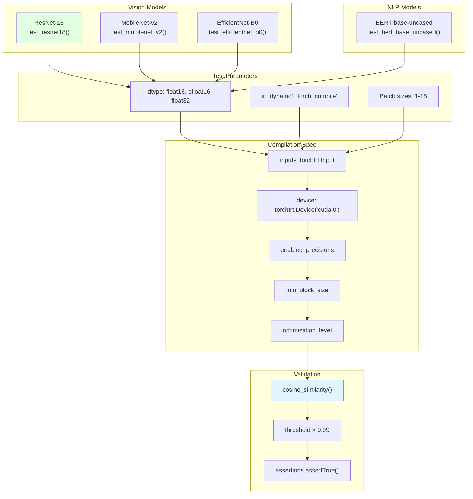
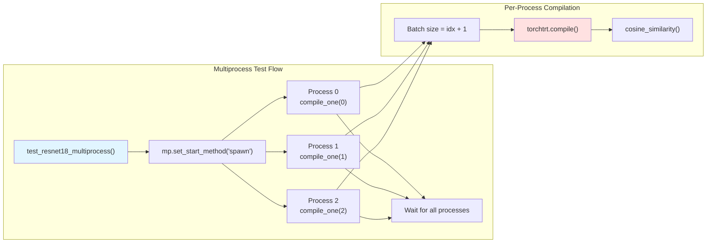
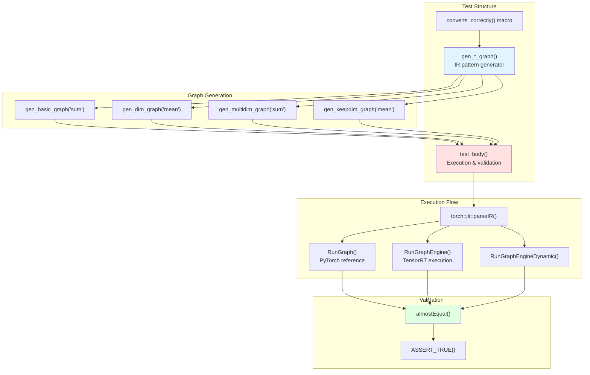
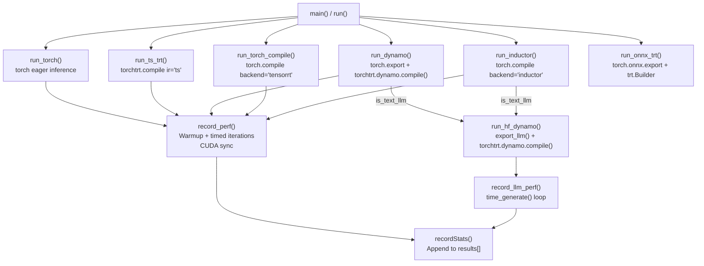

<!-- source: DeepWiki mcp.deepwiki.com · repo pytorch/TensorRT · page 7.5 Testing Infrastructure · fetched 2026-10-21 -->

# Testing Infrastructure

<details>
<summary>Relevant source files</summary>

The following files were used as context for generating this wiki page:

- [.dockerignore](.dockerignore)
- [docker/WORKSPACE.ngc](docker/WORKSPACE.ngc)
- [examples/dynamo/torch_compile_gpt2.py](examples/dynamo/torch_compile_gpt2.py)
- [examples/int8/benchmark/benchmark.cpp](examples/int8/benchmark/benchmark.cpp)
- [examples/int8/training/vgg16/README.md](examples/int8/training/vgg16/README.md)
- [examples/int8/training/vgg16/export_qat.py](examples/int8/training/vgg16/export_qat.py)
- [examples/int8/training/vgg16/finetune_qat.py](examples/int8/training/vgg16/finetune_qat.py)
- [examples/int8/training/vgg16/requirements.txt](examples/int8/training/vgg16/requirements.txt)
- [noxfile.py](noxfile.py)
- [py/torch_tensorrt/__init__.py](py/torch_tensorrt/__init__.py)
- [py/torch_tensorrt/dynamo/lowering/passes/remove_sym_nodes.py](py/torch_tensorrt/dynamo/lowering/passes/remove_sym_nodes.py)
- [py/torch_tensorrt/dynamo/partitioning/common.py](py/torch_tensorrt/dynamo/partitioning/common.py)
- [requirements-dev.txt](requirements-dev.txt)
- [tests/modules/custom_models.py](tests/modules/custom_models.py)
- [tests/modules/hub.py](tests/modules/hub.py)
- [tests/modules/requirements.txt](tests/modules/requirements.txt)
- [tests/py/dynamo/models/test_dtype_support.py](tests/py/dynamo/models/test_dtype_support.py)
- [tests/py/dynamo/models/test_dyn_models.py](tests/py/dynamo/models/test_dyn_models.py)
- [tests/py/dynamo/models/test_models.py](tests/py/dynamo/models/test_models.py)
- [tests/py/dynamo/models/test_models_export.py](tests/py/dynamo/models/test_models_export.py)
- [tests/py/dynamo/models/test_unbounded_symint.py](tests/py/dynamo/models/test_unbounded_symint.py)
- [tests/py/ts/models/test_models.py](tests/py/ts/models/test_models.py)
- [tests/py/ts/models/test_multiple_registered_engines.py](tests/py/ts/models/test_multiple_registered_engines.py)
- [tools/perf/README.md](tools/perf/README.md)
- [tools/perf/accumulate_results.py](tools/perf/accumulate_results.py)
- [tools/perf/benchmark.sh](tools/perf/benchmark.sh)
- [tools/perf/custom_models.py](tools/perf/custom_models.py)
- [tools/perf/hub.py](tools/perf/hub.py)
- [tools/perf/perf_run.py](tools/perf/perf_run.py)
- [tools/perf/requirements.txt](tools/perf/requirements.txt)
- [tools/perf/utils.py](tools/perf/utils.py)

</details>


This page documents the testing infrastructure used to validate Torch-TensorRT functionality across compilation, conversion, and runtime execution. The testing system includes unit tests, converter tests, model tests, and performance benchmarking tools, organized by test level using the `nox` automation tool.

For information about building from source, see page [7.2](). For CI/CD pipeline details, see page [7.4]().

---

## Test Organization and Structure

The Torch-TensorRT testing infrastructure is organized into two broad areas:

- **Python tests** (`tests/py/`) — end-to-end model validation, converter tests, and runtime tests for the Dynamo and TorchScript frontends
- **Performance benchmarking** (`tools/perf/`) — throughput and latency measurement across multiple backends

Test execution is managed by `nox`, configured in [noxfile.py]() at the root of the repository. Individual Python tests use `pytest`.

### Test Directory Structure

**Test Directory Layout**



Sources: [tests/py/dynamo/models/test_models.py:1-10](), [tests/py/dynamo/models/test_models_export.py:1-10](), [tests/modules/hub.py:1-20]()

---

## Nox Session Configuration

[noxfile.py]() defines all test sessions and their dependencies. Sessions are divided into three levels based on their scope and the resources required.

### Test Level Hierarchy

| Level | Nox Sessions | Purpose |
|-------|-------------|---------|
| **L0** | `l0_api_tests`, `l0_dynamo_tests`, `l0_dynamo_backend_tests`, `l0_dynamo_converter_tests`, `l0_dynamo_lower_tests`, `l0_dynamo_partitioning_tests`, `l0_dynamo_runtime_tests` | Fast correctness checks suitable for PR validation |
| **L1** | `l1_model_tests`, `l1_dynamo_tests`, `l1_int8_accuracy_tests` | Standard model compilation and accuracy tests |
| **L2** | `l2_trt_compatibility_tests`, `l2_multi_gpu_tests` | TensorRT interoperability and multi-GPU validation |

The default session (run when no session is specified) is `l0_api_tests` for the current Python version:

[noxfile.py:34-36]()

### Session Composition

Each L0/L1/L2 session is composed from helper functions that run specific sub-test groups. For example, `l0_dynamo_tests` runs backend, converter, and lowering pass tests:

[noxfile.py:386-393]()

**Nox Session Call Graph**

```mermaid
graph TB
    L0API["l0_api_tests()"]
    L0DYN["l0_dynamo_tests()"]
    L1MOD["l1_model_tests()"]
    L1DYN["l1_dynamo_tests()"]
    L2TRT["l2_trt_compatibility_tests()"]
    L2GPU["l2_multi_gpu_tests()"]

    INSTDEPS["install_deps()"]
    INSTTRT["install_torch_trt()"]
    DLMOD["download_models()"]
    RUNBASE["run_base_tests()"]
    RUNBACK["run_dynamo_backend_tests()"]
    RUNCONV["run_dynamo_converter_tests()"]
    RUNLOW["run_dynamo_lower_tests()"]
    RUNPART["run_dynamo_partitioning_tests()"]
    RUNRUN["run_dynamo_runtime_tests()"]
    RUNMCOMP["run_dynamo_model_compile_tests()"]
    RUNMEXP["run_dynamo_model_export_tests()"]
    RUNTRTCOMP["run_trt_compatibility_tests()"]
    RUNMGPU["run_multi_gpu_tests()"]
    CLEANUP["cleanup()"]

    L0API --> INSTDEPS
    L0API --> INSTTRT
    L0API --> DLMOD
    L0API --> RUNBASE
    L0API --> CLEANUP

    L0DYN --> INSTDEPS
    L0DYN --> INSTTRT
    L0DYN --> RUNBACK
    L0DYN --> RUNCONV
    L0DYN --> RUNLOW
    L0DYN --> CLEANUP

    L1MOD --> DLMOD
    L1MOD --> RUNMCOMP
    L1MOD --> RUNMEXP
    L1MOD --> CLEANUP

    L1DYN --> RUNPART
    L1DYN --> RUNRUN
    L1DYN --> CLEANUP

    L2TRT --> RUNTRTCOMP
    L2TRT --> CLEANUP

    L2GPU --> DLMOD
    L2GPU --> RUNMGPU
    L2GPU --> CLEANUP
```



Sources: [noxfile.py:377-498]()

### Environment Variables

The nox configuration reads three environment variables:

| Variable | Default | Effect |
|----------|---------|--------|
| `PYT_PATH` | `/usr/local/lib/python3.12/dist-packages` | Path to system Python packages; passed as `PYTHONPATH` when `USE_HOST_DEPS=1` |
| `TOP_DIR` | Directory of `noxfile.py` | Root for resolving test and source paths |
| `USE_HOST_DEPS` | `0` | When `1`, skips `install_deps()` and `install_torch_trt()`, uses system-installed packages |

Sources: [noxfile.py:8-27]()

### Supported Python Versions

Sessions are parameterized over `SUPPORTED_PYTHON_VERSIONS = ["3.9", "3.10", "3.11", "3.12"]`, producing one virtual environment per version.

[noxfile.py:32-33]()

---

## Model Hub Management

The `tests/modules/` directory contains scripts for generating and caching JIT model files used by the TorchScript-frontend integration tests.

### hub.py

[tests/modules/hub.py]() produces traced and scripted JIT files for a fixed set of models defined in `to_test_models`. It uses a manifest file (`model_manifest.json`) to avoid re-downloading models when the PyTorch version has not changed.

**Models registered in `to_test_models`:**

| Key | Model Class | JIT Format |
|-----|-------------|-----------|
| `pooling` | `cm.Pool` | trace |
| `module_fallback` | `cm.ModuleFallbackMain` | script |
| `loop_fallback_eval` | `cm.LoopFallbackEval` | script |
| `loop_fallback_no_eval` | `cm.LoopFallbackNoEval` | script |
| `conditional` | `cm.FallbackIf` | script |
| `inplace_op_if` | `cm.FallbackInplaceOPIf` | script |
| `standard_tensor_input` | `cm.StandardTensorInput` | script |
| `tuple_input` | `cm.TupleInput` | script |
| `list_input` | `cm.ListInput` | script |
| `tuple_input_output` | `cm.TupleInputOutput` | script |
| `list_input_output` | `cm.ListInputOutput` | script |
| `list_input_tuple_output` | `cm.ListInputTupleOutput` | script |

Sources: [tests/modules/hub.py:23-40]()

Custom model definitions are in [tests/modules/custom_models.py](). Model classes there cover pooling, nested module fallback, loop-based fallback, conditional branching, and various input/output collection types (tuple, list, mixed).

### Manifest Caching Logic

**Model Manifest Caching Flow**



Sources: [tests/modules/hub.py:94-138]()

### cleanup()

After test sessions, `noxfile.py` calls `cleanup()` to delete generated `.jit.pt` files from both `tests/modules/` and `tests/py/`, as well as VGG training artifacts:

[noxfile.py:171-183]()

---

## Python Test Infrastructure

### Test Harness Architecture

The test harness provides utilities for running TensorRT-compiled modules and comparing outputs against PyTorch reference implementations.



**Sources:** [tests/py/dynamo/conversion/harness.py:186-262](), [py/torch_tensorrt/dynamo/utils.py:173-184](), [py/torch_tensorrt/dynamo/utils.py:300-351](), [py/torch_tensorrt/dynamo/conversion/_TRTInterpreter.py:80-560]()

### Test Execution Methods

The `TRTTestCase` class provides two primary test execution methods:

| Method | Purpose | Key Parameters |
|--------|---------|----------------|
| `run_test()` | Standard test execution with default comparison | `mod`, `inputs`, `interpreter`, `rtol`, `atol`, `check_dtype` |
| `run_test_custom_compare_results()` | Custom comparison logic for complex outputs | `mod`, `inputs`, `expected_ops`, `interpreter`, `comparators` |

**Sources:** [tests/py/dynamo/conversion/harness.py:191-262](), [tests/py/dynamo/conversion/harness.py:264-338]()

### Dynamo Tracer Integration

The test harness supports two tracing modes for converter tests:



**Sources:** [tests/py/dynamo/conversion/harness.py:94-109](), [tests/py/dynamo/conversion/harness.py:44-90](), [tests/py/dynamo/conversion/harness.py:115-161]()

---

## Model Test Categories

### Standard Model Tests

Model tests validate end-to-end compilation and execution of popular neural network architectures across different precision modes and hardware configurations.



**Sources:** [tests/py/dynamo/models/test_models.py:30-425](), [tests/py/dynamo/models/test_models_export.py:27-211]()

### Dynamic Shape Tests

Dynamic shape tests validate models with variable input dimensions using optimization profiles:

| Test | Dynamic Dimension | Range |
|------|------------------|-------|
| `test_base_dynamic()` | Batch size | min=1, opt=4, max=8 |
| `test_base_dynamic_fallback()` | Batch size | min=2, opt=4, max=8 |
| `test_resnet18_dynamic()` | Batch size | min=1, opt=8, max=16 |

**Sources:** [tests/py/dynamo/models/test_dyn_models.py:18-69](), [tests/py/dynamo/models/test_dyn_models.py:73-149]()

### Multiprocess Compilation Tests



**Sources:** [tests/py/dynamo/models/test_models.py:60-103]()

---

## C++ Test Infrastructure

### Converter Tests

C++ converter tests validate individual operator conversions using the TorchScript frontend:



**Sources:** [tests/core/conversion/converters/test_reduce.cpp:11-81](), [tests/core/conversion/converters/test_reduce.cpp:84-143]()

### Test Macros

The C++ test infrastructure uses macros to reduce boilerplate:

```cpp
#define converts_correctly(op, name)                 \
  TEST(Converters, ATen##name##ConvertsCorrectly) {  \
    const auto graph = gen_basic_graph(#op);         \
    auto in = at::randint(-5, 5, {4, 4}, at::kCUDA); \
    test_body(graph, in);                            \
  }

converts_correctly(sum, Sum);
converts_correctly(prod, Prod);
converts_correctly(mean, Mean);
```

**Sources:** [tests/core/conversion/converters/test_reduce.cpp:84-93]()

---

## Performance Benchmarking Tools

The `tools/perf/` directory contains a standalone benchmarking suite for measuring inference throughput and latency across multiple backends.

### perf_run.py

[tools/perf/perf_run.py]() is the primary benchmarking script. It accepts a model (TorchScript or PyTorch), backend selection, input shapes, precision, and batch size as arguments and records timing statistics.

**Supported backends:**

| Backend identifier | Description |
|-------------------|-------------|
| `torch` | Eager PyTorch |
| `ts_trt` | Torch-TensorRT TorchScript frontend |
| `dynamo` | Torch-TensorRT Dynamo frontend |
| `torch_compile` | `torch.compile` with `backend="tensorrt"` |
| `inductor` | `torch.compile` with `backend="inductor"` |
| `onnx_trt` | ONNX export → TensorRT engine |

Sources: [tools/perf/perf_run.py:33-41]()

**perf_run.py Backend Execution Functions**



Sources: [tools/perf/perf_run.py:57-146](), [tools/perf/perf_run.py:587-672]()

### recordStats() Output

`recordStats()` computes and appends a row to the global `results` list. The row contains:

| Field | Description |
|-------|-------------|
| `Backend` | Backend name string |
| `Precision` | Precision string (e.g., `fp16`) |
| `Batch size` | Integer batch size |
| `Median(FPS)` | Median frames per second |
| `Mean(FPS)` | Mean frames per second |
| `Median-Latency(ms)` | Median per-iteration latency in ms |
| `Mean-Latency(ms)` | Mean latency |
| `Latency-StdDev(ms)` | Standard deviation of latency |
| `Compile Time(s)` | Time to compile model (seconds) |

At the end, results are printed as a `pandas.DataFrame` and optionally saved to CSV via `--report`.

Sources: [tools/perf/perf_run.py:57-82](), [tools/perf/perf_run.py:872-882]()

### BENCHMARK_MODELS Registry

[tools/perf/utils.py]() defines a `ModelStorage` class that acts as a lazy dictionary. Accessing `BENCHMARK_MODELS["vgg16"]` returns the model and path specification without loading all models eagerly.

Registered model names:

```
vgg16, alexnet, resnet50, efficientnet_b0, vit, vit_large, google_vit,
bert_base_uncased, sd1.4_unet, sd2.1_unet, sd2.1_vae_decoder,
meta-llama/Llama-2-7b-chat-hf, gpt2, meta-llama/Meta-Llama-3-8B,
meta-llama/Meta-Llama-3.1-8B-Instruct, apple/DCLM-7B,
mistralai/Mistral-7B-Instruct-v0.3, microsoft/Phi-3-mini-4k-instruct,
monai_unet
```

Sources: [tools/perf/utils.py:12-32](), [tools/perf/utils.py:47-143]()

### benchmark.sh

[tools/perf/benchmark.sh]() is the internal batch benchmarking script. It loops over batch sizes (1, 2, 4, 8, 16, 32, 64, 128, 256) and all backends for VGG16, AlexNet, ResNet-50, ViT, ViT-Large, EfficientNet-B0, Stable Diffusion UNets, and HuggingFace BERT, writing one CSV per combination.

[tools/perf/accumulate_results.py]() (`concat_all_results()`) merges all per-run CSVs into a single `all_outputs.csv` file.

Sources: [tools/perf/benchmark.sh:1-174](), [tools/perf/accumulate_results.py:1-23]()

### Benchmarking Dependencies

[tools/perf/requirements.txt]() lists additional packages required by the benchmarking suite beyond the core Torch-TensorRT dependencies:

```
numpy, argparse, pyyaml, onnx, pandas
transformers, diffusers, timm, monai
```

Sources: [tools/perf/requirements.txt:1-10]()

---


## Running Tests

### Python Test Execution via Nox

```bash
# Run default session (l0_api_tests for current Python version)
nox

# Run specific session
nox -s l0_dynamo_tests-3.12

# Run with system Python packages
USE_HOST_DEPS=1 nox -s l0_dynamo_tests-3.12

# Override root directory
TOP_DIR=/workspace nox -s l0_dynamo_tests-3.12
```

Sources: [noxfile.py:1-36]()

### Python Test Execution via pytest

Tests can also be run directly with `pytest` using markers:

```bash
# Run all unit tests
pytest tests/py/dynamo/models/ -m unit

# Run critical tests only
pytest tests/py/dynamo/models/ -m critical

# Run specific model test
pytest tests/py/dynamo/models/test_models.py::test_resnet18

# Skip hardware-compatibility tests (as done in l0_dynamo_runtime_tests)
pytest tests/py/dynamo/runtime/ -k "not hw_compat"
```

Sources: [noxfile.py:247-258](), [tests/py/dynamo/models/test_models.py:25-58]()

### Converter Test Harness Usage

The converter test harness provides utilities for testing operator conversions:

```python
from tests.py.dynamo.conversion.harness import TRTTestCase

class TestMyConverter(TRTTestCase):
    def test_my_op(self):
        mod = MyModule()
        inputs = [torch.randn(4, 4).cuda()]
        
        # Create interpreter with settings
        interpreter = TRTInterpreter(
            mod, 
            inputs,
            compilation_settings=CompilationSettings(...)
        )
        
        # Run test with default comparison
        self.run_test(mod, inputs, interpreter)
```

**Sources:** [tests/py/dynamo/conversion/harness.py:186-262]()

### Test Comparison Utilities

| Utility | Purpose | Threshold |
|---------|---------|-----------|
| `cosine_similarity()` | Compare tensor similarity | > 0.99 |
| `torch.testing.assert_close()` | Precise element-wise comparison | rtol=5e-3, atol=5e-3 |
| `almostEqual()` | C++ tensor comparison | Default tolerance |

**Sources:** [py/torch_tensorrt/dynamo/utils.py:45-48](), [py/torch_tensorrt/dynamo/utils.py:173-184](), [tests/py/dynamo/conversion/harness.py:255-262]()

---

## Test Settings and Configuration

### INT8 Accuracy Tests

`l1_int8_accuracy_tests` trains a VGG16 model on CIFAR-10 for 25 epochs (`EPOCHS = 25`), exports it, and then validates PTQ accuracy. The training step is skipped if a checkpoint already exists at `vgg16_ckpts/ckpt_epoch25.pth`.

The `finetune_model()` helper additionally runs QAT fine-tuning using `pytorch-quantization` from NVIDIA's PyPI index.

Sources: [noxfile.py:62-168](), [noxfile.py:463-469]()

### Common Compilation Settings for Tests

```python
compile_spec = {
    "inputs": [torchtrt.Input(...)],
    "device": torchtrt.Device("cuda:0"),
    "enabled_precisions": {torch.float},
    "ir": "dynamo",  # or "torch_compile"
    "pass_through_build_failures": True,
    "optimization_level": 1,
    "min_block_size": 5,
    "cache_built_engines": False,
    "reuse_cached_engines": False,
}
```

**Sources:** [tests/py/dynamo/models/test_models.py:34-47](), [py/torch_tensorrt/dynamo/_defaults.py:1-86]()

### Test-Specific Settings

```mermaid
graph TB
    subgraph "Accuracy Tests"
        ACCSETTINGS["min_block_size: 1-15"]
        ACCPRECISION["enabled_precisions: FP32/FP16/BF16"]
        ACCTHRESHOLD["cosine_threshold: 0.99"]
    end
    
    subgraph "Dynamic Shape Tests"
        DYNINPUT["Input with min/opt/max shapes"]
        DYNPROFILE["Optimization profiles"]
        DYNVALIDATE["Test multiple batch sizes"]
    end
    
    subgraph "Multiprocess Tests"
        MPSPAWN["mp.set_start_method('spawn')"]
        MPISOLATION["Isolated GPU contexts"]
        MPVALIDATE["Per-process validation"]
    end
    
    subgraph "Export Tests"
        EXPFORMAT["output_format: 'exported_program'"]
        EXPRETURN["Returns tuple outputs"]
        EXPVALIDATE["Index-based access: [0]"]
    end
    
    ACCSETTINGS --> ACCPRECISION
    ACCPRECISION --> ACCTHRESHOLD
    
    DYNINPUT --> DYNPROFILE
    DYNPROFILE --> DYNVALIDATE
    
    MPSPAWN --> MPISOLATION
    MPISOLATION --> MPVALIDATE
    
    EXPFORMAT --> EXPRETURN
    EXPRETURN --> EXPVALIDATE
    
    style ACCSETTINGS fill:#e1f5ff
    style DYNINPUT fill:#e1ffe1
    style MPSPAWN fill:#ffe1e1
```



**Sources:** [tests/py/dynamo/models/test_models.py:111-146](), [tests/py/dynamo/models/test_dyn_models.py:36-68](), [tests/py/dynamo/models/test_models_export.py:31-55]()

---

