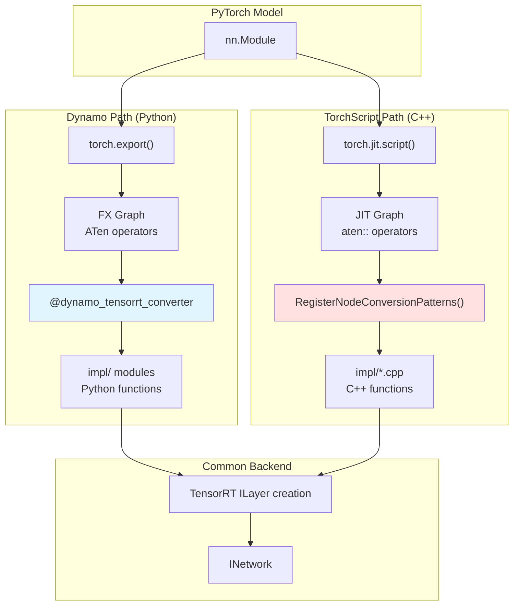
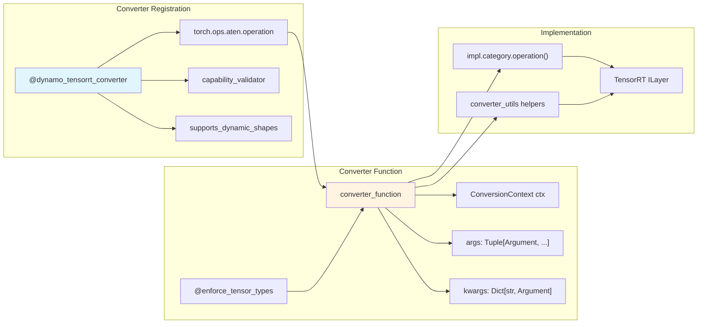
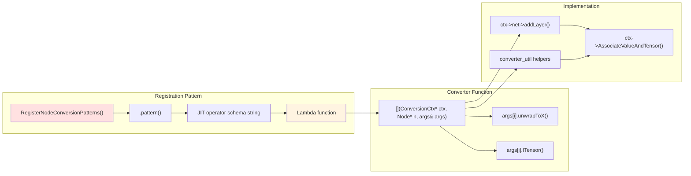
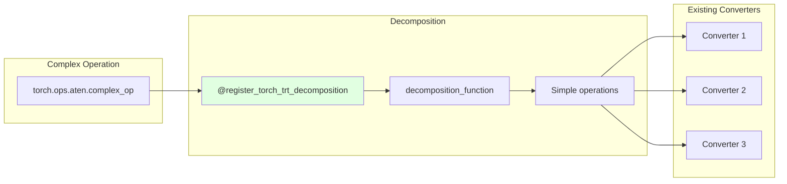
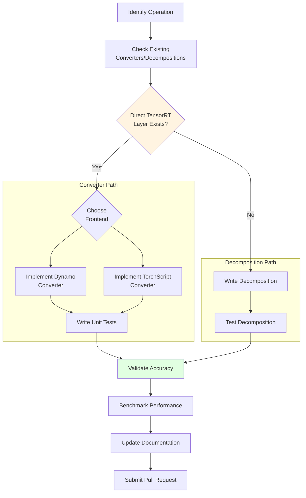

<!-- source: DeepWiki mcp.deepwiki.com · repo pytorch/TensorRT · page 7.6 Contributing Converters · fetched 2026-10-21 -->

# Contributing Converters

<details>
<summary>Relevant source files</summary>

The following files were used as context for generating this wiki page:

- [core/conversion/converters/converter_util.cpp](core/conversion/converters/converter_util.cpp)
- [core/conversion/converters/converter_util.h](core/conversion/converters/converter_util.h)
- [core/conversion/converters/impl/cast.cpp](core/conversion/converters/impl/cast.cpp)
- [core/conversion/converters/impl/select.cpp](core/conversion/converters/impl/select.cpp)
- [core/lowering/passes/reduce_to.cpp](core/lowering/passes/reduce_to.cpp)
- [core/lowering/passes/remove_nops.cpp](core/lowering/passes/remove_nops.cpp)
- [py/torch_tensorrt/dynamo/conversion/aten_ops_converters.py](py/torch_tensorrt/dynamo/conversion/aten_ops_converters.py)
- [py/torch_tensorrt/dynamo/conversion/converter_utils.py](py/torch_tensorrt/dynamo/conversion/converter_utils.py)
- [py/torch_tensorrt/dynamo/conversion/impl/__init__.py](py/torch_tensorrt/dynamo/conversion/impl/__init__.py)
- [py/torch_tensorrt/dynamo/conversion/impl/addmm.py](py/torch_tensorrt/dynamo/conversion/impl/addmm.py)
- [py/torch_tensorrt/dynamo/conversion/impl/linear.py](py/torch_tensorrt/dynamo/conversion/impl/linear.py)
- [py/torch_tensorrt/dynamo/conversion/impl/normalization/ops.py](py/torch_tensorrt/dynamo/conversion/impl/normalization/ops.py)
- [py/torch_tensorrt/dynamo/conversion/impl/slice/ops.py](py/torch_tensorrt/dynamo/conversion/impl/slice/ops.py)
- [py/torch_tensorrt/dynamo/lowering/_decomposition_groups.py](py/torch_tensorrt/dynamo/lowering/_decomposition_groups.py)
- [py/torch_tensorrt/dynamo/lowering/_decompositions.py](py/torch_tensorrt/dynamo/lowering/_decompositions.py)
- [py/torch_tensorrt/dynamo/lowering/passes/_aten_lowering_pass.py](py/torch_tensorrt/dynamo/lowering/passes/_aten_lowering_pass.py)
- [tests/core/conversion/converters/test_cast.cpp](tests/core/conversion/converters/test_cast.cpp)
- [tests/core/conversion/converters/test_select.cpp](tests/core/conversion/converters/test_select.cpp)
- [tests/core/lowering/test_reduce_to_pass.cpp](tests/core/lowering/test_reduce_to_pass.cpp)
- [tests/py/dynamo/conversion/test_addmm_aten.py](tests/py/dynamo/conversion/test_addmm_aten.py)
- [tests/py/dynamo/conversion/test_attention.py](tests/py/dynamo/conversion/test_attention.py)
- [tests/py/dynamo/conversion/test_batch_norm_aten.py](tests/py/dynamo/conversion/test_batch_norm_aten.py)
- [tests/py/dynamo/conversion/test_erf_aten.py](tests/py/dynamo/conversion/test_erf_aten.py)
- [tests/py/dynamo/conversion/test_flip_aten.py](tests/py/dynamo/conversion/test_flip_aten.py)
- [tests/py/dynamo/conversion/test_group_norm_aten.py](tests/py/dynamo/conversion/test_group_norm_aten.py)
- [tests/py/dynamo/conversion/test_layer_norm_aten.py](tests/py/dynamo/conversion/test_layer_norm_aten.py)
- [tests/py/dynamo/conversion/test_linear_aten.py](tests/py/dynamo/conversion/test_linear_aten.py)
- [tests/py/dynamo/conversion/test_neg_aten.py](tests/py/dynamo/conversion/test_neg_aten.py)
- [tests/py/dynamo/conversion/test_pdist_aten.py](tests/py/dynamo/conversion/test_pdist_aten.py)
- [tests/py/dynamo/conversion/test_rsqrt_aten.py](tests/py/dynamo/conversion/test_rsqrt_aten.py)
- [tests/py/dynamo/conversion/test_slice_aten.py](tests/py/dynamo/conversion/test_slice_aten.py)
- [tests/py/dynamo/conversion/test_tile_aten.py](tests/py/dynamo/conversion/test_tile_aten.py)
- [tests/py/dynamo/lowering/test_aten_lowering_passes.py](tests/py/dynamo/lowering/test_aten_lowering_passes.py)
- [tests/py/dynamo/lowering/test_decompositions.py](tests/py/dynamo/lowering/test_decompositions.py)

</details>


This guide explains how to add new operation converters to Torch-TensorRT, enabling support for additional PyTorch operations in TensorRT. Torch-TensorRT has two parallel converter systems: the Dynamo frontend (Python-based, for PyTorch 2.x models) and the TorchScript frontend (C++-based, for legacy models). This page provides step-by-step instructions for implementing converters in both frontends.

For information about the overall converter architecture and registry system, see [ATen Operator Conversion System](#3.2). For detailed documentation of existing converter implementations, see [Operation Converter Implementation](#5). For information about decompositions as an alternative approach, see [Decompositions and Lowering Passes](#3.3).

---

## Converter System Architecture

Torch-TensorRT maintains two independent converter implementations that target different PyTorch IR representations:



**Sources:** [py/torch_tensorrt/dynamo/conversion/aten_ops_converters.py:1-100](), [core/conversion/converters/impl/select.cpp:119-178]()

---

## Dynamo Converter Implementation

### Overview

Dynamo converters are Python functions decorated with `@dynamo_tensorrt_converter` that handle ATen operators from FX graphs. Each converter receives a `ConversionContext`, target operator, arguments, and produces TensorRT ITensors.



**Sources:** [py/torch_tensorrt/dynamo/conversion/aten_ops_converters.py:18-21](), [py/torch_tensorrt/dynamo/conversion/_ConverterRegistry.py]()

### Step 1: Choose Target Operation

Identify the PyTorch operation to support. Check if it already exists in the converter registry:

| Operation Type | Example Operators | Registry Location |
|---|---|---|
| Element-wise | `torch.ops.aten.add`, `torch.ops.aten.mul` | [aten_ops_converters.py]() |
| Reductions | `torch.ops.aten.sum`, `torch.ops.aten.mean` | [aten_ops_converters.py:1294-1326]() |
| Activations | `torch.ops.aten.relu`, `torch.ops.aten.sigmoid` | [aten_ops_converters.py:399-431]() |
| Tensor manipulation | `torch.ops.aten.slice`, `torch.ops.aten.select` | [aten_ops_converters.py:973-997]() |

**Sources:** [py/torch_tensorrt/dynamo/conversion/aten_ops_converters.py:33-48]()

### Step 2: Create Converter Function

Add the converter in `py/torch_tensorrt/dynamo/conversion/aten_ops_converters.py`:

```python
@dynamo_tensorrt_converter(
    torch.ops.aten.your_operation.default, 
    supports_dynamic_shapes=True
)
@enforce_tensor_types({
    0: (TRTTensor,),  # Enforce first argument is TRTTensor
})
def aten_ops_your_operation(
    ctx: ConversionContext,
    target: Target,
    args: Tuple[Argument, ...],
    kwargs: Dict[str, Argument],
    name: str,
) -> Union[TRTTensor, Sequence[TRTTensor]]:
    return impl.category.your_operation(
        ctx,
        target,
        SourceIR.ATEN,
        name,
        input=args[0],
        param1=args[1],
        param2=args_bounds_check(args, 2, default_value),
    )
```

**Converter function signature:**
- `ctx`: Contains TensorRT network (`ctx.net`) and compilation settings
- `target`: The PyTorch operator being converted
- `args`: Positional arguments from the FX node
- `kwargs`: Keyword arguments from the FX node
- `name`: Unique name for TensorRT layers

**Sources:** [py/torch_tensorrt/dynamo/conversion/aten_ops_converters.py:62-98]()

### Step 3: Implement Core Logic

Create the implementation in `py/torch_tensorrt/dynamo/conversion/impl/<category>/ops.py`:

```python
def your_operation(
    ctx: ConversionContext,
    target: Target,
    source_ir: Optional[SourceIR],
    name: str,
    input: TRTTensor,
    param1: Any,
    param2: Any,
) -> TRTTensor:
    # Get input properties
    input_shape = input.shape
    input_dtype = input.dtype
    
    # Create TensorRT layer
    layer = ctx.net.add_your_layer_type(input, param1, param2)
    layer.name = name
    
    # Set layer properties
    layer.set_property(value)
    
    # Return output tensor
    return layer.get_output(0)
```

**Common implementation patterns:**

| Pattern | Usage | Example |
|---|---|---|
| `get_trt_tensor()` | Convert Python value to ITensor | [converter_utils.py:492-515]() |
| `cast_trt_tensor()` | Type conversion | [converter_utils.py:147-183]() |
| `broadcast_to_same_shape()` | Broadcasting | [converter_utils.py:235-296]() |
| `get_positive_dim()` | Negative dimension handling | [converter_utils.py]() |

**Sources:** [py/torch_tensorrt/dynamo/conversion/impl/slice/ops.py:33-216](), [py/torch_tensorrt/dynamo/conversion/converter_utils.py:492-515]()

### Step 4: Add Capability Validator (Optional)

For operations with conditional support, add a validator function:

```python
def your_operation_validator(
    node: Node, settings: Optional[CompilationSettings] = None
) -> bool:
    # Check if operation is supported
    if not_supported_condition:
        return False
    
    # Check tensor properties
    input_meta = node.args[0].meta.get("val")
    if input_meta.dtype not in supported_dtypes:
        return False
    
    return True

@dynamo_tensorrt_converter(
    torch.ops.aten.your_operation.default,
    capability_validator=your_operation_validator,
    supports_dynamic_shapes=True,
)
def aten_ops_your_operation(...):
    ...
```

**Common validation checks:**

| Check Type | Purpose | Example |
|---|---|---|
| Data type | Verify supported dtypes | [aten_ops_converters.py:449-462]() |
| Tensor shape | Validate dimensions | [aten_ops_converters.py:297-313]() |
| Output consumers | Check user count | [aten_ops_converters.py:51-59]() |
| Settings flags | Feature compatibility | [aten_ops_converters.py:999-1003]() |

**Sources:** [py/torch_tensorrt/dynamo/conversion/aten_ops_converters.py:449-477](), [py/torch_tensorrt/dynamo/conversion/aten_ops_converters.py:297-313]()

### Step 5: Handle Dynamic Shapes

For dynamic shape support, use shape tensors and conditionally build the network:

```python
def your_operation_dynamic(
    ctx: ConversionContext,
    target: Target,
    source_ir: Optional[SourceIR],
    name: str,
    input: TRTTensor,
    dim: int,
) -> TRTTensor:
    if input.shape[dim] == DYNAMIC_DIM:
        # Use shape tensor for runtime dimension
        shape_tensor = get_shape(ctx, target, source_ir, name, input, dim)
        
        # Build network with shape tensor
        layer = ctx.net.add_slice(input, ...)
        layer.set_input(1, shape_tensor)
        return layer.get_output(0)
    else:
        # Static shape path
        layer = ctx.net.add_slice(input, static_params)
        return layer.get_output(0)
```

**Dynamic shape utilities:**

| Function | Purpose | Location |
|---|---|---|
| `get_shape()` | Extract dimension value | [impl/shape/ops.py]() |
| `get_shape_with_dynamic_shape()` | Create shape tensor | [impl/shape/ops.py]() |
| `has_dynamic_shape()` | Check for dynamic dims | [converter_utils.py]() |
| `DYNAMIC_DIM` constant | Sentinel value (-1) | [dynamo/utils.py]() |

**Sources:** [py/torch_tensorrt/dynamo/conversion/impl/slice/ops.py:44-210](), [py/torch_tensorrt/dynamo/utils.py]()

---

## TorchScript Converter Implementation

### Overview

TorchScript converters are C++ functions registered via `RegisterNodeConversionPatterns()` that handle `aten::` operators from JIT graphs. Each converter is a lambda function that builds TensorRT layers from JIT node arguments.



**Sources:** [core/conversion/converters/impl/select.cpp:119-294]()

### Step 1: Identify JIT Operator Schema

Determine the TorchScript operator schema. Schemas follow this format:

```
aten::operation_name(Tensor self, int param, ...) -> (Tensor)
```

Find the schema by tracing a PyTorch model and examining the graph, or check PyTorch source code.

**Sources:** [core/conversion/converters/impl/select.cpp:122-178]()

### Step 2: Create Registration Pattern

Add the converter in `core/conversion/converters/impl/<category>.cpp`:

```cpp
auto your_converter_registrations TORCHTRT_UNUSED =
    RegisterNodeConversionPatterns()
        .pattern({
            "aten::your_operation(Tensor self, int param1, int param2) -> (Tensor)",
            [](ConversionCtx* ctx, const torch::jit::Node* n, args& args) -> bool {
                // Get input tensor
                auto in = args[0].ITensorOrFreeze(ctx);
                
                // Extract parameters
                auto param1 = args[1].unwrapToInt();
                auto param2 = args[2].unwrapToInt();
                
                // Handle negative dimensions
                auto maxDim = static_cast<int64_t>(in->getDimensions().nbDims);
                param1 = param1 < 0 ? param1 + maxDim : param1;
                
                // Create TensorRT layer
                auto layer = ctx->net->addYourLayerType(*in, param1, param2);
                TORCHTRT_CHECK(layer, "Unable to create layer from node: " << *n);
                
                // Name the layer
                layer->setName(util::node_info(n).c_str());
                
                // Associate output
                auto out = ctx->AssociateValueAndTensor(n->outputs()[0], layer->getOutput(0));
                
                LOG_DEBUG("Output tensor shape: " << out->getDimensions());
                
                return true;
            }
        });
```

**Sources:** [core/conversion/converters/impl/select.cpp:119-237]()

### Step 3: Handle Arguments

The `args` object provides type-safe argument extraction:

| Method | Purpose | Example |
|---|---|---|
| `ITensor()` | Get input as ITensor | [select.cpp:205]() |
| `ITensorOrFreeze()` | Get or convert to ITensor | [select.cpp:124]() |
| `unwrapToInt()` | Extract integer value | [select.cpp:126-129]() |
| `unwrapToIntList()` | Extract integer list | [select.cpp:299]() |
| `IValue()` | Get raw IValue | [select.cpp:243]() |

**Argument extraction pattern:**

```cpp
// Tensor arguments
auto input = args[0].ITensorOrFreeze(ctx);

// Scalar arguments
auto dim = args[1].unwrapToInt();
auto start = args[2].unwrapToInt();

// Optional arguments with defaults
auto step = args.size() > 3 ? args[3].unwrapToInt() : 1;

// List arguments
auto dims = args[1].unwrapToIntList().vec();
```

**Sources:** [core/conversion/converters/impl/select.cpp:122-237]()

### Step 4: Build TensorRT Layers

Use the TensorRT C++ API to construct layers:

```cpp
// Example: Gather layer for indexing
at::Tensor indices = torch::tensor({index}).to(torch::kI32);
auto const_out = tensor_to_const(ctx, indices);
auto gather_layer = ctx->net->addGather(*input, *const_out, axis);
TORCHTRT_CHECK(gather_layer, "Unable to create gather layer from node: " << *n);

// Example: Shuffle layer for reshape
auto shuffle_layer = ctx->net->addShuffle(*input);
shuffle_layer->setReshapeDimensions(new_dims);
shuffle_layer->setName(util::node_info(n).c_str());

// Example: Element-wise operation
auto elementwise = add_elementwise(
    ctx, 
    nvinfer1::ElementWiseOperation::kADD,
    input1,
    input2,
    util::node_info(n)
);
```

**Common layer types:**

| TensorRT Layer | PyTorch Operation | Usage |
|---|---|---|
| `addGather()` | Select, index | [select.cpp:142-143]() |
| `addSlice()` | Slice, narrow | [select.cpp]() |
| `addShuffle()` | Reshape, permute | [select.cpp:150-151]() |
| `addElementWise()` | Binary ops | [converter_util.cpp:86-173]() |
| `addReduce()` | Sum, mean, max | Various |
| `addConvolution()` | Conv2d | Various |

**Sources:** [core/conversion/converters/impl/select.cpp:136-173](), [core/conversion/converters/converter_util.cpp:86-173]()

### Step 5: Use Utility Functions

Leverage converter utilities for common operations:

```cpp
// Pad tensor to N dimensions
auto padded = addPadding(ctx, n, input, 4, true, true);

// Cast tensor to different dtype
auto casted = castITensor(ctx, input, nvinfer1::DataType::kINT32);

// Freeze constant tensor
auto const_tensor = tensor_to_const(ctx, torch_tensor);

// Get tensor shape at runtime
auto shape_tensor = getShapeOutput(ctx, input);

// Element-wise operation with broadcasting
auto result = add_elementwise(
    ctx,
    nvinfer1::ElementWiseOperation::kADD,
    lhs,
    rhs,
    "addition_layer"
);
```

**Utility functions overview:**

| Function | Purpose | Location |
|---|---|---|
| `addPadding()` | Add dimensions | [converter_util.cpp:10-40]() |
| `addUnpadding()` | Remove dimensions | [converter_util.cpp:48-76]() |
| `tensor_to_const()` | Create constant | [converter_util.cpp:241-289]() |
| `castITensor()` | Type casting | [converter_util.cpp:214-239]() |
| `add_elementwise()` | Binary ops | [converter_util.cpp:86-173]() |
| `getShapeOutput()` | Shape tensor | [converter_util.cpp:42-46]() |

**Sources:** [core/conversion/converters/converter_util.cpp:1-382](), [core/conversion/converters/converter_util.h:1-110]()

---

## Testing Converters

### Dynamo Converter Tests

Create tests in `tests/py/dynamo/conversion/test_<operation>_aten.py`:

```python
class TestYourOperationConverter(DispatchTestCase):
    @parameterized.expand([
        ("case1", param1, param2),
        ("case2", param1, param2),
    ])
    def test_your_operation(self, test_name, param1, param2):
        class YourOperation(torch.nn.Module):
            def forward(self, x):
                return torch.ops.aten.your_operation(x, param1, param2)
        
        inputs = [torch.randn(input_shape)]
        self.run_test(YourOperation(), inputs)
    
    def test_your_operation_dynamic(self):
        class YourOperation(torch.nn.Module):
            def forward(self, x):
                return torch.ops.aten.your_operation(x, param)
        
        input_specs = [
            Input(
                min_shape=(1, 10),
                opt_shape=(5, 10),
                max_shape=(10, 10),
            )
        ]
        self.run_test_with_dynamic_shape(YourOperation(), input_specs)
```

**Test structure:**

| Component | Purpose | Example |
|---|---|---|
| `DispatchTestCase` | Base test class | [test_slice_aten.py:9]() |
| `@parameterized.expand` | Multiple test cases | [test_slice_aten.py:10-19]() |
| `run_test()` | Compare PyTorch vs TensorRT | [test_slice_aten.py:31-34]() |
| `run_test_with_dynamic_shape()` | Dynamic shape testing | [test_slice_aten.py:52-86]() |

**Sources:** [tests/py/dynamo/conversion/test_slice_aten.py:1-120]()

### TorchScript Converter Tests

Create tests in `tests/core/conversion/converters/test_<operation>.cpp`:

```cpp
TEST(Converters, ATenYourOperationConvertsCorrectly) {
    const auto graph = R"IR(
        graph(%x.1 : Tensor):
            %2 : int = prim::Constant[value=0]()
            %3 : Tensor = aten::your_operation(%x.1, %2)
            return (%3))IR";
    
    auto g = std::make_shared<torch::jit::Graph>();
    torch::jit::parseIR(graph, g.get());
    
    auto in = at::randint(1, 10, {3, 4, 5}, {at::kCUDA});
    
    // Run with PyTorch
    auto jit_in = at::clone(in);
    auto params = torch_tensorrt::core::ir::get_static_params(g->inputs(), {});
    auto jit_results = torch_tensorrt::tests::util::RunGraph(g, params, {jit_in});
    
    // Run with TensorRT
    auto trt_in = at::clone(in);
    params = torch_tensorrt::core::ir::get_static_params(g->inputs(), {});
    auto trt_results = torch_tensorrt::tests::util::RunGraphEngine(g, params, {trt_in});
    
    auto trt = trt_results[0].reshape(jit_results[0].sizes());
    ASSERT_TRUE(torch_tensorrt::tests::util::almostEqual(jit_results[0], trt));
}
```

**Test utilities:**

| Function | Purpose | Location |
|---|---|---|
| `parseIR()` | Parse graph from string | [test_select.cpp:18]() |
| `RunGraph()` | Execute with PyTorch | [test_select.cpp:24]() |
| `RunGraphEngine()` | Execute with TensorRT | [test_select.cpp:28]() |
| `almostEqual()` | Compare results | [test_select.cpp:32]() |

**Sources:** [tests/core/conversion/converters/test_select.cpp:9-167]()

---

## Decompositions as Alternative

For complex operations without direct TensorRT equivalents, implement a decomposition instead of a converter. Decompositions break down operations into simpler primitives.



**Decomposition example:**

```python
@register_torch_trt_decomposition(
    torch.ops.aten.rsqrt, 
    registry=TORCH_TRT_DECOMPOSITIONS
)
def rsqrt_replacement(*args, **kwargs) -> torch.Tensor:
    return torch.reciprocal(torch.sqrt(*args, **kwargs))

@register_torch_trt_decomposition(
    torch.ops.aten.reciprocal.default, 
    registry=TORCH_TRT_DECOMPOSITIONS
)
def reciprocal_replacement(input_: torch.Tensor) -> torch.Tensor:
    return torch.div(1, input_)
```

**When to use decompositions:**

| Scenario | Approach | Example |
|---|---|---|
| No TensorRT layer | Decompose | [_decompositions.py:94-96]() |
| Complex operation | Decompose | [_decompositions.py:173-184]() |
| Inplace operation | Replace with functional | [_decompositions.py:65-76]() |
| Simple mapping | Direct converter | Most operations |

**Sources:** [py/torch_tensorrt/dynamo/lowering/_decompositions.py:28-102](), [py/torch_tensorrt/dynamo/lowering/_decompositions.py:173-184]()

---

## Converter Development Workflow



**Development checklist:**

| Step | Dynamo | TorchScript | Files |
|---|---|---|---|
| 1. Add converter | `aten_ops_converters.py` | `impl/<category>.cpp` | Implementation |
| 2. Add implementation | `impl/<category>/ops.py` | Same file | Core logic |
| 3. Write unit tests | `test_<op>_aten.py` | `test_<op>.cpp` | Tests |
| 4. Test dynamic shapes | Add dynamic test cases | Add dynamic test cases | Tests |
| 5. Add lowering test | Optional | Optional | Decomposition tests |
| 6. Update documentation | Update wiki | Update wiki | Documentation |

**Sources:** Multiple files across the codebase

---

## Common Implementation Patterns

### Type Promotion and Casting

Handle mixed-dtype operations with automatic type promotion:

```python
# Dynamo pattern
from torch_tensorrt.dynamo.conversion.converter_utils import cast_trt_tensor

output = convert_binary_elementwise(
    ctx, target, source_ir, name,
    trt.ElementWiseOperation.ADD,
    lhs, rhs  # Automatic type promotion applied
)
```

```cpp
// TorchScript pattern
auto promo_type = promote_types(self->getType(), other->getType());
if (self->getType() != promo_type) {
    self = castITensor(ctx, self, promo_type, name);
}
```

**Sources:** [py/torch_tensorrt/dynamo/conversion/converter_utils.py:147-183](), [core/conversion/converters/converter_util.cpp:78-84]()

### Broadcasting

Handle shape broadcasting for binary operations:

```python
# Ensure tensors have same rank
lhs, rhs = broadcast(ctx, lhs, rhs, f"{name}_lhs", f"{name}_rhs")

# Ensure tensors have same shape (expand as needed)
lhs, rhs = broadcast_to_same_shape(
    ctx, target, source_ir, name, lhs, rhs
)
```

**Sources:** [py/torch_tensorrt/dynamo/conversion/converter_utils.py:235-296]()

### Constant Folding

Create constant tensors from Python values:

```python
# Dynamo
constant = create_constant(
    ctx, value, name, dtype, min_rank=1
)

# TorchScript
auto torch_tensor = torch::tensor({value}).to(torch::kInt32);
auto trt_tensor = tensor_to_const(ctx, torch_tensor);
```

**Sources:** [py/torch_tensorrt/dynamo/conversion/converter_utils.py:407-490](), [core/conversion/converters/converter_util.cpp:241-289]()

### Error Handling

```python
# Dynamo validation
assert isinstance(input, TRTTensor), f"Expected TRTTensor, got {type(input)}"

# TorchScript validation
TORCHTRT_CHECK(layer, "Unable to create layer from node: " << *n);
```

**Sources:** Various converter files

---

## Debugging Converters

### Enable Logging

```python
# Set log level
import logging
logging.getLogger("torch_tensorrt").setLevel(logging.DEBUG)

# In converter
_LOGGER.debug(f"Converting {target} with input shape {input.shape}")
```

```cpp
// C++ logging
LOG_DEBUG("Output tensor shape: " << out->getDimensions());
LOG_WARNING("Truncating type from Int64 to Int32");
```

**Sources:** [py/torch_tensorrt/dynamo/conversion/aten_ops_converters.py:30]()

### Validate Intermediate Results

```python
# Check tensor properties
print(f"Dtype: {tensor.dtype}")
print(f"Shape: {tensor.shape}")

# Verify TensorRT layer
layer = ctx.net.add_your_layer(...)
output = layer.get_output(0)
assert output is not None, "Layer produced no output"
```

### Compare with PyTorch

```python
# In unit test
torch_out = torch.ops.aten.operation(input)
trt_out = run_trt_converter(input)
torch.testing.assert_close(torch_out, trt_out, rtol=1e-3, atol=1e-3)
```

**Sources:** Test files

---

## Summary

**Key implementation locations:**

| Component | Dynamo | TorchScript |
|---|---|---|
| Converter registry | [aten_ops_converters.py]() | [impl/*.cpp]() |
| Implementation | [impl/*/ops.py]() | Same file as registry |
| Utilities | [converter_utils.py]() | [converter_util.cpp/h]() |
| Tests | [test_*_aten.py]() | [test_*.cpp]() |
| Decompositions | [_decompositions.py]() | N/A |

**Next steps:**
1. Review existing converters in [Operation Converter Implementation](#5)
2. Study utility functions in `converter_utils.py` and `converter_util.cpp`
3. Write converter following patterns in this guide
4. Add comprehensive tests with dynamic shapes
5. Submit pull request with documentation updates

**Sources:** All files referenced throughout this document

---

