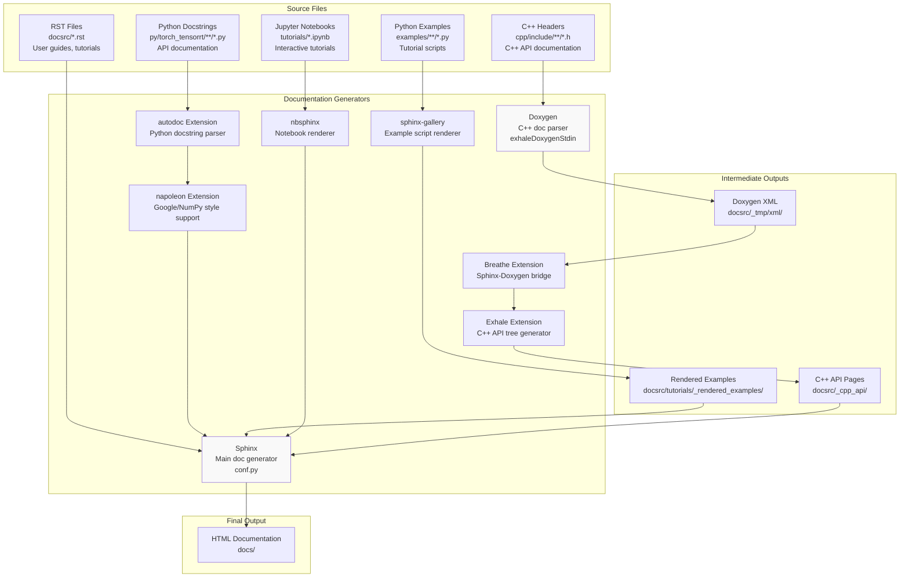
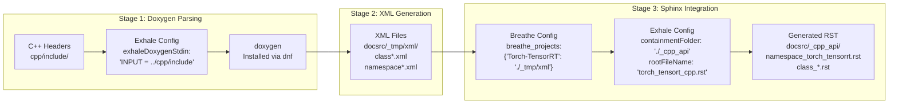
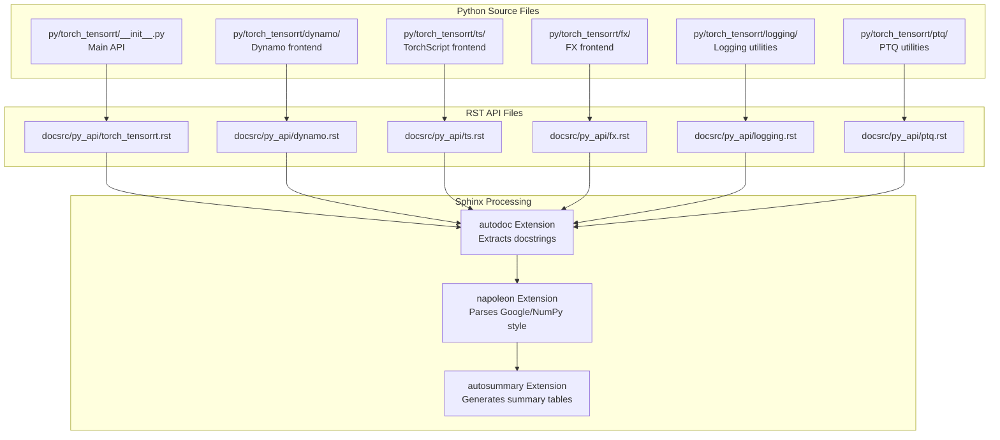
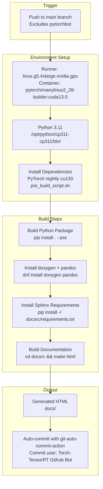

<!-- source: DeepWiki mcp.deepwiki.com · repo pytorch/TensorRT · page 7.7 Documentation Generation · fetched 2026-10-21 -->

# Documentation Generation

<details>
<summary>Relevant source files</summary>

The following files were used as context for generating this wiki page:

- [.github/scripts/run_cpp_linter.py](.github/scripts/run_cpp_linter.py)
- [.github/scripts/run_py_linter.py](.github/scripts/run_py_linter.py)
- [.github/workflows/docgen.yml](.github/workflows/docgen.yml)
- [.github/workflows/linter.yml](.github/workflows/linter.yml)
- [.github/workflows/stale.yml](.github/workflows/stale.yml)
- [.gitignore](.gitignore)
- [docker/Dockerfile](docker/Dockerfile)
- [docker/Dockerfile.docs](docker/Dockerfile.docs)
- [docker/README.md](docker/README.md)
- [docker/dist-build.sh](docker/dist-build.sh)
- [docsrc/conf.py](docsrc/conf.py)
- [docsrc/getting_started/installation.rst](docsrc/getting_started/installation.rst)
- [docsrc/index.rst](docsrc/index.rst)
- [docsrc/requirements.txt](docsrc/requirements.txt)
- [examples/dynamo/README.rst](examples/dynamo/README.rst)
- [examples/dynamo/compile_with_dynamic_inputs.py](examples/dynamo/compile_with_dynamic_inputs.py)
- [examples/dynamo/custom_kernel_plugins.py](examples/dynamo/custom_kernel_plugins.py)
- [examples/dynamo/debugger_example.py](examples/dynamo/debugger_example.py)
- [examples/dynamo/dynamic_memory_allocation.py](examples/dynamo/dynamic_memory_allocation.py)
- [examples/dynamo/low_cpu_memory_compilation.py](examples/dynamo/low_cpu_memory_compilation.py)
- [examples/dynamo/refit_engine_example.py](examples/dynamo/refit_engine_example.py)

</details>


This page documents the Sphinx-based documentation generation system for Torch-TensorRT. It covers the build pipeline that transforms reStructuredText source files, Python docstrings, C++ header files, and example scripts into the published HTML documentation. For information about debugging and logging during compilation, see [Debugging and Profiling](#2.7).

## Overview

Torch-TensorRT uses **Sphinx** as its documentation generator, with several specialized extensions to handle different documentation sources:

- **Doxygen + Breathe + Exhale** for C++ API documentation extracted from header files
- **autodoc + napoleon** for Python API documentation from docstrings
- **sphinx-gallery** for rendering Python example scripts as tutorials
- **nbsphinx** for rendering Jupyter notebooks

The documentation is automatically built and published via a GitHub Actions workflow whenever changes are pushed to the main branch.

**Sources:** [docsrc/conf.py:1-254](), [.github/workflows/docgen.yml:1-71]()

## Documentation Build Pipeline

The following diagram shows the end-to-end documentation generation process:



**Diagram: Documentation Build Pipeline**

**Sources:** [docsrc/conf.py:40-54](), [docsrc/conf.py:99-116]()

## Sphinx Configuration

The main configuration file is [docsrc/conf.py:1-254](). Key configuration sections:

### Project Metadata

The project version is dynamically extracted from the installed package:

| Configuration | Value | Source |
|--------------|-------|--------|
| `project` | "Torch-TensorRT" | [docsrc/conf.py:27]() |
| `copyright` | "2024, NVIDIA Corporation" | [docsrc/conf.py:28]() |
| `version` | `f"v{torch_tensorrt.__version__}"` | [docsrc/conf.py:31]() |
| `release` | `f"v{torch_tensorrt.__version__}"` | [docsrc/conf.py:33]() |

### Sphinx Extensions

The following extensions are enabled:

```python
extensions = [
    "breathe",              # C++ doc integration
    "exhale",               # C++ API tree generation
    "nbsphinx",             # Jupyter notebook support
    "sphinx.ext.napoleon",  # Google/NumPy docstring styles
    "sphinx.ext.intersphinx", # Cross-project linking
    "sphinx.ext.autosummary", # Automatic summary tables
    "sphinx.ext.autodoc",   # Python docstring extraction
    "sphinx.ext.doctest",   # Doctest support
    "sphinx.ext.todo",      # TODO directive
    "sphinx.ext.coverage",  # Coverage reporting
    "sphinx.ext.mathjax",   # Math rendering
    "sphinx.ext.viewcode",  # Source code links
    "sphinx_gallery.gen_gallery", # Example galleries
]
```

**Sources:** [docsrc/conf.py:40-54]()

## C++ API Documentation Generation

The C++ API documentation is generated through a three-stage pipeline:



**Diagram: C++ API Documentation Pipeline**

### Doxygen Configuration

Doxygen is executed by the Exhale extension with input directed to `cpp/include`:

```python
exhale_args = {
    "containmentFolder": "./_cpp_api",
    "rootFileName": "torch_tensort_cpp.rst",
    "rootFileTitle": "Torch-TensorRT C++ API",
    "doxygenStripFromPath": "..",
    "createTreeView": True,
    "exhaleExecutesDoxygen": True,
    "exhaleDoxygenStdin": "INPUT = ../cpp/include",
}
```

**Sources:** [docsrc/conf.py:104-116]()

### Breathe Configuration

Breathe bridges Doxygen XML output to Sphinx:

```python
breathe_projects = {"Torch-TensorRT": "./_tmp/xml"}
breathe_default_project = "Torch-TensorRT"
```

**Sources:** [docsrc/conf.py:100-101]()

### Output Structure

The generated C++ API documentation includes:

- Namespace pages: `namespace_torch_tensorrt.rst`, `namespace_torch_tensorrt__logging.rst`, `namespace_torch_tensorrt__torchscript.rst`
- Class pages: Individual `.rst` files for each class
- Function pages: Individual `.rst` files for functions
- File structure: Organized hierarchically in `docsrc/_cpp_api/`

These are referenced in the main documentation via [docsrc/index.rst:189-204]().

**Sources:** [docsrc/index.rst:187-204](), [docsrc/conf.py:104-116]()

## Python API Documentation Generation

Python API documentation is generated using **autodoc** with **napoleon** for docstring parsing:



**Diagram: Python API Documentation Generation**

### Configuration

```python
napoleon_use_ivar = True
autosummary_generate = True
autodoc_typehints_format = "short"
python_use_unqualified_type_names = True
autodoc_member_order = "groupwise"
```

**Sources:** [docsrc/conf.py:56-58](), [docsrc/conf.py:182-193]()

### Type Alias Support

Custom type aliases are configured for proper rendering:

```python
autodoc_type_aliases = {
    "LegacyConverterImplSignature": "LegacyConverterImplSignature",
    "DynamoConverterImplSignature": "DynamoConverterImplSignature",
    "ConverterImplSignature": "ConverterImplSignature",
}
```

**Sources:** [docsrc/conf.py:185-189]()

## Tutorial and Example Generation

### sphinx-gallery Configuration

The **sphinx-gallery** extension automatically converts Python example scripts into rendered tutorial pages:

```python
sphinx_gallery_conf = {
    "examples_dirs": "../examples",
    "gallery_dirs": "tutorials/_rendered_examples/",
    "ignore_pattern": r"(triton/\w*.py)|(utils.py)",
}
```

This converts scripts from `examples/` into HTML pages in `docsrc/tutorials/_rendered_examples/`. Scripts to ignore (utility files, Triton-specific examples) are specified via regex pattern.

**Sources:** [docsrc/conf.py:93-97]()

### Jupyter Notebook Support

Jupyter notebooks are included via **nbsphinx**:

```python
nbsphinx_execute = "never"
```

The `"never"` setting prevents re-execution of notebooks during documentation builds, using existing outputs from the notebooks.

**Sources:** [docsrc/conf.py:191]()

### Example Directory Structure

The examples are organized by frontend:

- `examples/dynamo/` - Dynamo frontend examples (converted to tutorials)
- Tutorial metadata and dependencies in `examples/dynamo/README.rst`

**Sources:** [examples/dynamo/README.rst:1-25]()

## Automated Documentation CI Workflow

The documentation is automatically built and published via GitHub Actions:



**Diagram: Documentation Generation CI Workflow**

### Workflow Configuration

The workflow is defined in [.github/workflows/docgen.yml:1-71]():

| Step | Command/Action | Purpose |
|------|----------------|---------|
| Checkout | `actions/checkout@v6` | Clone repository with bot token |
| Python Setup | Select `/opt/python/cp311-cp311/bin/` | Use Python 3.11 |
| Install Base Deps | `pip install torch --pre --extra-index-url https://download.pytorch.org/whl/nightly/cu130` | Install PyTorch nightly |
| Pre-build Script | `./packaging/pre_build_script.sh` | Platform-specific setup |
| Build Package | `pip install --pre . --extra-index-url https://download.pytorch.org/whl/nightly/cu130` | Build and install Torch-TensorRT |
| Install Doc Tools | `dnf install doxygen pandoc` | Install system dependencies |
| Install Sphinx Deps | `pip install -r docsrc/requirements.txt` | Install documentation dependencies |
| Build Docs | `cd docsrc && make html` | Generate HTML documentation |
| Commit Changes | `stefanzweifel/git-auto-commit-action@v4` | Auto-commit generated docs |

**Sources:** [.github/workflows/docgen.yml:26-66]()

### Environment Variables

```bash
CUDA_HOME=/usr/local/cuda-13.0
VERSION_SUFFIX=cu130
CU_VERSION=cu130
CHANNEL=nightly
CI_BUILD=1
```

**Sources:** [.github/workflows/docgen.yml:20-24]()

### Concurrency Control

```yaml
concurrency:
  group: ${{ github.workflow }}-${{ github.ref_name }}
  cancel-in-progress: true
```

This ensures only one documentation build runs per branch at a time, cancelling older builds if new commits are pushed.

**Sources:** [.github/workflows/docgen.yml:68-70]()

## Documentation Dependencies

The required Python packages for building documentation are specified in [docsrc/requirements.txt:1-9]():

| Package | Version | Purpose |
|---------|---------|---------|
| `sphinx` | 5.0.1 | Core documentation generator |
| `sphinx-gallery` | 0.13.0 | Example script renderer |
| `breathe` | 4.34.0 | Doxygen-Sphinx bridge |
| `exhale` | 0.3.7 | C++ API tree generator |
| `pytorch_sphinx_theme` | git master | PyTorch documentation theme |
| `nbsphinx` | 0.9.3 | Jupyter notebook integration |
| `docutils` | 0.17.1 | RST processing |
| `pillow` | (latest) | Image handling |

System dependencies installed via `dnf`:

- `doxygen` - C++ documentation parser
- `pandoc` - Document converter

**Sources:** [docsrc/requirements.txt:1-9](), [.github/workflows/docgen.yml:48-53]()

## Documentation Source Structure

The documentation source files are organized in `docsrc/`:

```mermaid
graph TB
    subgraph "Main Structure"
        INDEX["index.rst<br/>Main documentation index"]
        CONF["conf.py<br/>Sphinx configuration"]
        REQS["requirements.txt<br/>Build dependencies"]
    end
    
    subgraph "Getting Started"
        INSTALL["getting_started/installation.rst"]
        JETPACK["getting_started/jetpack.rst"]
        QUICKSTART["getting_started/quick_start.rst"]
        CAPTURE["getting_started/capture_and_replay.rst"]
    end
    
    subgraph "User Guide"
        EXPLAINED["user_guide/torch_tensorrt_explained.rst"]
        DYNAMIC["user_guide/dynamic_shapes.rst"]
        SAVING["user_guide/saving_models.rst"]
        RUNTIME["user_guide/runtime.rst"]
    end
    
    subgraph "API Documentation"
        PY_API["py_api/torch_tensorrt.rst<br/>py_api/dynamo.rst<br/>py_api/ts.rst"]
        CPP_API["_cpp_api/<br/>(Auto-generated)"]
    end
    
    subgraph "Tutorials"
        RENDERED["tutorials/_rendered_examples/<br/>(Auto-generated from examples/)"]
        NOTEBOOKS["tutorials/notebooks.rst"]
    end
    
    subgraph "Contributors"
        SYS_OVERVIEW["contributors/system_overview.rst"]
        CONVERTERS["contributors/dynamo_converters.rst<br/>contributors/ts_converters.rst"]
        RESOURCES["contributors/resource_management.rst"]
    end
    
    INDEX --> INSTALL
    INDEX --> EXPLAINED
    INDEX --> PY_API
    INDEX --> RENDERED
    INDEX --> SYS_OVERVIEW
```



**Diagram: Documentation Directory Structure**

### Index File Structure

The main index file [docsrc/index.rst:1-263]() organizes content into sections using `toctree` directives:

- **Getting Started** - Installation, quick start guides
- **User Guide** - Compilation, precision modes, dynamic shapes
- **Tutorials** - Rendered examples from `examples/` directory
- **Dynamo Frontend** - Modern compilation API documentation
- **TorchScript Frontend** - Legacy compilation API documentation
- **Model Zoo** - Specific model compilation examples
- **Python API Documentation** - Auto-generated from docstrings
- **C++ API Documentation** - Auto-generated from headers
- **CLI Documentation** - Command-line tool reference
- **Contributor Documentation** - System architecture, converter writing guides

**Sources:** [docsrc/index.rst:1-263]()

## HTML Theme Configuration

Torch-TensorRT uses the **pytorch_sphinx_theme**:

```python
html_theme = "pytorch_sphinx_theme"
html_theme_path = [pytorch_sphinx_theme.get_html_theme_path()]

html_theme_options = {
    "nav_title": "Torch-TensorRT",
    "base_url": "https://nvidia.github.io/Torch-TensorRT/",
    "theme_color": "84bd00",
    "color_primary": "light-green",
    "color_accent": "light-green",
    "repo_url": "https://github.com/pytorch/TensorRT/",
    "repo_name": "Torch-TensorRT",
    "globaltoc_depth": 1,
    "globaltoc_collapse": False,
    "globaltoc_includehidden": True,
    "version_info": {
        "main": "https://pytorch.org/TensorRT/",
        "v2.3.0": "https://pytorch.org/TensorRT/v2.3.0",
        # ... additional versions
    },
}
```

This provides version selection, navigation, and consistent styling with PyTorch documentation.

**Sources:** [docsrc/conf.py:79](), [docsrc/conf.py:124-173]()

## Build Process

To build documentation locally:

```bash
# Install dependencies
pip install -r docsrc/requirements.txt

# Install system dependencies (Linux)
dnf install doxygen pandoc

# Build documentation
cd docsrc
make html

# Output is generated in docsrc/_build/html/
```

The `make html` command invokes Sphinx, which:

1. Executes Doxygen via Exhale to parse C++ headers
2. Processes RST files and Python docstrings
3. Renders example scripts via sphinx-gallery
4. Includes Jupyter notebooks via nbsphinx
5. Generates the C++ API tree via Exhale
6. Produces final HTML in `_build/html/`

**Sources:** [.github/workflows/docgen.yml:45-56]()

## Ignored Files and Directories

The `.gitignore` file specifies documentation-related exclusions:

```
docsrc/_build         # Sphinx build output
docsrc/_notebooks     # Temporary notebook files
docsrc/_cpp_api       # Auto-generated C++ API docs
docsrc/_tmp           # Doxygen XML output
docsrc/tutorials/_rendered_examples  # Auto-generated tutorials
```

These directories are regenerated during each build and should not be committed.

**Sources:** [.gitignore:31-35]()

## C++ Language Configuration

The C++ domain is configured as the primary language for cross-referencing:

```python
primary_domain = "cpp"
cpp_id_attributes = ["TORCHTRT_API"]
highlight_language = "cpp"
```

The `TORCHTRT_API` attribute is recognized for API export macros.

**Sources:** [docsrc/conf.py:176-180]()

## Custom Docstring Rendering

A custom patch prevents Sphinx from creating cross-references for `ivar` tags, improving docstring rendering:

```python
def patched_make_field(self, types, domain, items, **kw):
    # Prevents cross-referencing of instance variables
    # See: http://stackoverflow.com/a/41184353/3343043
    # Implementation at lines 203-253
```

This patch is applied to `TypedField.make_field` to handle instance variables consistently.

**Sources:** [docsrc/conf.py:195-253]()

## Integration with Other Systems

The documentation system integrates with:

- **Build System** - Package must be built and installed before doc generation
- **CI/CD** - Automated builds on every main branch push
- **Version Management** - Documentation version extracted from `torch_tensorrt.__version__`
- **Example System** - Python scripts in `examples/` automatically converted to tutorials
- **Testing** - Documentation can serve as integration tests via doctest extension

For information about the build system that produces the package documented here, see [Build System Architecture](#7.1).

**Sources:** [.github/workflows/docgen.yml:42-56](), [docsrc/conf.py:31-33]()

---

