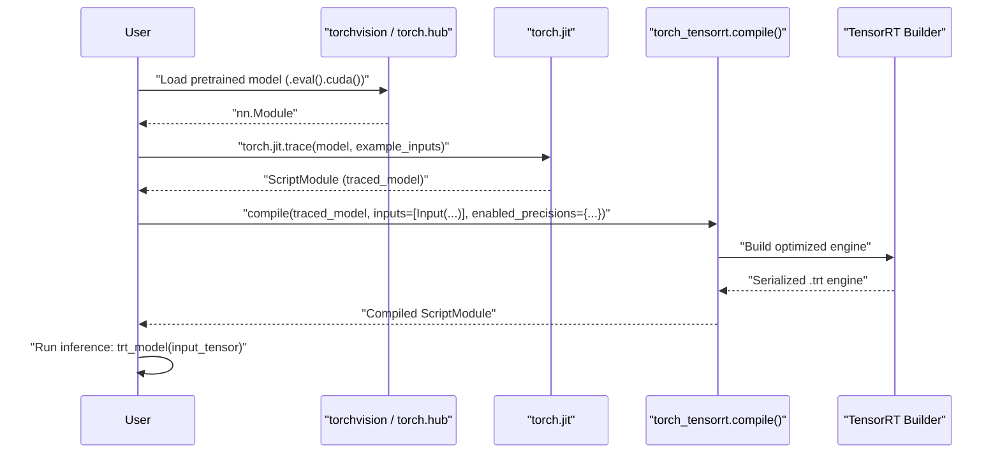

<!-- source: DeepWiki mcp.deepwiki.com · repo pytorch/TensorRT · page 8 Examples and Tutorials · fetched 2026-10-21 -->

# Examples and Tutorials

<details>
<summary>Relevant source files</summary>

The following files were used as context for generating this wiki page:

- [core/util/prelude.h](core/util/prelude.h)
- [docs/_cpp_api/function_torch__tensorrt_8h_1a710df824a7718b440e4bc17bf9693cef.html](docs/_cpp_api/function_torch__tensorrt_8h_1a710df824a7718b440e4bc17bf9693cef.html)
- [docs/_cpp_api/program_listing_file_cpp_include_torch_tensorrt_macros.h.html](docs/_cpp_api/program_listing_file_cpp_include_torch_tensorrt_macros.h.html)
- [docs/_downloads/c0341280f3b022df00c4241c42d9ee8b/custom_kernel_plugins.py](docs/_downloads/c0341280f3b022df00c4241c42d9ee8b/custom_kernel_plugins.py)
- [docs/_notebooks/CitriNet-example.html](docs/_notebooks/CitriNet-example.html)
- [docs/_notebooks/EfficientNet-example.html](docs/_notebooks/EfficientNet-example.html)
- [docs/_notebooks/Hugging-Face-BERT.html](docs/_notebooks/Hugging-Face-BERT.html)
- [docs/_notebooks/Resnet50-example.html](docs/_notebooks/Resnet50-example.html)
- [docs/_notebooks/lenet-getting-started.html](docs/_notebooks/lenet-getting-started.html)
- [docs/_notebooks/ssd-object-detection-demo.html](docs/_notebooks/ssd-object-detection-demo.html)
- [docs/_notebooks/vgg-qat.html](docs/_notebooks/vgg-qat.html)
- [docs/_sources/_cpp_api/program_listing_file_cpp_include_torch_tensorrt_macros.h.rst.txt](docs/_sources/_cpp_api/program_listing_file_cpp_include_torch_tensorrt_macros.h.rst.txt)
- [docs/genindex.html](docs/genindex.html)
- [docs/objects.inv](docs/objects.inv)
- [docs/py_api/ts.html](docs/py_api/ts.html)
- [docs/searchindex.js](docs/searchindex.js)
- [notebooks/CitriNet-example.ipynb](notebooks/CitriNet-example.ipynb)
- [notebooks/EfficientNet-example.ipynb](notebooks/EfficientNet-example.ipynb)
- [notebooks/Hugging-Face-BERT.ipynb](notebooks/Hugging-Face-BERT.ipynb)
- [notebooks/README.md](notebooks/README.md)
- [notebooks/Resnet50-CPP.ipynb](notebooks/Resnet50-CPP.ipynb)
- [notebooks/Resnet50-example.ipynb](notebooks/Resnet50-example.ipynb)
- [notebooks/WORKSPACE.notebook](notebooks/WORKSPACE.notebook)
- [notebooks/dynamic-shapes.ipynb](notebooks/dynamic-shapes.ipynb)
- [notebooks/lenet-getting-started.ipynb](notebooks/lenet-getting-started.ipynb)
- [notebooks/ssd-object-detection-demo.ipynb](notebooks/ssd-object-detection-demo.ipynb)
- [notebooks/vgg-qat.ipynb](notebooks/vgg-qat.ipynb)

</details>


This section catalogs the end-to-end example notebooks and tutorials shipped with Torch-TensorRT. Each example demonstrates compilation and inference on a real model, tying together the APIs described in the User Guide (see [User Guide](#2)) and the two primary compilation frontends: the TorchScript frontend (see [TorchScript Compilation](#2.3)) and the Dynamo frontend (see [AOT Compilation and Export](#2.2) and [JIT Compilation with torch.compile](#2.1)).

The notebooks live under [notebooks/]() and are the authoritative runnable artifacts. Rendered HTML documentation for each is under [docs/_notebooks/](). A companion set of Dynamo-specific runnable Python scripts lives under `tutorials/` and is indexed by the Sphinx gallery.

---

## Setup and Prerequisites

All notebooks are designed to run inside a Docker container. The setup procedure is documented in [notebooks/README.md]().

**Two container options are supported:**

| Option | Method |
|---|---|
| NGC PyTorch container | `docker pull nvcr.io/nvidia/pytorch:YY.MM-py3` |
| Build from source | `docker build -t torch_tensorrt -f ./docker/Dockerfile .` |

After starting the container, navigate to the `notebooks/` directory and start Jupyter:

```
jupyter notebook --allow-root --ip 0.0.0.0 --port 8888
```

The container must have GPU access (`--gpus=all`). See [notebooks/README.md:1-109]() for the full set of `docker run` options including volume mounts.

---

## Overview of Available Examples

### Legacy Notebook Examples (TorchScript Frontend)

All notebooks in [notebooks/]() use the TorchScript-based compilation path: models are first converted to `ScriptModule` via `torch.jit.trace` or `torch.jit.script`, then compiled with `torch_tensorrt.compile`.

| Notebook File | Model | Domain | Precision | Key Features |
|---|---|---|---|---|
| `lenet-getting-started.ipynb` | Custom LeNet | Image classification | FP32, FP16 | Entry-level trace + compile |
| `Resnet50-example.ipynb` | `torchvision.models.resnet50` | Image classification | FP16, INT8 | PTQ calibration, benchmarking |
| `ssd-object-detection-demo.ipynb` | NVIDIA SSD (PyTorch Hub) | Object detection | FP16 | End-to-end detection pipeline |
| `vgg-qat.ipynb` | VGG | Image classification | INT8 | Quantization-aware training (QAT) |
| `EfficientNet-example.ipynb` | EfficientNet-B0 (timm) | Image classification | FP32, FP16, INT8 | Third-party model library (`timm`) |
| `CitriNet-example.ipynb` | NVIDIA NeMo CitriNet | Speech recognition | FP16 | Acoustic model, dynamic inputs |
| `Hugging-Face-BERT.ipynb` | `bert-base-uncased` | NLP / MLM | FP16 | Transformer model, Hugging Face `transformers` |

Sources: [notebooks/README.md:101-109]()

### Dynamo-Frontend Script Examples

A separate set of runnable `.py` scripts is located under `examples/` and `tutorials/`. These use the `torch.compile` backend or `torch_tensorrt.dynamo.compile` with `ExportedProgram`. Notable examples include:

| Script / Directory | Model | Key Feature |
|---|---|---|
| `tutorials/_rendered_examples/dynamo/torch_compile_resnet_example` | ResNet | `torch.compile` with `backend="tensorrt"` |
| `tutorials/_rendered_examples/dynamo/torch_compile_gpt2` | GPT-2 | LLM compilation via `torch.compile` |
| `tutorials/_rendered_examples/dynamo/engine_caching_example` | ResNet | Engine caching across sessions |
| `tutorials/_rendered_examples/dynamo/vgg16_ptq` | VGG-16 | PTQ with Dynamo frontend |
| `tutorials/_rendered_examples/dynamo/refit_engine_example` | — | Weight refitting without recompilation |
| `tutorials/_rendered_examples/dynamo/torch_export_cudagraphs` | — | CUDA graph capture |
| `tutorials/_rendered_examples/dynamo/mutable_torchtrt_module_example` | — | `MutableTorchTRTModule` |

Sources: [docs/searchindex.js:1-1]()

---

## Common Compilation Pattern (TorchScript Notebooks)

All TorchScript-based notebooks follow the same two-phase workflow: first exporting the model to TorchScript, then passing it through `torch_tensorrt.compile`.

**Diagram: TorchScript Notebook Compilation Workflow**



Sources: [notebooks/lenet-getting-started.ipynb:1-1](), [notebooks/Resnet50-example.ipynb:1-1](), [notebooks/ssd-object-detection-demo.ipynb:1-1]()

---

## Notebook-to-API Mapping

The following diagram maps each notebook file to the specific Torch-TensorRT API calls it relies on, bridging the tutorial names to searchable code entities.

**Diagram: Notebook Files and Their Primary API Dependencies**

```mermaid
graph TD
    subgraph "notebooks/"
        N1["lenet-getting-started.ipynb"]
        N2["Resnet50-example.ipynb"]
        N3["ssd-object-detection-demo.ipynb"]
        N4["vgg-qat.ipynb"]
        N5["EfficientNet-example.ipynb"]
        N6["CitriNet-example.ipynb"]
        N7["Hugging-Face-BERT.ipynb"]
    end

    subgraph "torch_tensorrt"
        A1["torch_tensorrt.compile()"]
        A2["torch_tensorrt.Input"]
        A3["torch_tensorrt.ptq.DataLoaderCalibrator"]
        A4["torch_tensorrt.dtype.half"]
        A5["torch_tensorrt.dtype.int8"]
    end

    subgraph "torch.jit"
        B1["torch.jit.trace()"]
        B2["torch.jit.script()"]
    end

    subgraph "third_party"
        C1["torchvision.models"]
        C2["torch.hub.load()"]
        C3["timm.create_model()"]
        C4["nemo.collections.asr"]
        C5["transformers.BertModel"]
    end

    N1 --> B1
    N1 --> A1
    N1 --> A2
    N1 --> A4
    N1 --> C1

    N2 --> B1
    N2 --> A1
    N2 --> A2
    N2 --> A4
    N2 --> A5
    N2 --> A3
    N2 --> C1

    N3 --> B1
    N3 --> A1
    N3 --> A2
    N3 --> A4
    N3 --> C2

    N4 --> B1
    N4 --> A1
    N4 --> A5
    N4 --> A3

    N5 --> B2
    N5 --> A1
    N5 --> A2
    N5 --> A4
    N5 --> C3

    N6 --> B1
    N6 --> A1
    N6 --> A2
    N6 --> A4
    N6 --> C4

    N7 --> B1
    N7 --> A1
    N7 --> A2
    N7 --> A4
    N7 --> C5
```



Sources: [notebooks/README.md:101-109](), [notebooks/lenet-getting-started.ipynb:1-1](), [notebooks/Resnet50-example.ipynb:1-1](), [notebooks/EfficientNet-example.ipynb:1-1](), [notebooks/vgg-qat.ipynb:1-1](), [notebooks/ssd-object-detection-demo.ipynb:1-1](), [notebooks/CitriNet-example.ipynb:1-1](), [notebooks/Hugging-Face-BERT.ipynb:1-1]()

---

## Precision Coverage Across Examples

The table below summarizes which precision modes are exercised by each example, mapping to the API fields described in [Precision Modes (FP32, FP16, INT8)](#2.4).

| Notebook | FP32 | FP16 (`torch_tensorrt.dtype.half`) | INT8 PTQ (`DataLoaderCalibrator`) | INT8 QAT |
|---|:---:|:---:|:---:|:---:|
| LeNet | ✓ | ✓ | — | — |
| ResNet-50 | — | ✓ | ✓ | — |
| SSD | — | ✓ | — | — |
| VGG QAT | — | — | — | ✓ |
| EfficientNet-B0 | ✓ | ✓ | ✓ | — |
| CitriNet | — | ✓ | — | — |
| BERT | — | ✓ | — | — |

For the PTQ calibration workflow, the ResNet-50 and EfficientNet notebooks instantiate `torch_tensorrt.ptq.DataLoaderCalibrator` wrapping a `torch.utils.data.DataLoader` backed by ImageNet samples. For the QAT workflow, the VGG notebook uses the `pytorch_quantization` toolkit before calling `torch_tensorrt.compile`. See [Precision Modes (FP32, FP16, INT8)](#2.4) for details on both calibration paths.

Sources: [notebooks/Resnet50-example.ipynb:1-1](), [notebooks/vgg-qat.ipynb:1-1](), [notebooks/EfficientNet-example.ipynb:1-1]()

---

## Child Pages

Each example has a dedicated sub-page with a detailed walkthrough:

- **8.1** — [LeNet Classification](#8.1): Entry-level getting-started notebook. Covers model definition, `torch.jit.trace`, `torch_tensorrt.compile`, and FP16 inference.
- **8.2** — [ResNet-50 Benchmark](#8.2): FP16 and INT8 compilation of a production-scale classification model with performance benchmarking.
- **8.3** — [SSD Object Detection](#8.3): End-to-end detection pipeline using a pre-trained NVIDIA SSD model from `torch.hub`.
- **8.4** — [VGG Quantization-Aware Training](#8.4): Demonstrates the full QAT workflow using `pytorch_quantization` and deploying the resulting INT8 model.
- **8.5** — [EfficientNet-B0 Vision](#8.5): Uses the `timm` third-party model library and compares throughput across FP32, FP16, and INT8.
- **8.6** — [CitriNet Speech Recognition](#8.6): Compiles an acoustic model from NVIDIA NeMo with dynamic batch and sequence length inputs.
- **8.7** — [Hugging Face BERT](#8.7): Traces and compiles a BERT transformer model from the `transformers` library for masked language modeling.

---

## Notes on Frontend Versions

The notebooks in [notebooks/]() were written against the TorchScript frontend (`torch_tensorrt.ts`). The primary entry point is `torch_tensorrt.compile(scripted_module, ...)`. These notebooks predate the Dynamo frontend introduced with `torch.export` and `torch.compile`.

For examples using the current recommended Dynamo path — including `torch.compile(model, backend="tensorrt")` and `torch_tensorrt.dynamo.compile(exported_program, ...)` — refer to the rendered Python scripts under `tutorials/_rendered_examples/dynamo/` and the user guide sections [JIT Compilation with torch.compile](#2.1) and [AOT Compilation and Export](#2.2).

Sources: [notebooks/README.md:1-109](), [docs/searchindex.js:1-1]()

---

