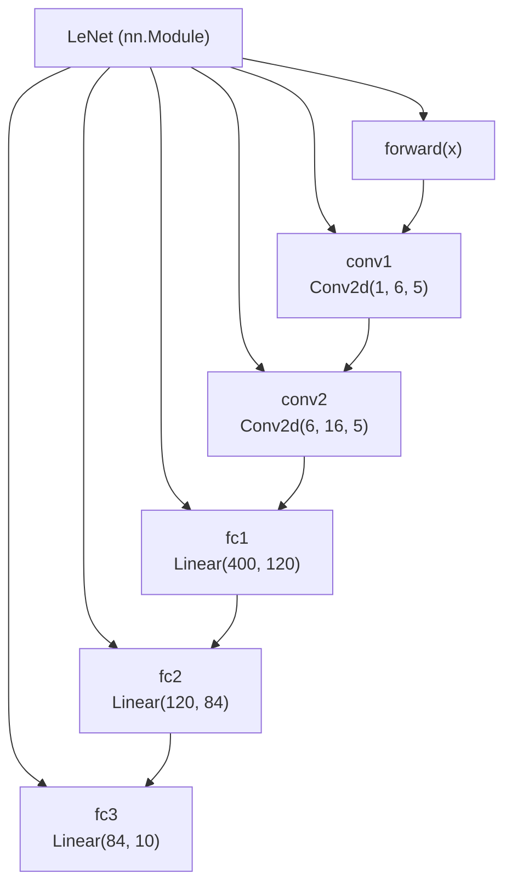
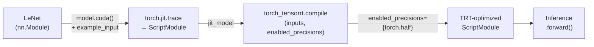
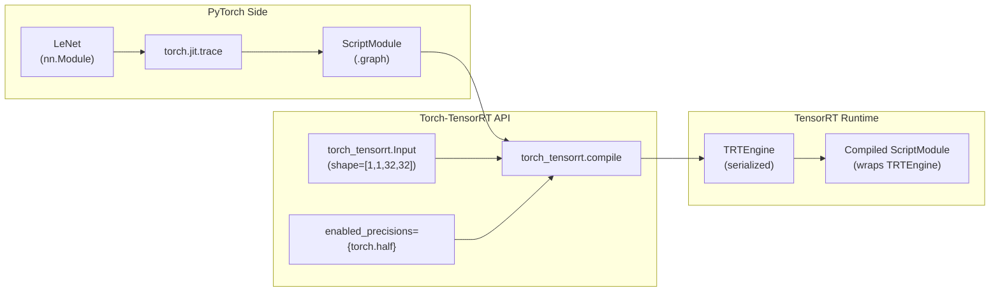

<!-- source: DeepWiki mcp.deepwiki.com · repo pytorch/TensorRT · page 8.1 LeNet Classification · fetched 2026-10-21 -->

# LeNet Classification

<details>
<summary>Relevant source files</summary>

The following files were used as context for generating this wiki page:

- [core/util/prelude.h](core/util/prelude.h)
- [docs/_cpp_api/function_torch__tensorrt_8h_1a710df824a7718b440e4bc17bf9693cef.html](docs/_cpp_api/function_torch__tensorrt_8h_1a710df824a7718b440e4bc17bf9693cef.html)
- [docs/_cpp_api/program_listing_file_cpp_include_torch_tensorrt_macros.h.html](docs/_cpp_api/program_listing_file_cpp_include_torch_tensorrt_macros.h.html)
- [docs/_downloads/c0341280f3b022df00c4241c42d9ee8b/custom_kernel_plugins.py](docs/_downloads/c0341280f3b022df00c4241c42d9ee8b/custom_kernel_plugins.py)
- [docs/_notebooks/CitriNet-example.html](docs/_notebooks/CitriNet-example.html)
- [docs/_notebooks/EfficientNet-example.html](docs/_notebooks/EfficientNet-example.html)
- [docs/_notebooks/Hugging-Face-BERT.html](docs/_notebooks/Hugging-Face-BERT.html)
- [docs/_notebooks/Resnet50-example.html](docs/_notebooks/Resnet50-example.html)
- [docs/_notebooks/lenet-getting-started.html](docs/_notebooks/lenet-getting-started.html)
- [docs/_notebooks/ssd-object-detection-demo.html](docs/_notebooks/ssd-object-detection-demo.html)
- [docs/_notebooks/vgg-qat.html](docs/_notebooks/vgg-qat.html)
- [docs/_sources/_cpp_api/program_listing_file_cpp_include_torch_tensorrt_macros.h.rst.txt](docs/_sources/_cpp_api/program_listing_file_cpp_include_torch_tensorrt_macros.h.rst.txt)
- [docs/genindex.html](docs/genindex.html)
- [docs/objects.inv](docs/objects.inv)
- [docs/py_api/ts.html](docs/py_api/ts.html)
- [docs/searchindex.js](docs/searchindex.js)
- [notebooks/CitriNet-example.ipynb](notebooks/CitriNet-example.ipynb)
- [notebooks/EfficientNet-example.ipynb](notebooks/EfficientNet-example.ipynb)
- [notebooks/Hugging-Face-BERT.ipynb](notebooks/Hugging-Face-BERT.ipynb)
- [notebooks/README.md](notebooks/README.md)
- [notebooks/Resnet50-CPP.ipynb](notebooks/Resnet50-CPP.ipynb)
- [notebooks/Resnet50-example.ipynb](notebooks/Resnet50-example.ipynb)
- [notebooks/WORKSPACE.notebook](notebooks/WORKSPACE.notebook)
- [notebooks/dynamic-shapes.ipynb](notebooks/dynamic-shapes.ipynb)
- [notebooks/lenet-getting-started.ipynb](notebooks/lenet-getting-started.ipynb)
- [notebooks/ssd-object-detection-demo.ipynb](notebooks/ssd-object-detection-demo.ipynb)
- [notebooks/vgg-qat.ipynb](notebooks/vgg-qat.ipynb)

</details>


This page documents the LeNet getting-started notebook, which serves as the introductory Torch-TensorRT tutorial. It walks through defining a simple convolutional network, tracing it to TorchScript, compiling it with Torch-TensorRT in FP16 precision, and verifying inference correctness.

This tutorial uses the **TorchScript frontend**. For the newer Dynamo-based compilation approach (using `torch.compile` or `torch.export`), see pages [2.1](#2.1) and [2.2](#2.2). For an explanation of precision modes including FP16, see [2.4](#2.4).

---

## Notebook Location and Setup

The notebook source lives at [notebooks/lenet-getting-started.ipynb]() and its rendered HTML at [docs/_notebooks/lenet-getting-started.html]().

The recommended way to run it is inside a Docker container. Setup instructions are in [notebooks/README.md]().

| Approach | Command |
|---|---|
| Pull NGC PyTorch container | `docker pull nvcr.io/nvidia/pytorch:22.05-py3` |
| Build from source | `docker build -t torch_tensorrt -f ./docker/Dockerfile .` |
| Launch Jupyter | `jupyter notebook --allow-root --ip 0.0.0.0 --port 8888` |

Sources: [notebooks/README.md:1-109]()

---

## LeNet Model Architecture

The notebook defines a standard LeNet-5 classification network as a `torch.nn.Module` subclass named `LeNet`. It accepts 32×32 single-channel (grayscale) images and produces 10-class logits.

**LeNet layer structure:**

```
Input: [N, 1, 32, 32]
  → conv1: Conv2d(1, 6, kernel=5)  + ReLU + MaxPool2d(2)
  → conv2: Conv2d(6, 16, kernel=5) + ReLU + MaxPool2d(2)
  → Flatten
  → fc1: Linear(16*5*5=400, 120)   + ReLU
  → fc2: Linear(120, 84)           + ReLU
  → fc3: Linear(84, 10)
Output: [N, 10]
```

**Diagram — LeNet class structure mapping to code:**



Sources: [notebooks/lenet-getting-started.ipynb](), [docs/_notebooks/lenet-getting-started.html]()

---

## Compilation Workflow

The notebook follows the **TorchScript compilation path**:

1. Instantiate and move the `LeNet` model to CUDA.
2. Trace the model using `torch.jit.trace` to produce a `ScriptModule`.
3. Compile the `ScriptModule` using `torch_tensorrt.compile` with an FP16 precision hint.
4. Run inference by calling the compiled module directly.

**Diagram — Compilation pipeline with code entities:**



Sources: [notebooks/lenet-getting-started.ipynb](), [docs/_notebooks/lenet-getting-started.html]()

---

## Step-by-Step Walkthrough

### Step 1 — Define and Instantiate LeNet

The `LeNet` class is defined with `__init__` and `forward` methods. After instantiation, the model is placed on GPU with `.cuda()` and set to evaluation mode with `.eval()`.

Reference: [notebooks/lenet-getting-started.ipynb]()

### Step 2 — Trace to TorchScript

`torch.jit.trace` is called with the model and a sample input tensor of shape `[1, 1, 32, 32]`:

```
torch.jit.trace(model, torch.empty([1, 1, 32, 32]).cuda())
```

The result is a `ScriptModule` whose `forward` graph is recorded from the example execution trace. This is a requirement before passing the module to Torch-TensorRT's TorchScript frontend.

For details on TorchScript tracing concepts, see [2.3](#2.3).

### Step 3 — Compile with Torch-TensorRT

`torch_tensorrt.compile` is invoked on the traced module. The two key parameters are:

| Parameter | Value | Effect |
|---|---|---|
| `inputs` | `[torch_tensorrt.Input([1, 1, 32, 32])]` | Declares fixed input shape for the TRT engine |
| `enabled_precisions` | `{torch.half}` | Permits FP16 layer selection by TRT |

The function returns a new `ScriptModule` that internally dispatches to a TensorRT engine. For details on precision modes and what `enabled_precisions` controls, see [2.4](#2.4).

### Step 4 — Run Inference

The returned module is called identically to the original `LeNet` module. Inputs must be `torch.half` (FP16) tensors on CUDA to match the compiled engine's precision. Output logits are compared against the original PyTorch model to verify numerical correctness.

---

## Diagram — Concept-to-Code Entity Mapping



Sources: [notebooks/lenet-getting-started.ipynb](), [docs/_notebooks/lenet-getting-started.html]()

---

## Key API Summary

| API | Role in Notebook |
|---|---|
| `LeNet` (`nn.Module`) | User-defined PyTorch model |
| `torch.jit.trace` | Converts `LeNet` to a `ScriptModule` |
| `torch_tensorrt.Input` | Specifies static input shape to the TRT compiler |
| `torch_tensorrt.compile` | Compiles the `ScriptModule` via the TorchScript frontend |
| `enabled_precisions={torch.half}` | Enables FP16 kernel selection in TensorRT |

---

## Environment Requirements

The notebook runs inside the container described in [notebooks/README.md](). The rendered output in [docs/_notebooks/lenet-getting-started.html]() was produced in a container with:

- **CUDA**: 11.6
- **Driver**: 510.39.01
- **GPU**: NVIDIA GeForce (10240 MiB)
- **Python**: 3.8

An additional pip install of `ipywidgets` is performed at the start of the notebook to support interactive output widgets.

Sources: [notebooks/README.md:1-109](), [docs/_notebooks/lenet-getting-started.html:737-748]()

---

## Related Pages

- [2.3 — TorchScript Compilation](#2.3): The compilation backend used by this notebook.
- [2.4 — Precision Modes (FP32, FP16, INT8)](#2.4): Details on `enabled_precisions` and FP16 behavior.
- [2.5 — Dynamic Shapes and Input Specifications](#2.5): How `torch_tensorrt.Input` works with min/opt/max ranges.
- [8.2 — ResNet-50 Benchmark](#8.2): A more advanced notebook adding INT8 calibration and benchmarking.

---

