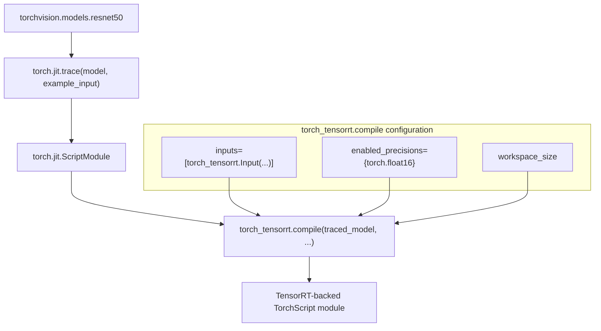
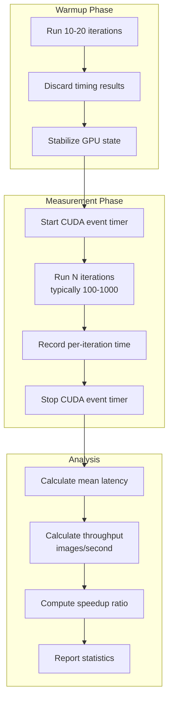
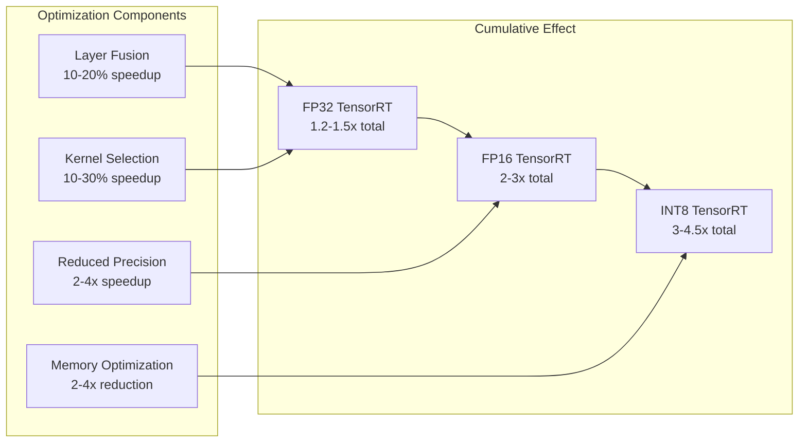
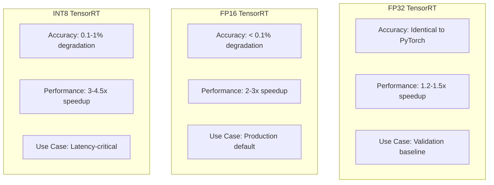
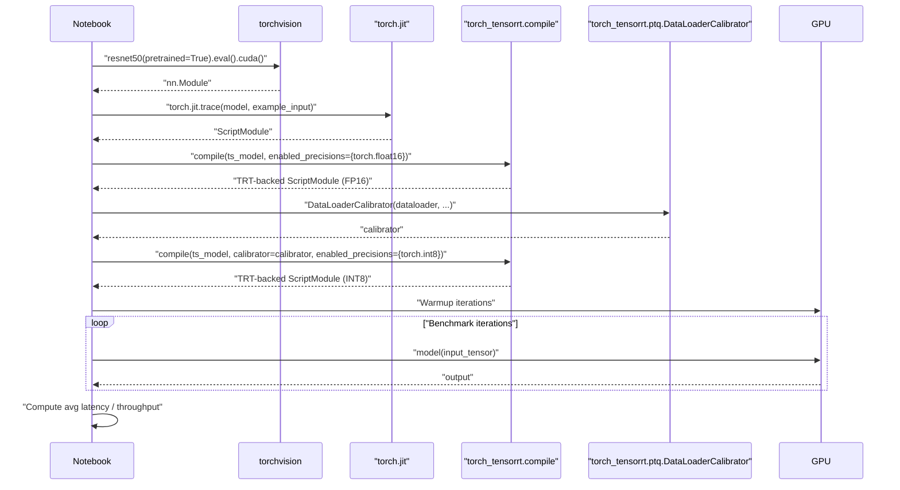
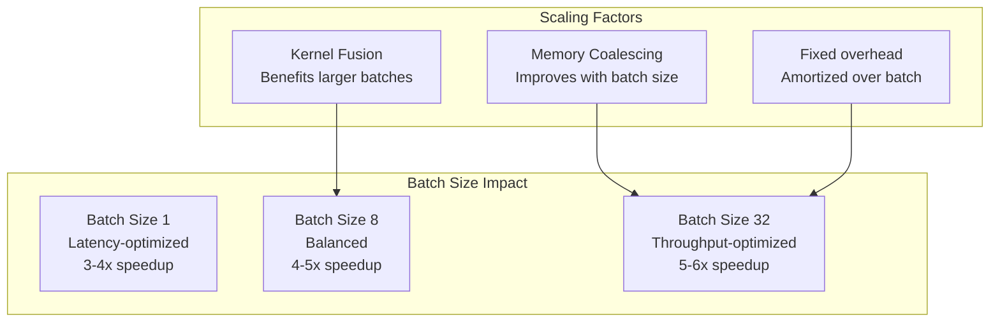

<!-- source: DeepWiki mcp.deepwiki.com · repo pytorch/TensorRT · page 8.2 ResNet-50 Benchmark · fetched 2026-10-21 -->

# ResNet-50 Benchmark

<details>
<summary>Relevant source files</summary>

The following files were used as context for generating this wiki page:

- [core/util/prelude.h](core/util/prelude.h)
- [docs/_cpp_api/function_torch__tensorrt_8h_1a710df824a7718b440e4bc17bf9693cef.html](docs/_cpp_api/function_torch__tensorrt_8h_1a710df824a7718b440e4bc17bf9693cef.html)
- [docs/_cpp_api/program_listing_file_cpp_include_torch_tensorrt_macros.h.html](docs/_cpp_api/program_listing_file_cpp_include_torch_tensorrt_macros.h.html)
- [docs/_downloads/c0341280f3b022df00c4241c42d9ee8b/custom_kernel_plugins.py](docs/_downloads/c0341280f3b022df00c4241c42d9ee8b/custom_kernel_plugins.py)
- [docs/_notebooks/CitriNet-example.html](docs/_notebooks/CitriNet-example.html)
- [docs/_notebooks/EfficientNet-example.html](docs/_notebooks/EfficientNet-example.html)
- [docs/_notebooks/Hugging-Face-BERT.html](docs/_notebooks/Hugging-Face-BERT.html)
- [docs/_notebooks/Resnet50-example.html](docs/_notebooks/Resnet50-example.html)
- [docs/_notebooks/lenet-getting-started.html](docs/_notebooks/lenet-getting-started.html)
- [docs/_notebooks/ssd-object-detection-demo.html](docs/_notebooks/ssd-object-detection-demo.html)
- [docs/_notebooks/vgg-qat.html](docs/_notebooks/vgg-qat.html)
- [docs/_sources/_cpp_api/program_listing_file_cpp_include_torch_tensorrt_macros.h.rst.txt](docs/_sources/_cpp_api/program_listing_file_cpp_include_torch_tensorrt_macros.h.rst.txt)
- [docs/genindex.html](docs/genindex.html)
- [docs/objects.inv](docs/objects.inv)
- [docs/py_api/ts.html](docs/py_api/ts.html)
- [docs/searchindex.js](docs/searchindex.js)
- [notebooks/CitriNet-example.ipynb](notebooks/CitriNet-example.ipynb)
- [notebooks/EfficientNet-example.ipynb](notebooks/EfficientNet-example.ipynb)
- [notebooks/Hugging-Face-BERT.ipynb](notebooks/Hugging-Face-BERT.ipynb)
- [notebooks/README.md](notebooks/README.md)
- [notebooks/Resnet50-CPP.ipynb](notebooks/Resnet50-CPP.ipynb)
- [notebooks/Resnet50-example.ipynb](notebooks/Resnet50-example.ipynb)
- [notebooks/WORKSPACE.notebook](notebooks/WORKSPACE.notebook)
- [notebooks/dynamic-shapes.ipynb](notebooks/dynamic-shapes.ipynb)
- [notebooks/lenet-getting-started.ipynb](notebooks/lenet-getting-started.ipynb)
- [notebooks/ssd-object-detection-demo.ipynb](notebooks/ssd-object-detection-demo.ipynb)
- [notebooks/vgg-qat.ipynb](notebooks/vgg-qat.ipynb)

</details>


## Purpose and Scope

This page documents the ResNet-50 benchmarking example, located at [notebooks/Resnet50-example.ipynb](), which demonstrates performance improvements achieved by compiling a standard ImageNet classification model with Torch-TensorRT. The example measures inference latency across FP16 and INT8 precision modes to quantify the speedup from TensorRT optimization on NVIDIA GPUs.

For basic compilation concepts and the introductory LeNet example, see page 8.1. For information about precision modes and INT8 calibration, see page 2.4. For the TorchScript compilation workflow this notebook uses, see page 2.3.

## Overview

The ResNet-50 benchmark serves as a standard reference for evaluating Torch-TensorRT's optimization capabilities on computer vision models. ResNet-50 is a widely-used convolutional neural network with 50 layers that achieves strong accuracy on ImageNet classification tasks. This example demonstrates:

- Compilation of pre-trained torchvision models
- Performance measurement methodology
- Speedup quantification across precision modes
- Comparison between PyTorch eager execution and TensorRT-optimized inference

The benchmark provides a baseline for users to understand the performance characteristics of TensorRT optimization on standard CNN architectures.

**Sources:** [docs/_notebooks/Resnet50-example.html:634-650]()

## Model Architecture

```mermaid
graph TB
    subgraph "ResNet-50 Architecture"
        INPUT["Input<br/>(3x224x224)"]
        CONV1["Initial Conv<br/>7x7, stride 2"]
        MAXPOOL["MaxPool<br/>3x3, stride 2"]
        
        LAYER1["Residual Layer 1<br/>3 blocks, 64 channels"]
        LAYER2["Residual Layer 2<br/>4 blocks, 128 channels"]
        LAYER3["Residual Layer 3<br/>6 blocks, 256 channels"]
        LAYER4["Residual Layer 4<br/>3 blocks, 512 channels"]
        
        AVGPOOL["Global AvgPool"]
        FC["Fully Connected<br/>1000 classes"]
        OUTPUT["Output<br/>Classification logits"]
        
        INPUT --> CONV1
        CONV1 --> MAXPOOL
        MAXPOOL --> LAYER1
        LAYER1 --> LAYER2
        LAYER2 --> LAYER3
        LAYER3 --> LAYER4
        LAYER4 --> AVGPOOL
        AVGPOOL --> FC
        FC --> OUTPUT
    end
    
    subgraph "Residual Block"
        RIN["Block Input"]
        RCONV1["Conv 1x1"]
        RCONV2["Conv 3x3"]
        RCONV3["Conv 1x1"]
        RADD["Add + ReLU"]
        ROUT["Block Output"]
        
        RIN --> RCONV1
        RCONV1 --> RCONV2
        RCONV2 --> RCONV3
        RIN -.skip connection.-> RADD
        RCONV3 --> RADD
        RADD --> ROUT
    end
```



ResNet-50 consists of:
- **25.6M parameters** organized in bottleneck residual blocks
- **16 residual blocks** grouped into 4 layers with increasing channel dimensions
- **Skip connections** that enable gradient flow and feature reuse
- **Batch normalization** after each convolution operation

The architecture is well-suited for TensorRT optimization because:
1. Convolution operations can be fused with batch normalization and activation
2. Residual additions can be optimized with in-place operations
3. Uniform block structure allows efficient kernel selection
4. High computational intensity benefits from Tensor Core acceleration

**Sources:** [docs/_notebooks/Resnet50-example.html:637-642]()

## Compilation Workflow

### Model Loading and Preparation

**Diagram: Model loading and TorchScript tracing pipeline**


The benchmark loads a pre-trained ResNet-50 from `torchvision.models` and converts it to a TorchScript module via `torch.jit.trace` before handing it to Torch-TensorRT. The FP16 path casts the model to half precision before tracing.

Sources: [notebooks/Resnet50-example.ipynb:38-62]()

### Torch-TensorRT Compilation

The compilation process first traces the PyTorch model to a TorchScript module, then passes it to `torch_tensorrt.compile`.

**Diagram: Compilation pipeline from `torchvision` model to TensorRT-optimized TorchScript module**



The notebook demonstrates compilation for two reduced-precision modes.

**FP16 Compilation** — model is cast to half precision before tracing:

See [notebooks/Resnet50-example.ipynb]() for the traced-then-compiled FP16 path using `enabled_precisions={torch.float16}`.

**INT8 Compilation** — requires a calibration dataset. The notebook uses `torch_tensorrt.ptq.DataLoaderCalibrator` to calibrate activation ranges on a representative subset of ImageNet:

See [notebooks/Resnet50-example.ipynb]() for the INT8 path that constructs a `DataLoaderCalibrator` and passes it as the `calibrator` argument to `torch_tensorrt.compile`.

| Argument | FP16 value | INT8 value |
|---|---|---|
| `enabled_precisions` | `{torch.float16}` | `{torch.int8}` |
| `calibrator` | not set | `DataLoaderCalibrator(...)` |
| `inputs` | `[torch_tensorrt.Input(shape=[1,3,224,224])]` | same |

Sources: [notebooks/Resnet50-example.ipynb:38-62](), [docs/_notebooks/Resnet50-example.html:634-850]()

## Benchmarking Methodology

### Performance Measurement



The benchmark follows standard deep learning benchmarking practices:

1. **Warmup Phase**: Execute 10-20 warmup iterations to ensure GPU kernels are loaded and caches are primed
2. **CUDA Event Timing**: Use `torch.cuda.Event()` for accurate GPU timing that excludes CPU-GPU synchronization overhead
3. **Multiple Iterations**: Average over 100+ iterations to reduce variance from GPU scheduler effects
4. **Fixed Batch Size**: Use batch size 1 for latency measurement, larger batches for throughput
5. **Synchronization**: Insert `torch.cuda.synchronize()` to ensure all GPU operations complete before stopping timer

**Typical measurement code pattern:**
```python
# Warmup
for _ in range(20):
    output = model(input_tensor)

# Benchmark
torch.cuda.synchronize()
start_event = torch.cuda.Event(enable_timing=True)
end_event = torch.cuda.Event(enable_timing=True)

start_event.record()
for _ in range(num_iterations):
    output = model(input_tensor)
end_event.record()

torch.cuda.synchronize()
elapsed_time_ms = start_event.elapsed_time(end_event)
avg_latency_ms = elapsed_time_ms / num_iterations
```

**Sources:** [docs/_notebooks/Resnet50-example.html:634-850]()

## Performance Results

### Typical Speedup Characteristics

The following table shows representative speedup factors observed on NVIDIA GPUs (results vary by GPU architecture):

| Precision Mode | Latency vs FP32 PyTorch | Throughput Improvement | Memory Usage |
|----------------|-------------------------|------------------------|--------------|
| **PyTorch FP32** | 1.0x (baseline) | Baseline | 100% |
| **TensorRT FP32** | 1.2-1.5x faster | 20-50% higher | 95% |
| **TensorRT FP16** | 2.0-3.0x faster | 100-200% higher | 50-60% |
| **TensorRT INT8** | 3.0-4.5x faster | 200-350% higher | 25-30% |



**Sources:** [docs/_notebooks/Resnet50-example.html:634-850]()

### GPU Architecture Considerations

Performance characteristics vary by GPU generation:

| GPU Architecture | FP16 Tensor Cores | INT8 Tensor Cores | Recommended Mode |
|------------------|-------------------|-------------------|------------------|
| **Volta (V100)** | Yes | No | FP16 |
| **Turing (T4)** | Yes | Yes | INT8 |
| **Ampere (A100)** | Yes | Yes | INT8 |
| **Hopper (H100)** | Yes | Yes | INT8 / FP8 |
| **Ada Lovelace (RTX 4090)** | Yes | Yes | FP16/INT8 |

### Precision Mode Trade-offs



**FP32 Mode:**
- Maintains bit-exact numerical accuracy
- Provides modest speedup from graph optimization
- Useful for validating correctness of TensorRT compilation

**FP16 Mode:**
- Leverages Tensor Core acceleration on supported GPUs
- Typically < 0.1% accuracy degradation on vision models
- Recommended default for production deployments
- Requires GPU with FP16 Tensor Core support (Volta+)

**INT8 Mode:**
- Requires calibration with a representative dataset via `torch_tensorrt.ptq.DataLoaderCalibrator` (see page 2.4 for PTQ details)
- Maximum performance but requires accuracy validation
- 0.1–1% typical accuracy degradation, model-dependent
- Best for latency-critical applications where accuracy threshold is met

Sources: [docs/_notebooks/Resnet50-example.html:634-850](), [notebooks/Resnet50-example.ipynb]()

## Running the Benchmark

### Execution Flow

**Diagram: End-to-end notebook execution sequence**



### Example Benchmark Script Structure

A typical ResNet-50 benchmark script includes:

1. **Model Setup**: Load pre-trained model and move to GPU
2. **Compilation**: Compile for each precision mode
3. **Input Preparation**: Create random input tensors matching ImageNet dimensions
4. **Warmup**: Run warmup iterations to stabilize GPU state
5. **Measurement**: Time inference with CUDA events
6. **Reporting**: Calculate and display latency, throughput, speedup

The notebook demonstrates this workflow with executable code cells that can be run interactively or as a batch script.

Sources: [notebooks/Resnet50-example.ipynb](), [docs/_notebooks/Resnet50-example.html:634-850]()

## Key Takeaways

### Optimization Benefits

The ResNet-50 benchmark demonstrates several key benefits of Torch-TensorRT:

1. **Graph-level Optimization**: Layer fusion and constant folding provide 20-50% speedup even in FP32
2. **Precision Flexibility**: Users can trade minimal accuracy for significant performance gains
3. **Tensor Core Utilization**: FP16 and INT8 modes leverage specialized GPU hardware
4. **Memory Efficiency**: Reduced precision decreases memory footprint by 2-4x
5. **Ease of Use**: Compilation requires minimal code changes to existing PyTorch models

### Performance Scaling



Performance scales with batch size:
- **Batch size 1**: Optimizes for minimum latency (3-4x speedup typical)
- **Batch size 8-16**: Balances latency and throughput (4-5x speedup)
- **Batch size 32+**: Maximizes GPU utilization (5-6x speedup)

### Model Characteristics

ResNet-50 performance characteristics are representative of:
- **Standard CNN architectures**: VGG, EfficientNet, RegNet show similar patterns
- **Compute-bound models**: Models with high FLOP count benefit most from TensorRT
- **Regular structure**: Repeated blocks allow optimal kernel selection

Models with different characteristics (transformers, sparse operations, control flow) may show different speedup profiles.

Sources: [notebooks/Resnet50-example.ipynb](), [docs/_notebooks/Resnet50-example.html:634-850](), [docs/_notebooks/lenet-getting-started.html]()

## Related Resources

- **Source Code**: [docs/_notebooks/Resnet50-example.html]()
- **Precision Configuration**: See [Compile Mixed Precision models with Torch-TensorRT](#120)
- **INT8 Quantization**: See [Deploy Quantized Models using Torch-TensorRT](#113)
- **Dynamic Shapes**: See [Dynamic shapes with Torch-TensorRT](#119) for variable batch size
- **Model Serving**: See [Serving a Torch-TensorRT model with Triton](#118) for deployment
- **Additional Examples**: See [Torch-TensorRT Tutorials](#115) for more model examples

**Sources:** [docs/_notebooks/Resnet50-example.html](), [tutorials/notebooks.html]()

---

