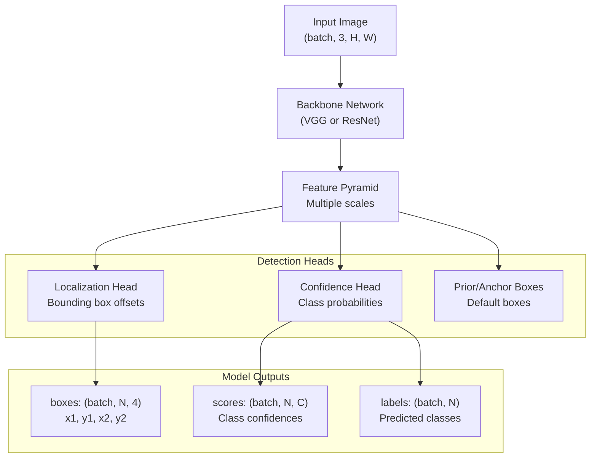
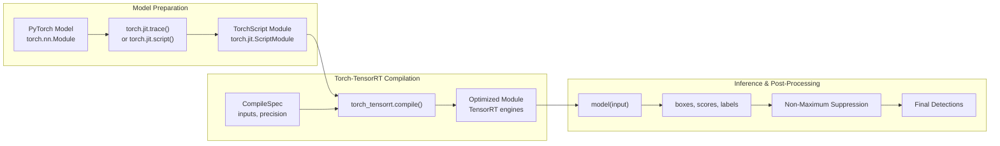
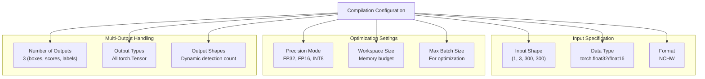
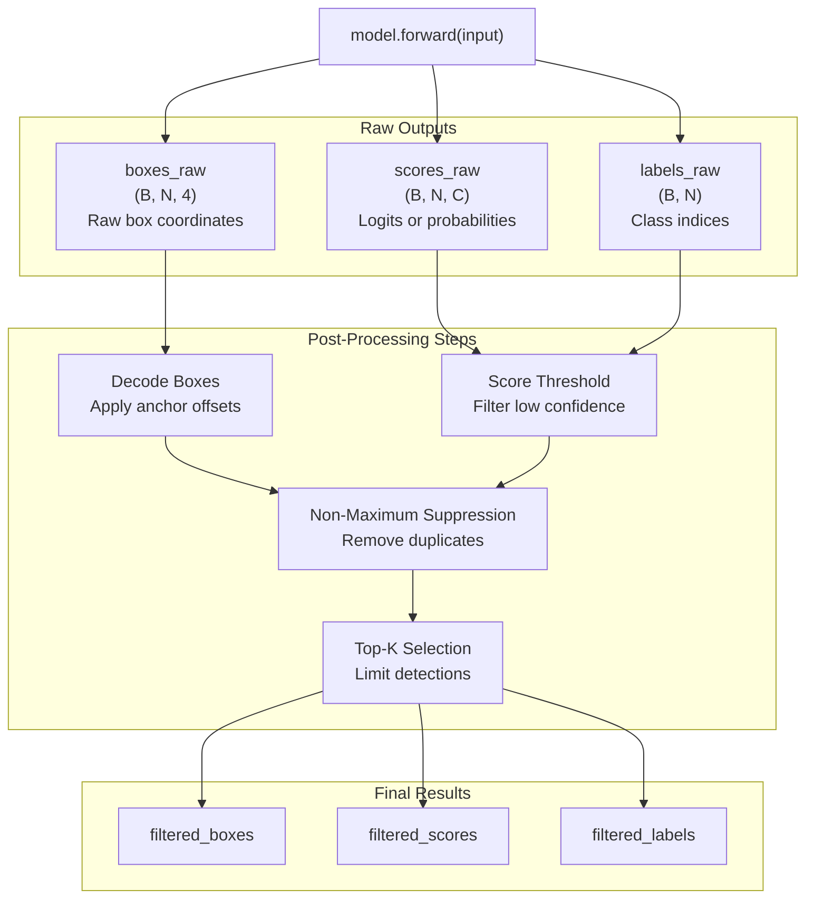
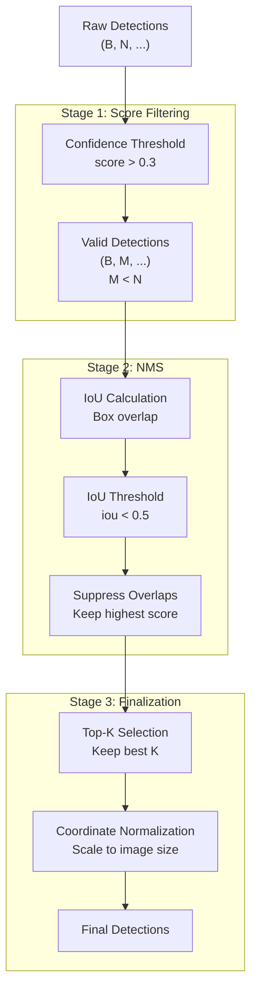
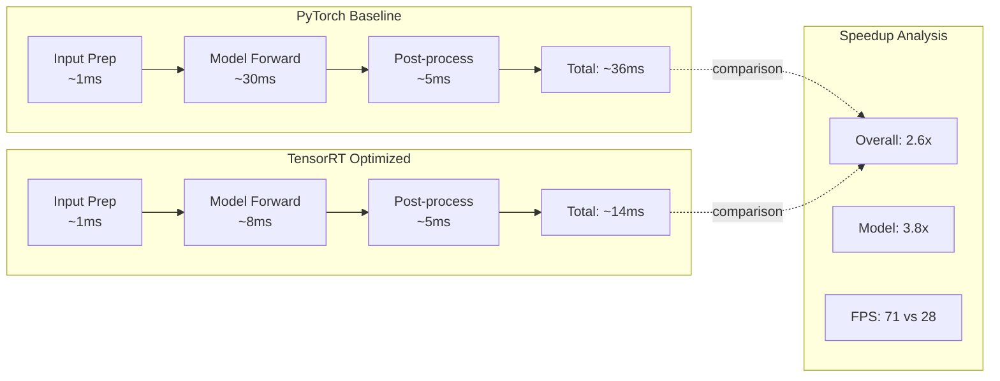
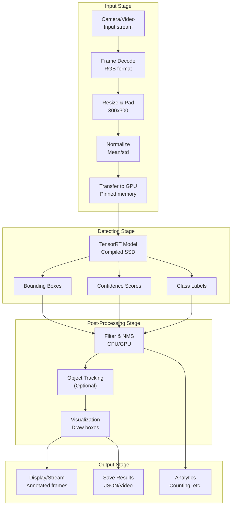

<!-- source: DeepWiki mcp.deepwiki.com · repo pytorch/TensorRT · page 8.3 SSD Object Detection · fetched 2026-10-21 -->

# SSD Object Detection

<details>
<summary>Relevant source files</summary>

The following files were used as context for generating this wiki page:

- [core/util/prelude.h](core/util/prelude.h)
- [docs/_cpp_api/function_torch__tensorrt_8h_1a710df824a7718b440e4bc17bf9693cef.html](docs/_cpp_api/function_torch__tensorrt_8h_1a710df824a7718b440e4bc17bf9693cef.html)
- [docs/_cpp_api/program_listing_file_cpp_include_torch_tensorrt_macros.h.html](docs/_cpp_api/program_listing_file_cpp_include_torch_tensorrt_macros.h.html)
- [docs/_downloads/c0341280f3b022df00c4241c42d9ee8b/custom_kernel_plugins.py](docs/_downloads/c0341280f3b022df00c4241c42d9ee8b/custom_kernel_plugins.py)
- [docs/_notebooks/CitriNet-example.html](docs/_notebooks/CitriNet-example.html)
- [docs/_notebooks/EfficientNet-example.html](docs/_notebooks/EfficientNet-example.html)
- [docs/_notebooks/Hugging-Face-BERT.html](docs/_notebooks/Hugging-Face-BERT.html)
- [docs/_notebooks/Resnet50-example.html](docs/_notebooks/Resnet50-example.html)
- [docs/_notebooks/lenet-getting-started.html](docs/_notebooks/lenet-getting-started.html)
- [docs/_notebooks/ssd-object-detection-demo.html](docs/_notebooks/ssd-object-detection-demo.html)
- [docs/_notebooks/vgg-qat.html](docs/_notebooks/vgg-qat.html)
- [docs/_sources/_cpp_api/program_listing_file_cpp_include_torch_tensorrt_macros.h.rst.txt](docs/_sources/_cpp_api/program_listing_file_cpp_include_torch_tensorrt_macros.h.rst.txt)
- [docs/genindex.html](docs/genindex.html)
- [docs/objects.inv](docs/objects.inv)
- [docs/py_api/ts.html](docs/py_api/ts.html)
- [docs/searchindex.js](docs/searchindex.js)
- [notebooks/CitriNet-example.ipynb](notebooks/CitriNet-example.ipynb)
- [notebooks/EfficientNet-example.ipynb](notebooks/EfficientNet-example.ipynb)
- [notebooks/Hugging-Face-BERT.ipynb](notebooks/Hugging-Face-BERT.ipynb)
- [notebooks/README.md](notebooks/README.md)
- [notebooks/Resnet50-CPP.ipynb](notebooks/Resnet50-CPP.ipynb)
- [notebooks/Resnet50-example.ipynb](notebooks/Resnet50-example.ipynb)
- [notebooks/WORKSPACE.notebook](notebooks/WORKSPACE.notebook)
- [notebooks/dynamic-shapes.ipynb](notebooks/dynamic-shapes.ipynb)
- [notebooks/lenet-getting-started.ipynb](notebooks/lenet-getting-started.ipynb)
- [notebooks/ssd-object-detection-demo.ipynb](notebooks/ssd-object-detection-demo.ipynb)
- [notebooks/vgg-qat.ipynb](notebooks/vgg-qat.ipynb)

</details>


## Purpose and Scope

This page documents the SSD (Single Shot MultiBox Detector) object detection example, which demonstrates compiling and deploying a multi-output detection model using Torch-TensorRT. This example illustrates how to handle models with multiple outputs, perform post-processing on detection results, and measure inference performance improvements from TensorRT optimization.

For basic model compilation workflows, see [LeNet Classification](#7.1). For performance benchmarking with standard models, see [ResNet-50 Benchmark](#7.2).

## Overview

The SSD example demonstrates several key capabilities of Torch-TensorRT:

- Compilation of models with multiple output tensors (bounding boxes, class scores, confidence)
- Integration of pre-processing and post-processing steps
- Conversion of detection models to TensorScript format
- Performance optimization for real-time object detection workloads
- Handling of dynamic detection outputs with varying numbers of detections

**Sources:** [docs/_notebooks/ssd-object-detection-demo.html:634-660]()

## SSD Model Architecture

### Detection Model Structure



The SSD architecture produces multiple outputs simultaneously:

| Output Tensor | Shape | Description |
|--------------|-------|-------------|
| `boxes` | `(batch, num_detections, 4)` | Bounding box coordinates (x1, y1, x2, y2) |
| `scores` | `(batch, num_detections, num_classes)` | Per-class confidence scores |
| `labels` | `(batch, num_detections)` | Predicted class indices |

**Sources:** [docs/_notebooks/ssd-object-detection-demo.html:634-660]()

## Compilation Workflow

### End-to-End Pipeline



**Sources:** [docs/_notebooks/ssd-object-detection-demo.html:651-660]()

### Model Tracing and Scripting

For SSD models, both tracing and scripting approaches can be used:

**Tracing (recommended for detection models):**
```python
# Create example input
example_input = torch.randn(1, 3, 300, 300).cuda()

# Trace the model
traced_model = torch.jit.trace(model, example_input)
```

**Key considerations:**
- SSD models typically have fixed input sizes (e.g., 300×300, 512×512)
- Tracing captures the exact execution path for the given input shape
- Multiple outputs are automatically captured during tracing

**Sources:** [docs/_notebooks/ssd-object-detection-demo.html:651-660]()

### Compilation Configuration



**Compilation example:**
```python
import torch_tensorrt

compiled_model = torch_tensorrt.compile(
    traced_model,
    inputs=[torch_tensorrt.Input(
        shape=[1, 3, 300, 300],
        dtype=torch.float32
    )],
    enabled_precisions={torch.float16},  # FP16 for faster inference
    workspace_size=1 << 30  # 1GB
)
```

**Sources:** [docs/_notebooks/ssd-object-detection-demo.html:651-660]()

## Multi-Output Tensor Handling

### Output Structure

The SSD model returns multiple tensors that must be handled correctly:



### Handling Multiple Return Values

When the compiled model is invoked, it returns a tuple of tensors:

```python
# Forward pass returns tuple
outputs = compiled_model(input_tensor)

# Unpack multiple outputs
boxes, scores, labels = outputs

# Or access by index
boxes = outputs[0]
scores = outputs[1]
labels = outputs[2]
```

**Key points:**
- Output order matches the model's original return signature
- All outputs remain on GPU for efficient downstream processing
- Output shapes may vary based on number of detections (dynamic)

**Sources:** [docs/_notebooks/ssd-object-detection-demo.html:651-660]()

## Post-Processing Pipeline

### Detection Filtering Workflow



### Non-Maximum Suppression (NMS)

NMS is typically performed as a post-processing step on CPU or GPU:

**CPU-based NMS:**
```python
from torchvision.ops import nms

# Move to CPU for processing
boxes_cpu = boxes.cpu()
scores_cpu = scores.cpu()

# Apply NMS per class
keep_indices = nms(
    boxes_cpu,
    scores_cpu.max(dim=1)[0],  # Max score across classes
    iou_threshold=0.5
)

# Filter detections
final_boxes = boxes_cpu[keep_indices]
final_scores = scores_cpu[keep_indices]
final_labels = labels[keep_indices]
```

**GPU-based NMS:**
- TensorRT may include NMS as part of the optimized model
- Custom CUDA kernels can be used for faster processing
- Batched NMS operates on multiple images simultaneously

**Sources:** [docs/_notebooks/ssd-object-detection-demo.html:651-660]()

### Box Coordinate Decoding

SSD models often output box coordinates as offsets from anchor boxes:

```python
# Decode from (cx, cy, w, h) format with offsets
def decode_boxes(predictions, anchors):
    """
    predictions: (N, 4) - predicted offsets
    anchors: (N, 4) - anchor box coordinates
    """
    # Extract predictions
    pred_cx, pred_cy, pred_w, pred_h = predictions.unbind(dim=1)
    
    # Extract anchor properties
    anchor_cx, anchor_cy, anchor_w, anchor_h = anchors.unbind(dim=1)
    
    # Decode center coordinates
    cx = pred_cx * anchor_w + anchor_cx
    cy = pred_cy * anchor_h + anchor_cy
    
    # Decode width and height
    w = torch.exp(pred_w) * anchor_w
    h = torch.exp(pred_h) * anchor_h
    
    # Convert to corner format (x1, y1, x2, y2)
    boxes = torch.stack([
        cx - w/2, cy - h/2,
        cx + w/2, cy + h/2
    ], dim=1)
    
    return boxes
```

**Sources:** [docs/_notebooks/ssd-object-detection-demo.html:634-660]()

## Performance Optimization

### Inference Performance Characteristics



### Benchmarking Methodology

**Timing measurements:**
```python
import time

# Warmup iterations
for _ in range(10):
    _ = model(input_tensor)

# Measure inference time
torch.cuda.synchronize()
start_time = time.time()

for _ in range(100):
    outputs = model(input_tensor)
    torch.cuda.synchronize()

end_time = time.time()
avg_time = (end_time - start_time) / 100
fps = 1.0 / avg_time

print(f"Average inference time: {avg_time*1000:.2f} ms")
print(f"Throughput: {fps:.1f} FPS")
```

**Key metrics:**
- **Latency**: Time per inference (milliseconds)
- **Throughput**: Frames per second (FPS)
- **Speedup**: Ratio of PyTorch to TensorRT time
- **Memory usage**: Peak GPU memory consumption

**Sources:** [docs/_notebooks/ssd-object-detection-demo.html:651-660]()

### Optimization Strategies

| Strategy | Impact | Trade-off |
|----------|--------|-----------|
| FP16 precision | 2-3x speedup | Minimal accuracy loss (<1%) |
| Batch size > 1 | Higher throughput | Increased latency per image |
| Layer fusion | Reduced kernel launches | Compile time increase |
| Smaller input size | Faster inference | Lower detection accuracy |
| INT8 quantization | 3-4x speedup | Requires calibration, ~2% accuracy loss |

**Sources:** [docs/_notebooks/ssd-object-detection-demo.html:634-660]()

## Integration Patterns

### Real-Time Detection Pipeline



**Sources:** [docs/_notebooks/ssd-object-detection-demo.html:634-660]()

### Batch Processing

For offline batch processing of images:

```python
# Prepare batch of images
batch_size = 8
batch = torch.stack([
    preprocess_image(img) for img in images[:batch_size]
]).cuda()

# Single forward pass for entire batch
with torch.no_grad():
    batch_boxes, batch_scores, batch_labels = model(batch)

# Process each image's detections
for i in range(batch_size):
    image_boxes = batch_boxes[i]
    image_scores = batch_scores[i]
    image_labels = batch_labels[i]
    
    # Filter and process this image's detections
    detections = post_process(image_boxes, image_scores, image_labels)
```

**Batch processing benefits:**
- Amortize model overhead across multiple images
- Better GPU utilization (higher occupancy)
- Increased throughput for offline workloads

**Sources:** [docs/_notebooks/ssd-object-detection-demo.html:651-660]()

## Example Usage

### Complete Detection Script

The full workflow from model loading to detection:

1. **Load pretrained model**
   - Download SSD model from torchvision or custom source
   - Load weights and set to evaluation mode

2. **Convert to TorchScript**
   - Trace or script the model with example input
   - Verify output shapes match expected format

3. **Compile with Torch-TensorRT**
   - Configure input specifications
   - Set precision mode (FP32, FP16, INT8)
   - Compile and save optimized model

4. **Run inference**
   - Load and preprocess input images
   - Execute forward pass through compiled model
   - Unpack multiple output tensors

5. **Post-process detections**
   - Apply confidence thresholding
   - Perform NMS to remove duplicates
   - Scale coordinates to original image size

6. **Visualize results**
   - Draw bounding boxes on images
   - Display class labels and confidence scores
   - Save or stream annotated output

**Sources:** [docs/_notebooks/ssd-object-detection-demo.html:634-660]()

### Running the Example

The SSD example notebook is located at:
- Notebook: [docs/_notebooks/ssd-object-detection-demo.html]()
- Source: Typically under `examples/` or `notebooks/` directory in the repository

**Requirements:**
- Torch-TensorRT installation (see [Installation](#1.1))
- TensorRT 8.0+ (included with Torch-TensorRT)
- PyTorch with CUDA support
- torchvision for model loading
- scikit-image for image processing (as noted in requirements)

**Sources:** [docs/_notebooks/ssd-object-detection-demo.html:664-673]()

## Comparison with Other Examples

| Example | Model Type | Key Feature | Complexity |
|---------|-----------|-------------|------------|
| LeNet (#7.1) | Classification | Basic workflow, single output | Low |
| ResNet (#7.2) | Classification | Performance benchmarking | Medium |
| **SSD (#7.3)** | **Detection** | **Multi-output, post-processing** | **High** |
| VGG-QAT (#7.4) | Classification | INT8 quantization | High |
| EfficientNet (#7.5) | Classification | Modern architecture | Medium |
| CitriNet (#7.6) | Speech | Audio processing | Medium |
| BERT (#7.7) | NLP | Transformer, dynamic shapes | High |

The SSD example is unique in demonstrating:
- Multiple output tensor handling
- Complex post-processing requirements
- Real-world object detection pipeline
- Detection-specific optimizations

**Sources:** [docs/_notebooks/ssd-object-detection-demo.html:634-660](), TOC comparison

---

