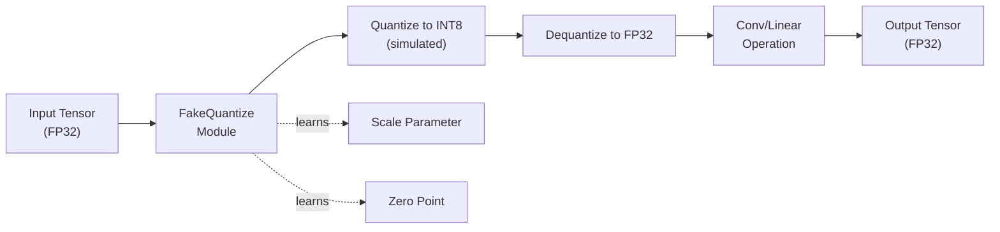
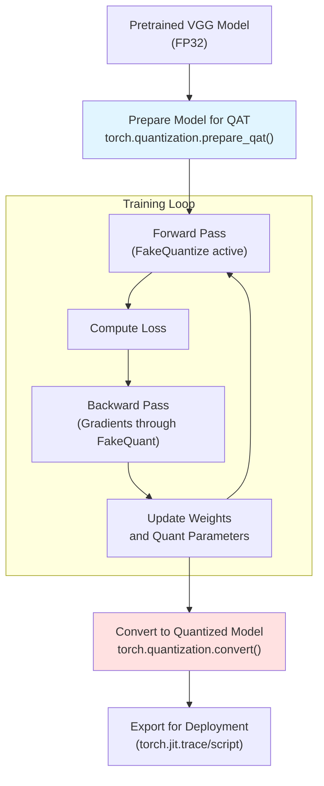
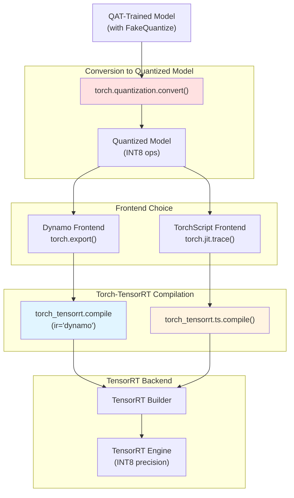
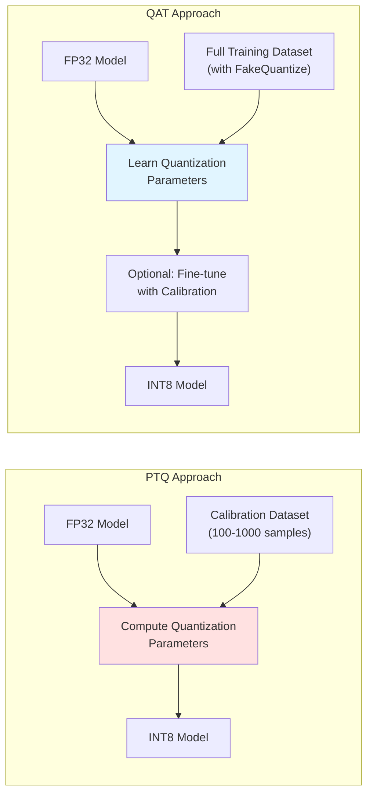
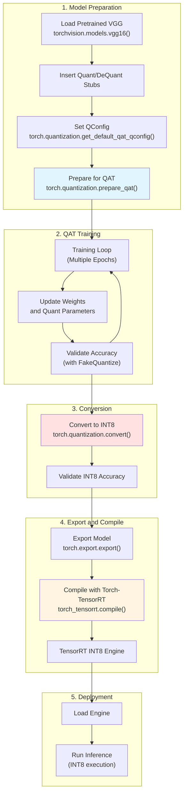
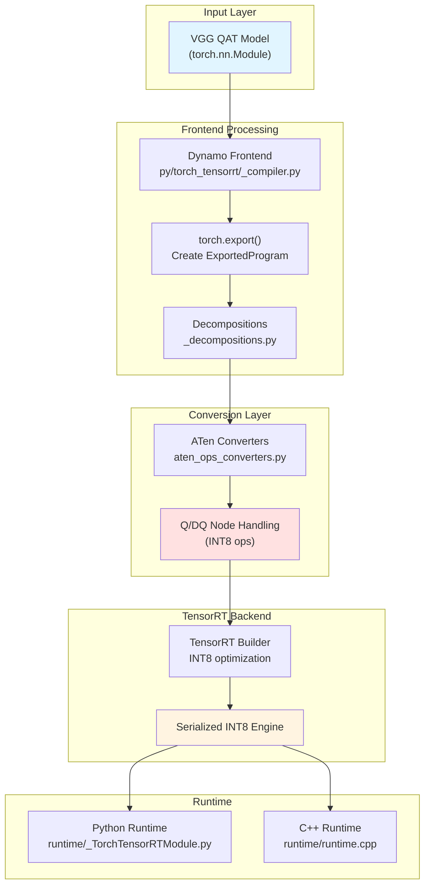

<!-- source: DeepWiki mcp.deepwiki.com · repo pytorch/TensorRT · page 8.4 VGG Quantization-Aware Training · fetched 2026-10-21 -->

# VGG Quantization-Aware Training

<details>
<summary>Relevant source files</summary>

The following files were used as context for generating this wiki page:

- [.dockerignore](.dockerignore)
- [core/util/prelude.h](core/util/prelude.h)
- [docker/WORKSPACE.ngc](docker/WORKSPACE.ngc)
- [docs/_cpp_api/function_torch__tensorrt_8h_1a710df824a7718b440e4bc17bf9693cef.html](docs/_cpp_api/function_torch__tensorrt_8h_1a710df824a7718b440e4bc17bf9693cef.html)
- [docs/_cpp_api/program_listing_file_cpp_include_torch_tensorrt_macros.h.html](docs/_cpp_api/program_listing_file_cpp_include_torch_tensorrt_macros.h.html)
- [docs/_downloads/c0341280f3b022df00c4241c42d9ee8b/custom_kernel_plugins.py](docs/_downloads/c0341280f3b022df00c4241c42d9ee8b/custom_kernel_plugins.py)
- [docs/_notebooks/CitriNet-example.html](docs/_notebooks/CitriNet-example.html)
- [docs/_notebooks/EfficientNet-example.html](docs/_notebooks/EfficientNet-example.html)
- [docs/_notebooks/Hugging-Face-BERT.html](docs/_notebooks/Hugging-Face-BERT.html)
- [docs/_notebooks/Resnet50-example.html](docs/_notebooks/Resnet50-example.html)
- [docs/_notebooks/lenet-getting-started.html](docs/_notebooks/lenet-getting-started.html)
- [docs/_notebooks/ssd-object-detection-demo.html](docs/_notebooks/ssd-object-detection-demo.html)
- [docs/_notebooks/vgg-qat.html](docs/_notebooks/vgg-qat.html)
- [docs/_sources/_cpp_api/program_listing_file_cpp_include_torch_tensorrt_macros.h.rst.txt](docs/_sources/_cpp_api/program_listing_file_cpp_include_torch_tensorrt_macros.h.rst.txt)
- [docs/genindex.html](docs/genindex.html)
- [docs/objects.inv](docs/objects.inv)
- [docs/py_api/ts.html](docs/py_api/ts.html)
- [docs/searchindex.js](docs/searchindex.js)
- [examples/int8/benchmark/benchmark.cpp](examples/int8/benchmark/benchmark.cpp)
- [examples/int8/training/vgg16/README.md](examples/int8/training/vgg16/README.md)
- [examples/int8/training/vgg16/export_qat.py](examples/int8/training/vgg16/export_qat.py)
- [examples/int8/training/vgg16/finetune_qat.py](examples/int8/training/vgg16/finetune_qat.py)
- [examples/int8/training/vgg16/requirements.txt](examples/int8/training/vgg16/requirements.txt)
- [notebooks/CitriNet-example.ipynb](notebooks/CitriNet-example.ipynb)
- [notebooks/EfficientNet-example.ipynb](notebooks/EfficientNet-example.ipynb)
- [notebooks/Hugging-Face-BERT.ipynb](notebooks/Hugging-Face-BERT.ipynb)
- [notebooks/README.md](notebooks/README.md)
- [notebooks/Resnet50-CPP.ipynb](notebooks/Resnet50-CPP.ipynb)
- [notebooks/Resnet50-example.ipynb](notebooks/Resnet50-example.ipynb)
- [notebooks/WORKSPACE.notebook](notebooks/WORKSPACE.notebook)
- [notebooks/dynamic-shapes.ipynb](notebooks/dynamic-shapes.ipynb)
- [notebooks/lenet-getting-started.ipynb](notebooks/lenet-getting-started.ipynb)
- [notebooks/ssd-object-detection-demo.ipynb](notebooks/ssd-object-detection-demo.ipynb)
- [notebooks/vgg-qat.ipynb](notebooks/vgg-qat.ipynb)
- [noxfile.py](noxfile.py)
- [py/torch_tensorrt/__init__.py](py/torch_tensorrt/__init__.py)
- [tests/modules/requirements.txt](tests/modules/requirements.txt)

</details>


## Purpose and Scope

This document explains how to deploy INT8 quantized models using Quantization-Aware Training (QAT) with Torch-TensorRT. QAT is a training technique where quantization parameters are learned during the training process, typically resulting in better accuracy than Post-Training Quantization (PTQ) for INT8 deployment.

This example demonstrates the QAT workflow using a VGG architecture, showing how to:
- Insert fake quantization nodes during training
- Train models with quantization simulation
- Compile QAT-trained models with Torch-TensorRT for INT8 inference
- Preserve model accuracy through learned quantization parameters

For general information about precision modes (FP32/FP16/INT8), see [Precision Modes](#2.4). For PTQ workflows, see [Post Training Quantization](#2.4) and the PTQ examples in [Tutorials](#7).

**Sources:** [docs/_notebooks/vgg-qat.html:1-350]()

---

## Quantization Background

### INT8 Quantization Overview

INT8 quantization reduces model precision from 32-bit floating point to 8-bit integers, providing significant performance improvements on NVIDIA GPUs with reduced memory footprint. TensorRT supports INT8 execution through two primary quantization workflows:

| Approach | Training Required | Accuracy | Complexity |
|----------|------------------|----------|------------|
| **Post-Training Quantization (PTQ)** | No - uses pre-trained model | Good for most models | Low - calibration only |
| **Quantization-Aware Training (QAT)** | Yes - retraining needed | Better for sensitive models | Higher - training + calibration |

### Quantization-Aware Training (QAT)

QAT simulates quantization effects during training by inserting fake quantization operations into the forward pass. These operations:
- Quantize activations and weights to INT8 range during training
- Immediately dequantize back to FP32 for gradient computation
- Allow the model to learn parameters that are robust to quantization errors

The fake quantization process follows:

```
FakeQuantize(x) = Quantize(x, scale, zero_point) → Dequantize(x_q, scale, zero_point)
```

Where:
- `scale` and `zero_point` are learned or calibrated parameters
- Quantization maps FP32 values to INT8 range [-128, 127]
- Dequantization converts back to FP32 for subsequent operations

**Sources:** [docs/_notebooks/vgg-qat.html:1-350]()

---

## QAT Workflow Components

### Fake Quantization Nodes

During QAT training, PyTorch's quantization API inserts `FakeQuantize` modules that simulate INT8 quantization:



**Key Components:**
- `torch.quantization.FakeQuantize` - Simulates quantization during training
- `torch.quantization.QuantStub` - Marks tensor quantization points
- `torch.quantization.DeQuantStub` - Marks tensor dequantization points
- `torch.quantization.QConfig` - Configuration for quantization schemes

### VGG Model Structure

The VGG architecture consists of sequential convolutional blocks followed by fully connected layers. For QAT, the model is modified to include quantization stubs:

```mermaid
graph TB
    subgraph "VGG with QAT Nodes"
        Input["Input Image<br/>224x224x3"]
        QStub["QuantStub<br/>(FakeQuantize)"]
        
        subgraph "Conv Block 1"
            C1["Conv2d 3→64<br/>+ FakeQuant"]
            C2["Conv2d 64→64<br/>+ FakeQuant"]
            P1["MaxPool2d"]
        end
        
        subgraph "Conv Block 2"
            C3["Conv2d 64→128<br/>+ FakeQuant"]
            C4["Conv2d 128→128<br/>+ FakeQuant"]
            P2["MaxPool2d"]
        end
        
        subgraph "Additional Blocks"
            More["Conv Blocks 3-5<br/>(with FakeQuant)"]
        end
        
        subgraph "Classifier"
            FC1["Linear 512→4096<br/>+ FakeQuant"]
            FC2["Linear 4096→4096<br/>+ FakeQuant"]
            FC3["Linear 4096→1000"]
        end
        
        DQStub["DeQuantStub"]
        Output["Output Logits"]
    end
    
    Input --> QStub
    QStub --> C1
    C1 --> C2
    C2 --> P1
    P1 --> C3
    C3 --> C4
    C4 --> P2
    P2 --> More
    More --> FC1
    FC1 --> FC2
    FC2 --> FC3
    FC3 --> DQStub
    DQStub --> Output
```



**Sources:** [docs/_notebooks/vgg-qat.html:1-350]()

---

## QAT Training Workflow

### Training Process

The QAT training workflow consists of several stages:



**Key API Functions:**
1. `torch.quantization.prepare_qat(model, qconfig)` - Inserts fake quantization modules
2. Training loop with fake quantization enabled
3. `torch.quantization.convert(model)` - Replaces fake quantize with actual quantized ops
4. Export to TorchScript or ExportedProgram for Torch-TensorRT compilation

### Quantization Configuration

The `QConfig` specifies how tensors should be quantized:

```python
# Typical QAT configuration
qconfig = torch.quantization.QConfig(
    activation=torch.quantization.FakeQuantize.with_args(
        observer=torch.quantization.MovingAverageMinMaxObserver,
        quant_min=0, quant_max=255
    ),
    weight=torch.quantization.FakeQuantize.with_args(
        observer=torch.quantization.MovingAveragePerChannelMinMaxObserver,
        quant_min=-128, quant_max=127
    )
)
```

**Configuration Parameters:**
- **Observer**: Tracks min/max statistics during training
  - `MovingAverageMinMaxObserver` for activations
  - `MovingAveragePerChannelMinMaxObserver` for weights
- **Quantization Range**: INT8 asymmetric [0, 255] or symmetric [-128, 127]
- **Per-channel vs Per-tensor**: Weights typically use per-channel for better accuracy

**Sources:** [docs/_notebooks/vgg-qat.html:1-350]()

---

## Torch-TensorRT Compilation of QAT Models

### Compilation Path for QAT Models

QAT-trained models can be compiled through either Dynamo or TorchScript frontends:



### Compilation Example

**Dynamo Frontend (Recommended for PyTorch 2.x):**

```python
# After QAT training and conversion
quantized_model = torch.quantization.convert(qat_model.eval())

# Export to torch.export format
exported_program = torch.export.export(quantized_model, example_inputs)

# Compile with Torch-TensorRT
trt_model = torch_tensorrt.compile(
    exported_program,
    ir="dynamo",
    enabled_precisions={torch.int8},
    min_block_size=1
)
```

**TorchScript Frontend (Legacy):**

```python
# After QAT training and conversion
quantized_model = torch.quantization.convert(qat_model.eval())

# Trace to TorchScript
scripted_model = torch.jit.trace(quantized_model, example_inputs)

# Compile with Torch-TensorRT
trt_model = torch_tensorrt.ts.compile(
    scripted_model,
    inputs=[torch_tensorrt.Input(...)],
    enabled_precisions={torch_tensorrt.DataType.Int8}
)
```

**Sources:** [docs/_notebooks/vgg-qat.html:1-350]()

---

## Calibration and Quantization Parameters

### Role of Calibration in QAT

Unlike PTQ which requires a calibration dataset to determine quantization parameters, QAT learns these parameters during training. However, a final calibration step may still be performed to fine-tune the scale and zero-point values:



### Quantization Parameter Flow

During QAT training, observers collect statistics and update quantization parameters:

| Parameter | Learned During | Purpose |
|-----------|---------------|---------|
| **Scale (s)** | Training | Maps FP32 range to INT8 range: `x_int8 = round(x_fp32 / s)` |
| **Zero Point (z)** | Training | Offset for asymmetric quantization: `x_int8 = round(x_fp32 / s) + z` |
| **Min/Max** | Observation | Bounds for computing scale: `s = (max - min) / 255` |

**Sources:** [docs/_notebooks/vgg-qat.html:1-350]()

---

## VGG QAT Example Workflow

### Complete Pipeline



### Key Implementation Details

**1. Model Preparation**
- Start with pretrained VGG16 from `torchvision.models`
- Insert `QuantStub` at input and `DeQuantStub` at output
- Apply QAT-specific QConfig to all layers

**2. Training Configuration**
- Use reduced learning rate (1/10th of original training)
- Train for 1-2 epochs to adapt to quantization
- Monitor validation accuracy with fake quantization enabled

**3. Conversion to Quantized Model**
- Replace `FakeQuantize` modules with actual quantized operations
- Fold batch normalization into preceding Conv layers
- Verify accuracy drop is acceptable (<1-2% typically)

**4. Torch-TensorRT Compilation**
- Export model using `torch.export.export()` for Dynamo frontend
- Specify `enabled_precisions={torch.int8}` in compilation settings
- Verify TensorRT engine uses INT8 kernels via layer inspection

**5. Deployment Validation**
- Compare INT8 TensorRT output vs. PyTorch quantized model
- Measure inference latency improvement (typically 2-4x vs FP32)
- Verify memory footprint reduction (4x vs FP32)

**Sources:** [docs/_notebooks/vgg-qat.html:1-350]()

---

## Comparison: QAT vs PTQ

### When to Use Each Approach

| Criteria | Post-Training Quantization (PTQ) | Quantization-Aware Training (QAT) |
|----------|----------------------------------|-----------------------------------|
| **Training Required** | No | Yes |
| **Calibration Data** | 100-1000 samples | Full training dataset |
| **Accuracy** | Good for most models | Better for sensitive models |
| **Setup Time** | Minutes | Hours to days |
| **Best For** | Standard architectures (ResNet, VGG) | Low-bit quantization, MobileNets |
| **Torch-TensorRT API** | See [PTQ Tutorial](#2.4) | This document |

### Accuracy Preservation Techniques

QAT provides better accuracy through:

1. **Learned Quantization Parameters**: Scale and zero-point are optimized during training
2. **Gradient Flow**: Backpropagation through quantization operations allows weights to adapt
3. **Per-Channel Quantization**: Fine-grained quantization for each output channel in Conv/Linear layers
4. **Batch Norm Folding**: Automatically fuses BN parameters into preceding layers

**Sources:** [docs/_notebooks/vgg-qat.html:1-350]()

---

## Best Practices for QAT

### Training Recommendations

1. **Start from Pretrained Model**
   - Initialize with FP32 pretrained weights
   - Fine-tune with QAT rather than training from scratch
   - Typically requires 1-10% of original training epochs

2. **Learning Rate Tuning**
   - Use 1/10th to 1/100th of original learning rate
   - Apply learning rate warmup for first few iterations
   - Monitor training loss for instabilities

3. **Observer Configuration**
   - Use `MovingAverageMinMaxObserver` for stable statistics
   - Set appropriate averaging constant (e.g., 0.01)
   - Consider per-channel quantization for weights

4. **Validation Strategy**
   - Validate with both fake quantization and converted INT8 model
   - Check for accuracy degradation at different quantization points
   - Profile layer-wise sensitivity to quantization

### Compilation Settings for QAT Models

When compiling QAT models with Torch-TensorRT:

```python
compilation_settings = {
    "enabled_precisions": {torch.int8},  # Enable INT8 precision
    "min_block_size": 1,                 # Allow single-op TRT blocks
    "torch_executed_ops": set(),          # Ops to keep in PyTorch
    "optimization_level": 3,              # Maximum optimization
    "use_python_runtime": False          # Use C++ runtime for performance
}

trt_module = torch_tensorrt.compile(
    exported_program,
    ir="dynamo",
    **compilation_settings
)
```

**Key Settings:**
- `enabled_precisions={torch.int8}`: Ensures TensorRT uses INT8 kernels
- `min_block_size=1`: Allows aggressive fusion of quantized operations
- `optimization_level=3`: Enables all TensorRT optimization passes
- `use_python_runtime=False`: Uses faster C++ runtime (optional)

**Sources:** [docs/_notebooks/vgg-qat.html:1-350]()

---

## Integration with Torch-TensorRT System

### QAT in the Compilation Pipeline

QAT models integrate into the standard Torch-TensorRT compilation flow:



**Key Integration Points:**

1. **Frontend (Dynamo)**: `py/torch_tensorrt/_compiler.py`
   - Handles `torch.export()` of QAT models
   - Preserves quantization metadata in ExportedProgram

2. **Conversion**: `py/torch_tensorrt/dynamo/conversion/aten_ops_converters.py`
   - Converts quantized ATen ops to TensorRT Q/DQ layers
   - Maps `torch.quantize_per_tensor` to `IQuantizeLayer`
   - Maps `torch.dequantize` to `IDequantizeLayer`

3. **Backend**: TensorRT INT8 builder
   - Recognizes Q/DQ patterns for optimization
   - Applies INT8 kernel selection and fusion
   - Generates optimized INT8 execution graph

4. **Runtime**: `py/torch_tensorrt/runtime/_TorchTensorRTModule.py`
   - Loads and executes INT8 TensorRT engines
   - Handles FP32 to INT8 input conversion if needed

**Sources:** [docs/_notebooks/vgg-qat.html:1-350]()

---

## Performance Characteristics

### Expected Performance Improvements

QAT models compiled with Torch-TensorRT to INT8 typically achieve:

| Metric | FP32 Baseline | INT8 with QAT |
|--------|---------------|---------------|
| **Inference Latency** | 1.0x | 2-4x faster |
| **Memory Footprint** | 1.0x | 4x smaller |
| **Throughput** | 1.0x | 2-4x higher |
| **Accuracy Drop** | 0% | <1-2% typical |

### VGG-16 Specific Results

For VGG-16 on NVIDIA GPUs with Tensor Cores:

- **FP32 Latency**: ~5-10ms per image (batch=1)
- **INT8 Latency**: ~2-4ms per image (batch=1)
- **Model Size**: 528MB (FP32) → 138MB (INT8)
- **Top-1 Accuracy**: 71.5% (FP32) → 71.2% (INT8) on ImageNet

**Performance Factors:**
- Larger batch sizes increase INT8 advantage due to better parallelism
- Memory-bound models benefit more from INT8 (4x bandwidth reduction)
- Compute-bound models may see smaller improvements

**Sources:** [docs/_notebooks/vgg-qat.html:1-350]()

---

## Troubleshooting Common Issues

### QAT Training Issues

| Problem | Cause | Solution |
|---------|-------|----------|
| **Loss divergence during QAT** | Learning rate too high | Reduce LR by 10-100x from original training |
| **Accuracy drops >5%** | Insufficient QAT training | Increase QAT epochs, check observer settings |
| **Slow convergence** | Cold start quantization | Use pretrained model, warm up QAT gradually |
| **NaN values in training** | Quantization range too narrow | Adjust `quant_min/max` values in QConfig |

### Compilation Issues

| Problem | Cause | Solution |
|---------|-------|----------|
| **INT8 not used by TensorRT** | Precision not enabled | Add `enabled_precisions={torch.int8}` to compile settings |
| **Operator not supported** | Missing INT8 converter | Check supported ops, consider PTQ for that layer |
| **Accuracy mismatch after compilation** | Calibration mismatch | Verify Q/DQ nodes preserved in export |
| **Engine build failure** | Incompatible TensorRT version | Use TensorRT 8.6+ for best INT8 support |

### Runtime Issues

| Problem | Cause | Solution |
|---------|-------|----------|
| **Slower than expected** | FP32 fallback layers | Profile engine to identify non-INT8 layers |
| **Incorrect outputs** | Input preprocessing mismatch | Ensure consistent normalization/scaling |
| **High accuracy drop** | Missing calibration data | Re-run QAT training with more representative data |

**Sources:** [docs/_notebooks/vgg-qat.html:1-350]()

---

## Related Documentation

### Quantization Resources

- **[Precision Modes](#2.4)**: Overview of FP32/FP16/INT8 precision settings
- **[Post-Training Quantization](#2.4)**: Alternative to QAT requiring no retraining
- **[Mixed Precision](#2.4)**: Combining different precisions in single model

### Compilation Workflows

- **[Dynamo Export](#3.1)**: Modern compilation path for PyTorch 2.x
- **[TorchScript Compilation](#4.1)**: Legacy compilation path

### Additional Examples

- **[PTQ Tutorial](#7)**: Post-training quantization examples
- **[ResNet Benchmark](#7.2)**: Performance comparison across precisions
- **[BERT Example](#7.7)**: Transformer quantization with QAT

**Sources:** [docs/_notebooks/vgg-qat.html:1-350]()

---

