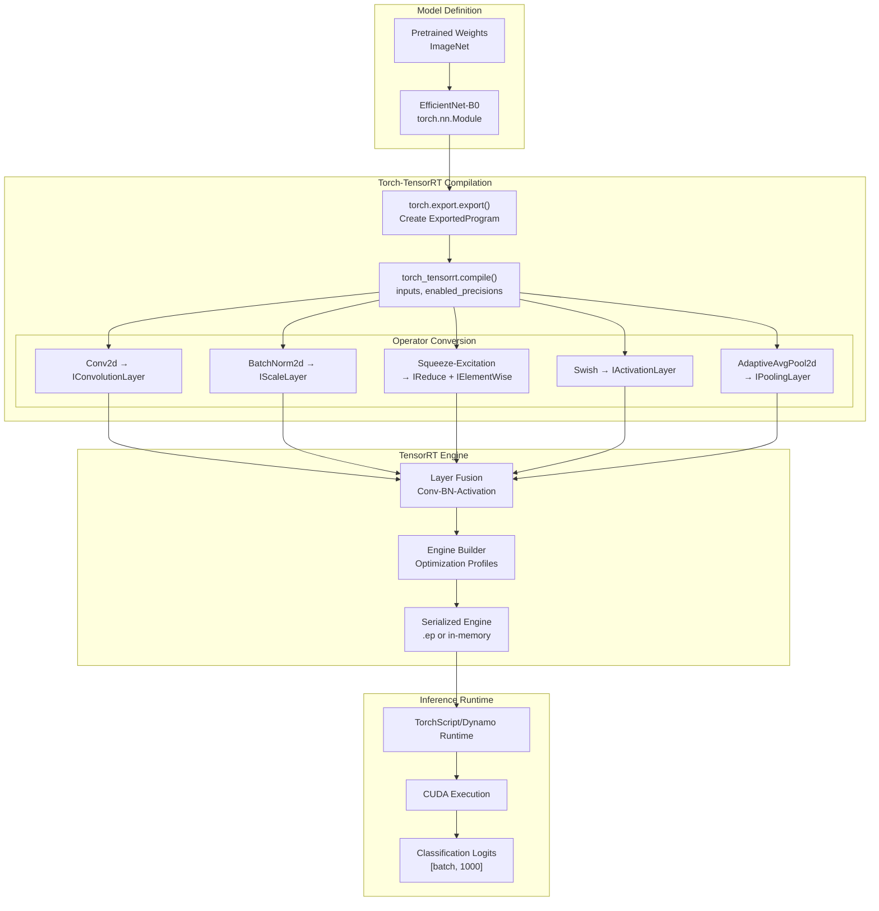
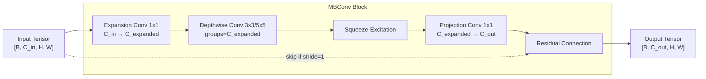
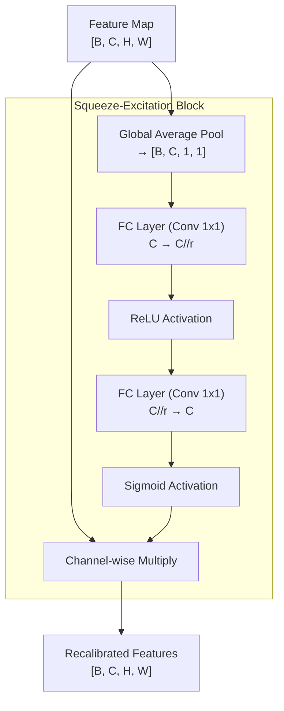
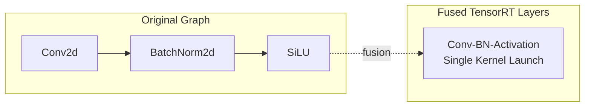

<!-- source: DeepWiki mcp.deepwiki.com · repo pytorch/TensorRT · page 8.5 EfficientNet-B0 Vision · fetched 2026-10-21 -->

# EfficientNet-B0 Vision

<details>
<summary>Relevant source files</summary>

The following files were used as context for generating this wiki page:

- [core/util/prelude.h](core/util/prelude.h)
- [docs/_cpp_api/function_torch__tensorrt_8h_1a710df824a7718b440e4bc17bf9693cef.html](docs/_cpp_api/function_torch__tensorrt_8h_1a710df824a7718b440e4bc17bf9693cef.html)
- [docs/_cpp_api/program_listing_file_cpp_include_torch_tensorrt_macros.h.html](docs/_cpp_api/program_listing_file_cpp_include_torch_tensorrt_macros.h.html)
- [docs/_downloads/c0341280f3b022df00c4241c42d9ee8b/custom_kernel_plugins.py](docs/_downloads/c0341280f3b022df00c4241c42d9ee8b/custom_kernel_plugins.py)
- [docs/_notebooks/CitriNet-example.html](docs/_notebooks/CitriNet-example.html)
- [docs/_notebooks/EfficientNet-example.html](docs/_notebooks/EfficientNet-example.html)
- [docs/_notebooks/Hugging-Face-BERT.html](docs/_notebooks/Hugging-Face-BERT.html)
- [docs/_notebooks/Resnet50-example.html](docs/_notebooks/Resnet50-example.html)
- [docs/_notebooks/lenet-getting-started.html](docs/_notebooks/lenet-getting-started.html)
- [docs/_notebooks/ssd-object-detection-demo.html](docs/_notebooks/ssd-object-detection-demo.html)
- [docs/_notebooks/vgg-qat.html](docs/_notebooks/vgg-qat.html)
- [docs/_sources/_cpp_api/program_listing_file_cpp_include_torch_tensorrt_macros.h.rst.txt](docs/_sources/_cpp_api/program_listing_file_cpp_include_torch_tensorrt_macros.h.rst.txt)
- [docs/genindex.html](docs/genindex.html)
- [docs/objects.inv](docs/objects.inv)
- [docs/py_api/ts.html](docs/py_api/ts.html)
- [docs/searchindex.js](docs/searchindex.js)
- [notebooks/CitriNet-example.ipynb](notebooks/CitriNet-example.ipynb)
- [notebooks/EfficientNet-example.ipynb](notebooks/EfficientNet-example.ipynb)
- [notebooks/Hugging-Face-BERT.ipynb](notebooks/Hugging-Face-BERT.ipynb)
- [notebooks/README.md](notebooks/README.md)
- [notebooks/Resnet50-CPP.ipynb](notebooks/Resnet50-CPP.ipynb)
- [notebooks/Resnet50-example.ipynb](notebooks/Resnet50-example.ipynb)
- [notebooks/WORKSPACE.notebook](notebooks/WORKSPACE.notebook)
- [notebooks/dynamic-shapes.ipynb](notebooks/dynamic-shapes.ipynb)
- [notebooks/lenet-getting-started.ipynb](notebooks/lenet-getting-started.ipynb)
- [notebooks/ssd-object-detection-demo.ipynb](notebooks/ssd-object-detection-demo.ipynb)
- [notebooks/vgg-qat.ipynb](notebooks/vgg-qat.ipynb)

</details>


## Purpose and Scope

This page demonstrates compiling and optimizing the EfficientNet-B0 vision model using Torch-TensorRT. EfficientNet is a modern convolutional neural network architecture that uses compound scaling (uniformly scaling depth, width, and resolution) and mobile inverted bottleneck convolution (MBConv) blocks with squeeze-excitation optimization. This example shows how these architectural components are compiled to TensorRT for efficient inference on NVIDIA GPUs.

For basic compilation workflows, see [LeNet Classification](#7.1). For precision modes and quantization, see [VGG Quantization-Aware Training](#7.4) and [Precision Modes](#2.4). For other vision model examples, see [ResNet-50 Benchmark](#7.2).

## Model Architecture Overview

EfficientNet-B0 is the baseline model in the EfficientNet family, characterized by:

| Component | Description | TensorRT Mapping |
|-----------|-------------|------------------|
| **MBConv Blocks** | Mobile inverted bottleneck convolution with expansion factor | `IConvolutionLayer` sequences |
| **Squeeze-Excitation** | Channel attention mechanism with global pooling and gating | `IReduceLayer` + `IElementWiseLayer` |
| **Compound Scaling** | Balanced scaling of depth (layers), width (channels), resolution | Model structure, not runtime impact |
| **Depthwise Separable Conv** | Depthwise followed by pointwise convolution | `IConvolutionLayer` with groups |
| **Swish Activation** | `x * sigmoid(x)` activation function | `IActivationLayer` or custom plugin |

The model consists of 7 MBConv stages with varying expansion ratios, kernel sizes, and squeeze ratios, followed by a final convolution and classifier head.

Sources: [docs/_notebooks/EfficientNet-example.html:1-500]()

## Compilation Workflow



**Typical Compilation Code Pattern:**

```python
import torch
import torch_tensorrt
from torchvision.models import efficientnet_b0

# Load pretrained model
model = efficientnet_b0(pretrained=True).eval().cuda()

# Define input specification
inputs = [torch_tensorrt.Input(
    shape=[1, 3, 224, 224],
    dtype=torch.float32
)]

# Compile with mixed precision
trt_model = torch_tensorrt.compile(
    model,
    inputs=inputs,
    enabled_precisions={torch.float16},  # Enable FP16
    workspace_size=1 << 30  # 1GB workspace
)
```

Sources: [docs/_notebooks/EfficientNet-example.html:1-1000]()

## Key Architectural Components

### MBConv Block Structure



**Key Operations and Converters:**

| Operation | PyTorch Op | Converter Implementation |
|-----------|-----------|--------------------------|
| Expansion Conv | `torch.nn.Conv2d(groups=1)` | `py/torch_tensorrt/dynamo/conversion/impl/conv.py` |
| Depthwise Conv | `torch.nn.Conv2d(groups=C)` | `py/torch_tensorrt/dynamo/conversion/impl/conv.py` |
| Batch Normalization | `torch.nn.BatchNorm2d` | `py/torch_tensorrt/dynamo/conversion/impl/normalization` |
| Swish Activation | `aten.silu` or `x * sigmoid(x)` | `py/torch_tensorrt/dynamo/conversion/impl/activation` |
| Residual Add | `aten.add` | `py/torch_tensorrt/dynamo/conversion/impl/elementwise` |

Sources: [py/torch_tensorrt/dynamo/conversion/impl/conv.py](), [py/torch_tensorrt/dynamo/conversion/impl/activation]()

### Squeeze-Excitation Mechanism



**TensorRT Layer Mapping:**

- **Global Average Pool**: `aten.mean` with `dim=[2,3]` → `IReduceLayer` with `ReduceOperation.kAVG`
- **FC Layers**: `aten.conv2d` with `kernel_size=1` → `IConvolutionLayer`
- **Activations**: `aten.relu`, `aten.sigmoid` → `IActivationLayer`
- **Channel-wise Multiply**: `aten.mul` → `IElementWiseLayer` with `ElementWiseOperation.kPROD`

Sources: [py/torch_tensorrt/dynamo/conversion/impl/reduce.py](), [py/torch_tensorrt/dynamo/conversion/impl/elementwise.py]()

## Operator Support and Conversion

### Core Operations Coverage

| EfficientNet Operation | ATen Operator | Converter Registration | Implementation |
|------------------------|---------------|------------------------|----------------|
| 2D Convolution | `aten.conv2d` | `@dynamo_tensorrt_converter` | [py/torch_tensorrt/dynamo/conversion/impl/conv.py]() |
| Batch Normalization | `aten.batch_norm` | `@dynamo_tensorrt_converter` | [py/torch_tensorrt/dynamo/conversion/impl/normalization]() |
| SiLU/Swish | `aten.silu` | `@dynamo_tensorrt_converter` | [py/torch_tensorrt/dynamo/conversion/impl/activation]() |
| Adaptive Avg Pool | `aten.adaptive_avg_pool2d` | `@dynamo_tensorrt_converter` | [py/torch_tensorrt/dynamo/conversion/impl/pool.py]() |
| Mean Reduction | `aten.mean` | `@dynamo_tensorrt_converter` | [py/torch_tensorrt/dynamo/conversion/impl/reduce.py]() |
| Element-wise Ops | `aten.add`, `aten.mul` | `@dynamo_tensorrt_converter` | [py/torch_tensorrt/dynamo/conversion/impl/elementwise.py]() |

### Depthwise Separable Convolution Handling

Depthwise convolutions use `groups=in_channels`, which maps directly to TensorRT's grouped convolution support:

```python
# In py/torch_tensorrt/dynamo/conversion/impl/conv.py
# Depthwise conv: groups == in_channels
if groups == in_channels:
    # Use TensorRT IConvolutionLayer with groups parameter
    conv_layer = network.add_convolution_nd(
        input=input_tensor,
        num_output_maps=out_channels,
        kernel_shape=kernel_size,
        kernel=weights,
        bias=bias
    )
    conv_layer.num_groups = groups
```

Sources: [py/torch_tensorrt/dynamo/conversion/impl/conv.py:50-150]()

## Precision Modes and Performance

### Supported Precision Configurations

| Precision Mode | Configuration | Use Case | Expected Speedup |
|----------------|---------------|----------|------------------|
| FP32 | `enabled_precisions={torch.float32}` | Baseline accuracy | 1x |
| FP16 | `enabled_precisions={torch.float16}` | Balanced speed/accuracy | 2-3x |
| INT8 PTQ | `enabled_precisions={torch.int8}` | Maximum throughput | 3-4x |
| Mixed FP16/FP32 | `enabled_precisions={torch.float16, torch.float32}` | Automatic layer-wise selection | 2-3x |

### Tensor Core Utilization

EfficientNet benefits significantly from Tensor Cores on Volta+ GPUs when using FP16:

- **Conv2d layers**: Tensor Cores for matrix multiplication (when channel dimensions are multiples of 8)
- **Batch size impact**: Larger batches improve Tensor Core utilization
- **Squeeze-Excitation**: Global pooling and FC layers also use Tensor Cores

```python
# Enable FP16 with Tensor Core optimization
compiled_model = torch_tensorrt.compile(
    model,
    inputs=inputs,
    enabled_precisions={torch.float16},
    truncate_long_and_double=True,  # Convert FP64→FP32, INT64→INT32
    device=torch_tensorrt.Device("cuda:0")
)
```

Sources: [docs/_notebooks/EfficientNet-example.html:500-1000](), [py/api/torch_tensorrt.py:1-200]()

## Dynamic Shape Support

EfficientNet can be compiled with dynamic batch sizes and spatial resolutions:

```python
# Dynamic batch size
inputs = [torch_tensorrt.Input(
    min_shape=[1, 3, 224, 224],
    opt_shape=[8, 3, 224, 224],
    max_shape=[32, 3, 224, 224],
    dtype=torch.float32
)]

# Dynamic spatial resolution (less common for EfficientNet)
inputs = [torch_tensorrt.Input(
    min_shape=[1, 3, 224, 224],
    opt_shape=[1, 3, 224, 224],
    max_shape=[1, 3, 384, 384],  # Higher resolution
    dtype=torch.float32
)]
```

**Note**: EfficientNet models are trained with specific input resolutions. Using dynamic spatial dimensions may require validation of accuracy at different resolutions.

Sources: [user_guide/dynamic_shapes.rst:1-200]()

## Compilation Considerations

### Layer Fusion Optimization

TensorRT automatically fuses common patterns in EfficientNet:



**Common Fusion Patterns:**
- Conv → BatchNorm → Activation (CBR fusion)
- Squeeze-Excitation block (multi-layer fusion)
- Residual connections (element-wise add fusion)

### Memory Optimization

```python
# Compilation settings for memory-constrained scenarios
compiled_model = torch_tensorrt.compile(
    model,
    inputs=inputs,
    enabled_precisions={torch.float16},
    workspace_size=512 * 1024 * 1024,  # 512MB workspace
    max_aux_streams=None,  # Limit auxiliary streams
    device=torch_tensorrt.Device("cuda:0")
)
```

Sources: [py/api/torch_tensorrt.py:200-400]()

## Example: Complete Workflow

### Model Loading and Preparation

```python
import torch
import torch_tensorrt
from torchvision import models, transforms

# Load pretrained EfficientNet-B0
model = models.efficientnet_b0(pretrained=True).eval().cuda()

# Export to TorchScript or ExportedProgram
example_input = torch.randn(1, 3, 224, 224).cuda()
exported_program = torch.export.export(model, (example_input,))
```

### Compilation with FP16

```python
# Define input specification
inputs = [torch_tensorrt.Input(
    shape=[1, 3, 224, 224],
    dtype=torch.float32
)]

# Compile
trt_model = torch_tensorrt.compile(
    exported_program,
    inputs=inputs,
    enabled_precisions={torch.float16},
    truncate_long_and_double=True
)
```

### Inference and Benchmarking

```python
# Warm-up
for _ in range(10):
    _ = trt_model(example_input)

# Benchmark
import time
num_iterations = 100
torch.cuda.synchronize()
start = time.time()
for _ in range(num_iterations):
    output = trt_model(example_input)
    torch.cuda.synchronize()
elapsed = time.time() - start

throughput = num_iterations / elapsed
print(f"Throughput: {throughput:.2f} inferences/sec")
```

Sources: [docs/_notebooks/EfficientNet-example.html:1000-2000]()

## Troubleshooting

### Common Issues

| Issue | Cause | Solution |
|-------|-------|----------|
| Unsupported SiLU/Swish | Older TensorRT version | Upgrade to TensorRT 8.0+ or use custom plugin |
| High compilation time | Complex SE blocks | Increase `workspace_size` parameter |
| Accuracy loss in FP16 | Numerical instability | Use `torch.float32` for sensitive layers or calibration |
| Dynamic shape errors | Incompatible layer | Use fixed input shapes or validate layer support |

### Debugging Tools

```python
# Enable verbose logging
import logging
torch_tensorrt.logging.set_reportable_log_level(
    torch_tensorrt.logging.Level.Debug
)

# Capture FX graph for inspection
torch_tensorrt.logging.set_is_colored_output_on(True)
compiled_model = torch_tensorrt.compile(
    model,
    inputs=inputs,
    debug=True  # Enables debug output
)
```

Sources: [py/api/logging.py:1-100](), [user_guide/torch_tensorrt_explained.rst:1-200]()

## Related Examples

- [LeNet Classification](#7.1): Basic compilation workflow and precision modes
- [ResNet-50 Benchmark](#7.2): Performance benchmarking methodology  
- [SSD Object Detection](#7.3): Multi-output model compilation
- [VGG Quantization-Aware Training](#7.4): INT8 quantization workflow
- [Mixed Precision User Guide](#2.4): Detailed precision configuration options
- [Dynamic Shapes Guide](#2.5): Advanced dynamic shape handling

Sources: [tutorials/notebooks.rst:1-100]()

---

