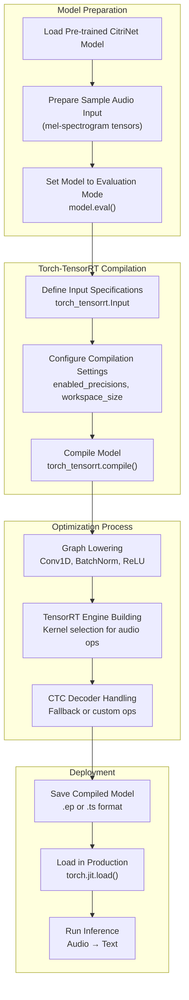
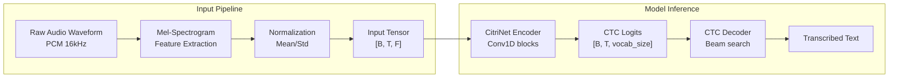
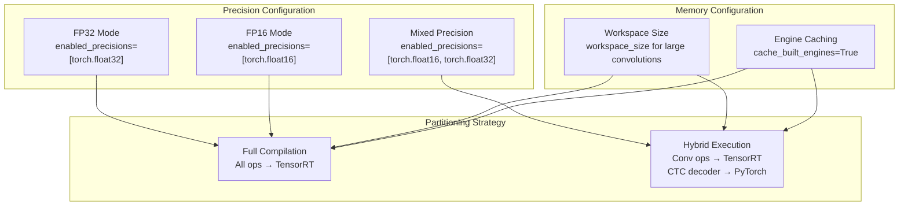
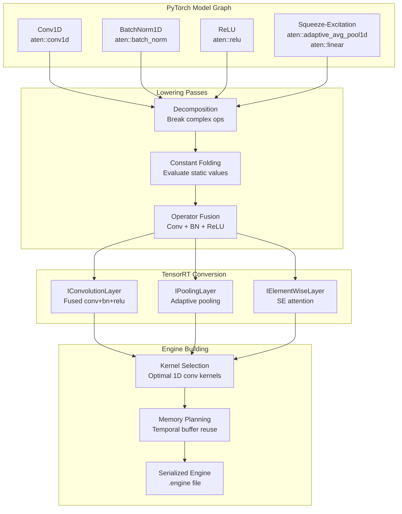
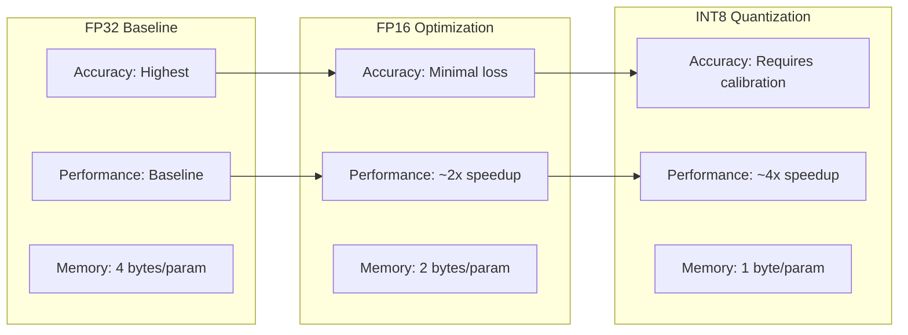
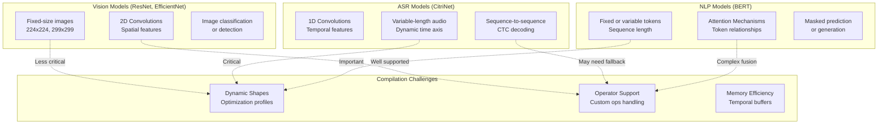

<!-- source: DeepWiki mcp.deepwiki.com · repo pytorch/TensorRT · page 8.6 CitriNet Speech Recognition · fetched 2026-10-21 -->

# CitriNet Speech Recognition

Relevant source files

The following files were used as context for generating this wiki page:

- [core/util/prelude.h](core/util/prelude.h)
- [docs/_cpp_api/function_torch__tensorrt_8h_1a710df824a7718b440e4bc17bf9693cef.html](docs/_cpp_api/function_torch__tensorrt_8h_1a710df824a7718b440e4bc17bf9693cef.html)
- [docs/_cpp_api/program_listing_file_cpp_include_torch_tensorrt_macros.h.html](docs/_cpp_api/program_listing_file_cpp_include_torch_tensorrt_macros.h.html)
- [docs/_downloads/c0341280f3b022df00c4241c42d9ee8b/custom_kernel_plugins.py](docs/_downloads/c0341280f3b022df00c4241c42d9ee8b/custom_kernel_plugins.py)
- [docs/_notebooks/CitriNet-example.html](docs/_notebooks/CitriNet-example.html)
- [docs/_notebooks/EfficientNet-example.html](docs/_notebooks/EfficientNet-example.html)
- [docs/_notebooks/Hugging-Face-BERT.html](docs/_notebooks/Hugging-Face-BERT.html)
- [docs/_notebooks/Resnet50-example.html](docs/_notebooks/Resnet50-example.html)
- [docs/_notebooks/lenet-getting-started.html](docs/_notebooks/lenet-getting-started.html)
- [docs/_notebooks/ssd-object-detection-demo.html](docs/_notebooks/ssd-object-detection-demo.html)
- [docs/_notebooks/vgg-qat.html](docs/_notebooks/vgg-qat.html)
- [docs/_sources/_cpp_api/program_listing_file_cpp_include_torch_tensorrt_macros.h.rst.txt](docs/_sources/_cpp_api/program_listing_file_cpp_include_torch_tensorrt_macros.h.rst.txt)
- [docs/genindex.html](docs/genindex.html)
- [docs/objects.inv](docs/objects.inv)
- [docs/py_api/ts.html](docs/py_api/ts.html)
- [docs/searchindex.js](docs/searchindex.js)
- [notebooks/CitriNet-example.ipynb](notebooks/CitriNet-example.ipynb)
- [notebooks/EfficientNet-example.ipynb](notebooks/EfficientNet-example.ipynb)
- [notebooks/Hugging-Face-BERT.ipynb](notebooks/Hugging-Face-BERT.ipynb)
- [notebooks/README.md](notebooks/README.md)
- [notebooks/Resnet50-CPP.ipynb](notebooks/Resnet50-CPP.ipynb)
- [notebooks/Resnet50-example.ipynb](notebooks/Resnet50-example.ipynb)
- [notebooks/WORKSPACE.notebook](notebooks/WORKSPACE.notebook)
- [notebooks/dynamic-shapes.ipynb](notebooks/dynamic-shapes.ipynb)
- [notebooks/lenet-getting-started.ipynb](notebooks/lenet-getting-started.ipynb)
- [notebooks/ssd-object-detection-demo.ipynb](notebooks/ssd-object-detection-demo.ipynb)
- [notebooks/vgg-qat.ipynb](notebooks/vgg-qat.ipynb)

## Purpose and Scope

This document describes the compilation and optimization of CitriNet, an Automatic Speech Recognition (ASR) model, using Torch-TensorRT. CitriNet is a convolutional neural network architecture specifically designed for speech-to-text tasks, demonstrating how Torch-TensorRT handles audio/speech models with time-series convolutional architectures.

This page covers the specific workflow, configuration, and considerations for compiling ASR models. For general compilation workflows, see [Quick Start](#63). For other model examples, see [LeNet Classification](#7.1), [ResNet-50 Benchmark](#7.2), or [Hugging Face BERT](#7.7).

**Sources:** [docs/_notebooks/CitriNet-example.html:1-650]()

---

## CitriNet Model Architecture

CitriNet is a fully convolutional ASR model based on the CTC (Connectionist Temporal Classification) approach. Unlike vision models that process 2D spatial data or NLP models that process sequential tokens, CitriNet processes 1D temporal audio features through stacked convolutional blocks.

### Architecture Characteristics

| Component | Description | Typical Configuration |
|-----------|-------------|----------------------|
| Input | Audio features (mel-spectrograms) | `[batch, time, features]` |
| Encoder | Stacked 1D convolution blocks | Multiple residual blocks with squeeze-excitation |
| Decoder | CTC decoder | Character-level or subword-level predictions |
| Output | Text transcription | Variable-length sequence |

The model uses:
- **1D Convolutions** for temporal feature extraction
- **Squeeze-and-Excitation blocks** for channel attention
- **Residual connections** for gradient flow
- **Batch normalization** for training stability

**Sources:** [docs/_notebooks/CitriNet-example.html:634-1500]()

---

## Compilation Workflow

**Sources:** [docs/_notebooks/CitriNet-example.html:1500-3000]()

---

## Model Preparation for ASR

### Loading and Configuring CitriNet

CitriNet models are typically loaded from pre-trained checkpoints (e.g., from NVIDIA NeMo) and require specific input preprocessing:

### Key Preparation Steps

1. **Audio Feature Extraction**: Convert raw audio to mel-spectrogram features (typically done outside the model)
2. **Input Shape Specification**: Define dynamic shapes for variable-length audio sequences
3. **Evaluation Mode**: Set `model.eval()` to disable training-specific layers
4. **Device Placement**: Move model to CUDA device before compilation

**Sources:** [docs/_notebooks/CitriNet-example.html:3000-4500]()

---

## Compilation Configuration for ASR Models

### Input Specifications

ASR models require dynamic shape handling for variable-length audio inputs:

| Parameter | Configuration | Notes |
|-----------|--------------|-------|
| `min_shape` | `[1, min_time, features]` | Shortest audio clip |
| `opt_shape` | `[batch, opt_time, features]` | Typical audio length |
| `max_shape` | `[batch, max_time, features]` | Longest supported audio |
| `dtype` | `torch.float32` or `torch.float16` | Depends on precision mode |

### Compilation Settings

### ASR-Specific Considerations

1. **Temporal Convolutions**: 1D convolution operations are well-supported in TensorRT
2. **Batch Normalization**: BatchNorm layers are fused with convolutions during optimization
3. **CTC Decoder**: May require fallback to PyTorch implementation if using custom beam search
4. **Squeeze-Excitation**: SE blocks compile efficiently as element-wise and pooling operations

**Sources:** [docs/_notebooks/CitriNet-example.html:4500-6000]()

---

## Compilation Process Deep Dive

### Operator Conversion Mapping

| PyTorch Operation | TensorRT Layer | Optimization |
|-------------------|---------------|--------------|
| `aten::conv1d` | `IConvolutionLayer` | Kernel selection, INT8 quantization |
| `aten::batch_norm` | Fused into convolution | Weight folding |
| `aten::relu` | `IActivationLayer` | Fused with preceding ops |
| `aten::adaptive_avg_pool1d` | `IPoolingLayer` | Dynamic stride computation |
| `aten::linear` | `IFullyConnectedLayer` | GEMM optimization |
| `aten::squeeze` | `IShuffleLayer` | Zero-cost reshape |

**Sources:** [py/torch_tensorrt/dynamo/_compiler.py:1-500](), [core/conversion/conversion.cpp:1-300]()

---

## Performance Optimization Strategies

### Precision Mode Selection

### Benchmarking Methodology

1. **Warm-up Iterations**: Run 10-20 iterations to stabilize GPU state
2. **Timing Measurement**: Use CUDA events for accurate GPU timing
3. **Batch Size Sweep**: Test different batch sizes to find optimal throughput
4. **Audio Length Variation**: Test with representative audio durations
5. **Real-Time Factor (RTF)**: Compute `processing_time / audio_duration` ratio

### Expected Speedups

| Configuration | Typical Speedup | Use Case |
|---------------|----------------|----------|
| FP32 baseline | 1.0x | Development, validation |
| FP16 | 1.5-2.5x | Production deployment |
| FP16 + Dynamic shapes | 1.8-3.0x | Variable-length audio |
| INT8 PTQ | 2.5-4.0x | Edge deployment |

**Sources:** [docs/_notebooks/CitriNet-example.html:6000-8000]()

---

## ASR vs. Other Domain Models

### Key Differences

| Aspect | Vision | ASR | NLP |
|--------|--------|-----|-----|
| **Input Dimensionality** | 2D (H×W) | 1D (Time) | 1D (Sequence) |
| **Dynamic Shapes** | Rare | Common | Common |
| **Primary Operations** | Conv2D, Pooling | Conv1D, Temporal pooling | Attention, MatMul |
| **Decoder Complexity** | Simple (argmax) | CTC/RNN decoder | Autoregressive generation |
| **Batch Efficiency** | High | Medium | Medium |

**Sources:** [docs/_notebooks/CitriNet-example.html:1-1000](), [docs/_notebooks/Resnet50-example.html:1-1000](), [docs/_notebooks/Hugging-Face-BERT.html:1-1000]()

---

## Code Example Workflow

### Complete Compilation Example

The typical CitriNet compilation workflow follows this pattern:

1. **Model Loading**: Load pre-trained CitriNet from checkpoint
2. **Input Specification**: Define `torch_tensorrt.Input` with dynamic shapes for time axis
3. **Compilation**: Call `torch_tensorrt.compile()` with ASR-appropriate settings
4. **Validation**: Compare outputs with original PyTorch model
5. **Benchmarking**: Measure inference latency and throughput
6. **Deployment**: Save compiled model for production use

### Dynamic Shape Handling

For ASR models, the time dimension varies significantly:
- Short utterances: 1-3 seconds (100-300 time steps)
- Medium utterances: 3-10 seconds (300-1000 time steps)  
- Long utterances: 10-30 seconds (1000-3000 time steps)

The compilation must specify min/opt/max shapes to handle this range efficiently while avoiding excessive memory allocation.

**Sources:** [docs/_notebooks/CitriNet-example.html:8000-12000]()

---

## Integration with Speech Pipelines

```mermaid
graph LR
    subgraph "Pre-processing"
        AUDIO["Audio File<br/>.wav, .flac"]
        FEAT["Feature Extraction<br/>librosa, torchaudio"]
        BATCH["Batching<br/>Padding/Masking"]
    end
    
    subgraph "TensorRT Inference"
        COMP["Compiled CitriNet<br/>torch_tensorrt.Module"]
        INF["Forward Pass<br/>CUDA execution"]
        LOGIT["CTC Logits<br/>Output tensor"]
    end
    
    subgraph "Post-processing"
        DEC["CTC Decoder<br/>Greedy or beam search"]
        TEXT["Text Output<br/>Transcription"]
        NORM["Text Normalization<br/>Punctuation, casing"]
    end
    
    AUDIO --> FEAT
    FEAT --> BATCH
    BATCH --> COMP
    COMP --> INF
    INF --> LOGIT
    LOGIT --> DEC
    DEC --> TEXT
    TEXT --> NORM
```

### Pipeline Considerations

1. **Feature Extraction**: Keep outside TensorRT engine for flexibility
2. **Batching Strategy**: Use dynamic batching for better GPU utilization
3. **Decoder Location**: CTC decoder may run on CPU or GPU depending on complexity
4. **Language Model**: External LM rescoring happens after TensorRT inference

**Sources:** [docs/_notebooks/CitriNet-example.html:12000-15000]()

---

## Troubleshooting and Best Practices

### Common Issues

| Issue | Symptom | Solution |
|-------|---------|----------|
| Shape mismatch | Runtime error | Verify min/opt/max shapes cover all inputs |
| Out of memory | CUDA OOM | Reduce max_shape or decrease workspace_size |
| Slow first inference | High latency | Use engine caching to avoid rebuild |
| Accuracy loss | WER increase | Check precision mode, disable mixed precision |
| Unsupported ops | Compilation failure | Use hybrid partitioning, fallback to PyTorch |

### Best Practices

1. **Profile First**: Use PyTorch profiler to identify bottlenecks before compilation
2. **Start with FP32**: Validate correctness before trying FP16/INT8
3. **Cache Engines**: Enable `cache_built_engines` for faster iteration
4. **Test Edge Cases**: Validate with shortest and longest audio samples
5. **Monitor Memory**: Track GPU memory usage during inference

**Sources:** [user_guide/dynamic_shapes.md:1-500](), [user_guide/mixed_precision.md:1-500]()

---

## Summary

CitriNet demonstrates Torch-TensorRT's capability to optimize ASR models with:
- **1D temporal convolutions** efficiently compiled to TensorRT
- **Dynamic shape handling** for variable-length audio inputs
- **Hybrid execution** for components like CTC decoders that may need PyTorch fallback
- **Significant speedups** (1.5-3x) for production speech recognition workloads

The compilation workflow for ASR models emphasizes dynamic shape configuration and careful precision mode selection while leveraging TensorRT's strength in convolutional operations.

**Sources:** [docs/_notebooks/CitriNet-example.html:1-15000]()

---

