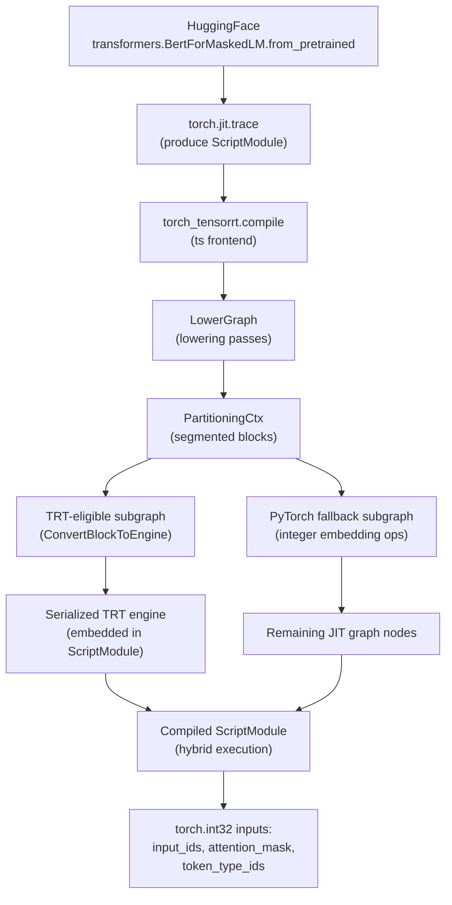
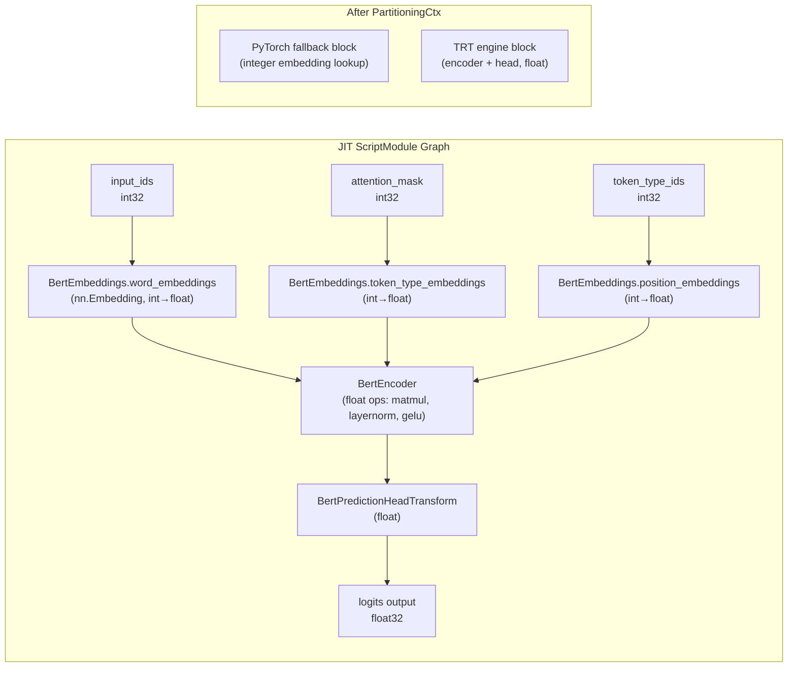

<!-- source: DeepWiki mcp.deepwiki.com · repo pytorch/TensorRT · page 8.7 Hugging Face BERT · fetched 2026-10-21 -->

# Hugging Face BERT

<details>
<summary>Relevant source files</summary>

The following files were used as context for generating this wiki page:

- [core/util/prelude.h](core/util/prelude.h)
- [docs/_cpp_api/function_torch__tensorrt_8h_1a710df824a7718b440e4bc17bf9693cef.html](docs/_cpp_api/function_torch__tensorrt_8h_1a710df824a7718b440e4bc17bf9693cef.html)
- [docs/_cpp_api/program_listing_file_cpp_include_torch_tensorrt_macros.h.html](docs/_cpp_api/program_listing_file_cpp_include_torch_tensorrt_macros.h.html)
- [docs/_downloads/c0341280f3b022df00c4241c42d9ee8b/custom_kernel_plugins.py](docs/_downloads/c0341280f3b022df00c4241c42d9ee8b/custom_kernel_plugins.py)
- [docs/_notebooks/CitriNet-example.html](docs/_notebooks/CitriNet-example.html)
- [docs/_notebooks/EfficientNet-example.html](docs/_notebooks/EfficientNet-example.html)
- [docs/_notebooks/Hugging-Face-BERT.html](docs/_notebooks/Hugging-Face-BERT.html)
- [docs/_notebooks/Resnet50-example.html](docs/_notebooks/Resnet50-example.html)
- [docs/_notebooks/lenet-getting-started.html](docs/_notebooks/lenet-getting-started.html)
- [docs/_notebooks/ssd-object-detection-demo.html](docs/_notebooks/ssd-object-detection-demo.html)
- [docs/_notebooks/vgg-qat.html](docs/_notebooks/vgg-qat.html)
- [docs/_sources/_cpp_api/program_listing_file_cpp_include_torch_tensorrt_macros.h.rst.txt](docs/_sources/_cpp_api/program_listing_file_cpp_include_torch_tensorrt_macros.h.rst.txt)
- [docs/genindex.html](docs/genindex.html)
- [docs/objects.inv](docs/objects.inv)
- [docs/py_api/ts.html](docs/py_api/ts.html)
- [docs/searchindex.js](docs/searchindex.js)
- [notebooks/CitriNet-example.ipynb](notebooks/CitriNet-example.ipynb)
- [notebooks/EfficientNet-example.ipynb](notebooks/EfficientNet-example.ipynb)
- [notebooks/Hugging-Face-BERT.ipynb](notebooks/Hugging-Face-BERT.ipynb)
- [notebooks/README.md](notebooks/README.md)
- [notebooks/Resnet50-CPP.ipynb](notebooks/Resnet50-CPP.ipynb)
- [notebooks/Resnet50-example.ipynb](notebooks/Resnet50-example.ipynb)
- [notebooks/WORKSPACE.notebook](notebooks/WORKSPACE.notebook)
- [notebooks/dynamic-shapes.ipynb](notebooks/dynamic-shapes.ipynb)
- [notebooks/lenet-getting-started.ipynb](notebooks/lenet-getting-started.ipynb)
- [notebooks/ssd-object-detection-demo.ipynb](notebooks/ssd-object-detection-demo.ipynb)
- [notebooks/vgg-qat.ipynb](notebooks/vgg-qat.ipynb)

</details>


## Purpose and Scope

This page documents the `notebooks/Hugging-Face-BERT.ipynb` example, which demonstrates compiling a Hugging Face BERT model for Masked Language Modeling (MLM) using Torch-TensorRT's **TorchScript frontend**. The notebook shows how to load a pretrained transformer from the Hugging Face `transformers` library, trace it to TorchScript, compile it with `torch_tensorrt.compile`, and benchmark the resulting inference throughput.

> This notebook uses the **TorchScript-based** compilation path (see [4]() for that frontend's architecture). For newer BERT examples using the `torch.compile` Dynamo backend, see the tutorials in `tutorials/_rendered_examples/dynamo/torch_compile_transformers_example.rst` and `tutorials/_rendered_examples/dynamo/engine_caching_bert_example.rst`.

---

## Notebook Overview

| Property | Value |
|---|---|
| Source file | `notebooks/Hugging-Face-BERT.ipynb` |
| Rendered HTML | `docs/_notebooks/Hugging-Face-BERT.html` |
| Title | Masked Language Modeling (MLM) with Hugging Face BERT Transformer |
| Compilation frontend | TorchScript (`torch.jit.trace`) |
| Task | Fill-mask / Masked Language Modeling |
| Base model | `bert-base-uncased` via `transformers.BertForMaskedLM` |

Sources: [notebooks/Hugging-Face-BERT.ipynb:1-18](), [docs/_notebooks/Hugging-Face-BERT.html:13-13]()

---

## Prerequisites

The notebook runs inside the standard Torch-TensorRT Docker environment described in `notebooks/README.md`. In addition to the core packages, the Hugging Face `transformers` library must be installed:

```
pip install transformers
```

The container setup follows the same pattern as the other notebooks in the `notebooks/` directory. See `notebooks/README.md` for Docker pull and launch instructions.

Sources: [notebooks/README.md:1-108]()

---

## Model and Task Background

**BERT** (Bidirectional Encoder Representations from Transformers) is a transformer encoder model trained with a masked language modeling objective. In MLM, selected tokens in the input are replaced with `[MASK]` and the model predicts the original tokens.

**`BertForMaskedLM`** takes three integer tensors as input:

| Input tensor | dtype | Description |
|---|---|---|
| `input_ids` | `torch.int32` / `torch.int64` | Token indices into the vocabulary |
| `attention_mask` | `torch.int32` | Binary mask: 1 for real tokens, 0 for padding |
| `token_type_ids` | `torch.int32` | Segment IDs distinguishing sentence A from sentence B |

All three inputs are **integer tensors**. This has an important consequence for TensorRT compilation: the embedding lookup operations that consume integer inputs are not converted to TensorRT layers. Torch-TensorRT's graph partitioner (see [4.3]()) splits the graph so that the floating-point computation in the transformer stack is compiled into a TRT engine while integer-consuming nodes remain in the PyTorch fallback subgraph.

Sources: [docs/_notebooks/Hugging-Face-BERT.html:13-13]()

---

## Compilation Workflow

The diagram below maps the notebook's compilation steps to the Torch-TensorRT TorchScript frontend code entities.

**Diagram: BERT TorchScript Compilation Pipeline**



Sources: [notebooks/Hugging-Face-BERT.ipynb:1-18](), [docs/_notebooks/Hugging-Face-BERT.html:13-13]()

---

## Step-by-Step Walkthrough

### 1. Load the Pretrained Model

The model is loaded from the Hugging Face Hub and moved to CUDA:

```python
from transformers import BertTokenizer, BertForMaskedLM
import torch

tokenizer = BertTokenizer.from_pretrained('bert-base-uncased')
model = BertForMaskedLM.from_pretrained('bert-base-uncased')
model = model.eval().cuda()
```

`BertForMaskedLM` is a standard `torch.nn.Module`. Setting `eval()` disables dropout and other training-only behaviors before tracing.

### 2. Prepare Inputs

A sample sentence with a `[MASK]` token is tokenized:

```python
text = "The capital of France is [MASK]."
inputs = tokenizer(text, return_tensors='pt')
input_ids = inputs['input_ids'].cuda()
attention_mask = inputs['attention_mask'].cuda()
token_type_ids = inputs['token_type_ids'].cuda()
```

The tokenizer produces integer tensors with a fixed sequence length. Because TensorRT requires fixed input shapes (or explicit dynamic shape profiles), the notebook uses a fixed sequence length (e.g., 128 tokens, with padding).

### 3. Trace to TorchScript

`torch.jit.trace` is used rather than `torch.jit.script` because the BERT implementation in the Hugging Face library uses Python control flow patterns that are easier to capture by tracing:

```python
with torch.no_grad():
    traced_model = torch.jit.trace(model, [input_ids, attention_mask, token_type_ids])
```

For tracing behavior and known limitations, see [2.3]() and [4]().

### 4. Compile with Torch-TensorRT

The traced module is compiled using `torch_tensorrt.compile`. The `inputs` argument uses `torch_tensorrt.Input` to specify shape and **dtype** for each tensor:

```python
import torch_tensorrt

trt_model = torch_tensorrt.compile(
    traced_model,
    inputs=[
        torch_tensorrt.Input(shape=input_ids.shape, dtype=torch.int32),
        torch_tensorrt.Input(shape=attention_mask.shape, dtype=torch.int32),
        torch_tensorrt.Input(shape=token_type_ids.shape, dtype=torch.int32),
    ],
    enabled_precisions={torch.float, torch.half},
)
```

Passing both `torch.float` and `torch.half` in `enabled_precisions` allows TensorRT to select FP16 kernels where beneficial. For a description of the `Input` class and precision flags, see [2.4]() and [2.5]().

### 5. Run Inference

The compiled module is called like any other `nn.Module`:

```python
with torch.no_grad():
    outputs = trt_model(input_ids, attention_mask, token_type_ids)
```

The result is a `logits` tensor of shape `[batch, seq_len, vocab_size]`. The predicted token for each `[MASK]` position is recovered with `torch.argmax`.

### 6. Benchmark

Performance is measured by timing repeated forward passes with `torch.cuda.Event` synchronization, comparing:

| Configuration | Typical speedup |
|---|---|
| PyTorch eager (FP32) | baseline |
| Torch-TensorRT FP16 | 2–4× throughput improvement |

Actual results vary by GPU and batch size.

---

## Integer Input Handling

BERT's embedding layers consume integer inputs. This creates a partitioning outcome worth understanding:

**Diagram: Graph Partitioning for Integer-Input Models**



The `PartitioningCtx` (see [4.3]()) places `nn.Embedding` ops into a PyTorch fallback segment because TensorRT does not natively support the integer gather operation in the same way. The floating-point encoder stack — which accounts for the majority of FLOPs — is compiled into a TRT engine.

Sources: [docs/_notebooks/Hugging-Face-BERT.html:13-13](), [notebooks/Hugging-Face-BERT.ipynb:1-18]()

---

## Precision Considerations

| Precision | `enabled_precisions` argument | Notes |
|---|---|---|
| FP32 only | `{torch.float}` | Baseline; no Tensor Core utilization |
| FP16 | `{torch.float, torch.half}` | Best throughput on Volta and later GPUs |
| INT8 | `{torch.int8}` + calibration | Requires PTQ calibrator; not shown in this notebook |

The integer input tensors (`input_ids`, etc.) are **not** subject to precision downcast — they remain as integer types throughout and are not passed to the TRT engine directly. Only the floating-point activations produced after the embedding lookup are handled by the TRT engine and potentially cast to FP16. See [2.4]() for the full precision mode documentation.

Sources: [notebooks/Hugging-Face-BERT.ipynb:1-18]()

---

## Relationship to Newer BERT Examples

The repository contains additional, more recent BERT examples that use the **Dynamo** frontend rather than TorchScript:

| Example | File | Frontend | Key feature |
|---|---|---|---|
| Legacy BERT MLM | `notebooks/Hugging-Face-BERT.ipynb` | TorchScript (`torch.jit.trace`) | Basic compilation demo |
| Engine Caching BERT | `tutorials/_rendered_examples/dynamo/engine_caching_bert_example.rst` | Dynamo | Demonstrates TRT engine reuse across sessions |
| torch.compile BERT | `tutorials/_rendered_examples/dynamo/torch_compile_transformers_example.rst` | Dynamo (`torch.compile`) | JIT compilation with minimal code change |

For the Dynamo compilation pipeline, see [3]() and [3.1](). For `torch.compile` usage, see [2.1]().

Sources: [docs/searchindex.js:1-1]()

---

## Running the Notebook

Follow the Docker setup in `notebooks/README.md`, then:

```bash
# Inside the container
cd /Torch-TensorRT/notebooks
jupyter notebook --allow-root --ip 0.0.0.0 --port 8888
```

Open `Hugging-Face-BERT.ipynb` in the Jupyter interface. Note that the notebook is **not** listed in the `notebooks/README.md` notebook index (which covers only the six notebooks originally shipped with the container), but the file is present in the same directory.

Sources: [notebooks/README.md:101-108](), [notebooks/Hugging-Face-BERT.ipynb:1-18]()