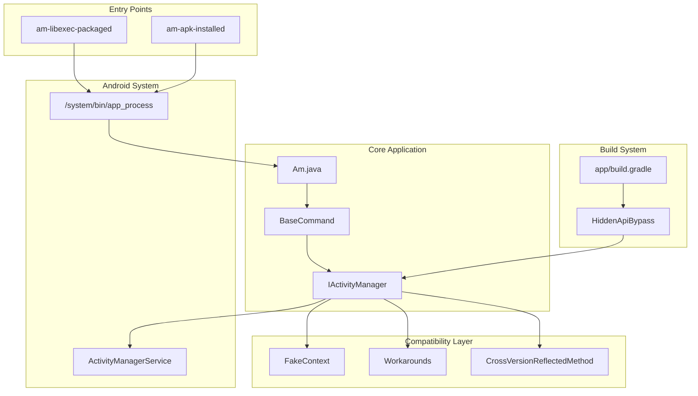
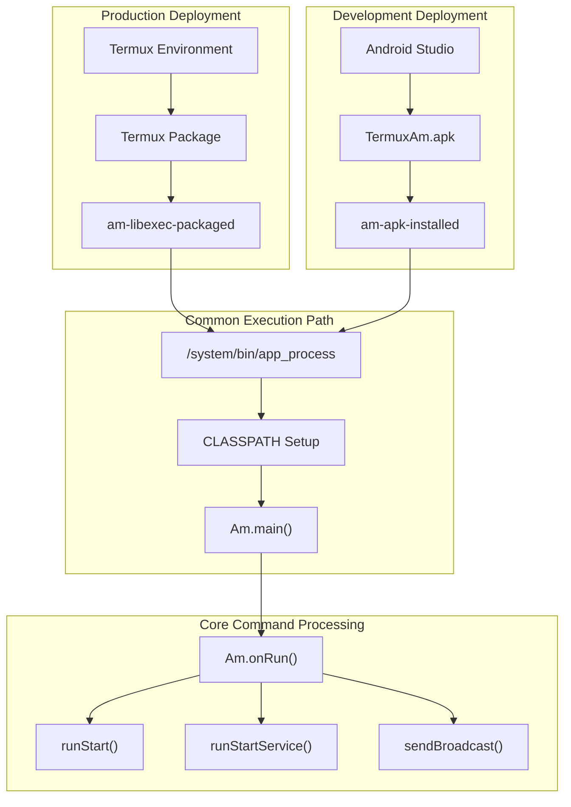
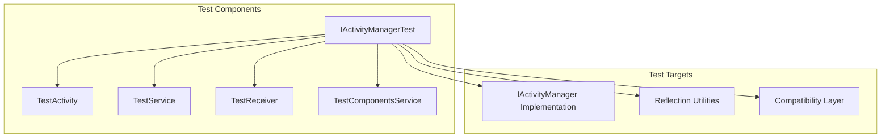

<!-- source: DeepWiki mcp.deepwiki.com · repo termux/TermuxAm · page 1 Overview · fetched 2026-10-26 -->

# Overview

Relevant source files

The following files were used as context for generating this wiki page:

- [.gitignore](.gitignore)
- [LICENSE](LICENSE)
- [README.md](README.md)

This document provides an introduction to the TermuxAm project, explaining its purpose, core architecture, and how it solves the Android Oreo `am` command restrictions. For detailed information about specific components, see [Architecture Overview](#2), [Entry Points and Execution](#3), and [Core Application Components](#4).

## Purpose and Problem Statement

TermuxAm is an Android Oreo-compatible reimplementation of the Android Activity Manager (`am`) command that enables applications to start activities, send broadcasts, and manage services programmatically. Since Android Oreo (API 26), the system `am` command has been restricted to work only from `adb shell` environments and is no longer accessible to applications running in user space.

This restriction created a significant limitation for terminal emulators like Termux and other applications that need programmatic access to Android's activity management functionality. TermuxAm solves this problem by providing a drop-in replacement that works within application contexts while maintaining compatibility with the original `am` command interface.

Sources: [README.md:1-5]()

## System Architecture Overview

The following diagram illustrates the high-level system architecture and how the main components interact:

**TermuxAm System Architecture**

The system operates through two primary execution paths:
- **Production Path**: `am-libexec-packaged` → `app_process` → `Am.java`
- **Development Path**: `am-apk-installed` → `app_process` → `Am.java`

Both paths converge on the core Java application (`Am.java`) which processes commands and interacts with Android's system services through a carefully constructed compatibility layer.

Sources: [README.md:8-14]()

## Deployment Models

TermuxAm supports two distinct deployment models, each optimized for different use cases:

| Deployment Model | Entry Script | Target Environment | Primary Use Case |
|-----------------|--------------|-------------------|------------------|
| Production | `am-libexec-packaged` | Termux package system | End-user installations |
| Development | `am-apk-installed` | Android Studio + APK | Development and testing |

**Deployment and Execution Flow**

The production model (`am-libexec-packaged`) includes specific Android 14 compatibility fixes and is optimized for distribution through Termux's package manager. The development model (`am-apk-installed`) facilitates rapid development and testing by leveraging Android Studio's build and debug capabilities.

Sources: [README.md:8-14]()

## Core Technical Challenges

TermuxAm addresses several critical technical challenges that emerged with Android's security model evolution:

### Hidden API Access Restrictions

Starting with Android 9 (API 28), Google implemented restrictions on accessing hidden APIs through reflection. TermuxAm overcomes this through:

- **Target SDK Version Strategy**: Using `targetSdkVersion = 27` to maintain legacy permission model
- **HiddenApiBypass Library**: Integration of `org.lsposed.hiddenapibypass:4.3` for runtime API access
- **Reflection Utilities**: Custom `CrossVersionReflectedMethod` for version-specific compatibility

### Android 14 Writable DEX Restrictions

Android 14 introduced restrictions on writable DEX files that affected the execution model. The solution involves:

- **File Permission Management**: Setting DEX files to read-only (`chmod 0400`) in `am-libexec-packaged`
- **Execution Path Optimization**: Modified app_process invocation to handle restricted file permissions

### Manufacturer-Specific Variations

Different Android manufacturers (Meizu, Honor, etc.) implement system variations that require specific workarounds:

- **Device-Specific Fixes**: `Workarounds` class containing manufacturer-specific adaptations
- **Context Manipulation**: `FakeContext` class for handling context-related system differences

Sources: [README.md:1-19]()

## Testing and Quality Assurance

The system includes comprehensive testing infrastructure to ensure compatibility across Android versions and device manufacturers:

**Test Architecture Overview**

The primary test suite is located in `IActivityManagerTest.java` and provides comprehensive validation of the core `IActivityManager` wrapper functionality across different Android versions and system configurations.

Sources: [README.md:16-18]()

## Project Structure and Navigation

The TermuxAm codebase is organized into several key areas:

- **Entry Points**: Shell scripts that handle different deployment scenarios
- **Core Application**: Java implementation of the `am` command functionality  
- **Compatibility Layer**: Version-specific workarounds and system integration code
- **Build System**: Gradle configuration enabling hidden API access
- **Testing Infrastructure**: Comprehensive test suite for validation

For detailed exploration of each component:
- System architecture details: [Architecture Overview](#2)
- Entry point implementation: [Entry Points and Execution](#3)  
- Java application logic: [Core Application Components](#4)
- Build configuration: [Build System and Configuration](#5)
- Testing framework: [Testing Infrastructure](#6)

Sources: [README.md:1-19](), [LICENSE:1-203]()

---

