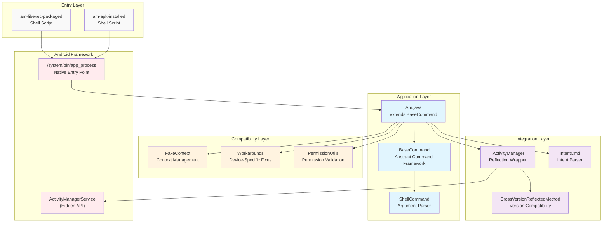
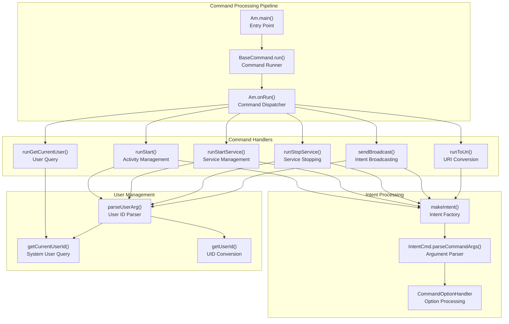
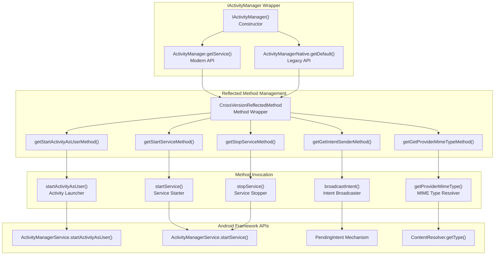
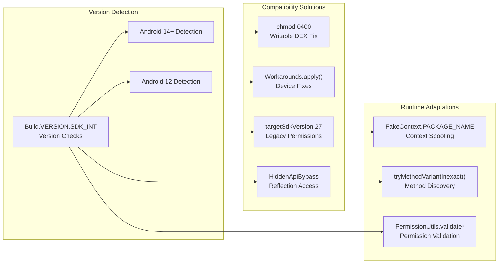
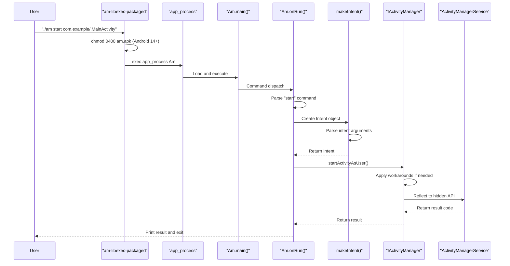

<!-- source: DeepWiki mcp.deepwiki.com · repo termux/TermuxAm · page 2 Architecture Overview · fetched 2026-10-26 -->

# Architecture Overview

Relevant source files

The following files were used as context for generating this wiki page:

- [am-libexec-packaged](am-libexec-packaged)
- [app/src/main/java/com/termux/termuxam/Am.java](app/src/main/java/com/termux/termuxam/Am.java)
- [app/src/main/java/com/termux/termuxam/BaseCommand.java](app/src/main/java/com/termux/termuxam/BaseCommand.java)
- [app/src/main/java/com/termux/termuxam/IActivityManager.java](app/src/main/java/com/termux/termuxam/IActivityManager.java)

This page provides a comprehensive overview of the TermuxAm system architecture, covering the main components and their interactions to deliver Android Activity Manager functionality to terminal applications.

TermuxAm is designed as a command-line utility that replicates the functionality of Android's `/system/bin/am` command, which was restricted starting in Android Oreo. The system uses reflection and hidden API access to interact with Android's internal `IActivityManager` service, providing activities starting, service management, and broadcast capabilities to applications running in terminal environments like Termux.

For details about specific entry points and execution paths, see [Entry Points and Execution](#3). For information about the build system configuration that enables hidden API access, see [Build System and Configuration](#5).

## System Architecture Overview

The TermuxAm system follows a layered architecture with clear separation between entry points, application logic, Android integration, and compatibility handling.

**System Architecture with Code Entities**

Sources: [am-libexec-packaged:1-31](), [app/src/main/java/com/termux/termuxam/Am.java:40-41](), [app/src/main/java/com/termux/termuxam/BaseCommand.java:25-27](), [app/src/main/java/com/termux/termuxam/IActivityManager.java:19-21]()

## Core Application Architecture

The application layer implements the command-line interface and business logic for processing Android Activity Manager commands.

**Application Layer Components**

Sources: [app/src/main/java/com/termux/termuxam/Am.java:119-124](), [app/src/main/java/com/termux/termuxam/BaseCommand.java:37-56](), [app/src/main/java/com/termux/termuxam/Am.java:416-524](), [app/src/main/java/com/termux/termuxam/Am.java:606-676]()

## Android System Integration Architecture

The integration layer handles the complex task of accessing Android's hidden APIs through reflection while maintaining compatibility across Android versions.

**Android Integration and Reflection Architecture**

Sources: [app/src/main/java/com/termux/termuxam/IActivityManager.java:31-61](), [app/src/main/java/com/termux/termuxam/IActivityManager.java:63-242](), [app/src/main/java/com/termux/termuxam/IActivityManager.java:246-346]()

## Compatibility and Workaround System

The system includes extensive compatibility handling to work across different Android versions and manufacturer variations.

**Compatibility Architecture**

Sources: [am-libexec-packaged:10-26](), [app/src/main/java/com/termux/termuxam/IActivityManager.java:247-248](), [app/src/main/java/com/termux/termuxam/IActivityManager.java:315-326]()

## Command Execution Flow

The following diagram shows how commands flow through the system from user input to Android framework interaction.

**End-to-End Command Processing Flow**

Sources: [am-libexec-packaged:28-30](), [app/src/main/java/com/termux/termuxam/Am.java:119-124](), [app/src/main/java/com/termux/termuxam/Am.java:735-933](), [app/src/main/java/com/termux/termuxam/IActivityManager.java:246-258]()

## Key Architectural Patterns

### Reflection-Based API Access
The system heavily relies on Java reflection to access Android's hidden `IActivityManager` interface. The `CrossVersionReflectedMethod` class provides version-agnostic method discovery and invocation, allowing the same code to work across different Android versions where method signatures may vary.

### Command Pattern Implementation
The `BaseCommand` class implements a command pattern where each am subcommand (`start`, `startservice`, `broadcast`, etc.) is handled by a specific method in the `Am` class. The `onRun()` method acts as a dispatcher based on the first command argument.

### Compatibility Layer Strategy
Rather than creating version-specific code branches, the system uses a layered approach with:
- Build-time configuration (`targetSdkVersion 27`)
- Runtime workarounds (`Workarounds.apply()`)
- Permission validation (`PermissionUtils`)
- Context manipulation (`FakeContext`)

### Intent Processing Pipeline
All commands that involve Android Intents follow a common pipeline through `makeIntent()`, which parses command-line arguments into `Intent` objects using the `IntentCmd.parseCommandArgs()` method with custom option handlers.

Sources: [app/src/main/java/com/termux/termuxam/BaseCommand.java:25-108](), [app/src/main/java/com/termux/termuxam/Am.java:606-676](), [app/src/main/java/com/termux/termuxam/IActivityManager.java:63-242]()

---

