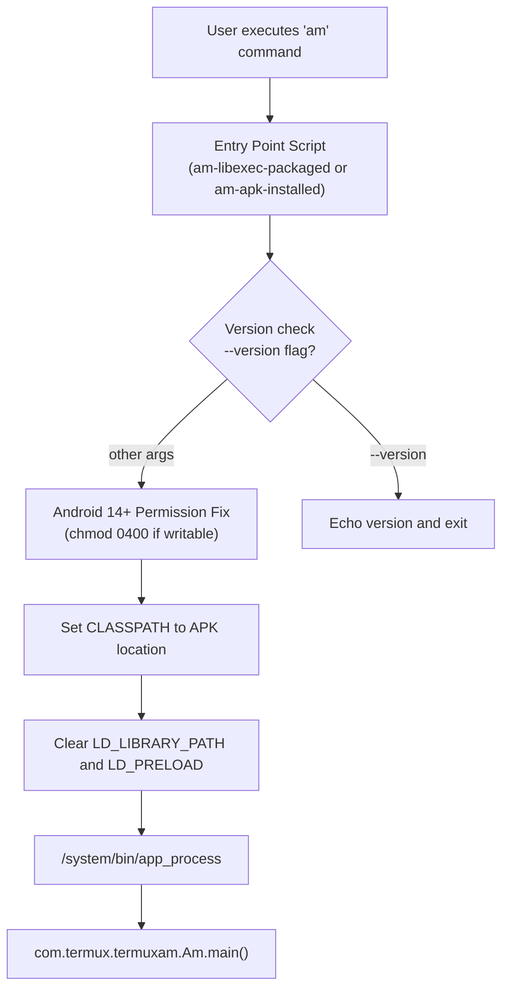
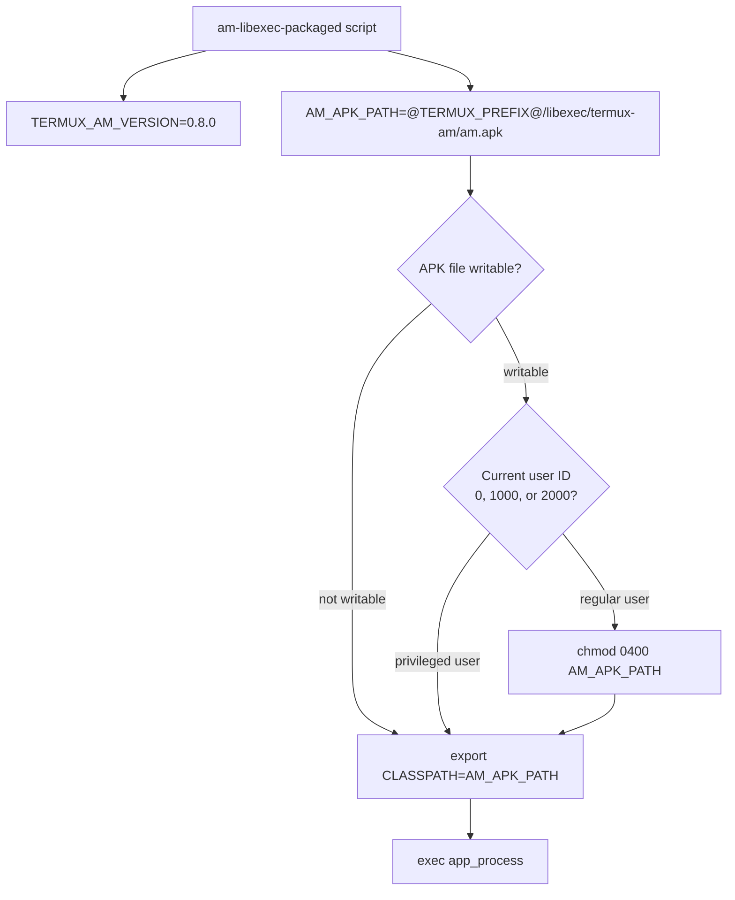
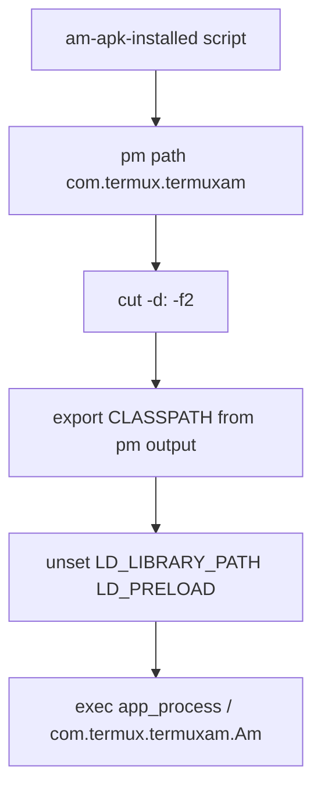
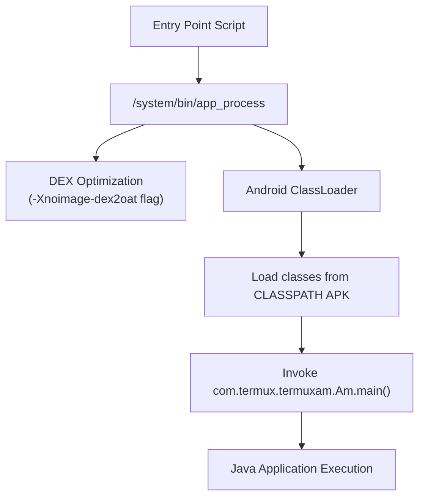

<!-- source: DeepWiki mcp.deepwiki.com · repo termux/TermuxAm · page 3 Entry Points and Execution · fetched 2026-10-26 -->

# Entry Points and Execution

Relevant source files

The following files were used as context for generating this wiki page:

- [am-apk-installed](am-apk-installed)
- [am-libexec-packaged](am-libexec-packaged)

This document explains how the TermuxAm system starts up and the two different execution paths available. It covers the shell script entry points that bootstrap the Java application and handle platform-specific compatibility requirements.

For detailed information about the main Java application logic, see [Core Application Components](#4). For build system configuration that enables this execution model, see [Build System and Configuration](#5).

## Entry Point Overview

TermuxAm provides two distinct entry points that serve different deployment scenarios:

| Entry Point | Purpose | Target Scenario | Importance Score |
|-------------|---------|-----------------|------------------|
| `am-libexec-packaged` | Production deployment | Termux package distribution | 24.97 |
| `am-apk-installed` | Development testing | Android Studio development | 3.05 |

Both entry points follow the same fundamental pattern: they configure the environment and execute the Java application via Android's `app_process` system binary.

## Execution Flow

**System Execution Flow**

Sources: [am-libexec-packaged:1-31](), [am-apk-installed:1-5]()

## Production Entry Point Architecture

The `am-libexec-packaged` script serves as the primary entry point for production deployments and implements several critical compatibility mechanisms:

**APK Location and Permission Management**

The script implements Android 14 compatibility by removing write permissions from the APK file for non-privileged users. This prevents the `SecurityException: Writable dex file` that would cause `SIGABRT` in `app_process` on Android 14+.

**Key Implementation Details:**

- **Version handling**: [am-libexec-packaged:2,5-8]() provides version information via `TERMUX_AM_VERSION` variable
- **APK path resolution**: [am-libexec-packaged:3]() uses build-time substitution with `@TERMUX_PREFIX@` placeholder
- **Android 14 fix**: [am-libexec-packaged:21-26]() removes write permissions for users other than root (0), system (1000), and shell (2000)
- **Environment cleanup**: [am-libexec-packaged:29]() clears `LD_LIBRARY_PATH` and `LD_PRELOAD` to prevent interference
- **Process execution**: [am-libexec-packaged:30]() uses `-Xnoimage-dex2oat` flag and targets main class `com.termux.termuxam.Am`

Sources: [am-libexec-packaged:1-31]()

## Development Entry Point Architecture

The `am-apk-installed` script provides a simplified entry point for development scenarios:

**Development Execution Flow**

**Key Implementation Differences:**

- **Dynamic APK discovery**: [am-apk-installed:2]() uses `pm path com.termux.termuxam` to locate the installed APK dynamically
- **Simplified execution**: No version checking or permission management
- **Development focus**: Assumes APK is properly installed via Android Studio or `adb install`

Sources: [am-apk-installed:1-5]()

## Android System Integration

Both entry points ultimately delegate to Android's `app_process` system binary, which provides the runtime environment for the Java application:

**App Process Integration**

**System Integration Details:**

- **Process model**: Both scripts use `exec` to replace the shell process with `app_process`
- **DEX optimization**: The `-Xnoimage-dex2oat` flag in production script prevents image-based DEX optimization
- **Class loading**: Android's system class loader loads classes from the APK specified in `CLASSPATH`
- **Main class**: Both entry points target `com.termux.termuxam.Am` as the main application class
- **Argument passing**: All command-line arguments are forwarded to the Java application via `"$@"`

Sources: [am-libexec-packaged:30](), [am-apk-installed:4]()

---

