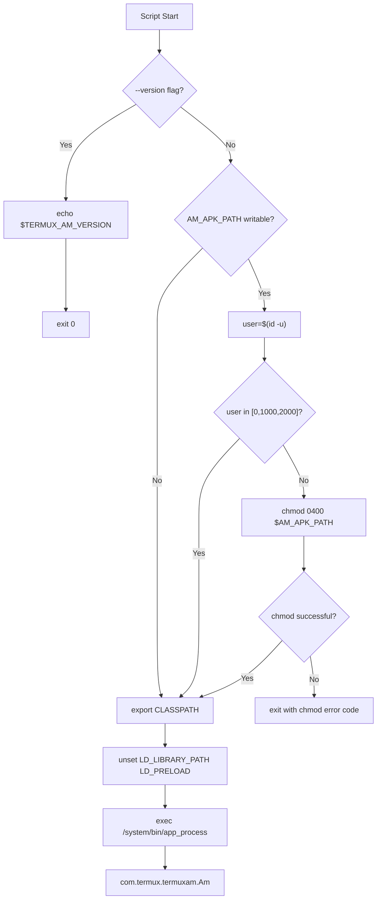
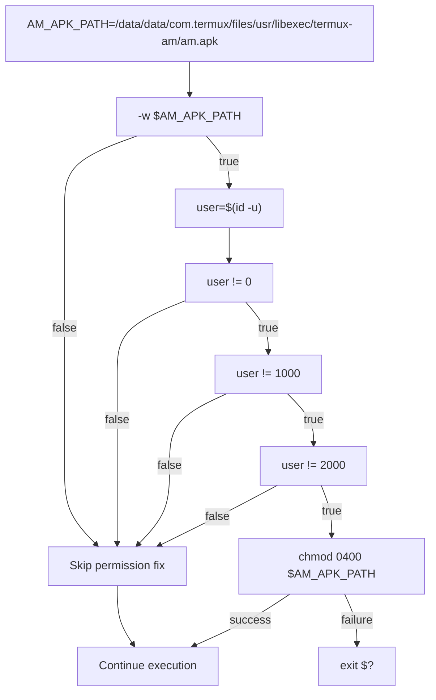
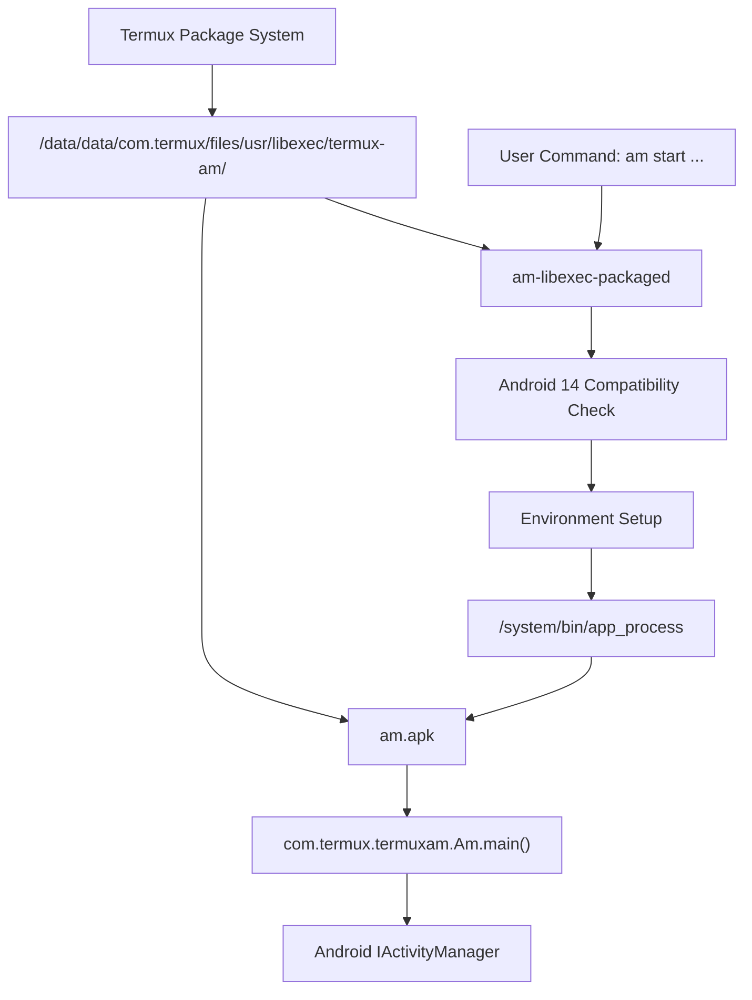

<!-- source: DeepWiki mcp.deepwiki.com · repo termux/TermuxAm · page 3.1 Production Entry Point (am-libexec-packaged) · fetched 2026-10-26 -->

# Production Entry Point (am-libexec-packaged)

Relevant source files

The following files were used as context for generating this wiki page:

- [am-libexec-packaged](am-libexec-packaged)

## Purpose and Scope

This document covers the primary production entry point for TermuxAm, implemented as the `am-libexec-packaged` shell script. This script serves as the main executable that Termux users interact with when running `am` commands, handling system compatibility issues and launching the Java application through Android's `app_process`.

For information about the development entry point, see [Development Entry Point (am-apk-installed)](#3.2). For details about the Java application that this script launches, see [Core Application Components](#4).

## Script Overview and Architecture

The `am-libexec-packaged` script is a carefully designed wrapper that addresses several critical challenges in running Java applications within the Termux environment on modern Android systems.

### Execution Flow Diagram

Sources: [am-libexec-packaged:1-31]()

## Version Handling

The script implements simple version reporting functionality that responds to the `--version` flag by outputting the hardcoded version string and exiting immediately.

| Component | Value | Line Reference |
|-----------|-------|----------------|
| Version Variable | `TERMUX_AM_VERSION=0.8.0` | [am-libexec-packaged:2]() |
| Version Check | `if [ "$1" = "--version" ]` | [am-libexec-packaged:5]() |
| Version Output | `echo "$TERMUX_AM_VERSION"` | [am-libexec-packaged:6]() |

Sources: [am-libexec-packaged:2](), [am-libexec-packaged:5-8]()

## Android 14 Compatibility Logic

The most complex part of the script addresses Android 14's stricter security model around writable DEX files. This compatibility layer prevents `SecurityException: Writable dex file` errors that would cause `SIGABRT` in `app_process`.

### Permission Fix Logic Diagram

### Privileged User Exclusions

The script excludes certain system users from the permission fix:

| User ID | System Role | Reasoning |
|---------|-------------|-----------|
| `0` | root | System-level privileges bypass restrictions |
| `1000` | system | Android system user with special permissions |
| `2000` | shell | ADB shell user context |

Sources: [am-libexec-packaged:10-26]()

## Environment Setup and Process Execution

The final phase of the script configures the Java execution environment and launches the application through Android's native process spawning mechanism.

### Environment Configuration

The script performs several critical environment setup operations:

| Environment Operation | Purpose | Line Reference |
|----------------------|---------|----------------|
| `export CLASSPATH` | Set Java classpath to APK location | [am-libexec-packaged:28]() |
| `unset LD_LIBRARY_PATH` | Clean native library path | [am-libexec-packaged:29]() |
| `unset LD_PRELOAD` | Remove library preloading | [am-libexec-packaged:29]() |

### App Process Invocation

The script uses Android's `app_process` with specific flags and arguments:

- **Binary**: `/system/bin/app_process` - Android's Java application launcher
- **Flag**: `-Xnoimage-dex2oat` - Disables ahead-of-time compilation for faster startup
- **Working Directory**: `/` - Root directory as working directory
- **Main Class**: `com.termux.termuxam.Am` - Entry point for the Java application
- **Arguments**: `"$@"` - Forward all command-line arguments to the Java application

Sources: [am-libexec-packaged:28-30]()

## Integration with System Architecture

This production entry point serves as the bridge between the Termux package system and the Java application core:

### System Integration Flow

The script's design ensures that:
1. Modern Android security restrictions are respected
2. The Java application receives a clean execution environment  
3. All user arguments are properly forwarded to the application
4. System integration occurs through standard Android mechanisms

Sources: [am-libexec-packaged:1-31]()

---

