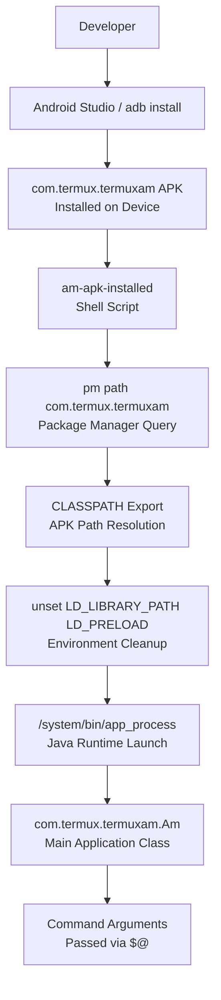
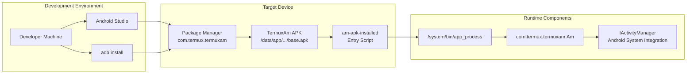

<!-- source: DeepWiki mcp.deepwiki.com · repo termux/TermuxAm · page 3.2 Development Entry Point (am-apk-installed) · fetched 2026-10-26 -->

# Development Entry Point (am-apk-installed)

<details>
<summary>Relevant source files</summary>

The following files were used as context for generating this wiki page:

- [am-apk-installed](am-apk-installed)

</details>


## Purpose and Scope

This document covers the development-oriented entry point script `am-apk-installed`, which provides access to TermuxAm functionality when the application is installed as an APK during development workflows. This script is designed for developers testing the application through Android Studio or manual APK installation, as opposed to end users who would use the production Termux package entry point covered in [Production Entry Point (am-libexec-packaged)](#3.1).

## Script Overview

The `am-apk-installed` script is a minimal shell script that bootstraps the TermuxAm Java application when installed as a standard Android APK. Unlike the production entry point, this script relies on the Android Package Manager to locate the installed application.

**Sources:** [am-apk-installed:1-4]()

## Core Functionality

### APK Path Resolution

The script uses Android's Package Manager to dynamically locate the installed TermuxAm APK:

```bash
export CLASSPATH="$(pm path com.termux.termuxam 2>&1 </dev/null | cut -d: -f2)"
```

This command performs several operations:
- Executes `pm path com.termux.termuxam` to query the package location
- Redirects stderr to stdout and stdin to /dev/null for clean output
- Extracts the APK path using `cut` to parse the "package:/path/to/apk.apk" format
- Sets the extracted path as the Java CLASSPATH

**Sources:** [am-apk-installed:2]()

### Environment Cleanup

The script cleans the execution environment to prevent interference from Termux-specific library paths:

```bash
unset LD_LIBRARY_PATH LD_PRELOAD
```

This ensures that the Android system's app_process runs with clean library dependencies rather than potentially conflicting Termux libraries.

**Sources:** [am-apk-installed:3]()

### Java Execution

The final step launches the Java application through Android's app_process:

```bash
exec /system/bin/app_process / com.termux.termuxam.Am "$@"
```

This directly invokes the `com.termux.termuxam.Am` main class with all provided arguments.

**Sources:** [am-apk-installed:4]()

## Development Workflow Integration

### Execution Flow



**Development Entry Point Execution Flow**

**Sources:** [am-apk-installed:1-4]()

### APK Installation Context



**Development Installation and Execution Context**

**Sources:** [am-apk-installed:2,4]()

## Comparison with Production Entry Point

| Aspect | Development (`am-apk-installed`) | Production (`am-libexec-packaged`) |
|--------|----------------------------------|-----------------------------------|
| **Installation Method** | APK via Android Studio/adb | Termux package manager |
| **Path Resolution** | `pm path` command | Direct file path |
| **Target Users** | Developers and testers | End users |
| **Complexity** | Simple 4-line script | Complex with Android 14 fixes |
| **Importance Score** | 3.05 | 24.97 |

**Sources:** [am-apk-installed:1-4]()

## Integration Points

### Build System Connection

This entry point connects to the build system components that produce the installable APK:

- **Application Build**: The APK is generated by [app/build.gradle](#5.1) with proper hidden API configurations
- **Main Class**: Executes the `com.termux.termuxam.Am` class documented in [Command Processing (Am.java)](#4.1)
- **System Integration**: Uses the same Android system integration layer as the production version

### Testing Workflow

The development entry point supports the testing infrastructure by providing direct access to the installed APK during development:

- Enables [IActivityManager Testing](#6.1) with installed APK
- Supports manual testing of core functionality
- Allows debugging through Android Studio with installed components

**Sources:** [am-apk-installed:2,4]()

## Technical Limitations

### APK Dependency

Unlike the production entry point, this script requires the TermuxAm APK to be installed through standard Android package management. This creates a dependency on:

- Android Package Manager service availability
- Proper APK signing and installation
- Device storage for APK installation

### Development-Only Scope

The script lacks the production-ready features of the main entry point:
- No Android 14 compatibility fixes
- No advanced error handling
- No Termux-specific environment optimizations

**Sources:** [am-apk-installed:1-4]()

---

