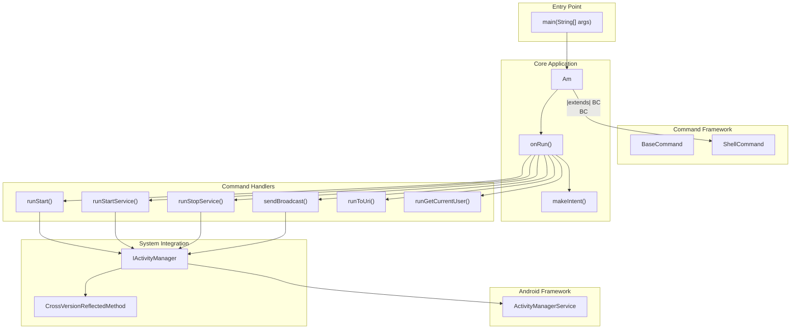

<!-- source: DeepWiki mcp.deepwiki.com · repo termux/TermuxAm · page 4 Core Application Components · fetched 2026-10-26 -->

# Core Application Components

<details>
<summary>Relevant source files</summary>

The following files were used as context for generating this wiki page:

- [app/src/main/java/com/termux/termuxam/Am.java](app/src/main/java/com/termux/termuxam/Am.java)
- [app/src/main/java/com/termux/termuxam/BaseCommand.java](app/src/main/java/com/termux/termuxam/BaseCommand.java)
- [app/src/main/java/com/termux/termuxam/IActivityManager.java](app/src/main/java/com/termux/termuxam/IActivityManager.java)

</details>


This document covers the main Java application components that implement the core `am` command functionality in TermuxAm. These components handle command parsing, dispatch, and interaction with Android's system services. For detailed information about the command processing logic, see [Command Processing (Am.java)](#4.1). For Android system integration details, see [Android System Integration](#4.2). For compatibility handling, see [Compatibility and Workarounds](#4.3).

## Component Architecture

The core application is built around three primary Java classes that work together to provide `am` command functionality:



Sources: [app/src/main/java/com/termux/termuxam/Am.java:40-41](), [app/src/main/java/com/termux/termuxam/Am.java:119-124](), [app/src/main/java/com/termux/termuxam/BaseCommand.java:25-27](), [app/src/main/java/com/termux/termuxam/IActivityManager.java:19-21]()

## Component Responsibilities

| Component | Purpose | Key Methods |
|-----------|---------|-------------|
| `Am` | Main application class implementing am command functionality | `main()`, `onRun()`, `runStart()`, `runStartService()`, `sendBroadcast()` |
| `BaseCommand` | Abstract base class providing command-line framework | `run()`, `onRun()`, `onShowUsage()`, `nextArg()` |
| `IActivityManager` | Reflection wrapper for Android's internal IActivityManager interface | `startActivityAsUser()`, `broadcastIntent()`, `startService()` |
| `ShellCommand` | Command-line argument parsing utilities | `getNextOption()`, `getNextArg()`, `init()` |

Sources: [app/src/main/java/com/termux/termuxam/Am.java:40-124](), [app/src/main/java/com/termux/termuxam/BaseCommand.java:37-108](), [app/src/main/java/com/termux/termuxam/IActivityManager.java:246-345]()

## Command Processing Flow

The application follows a structured command processing pattern from entry point to Android system integration:

```mermaid
flowchart TD
    subgraph "Application Entry"
        MAIN_ENTRY["Am.main(String[] args)"]
        RUN["BaseCommand.run(args)"]
        INIT_ARGS["ShellCommand.init(args, 0)"]
    end
    
    subgraph "Command Dispatch"
        ONRUN_START["Am.onRun()"]
        NEXTARG["nextArgRequired()"]
        COMMAND_SWITCH{"Command Switch"}
    end
    
    subgraph "Command Execution"
        START_CMD["\"start\" | \"start-activity\""]
        SERVICE_CMD["\"startservice\" | \"start-service\""] 
        STOP_CMD["\"stopservice\" | \"stop-service\""]
        BROADCAST_CMD["\"broadcast\""]
        URI_CMD["\"to-uri\" | \"to-intent-uri\""]
        USER_CMD["\"get-current-user\""]
    end
    
    subgraph "Intent Creation"
        MAKE_INTENT["makeIntent()"]
        PARSE_OPTIONS["IntentCmd.parseCommandArgs()"]
        HANDLE_OPTIONS["CommandOptionHandler.handleOption()"]
    end
    
    subgraph "System Calls"
        IAM_INIT["new IActivityManager()"]
        SYSTEM_METHOD["startActivityAsUser() | startService() | broadcastIntent()"]
    end
    
    MAIN_ENTRY --> RUN
    RUN --> INIT_ARGS
    RUN --> ONRUN_START
    ONRUN_START --> NEXTARG
    NEXTARG --> COMMAND_SWITCH
    
    COMMAND_SWITCH --> START_CMD
    COMMAND_SWITCH --> SERVICE_CMD
    COMMAND_SWITCH --> STOP_CMD
    COMMAND_SWITCH --> BROADCAST_CMD
    COMMAND_SWITCH --> URI_CMD
    COMMAND_SWITCH --> USER_CMD
    
    START_CMD --> MAKE_INTENT
    SERVICE_CMD --> MAKE_INTENT
    STOP_CMD --> MAKE_INTENT
    BROADCAST_CMD --> MAKE_INTENT
    
    MAKE_INTENT --> PARSE_OPTIONS
    PARSE_OPTIONS --> HANDLE_OPTIONS
    HANDLE_OPTIONS --> IAM_INIT
    IAM_INIT --> SYSTEM_METHOD
```

Sources: [app/src/main/java/com/termux/termuxam/Am.java:119-124](), [app/src/main/java/com/termux/termuxam/Am.java:417-524](), [app/src/main/java/com/termux/termuxam/Am.java:606-676](), [app/src/main/java/com/termux/termuxam/BaseCommand.java:37-56]()

## Core Interfaces and Patterns

### Command Pattern Implementation

The application uses a command pattern where `Am` extends `BaseCommand` and implements specific command handlers:

- **Entry Point**: [app/src/main/java/com/termux/termuxam/Am.java:119-124]()
- **Command Dispatch**: [app/src/main/java/com/termux/termuxam/Am.java:417-524]()
- **Base Framework**: [app/src/main/java/com/termux/termuxam/BaseCommand.java:37-78]()

### Reflection-Based System Integration

The `IActivityManager` class uses reflection to access Android's hidden APIs across different Android versions:

- **Service Acquisition**: [app/src/main/java/com/termux/termuxam/IActivityManager.java:38-50]()
- **Method Resolution**: [app/src/main/java/com/termux/termuxam/IActivityManager.java:80-104]()
- **Cross-Version Compatibility**: [app/src/main/java/com/termux/termuxam/IActivityManager.java:246-345]()

### State Management

The `Am` class maintains command state through instance variables that are reset for each command execution:

| Variable | Purpose | Reset Location |
|----------|---------|----------------|
| `mStartFlags` | Activity start flags | [app/src/main/java/com/termux/termuxam/Am.java:607]() |
| `mWaitOption` | Wait for completion flag | [app/src/main/java/com/termux/termuxam/Am.java:608]() |
| `mUserId` | Target user ID | [app/src/main/java/com/termux/termuxam/Am.java:616]() |
| `mReceiverPermission` | Broadcast receiver permission | [app/src/main/java/com/termux/termuxam/Am.java:104]() |

Sources: [app/src/main/java/com/termux/termuxam/Am.java:98-106](), [app/src/main/java/com/termux/termuxam/Am.java:606-620]()

## Key Constants and Configuration

The application defines important Android system constants used throughout the command processing:

- **User ID Constants**: `USER_ALL (-1)`, `USER_CURRENT (-2)`, `USER_NULL (-10000)` at [app/src/main/java/com/termux/termuxam/Am.java:82-89]()
- **UID Ranges**: `PER_USER_RANGE (100000)`, `FIRST_APPLICATION_UID (10000)`, `LAST_APPLICATION_UID (19999)` at [app/src/main/java/com/termux/termuxam/Am.java:67-80]()
- **Error Codes**: Inherited from `BaseCommand` at [app/src/main/java/com/termux/termuxam/BaseCommand.java:30-32]()

Sources: [app/src/main/java/com/termux/termuxam/Am.java:67-89](), [app/src/main/java/com/termux/termuxam/BaseCommand.java:30-32]()

---

