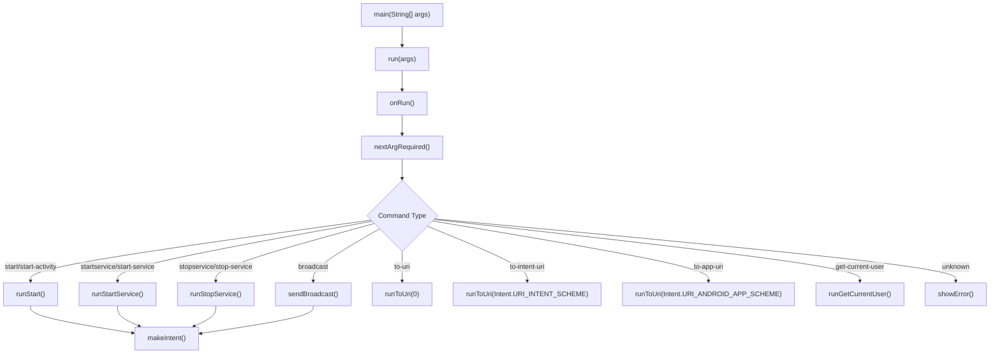
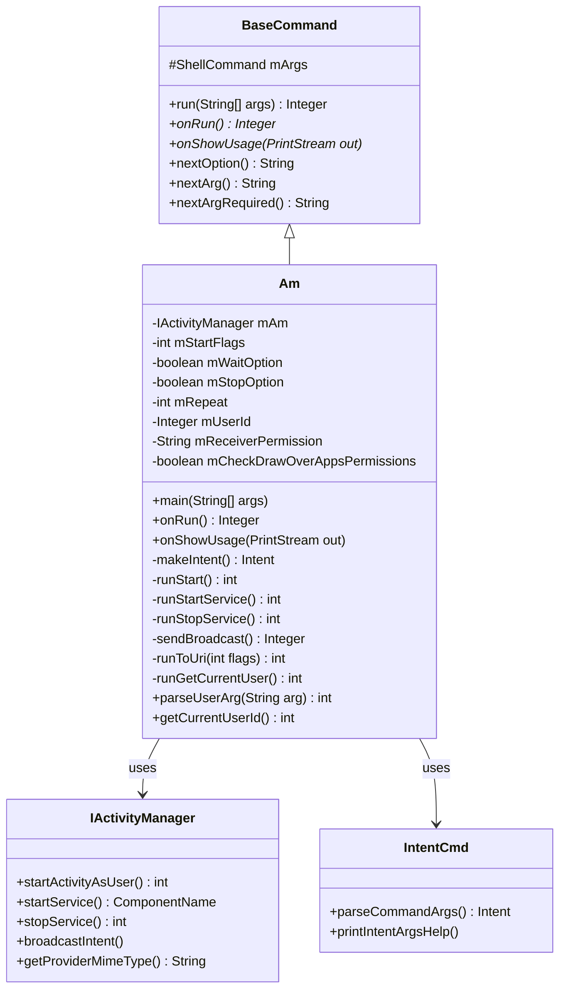
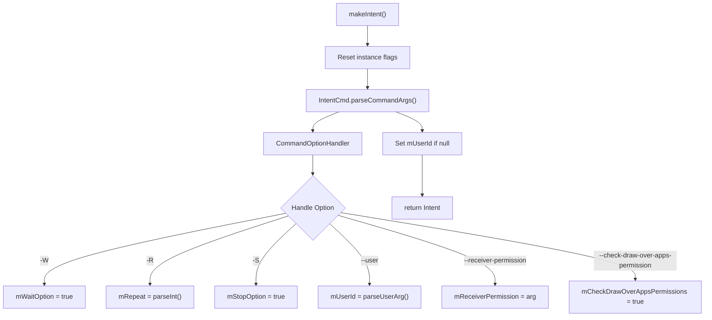
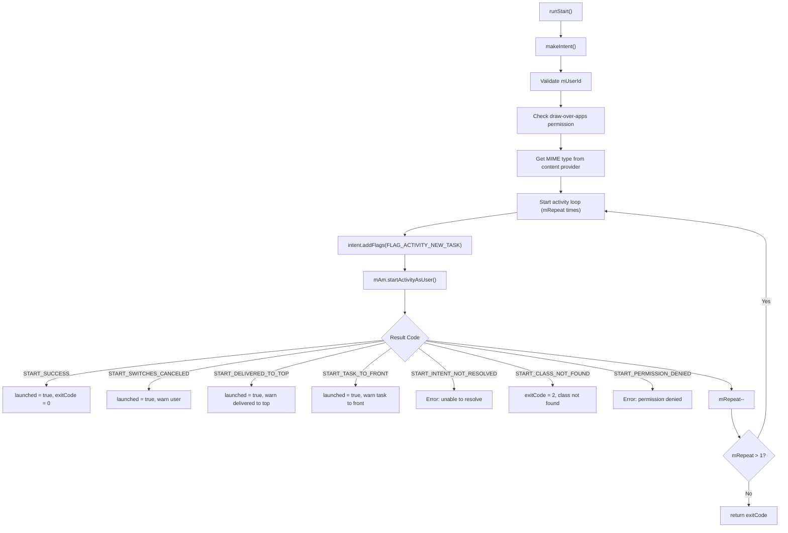
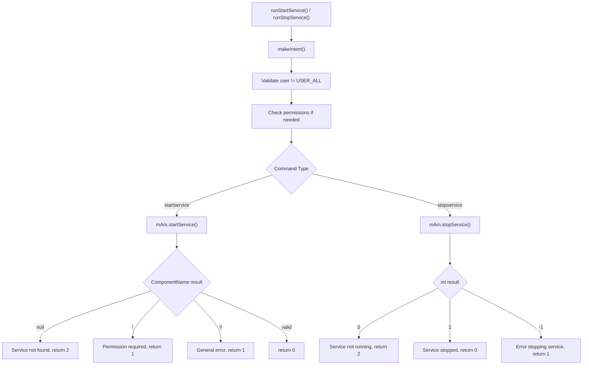
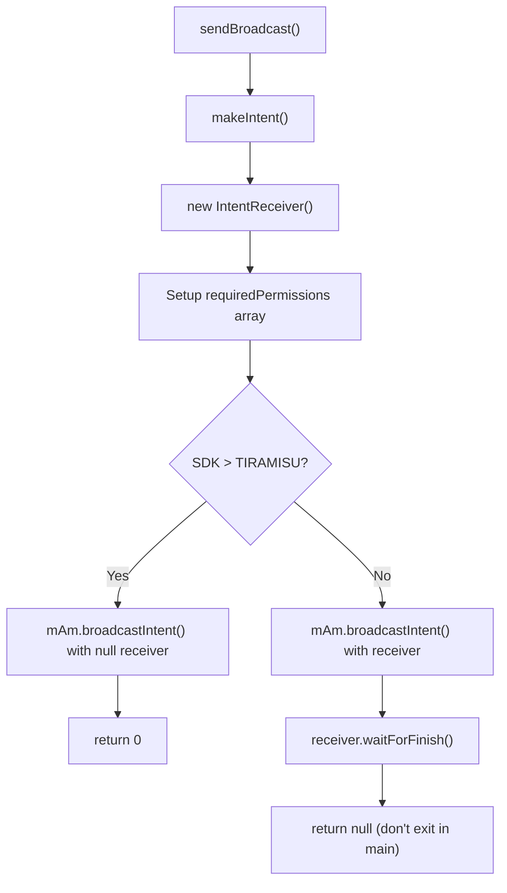

<!-- source: DeepWiki mcp.deepwiki.com · repo termux/TermuxAm · page 4.1 Command Processing (Am.java) · fetched 2026-10-26 -->

# Command Processing (Am.java)

<details>
<summary>Relevant source files</summary>

The following files were used as context for generating this wiki page:

- [app/src/main/java/com/termux/termuxam/Am.java](app/src/main/java/com/termux/termuxam/Am.java)
- [app/src/main/java/com/termux/termuxam/BaseCommand.java](app/src/main/java/com/termux/termuxam/BaseCommand.java)
- [app/src/main/java/com/termux/termuxam/IntentCmd.java](app/src/main/java/com/termux/termuxam/IntentCmd.java)

</details>


This document covers the core command processing logic implemented in the `Am` class, which serves as the main entry point and command dispatcher for the TermuxAm application. The `Am` class handles parsing command-line arguments, dispatching to appropriate command handlers, and interfacing with Android's activity management system through reflection-based API calls.

For information about the Android system integration layer, see [Android System Integration](#4.2). For details about compatibility workarounds and reflection utilities, see [Compatibility and Workarounds](#4.3).

## Command Dispatch Architecture

The `Am` class follows a command pattern where the first argument determines which operation to perform. The architecture centers around the `onRun` method which acts as the central dispatcher to specialized command handler methods.



Sources: [app/src/main/java/com/termux/termuxam/Am.java:119-124](), [app/src/main/java/com/termux/termuxam/Am.java:416-524]()

## Class Hierarchy and Dependencies

The `Am` class inherits from `BaseCommand` and integrates with several key components for argument parsing, intent creation, and system interaction.



Sources: [app/src/main/java/com/termux/termuxam/Am.java:40](), [app/src/main/java/com/termux/termuxam/BaseCommand.java:25-108](), [app/src/main/java/com/termux/termuxam/IntentCmd.java:16-406]()

## Command Parsing and Intent Creation

The `makeIntent` method serves as the central point for parsing command-line arguments and creating Android `Intent` objects. It handles both command-specific options and generic intent parameters through the `IntentCmd.parseCommandArgs` method.

### Intent Creation Flow



### Supported Command Options

| Option | Purpose | Applicable Commands |
|--------|---------|-------------------|
| `-W` | Wait for activity launch completion | start |
| `-R COUNT` | Repeat activity launch COUNT times | start |
| `-S` | Force stop target app before starting | start |
| `--user USER_ID` | Specify target user ID | start, startservice, stopservice, broadcast |
| `--receiver-permission PERM` | Require receiver permission | broadcast |
| `--check-draw-over-apps-permission` | Validate overlay permission | start, startservice |

Sources: [app/src/main/java/com/termux/termuxam/Am.java:606-676](), [app/src/main/java/com/termux/termuxam/Am.java:623-665]()

## Individual Command Handlers

### Activity Management Commands

The `runStart` method handles launching activities through the `IActivityManager.startActivityAsUser` method. It includes comprehensive error handling for various launch result codes.



Sources: [app/src/main/java/com/termux/termuxam/Am.java:735-933](), [app/src/main/java/com/termux/termuxam/Am.java:833-903]()

### Service Management Commands

Service commands (`runStartService` and `runStopService`) follow a similar pattern but use different `IActivityManager` methods and handle service-specific return codes.



Sources: [app/src/main/java/com/termux/termuxam/Am.java:678-708](), [app/src/main/java/com/termux/termuxam/Am.java:710-733]()

### Broadcast Command

The `sendBroadcast` method handles intent broadcasting with special logic for Android 14+ where broadcast results are not waited for.



Sources: [app/src/main/java/com/termux/termuxam/Am.java:971-990](), [app/src/main/java/com/termux/termuxam/Am.java:978-989]()

## User Handling and Permission Management

The `Am` class includes sophisticated user ID parsing and permission checking to handle multi-user Android environments and permission restrictions.

### User ID Resolution

```mermaid
flowchart TD
    parseUserArg["parseUserArg(String arg)"] --> checkArg{arg value}
    checkArg -->|"all"| userAll["return USER_ALL (-1)"]
    checkArg -->|"current" or "cur"| handleCurrent["Handle current user"]
    checkArg -->|numeric| parseInt["return Integer.parseInt(arg)"]
    
    handleCurrent --> getUid["Process.myUid()"]
    getUid --> checkAppUid{uid >= FIRST_APPLICATION_UID?}
    checkAppUid -->|Yes| appUser["return getUserId(uid)"]
    checkAppUid -->|No| privilegedUser{getActualUser?}
    
    privilegedUser -->|Yes| getCurrentUserId["return getCurrentUserId() via reflection"]
    privilegedUser -->|No| userCurrent["return USER_CURRENT (-2)"]
```

### Permission Validation

The system includes permission checking for scenarios where apps need special permissions to perform background operations on Android 10+.

| Permission Check | Method | Purpose |
|-----------------|--------|---------|
| Draw over apps | `PermissionUtils.validateDisplayOverOtherAppsPermissionForPostAndroid10` | Required for background activity starts on Android 10+ |
| User interaction | `parseUserArg` with reflection | Handles `INTERACT_ACROSS_USERS` permission requirements |

Sources: [app/src/main/java/com/termux/termuxam/Am.java:567-604](), [app/src/main/java/com/termux/termuxam/Am.java:547-565](), [app/src/main/java/com/termux/termuxam/Am.java:528-531]()

## Error Handling and Exit Codes

The `Am` class implements a comprehensive error handling system with specific exit codes for different failure scenarios.

### Exit Code Standards

| Exit Code | Scenario | Example |
|-----------|----------|---------|
| 0 | Success | Command completed successfully |
| 1 | General error | Permission denied, invalid arguments |
| 2 | Resource not found | Activity class not found, service not running |
| null | Async operation | Broadcast command waiting for result |

### Error Code Constants

The system defines several error code constants inherited from `BaseCommand`:

- `FATAL_ERROR_CODE`: "Error type 1"
- `NO_SYSTEM_ERROR_CODE`: "Error type 2" 
- `NO_CLASS_ERROR_CODE`: "Error type 3"

These constants are recognized by development tools like the Eclipse plugin for structured error reporting.

Sources: [app/src/main/java/com/termux/termuxam/Am.java:119-128](), [app/src/main/java/com/termux/termuxam/BaseCommand.java:29-32](), [app/src/main/java/com/termux/termuxam/Am.java:126-128]()

---

